PDF стр. 2 ^p002

**Е. Г. Плотникова, А. П. Иванов, В. В. Логинова, А. В. Морозова**

# ЛИНЕЙНАЯ АЛГЕБРА И АНАЛИТИЧЕСКАЯ ГЕОМЕТРИЯ

УЧЕБНИК И ПРАКТИКУМ ДЛЯ СПО

Под редакцией **Е. Г. Плотниковой**

2-е издание

*Рекомендовано Учебно-методическим отделом среднего профессионального образования в качестве учебника и практикума для студентов образовательных учреждений среднего профессионального образования*

> [QR-код] **Курс с практическими заданиями и дополнительными материалами доступен на образовательной платформе «Юрайт», а также в мобильном приложении «Юрайт.Библиотека»**

**Москва • Юрайт • 2025**

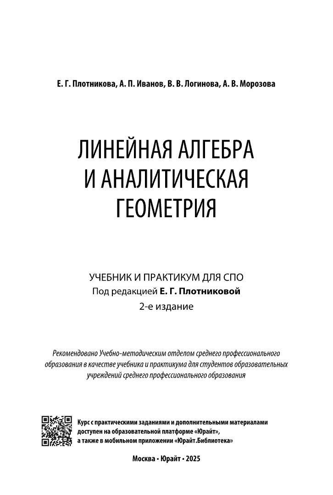

---

PDF стр. 3 ^p003

УДК 51(075.32)
ББК 22.1я723
Л59

***Авторы:***

**Плотникова Евгения Григорьевна** — доктор педагогических наук, профессор, заведующая кафедрой «Информационные технологии в бизнесе» Национального исследовательского университета «Высшая школа экономики»;

**Иванов Анатолий Прокопьевич** — кандидат физико-математических наук, ординарный профессор, профессор кафедры «Информационные технологии в бизнесе» Национального исследовательского университета «Высшая школа экономики»;

**Логинова Валерия Валерьевна** — кандидат педагогических наук, доцент кафедры «Информационные технологии в бизнесе» Национального исследовательского университета «Высшая школа экономики»;

**Морозова Алена Витальевна** — старший преподаватель кафедры «Информационные технологии в бизнесе» Национального исследовательского университета «Высшая школа экономики».

***Рецензенты:***

*Абдуллаев А. Р.* — доктор физико-математических наук, профессор, заведующий кафедрой высшей математики Пермского государственного национального исследовательского политехнического университета;

*Панов В. Ф.* — доктор физико-математических наук, профессор кафедры высшей математики механико-математического факультета Пермского государственного национального исследовательского университета.

**Плотникова, Е. Г.**

Л59 Линейная алгебра и аналитическая геометрия : учебник и практикум для среднего профессионального образования / Е. Г. Плотникова, А. П. Иванов, В. В. Логинова, А. В. Морозова ; под редакцией Е. Г. Плотниковой. — 2-е изд. — Москва : Издательство Юрайт, 2025. — 416 с. — (Профессиональное образование). — Текст : непосредственный.

ISBN 978-5-534-18888-2

Данный курс предназначен в помощь учащимся, изучающим линейную алгебру и аналитическую геометрию в качестве базовой дисциплины математического и научного цикла. В простой и наглядной форме изложены основные математические понятия, методы решения задач. Каждая тема содержит необходимый теоретический материал, иллюстрированный примерами, контрольные вопросы, задания для самостоятельного решения. Отдельные подтемы посвящены экономическим приложениям рассмотренных математических понятий и методов.

Главной отличительной особенностью курса является большой банк тестовых заданий, которые можно использовать для организации как аудиторной, так и внеаудиторной самостоятельной работы учащихся, а также для контроля знаний, в том числе автоматизированного.

Соответствует актуальным требованиям федерального государственного образовательного стандарта среднего профессионального образования и профессиональным требованиям.

*Для студентов образовательных учреждений среднего профессионального образования экономических и других специальностей, а также преподавателей и лиц, занимающихся самообразованием.*

УДК 51(075.32)
ББК 22.1я723

*Все права защищены. Никакая часть данной книги не может быть воспроизведена в какой бы то ни было форме без письменного разрешения владельцев авторских прав.*

ISBN 978-5-534-18888-2

© Плотникова Е. Г., Иванов А. П., Логинова В. В., Морозова А. В., 2024
© Плотникова Е. Г., Иванов А. П., Логинова В. В., Морозова А. В., 2024, с изменениями
© ООО «Издательство Юрайт», 2025

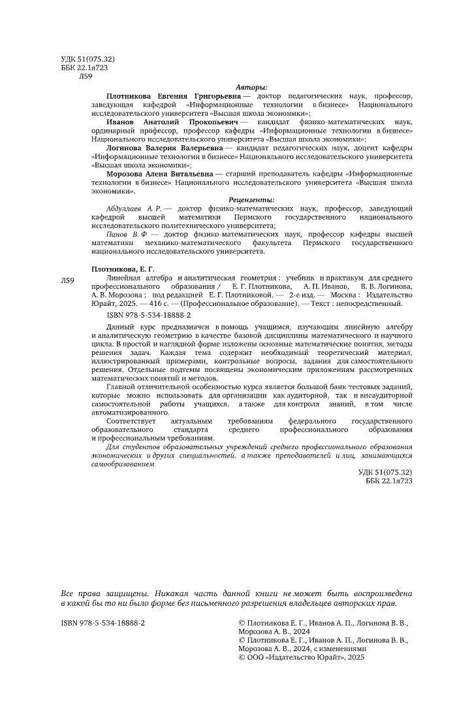

---

PDF стр. 4 ^p004

# Предисловие от редакции

Данный учебник является малой частью обширного курса. Мы рекомендуем вам обратиться к полному набору учебных материалов, доступных на Образовательной платформе «Юрайт».

На платформе вы найдете тесты, интерактивные задания и другие дополнительные ресурсы для самостоятельного обучения, которые помогут вам углубить свои знания и навыки.

Не упустите шанс максимально использовать все доступные возможности для успешного освоения дисциплины!

> [!info] Схема: Групповая работа
> - Тесты / Задания / Экзамены
> - Аудио / Видео / Ссылки
> - **Этот учебник** = Лекции на платформе
> - Конструктор курсов
> - Шаблоны рабочих программ
> - Входное тестирование · Тотальный экзамен · Конституционный экзамен · Культурный уровень
> - Мобильное приложение · Интеграция с MOODLE
>
> Значки: 👥 — для студентов; 🧑‍🏫 — для преподавателей

[QR-код]

**ОБРАЗОВАТЕЛЬНАЯ ПЛАТФОРМА «ЮРАЙТ»**

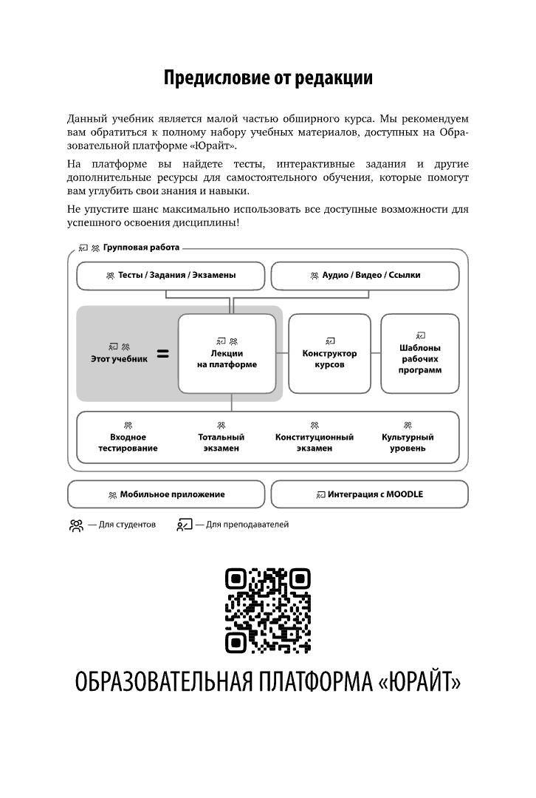

---

PDF стр. 5 ^p005

# Преподавателю

**Работа с курсом на Образовательной платформе Юрайт**

## Создавайте группу студентов и назначайте им курсы

[QR-код: Группы студентов]

Группы помогут вам в обучении и аттестации студентов на нашей платформе. Вы сможете:
— получать результаты тестов студентов по назначенным курсам;
— выдавать студентам задания для самостоятельной работы;
— проводить промежуточную и итоговую аттестацию;
— смотреть цифровую активность студентов группы на платформе.

**Работа с группами студентов:**
— группу можно создать в разделе личного кабинета Преподавателя «Группы студентов»;
— добавить студентов в группу можно по ФИО, адресу электронной почты или загрузить их списком Excel;
— назначить курс группе можно на странице любого курса на платформе.

## Выдавайте студентам тесты

[QR-код: Тесты]

Наши тесты помогут вам быстро проверить знания ваших студентов:
— проверяйте знания по конкретным темам или по всему курсу, указывайте сроки и количество попыток;
— выдавайте тесты студентам индивидуально или всей группе;
— платформа автоматически проверит ответы и пришлет вам результаты в личный кабинет;
— используйте анализ тестов, чтобы узнать с какими вопросами и темами у студентов проблемы;
— после прохождения теста студенты получат индивидуальные рекомендации и смогут сразу перейти к повторению нужных тем.

**Работа с тестами:**
— результаты тестов доступны в разделе личного кабинета Преподавателя «Результаты тестов студентов»;
— выдать тест можно на странице любого курса, который содержит тесты.

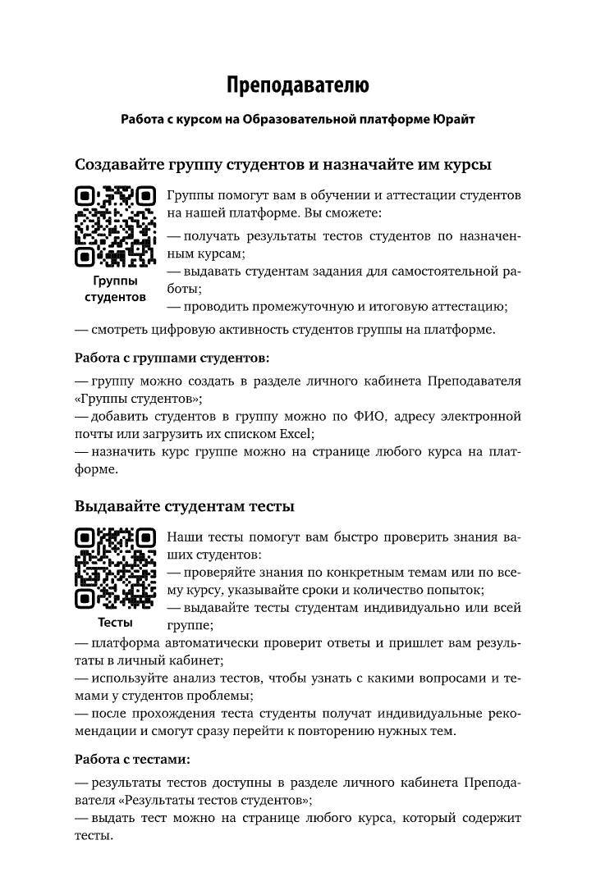

---

PDF стр. 6 ^p006

## Выдавайте студентам задания для самостоятельной работы

[QR-код: Задания]

Задания помогут вам с подбором образовательных задач, которые структурируют самостоятельную работу студентов в онлайне, делают ее интерактивной, разнообразной и удобной:
— на платформе доступно 28 видов заданий для формирования профессиональных навыков студентов, в том числе кейсы, деловые игры и групповые дебаты;
— студенты могут выполнять задания как индивидуально, так и работая в команде;
— указывайте сроки и критерии выполнения самостоятельной работы;
— общайтесь со студентами и отвечайте на вопросы во время выполнения задания с помощью комментариев;
— отправляйте на доработку сданные работы, которые выполнены не полностью или не соответствуют критериям.

**Работа с заданиями:**
— результаты самостоятельной работы студентов доступны в разделе личного кабинета Преподавателя «Задания»;
— выдать студентам самостоятельную работу можно на странице любого курса, который содержит задания.

## Проводите со студентами промежуточную и итоговую аттестацию

[QR-код: Экзамены]

Сервис «Экзамен» поможет вам просто и оперативно провести зачеты и экзамены в онлайне:
— назначайте экзамен из одной или двух частей: тестовой и заданий, требующих развернутого ответа;
— выбирайте только необходимые вам для контроля темы курса;
— по окончании экзамена получайте цифровую ведомость, которую можно выгрузить в Excel;
— назначайте пересдачу для студентов с плохими результатами или пропустивших экзамен.

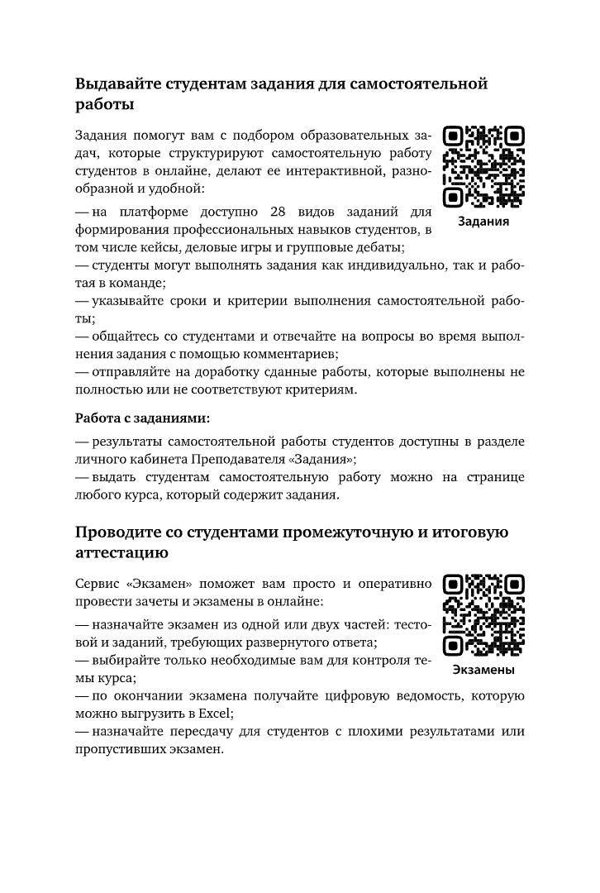

---

PDF стр. 7 ^p007

**Работа с экзаменами:**
— результаты экзаменов доступны в разделе личного кабинета Преподавателя «Экзамены»;
— назначить студентам экзамен можно на странице любого курса, который подходит для экзамена.

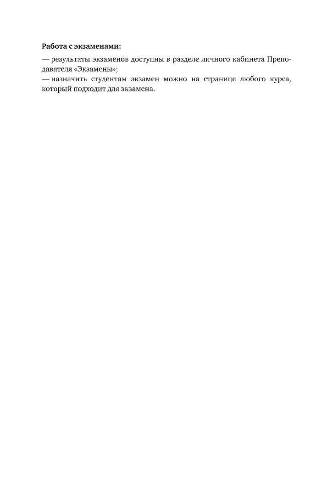

---

PDF стр. 8 · стр. книги 1 ^p008

# Студенту

**Работа с курсом на Образовательной платформе Юрайт**

## Добавляйтесь в группу к своему преподавателю

[QR-код: Мои преподаватели]

Группы помогут вам полноценно изучать курсы, назначенные преподавателем, и пользоваться сервисами платформы:
— смотрите список своих преподавателей и курсы, которые они вам назначили;
— переходите в чат группы в социальных сетях при наличии в группе ссылки на него;
— делитесь быстро результатами тестов с преподавателем;
— выполняйте задания, выданные преподавателем;
— проходите экзамен, назначенный преподавателем.

**Как добавиться в группу преподавателя:**
— после регистрации и авторизации на платформе получите ссылку на группу от преподавателя и перейдите по ней;
— преподавателя можно добавить в разделе личного кабинета Студента «Преподаватели».

## Проходите тесты

[QR-код: Тесты]

Тесты в наших курсах помогут вам проверить знания по различным дисциплинам:
— проверяйте знания по конкретным темам или по всему курсу;
— после прохождения теста получайте индивидуальные рекомендации и сразу переходите к повторению нужных тем;
— платформа автоматически проверит ответы и пришлет вам результаты в личный кабинет;
— делитесь результатами тестов с преподавателем и с сокурсниками в соцсетях.

**Работа с тестами:**
— пройти тест можно на странице любого курса, который содержит тесты;
— результаты тестов доступны в разделе личного кабинета Студента «Тесты».

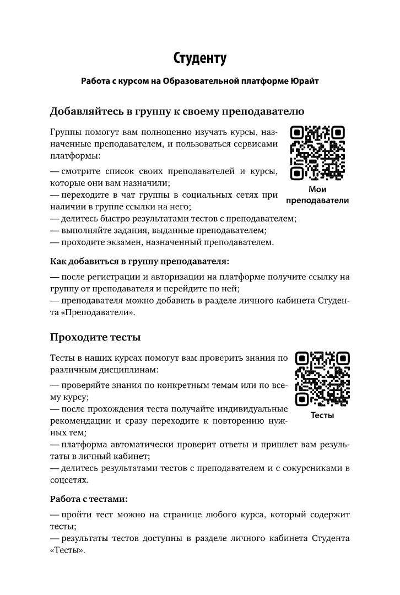

---

PDF стр. 9 · стр. книги 2 ^p009

## Выполняйте задания

[QR-код: Задания]

Задания помогут развить навыки, востребованные на рынке труда:
— на платформе доступны различные типы заданий для формирования профессиональных навыков;
— выполняйте выданные преподавателем задания индивидуально или в команде с другими студентами и одногруппниками;
— общайтесь с преподавателем и отвечайте на вопросы во время выполнения задания с помощью прикрепления файлов и комментариев;
— получайте обратную связь и оценку знаний.

**Работа с заданиями:**
— вы можете получить самостоятельную работу от преподавателя на основе материалов любого курса, который содержит задания;
— результаты доступны в разделе личного кабинета Студента «Задания».

## Проходите промежуточную и итоговую аттестации

[QR-код: Экзамены]

Сервис «Экзамен» поможет вам просто и оперативно сдать зачеты и экзамены дистанционно:
— сдавайте экзамен в спокойной домашней обстановке;
— счетчик покажет, сколько осталось времени на экзамен;
— оставляйте ответы на платформе или прикрепляйте файлы.

**Работа с экзаменами:**
— о назначении экзамена вам придет уведомление с датой и временем на сайте и на почту;
— в назначенное время вы сможете начать проходить экзамен;
— ответьте на тестовую часть экзамена и прикрепите развернутый ответ на вторую часть экзамена в окошке на платформе;
— система автоматически проверит ваши ответы на первую часть экзамена;
— преподаватель проверит ответы второй части и выставит оценку за обе части;
— результаты экзаменов доступны в разделе личного кабинета Студента «Экзамены».

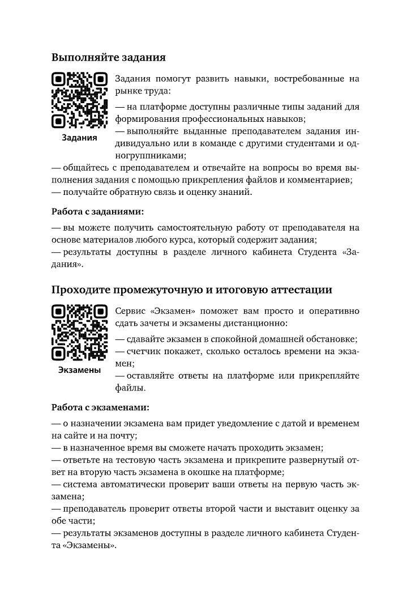

---

PDF стр. 10 · стр. книги 3 ^p010

# Оглавление

| Раздел | Стр. |
|---|---:|
| **Авторский коллектив** | **7** |
| **Предисловие** | **8** |
| **Введение** | **11** |
| **Тема 1. Алгебра матриц** | **12** |
| 1.1. Матрицы | 12 |
| &emsp;1.1.1. Определение и виды матриц | 12 |
| &emsp;1.1.2. Операции над матрицами | 15 |
| 1.2. Определители | 20 |
| &emsp;1.2.1. Формулы для вычисления определителей | 20 |
| &emsp;1.2.2. Свойства определителей | 27 |
| 1.3. Ранг матрицы. Эквивалентные преобразования матриц | 29 |
| &emsp;1.3.1. Ранг матрицы | 29 |
| &emsp;1.3.2. Эквивалентные преобразования матриц | 31 |
| &emsp;1.3.3. Линейная зависимость строк (столбцов) матрицы | 32 |
| 1.4. Обратная матрица | 33 |
| 1.5. Использование алгебры матриц в решении экономических задач | 39 |
| *Вопросы и задания для повторения* | 41 |
| *Задания для самостоятельного решения* | 42 |
| *Список рекомендуемой литературы* | 46 |
| **Тема 2. Системы линейных уравнений** | **47** |
| 2.1. Основные определения и исследование системы линейных уравнений | 48 |
| 2.2. Нахождение единственного решения системы линейных уравнений | 51 |
| 2.3. Общий подход к решению систем линейных уравнений | 57 |
| 2.4. Однородные системы линейных уравнений | 58 |
| 2.5. Системы линейных уравнений в решении экономических задач. Модель межотраслевого баланса Леонтьева | 61 |
| *Вопросы и задания для повторения* | 71 |
| *Задания для самостоятельного решения* | 71 |
| *Список рекомендуемой литературы* | 75 |
| **Тема 3. Векторная алгебра** | **76** |
| 3.1. Геометрические векторы на плоскости и в пространстве | 77 |
| 3.2. Линейные векторные пространства | 94 |
| 3.3. Евклидово пространство | 101 |

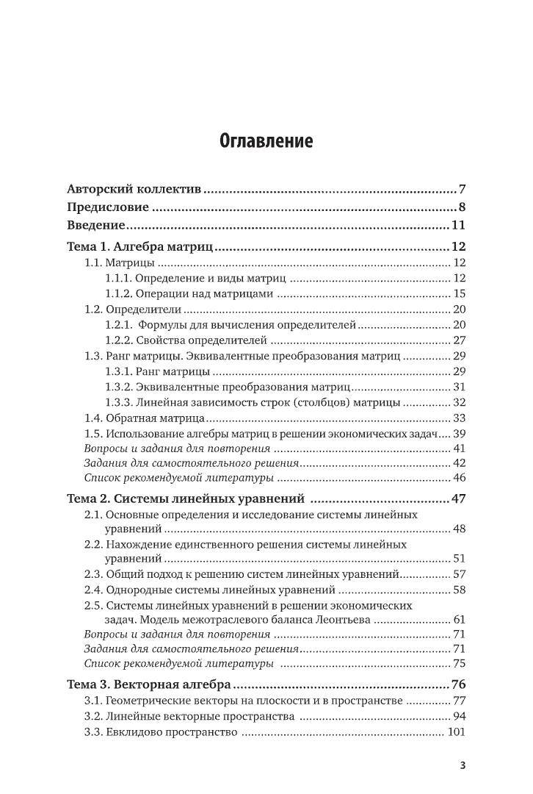

---

PDF стр. 11 · стр. книги 4 ^p011

| Раздел | Стр. |
|---|---:|
| 3.4. Использование векторной алгебры в решении экономических задач | 103 |
| *Вопросы и задания для повторения* | 106 |
| *Задания для самостоятельного решения* | 107 |
| *Список рекомендуемой литературы* | 111 |
| **Тема 4. Линейные операторы** | **113** |
| 4.1. Линейные преобразования и операторы | 114 |
| 4.2. Собственные значения и собственные векторы линейного оператора | 119 |
| 4.3. Квадратичные формы | 126 |
| 4.4. Линейная модель обмена | 138 |
| *Вопросы и задания для повторения* | 140 |
| *Задания для самостоятельного решения* | 140 |
| *Список рекомендуемой литературы* | 143 |
| **Тема 5. Элементы аналитической геометрии** | **144** |
| 5.1. Прямая на плоскости | 145 |
| 5.2. Кривые второго порядка | 155 |
| 5.3. Плоскость | 166 |
| 5.4. Прямая в пространстве | 175 |
| 5.5. Поверхности второго порядка | 185 |
| 5.6. Использование аналитической геометрии в решении экономических задач | 199 |
| 5.7. Некоторые «замечательные кривые» | 203 |
| *Вопросы и задания для повторения* | 212 |
| *Задания для самостоятельного решения* | 212 |
| *Список рекомендуемой литературы* | 217 |
| **Тема 6. Системы координат на плоскости и в пространстве** | **218** |
| 6.1. Полярная система координат | 218 |
| 6.2. Кривые второго порядка в полярной системе координат | 225 |
| 6.3. Цилиндрическая система координат | 227 |
| 6.4. Сферическая система координат | 229 |
| 6.5. Параметрическая система координат | 231 |
| *Вопросы и задания для повторения* | 234 |
| *Задания для самостоятельного решения* | 235 |
| *Список рекомендуемой литературы* | 236 |
| **Тема 7. Числовые множества** | **237** |
| 7.1. Основные определения, способы задания, операции над множествами | 237 |
| 7.2. Множество действительных чисел | 239 |
| 7.3. Множество комплексных чисел. Действия над комплексными числами | 240 |
| *Вопросы и задания для повторения* | 248 |
| *Задания для самостоятельного решения* | 248 |
| *Список рекомендуемой литературы* | 251 |

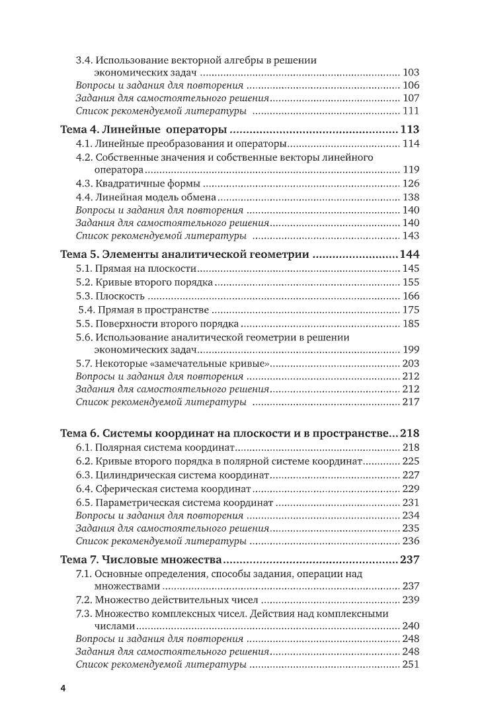

---

PDF стр. 12 · стр. книги 5 ^p012

## ТЕСТЫ

| Раздел | Стр. |
|---|---:|
| **Тесты к теме 1** | **255** |
| Тест «Матрицы» | 255 |
| Тест «Определители» | 265 |
| Тест «Ранг матрицы. Эквивалентные преобразования матриц» | 272 |
| Тест «Обратная матрица» | 281 |
| **Тесты к теме 2** | **289** |
| Тест «Основные определения и исследование системы линейных уравнений» | 289 |
| Тест «Системы линейных уравнений в решении экономических задач. Модель межотраслевого баланса Леонтьева» | 298 |
| **Тесты к теме 3** | **312** |
| Тест «Геометрические векторы на плоскости» | 312 |
| Тест «Геометрические векторы в пространстве» | 320 |
| Тест «Линейные векторные пространства. Евклидовы пространства» | 330 |
| **Тесты к теме 4** | **338** |
| Тест «Линейные преобразования и операторы. Собственные значения и собственные векторы линейного оператора» | 338 |
| Тест «Квадратичные формы» | 348 |
| **Тесты к теме 5** | **357** |
| Тест «Прямая на плоскости» | 357 |
| Тест «Кривые второго порядка» | 368 |
| Тест «Плоскость» | 377 |
| Тест «Прямая в пространстве» | 388 |
| **Тесты к теме 6** | **398** |
| Тест «Системы координат на плоскости и в пространстве» | 398 |
| **Тесты к теме 7** | **408** |
| Тест «Комплексные числа» | 408 |
| **Литература** | **416** |

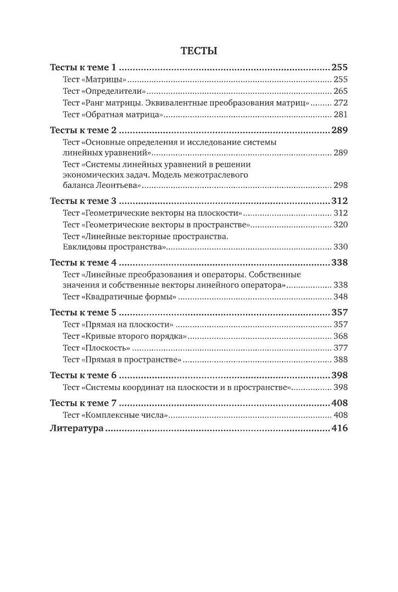

---

PDF стр. 13 · стр. книги 6 ^p013

*(пустая страница)*

---

PDF стр. 14 · стр. книги 7 ^p014

# Авторский коллектив

**Плотникова Евгения Григорьевна** — доктор педагогических наук, профессор, заведующая кафедрой «Информационные технологии в бизнесе» Национального исследовательского университета «Высшая школа экономики»;

**Иванов Анатолий Прокопьевич** — кандидат физико-математических наук, ординарный профессор, профессор кафедры «Информационные технологии в бизнесе» Национального исследовательского университета «Высшая школа экономики»;

**Логинова Валерия Валерьевна** — кандидат педагогических наук, доцент кафедры «Информационные технологии в бизнесе» Национального исследовательского университета «Высшая школа экономики»;

**Морозова Алена Витальевна** — старший преподаватель кафедры «Информационные технологии в бизнесе» Национального исследовательского университета «Высшая школа экономики».

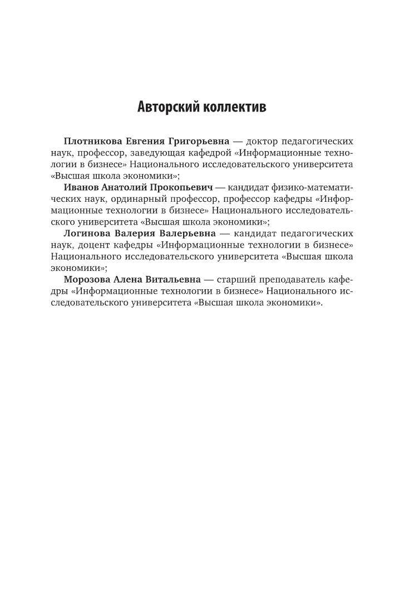

---

PDF стр. 15 · стр. книги 8 ^p015

# Предисловие

Современный компетентностный подход к обучению предполагает практическую направленность изучения математических дисциплин. Федеральными государственными образовательными стандартами среднего образования различных направлений подготовки бакалавра определено, что обучающиеся в результате изучения дисциплин математического цикла должны знать основные понятия и инструменты математических дисциплин, необходимые для решения экономических задач и принятия управленческих решений; уметь использовать математический аппарат для построения экономических и организационно-управленческих моделей, их теоретического и экспериментального исследования; владеть навыками применения современного математического инструментария для решения экономических задач, методикой построения, анализа и применения математических моделей для оценки состояния и прогноза развития экономических явлений и процессов, математическими методами решения типовых организационно-управленческих задач.

Линейная алгебра является базовой дисциплиной математического и научного цикла. В результате освоения этой дисциплины студент должен освоить:

***трудовые действия***
- навыки применения аппарата линейной алгебры и аналитической геометрии к решению экономических задач;

***необходимые уметь***
- выполнять типовые математические задания разделов дисциплины;
- осуществлять выбор методов линейной алгебры и аналитической геометрии, необходимых для решения экономических задач;
- анализировать результаты расчетов и обосновывать полученные выводы;

***необходимые знания***
- алгебра матриц;
- методы исследования и решения систем линейных уравнений;
- элементы векторного анализа;
- линейные преобразования и операторы;
- основы аналитической геометрии.

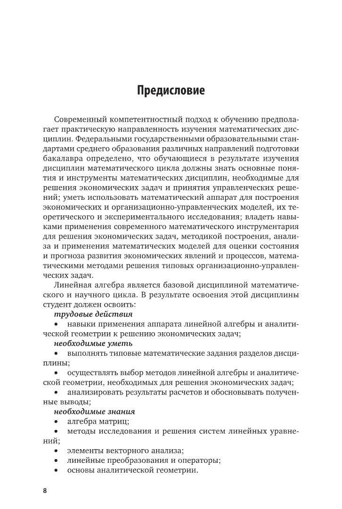

---

PDF стр. 16 · стр. книги 9 ^p016

Данный курс предназначен в помощь студентам различных направлений подготовки, изучающим линейную алгебру и аналитическую геометрию. Авторы преследовали цель — в простой и наглядной форме изложить основные математические понятия дисциплины, ее методы и подходы к решению задач, а также создать дидактический комплекс заданий для активизации самостоятельной работы студентов.

Темы курса представляют основные разделы линейной алгебры и аналитической геометрии. В курсе приводится необходимый теоретический материал, при этом понятия, определения, методы иллюстрируются большим количеством примеров. Отдельная подтема каждой темы посвящается экономическим приложениям рассмотренных понятий и методов. В конце тем содержатся вопросы для повторения и задания для самостоятельного решения, список рекомендуемой литературы. Кроме того, для систематизации знаний, а также для организации самостоятельной работы студентов по каждой теме приведены наборы тематических тестов.

Главной отличительной особенностью наборов тестовых заданий является то, что они полностью охватывают учебные темы дисциплины, а кроме того, все темы представлены тестами трех уровней сложности. При этом тест каждого уровня предлагается в двух вариантах и состоит из 10 или 15 заданий. Задания в вариантах расположены по принципу параллельности, а также по возрастанию уровня сложности.

Новым является используемый подход к построению тестов и выделению уровней сложности. Первый уровень сложности предназначен для отработки базовых математических умений, задания этого уровня, как правило, выполняются в одно действие. Второй уровень содержит более сложные задания, для выполнения которых необходимо несколько действий и знание технологии решения стандартных учебных задач. В тесты третьего уровня включаются нестандартные задания, а также прикладные, профессионально-ориентированные задачи, предполагающие актуализацию полученных знаний и активизацию мыслительной деятельности студентов в процессе их решения. Банк данных тестовых заданий апробирован в ходе многолетней практической деятельности преподавателями кафедры высшей математики и кафедры «Информационные технологии в бизнесе» Национального исследовательского университета «Высшая школа экономики» и других вузов г. Перми.

В курс включены следующие темы: алгебра матриц (А. В. Морозова, Е. Г. Плотникова), системы линейных уравнений (А. В. Морозова, Е. Г. Плотникова), векторная алгебра (В. В. Логинова, Е. Г. Плотникова), линейные операторы (А. П. Иванов, Е. Г. Плотникова), элементы аналитической геометрии (В. В. Логинова, Е. Г. Плотникова), системы координат на плоскости и в пространстве (В. В. Ло-

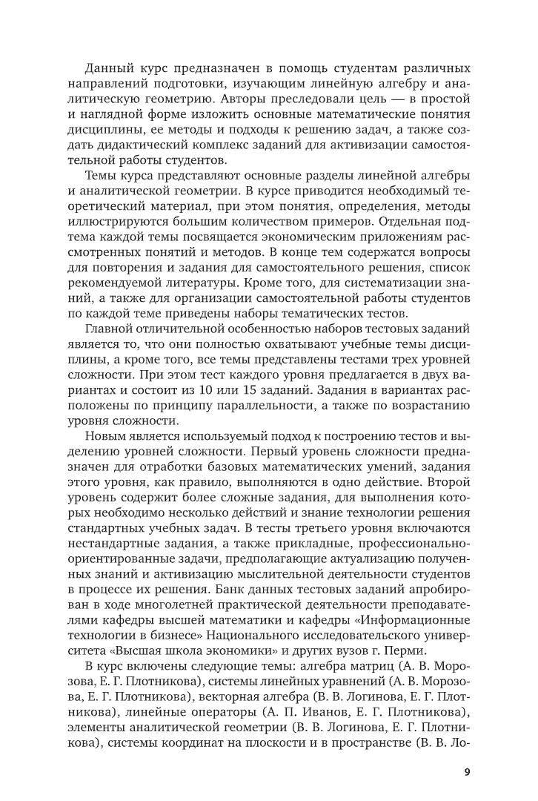

---

PDF стр. 17 · стр. книги 10 ^p017

гинова, Е. Г. Плотникова), числовые множества (В. В. Логинова, Е. Г. Плотникова).

Курс соответствует учебным программам направлений подготовки «Экономика», «Менеджмент», «Программная инженерия», «Бизнес-информатика», он также будет полезен студентам других направлений, магистрам, аспирантам, изучающим «Линейную алгебру», «Высшую математику», и преподавателям этих дисциплин.

Авторы выражают глубокую благодарность В. Ф. Селезневу и Е. Н. Остапенко за техническую помощь в работе над курсом.

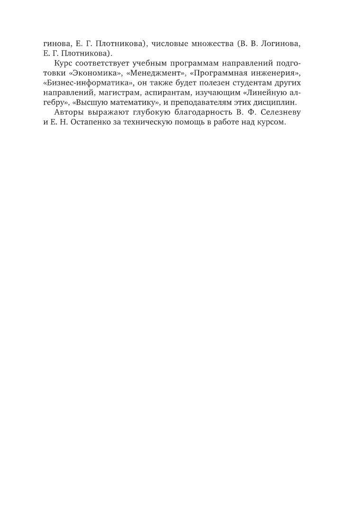

---

PDF стр. 18 · стр. книги 11 ^p018

# Введение

В середине XVII в. французские математики Рене Декарт (1596—1650) и Пьер Ферма (1601—1665) создали аналитическую геометрию — раздел математики, в котором геометрические фигуры на координатной плоскости или в координатном пространстве описываются алгебраическими уравнениями, а геометрические задачи решаются алгебраическими методами.

В связи с изучением линейных уравнений как уравнений прямых и плоскостей зарождается линейная алгебра. В дальнейшем необходимость исследования и решения систем линейных уравнений приводит к появлению понятий определителя и матрицы, разрабатываются теория определителей и алгебра матриц. В конце XIX в. построение общей теории систем линейных уравнений было завершено.

В XX в. центральное положение в линейной алгебре занимают понятия векторных пространств и связанных с ними линейных преобразований (операторов), разрабатываются также понятия линейных, билинейных и квадратичных форм.

В настоящее время методы линейной алгебры широко применяются при построении моделей изучаемых явлений и решении самых разнообразных практических задач. Линейная алгебра является основой современных численных методов, аппарат линейной алгебры позволяет в компактной форме представлять фундаментальные законы различной природы (физической, экономической и т. п.). Таким образом, линейная алгебра является наиболее важной с точки зрения приложений частью алгебры, изучающей объекты линейной природы: системы линейных уравнений, векторные (линейные) пространства, линейные отображения (операторы), линейные, билинейные и квадратичные формы. Кроме того, линейная алгебра является аппаратом изучения аналитической геометрии.

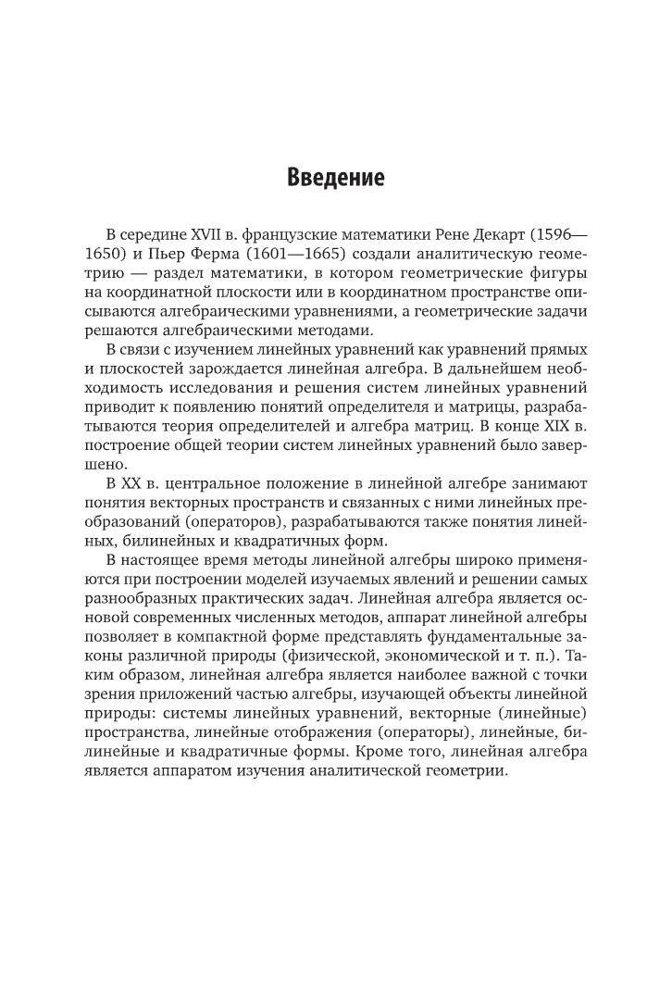

---

PDF стр. 19 · стр. книги 12 ^p019

# Тема 1. АЛГЕБРА МАТРИЦ

При решении многих практических, в том числе экономических, задач используются матрицы как наиболее удобный способ хранения, передачи и обработки информации. Данная тема представляет алгебру матриц, в результате изучения которой обучаемые должны:

***знать***
- определение и виды матриц;
- действия над матрицами и их свойства;
- определение, вычисление и свойства определителей, теорему Лапласа;
- определение, вычисление и свойства обратной матрицы;
- определение и свойства ранга матрицы;

***уметь***
- определять характеристики матриц;
- выполнять действия над матрицами;
- вычислять значение многочлена от матрицы;
- определять взаимообратные матрицы;
- вычислять определители любого порядка;
- выполнять элементарные преобразования строк (столбцов) матрицы;
- находить ранг матрицы;

***владеть***
- методикой определения перестановочных матриц;
- методикой определения присоединенной матрицы;
- методикой разложения определителя по строке (столбцу);
- навыками вычисления определителей с использованием их свойств;
- алгоритмами нахождения обратной матрицы;
- алгоритмами нахождения ранга матрицы;
- навыками использования алгебры матриц в решении экономических задач.

## 1.1. Матрицы

### 1.1.1. Определение и виды матриц

Прямоугольная таблица вида

$$
A_{m\times n}=\begin{pmatrix} a_{11} & a_{12} & \dots & a_{1n}\\ a_{21} & a_{22} & \dots & a_{2n}\\ \dots & \dots & \dots & \dots\\ a_{m1} & a_{m2} & \dots & a_{mn}\end{pmatrix},
$$

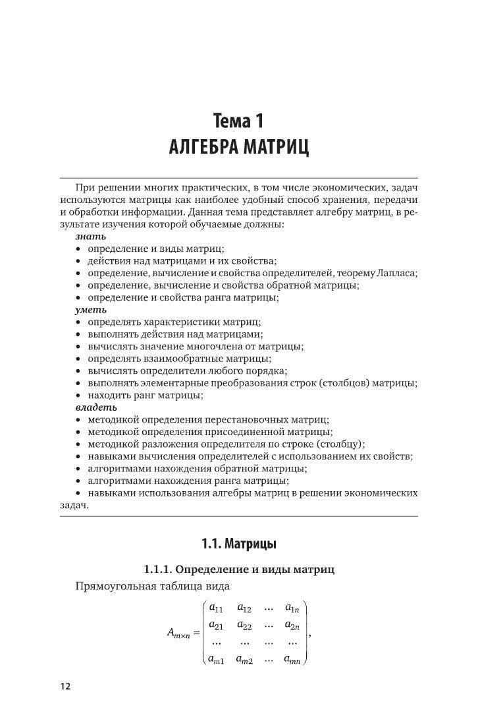

---

PDF стр. 20 · стр. книги 13 ^p020

или в сокращенной записи $A=[a_{ij}]_{m\times n}$, называется *матрицей* размерности $m\times n$ ($m$ — количество строк, $n$ — количество столбцов), где $a_{ij}$ — *элементы* матрицы ($i=1,2,\dots,m$; $j=1,2,\dots,n$). Традиционно матрицы обозначаются прописными буквами латинского алфавита $A, B, C, \dots$, при этом индексы, указывающие на размерность матрицы ($m\times n$), могут быть прописаны, а могут опускаться. Элементы матрицы обозначаются соответствующими строчными буквами $a_{ij}, b_{ij}, c_{ij}, \dots$ . Индексы указывают на положение элемента в матрице: $i$ — номер строки, $j$ — номер столбца, на пересечении которых расположен элемент. Например, матрица $A=\begin{pmatrix}2&3&-1\\4&0&-2\end{pmatrix}$ содержит две строки и три столбца, следовательно, ее размерность $2\times3$. Элемент этой матрицы $a_{23}=-2$.

Определим основные виды матриц.

Две матрицы $A=[a_{ij}]_{m\times n}$ и $B=[b_{ij}]_{m\times n}$ одинаковой размерности называются *равными*, если совпадают их соответствующие элементы, т. е. $a_{ij}=b_{ij}$ для любых $i=1,2,\dots,m$ и $j=1,2,\dots,n$.

Если количество строк совпадает с количеством столбцов, то матрица

$$
A_{n\times n}=\begin{pmatrix} a_{11} & a_{12} & \dots & a_{1n}\\ a_{21} & a_{22} & \dots & a_{2n}\\ \dots & \dots & \dots & \dots\\ a_{n1} & a_{n2} & \dots & a_{nn}\end{pmatrix}
$$

называется квадратной порядка $n$.

Элементы $a_{11}, a_{22}, \dots, a_{nn}$ квадратной матрицы образуют ее *главную диагональ*, а элементы $a_{1n}, a_{2n-1}, \dots, a_{n1}$ — *побочную диагональ*. Так, матрица $A=\begin{pmatrix}2&1&0\\-3&4&5\\-1&1&2\end{pmatrix}$ — квадратная 3-го порядка. Ее главную диагональ образуют числа 2, 4, 2, а побочную — 0, 4, −1.

Матрица называется *нулевой* (обозначается обычно $O$), если все ее элементы нулевые.

Квадратная матрица называется *диагональной*, если все ее элементы, стоящие вне главной диагонали, равны нулю. Пример:

$$
A=\begin{pmatrix}2&0&0\\0&3&0\\0&0&-1\end{pmatrix}.
$$

Диагональная матрица $E$ называется *единичной*, если все элементы ее главной диагонали равны единице.

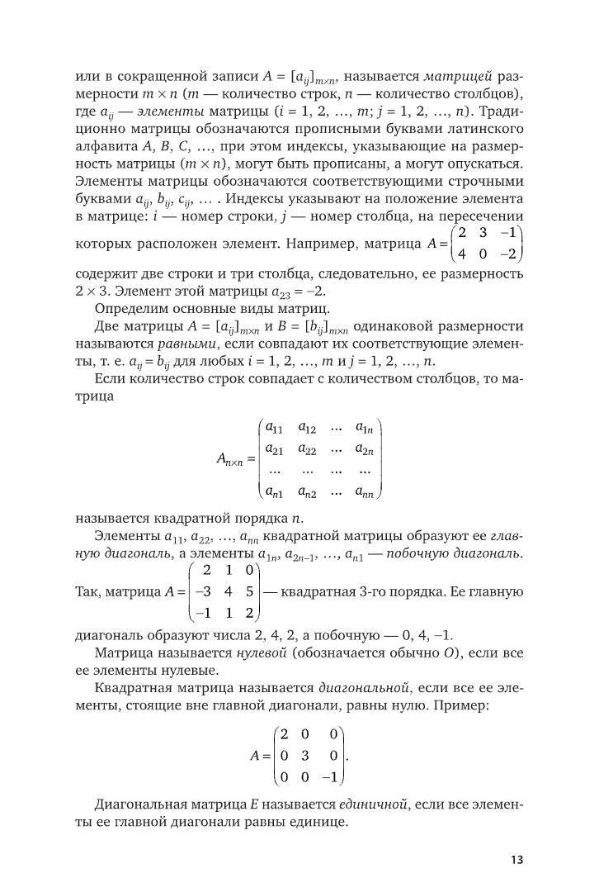

---

PDF стр. 21 · стр. книги 14 ^p021

Пример:

$$
E=\begin{pmatrix}1&0&0\\0&1&0\\0&0&1\end{pmatrix}.
$$

Квадратная матрица $A=[a_{ij}]_{n\times n}$ называется *симметричной*, если относительно главной диагонали для всех ее элементов выполняется условие $a_{ij}=a_{ji}$, $i,j=1,2,\dots,n$. Пример:

$$
A=\begin{pmatrix}2&3&1\\3&0&4\\1&4&-1\end{pmatrix}.
$$

*Следом* квадратной матрицы $A=[a_{ij}]_{n\times n}$ является число $\operatorname{tr}A$, полученное путем сложения всех элементов матрицы $A$, стоящих по главной диагонали: $\operatorname{tr}A=\sum\limits_{i=1}^{n}a_{ii}$, $i=1,2,\dots,n$. Например, след матрицы $A=\begin{pmatrix}2&4\\-1&0\end{pmatrix}$ равен $\operatorname{tr}A=2+0=2$.

Квадратные матрицы, все элементы которых ниже или выше главной диагонали равны нулю, называются *треугольными*. Различают *верхнетреугольные* и *нижнетреугольные* матрицы. Так, матрица вида

$$
A=\begin{pmatrix} a_{11} & a_{12} & \dots & a_{1n}\\ 0 & a_{22} & \dots & a_{2n}\\ \dots & \dots & \dots & \dots\\ 0 & 0 & \dots & a_{nn}\end{pmatrix}
$$

является *верхнетреугольной*.

Прямоугольная матрица вида

$$
A=\begin{pmatrix} a_{11} & a_{12} & \dots & a_{1m} & \dots & a_{1n}\\ 0 & a_{22} & \dots & a_{2m} & \dots & a_{2n}\\ \dots & \dots & \dots & \dots & \dots & \dots\\ 0 & 0 & \dots & a_{mm} & \dots & a_{mn}\end{pmatrix}
$$

называется *квазитреугольной* (ступенчатой или трапециевидной).

Матрица, состоящая из одной строки, называется *матрицей-строкой* или *строчной матрицей*: $A=(a_{11}\ \ a_{12}\ \ \dots\ \ a_{1n})$.

Матрица, состоящая из одного столбца, называется *матрицей-столбцом* или *столбцевой матрицей*: $A=\begin{pmatrix}a_{11}\\a_{21}\\\dots\\a_{m1}\end{pmatrix}$.

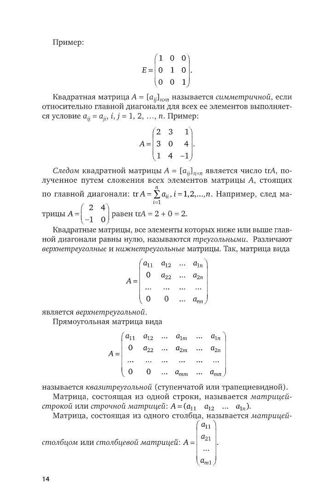

---

PDF стр. 22 · стр. книги 15 ^p022

### 1.1.2. Операции над матрицами

Над матрицами выполняются следующие операции: сложения, вычитания, умножения на число, транспонирования. Определим каждую операцию из перечисленных.

**1.** *Умножением матрицы $A=[a_{ij}]_{m\times n}$ на действительное число* $\lambda$ является матрица $B_{m\times n}=\lambda\cdot A_{m\times n}$, элементы которой вычисляются по формуле

$$
b_{ij}=\lambda a_{ij},\ i=1,2,\dots,m;\ j=1,2,\dots,n.
$$

Например:

$$
-5\cdot\begin{pmatrix}2&-3\\4&0\end{pmatrix}=\begin{pmatrix}-5\cdot2&-5\cdot(-3)\\-5\cdot4&-5\cdot0\end{pmatrix}=\begin{pmatrix}-10&15\\-20&0\end{pmatrix}.
$$

*Замечание 1.1.* Общий множитель всех элементов матрицы можно выносить за ее знак.

**2.** *Суммой матриц* $A=[a_{ij}]_{m\times n}$ и $B=[b_{ij}]_{m\times n}$ является матрица $C_{m\times n}=A_{m\times n}+B_{m\times n}$, элементы которой вычисляются по формуле

$$
c_{ij}=a_{ij}+b_{ij},\ i=1,2,\dots,m;\ j=1,2,\dots,n.
$$

Например:

$$
\begin{pmatrix}2&-3&4\\0&1&5\end{pmatrix}+\begin{pmatrix}3&1&6\\2&-1&3\end{pmatrix}=\begin{pmatrix}2+3&-3+1&4+6\\0+2&1+(-1)&5+3\end{pmatrix}=\begin{pmatrix}5&-2&10\\2&0&8\end{pmatrix}.
$$

**3.** *Вычитанием* из матрицы $A=[a_{ij}]_{m\times n}$ матрицы $B=[b_{ij}]_{m\times n}$ является матрица $C_{m\times n}=A_{m\times n}-B_{m\times n}=A_{m\times n}+(-1)\cdot B_{m\times n}$, элементы которой вычисляются по формуле

$$
c_{ij}=a_{ij}-b_{ij},\ i=1,2,\dots,m;\ j=1,2,\dots,n.
$$

Например:

$$
\begin{pmatrix}2&-3&4\\0&1&5\end{pmatrix}-\begin{pmatrix}3&1&6\\2&-1&3\end{pmatrix}=\begin{pmatrix}2-3&-3-1&4-6\\0-2&1-(-1)&5-3\end{pmatrix}=\begin{pmatrix}-1&-4&-2\\-2&2&2\end{pmatrix}.
$$

*Замечание 1.2.* Операции сложения и вычитания определены для матриц одинаковой размерности.

**4.** *Произведением матрицы $A=[a_{ij}]_{m\times k}$ на матрицу $B=[b_{ij}]_{k\times n}$* называется такая матрица $C_{m\times n}=A_{m\times k}\cdot B_{k\times n}$ (символ умножения можно опускать и писать $AB$), каждый элемент $c_{ij}$ которой равен сумме произведений элементов $i$-й строки матрицы $A$ на соответствующие элементы $j$-го столбца матрицы $B$, т. е.

$$
c_{ij}=a_{i1}b_{1j}+a_{i2}b_{2j}+\dots+a_{ik}b_{kj}=\sum_{s=1}^{k}a_{is}b_{sj},\ i=1,2,\dots,m;\ j=1,2,\dots,n.
$$

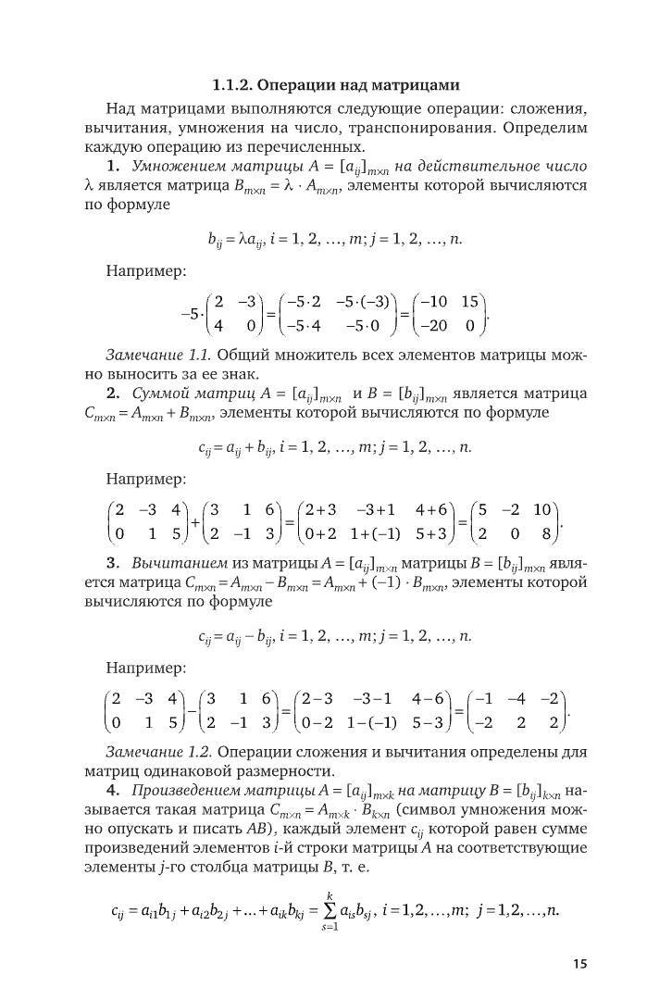

---

PDF стр. 23 · стр. книги 16 ^p023

Умножение матрицы $A$ на матрицу $B$ определено (*матрица $A$ согласована с матрицей $B$*), если число столбцов матрицы $A$ равно числу строк матрицы $B$.

Например:

$$
\begin{pmatrix}2&1\\3&0\end{pmatrix}\cdot\begin{pmatrix}4&-2\\2&1\end{pmatrix}=\begin{pmatrix}2\cdot4+1\cdot2&2\cdot(-2)+1\cdot1\\3\cdot4+0\cdot2&3\cdot(-2)+0\cdot1\end{pmatrix}=\begin{pmatrix}10&-3\\12&-6\end{pmatrix}.
$$

*Замечание 1.3.* Если произведение $A\cdot B$ существует, то произведение $B\cdot A$ может не существовать в силу несогласованности матриц.

Квадратные матрицы $A$ и $B$ называются *перестановочными* или *коммутативными*, если $AB=BA$.

Квадратные матрицы $A$ и $B$ одинаковых размерностей называются *взаимообратными*, если $AB=BA=E$.

Возведением квадратной матрицы $A$ в целую положительную степень $m$ ($m>1$, $m\in\mathbb{Z}$) является матрица $A^m=\underbrace{A\cdot A\cdot\ldots\cdot A}_{m\text{ раз}}$.

**5.** *Транспонированной* матрицей к матрице $A_{m\times n}$ является матрица $A^T$ размерности $n\times m$, которая получена из матрицы $A$ путем замены строк столбцами с сохранением их порядка:

$$
A^T=[a_{ij}]^T=[a_{ji}],\ i=1,2,\dots,m;\ j=1,2,\dots,n.
$$

Операции над матрицами обладают следующими свойствами, которые можно доказать по определениям:
1) $A+B=B+A$;
2) $(A+B)+C=A+(B+C)$;
3) $\lambda(A+B)=\lambda A+\lambda B$, где $\lambda\in\mathbb{R}$;
4) $A(B+C)=AB+AC$;
5) $(A+B)C=AC+BC$;
6) $C(AB)=(CA)B$;
7) $\lambda(AB)=(\lambda A)B=A(\lambda B)$, где $\lambda\in\mathbb{R}$;
8) $(A^T)^T=A$;
9) $(\lambda A)^T=\lambda A^T$, где $\lambda\in\mathbb{R}$;
10) $(A+B)^T=A^T+B^T$;
11) $(AB)^T=B^TA^T$.

Продемонстрируем дополнительно на примерах выполнение операций над матрицами.

**Пример 1.1**

Для матриц

$$
A=\begin{pmatrix}2&3\\0&4\\-4&9\end{pmatrix}\ \text{и}\ B=\begin{pmatrix}-5&6\\7&0\\-2&1\end{pmatrix}
$$

найдем $4B-7A$, $A^T$, $2A-3B^T$.

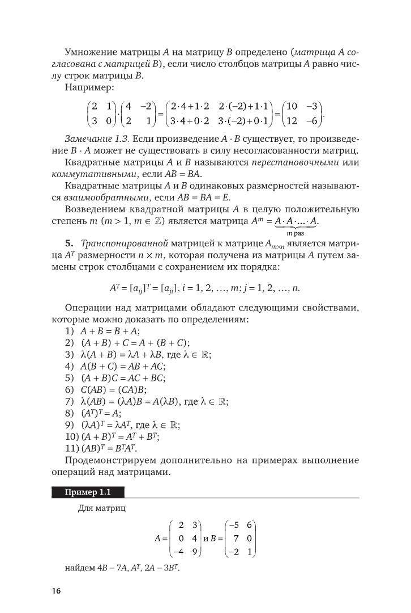

---

PDF стр. 24 · стр. книги 17 ^p024

*Решение*

1.
$$
4B-7A=4\cdot\begin{pmatrix}-5&6\\7&0\\-2&1\end{pmatrix}-7\cdot\begin{pmatrix}2&3\\0&4\\-4&9\end{pmatrix}=\begin{pmatrix}4\cdot(-5)-7\cdot2&4\cdot6-7\cdot3\\4\cdot7-7\cdot0&4\cdot0-7\cdot4\\4\cdot(-2)-7\cdot(-4)&4\cdot1-7\cdot9\end{pmatrix}=\begin{pmatrix}-34&3\\28&-28\\20&-59\end{pmatrix}.
$$

2.
$$
A^T=\begin{pmatrix}2&3\\0&4\\-4&9\end{pmatrix}^T=\begin{pmatrix}2&0&-4\\3&4&9\end{pmatrix}.
$$

3. Операция $2A-3B^T$ невозможна, так как матрица $2A$ имеет размерность $3\times2$, матрица $3B^T$ имеет размерность $2\times3$, а операция вычитания матриц возможна только для матриц одинаковых размерностей.

**Пример 1.2**

Для матриц $A=\begin{pmatrix}2&3\\0&4\\-4&9\end{pmatrix}$ и $B=\begin{pmatrix}-5&6\\7&0\\-2&1\end{pmatrix}$ найдем $AB$, $B^TA$, $A^TB^T$, $AA^T$, $A^2$, $\operatorname{tr}(AB^T)$.

*Решение*

1. Операция $AB$ невозможна, поскольку матрица $A_{3\times2}$ несогласована с матрицей $B_{3\times2}$, так как число столбцов матрицы $A$ (два столбца) не равно числу строк матрицы $B$ (три строки).

2. Операция $B^TA$ возможна, поскольку матрица $B^T_{2\times3}$ согласована с матрицей $A_{3\times2}$, $B^T_{2\times3}\cdot A_{3\times2}=C_{2\times2}$:

$$
B^TA=\begin{pmatrix}-5&6\\7&0\\-2&1\end{pmatrix}^T\cdot\begin{pmatrix}2&3\\0&4\\-4&9\end{pmatrix}=\begin{pmatrix}-5&7&-2\\6&0&1\end{pmatrix}\cdot\begin{pmatrix}2&3\\0&4\\-4&9\end{pmatrix}=
$$
$$
=\begin{pmatrix}(-5)\cdot2+7\cdot0+(-2)\cdot(-4)&(-5)\cdot3+7\cdot4+(-2)\cdot9\\6\cdot2+0\cdot0+1\cdot(-4)&6\cdot3+0\cdot4+1\cdot9\end{pmatrix}=\begin{pmatrix}-2&-5\\8&27\end{pmatrix}.
$$

3. Операция $A^TB^T$ невозможна, поскольку матрица $A^T_{2\times3}$ несогласована с матрицей $B^T_{2\times3}$.

4. Операция $AA^T$ возможна, поскольку матрица $A_{3\times2}$ согласована с матрицей $A^T_{2\times3}$:

$$
A_{3\times2}\cdot A^T_{2\times3}=\begin{pmatrix}2&3\\0&4\\-4&9\end{pmatrix}\cdot\begin{pmatrix}2&3\\0&4\\-4&9\end{pmatrix}^T=\begin{pmatrix}2&3\\0&4\\-4&9\end{pmatrix}\cdot\begin{pmatrix}2&0&-4\\3&4&9\end{pmatrix}=
$$
$$
=\begin{pmatrix}2\cdot2+3\cdot3&2\cdot0+3\cdot4&2\cdot(-4)+3\cdot9\\0\cdot2+4\cdot3&0\cdot0+4\cdot4&0\cdot(-4)+4\cdot9\\(-4)\cdot2+9\cdot3&(-4)\cdot0+9\cdot4&(-4)\cdot(-4)+9\cdot9\end{pmatrix}=\begin{pmatrix}13&12&19\\12&16&36\\19&36&97\end{pmatrix}.
$$

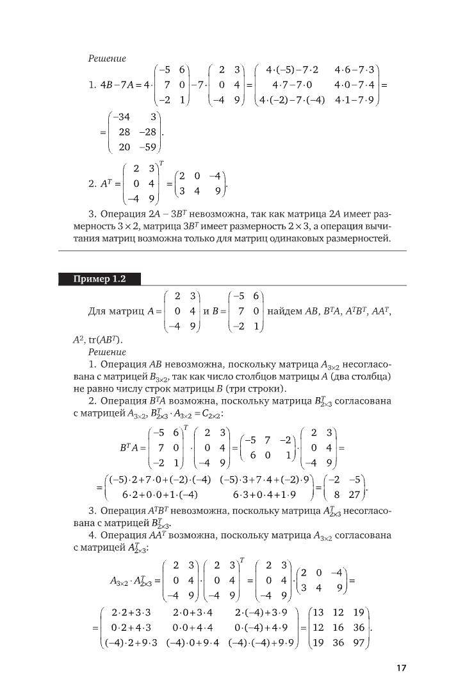

---

PDF стр. 25 · стр. книги 18 ^p025

5. Операция $A^2$ невозможна, поскольку матрица $A_{3\times2}$ не является квадратной.

6. Нахождение $\operatorname{tr}(AB^T)$ возможно, так как произведение $AB^T$ существует, поскольку матрица $A_{3\times2}$ согласована с матрицей $B^T_{2\times3}$:

$$
AB^T=\begin{pmatrix}2&3\\0&4\\-4&9\end{pmatrix}\cdot\begin{pmatrix}-5&6\\7&0\\-2&1\end{pmatrix}^T=\begin{pmatrix}2&3\\0&4\\-4&9\end{pmatrix}\cdot\begin{pmatrix}-5&7&-2\\6&0&1\end{pmatrix}=
$$
$$
=\begin{pmatrix}2\cdot(-5)+3\cdot6&2\cdot7+3\cdot0&2\cdot(-2)+3\cdot1\\0\cdot(-5)+4\cdot6&0\cdot7+4\cdot0&0\cdot(-2)+4\cdot1\\(-4)\cdot(-5)+9\cdot6&(-4)\cdot7+9\cdot0&(-4)\cdot(-2)+9\cdot1\end{pmatrix}=\begin{pmatrix}8&14&-1\\24&0&4\\74&-28&17\end{pmatrix},
$$

тогда $\operatorname{tr}(AB^T)=8+0+17=25$.

**Пример 1.3**

Найдем все матрицы, перестановочные с матрицей

$$
A=\begin{pmatrix}1&-2\\0&3\end{pmatrix}.
$$

*Решение*

Запишем общий вид всех перестановочных матриц:

$$
B=\begin{pmatrix}a&b\\c&d\end{pmatrix},
$$

где $a,b,c,d\in\mathbb{R}$.

Применим определение перестановочных матриц $AB=BA$:

$$
AB=\begin{pmatrix}1&-2\\0&3\end{pmatrix}\begin{pmatrix}a&b\\c&d\end{pmatrix}=\begin{pmatrix}a-2c&b-2d\\3c&3d\end{pmatrix},
$$
$$
BA=\begin{pmatrix}a&b\\c&d\end{pmatrix}\begin{pmatrix}1&-2\\0&3\end{pmatrix}=\begin{pmatrix}a&-2a+3b\\c&-2c+3d\end{pmatrix}.
$$

Получаем

$$
\begin{pmatrix}a-2c&b-2d\\3c&3d\end{pmatrix}=\begin{pmatrix}a&-2a+3b\\c&-2c+3d\end{pmatrix}.
$$

По определению равных матриц имеем

$$
\begin{cases}a-2c=a,\\b-2d=-2a+3b,\\3c=c,\\3d=-2c+3d\end{cases}\Rightarrow\begin{cases}a\in\mathbb{R},\\b=a-d,\\c=0,\\d\in\mathbb{R}.\end{cases}
$$

Тогда общий вид всех перестановочных матриц $B=\begin{pmatrix}a&a-d\\0&d\end{pmatrix}$.

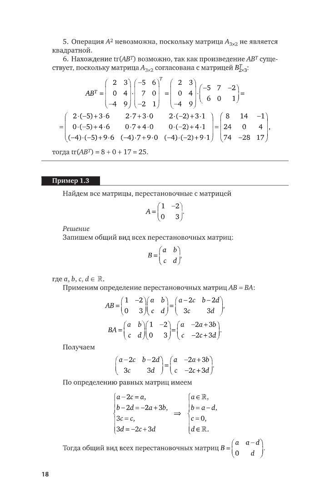

---

PDF стр. 26 · стр. книги 19 ^p026

Выполним проверку (по определению перестановочных матриц):

$$
\left.\begin{aligned}AB&=\begin{pmatrix}1&-2\\0&3\end{pmatrix}\begin{pmatrix}a&a-d\\0&d\end{pmatrix}=\begin{pmatrix}a&a+d\\0&3d\end{pmatrix}\\BA&=\begin{pmatrix}a&a-d\\0&d\end{pmatrix}\begin{pmatrix}1&-2\\0&3\end{pmatrix}=\begin{pmatrix}a&a+d\\0&3d\end{pmatrix}\end{aligned}\right\}\Rightarrow AB=BA.
$$

**Пример 1.4**

Проверим, являются ли матрицы взаимообратными:

1) $A=\begin{pmatrix}3&2\\4&3\end{pmatrix}$, $B=\begin{pmatrix}3&-2\\-4&3\end{pmatrix}$; 2) $A=\begin{pmatrix}1&-2&3\\1&0&2\\0&-1&0\end{pmatrix}$, $B=\begin{pmatrix}-2&3&4\\0&0&-1\\1&-1&2\end{pmatrix}$.

*Решение*

Воспользуемся определением взаимообратных матриц $AB=BA=E$:

1)
$$
\left.\begin{aligned}AB&=\begin{pmatrix}3&2\\4&3\end{pmatrix}\begin{pmatrix}3&-2\\-4&3\end{pmatrix}=\begin{pmatrix}1&0\\0&1\end{pmatrix}=E\\BA&=\begin{pmatrix}3&-2\\-4&3\end{pmatrix}\begin{pmatrix}3&2\\4&3\end{pmatrix}=\begin{pmatrix}1&0\\0&1\end{pmatrix}=E\end{aligned}\right\}\Rightarrow AB=BA=E,
$$

матрицы $A$ и $B$ являются взаимообратными;

2)
$$
\left.\begin{aligned}AB&=\begin{pmatrix}1&-2&3\\1&0&2\\0&-1&0\end{pmatrix}\begin{pmatrix}-2&3&4\\0&0&-1\\1&-1&2\end{pmatrix}=\begin{pmatrix}1&0&12\\0&1&8\\0&0&1\end{pmatrix}\ne E\\BA&=\begin{pmatrix}-2&3&4\\0&0&-1\\1&-1&2\end{pmatrix}\begin{pmatrix}1&-2&3\\1&0&2\\0&-1&0\end{pmatrix}=\begin{pmatrix}1&0&0\\0&1&0\\0&-4&1\end{pmatrix}\ne E\end{aligned}\right\}\Rightarrow AB\ne BA\ne E,
$$

матрицы $A$ и $B$ не являются взаимообратными.

Операции над матрицами используются при построении и решении *матричных уравнений*, в которых участвуют как известные матрицы, так и неизвестные.

**Пример 1.5**

Решим уравнение $2A=3B-4X$, если $A=\begin{pmatrix}2&3\\0&4\\-4&9\end{pmatrix}$ и $B=\begin{pmatrix}-5&6\\7&0\\-2&1\end{pmatrix}$.

*Решение*

Выразим матрицу $X$ и подставим данные матрицы в уравнение:

$$
X=\frac14(3B-2A)=\frac14\cdot\left(3\cdot\begin{pmatrix}-5&6\\7&0\\-2&1\end{pmatrix}-2\cdot\begin{pmatrix}2&3\\0&4\\-4&9\end{pmatrix}\right)=\frac14\begin{pmatrix}-19&12\\21&-8\\2&-15\end{pmatrix}=\begin{pmatrix}-\frac{19}{4}&3\\\frac{21}{4}&-2\\\frac12&-\frac{15}{4}\end{pmatrix}.
$$

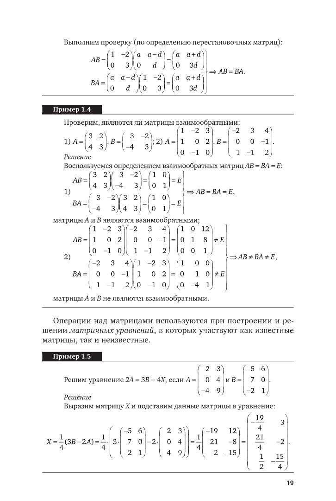

---

PDF стр. 27 · стр. книги 20 ^p027

Операции над матрицами позволяют составлять *многочлен от матрицы*, представляющий собой матрицу, полученную в результате подстановки данной матрицы вместо переменной $x$ в обычный алгебраический многочлен степени $n$:

$$
P(x)=\lambda_0+\lambda_1x+\lambda_2x^2+\dots+\lambda_nx^n,
$$

где $\lambda_0,\lambda_1,\dots,\lambda_n\in\mathbb{R}$.

**Пример 1.6**

Вычислим значение многочлена $P(x)=-3x^2+5x-2$ от матрицы

$$
A=\begin{pmatrix}1&-2\\0&3\end{pmatrix}.
$$

*Решение*

Подставим вместо переменной $x$ матрицу $A$ и выполним необходимые действия:

$$
P(A)=-3A^2+5A-2E=-3\cdot\begin{pmatrix}1&-2\\0&3\end{pmatrix}\cdot\begin{pmatrix}1&-2\\0&3\end{pmatrix}+5\cdot\begin{pmatrix}1&-2\\0&3\end{pmatrix}-2\cdot\begin{pmatrix}1&0\\0&1\end{pmatrix}=
$$
$$
=-3\cdot\begin{pmatrix}1&-8\\0&9\end{pmatrix}+5\cdot\begin{pmatrix}1&-2\\0&3\end{pmatrix}-2\cdot\begin{pmatrix}1&0\\0&1\end{pmatrix}=\begin{pmatrix}0&14\\0&-14\end{pmatrix}.
$$

## 1.2. Определители

### 1.2.1. Формулы для вычисления определителей

Каждой квадратной матрице $A$ соответствует число, называемое ее *определителем* (*детерминантом*). Это число представляется в виде таблицы, соответствующей матрице, вычисляется по определенному правилу и обозначается

$$
\Delta=\det A=|A|.
$$

Квадратная матрица называется *вырожденной* (*особенной*), если ее определитель равен нулю ($\det A=0$).

Квадратная матрица называется *невырожденной* (*неособенной*), если ее определитель отличен от нуля ($\det A\ne0$).

*Определителем 1-го порядка* для матрицы $A=(a_{11})$ является число $\det A=a_{11}$.

**Пример 1.7**

Вычислим определители матриц $A=(17)$, $B=(-2024)$, $C=(a)$.

*Решение*

Имеем: $\det A=17$, $\det B=-2024$, $\det C=a$.

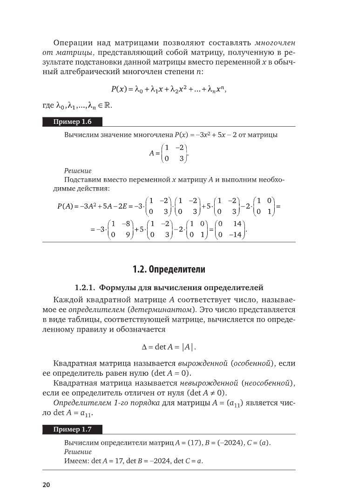

---

PDF стр. 28 · стр. книги 21 ^p028

*Определителем 2-го порядка* для матрицы $A=\begin{pmatrix}a_{11}&a_{12}\\a_{21}&a_{22}\end{pmatrix}$ является число $\det A=\begin{vmatrix}a_{11}&a_{12}\\a_{21}&a_{22}\end{vmatrix}$, вычисляемое по формуле

$$
\det A=a_{11}\cdot a_{22}-a_{21}\cdot a_{12}. \tag{1.1}
$$

**Пример 1.8**

Вычислим определители матриц $A=\begin{pmatrix}2&-4\\-1&3\end{pmatrix}$, $B=\begin{pmatrix}\cos\alpha&\sin2\alpha\\-\sin\alpha&\cos2\alpha\end{pmatrix}$.

*Решение*

Воспользуемся формулой (1.1):

$$
\det A=\begin{vmatrix}2&-4\\-1&3\end{vmatrix}=2\cdot3-(-1)\cdot(-4)=6-4=2;
$$
$$
\det B=\begin{vmatrix}\cos\alpha&\sin2\alpha\\-\sin\alpha&\cos2\alpha\end{vmatrix}=\cos\alpha\cdot\cos2\alpha-(-\sin\alpha)\cdot\sin2\alpha=
$$
$$
=\cos\alpha\cdot\cos2\alpha+\sin\alpha\cdot\sin2\alpha=\cos(\alpha-2\alpha)=\cos\alpha.
$$

*Определителем 3-го порядка* для матрицы $A=\begin{pmatrix}a_{11}&a_{12}&a_{13}\\a_{21}&a_{22}&a_{23}\\a_{31}&a_{32}&a_{33}\end{pmatrix}$ является число $\det A=\begin{vmatrix}a_{11}&a_{12}&a_{13}\\a_{21}&a_{22}&a_{23}\\a_{31}&a_{32}&a_{33}\end{vmatrix}$, вычисляемое по формуле

$$
\begin{aligned}\det A=a_{11}a_{22}a_{33}+a_{12}a_{23}a_{31}+a_{21}a_{13}a_{32}-\\-a_{13}a_{22}a_{31}-a_{11}a_{23}a_{32}-a_{12}a_{33}a_{21}.\end{aligned} \tag{1.2}
$$

Для удобства запоминания формулы (1.2) и упрощения вычислений можно использовать мнемонические правила Саррюса.

1. *Правило треугольников.* Определитель третьего порядка равен сумме произведений элементов, расположенных на главной диагонали и в вершинах треугольников с основаниями, параллельными этой диагонали, минус сумма произведений элементов, расположенных на побочной диагонали и в вершинах треугольников с основаниями, параллельными этой диагонали:

$$
\det A=\text{сумма}\begin{vmatrix}a_{11}&a_{12}&a_{13}\\a_{21}&a_{22}&a_{23}\\a_{31}&a_{32}&a_{33}\end{vmatrix}-\text{сумма}\begin{vmatrix}a_{11}&a_{12}&a_{13}\\a_{21}&a_{22}&a_{23}\\a_{31}&a_{32}&a_{33}\end{vmatrix}.
$$

*[Схема: в определителях линиями соединены элементы главной диагонали и треугольников (слева) и побочной диагонали и треугольников (справа) — см. изображение страницы.]*

(соединенные линиями элементы перемножаются).

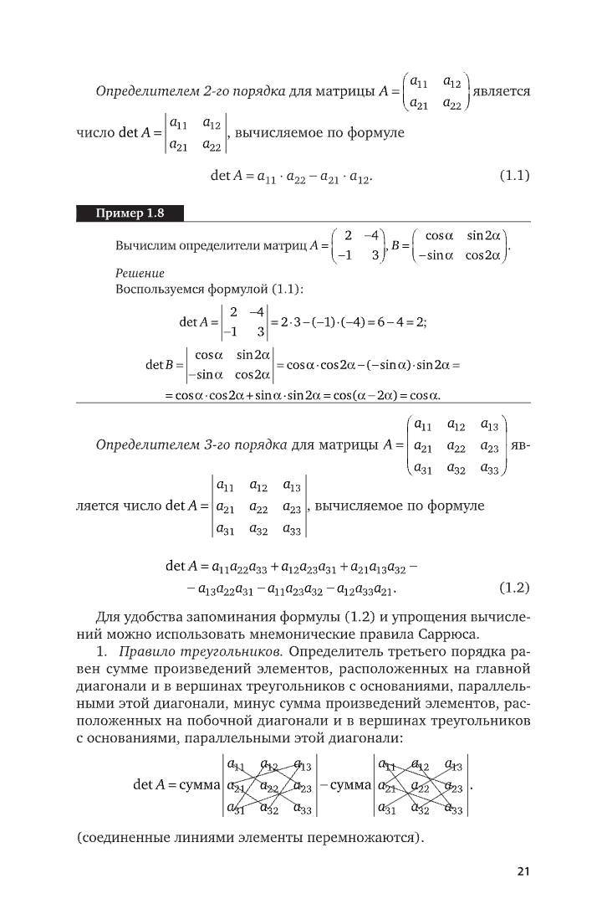

---

PDF стр. 29 · стр. книги 22 ^p029

2. *Правило диагоналей.* Второй, эквивалентный первому, способ вычисления заключается в том, что к таблице элементов исходного определителя последовательно дописываются справа ее первый и второй столбцы. Тогда определитель 3-го порядка равен сумме произведений элементов расширенной таблицы, расположенных на трех ее главных диагоналях, минус сумма произведений элементов, расположенных на трех побочных диагоналях:

$$
\det A=\text{сумма}\begin{vmatrix}a_{11}&a_{12}&a_{13}&a_{11}&a_{12}\\a_{21}&a_{22}&a_{23}&a_{21}&a_{22}\\a_{31}&a_{32}&a_{33}&a_{31}&a_{32}\end{vmatrix}-\text{сумма}\begin{vmatrix}a_{11}&a_{12}&a_{13}&a_{11}&a_{12}\\a_{21}&a_{22}&a_{23}&a_{21}&a_{22}\\a_{31}&a_{32}&a_{33}&a_{31}&a_{32}\end{vmatrix}.
$$

*[Схема: в расширенных таблицах линиями соединены элементы трех главных (слева) и трех побочных (справа) диагоналей — см. изображение страницы.]*

(соединенные линиями элементы перемножаются).

**Пример 1.9**

Вычислим определители матриц $A=\begin{pmatrix}1&2&3\\4&0&-4\\-3&-2&-1\end{pmatrix}$, $B=\begin{pmatrix}a&0&2\\-1&a&-1\\2&0&a\end{pmatrix}$.

*Решение*

Воспользуемся формулой (1.2):

$$
\det A=\begin{pmatrix}1&2&3\\4&0&-4\\-3&-2&-1\end{pmatrix}=1\cdot0\cdot(-1)+3\cdot4\cdot(-2)+(-3)\cdot2\cdot(-4)-3\cdot0\cdot(-3)-
$$
$$
-1\cdot(-4)\cdot(-2)-(-1)\cdot2\cdot4=0;
$$
$$
\det B=\begin{pmatrix}a&0&2\\-1&a&-1\\2&0&a\end{pmatrix}=a\cdot a\cdot a+2\cdot0\cdot(-1)+2\cdot(-1)\cdot0-
$$
$$
-2\cdot a\cdot2-a\cdot0\cdot(-1)-a\cdot(-1)\cdot0=a^3-4a.
$$

Правила Саррюса применяются только для определителей 3-го порядка. Для рассмотрения практического способа вычисления определителей любого порядка необходимо ввести понятия минора и алгебраического дополнения элемента матрицы.

*Минором $M_{ij}$ элемента $a_{ij}$* матрицы $n$-го порядка называется определитель $(n-1)$-го порядка, полученный из определителя матрицы после вычеркивания $i$-й строки и $j$-го столбца, на пересечении которых расположен элемент.

**Пример 1.10**

Вычислим миноры $M_{11}$ и $M_{12}$ для матриц

$$
A=\begin{pmatrix}-1&2\\0&7\end{pmatrix},\ B=\begin{pmatrix}1&2&3\\4&0&-4\\-3&-2&-1\end{pmatrix}.
$$

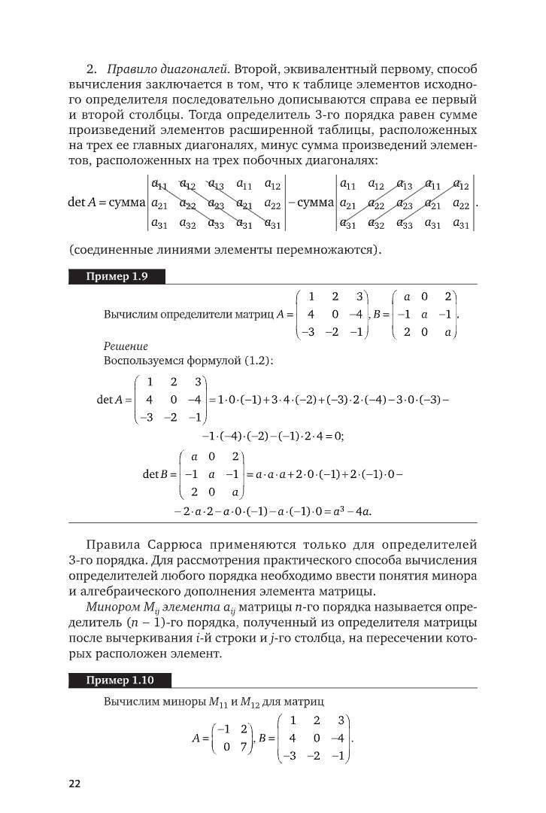

---

PDF стр. 30 · стр. книги 23 ^p030

*Решение*

1. В матрице $A$ вычеркиваем первую строку и первый столбец:

$$
\begin{pmatrix}\not1&\not2\\\not0&7\end{pmatrix}\Rightarrow M_{11}=|7|=7;
$$

вычеркиваем первую строку и второй столбец:

$$
\begin{pmatrix}\not1&\not2\\0&\not7\end{pmatrix}\Rightarrow M_{12}=|0|=0.
$$

2. Аналогично для матрицы $B$:

$$
\begin{pmatrix}\not1&\not2&\not3\\\not4&0&-4\\\not{-3}&-2&-1\end{pmatrix}\Rightarrow M_{11}=\begin{vmatrix}0&-4\\-2&-1\end{vmatrix}=-8;
$$
$$
\begin{pmatrix}\not1&\not2&\not3\\4&\not0&-4\\-3&\not{-2}&-1\end{pmatrix}\Rightarrow M_{12}=\begin{vmatrix}4&-4\\-3&-1\end{vmatrix}=-16.
$$

*Алгебраическим дополнением $A_{ij}$* элемента $a_{ij}$ матрицы $n$-го порядка называется число, равное значению минора $M_{ij}$ элемента, взятого со знаком $(-1)^{i+j}$:

$$
A_{ij}=(-1)^{i+j}M_{ij}. \tag{1.3}
$$

**Пример 1.11**

Вычислим $A_{21}+A_{32}$ для матрицы $A=\begin{pmatrix}1&2&3\\4&0&-4\\-3&-2&-1\end{pmatrix}$.

*Решение*

Воспользуемся формулой (1.3):

$$
A_{21}=(-1)^{2+1}\cdot\begin{vmatrix}2&3\\-2&-1\end{vmatrix}=-[2\cdot(-1)-(-2)\cdot3]=-4;
$$
$$
A_{32}=(-1)^{3+2}\cdot\begin{vmatrix}1&3\\4&-4\end{vmatrix}=-[1\cdot(-4)-4\cdot3]=16.
$$

Тогда $A_{21}+A_{32}=-4+16=12$.

Каждый элемент $a_{ij}$ матрицы $A$ $n$-го порядка имеет алгебраическое дополнение $A_{ij}$. Матрица $A^+$, элементами $a^+_{ij}$ которой являются

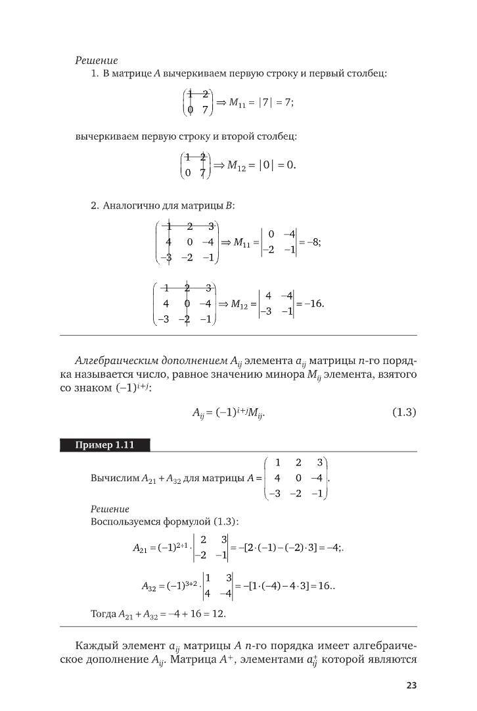

---

PDF стр. 31 · стр. книги 24 ^p031

алгебраические дополнения элементов $a_{ji}$ матрицы $A$ (иначе, элементов матрицы $A^T$) называется *присоединенной*, т. е. $a^+_{ij}=A_{ji}$.

***Алгоритм нахождения присоединенной матрицы***

1. По формуле (1.3) вычислить алгебраические дополнения элементов матрицы $A$ и составить из них матрицу $[A_{ij}]$.
2. Найти присоединенную матрицу $A^+$, транспонируя матрицу $[A_{ij}]$, т. е. $A^+=[A_{ij}]^T$.

**Пример 1.12**

Составим присоединенную матрицу $A^+$, если $A=\begin{pmatrix}2&-1&0\\3&2&4\\-2&1&1\end{pmatrix}$.

*Решение*

Вычислим алгебраические дополнения элементов матрицы $A$:

$$
A_{11}=(-1)^{1+1}\cdot\begin{vmatrix}2&4\\1&1\end{vmatrix}=-2,\ A_{12}=(-1)^{1+2}\cdot\begin{vmatrix}3&4\\-2&1\end{vmatrix}=-11,\ A_{13}=(-1)^{1+3}\cdot\begin{vmatrix}3&2\\-2&1\end{vmatrix}=7,
$$
$$
A_{21}=(-1)^{2+1}\cdot\begin{vmatrix}-1&0\\1&1\end{vmatrix}=1,\ A_{22}=(-1)^{2+2}\cdot\begin{vmatrix}2&0\\-2&1\end{vmatrix}=2,\ A_{23}=(-1)^{2+3}\cdot\begin{vmatrix}2&-1\\-2&1\end{vmatrix}=0,
$$
$$
A_{31}=(-1)^{3+1}\cdot\begin{vmatrix}-1&0\\2&4\end{vmatrix}=-4,\ A_{32}=(-1)^{3+2}\cdot\begin{vmatrix}2&0\\3&4\end{vmatrix}=-8,\ A_{33}=(-1)^{3+3}\cdot\begin{vmatrix}2&-1\\3&2\end{vmatrix}=7.
$$

Тогда $[A_{ij}]=\begin{pmatrix}-2&-11&7\\1&2&0\\-4&-8&7\end{pmatrix}$, $A^+=[A_{ij}]^T=\begin{pmatrix}-2&1&-4\\-11&2&-8\\7&0&7\end{pmatrix}$.

Определение определителя $n$-го порядка представлено следующей теоремой.

**Теорема 1.1 (Лапласа).** ***Определителем n-го порядка*** *для матрицы $A$ размерности $n\times n$ является действительное число, равное сумме произведений всех миноров $k$-го порядка, расположенных в произвольно выбранных $k$ строках или $k$ столбцах, $1\le k\le n-1$, на их алгебраические дополнения.*

**Пример 1.13**

Используя теорему Лапласа, вычислим определитель матрицы

$$
A=\begin{pmatrix}5&0&1&-1\\0&6&0&-8\\2&1&2&0\\0&1&2&-2\end{pmatrix}.
$$

*Решение*

Выберем, например, 1-ю и 2-ю строки ($k=2$). Построим все миноры 2-го порядка по выбранным строкам.

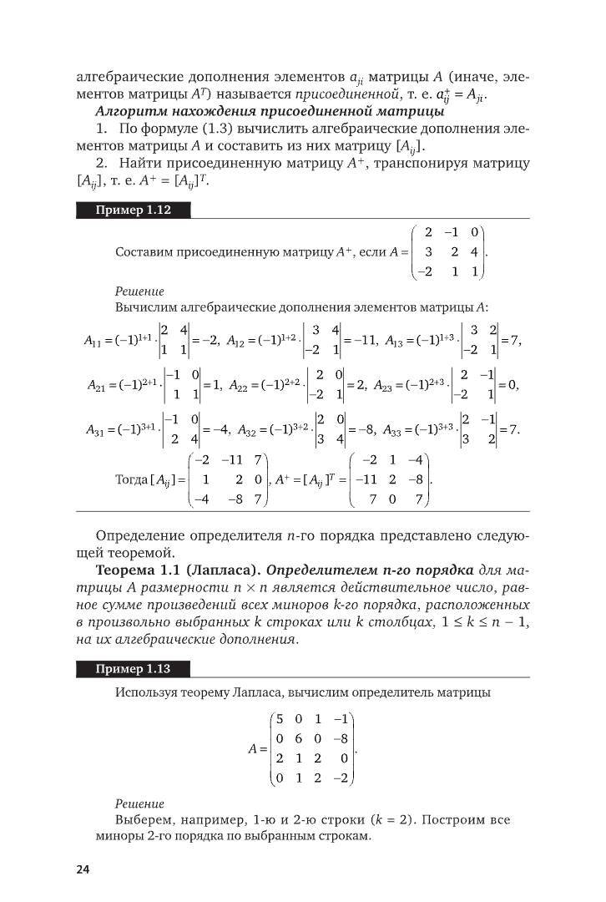

---

PDF стр. 32 · стр. книги 25 ^p032

Первый минор — это определитель 2-го порядка, построенный по элементам, стоящим на пересечении 1-й и 2-й строк и 1-го и 2-го столбцов: $\begin{vmatrix}5&0\\0&6\end{vmatrix}$.

Второй минор — это определитель 2-го порядка, построенный по элементам, стоящим на пересечении 1-й и 2-й строк и 1-го и 3-го столбцов: $\begin{vmatrix}5&1\\0&0\end{vmatrix}$.

Третий минор (1-я и 2-я строки и 1-й и 4-й столбцы): $\begin{vmatrix}5&-1\\0&-8\end{vmatrix}$.

Аналогично получим еще три минора:

$$
\begin{vmatrix}0&1\\6&0\end{vmatrix},\ \begin{vmatrix}0&-1\\6&-8\end{vmatrix},\ \begin{vmatrix}1&-1\\0&-8\end{vmatrix}.
$$

Для каждого из шести построенных миноров найдем алгебраические дополнения, которые будем вычислять по формуле $A_{i_1i_2j_1j_2}=(-1)^{i_1+i_2+j_1+j_2}\cdot M_{i_1i_2j_1j_2}$, где $i_1$ и $i_2$ — номера строк, $j_1$ и $j_2$ — номера столбцов, по которым был составлен соответствующий минор; $M_{i_1i_2j_1j_2}$ — минор (определитель 2-го порядка), составленный из элементов, оставшихся после вычеркивания $i_1$-й и $i_2$-й строк и $j_1$-го и $j_2$-го столбцов.

Минор $\begin{vmatrix}5&0\\0&6\end{vmatrix}$ был построен по 1-й и 2-й строкам ($i_1=1$, $i_2=2$) и 1-му и 2-му столбцам ($j_1=1$, $j_2=2$), значит, его алгебраическое дополнение равно

$$
A_{1212}=(-1)^{1+2+1+2}\cdot\begin{vmatrix}2&0\\2&-2\end{vmatrix}.
$$

Для минора $\begin{vmatrix}5&1\\0&0\end{vmatrix}$ алгебраическое дополнение равно

$$
A_{1213}=(-1)^{1+2+1+3}\cdot\begin{vmatrix}1&0\\1&-2\end{vmatrix}
$$

и т. д.

Тогда согласно теореме Лапласа значение определителя равно

$$
\begin{aligned}\det A&=\begin{vmatrix}5&0\\0&6\end{vmatrix}\cdot(-1)^{1+2+1+2}\cdot\begin{vmatrix}2&0\\2&-2\end{vmatrix}+\begin{vmatrix}5&1\\0&0\end{vmatrix}\cdot(-1)^{1+2+1+3}\cdot\begin{vmatrix}1&0\\1&-2\end{vmatrix}+\\&+\begin{vmatrix}5&-1\\0&-8\end{vmatrix}\cdot(-1)^{1+2+1+4}\cdot\begin{vmatrix}1&2\\1&2\end{vmatrix}+\begin{vmatrix}0&1\\6&0\end{vmatrix}\cdot(-1)^{1+2+2+3}\cdot\begin{vmatrix}2&0\\0&-2\end{vmatrix}+\\&+\begin{vmatrix}0&-1\\6&-8\end{vmatrix}\cdot(-1)^{1+2+2+4}\cdot\begin{vmatrix}2&2\\0&2\end{vmatrix}+\begin{vmatrix}1&-1\\0&-8\end{vmatrix}\cdot(-1)^{1+2+3+4}\cdot\begin{vmatrix}2&1\\0&1\end{vmatrix}=-136.\end{aligned}
$$

На практике для вычисления определителя $n$-го порядка удобно использовать следствия теоремы Лапласа.

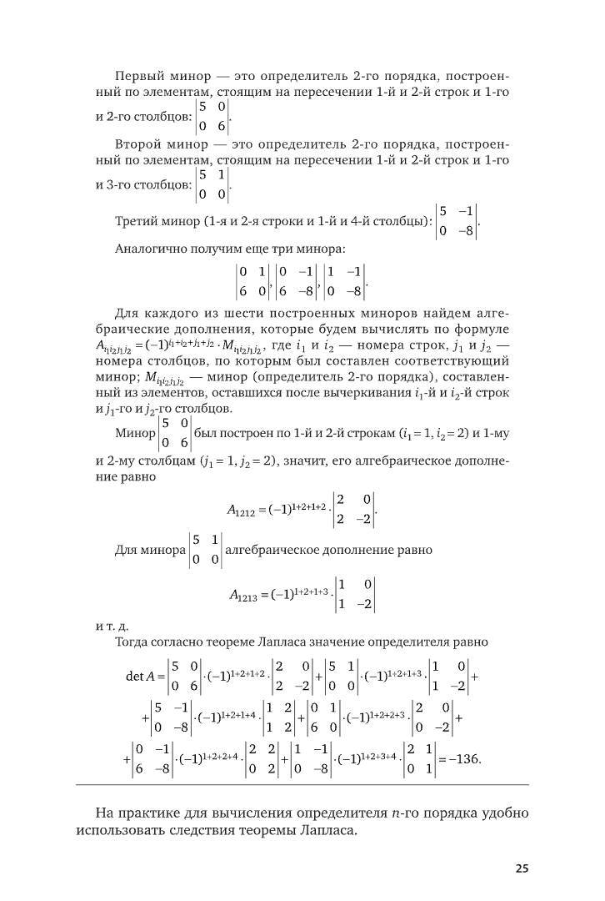

---

PDF стр. 33 · стр. книги 26 ^p033

1. *Разложение определителя по строке.* Определителем $n$-го порядка квадратной матрицы $A$ $n$-го порядка является число, равное сумме произведений элементов любой строки на их алгебраические дополнения, т. е.

$$
\det A=a_{s1}A_{s1}+a_{s2}A_{s2}+\dots+a_{sn}A_{sn}=\sum_{j=1}^{n}a_{sj}A_{sj}, \tag{1.4}
$$

где $s$ — номер выбранной строки.

2. *Разложение определителя по столбцу.* Определителем $n$-го порядка квадратной матрицы $A$ $n$-го порядка является число, равное сумме произведений элементов любого столбца на их алгебраические дополнения, т. е.

$$
\det A=a_{1s}A_{1s}+a_{2s}A_{2s}+\dots+a_{ns}A_{ns}=\sum_{i=1}^{n}a_{is}A_{is}, \tag{1.5}
$$

где $s$ — номер выбранного столбца.

*Замечание 1.4.* Определителем треугольной матрицы является число, равное произведению элементов, стоящих по главной диагонали.

**Пример 1.14**

Используя разложения по строке и столбцу, вычислим определитель матрицы из примера 1.13.

*Решение*

Выберем произвольную строку, например вторую.

Воспользуемся разложением по строке (формула (1.4), $s=2$):

$$
A=\sum_{j=1}^{4}a_{2j}\cdot A_{2j}=a_{21}\cdot A_{21}+a_{22}\cdot A_{22}+a_{23}\cdot A_{23}+a_{24}\cdot A_{24}=
$$
$$
=0\cdot(-1)^{2+1}\cdot\begin{vmatrix}0&1&-1\\1&2&0\\1&2&-2\end{vmatrix}+6\cdot(-1)^{2+2}\cdot\begin{vmatrix}5&1&-1\\2&2&0\\0&2&-2\end{vmatrix}+0\cdot(-1)^{2+3}\cdot\begin{vmatrix}5&0&-1\\2&1&0\\0&1&-2\end{vmatrix}+
$$
$$
+(-1)\cdot(-1)^{2+4}\cdot\begin{vmatrix}5&0&1\\2&1&2\\0&1&2\end{vmatrix}=-136.
$$

Выберем произвольный столбец, например первый.

Воспользуемся разложением по столбцу (формула (1.5), $s=1$):

$$
A=\sum_{i=1}^{4}a_{i1}\cdot A_{i1}=a_{11}\cdot A_{11}+a_{21}\cdot A_{21}+a_{31}\cdot A_{31}+a_{41}\cdot A_{41}=
$$
$$
=5\cdot(-1)^{1+1}\cdot\begin{vmatrix}6&0&-8\\1&2&0\\1&2&-2\end{vmatrix}+2\cdot(-1)^{3+1}\cdot\begin{vmatrix}0&1&-1\\6&0&-8\\1&2&-2\end{vmatrix}=-136.
$$

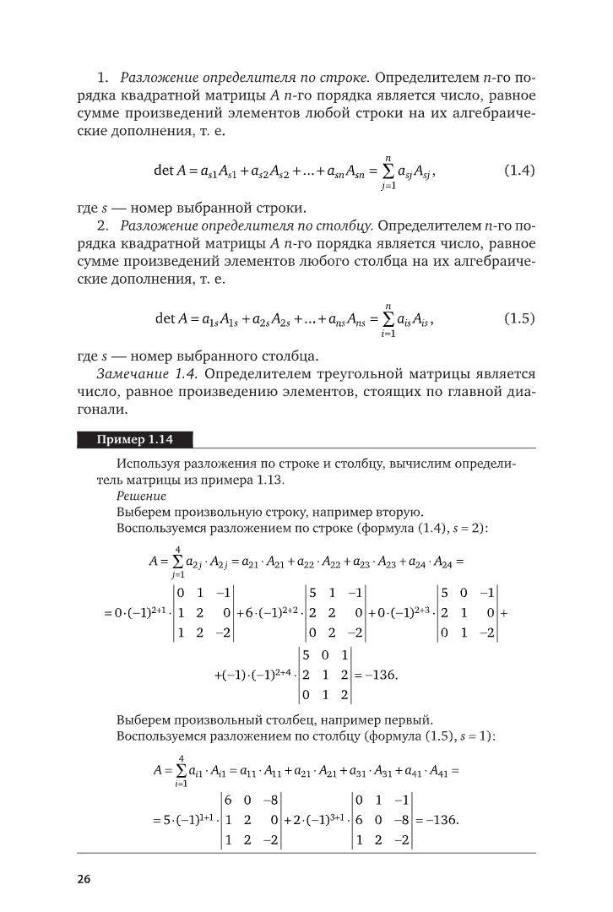

---

PDF стр. 34 · стр. книги 27 ^p034

**Пример 1.15**

Решим уравнение $\begin{vmatrix}3&x&-4\\2&-1&3\\x+10&1&1\end{vmatrix}=0$.

*Решение*

Вычислим определитель левой части уравнения:

$$
\begin{vmatrix}3&x&-4\\2&-1&3\\x+10&1&1\end{vmatrix}=-3-8+3x(x+10)-4(x+10)-9-2x=
$$
$$
=-20+3x^2+30x-4x-40-2x=3x^2+24x-60.
$$

Уравнение принимает вид $3x^2+24x-60=0$, или $x^2+8x-20=0$.

Решением этого квадратного уравнения являются числа $x_1=-10$ и $x_2=2$.

**Пример 1.16**

Вычислим сумму целых решений неравенства $\begin{vmatrix}x+2&-1&2\\-1&2&-1\\3&-x&-5\end{vmatrix}\ge0$.

*Решение*

Вычислим определитель левой части неравенства:

$$
\begin{vmatrix}x+2&-1&2\\-1&2&-1\\3&-x&-5\end{vmatrix}=-10(x+2)+3+2x-12-x(x+2)+5=-x^2-10x-24.
$$

Получаем неравенство $-x^2-10x-24\ge0$, или $x^2+10x+24\le0$.

Решением неравенства является отрезок $x\in[-6;-4]$. Сумма целых решений составляет $(-6)+(-5)+(-4)=-15$.

### 1.2.2. Свойства определителей

Определители обладают рядом свойств, облегчающих их вычисление.

1. Определитель равен нулю, если все элементы его некоторого столбца (строки) равны нулю.
2. Определитель не изменится при замене всех его строк соответствующими столбцами, т. е. при транспонировании матрицы ее определитель не изменяется.
3. При перестановке двух столбцов (строк) определитель меняет знак.
4. Множитель, общий для элементов некоторого столбца (строки), можно выносить за знак определителя. Иначе: умножение определителя на число равносильно умножению какого-либо столбца (строки) на это число.

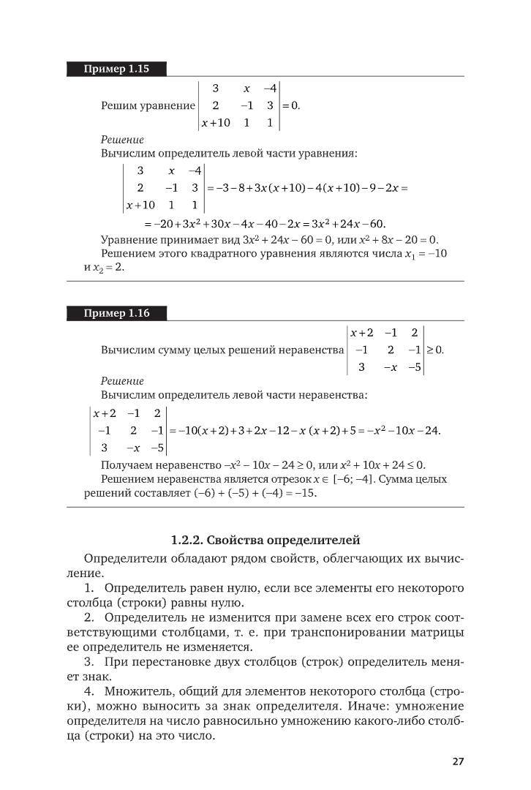

---

PDF стр. 35 · стр. книги 28 ^p035

5. Определитель с двумя одинаковыми столбцами (строками) равен нулю.
6. Определитель с двумя пропорциональными столбцами (строками) равен нулю.
7. Определитель не изменится, если к элементам какой-либо строки (столбца) матрицы прибавить элементы другой строки (столбца), предварительно умноженные на число, отличное от нуля.
8. Сумма произведений элементов какого-либо столбца (строки) на алгебраические дополнения элементов другого столбца (строки) этой матрицы равна нулю, т. е.

$$
\sum_{s=1}^{n}a_{si}\cdot A_{sj}=0\ \Big(\sum_{s=1}^{n}a_{is}\cdot A_{js}=0\Big)\ \text{при}\ i\ne j.
$$

*Замечание 1.5.* Из следствий теоремы Лапласа и свойства 8 имеем

$$
\sum_{s=1}^{n}a_{si}\cdot A_{sj}=\sum_{s=1}^{n}a_{is}\cdot A_{js}=\begin{cases}0,\ \text{если}\ i\ne j,\\\det A,\ \text{если}\ i=j.\end{cases} \tag{1.6}
$$

Из формулы (1.6) и правила умножения матриц следует, что

$$
A\cdot A^+=A^+\cdot A=(\det A)\cdot E, \tag{1.7}
$$

где $E$ — единичная матрица того же порядка, что и матрица $A$.

9. Определитель произведения квадратных матриц $A$ и $B$ равен произведению определителей этих матриц:

$$
|A\cdot B|=|A|\cdot|B|. \tag{1.8}
$$

**Пример 1.17**

Вычислим определитель $\Delta=\begin{vmatrix}3&3&-1\\3&-6&1\\-3&-3&2\end{vmatrix}$.

*Решение*

Воспользуемся свойствами определителя для преобразования его к треугольному виду. Для этого первую строку умножим на −1 и сложим со второй строкой (изменяться будет вторая строка):

$$
\begin{vmatrix}3&3&-1\\3&-6&1\\-3&-3&2\end{vmatrix}\begin{matrix}\cdot(-1)+\\\swarrow\\\ \end{matrix}=\begin{vmatrix}3&3&-1\\0&-9&2\\-3&-3&2\end{vmatrix}.
$$

Затем первую строку прибавим к третьей (изменяться будет третья строка):

$$
\begin{vmatrix}3&3&-1\\0&-9&2\\-3&-3&1\end{vmatrix}\begin{matrix}+\\\ \\\swarrow\end{matrix}=\begin{vmatrix}3&3&-1\\0&-9&2\\0&0&1\end{vmatrix}.
$$

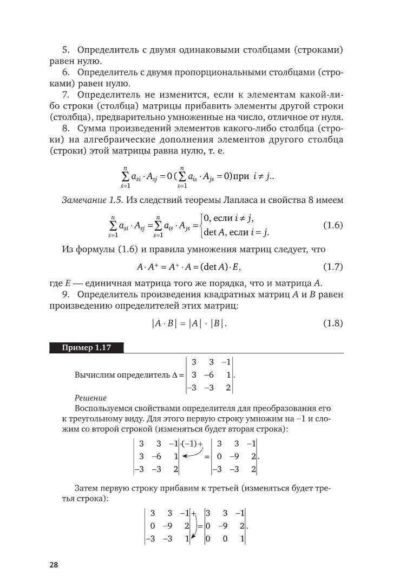

---

PDF стр. 36 · стр. книги 29 ^p036

Определитель имеет треугольный вид и равен произведению элементов главной диагонали: $\Delta=3\cdot(-9)\cdot1=-27$.

## 1.3. Ранг матрицы. Эквивалентные преобразования матриц

### 1.3.1. Ранг матрицы

Важной характеристикой любой матрицы является ее ранг.

Если в матрице $A$ размерности $m\times n$ выбрать произвольные $k$ строк и $k$ столбцов ($k\le\min\{m;n\}$), то элементы, стоящие на их пересечении, образуют квадратную матрицу $k$-го порядка, определитель которой называют *минором $k$-го порядка матрицы $A$*. Говорят, что этот минор порожден матрицей.

Так, порожденными минорами 1-го порядка матрицы размерности $m\times n$ являются ее элементы.

*Рангом матрицы $A$* называется наивысший порядок отличного от нуля минора, порожденного этой матрицей. Обозначение: $r(A)$ или $\operatorname{rang}A$.

Из определения следуют *свойства ранга матрицы*:
1) если матрица $A$ имеет размерность $m\times n$, то $\operatorname{rang}A\le\min\{m;n\}$, т. е. не превосходит меньшего из ее размеров;
2) ранг матрицы равен нулю тогда и только тогда, когда все ее элементы равны нулю, т. е. матрица является нулевой;
3) ранг квадратной матрицы $n$-го порядка равен $n$ тогда и только тогда, когда матрица $A$ невырожденная ($\det A\ne0$).

Миноры, порождаемые матрицей, обладают свойством: если все миноры $k$-го порядка матрицы $A$ размерности $m\times n$, $k\le\min\{m;n\}$, равны нулю, то все миноры более высокого порядка также равны нулю.

Если среди всех миноров $k$-го порядка матрицы $A$ размерности $m\times n$, $k\le\min\{m;n\}$, есть хотя бы один неравный нулю, а все миноры $(k+1)$-го порядка, *окаймляющие* этот минор (т. е. содержащие минор $k$-го порядка целиком внутри себя), равны нулю или не существуют, то $\operatorname{rang}A=k$.

***Алгоритм нахождения ранга матрицы методом окаймляющих миноров***

1. Выбрать любой ненулевой элемент матрицы — если такого нет, то ранг матрицы равен нулю ($\operatorname{rang}A=0$).
2. Вычислить миноры 2-го порядка, которые окаймляют выбранный ненулевой элемент, — если все они равны нулю, то ранг матрицы равен единице ($\operatorname{rang}A=1$).
3. Если среди вычисленных миноров 2-го порядка имеются отличные от нуля, то необходимо вычислять все миноры 3-го поряд-

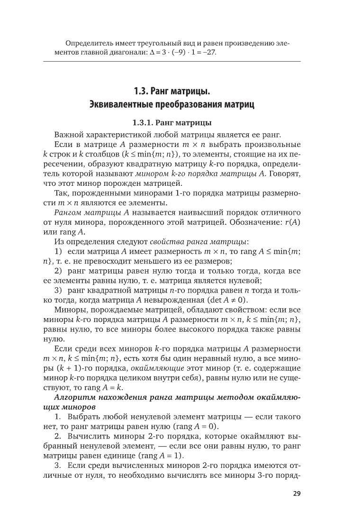

---

PDF стр. 37 · стр. книги 30 ^p037

ка, окаймляющие какой-либо минор 2-го порядка, не равный нулю. Если все они равны нулю, то ранг матрицы равен двум ($\operatorname{rang}A=2$).
4. Продолжить этот алгоритм до тех пор, пока все миноры, окаймляющие ненулевой минор $k$-го порядка, не будут равны нулю, тогда $\operatorname{rang}A=k$.

**Пример 1.18**

Вычислим ранги следующих матриц:

$$
A=\begin{pmatrix}0&0&0&0\\0&0&0&0\end{pmatrix},\ B=\begin{pmatrix}1&2\\3&4\end{pmatrix},\ C=\begin{pmatrix}-1&2\\3&-6\\4&-8\end{pmatrix},\ D=\begin{pmatrix}2&-4&-2\\5&-5&0\\0&3&3\end{pmatrix}.
$$

*Решение*

1. Так как все элементы матрицы $A$ нулевые, то $\operatorname{rang}A=0$.
2. По свойству ранга квадратной матрицы $n$-го порядка, если она невырожденная (ее определитель отличен от нуля), то ее ранг равен $n$. Так как $\det B=1\cdot4-2\cdot3=-2\ne0$, то $\operatorname{rang}B=2$.
3. Для матрицы $C$ рассмотрим миноры всевозможных порядков.

Миноры 1-го порядка — это все элементы матрицы $C$: −1; 2; 3; −6; 4; −8.

Миноры 2-го порядка:

$$
\begin{vmatrix}-1&2\\3&-6\end{vmatrix}=0;\ \begin{vmatrix}-1&2\\4&-8\end{vmatrix}=0;\ \begin{vmatrix}3&-6\\4&-8\end{vmatrix}=0.
$$

Согласно определению получаем, что $\operatorname{rang}C=1$.

4. Для матрицы $D$ также рассмотрим всевозможные миноры.

Миноры 1-го порядка: 2; −4; −2; 5; −5; 0; 3.

Миноры 2-го порядка:

$$
\begin{vmatrix}2&-4\\5&-5\end{vmatrix}=10;\ \begin{vmatrix}2&-4\\0&3\end{vmatrix}=6;\ \begin{vmatrix}5&-5\\0&3\end{vmatrix}=15;\ \begin{vmatrix}2&-2\\5&0\end{vmatrix}=10;\ \begin{vmatrix}2&-2\\0&3\end{vmatrix}=6;
$$
$$
\begin{vmatrix}5&0\\0&3\end{vmatrix}=15;\ \begin{vmatrix}-4&-2\\-5&0\end{vmatrix}=-10;\ \begin{vmatrix}-4&-2\\3&3\end{vmatrix}=-6;\ \begin{vmatrix}-5&0\\3&3\end{vmatrix}=-15.
$$

Минор 3-го порядка:

$$
\det D=\begin{vmatrix}2&-4&-2\\5&-5&0\\0&3&3\end{vmatrix}=0.
$$

По методу окаймляющих миноров получаем, что $\operatorname{rang}D=2$, так как среди миноров 2-го порядка есть хотя бы один ненулевой, а все миноры (окаймляющие) 3-го порядка (в данном случае он один) равны нулю.

Достаточно было выбрать любой ненулевой элемент матрицы $D$, например $a_{11}=2$, затем вычислить окаймляющий его минор 2-го порядка $\begin{vmatrix}2&-4\\5&-5\end{vmatrix}=10$, а так как он не равен нулю, то далее вычислить окаймляющий его минор 3-го порядка.

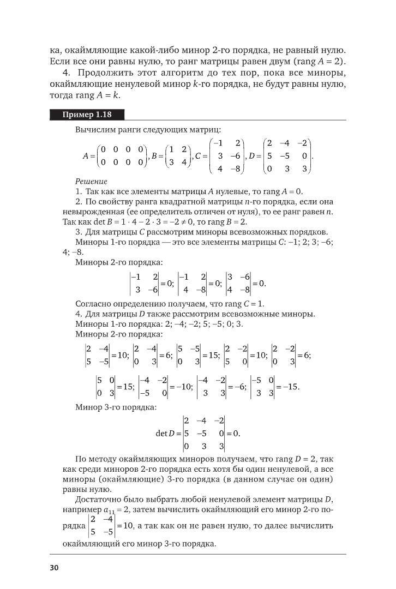

---

PDF стр. 38 · стр. книги 31 ^p038

### 1.3.2. Эквивалентные преобразования матриц

*Эквивалентными* (*элементарными*) преобразованиями строк (столбцов) матрицы, не меняющими ее ранга, являются следующие:
1) отбрасывание нулевой строки (столбца);
2) умножение всех элементов строки (столбца) матрицы на число $k$ ($k\in\mathbb{R}$, $k\ne0$);
3) изменение порядка строк (столбцов) матрицы;
4) прибавление к каждому элементу одной строки (столбца) соответствующих элементов другой строки (столбца), умноженных на число $k$ ($k\in\mathbb{R}$);
5) транспонирование матрицы.

*Замечание 1.6.* Из пп. 1 и 4 следует, что если в матрице есть пропорциональные (в частности, одинаковые) строки (столбцы) матрицы, то можно удалить все, кроме одной.

***Алгоритм нахождения ранга матрицы с помощью эквивалентных преобразований***

С помощью эквивалентных преобразований приводим матрицу $A$ к ступенчатому виду:

$$
\begin{pmatrix}a_{11}&a_{12}&\dots&a_{1r}&\dots&a_{1k}\\0&a_{22}&\dots&a_{2r}&\dots&a_{2k}\\\dots&\dots&\dots&\dots&\dots&\dots\\0&0&\dots&a_{rr}&\dots&a_{rk}\\0&0&\dots&0&\dots&0\\\dots&\dots&\dots&\dots&\dots&\dots\\0&0&\dots&0&\dots&0\end{pmatrix},
$$

где $a_{ii}\ne0$, $i=1,2,\dots,r$, $r\le k\le\min\{n;m\}$, тогда $\operatorname{rang}A=r$.

**Пример 1.19**

Вычислим ранг матрицы

$$
A=\begin{pmatrix}6&0&2&1&-3\\9&5&7&6&-6\\3&0&1&2&-1\\0&5&4&3&-2\end{pmatrix}.
$$

*Решение*

С помощью эквивалентных (элементарных) преобразований приведем матрицу к ступенчатому виду. Для этого (для удобства преобразований) поменяем местами первый и четвертый столбцы:

$$
\begin{pmatrix}1&0&2&6&-3\\6&5&7&9&-6\\2&0&1&3&-1\\3&5&4&0&-2\end{pmatrix}.
$$

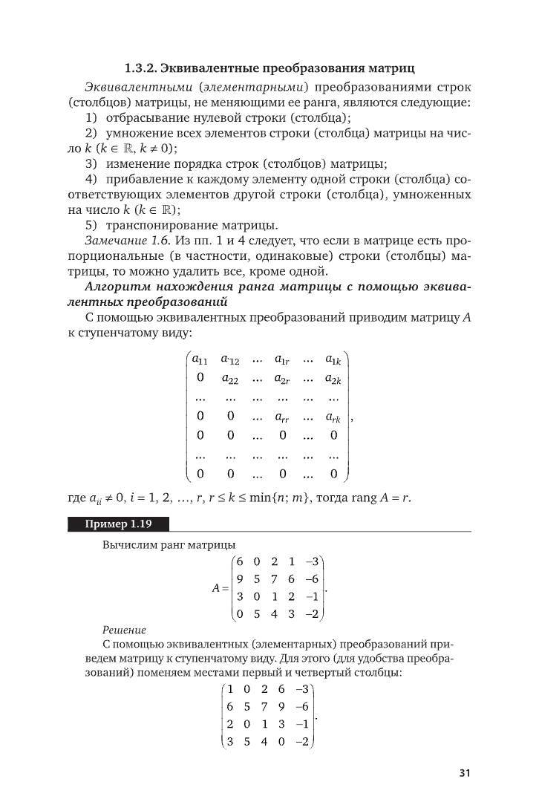

---

PDF стр. 39 · стр. книги 32 ^p039

Домножим первую строку на (−6) и прибавим к соответствующим элементам второй строки:

$$
\begin{pmatrix}1&0&2&6&-3\\6&5&7&9&-6\\2&0&1&3&-1\\3&5&4&0&-2\end{pmatrix}\xrightarrow{II+I\cdot(-6)}\begin{pmatrix}1&0&2&6&-3\\0&5&-5&-27&12\\2&0&1&3&-1\\3&5&4&0&-2\end{pmatrix}.
$$

Аналогично умножим первую строку на (−2) и прибавим к соответствующим элементам третьей строки, также умножим элементы первой строки на (−3) и прибавим к элементам четвертой строки. Получим

$$
\begin{pmatrix}1&0&2&6&-3\\0&5&-5&-27&12\\2&0&1&3&-1\\3&5&4&0&-2\end{pmatrix}\xrightarrow[IV+I\cdot(-3)]{III+I\cdot(-2)}\begin{pmatrix}1&0&2&6&-3\\0&5&-5&-27&12\\0&0&-3&-9&5\\0&5&-2&-18&7\end{pmatrix}.
$$

Вычитаем из элементов второй строки полученной матрицы соответствующие элементы четвертой строки. Полученные значения совпадают с элементами второй строки.

Отбросив одну из одинаковых строк, получим матрицу ступенчатого вида:

$$
\begin{pmatrix}\boxed{\begin{matrix}1&0&2\\0&5&-5\\0&0&-3\end{matrix}}&\begin{matrix}6&-3\\-27&12\\-9&5\end{matrix}\end{pmatrix}.
$$

В полученной матрице есть хотя бы один минор 3-го порядка (выделен определитель 3-го порядка), отличный от нуля (наивысший порядок — 3), следовательно, $\operatorname{rang}A=3$.

### 1.3.3. Линейная зависимость строк (столбцов) матрицы

Обозначим строки матрицы $A$ следующим образом:

$$
e_1=(a_{11},a_{12},\dots,a_{1n}),\ e_2=(a_{21},a_{22},\dots,a_{2n}),\ \dots,\ e_m=(a_{m1},a_{m2},\dots,a_{mn}).
$$

Строка $e_m$ называется *линейной комбинацией* строк $e_1,e_2,\dots,e_{m-1}$, если выполняется равенство

$$
e_m=\lambda_1e_1+\lambda_2e_2+\dots+\lambda_{m-1}e_{m-1},
$$

где $\lambda_1,\lambda_2,\dots,\lambda_{m-1}$ — любые действительные числа.

Строки матрицы $e_1,e_2,\dots,e_m$ называются *линейно зависимыми*, если существуют такие числа $\lambda_1,\lambda_2,\dots,\lambda_m$, не равные одновременно нулю, что линейная комбинация строк матрицы равна нулевой строке: $\lambda_1e_1+\lambda_2e_2+\dots+\lambda_me_m=O$, где $O=(0\ \ 0\ \ \dots\ \ 0)$. В противном случае строки матрицы называются *линейно независимыми*.

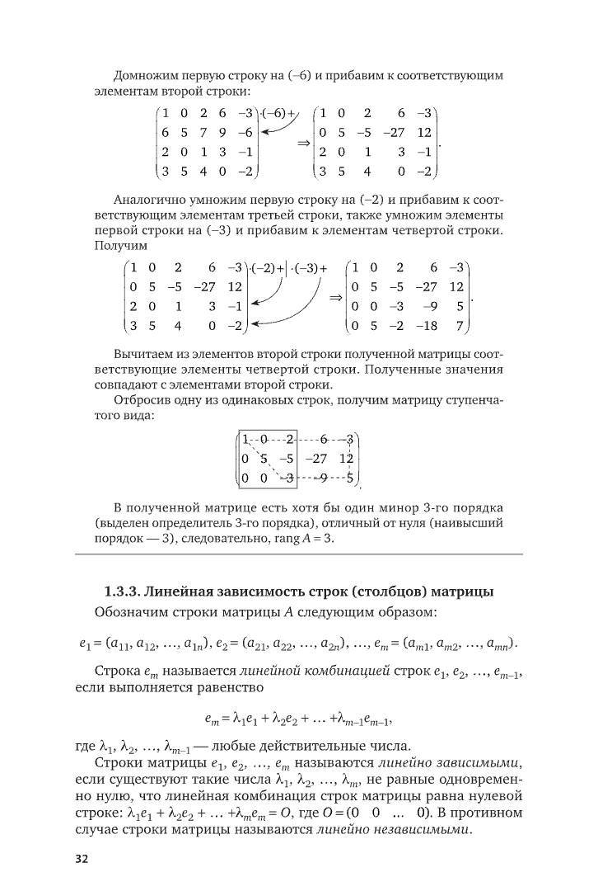

---

PDF стр. 40 · стр. книги 33 ^p040

Аналогично рассматривается линейная зависимость столбцов матрицы.

Доказано, что ранг матрицы равен максимальному числу ее линейно независимых строк или столбцов.

**Пример 1.20**

Найдем максимальное число линейно независимых строк матрицы

$$
A=\begin{pmatrix}1&2&1&4&2\\0&-1&1&-3&-2\\2&5&1&11&6\\-1&-3&0&-7&-4\end{pmatrix}.
$$

*Решение*

С помощью элементарных преобразований приведем матрицу к ступенчатому виду:

$$
\begin{pmatrix}1&2&1&4&2\\0&-1&1&-3&-2\\2&5&1&11&6\\-1&-3&0&-7&-4\end{pmatrix}\xrightarrow[IV+I]{III+I\cdot(-2)}\begin{pmatrix}1&2&1&4&2\\0&-1&1&-3&-2\\0&1&-1&3&2\\0&-1&1&-3&-2\end{pmatrix}\xrightarrow[IV+II\cdot(-1)]{III+II}
$$
$$
\Rightarrow\begin{pmatrix}1&2&1&4&2\\0&-1&1&-3&-2\\0&0&0&0&0\\0&0&0&0&0\end{pmatrix}.
$$

Отбрасываем нулевые строки:

$$
\begin{pmatrix}\boxed{\begin{matrix}1&2\\0&-1\end{matrix}}&\begin{matrix}1&4&2\\1&-3&-2\end{matrix}\end{pmatrix}\Rightarrow\operatorname{rang}A=2.
$$

Следовательно, по теореме о ранге матрицы исходная матрица имеет две линейно независимые строки (или столбца).

## 1.4. Обратная матрица

Известно, если число $a$ отлично от нуля ($a\ne0$), то для него существует число $\frac1a=a^{-1}$, называемое обратным, такое что $a\cdot a^{-1}=a^{-1}\cdot a=1$. Для квадратных матриц можно ввести аналогичное понятие.

Матрица $A^{-1}$ называется *обратной* к квадратной матрице $A$, если выполняется равенство

$$
A^{-1}A=AA^{-1}=E, \tag{1.9}
$$

где $E$ — единичная матрица того же порядка, что и матрица $A$.

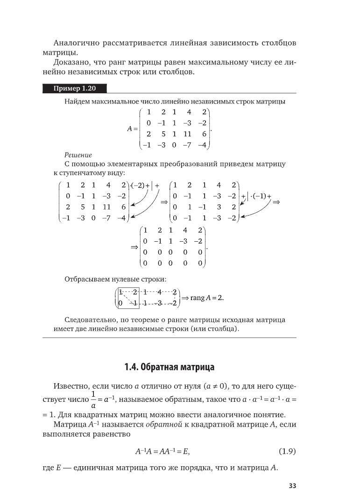

---

PDF стр. 41 · стр. книги 34 ^p041

Квадратная матрица $A$ называется *ортогональной*, если $A^{-1}=A^T$, где $A^{-1}$ — матрица, обратная к матрице $A$; $A^T$ — матрица, транспонированная к матрице $A$.

*Свойства* обратной матрицы:
1) $(A^{-1})^{-1}=A$;
2) $(AB)^{-1}=B^{-1}A^{-1}$;
3) $(A^{-1})^T=(A^T)^{-1}$.

**Теорема 1.2 (существования и единственности обратной матрицы).** *Обратная матрица $A^{-1}$ существует и является единственной тогда и только тогда, когда матрица $A$ является невырожденной, т. е.* $\det A\ne0$.

Необходимость невырожденности матрицы $A$ для существования обратной $A^{-1}$ следует из девятого свойства определителей (формула (1.8)). Имеем для равенства (1.9)

$$
|A\cdot A^{-1}|=|A|\cdot|A^{-1}|=|E|=1.
$$

Следовательно, $|A|\ne0$ и $|A^{-1}|\ne0$, т. е. $\det A\ne0$.

Обратная матрица для матрицы $A$ вычисляется по формуле

$$
A^{-1}=\frac{1}{|A|}\cdot A^+, \tag{1.10}
$$

где $|A|=\det A\ne0$; матрица $A^+$ — присоединенная матрица.

Обратную матрицу можно вычислить непосредственно по формуле (1.10). Для этого используется следующий алгоритм.

***Алгоритм нахождения обратной матрицы с помощью присоединенной матрицы***

1. Вычисляем определитель матрицы $A$ ($|A|=\det A$);
2. Строим присоединенную матрицу $A^+$ (см. подтему 1.2);
3. Находим обратную матрицу по формуле (1.10).

Полученную матрицу $A^{-1}$ рекомендуется проверить по формуле (1.9).

**Пример 1.21**

Вычислим произведение элементов второго столбца обратной матрицы для матрицы $A=\begin{pmatrix}2&4\\1&-2\end{pmatrix}$.

*Решение*

Найдем обратную матрицу с помощью построения присоединенной матрицы.

Вычислим определитель: $|A|=2\cdot(-2)-1\cdot4=-8$.

Построим присоединенную матрицу, элементами которой являются алгебраические дополнения элементов матрицы $A$:

$$
[A_{ij}]=\begin{pmatrix}A_{11}&A_{12}\\A_{21}&A_{22}\end{pmatrix},
$$

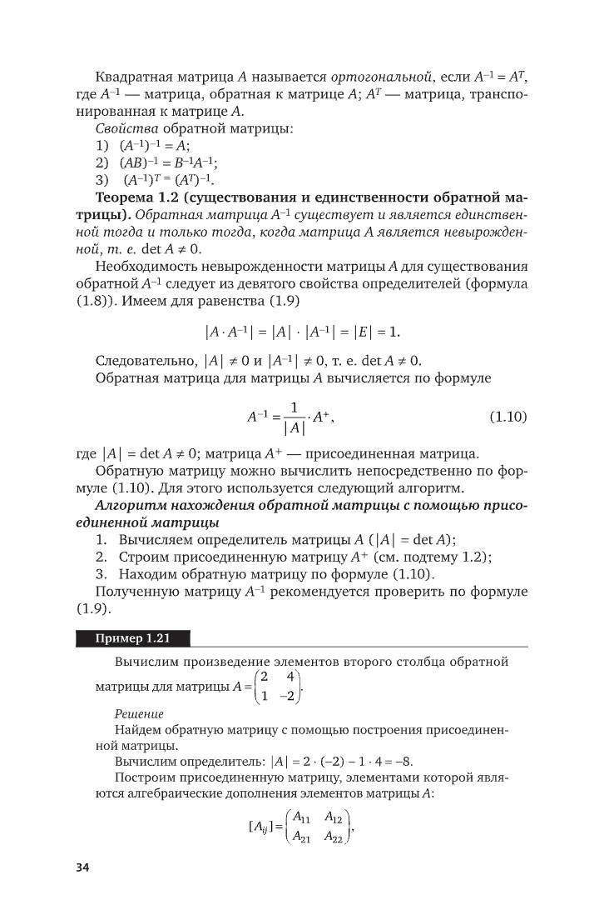

---

PDF стр. 42 · стр. книги 35 ^p042

где

$$
A_{11}=(-1)^{1+1}\cdot M_{11}=M_{11}=|-2|=-2;\ A_{12}=(-1)^{1+2}\cdot M_{12}=-|1|=-1;
$$
$$
A_{21}=(-1)^{2+1}\cdot M_{21}=-|4|=-4;\ A_{22}=(-1)^{2+2}\cdot M_{22}=|2|=2.
$$

Тогда $[A_{ij}]=\begin{pmatrix}-2&-1\\-4&2\end{pmatrix}$.

Транспонируем матрицу $[A_{ij}]$, получаем присоединенную $A^+$:

$$
A^+=[A_{ij}]^T=\begin{pmatrix}-2&-1\\-4&2\end{pmatrix}^T=\begin{pmatrix}-2&-4\\-1&2\end{pmatrix}.
$$

Находим обратную матрицу по формуле (1.10):

$$
A^{-1}=\frac{1}{|A|}\cdot A^+=\frac{1}{-8}\cdot\begin{pmatrix}-2&-4\\-1&2\end{pmatrix}=\begin{pmatrix}\frac14&\frac12\\\frac18&-\frac14\end{pmatrix}.
$$

Сделаем проверку с помощью равенства (1.9):

$$
A\cdot A^{-1}=\begin{pmatrix}2&4\\1&-2\end{pmatrix}\cdot\begin{pmatrix}\frac14&\frac12\\\frac18&-\frac14\end{pmatrix}=\begin{pmatrix}2\cdot\frac14+4\cdot\frac18&2\cdot\frac12+4\cdot\left(-\frac14\right)\\1\cdot\frac14+(-2)\cdot\frac18&1\cdot\frac12+(-2)\cdot\left(-\frac14\right)\end{pmatrix}=\begin{pmatrix}1&0\\0&1\end{pmatrix}=E.
$$

Аналогично

$$
A^{-1}\cdot A=\begin{pmatrix}\frac14&\frac12\\\frac18&-\frac14\end{pmatrix}\cdot\begin{pmatrix}2&4\\1&-2\end{pmatrix}=\begin{pmatrix}1&0\\0&1\end{pmatrix}=E.
$$

Значит, обратная матрица найдена верно.

Вычислим произведение элементов второго столбца найденной обратной матрицы:

$$
\frac12\cdot\left(-\frac14\right)=-\frac18=-0{,}125.
$$

Обратную матрицу можно вычислить с помощью элементарных преобразований (*метод Гаусса*). Для этого:

1) к матрице $A$ размерности $n\times n$ ($\det A\ne0$) справа приписываем единичную матрицу той же размерности, что и исходная матрица $A$. Получаем матрицу $(A|E)$ размерности $n\times2n$;

2) с помощью элементарных преобразований над строками объединенной матрицы

$$
(A|E)=\left(\begin{array}{cccc|cccc}a_{11}&a_{12}&\dots&a_{1n}&1&0&\dots&0\\a_{21}&a_{22}&\dots&a_{2n}&0&1&\dots&0\\\dots&\dots&\dots&\dots&\dots&\dots&\dots&\dots\\a_{n1}&a_{n2}&\dots&a_{nn}&0&0&\dots&1\end{array}\right)
$$

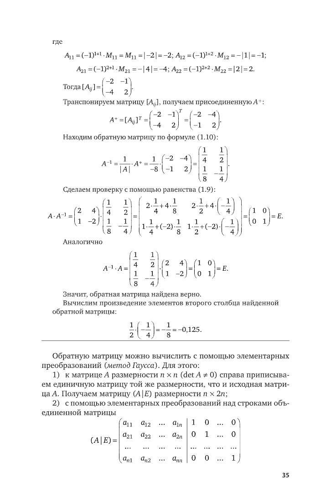

---

PDF стр. 43 · стр. книги 36 ^p043

получаем вместо элементов исходной матрицы $A$ элементы единичной матрицы:

$$
\left(\begin{array}{cccc|cccc}1&0&\dots&0&b_{11}&b_{12}&\dots&b_{1n}\\0&1&\dots&0&b_{21}&b_{22}&\dots&b_{2n}\\\dots&\dots&\dots&\dots&\dots&\dots&\dots&\dots\\0&0&\dots&1&b_{n1}&b_{n2}&\dots&b_{nn}\end{array}\right)=(E|A^{-1});
$$

3) матрица $A^{-1}$ имеет вид

$$
A^{-1}=\begin{pmatrix}b_{11}&b_{12}&\dots&b_{1n}\\b_{21}&b_{22}&\dots&b_{2n}\\\dots&\dots&\dots&\dots\\b_{n1}&b_{n2}&\dots&b_{nn}\end{pmatrix}.
$$

**Пример 1.22**

Для матрицы $B=\begin{pmatrix}1&2&4\\0&2&4\\3&-1&2\end{pmatrix}$ вычислим сумму элементов по главной диагонали обратной матрицы.

*Решение*

Найдем обратную матрицу с помощью элементарных преобразований. Но сначала проверим необходимое условие существования обратной матрицы. Так как $\det B=8\ne0$, то обратная матрица существует.

Построим объединенную матрицу:

$$
(B|E)=\left(\begin{array}{ccc|ccc}1&2&4&1&0&0\\0&2&4&0&1&0\\3&-1&2&0&0&1\end{array}\right).
$$

Проведем следующие элементарные преобразования: умножим элементы первой строки матрицы $(B|E)$ на −3 и прибавим к соответствующим элементам третьей строки, получим

$$
\left(\begin{array}{ccc|ccc}1&2&4&1&0&0\\0&2&4&0&1&0\\0&-7&-10&-3&0&1\end{array}\right).
$$

Все элементы второй строки умножим на $\frac12$:

$$
\left(\begin{array}{ccc|ccc}1&2&4&1&0&0\\0&1&2&0&\frac12&0\\0&-7&-10&-3&0&1\end{array}\right).
$$

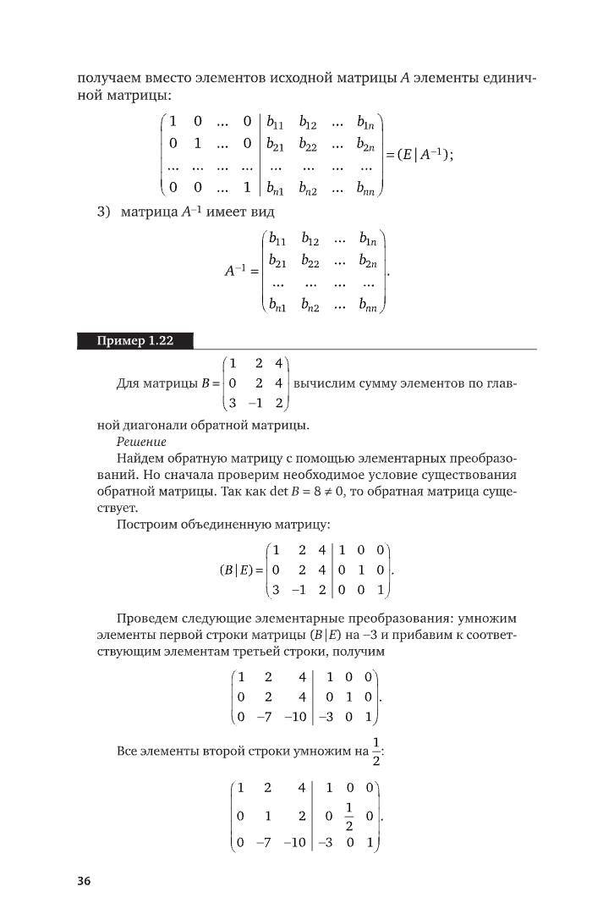

---

PDF стр. 44 · стр. книги 37 ^p044

Умножим элементы второй строки на −2 и прибавим к элементам первой строки:

$$
\left(\begin{array}{ccc|ccc}1&0&0&1&-1&0\\0&1&2&0&\frac12&0\\0&-7&-10&-3&0&1\end{array}\right).
$$

Умножим элементы второй строки на 7 и прибавим к элементам третьей строки:

$$
\left(\begin{array}{ccc|ccc}1&0&0&1&-1&0\\0&1&2&0&\frac12&0\\0&0&4&-3&\frac72&1\end{array}\right).
$$

Все элементы третьей строки умножим на $\frac14$:

$$
\left(\begin{array}{ccc|ccc}1&0&0&1&-1&0\\0&1&2&0&\frac12&0\\0&0&1&-\frac34&\frac78&\frac14\end{array}\right).
$$

Умножим элементы третьей строки на −2 и прибавим к элементам второй строки:

$$
\left(\begin{array}{ccc|ccc}1&0&0&1&-1&0\\0&1&0&\frac32&-\frac54&-\frac12\\0&0&1&-\frac34&\frac78&\frac14\end{array}\right)=(E|B^{-1}).
$$

Тогда $B^{-1}=\begin{pmatrix}1&-1&0\\\frac32&-\frac54&-\frac12\\-\frac34&\frac78&\frac14\end{pmatrix}$.

Найдем сумму элементов по главной диагонали полученной обратной матрицы:

$$
1+\left(-\frac54\right)+\frac14=0.
$$

Отметим, что сумма элементов главной диагонали матрицы $B^{-1}$ есть след этой матрицы, т. е. $\operatorname{tr}B^{-1}=0$.

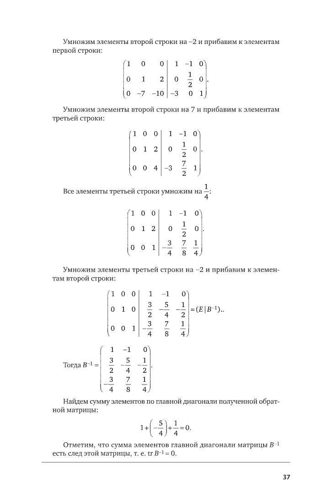

---

PDF стр. 45 · стр. книги 38 ^p045

Обратные матрицы используются при решении различных матричных уравнений. Пусть матрицы $A$ и $B$ имеют обратные матрицы, тогда имеем следующие решения матричных уравнений:
1) $AX=C$ — матрица $X=A^{-1}\cdot C$;
2) $XA=C$ — матрица $X=C\cdot A^{-1}$;
3) $AXB=C$ — матрица $X=A^{-1}\cdot C\cdot B^{-1}$.

**Пример 1.23**

Решим матричное уравнение

$$
X\cdot\begin{pmatrix}-5&2\\3&-1\end{pmatrix}=\begin{pmatrix}-2&4\\3&-1\end{pmatrix}.
$$

*Решение*

Если обозначить $\begin{pmatrix}-5&2\\3&-1\end{pmatrix}=A$ и $\begin{pmatrix}-2&4\\3&-1\end{pmatrix}=B$, то исходное матричное уравнение запишется в виде $X\cdot A=B$ и его решением будет матрица $X=B\cdot A^{-1}$.

Найдем обратную матрицу $A^{-1}$ для матрицы $A=\begin{pmatrix}-5&2\\3&-1\end{pmatrix}$. Используем алгоритм нахождения с помощью присоединенной матрицы.

Вычисляем определитель матрицы:

$$
|A|=\begin{vmatrix}-5&2\\3&-1\end{vmatrix}=-1.
$$

Строим матрицу $[A_{ij}]$:

$$
[A_{ij}]=\begin{pmatrix}A_{11}&A_{12}\\A_{21}&A_{22}\end{pmatrix}=\begin{pmatrix}-1&-3\\-2&-5\end{pmatrix}.
$$

Транспонируем матрицу $[A_{ij}]$:

$$
A^+=[A_{ij}]^T=\begin{pmatrix}-1&-3\\-2&-5\end{pmatrix}^T=\begin{pmatrix}-1&-2\\-3&-5\end{pmatrix}.
$$

Находим обратную матрицу:

$$
A^{-1}=\frac{1}{|A|}\cdot A^+=\frac{1}{-1}\cdot\begin{pmatrix}-1&-2\\-3&-5\end{pmatrix}=\begin{pmatrix}1&2\\3&5\end{pmatrix}.
$$

Тогда

$$
X=B\cdot A^{-1}=\begin{pmatrix}-2&4\\3&-1\end{pmatrix}\cdot\begin{pmatrix}1&2\\3&5\end{pmatrix}=\begin{pmatrix}10&16\\0&1\end{pmatrix}.
$$

Сделаем проверку:

$$
X\cdot A=\begin{pmatrix}10&16\\0&1\end{pmatrix}\cdot\begin{pmatrix}-5&2\\3&-1\end{pmatrix}=\begin{pmatrix}-2&4\\3&-1\end{pmatrix}=B.
$$

Решение верно.

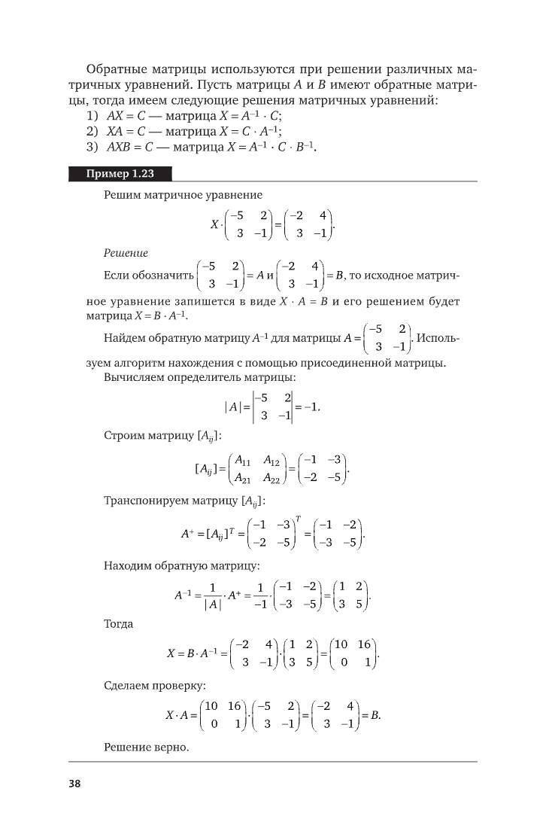

---

PDF стр. 46 · стр. книги 39 ^p046

## 1.5. Использование алгебры матриц в решении экономических задач

Матрицы широко используются в решении экономических задач. Как уже отмечалось, матрицы — это способ хранения, передачи и обработки информации. Любая таблица, с которой приходится иметь дело в бытовой или профессиональной деятельности, может быть представлена в матричном виде, допускающем выполнение разнообразных действий, позволяющем свести громоздкие вычисления к компактной и удобной форме. С помощью действий над матрицами можно определять объем выпускаемой продукции за определенный период времени, выручку, затраты, стоимость ресурсов и т. п. Рассмотрим примеры.

**Пример 1.24**

Два комбината выпускают четыре вида мясной продукции. В матрицах поквартальных выпусков за один отчетный год $A_k$ (где $k$ — номер квартала в году) элементы $a_{ij}$ представляют объемы выпуска на $i$-м комбинате $j$-го вида продукции:

$$
A_1=\begin{pmatrix}45&78&50&53\\64&60&25&60\end{pmatrix},\ A_2=\begin{pmatrix}50&75&55&53\\50&60&35&66\end{pmatrix},
$$
$$
A_3=\begin{pmatrix}50&60&59&55\\45&60&45&70\end{pmatrix},\ A_4=\begin{pmatrix}53&62&65&56\\40&60&50&72\end{pmatrix}.
$$

Найдем матрицу годового выпуска продукции и матрицы прироста объемов производства за каждый квартал, проанализируем полученные результаты.

*Решение*

1. Матрица годового выпуска продукции определяется суммой матриц поквартальных выпусков $A_1,A_2,A_3,A_4$:

$$
V=A_1+A_2+A_3+A_4=\begin{pmatrix}45&78&50&53\\64&60&25&60\end{pmatrix}+\begin{pmatrix}50&75&55&53\\50&60&35&66\end{pmatrix}+
$$
$$
+\begin{pmatrix}50&60&59&55\\45&60&45&70\end{pmatrix}+\begin{pmatrix}53&62&65&56\\40&60&50&72\end{pmatrix}=\begin{pmatrix}198&275&229&217\\199&240&155&268\end{pmatrix}.
$$

2. Прирост продукции во втором квартале определяется разностью матриц $A_2$ и $A_1$:

$$
G_1=A_2-A_1=\begin{pmatrix}50&75&55&53\\50&60&35&66\end{pmatrix}-\begin{pmatrix}45&78&50&53\\64&60&25&60\end{pmatrix}=\begin{pmatrix}5&-3&5&0\\-14&0&10&6\end{pmatrix}.
$$

Прирост продукции в третьем квартале определяется разностью матриц $A_3$ и $A_2$:

$$
G_2=A_3-A_2=\begin{pmatrix}50&60&59&55\\45&60&45&70\end{pmatrix}-\begin{pmatrix}50&75&55&53\\50&60&35&66\end{pmatrix}=\begin{pmatrix}0&-15&4&2\\-5&0&10&4\end{pmatrix}.
$$

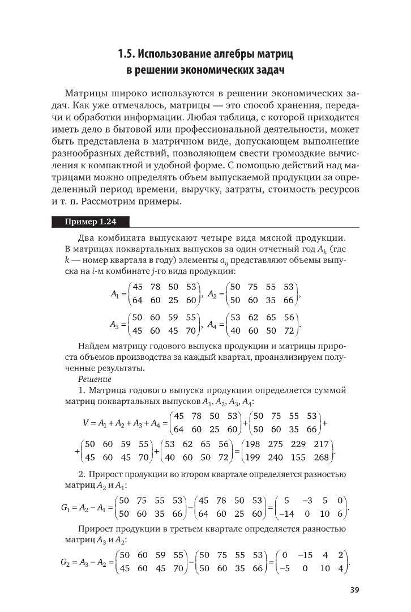

---

PDF стр. 47 · стр. книги 40 ^p047

Прирост продукции в четвертом квартале определяется разностью матриц $A_4$ и $A_3$:

$$
G_3=A_4-A_3=\begin{pmatrix}53&62&65&56\\40&60&50&72\end{pmatrix}-\begin{pmatrix}50&60&59&55\\45&60&45&70\end{pmatrix}=\begin{pmatrix}3&2&6&1\\-5&0&5&2\end{pmatrix}.
$$

Результаты вычислений позволяют сделать вывод о том, что в целом на обоих комбинатах наблюдается увеличение выпуска продукции. Но при этом на первом комбинате объемы выпуска продукции второго вида во втором и третьем кварталах уменьшались, а в четвертом — объем вырос. На втором комбинате объем выпуска первого вида с каждым кварталом уменьшался, а объем второго вида продукции в течение всего года был одинаковым.

**Пример 1.25**

Молокозавод производит четыре вида йогурта, объемы выпуска которого заданы матрицей $A=(40\ \ 10\ \ 20\ \ 15)$. Реализация продукции производится в трех магазинах. Цена реализации единицы $i$-го вида йогурта в $j$-м магазине задана матрицей $B=\begin{pmatrix}2&1&2\\3&1&3\\2&4&3\\1&3&4\end{pmatrix}$. Найдем матрицу выручки по магазинам и определим, какой из них наиболее выгоден для реализации товара.

*Решение*

Для нахождения матрицы выручки по магазинам необходимо вычислить произведение матриц $A\cdot B$. Эта операция возможна, поскольку матрица $A_{1\times4}$ согласована с матрицей $B_{4\times3}$ ($A_{1\times4}\cdot B_{4\times3}=C_{1\times3}$):

$$
A\cdot B=(40\ \ 10\ \ 20\ \ 15)\cdot\begin{pmatrix}2&1&2\\3&1&3\\2&4&3\\1&3&4\end{pmatrix}=(165\ \ 175\ \ 230).
$$

Наиболее выгодным для реализации товара является третий магазин, в котором выручка от реализации товара составит 230 ден. ед.

**Пример 1.26**

Швейный цех за месяц на пошив двух видов штор, объем выпуска которых составляет 240 и 310 м, использует три вида материалов. Нормы расхода материалов на единицу каждого вида изделия, цена материала представлены в табл. 1.1.

Представим данные задачи в матричном виде и найдем матрицу полных затрат по материалам каждого вида и полную стоимость всего материала за месяц.

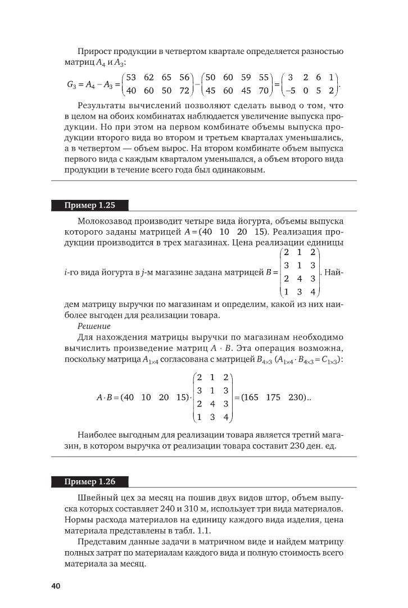

---

PDF стр. 48 · стр. книги 41 ^p048

*Таблица 1.1*

| Вид материала | Расход на изделие 1, м | Расход на изделие 2, м | Цена материала, ден. ед. |
|:---:|:---:|:---:|:---:|
| 1 | 3 | 2 | 21 |
| 2 | 2 | 1 | 18 |
| 3 | 1 | 3 | 20 |

*Решение*

1. Нормы затрат $i$-го вида материала на пошив шторы $j$-го вида представим матрицей $A=\begin{pmatrix}3&2\\2&1\\1&3\end{pmatrix}$, объем выпуска штор каждого вида за месяц — матрицей $B=\begin{pmatrix}240\\310\end{pmatrix}$, а стоимость одного метра материала каждого вида — матрицей $P=(21\ \ 18\ \ 20)$.

2. Для нахождения матрицы полных затрат по материалам каждого вида необходимо вычислить произведение матриц $A\cdot B$. Эта операция возможна, поскольку матрица $A_{3\times2}$ согласована с матрицей $B_{2\times1}$ ($A_{3\times2}\cdot B_{2\times1}=C_{3\times1}$):

$$
A\cdot B=\begin{pmatrix}3&2\\2&1\\1&3\end{pmatrix}\cdot\begin{pmatrix}240\\310\end{pmatrix}=\begin{pmatrix}1340\\790\\1170\end{pmatrix}.
$$

3. Для нахождения матрицы полной стоимости на весь материал необходимо вычислить произведение матриц $P\cdot A\cdot B$. Эта операция возможна, поскольку матрица $P_{1\times3}$ согласована с матрицей $(AB)_{3\times1}$ ($P_{1\times3}\cdot(AB)_{3\times1}=G_{1\times1}$):

$$
P\cdot A\cdot B=(21\ \ 18\ \ 20)\cdot\begin{pmatrix}3&2\\2&1\\1&3\end{pmatrix}\cdot\begin{pmatrix}240\\310\end{pmatrix}=(21\ \ 18\ \ 20)\cdot\begin{pmatrix}1340\\790\\1170\end{pmatrix}=
$$
$$
=65\,760\ \text{ден. ед.}
$$

## Вопросы и задания для повторения

1. Сформулируйте определение матрицы, выделите ее характеристики.
2. Перечислите основные виды матриц. Каковы их свойства?
3. Сформулируйте правила выполнения операций над матрицами, перечислите их свойства.
4. Сформулируйте определение перестановочной матрицы и алгоритм ее нахождения.
5. Сформулируйте определение присоединенной матрицы и алгоритм ее нахождения.

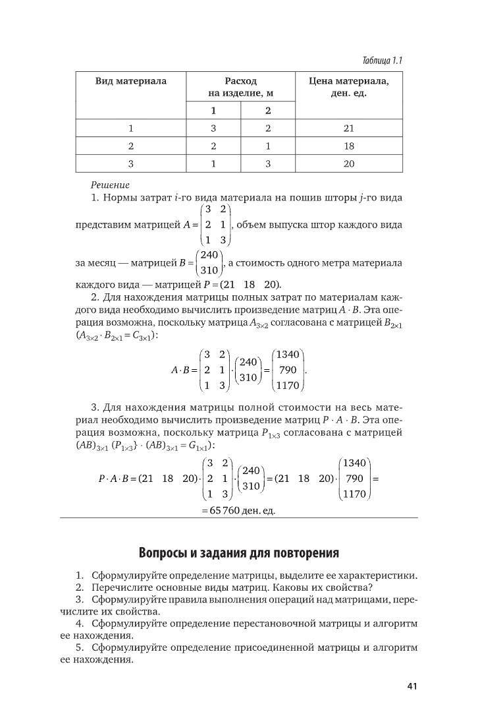

---

PDF стр. 49 · стр. книги 42 ^p049

6. Сформулируйте условия существования обратной матрицы и способы ее нахождения.
7. Какие вы знаете способы вычисления определителей различных порядков?
8. Перечислите свойства определителей.
9. Перечислите виды эквивалентных (элементарных) преобразований матрицы.
10. Сформулируйте определение ранга матрицы, перечислите способы его вычисления и приведите соответствующие алгоритмы.

## Задания для самостоятельного решения

**1.1.** Для заданных матриц $A$ и $B$:

а) найдите $5A$; $-3B$; $5A-3B$; $A^T$; $(B^T)^T$; $(5A-3B)^T$; $\operatorname{tr}A$; $\operatorname{tr}B$;

б) найдите $A^2$; $B^3$; $AA^T$; $B^TB$; $AB$; $BA$; $A^TB$; $B^TA$; $AB^T$; $BA^T$; $A^TB^T$; $B^TA^T$; $\operatorname{tr}(A^TB)$; $\operatorname{tr}(AB^T)$;

в) найдите $P(A)$, если $P(x)=5-4x$; $P(B)$, если $P(x)=2x^2-7x+3$;

г) решите уравнения $4A-3E+2X=0$ и $4Y-5E=2B^T$.

1) $A=\begin{pmatrix}3&0&-1\\1&-2&4\\7&4&0\end{pmatrix}$, $B=\begin{pmatrix}-1&3&8\\0&5&1\end{pmatrix}$; 2) $A=\begin{pmatrix}0&5\\2&1\\3&-2\end{pmatrix}$, $B=\begin{pmatrix}2&-3&0\\1&5&-7\\2&1&-1\end{pmatrix}$.

**1.2.** Найдите все матрицы, перестановочные с матрицей $A$, выполните проверку:

1) $A=\begin{pmatrix}1&-1\\2&2\end{pmatrix}$; 2) $A=\begin{pmatrix}-1&2\\0&5\end{pmatrix}$.

**1.3.** Вычислите определители данных матриц:

1) $A=\begin{pmatrix}3&-4\\2&-5\end{pmatrix}$, $B=\begin{pmatrix}3&-4&7\\2&-1&3\\-5&0&-3\end{pmatrix}$, $C=\begin{pmatrix}3&-2&0&1\\0&-7&-3&8\\-4&6&0&-5\\1&0&4&-2\end{pmatrix}$;

2) $A=\begin{pmatrix}-3&7\\2&6\end{pmatrix}$, $B=\begin{pmatrix}-3&3&2\\5&-8&1\\0&4&-3\end{pmatrix}$, $C=\begin{pmatrix}4&-2&0&-1\\2&1&-8&3\\-4&0&2&0\\0&-3&1&-5\end{pmatrix}$.

**1.4.** Для заданных матриц вычислите $A_{32}-3|A|-2M_{21}$:

1) $A=\begin{pmatrix}-3&2&1&0\\-1&-4&-2&3\\0&5&-1&2\\4&7&3&-6\end{pmatrix}$; 2) $A=\begin{pmatrix}4&-2&0&-1\\2&1&-8&3\\-4&0&2&0\\0&-3&1&-5\end{pmatrix}$.

**1.5.** Решите уравнения:

1) $\begin{vmatrix}-1&\cos2\varphi&2\\2&-3&0\\4&\sin\varphi&1\end{vmatrix}=33$, $\begin{vmatrix}2&-3&\ln x&1\\\ln x&-1&4&-2\\-1&2&1&0\\3&0&-1&2\end{vmatrix}=56$;

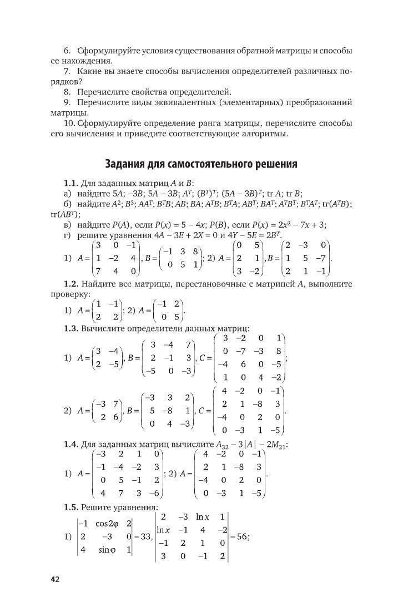

---

PDF стр. 50 · стр. книги 43 ^p050

2) $\begin{vmatrix}2&-1&3\\\cos\varphi&1&\cos2\varphi\\-1&0&-2\end{vmatrix}=2$, $\begin{vmatrix}3&-4&-1&\lg x\\0&1&2&-1\\-2&-3&1&5\\1&0&\lg x&-2\end{vmatrix}=-26$.

**1.6.** Решите неравенства:

1) $\begin{vmatrix}4^x&-1&0\\6^x&2&1\\9^x&-3&2\end{vmatrix}\ge0$, $\begin{vmatrix}-2&3&0&1\\0&y^3&1&0\\1&y&-1&-1\\-1&2&-2&-1\end{vmatrix}\le0$;

2) $\begin{vmatrix}-1&2&-4\\0&1&-5\\4^x&10^x&25^x\end{vmatrix}\le0$, $\begin{vmatrix}-3&1&y^2&0\\4&-2&-y^3&1\\1&-1&4&5\\-2&0&3&-1\end{vmatrix}\ge-32$.

**1.7.** Вычислите ранги матриц:

1) $A=\begin{pmatrix}-1&2\\3&4\end{pmatrix}$, $B=\begin{pmatrix}2&-4&-2\\5&-5&0\\0&3&3\end{pmatrix}$, $C=\begin{pmatrix}2&3&-2&0&-1\\3&6&-7&5&-6\\-1&-1&1&0&2\\0&2&-4&5&-3\end{pmatrix}$;

2) $A=\begin{pmatrix}3&-6\\-1&2\end{pmatrix}$, $B=\begin{pmatrix}-3&1&8\\2&-4&-5\\1&3&-3\end{pmatrix}$, $C=\begin{pmatrix}5&-3&0&1&-2\\-3&4&3&-5&1\\2&1&3&-4&-1\\-1&5&6&-9&0\end{pmatrix}$.

**1.8.** Вычислите $r(A)\cdot r(B)$ для данных матриц:

1) $A=\begin{pmatrix}2&-1&-3\\-2&-1&-6\\2&2&3\\-12&-5&-9\end{pmatrix}$, $B=\begin{pmatrix}5&0&1&-1\\0&6&0&-8\\2&1&2&0\\0&1&2&-2\end{pmatrix}$;

2) $A=\begin{pmatrix}-1&-3&3&0\\-2&4&5&9\\3&-1&-8&-9\\1&3&-3&0\end{pmatrix}$, $B=\begin{pmatrix}-4&2&3&-3&6\\1&-1&-3&1&-1\\2&0&3&1&-4\\3&-1&0&2&-5\end{pmatrix}$.

**1.9.** С помощью элементарных преобразований приведите матрицы к квазитреугольному виду:

1) $\begin{pmatrix}4&5&1&-1\\-1&-2&-1&1\\0&1&1&-1\\2&1&-1&1\end{pmatrix}$, $\begin{pmatrix}2&7&3&1&6\\1&-2&-1&1&-2\\-3&-5&-2&-2&-4\\1&9&4&0&8\end{pmatrix}$;

2) $\begin{pmatrix}3&2&-1&-1\\2&-1&3&-1\\8&5&-4&-1\\5&1&2&-2\end{pmatrix}$, $\begin{pmatrix}3&-6&-3&12&9\\1&-5&-6&-2&-4\\0&1&-4&1&-6\\2&-5&1&6&10\end{pmatrix}$.

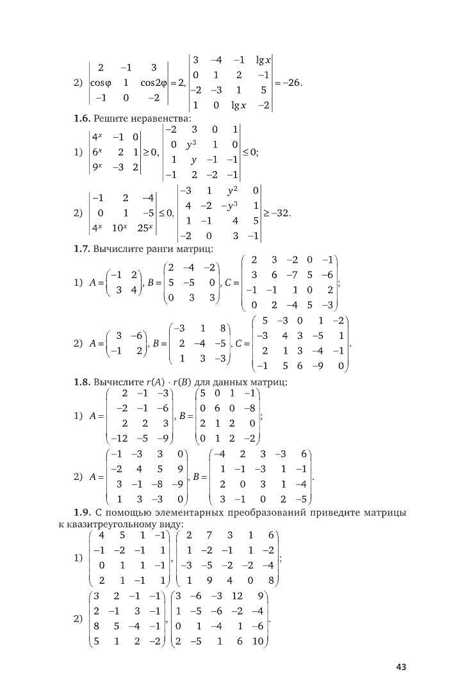

---

PDF стр. 51 · стр. книги 44 ^p051

**1.10.** Определите максимальное число линейно независимых строк следующих матриц:

1) $A=\begin{pmatrix}-4&2\\3&-3\end{pmatrix}$, $B=\begin{pmatrix}4&-1&-2\\5&0&3\\-2&2&1\end{pmatrix}$, $C=\begin{pmatrix}2&-6&-4&-2&4\\5&-15&-10&-5&10\\-7&21&14&7&-14\\-3&9&6&3&-6\end{pmatrix}$;

2) $A=\begin{pmatrix}8&-4\\-6&3\end{pmatrix}$, $B=\begin{pmatrix}14&-4&2\\-7&2&-1\\21&-6&3\end{pmatrix}$, $C=\begin{pmatrix}-3&1&0&-2&5\\-1&1&3&-1&1\\2&0&3&1&-4\\3&-2&-1&5&2\end{pmatrix}$.

**1.11.** Найдите обратные матрицы к данным и выполните проверку:

1) $A=\begin{pmatrix}-2&2\\-1&-1\end{pmatrix}$, $B=\begin{pmatrix}-1&1&0\\2&2&3\\-1&2&1\end{pmatrix}$;

2) $A=\begin{pmatrix}4&2\\-3&-2\end{pmatrix}$, $B=\begin{pmatrix}-5&6&2\\2&-2&-5\\-3&4&-4\end{pmatrix}$.

**1.12.** Вычислите $\operatorname{tr}(A^{-1})$ для заданных матриц:

1) $A=\begin{pmatrix}5&2&4\\7&3&4\\2&1&-1\end{pmatrix}$; 2) $A=\begin{pmatrix}2&1&-1\\1&-7&3\\1&2&-1\end{pmatrix}$.

**1.13.** Для четырех фабрик, выпускающих пять видов изделий, заданы матрицы поквартальных выпусков одного отчетного года:

$$
A_{\mathrm I}=\begin{pmatrix}10&15&20&17&11\\21&30&16&18&31\\14&22&14&25&8\\12&32&9&10&20\end{pmatrix};\ A_{\mathrm{II}}=\begin{pmatrix}12&18&20&20&15\\17&28&19&23&33\\20&20&18&26&18\\9&3&12&12&22\end{pmatrix};
$$
$$
A_{\mathrm{III}}=\begin{pmatrix}14&18&25&20&11\\20&30&25&20&30\\18&20&20&25&12\\14&30&15&11&20\end{pmatrix};\ A_{\mathrm{IV}}=\begin{pmatrix}12&20&20&20&14\\20&32&28&25&30\\20&25&30&30&10\\10&28&18&14&24\end{pmatrix}.
$$

Найдите матрицу годового выпуска продукции и матрицы приростов за каждый квартал и проанализируйте полученные результаты.

**1.14.** Для трех автозаводов, выпускающих шесть видов автопродукции, заданы матрицы поквартальных выпусков одного отчетного года:

$$
A_{\mathrm I}=\begin{pmatrix}60&92&30&72&50&60\\52&95&31&70&52&40\\60&95&25&62&60&30\end{pmatrix};\ A_{\mathrm{II}}=\begin{pmatrix}58&100&23&73&52&44\\50&110&31&68&55&45\\62&98&28&60&60&32\end{pmatrix};
$$
$$
A_{\mathrm{III}}=\begin{pmatrix}60&100&25&75&48&32\\48&98&31&72&53&48\\64&93&25&63&60&33\end{pmatrix};\ A_{\mathrm{IV}}=\begin{pmatrix}64&95&28&75&56&38\\49&96&31&78&58&51\\66&99&25&60&61&38\end{pmatrix}.
$$

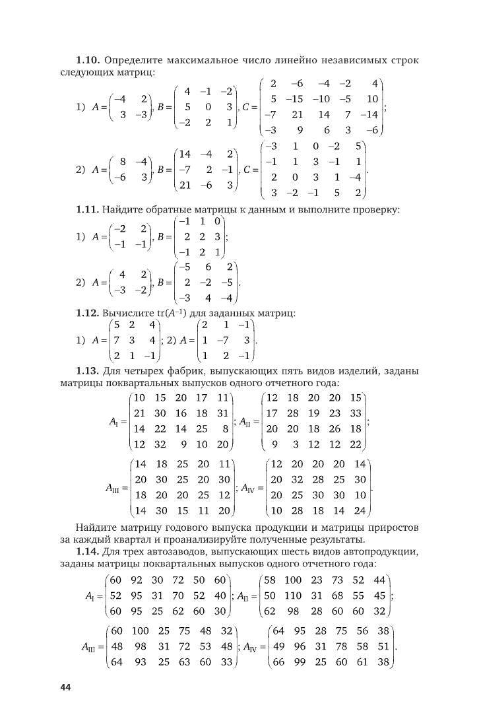

---

PDF стр. 52 · стр. книги 45 ^p052

Найдите матрицу годового выпуска автопродукции и матрицы приростов за каждый квартал и проанализируйте полученные результаты.

**1.15.** Предприятие производит четыре вида продукции и продает ее в пяти районах города. Матрица $B=\begin{pmatrix}2&5&1&2&1\\1&4&3&3&3\\3&2&4&2&3\\2&3&2&1&2\end{pmatrix}$ задает цену реализации единицы продукции $i$-го типа в $j$-м районе. Рассчитайте выручку предприятия в каждом районе, если реализация товара за месяц по видам задана матрицей $A=(80\ \ 50\ \ 35\ \ 45)$. Определите, какой район наиболее выгоден для реализации.

**1.16.** Молокозавод производит пять видов продукции, объемы выпуска которой заданы матрицей $A=(25\ \ 31\ \ 20\ \ 16\ \ 30)$. Реализация продукции производится в четырех магазинах города. Цена реализации единицы $i$-го вида продукции в $j$-м магазине задана матрицей $B=\begin{pmatrix}21&32&10&42\\18&25&27&51\\20&50&19&30\\10&30&45&28\\40&20&25&35\end{pmatrix}$. Найдите выручку по магазинам и определите, какой из магазинов наиболее выгоден для реализации товара.

**1.17.** Завод производит четыре типа продукции, используя пять видов ресурсов. Норма затрат ресурсов $i$-го вида на производство единицы продукции $j$-го типа задана матрицей $A=\begin{pmatrix}3&2&1&1\\1&3&2&2\\1&4&2&3\\2&1&3&2\\2&3&1&1\end{pmatrix}$, выпуск продукции за отчетный период — матрицей $B=\begin{pmatrix}32\\44\\28\\35\end{pmatrix}$, стоимость единицы каждого вида ресурсов задана матрицей $P=(10\ \ 17\ \ 20\ \ 12\ \ 15)$. Найдите за отчетный период матрицу полных затрат ресурсов каждого вида и полную стоимость всех затраченных ресурсов.

**1.18.** Фабрика производит пять типов продукции, используя четыре вида ресурсов. Норма затрат ресурсов $i$-го вида на производство единицы продукции $j$-го типа задана матрицей $A=\begin{pmatrix}30&25&40&20&15\\25&40&15&50&10\\25&10&20&40&20\\35&45&30&15&45\end{pmatrix}$, выпуск продукции за отчетный период — матрицей $B=\begin{pmatrix}33\\47\\54\\29\\42\end{pmatrix}$, стоимость единицы каждого вида

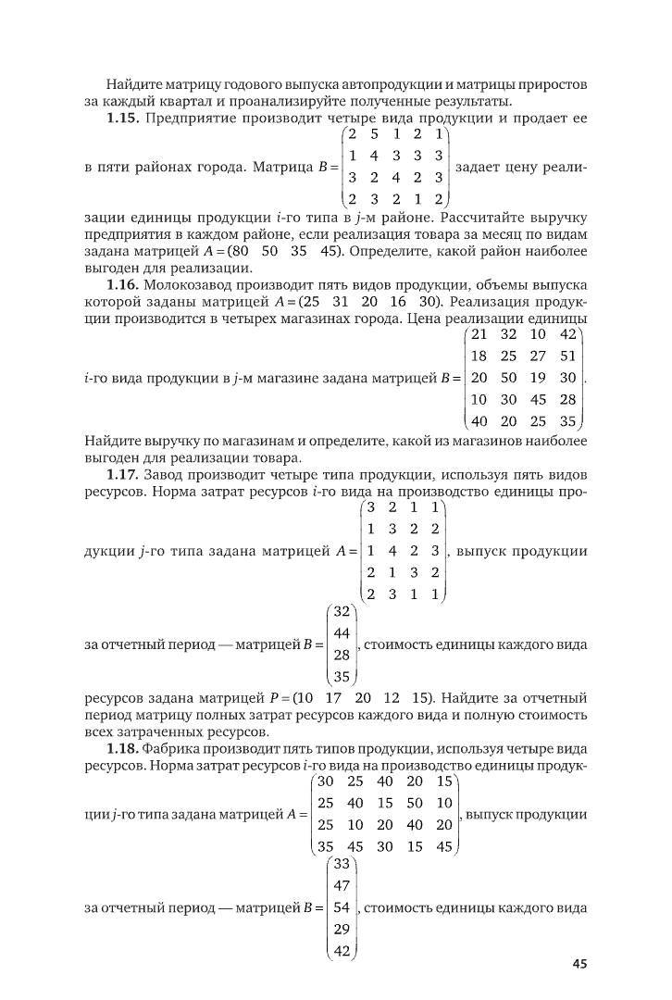

---

PDF стр. 53 · стр. книги 46 ^p053

ресурсов задана матрицей $P=(24\ \ 18\ \ 20\ \ 26)$. Найдите за отчетный период матрицу полных затрат ресурсов каждого вида и полную стоимость всех затраченных ресурсов.

## Список рекомендуемой литературы

*Боревич, З. И.* Определители и матрицы : учебное пособие / З. И. Боревич. — Санкт-Петербург : Лань, 2009.

Высшая математика для экономического бакалавриата. В 3 частях. Ч. 3 : учебник и практикум для вузов / Н. Ш. Кремер, М. Н. Фридман, Б. А. Путко, И. М. Тришин ; под редакцией Н. Ш. Кремера. — 5-е изд., перераб. и доп. — Москва : Издательство Юрайт, 2024.

*Малугин, В. А.* Линейная алгебра для экономистов. Учебник, практикум и сборник задач : для вузов / В. А. Малугин, Я. А. Рощина. — Москва : Издательство Юрайт, 2024.

*Просветов, Г. И.* Линейная алгебра и аналитическая геометрия. Задачи и решения : учебно-практическое пособие / Г. И. Просветов. — Москва : Альфа-пресс, 2009.

---

PDF стр. 54 · стр. книги 47 ^p054

# Тема 2. СИСТЕМЫ ЛИНЕЙНЫХ УРАВНЕНИЙ

Системы линейных уравнений (СЛУ) являются инструментом математического моделирования самых разнообразных процессов. Данная тема посвящена проблемам исследования и решения систем линейных уравнений. В результате изучения материала данной темы обучаемые должны:

***знать***
- общий вид и матричную форму записи СЛУ;
- виды СЛУ;
- теорему Кронекера — Капелли;
- теорему и формулы Крамера;
- условие разрешимости СЛУ при использовании метода обратной матрицы;
- общий вид и матричную форму записи балансовых соотношений, постановку модели межотраслевого баланса Леонтьева, критерии продуктивности;

***уметь***
- переводить СЛУ к матричной форме от общего вида и наоборот;
- устанавливать совместность и несовместность СЛУ;
- решать СЛУ методом обратной матрицы;
- применять формулы Крамера для нахождения решения СЛУ;
- записывать общее решение однородной системы;
- составлять балансовые соотношения модели межотраслевого баланса Леонтьева;
- определять величины модели межотраслевого баланса;

***владеть***
- методикой определения разрешимости СЛУ;
- навыками исследования СЛУ методом Гаусса;
- методикой нахождения фундаментальной системы решений однородной СЛУ;
- навыками применения различных методов нахождения решения СЛУ при решении экономических задач;
- навыками составления межотраслевого баланса;
- методикой определения разрешимости уравнения межотраслевого баланса.

---

PDF стр. 55 · стр. книги 48 ^p055

## 2.1. Основные определения и исследование системы линейных уравнений

Система $m$ линейных уравнений с $n$ неизвестными имеет вид

$$
\begin{cases}a_{11}x_1+a_{12}x_2+\dots+a_{1j}x_j+\dots+a_{1n}x_n=b_1,\\a_{21}x_1+a_{22}x_2+\dots+a_{2j}x_j+\dots+a_{2n}x_n=b_2,\\\dots\\a_{i1}x_1+a_{i2}x_2+\dots+a_{ij}x_j+\dots+a_{in}x_n=b_i,\\\dots\\a_{m1}x_1+a_{m2}x_2+\dots+a_{mj}x_j+\dots+a_{mn}x_n=b_m,\end{cases} \tag{2.1}
$$

где $a_{ij}\in\mathbb{R}$ называют *коэффициентами системы при неизвестных* (переменных) $x_j$, а $b_i\in\mathbb{R}$ — *свободными коэффициентами* или *свободными членами*, $i=1,2,\dots,m$; $j=1,2,\dots,n$.

Если все свободные коэффициенты системы (2.1) равны нулю ($b_i=0$ для любого $i=1,2,\dots,m$), то такую систему называют *однородной*.

Если хотя бы один свободный коэффициент системы (2.1) отличен от нуля ($b_i\ne0$ хотя бы для одного $i=1,2,\dots,m$), то такую систему называют *неоднородной*.

*Решением системы линейных уравнений* (2.1) называется упорядоченная совокупность чисел $x_1,x_2,\dots,x_n$, подстановка которых в систему обращает каждое ее уравнение в тождество. Система линейных уравнений называется *совместной*, если она имеет хотя бы одно решение. Система линейных уравнений называется *несовместной*, если она не имеет ни одного решения.

Совместная система называется *определенной*, если она имеет единственное решение. Совместная система называется *неопределенной*, если она имеет более одного решения.

Выражение «решить систему линейных уравнений» означает, что необходимо исследовать систему на совместность и в случае совместности найти все ее решения.

Матрица

$$
A=\begin{pmatrix}a_{11}&a_{12}&\dots&a_{1n}\\a_{21}&a_{22}&\dots&a_{2n}\\\dots&\dots&\dots&\dots\\a_{m1}&a_{m2}&\dots&a_{mn}\end{pmatrix},
$$

составленная из коэффициентов при неизвестных $x_i$, $i=1,2,\dots,n$, называется *матрицей основных коэффициентов* или *основной матрицей системы линейных уравнений* (2.1).

---

PDF стр. 56 · стр. книги 49 ^p056

Матрица

$$
B=\begin{pmatrix}b_1\\b_2\\\dots\\b_m\end{pmatrix},
$$

составленная из свободных коэффициентов (членов) системы линейных уравнений (2.1), называется *матрицей свободных коэффициентов* (*членов*).

Матрица

$$
X=\begin{pmatrix}x_1\\x_2\\\dots\\x_n\end{pmatrix}
$$

называется *матрицей неизвестных* системы линейных уравнений (2.1).

Матричной формой, или матричным видом, системы линейных уравнений (2.1) является матричное уравнение

$$
A\cdot X=B. \tag{2.2}
$$

Матрица

$$
\overline{A}=(A|B)=\left(\begin{array}{cccc|c}a_{11}&a_{12}&\dots&a_{1n}&b_1\\a_{21}&a_{22}&\dots&a_{2n}&b_2\\\dots&\dots&\dots&\dots&\dots\\a_{m1}&a_{m2}&\dots&a_{mn}&b_m\end{array}\right)
$$

называется *расширенной матрицей* системы линейных уравнений (2.1).

В общем случае проблема исследования системы линейных уравнений на совместность решается с помощью следующей теоремы.

**Теорема 2.1 (Кронекера — Капелли).** *Система линейных уравнений совместна тогда и только тогда, когда ранг основной матрицы системы $A$ равен рангу расширенной матрицы $\overline{A}$* ($\operatorname{rang}A=\operatorname{rang}\overline{A}$).

Для совместной системы линейных уравнений верны следующие утверждения:

1) совместная система $m$ линейных уравнений с $n$ неизвестными имеет единственное решение, если ее ранг равен числу неизвестных ($\operatorname{rang}A=\operatorname{rang}\overline{A}=n$);

2) совместная система $m$ линейных уравнений с $n$ неизвестными имеет бесконечное множество решений, если ее ранг меньше числа неизвестных ($\operatorname{rang}A=\operatorname{rang}\overline{A}<n$).

---

PDF стр. 57 · стр. книги 50 ^p057

Возможны три вида совместных систем линейных уравнений:
1) число уравнений системы меньше числа неизвестных ($m<n$);
2) число уравнений системы совпадает с числом неизвестных ($m=n$);
3) число уравнений системы больше числа неизвестных ($m>n$).

Результаты исследования для каждого вида наглядно представлены на рис. 2.1.

*Рис. 2.1*

**Пример 2.1**

Установим совместность систем уравнений:

1) $\begin{cases}3x_1-5x_2=13,\\2x_1+7x_2=81;\end{cases}$ 2) $\begin{cases}3x_1-4x_2=-6,\\-6x_1+8x_2=12;\end{cases}$ 3) $\begin{cases}2x_1-5x_2=3,\\12x_1-30x_2=-6;\end{cases}$

4) $\begin{cases}x_1+x_2-x_3-x_4=1,\\x_1+x_2-2x_3+3x_4=2,\\x_1+x_2+x_3-9x_4=-1.\end{cases}$

*Решение*

1) Число уравнений $m$ и число неизвестных $n$ системы равны ($m=n=2$). Расширенная матрица системы имеет вид

$$
\overline{A}=\left(\begin{array}{cc|c}3&-5&13\\2&7&81\end{array}\right).
$$

Несложно определить, что $\operatorname{rang}A=\operatorname{rang}\overline{A}=2=n$, а следовательно, система является совместной и определенной.

2) Имеем $m=n=2$, $\overline{A}=\left(\begin{array}{cc|c}3&-4&-6\\-6&8&12\end{array}\right)$. Выполним эквивалентные преобразования:

$$
\left(\begin{array}{cc|c}3&-4&-6\\-6&8&12\end{array}\right)\xrightarrow{II+I\cdot2}\left(\begin{array}{cc|c}3&-4&-6\\0&0&0\end{array}\right)\Rightarrow\operatorname{rang}A=\operatorname{rang}\overline{A}=1<n,
$$

система совместная, неопределенная.

---

PDF стр. 58 · стр. книги 51 ^p058

3) Имеем $m=n=2$, $\overline{A}=\left(\begin{array}{cc|c}2&-5&3\\12&-30&-6\end{array}\right)$. Воспользуемся методом окаймляющих миноров.

Ненулевой минор первого порядка $\Delta_1=2$.

Окаймляющий его минор второго порядка

$$
\Delta_2=\begin{vmatrix}2&-5\\12&-30\end{vmatrix}=0,
$$

другой окаймляющий минор

$$
\Delta_2=\begin{vmatrix}2&3\\12&-6\end{vmatrix}=-48\ne0\Rightarrow
$$

$\operatorname{rang}A=1$, $\operatorname{rang}\overline{A}=2\Rightarrow\operatorname{rang}A\ne\operatorname{rang}\overline{A}\Rightarrow$ система несовместная, решений нет.

4) Имеем $m=3$, $n=4$. Составим расширенную матрицу и выполним эквивалентные преобразования:

$$
\overline{A}=\left(\begin{array}{cccc|c}1&1&-1&-1&1\\1&1&-2&3&2\\1&1&1&-9&-1\end{array}\right)\xrightarrow[III+I\cdot(-1)]{II+I\cdot(-1)}\left(\begin{array}{cccc|c}1&1&-1&-1&1\\0&0&-1&4&1\\0&0&2&-8&-2\end{array}\right)\xrightarrow{III+II\cdot2}
$$
$$
\Rightarrow\left(\begin{array}{cccc|c}1&1&-1&-1&1\\0&0&-1&4&1\\0&0&0&0&0\end{array}\right).
$$

Полученная матрица позволяет легко определить, что

$$
\operatorname{rang}A=\operatorname{rang}\overline{A}=2<n,
$$

следовательно, система совместная, неопределенная.

## 2.2. Нахождение единственного решения системы линейных уравнений

Пусть число уравнений системы (2.1) совпадает с числом неизвестных ($m=n$), система является совместной, определитель основной матрицы системы отличен от нуля ($\Delta=\det A\ne0$), тогда

$$
\operatorname{rang}A=\operatorname{rang}\overline{A}=r=n,
$$

а значит, система имеет единственное решение (см. рис. 2.1). Это решение может быть найдено разными методами.

**Метод обратной матрицы.** Так как $\det A\ne0$, то матрица $A$ имеет обратную $A^{-1}$. Умножим обе части матричного уравнения (2.2) на матрицу $A^{-1}$ слева:

$$
A^{-1}\cdot A\cdot X=A^{-1}\cdot B.
$$

---

PDF стр. 59 · стр. книги 52 ^p059

Известно, что $A^{-1}\cdot A=E$, а $E\cdot X=X$, тогда получаем

$$
X=A^{-1}\cdot B. \tag{2.3}
$$

Таким образом, для нахождения матрицы неизвестных $X$, т. е. решения системы, необходимо:
1) найти обратную матрицу $A^{-1}$ для основной матрицы системы;
2) умножить полученную матрицу $A^{-1}$ на матрицу свободных членов $B$.

**Пример 2.2**

Решим систему линейных уравнений методом обратной матрицы:

$$
\begin{cases}x_1+x_2+x_3=6,\\2x_1-x_2+x_3=3,\\x_1-x_2+2x_3=5.\end{cases}
$$

*Решение*

Основная матрица системы $A=\begin{pmatrix}1&1&1\\2&-1&1\\1&-1&2\end{pmatrix}$, матрица свободных членов $B=\begin{pmatrix}6\\3\\5\end{pmatrix}$.

Определитель основной матрицы системы

$$
\det A=\begin{vmatrix}1&1&1\\2&-1&1\\1&-1&2\end{vmatrix}=-5,
$$

т. е. система имеет единственное решение, которое может быть найдено методом обратной матрицы.

Находим обратную матрицу основной матрицы системы (см. подтему 1.4).

Она имеет вид

$$
A^{-1}=-\frac15\begin{pmatrix}-1&-3&2\\-3&1&1\\-1&2&-3\end{pmatrix}.
$$

Находим матрицу неизвестных по формуле (2.3):

$$
X=-\frac15\begin{pmatrix}-1&-3&2\\-3&1&1\\-1&2&-3\end{pmatrix}\cdot\begin{pmatrix}6\\3\\5\end{pmatrix}=-\frac15\begin{pmatrix}-1\cdot6+(-3)\cdot3+2\cdot5\\-3\cdot6+1\cdot3+1\cdot5\\-1\cdot6+2\cdot3+(-3)\cdot5\end{pmatrix}=-\frac15\begin{pmatrix}-5\\-10\\-15\end{pmatrix}=\begin{pmatrix}1\\2\\3\end{pmatrix},
$$

т. е. $x_1=1$, $x_2=2$, $x_3=3$.

Выполняем проверку решения. Подставляем значение неизвестных в каждое уравнение системы:

---

PDF стр. 60 · стр. книги 53 ^p060

$1+2+3=6\Rightarrow$ верно;
$2\cdot1-2+3=3\Rightarrow$ верно;
$1-2+2\cdot3=5\Rightarrow$ верно.

Таким образом, полученное решение верно.

Как было показано ранее (см. подтему 1.4), метод обратной матрицы позволяет решать матричные уравнения, в том числе уравнения вида $XA=B$ (тогда $X=BA^{-1}$, $AXB=C$ (тогда $X=A^{-1}CB^{-1}$).

**Пример 2.3**

Решим матричные уравнения:

1) $X\cdot\begin{pmatrix}-1&-2&20\\-1&-3&28\\-2&-1&17\end{pmatrix}=\begin{pmatrix}-2&1&2\\1&-1&3\\1&-1&4\end{pmatrix}$;

2) $\begin{pmatrix}3&4\\4&5\end{pmatrix}\cdot X\cdot\begin{pmatrix}-5&2\\3&-1\end{pmatrix}=\begin{pmatrix}-2&4\\3&-1\end{pmatrix}$.

*Решение*

1) Матричное уравнение вида $XA=B$ имеет решение

$$
X=B\cdot A^{-1}=\begin{pmatrix}-2&1&2\\1&-1&3\\1&-1&4\end{pmatrix}\cdot\begin{pmatrix}-1&-2&20\\-1&-3&28\\-2&-1&17\end{pmatrix}^{-1}.
$$

Находим обратную матрицу $A^{-1}$ (см. подтему 1.4):

$$
A^{-1}=\begin{pmatrix}-23&14&4\\-39&23&8\\-5&3&1\end{pmatrix}.
$$

Тогда $X=\begin{pmatrix}-2&1&2\\1&-1&3\\1&-1&4\end{pmatrix}\cdot\begin{pmatrix}-23&14&4\\-39&23&8\\-5&3&1\end{pmatrix}=\begin{pmatrix}-3&1&2\\1&0&-1\\-4&3&0\end{pmatrix}$.

2) Матричное уравнение $AXB=C$ имеет решение

$$
X=A^{-1}\cdot C\cdot B^{-1}=\begin{pmatrix}3&4\\4&5\end{pmatrix}^{-1}\cdot\begin{pmatrix}-2&4\\3&-1\end{pmatrix}\cdot\begin{pmatrix}-5&2\\3&-1\end{pmatrix}^{-1}.
$$

Находим обратные матрицы $A^{-1}$ и $B^{-1}$ (см. подтему 1.4):

$$
A^{-1}=\begin{pmatrix}-5&4\\4&-3\end{pmatrix}\ \text{и}\ B^{-1}=\begin{pmatrix}1&2\\3&5\end{pmatrix}.
$$

Тогда $X=\begin{pmatrix}-5&4\\4&-3\end{pmatrix}\cdot\begin{pmatrix}-2&4\\3&-1\end{pmatrix}\cdot\begin{pmatrix}1&2\\3&5\end{pmatrix}=\begin{pmatrix}-50&-76\\40&61\end{pmatrix}$.

**Метод Крамера.** Основу метода составляет следующая теорема.

**Теорема 2.2 (Крамера).** *Если определитель основной матрицы системы $n$ линейных уравнений с $n$ неизвестными отличен от нуля*

---

PDF стр. 61 · стр. книги 54 ^p061

($\det A=\Delta\ne0$), *то система имеет единственное решение, определяемое по формулам*

$$
x_j=\frac{\Delta_{x_j}}{\Delta},\ j=1,\dots,n, \tag{2.4}
$$

*где $\Delta_{x_j}$ — определитель матрицы, получаемой из основной матрицы $A$ заменой $j$-го столбца столбцом свободных членов $B$.*

Формулы (2.4) известны как *формулы Крамера.*

**Пример 2.4**

Решим системы линейных уравнений методом Крамера:

1) $\begin{cases}3x_1-5x_2=13,\\2x_1+7x_2=81;\end{cases}$ 2) $\begin{cases}2x_1-x_2+x_3=2,\\-3x_1-2x_2-2x_3=2,\\x_1-2x_2+x_3=1.\end{cases}$

*Решение*

1) Определитель основной матрицы системы $\Delta=\begin{vmatrix}3&-5\\2&7\end{vmatrix}=31$.

Так как $\Delta\ne0$, то система уравнений совместная, определенная. Найдем определители для неизвестных $\Delta_{x_j}$ и воспользуемся формулой (2.4):

$$
\Delta_{x_1}=\begin{vmatrix}13&-5\\81&7\end{vmatrix}=496\Rightarrow x_1=\frac{\Delta_{x_1}}{\Delta}=\frac{496}{31}=16;
$$
$$
\Delta_{x_2}=\begin{vmatrix}3&13\\2&81\end{vmatrix}=217\Rightarrow x_2=\frac{\Delta_{x_2}}{\Delta}=\frac{217}{31}=7.
$$

Подставим полученные значения в уравнения системы. Проверка показывает, что решение верно.

2) Определитель основной матрицы системы $\Delta=\begin{vmatrix}2&-1&1\\-3&-2&-2\\1&-2&1\end{vmatrix}=-5$.

Так как $\Delta\ne0$, то система уравнений совместная, определенная. Вычислим определители $\Delta_{x_j}$ и найдем значения соответствующих неизвестных:

$$
\Delta_{x_1}=\begin{vmatrix}2&-1&1\\2&-2&-2\\1&-2&1\end{vmatrix}=-10\Rightarrow x_1=\frac{\Delta_{x_1}}{\Delta}=\frac{-10}{-5}=2;
$$
$$
\Delta_{x_2}=\begin{vmatrix}2&2&1\\-3&2&-2\\1&1&1\end{vmatrix}=5\Rightarrow x_2=\frac{\Delta_{x_2}}{\Delta}=\frac{5}{-5}=-1;
$$
$$
\Delta_{x_3}=\begin{vmatrix}2&-1&2\\-3&-2&2\\1&-2&1\end{vmatrix}=15\Rightarrow x_3=\frac{\Delta_{x_3}}{\Delta}=\frac{15}{-5}=-3.
$$

---

PDF стр. 62 · стр. книги 55 ^p062

Подставим полученные значения в уравнения системы. Проверка показывает, что решение верно.

**Метод Гаусса.** Метод заключается в последовательном исключении неизвестных. Алгоритм метода состоит из трех пунктов:

1) выполняем «прямой ход»: расширенную матрицу $\overline{A}=(A|B)$ системы линейных уравнений с помощью эквивалентных (элементарных) преобразований приводим к ступенчатому (в частности, треугольному) виду;

2) по полученной равносильной (ступенчатого вида) матрице составляем новую систему линейных уравнений;

3) выполняем «обратный ход»: начиная с последнего уравнения последовательно находим значения неизвестных $x_j$.

При использовании метода Гаусса предварительное исследование с помощью теоремы Кронекера — Капелли можно не выполнять, так как после приведения расширенной матрицы системы к ступенчатому виду определить ранги основной и расширенной матриц, а значит, решить вопрос о совместности будет существенно проще.

**Пример 2.5**

Решим систему методом Гаусса:

$$
\begin{cases}x_1-2x_2+x_3=1,\\-x_1+x_2-2x_3=-2,\\-2x_1-2x_2-3x_3=2.\end{cases}
$$

*Решение*

Выпишем расширенную матрицу системы и выполним «прямой ход» (эквивалентные преобразования):

$$
\overline{A}=(A|B)=\left(\begin{array}{ccc|c}1&-2&1&1\\-1&1&-2&-2\\-2&-2&-3&2\end{array}\right)\xrightarrow[III+I\cdot2]{II+I}\left(\begin{array}{ccc|c}1&-2&1&1\\0&-1&-1&-1\\0&-6&-1&4\end{array}\right)\xrightarrow{III+II\cdot(-6)}
$$
$$
\Rightarrow\left(\begin{array}{ccc|c}1&-2&1&1\\0&-1&-1&-1\\0&0&5&10\end{array}\right),
$$

тогда $\operatorname{rang}A=\operatorname{rang}\overline{A}=3$, следовательно, по теореме Кронекера — Капелли система совместна. Так как ранг системы равен количеству неизвестных, то система имеет единственное решение. Найдем его. По полученной матрице запишем новую систему уравнений:

$$
\left(\begin{array}{ccc|c}1&-2&1&1\\0&-1&-1&-1\\0&0&5&10\end{array}\right)\Rightarrow\begin{cases}x_1-2x_2+x_3=1,\\-x_2-x_3=-1,\\5x_3=10.\end{cases}
$$

---

PDF стр. 63 · стр. книги 56 ^p063

Выполняем «обратный ход», получаем

$$
\begin{cases}x_1=-3,\\x_2=-1,\\x_3=2.\end{cases}
$$

Выполнив проверку, убедимся, что решение верно.

Система (2.1) имеет единственное решение и в случае, когда число уравнений $m$ больше числа неизвестных $n$, $\operatorname{rang}A=\operatorname{rang}\overline{A}=r=n$ (см. рис. 2.1).

**Пример 2.6**

Исследуем и в случае совместности решим систему уравнений

$$
\begin{cases}x_1+2x_2+3x_3=14,\\3x_1+2x_2+x_3=10,\\x_1+x_2+x_3=6,\\2x_1+3x_2-x_3=5,\\x_1+x_2=3.\end{cases}
$$

*Решение*

Число уравнений системы $m=5$, число неизвестных $n=3$ ($m>n$).

Составим расширенную матрицу системы, выполним эквивалентные преобразования:

$$
\overline{A}=\left(\begin{array}{ccc|c}1&2&3&14\\3&2&1&10\\1&1&1&6\\2&3&-1&5\\1&1&0&3\end{array}\right)\xrightarrow[\substack{III+I\cdot(-1),\ IV+I\cdot(-2)\\V+I\cdot(-1)}]{II+I\cdot(-3)}\left(\begin{array}{ccc|c}1&2&3&14\\0&-4&-8&-32\\0&-1&-2&-8\\0&-1&-7&-23\\0&-1&-3&-11\end{array}\right).
$$

Вторая и третья строки пропорциональны, одну из них удалим, поменяем знаки элементов оставшейся строки и двух последних строк. Продолжим преобразования:

$$
\left(\begin{array}{ccc|c}1&2&3&14\\0&1&2&8\\0&1&7&23\\0&1&3&11\end{array}\right)\xrightarrow[IV+II\cdot(-1)]{III+II\cdot(-1)}\left(\begin{array}{ccc|c}1&2&3&14\\0&1&2&8\\0&0&5&15\\0&0&1&3\end{array}\right).
$$

Третья и четвертая строки пропорциональны, удалим одну из них. Получаем ступенчатую матрицу

$$
\left(\begin{array}{ccc|c}1&2&3&14\\0&1&2&8\\0&0&1&3\end{array}\right).
$$

---

PDF стр. 64 · стр. книги 57 ^p064

Очевидно, что $\operatorname{rang}A=\operatorname{rang}\overline{A}=r=3$. Исходная система совместна и имеет единственное решение, так как $r=n=3$.

Составим по полученной эквивалентной матрице новую систему уравнений:

$$
\begin{cases}x_1+2x_2+3x_3=14,\\x_2+2x_3=8,\\x_3=3,\end{cases}\Rightarrow\begin{cases}x_1=1,\\x_2=2,\\x_3=3.\end{cases}
$$

Подставим полученные значения неизвестных в каждое уравнение системы, они обращаются в верные равенства, а значит, решение верно.

## 2.3. Общий подход к решению систем линейных уравнений

Если совместная система $m$ линейных уравнений с $n$ неизвестными имеет ранг, равный $r$ и $r<n$, то система имеет бесконечное множество решений (см. рис. 2.1). Тогда $r$ переменных $x_1,x_2,\dots,x_r$ называют *основными* или *базисными*, если определитель матрицы, составленной из коэффициентов при них (*базисный минор*), отличен от нуля. Остальные $n-r$ переменных называют *неосновными* или *свободными* (*небазисными*).

Решение системы (2.1), в котором все свободные переменные равны нулю, называется *базисным*. Базисное решение является частным решением системы.

В общем случае решение системы (2.1) удобно осуществлять методом Гаусса.

**Пример 2.7**

Установим совместность систем уравнений и решим их, если они совместны:

1) $\begin{cases}-2x_1+3x_2-2x_3=2,\\x_1-2x_2+3x_3=2,\\-7x_1+10x_2-5x_3=10;\end{cases}$ 2) $\begin{cases}x_1+3x_2-x_3+x_4=6,\\-x_1-7x_2+5x_3+7x_4=8,\\-x_1-5x_2+3x_3+3x_4=-2.\end{cases}$

*Решение*

1) Решим систему методом Гаусса. Поменяем местами первое и второе уравнения:

$$
\begin{cases}x_1-2x_2+3x_3=2,\\-2x_1+3x_2-2x_3=2,\\-7x_1+10x_2-5x_3=10.\end{cases}
$$

Выпишем расширенную матрицу и выполним эквивалентные преобразования:

---

PDF стр. 65 · стр. книги 58 ^p065

$$
\overline{A}=(A|B)=\left(\begin{array}{ccc|c}1&-2&3&2\\-2&3&-2&2\\-7&10&-5&10\end{array}\right)\xrightarrow[III+I\cdot7]{II+I\cdot2}
$$
$$
\Rightarrow\left(\begin{array}{ccc|c}1&-2&3&2\\0&-1&4&6\\0&-4&16&24\end{array}\right)\xrightarrow{III+II\cdot(-4)}\left(\begin{array}{ccc|c}1&-2&3&2\\0&-1&4&6\\0&0&0&0\end{array}\right).
$$

Полученная матрица позволяет определить, что

$$
r=\operatorname{rang}A=\operatorname{rang}\overline{A}=2,
$$

следовательно, по теореме Кронекера — Капелли система совместна.

Так как ранг системы ($r=2$) меньше количества неизвестных системы ($n=3$), то система имеет бесконечное множество решений. Количество базисных переменных — две (так как $r=2$), а количество свободных (небазисных) — одна (так как $n-r=3-2=1$). Составим новую систему уравнений, в которой $x_1$, $x_2$ — базисные переменные, $x_3$ — свободная:

$$
\left(\begin{array}{ccc|c}1&-2&3&2\\0&-1&4&6\\0&0&0&0\end{array}\right)\Rightarrow\begin{cases}x_1-2x_2+3x_3=2,\\-x_2+4x_3=6,\\0=0.\end{cases}
$$

Выполним «обратный ход» и найдем решение системы:

$$
\begin{cases}x_1=5c-10,\\x_2=4c-6,\\x_3=c,\ c\in\mathbb{R}.\end{cases}
$$

2) Решим систему методом Гаусса:

$$
\begin{cases}x_1+3x_2-x_3+x_4=6,\\-x_1-7x_2+5x_3+7x_4=8,\\-x_1-5x_2+3x_3+3x_4=-2\end{cases}\Rightarrow\overline{A}=(A|B)=\left(\begin{array}{cccc|c}1&3&-1&1&6\\-1&-7&5&7&8\\-1&-5&3&3&-2\end{array}\right)\xrightarrow[III+I]{II+I}
$$
$$
\Rightarrow\left(\begin{array}{cccc|c}1&3&-1&1&6\\0&-4&4&8&14\\0&-2&2&4&4\end{array}\right)\xrightarrow{III+II\cdot\left(-\frac12\right)}\left(\begin{array}{cccc|c}1&3&-1&1&6\\0&-4&4&8&14\\0&0&0&0&-3\end{array}\right),
$$

тогда $\operatorname{rang}A=2$, $\operatorname{rang}\overline{A}=3$ и так как $\operatorname{rang}A\ne\operatorname{rang}\overline{A}$, то по теореме Кронекера — Капелли система несовместна, т. е. не имеет решений.

## 2.4. Однородные системы линейных уравнений

Рассмотрим однородную систему $m$ линейных уравнений с $n$ неизвестными вида

---

PDF стр. 66 · стр. книги 59 ^p066

$$
\begin{cases}a_{11}x_1+a_{12}x_2+\dots+a_{1j}x_j+\dots+a_{1n}x_n=0,\\a_{21}x_1+a_{22}x_2+\dots+a_{2j}x_j+\dots+a_{2n}x_n=0,\\\dots\\a_{i1}x_1+a_{i2}x_2+\dots+a_{ij}x_j+\dots+a_{in}x_n=0,\\\dots\\a_{m1}x_1+a_{m2}x_2+\dots+a_{mj}x_j+\dots+a_{mn}x_n=0,\end{cases} \tag{2.5}
$$

или в матричной форме $A\cdot X=O$, где $O=\begin{pmatrix}0\\0\\\dots\\0\end{pmatrix}$ — нулевая матрица.

Однородная система имеет нулевое (тривиальное) решение, поэтому она всегда совместна. Для осуществления ненулевых решений ранг основной матрицы системы должен быть меньше числа переменных ($\operatorname{rang}A<n$). В частном случае, когда число уравнений системы (2.5) совпадает с числом ее неизвестных $n$, для осуществления нетривиальных решений определитель основной матрицы системы должен быть равен нулю ($\det A=0$).

Обозначим $e_k=(x_{1k},x_{2k},\dots,x_{nk})$, $k=1,2,\dots,n$, решения системы (2.5).

Любая линейная комбинация решений системы линейных однородных уравнений $\lambda_1e_1+\lambda_2e_2+\dots+\lambda_ke_k$, где $\lambda_1,\lambda_2,\dots,\lambda_k$ — произвольные числа, также является решением системы (2.5).

Решения однородной системы $e_1,e_2,\dots,e_k$ называются *линейно независимыми*, если линейная комбинация $\lambda_1e_1+\lambda_2e_2+\dots+\lambda_ke_k\equiv0$ только лишь при условии $\lambda_1=\lambda_2=\dots=\lambda_k=0$.

Совокупность линейно независимых решений системы (2.5) $e_1,e_2,\dots e_k$ называется *фундаментальной*, если каждое решение системы является линейной комбинацией этих решений.

**Теорема 2.3.** *Если ранг основной матрицы системы* (2.5) *меньше числа неизвестных* ($\operatorname{rang}A=r<n$), *то эта система имеет $n-r$ линейно независимых решений $e_1,e_2,\dots,e_{n-r}$. Набор решений $e_1,e_2,\dots,e_{n-r}$ составляет* ***фундаментальную систему решений*** *однородной системы* (2.5).

*Общее решение* однородной системы имеет вид

$$
c_1e_1+c_2e_2+\dots+c_{n-r}e_{n-r},
$$

где $c_i\in\mathbb{R}$, $i=1,2,\dots,n-r$.

***Алгоритм нахождения фундаментальной системы решений однородной системы линейных уравнений***

1. Основные (базисные) переменные в количестве $r$ (с отличным от нуля базисным минором) выражают через свободные (неосновные) переменные.

---

PDF стр. 67 · стр. книги 60 ^p067

2. Поочередно заменяют $(n-r)$ свободных (неосновных) переменных элементами каждой строки невырожденной квадратной матрицы порядка $(n-r)$, например единичной $E$.

**Пример 2.8**

Найдем фундаментальную систему решений системы линейных уравнений

$$
\begin{cases}x_1+x_2-x_3+x_4+x_5=0,\\2x_1+3x_2-6x_3+3x_4+x_5=0,\\2x_1+x_2+2x_3+x_4+3x_5=0,\\3x_1+2x_2+x_3+2x_4+4x_5=0.\end{cases}
$$

*Решение*

Выпишем матрицу системы:

$$
\left(\begin{array}{ccccc|c}1&1&-1&1&1&0\\2&3&-6&3&1&0\\2&1&2&1&3&0\\3&2&1&2&4&0\end{array}\right).
$$

Приведем ее к ступенчатому виду. Для этого умножим элементы первой строки на (−2) и прибавим к соответствующим элементам второй и третьей строк. Умножим элементы первой строки на (−3) и прибавим к элементам четвертой строки. Получим

$$
\left(\begin{array}{ccccc|c}1&1&-1&1&1&0\\0&1&-4&1&-1&0\\0&-1&4&-1&1&0\\0&-1&4&-1&1&0\end{array}\right).
$$

Прибавим элементы второй строки к элементам третьей строки и к элементам четвертой строки. Отбросим нулевые строки, получим

$$
\left(\begin{array}{ccccc|c}1&1&-1&1&1&0\\0&1&-4&1&-1&0\end{array}\right).
$$

Ранг однородной системы $\operatorname{rang}A=\operatorname{rang}\overline{A}=2$, число неизвестных равно 5, следовательно, система имеет $5-2=3$ линейно независимых решения.

Базисный минор при переменных $x_1$ и $x_2$ отличен от нуля: $\begin{vmatrix}1&0\\0&1\end{vmatrix}\ne0$.

Выбираем $x_1$ и $x_2$ в качестве основных (базисных) переменных и выражаем их через свободные (неосновные) переменные $x_3,x_4,x_5$:

$$
\begin{cases}x_1+x_2-x_3+x_4+x_5=0,\\x_2-4x_3+x_4-x_5=0\end{cases}\Rightarrow\begin{cases}x_1=-3x_3-2x_5,\\x_2=4x_3-x_4+x_5.\end{cases}
$$

---

PDF стр. 68 · стр. книги 61 ^p068

Для получения фундаментальной системы решений $e_1,e_2,e_3$ поочередно заменяем неосновные (свободные) переменные $x_3,x_4,x_5$ элементами строк единичной матрицы $E=\begin{pmatrix}1&0&0\\0&1&0\\0&0&1\end{pmatrix}$.

При $x_3=1$, $x_4=0$, $x_5=0$ получаем $\begin{cases}x_1=-3,\\x_2=4,\end{cases}$ тогда базисное решение $e_1=(-3;4;1;0;0)$.

При $x_3=0$, $x_4=1$, $x_5=0$ получаем $\begin{cases}x_1=0,\\x_2=-1,\end{cases}$ тогда базисное решение $e_2=(0;-1;0;1;0)$.

При $x_3=0$, $x_4=0$, $x_5=1$ получаем $\begin{cases}x_1=-2,\\x_2=1,\end{cases}$ тогда базисное решение $e_3=(-2;1;0;0;1)$.

Найденные решения $e_1,e_2,e_3$ образуют фундаментальную систему решений.

Получить фундаментальную систему решений можно и другим способом. Представим значения переменных через свободные. Имеем

$$
\begin{aligned}x_1&=-3\cdot x_3+0\cdot x_4-2\cdot x_5,\\x_2&=4\cdot x_3-1\cdot x_4+1\cdot x_5,\\x_3&=1\cdot x_3+0\cdot x_4+0\cdot x_5,\\x_4&=0\cdot x_3+1\cdot x_4+0\cdot x_5,\\x_5&=0\cdot x_3+0\cdot x_4+1\cdot x_5.\end{aligned}
$$

Тогда общее решение системы имеет матричный вид:

$$
\begin{pmatrix}x_1\\x_2\\x_3\\x_4\\x_5\end{pmatrix}=x_3\cdot\begin{pmatrix}-3\\4\\1\\0\\0\end{pmatrix}+x_4\cdot\begin{pmatrix}0\\-1\\0\\1\\0\end{pmatrix}+x_5\cdot\begin{pmatrix}-2\\1\\0\\0\\1\end{pmatrix}.
$$

Базисные решения, образующие фундаментальную систему решений, имеют вид $e_1=(-3;4;1;0;0)$, $e_2=(0;-1;0;1;0)$, $e_3=(-2;1;0;0;1)$.

## 2.5. Системы линейных уравнений в решении экономических задач. Модель межотраслевого баланса Леонтьева

Многие экономические задачи приводят к необходимости решения систем линейных уравнений. Например, если матрица $A$ задает объемы выпуска продукции, а матрица $B$ — затраты на производ-

---

PDF стр. 69 · стр. книги 62 ^p069

ство этой продукции, то ее себестоимость (матрица $X$) находится как решение системы линейных уравнений, матричный вид которой соответствует формуле (2.2).

**Пример 2.9**

Предприятие в течение трех дней производит три вида продукции (табл. 2.1). Определим себестоимость единицы продукции каждого вида.

*Таблица 2.1*

| Номер дня производства | Объем выпуска: 1-й вид, ед. | 2-й вид, ед. | 3-й вид, ед. | Затраты на производство, ден. ед. |
|---|:---:|:---:|:---:|:---:|
| 1-й день | 2 | 1 | 1 | 47 |
| 2-й день | 1 | 3 | 2 | 66 |
| 3-й день | 2 | 2 | 1 | 55 |

*Решение*

Представим данные задачи в матричном виде. Объемы выпуска в $i$-й день $j$-го вида продукции зададим матрицей $A=\begin{pmatrix}2&1&1\\1&3&2\\2&2&1\end{pmatrix}$. Денежные затраты (ден. ед.) на производство за эти дни зададим матрицей $B=\begin{pmatrix}47\\66\\55\end{pmatrix}$.

Пусть $x_1$ (ден. ед.) — себестоимость единицы продукции 1-го вида, $x_2$ (ден. ед.) — себестоимость единицы продукции 2-го вида, $x_3$ (ден. ед.) — себестоимость продукции 3-го вида.

Представим задачу в виде математической модели — системы линейных алгебраических уравнений, которые сформированы по суммарным денежным затратам на производство всей продукции за три дня:

$$
\begin{cases}2x_1+x_2+x_3=47,\\x_1+3x_2+2x_3=66,\\2x_1+2x_2+x_3=55.\end{cases}
$$

Решим систему методом Гаусса:

$$
\overline{A}=\left(\begin{array}{ccc|c}2&1&1&47\\1&3&2&66\\2&2&1&55\end{array}\right)\Rightarrow\left(\begin{array}{ccc|c}1&3&2&66\\2&1&1&47\\2&2&1&55\end{array}\right)\Rightarrow\left(\begin{array}{ccc|c}1&3&2&66\\0&-5&-3&-85\\0&-4&-3&-77\end{array}\right)\Rightarrow
$$
$$
\Rightarrow\left(\begin{array}{ccc|c}1&3&2&66\\0&5&3&85\\0&1&0&8\end{array}\right)\Rightarrow\left(\begin{array}{ccc|c}1&3&2&66\\0&5&3&85\\0&5&0&40\end{array}\right)\Rightarrow\left(\begin{array}{ccc|c}1&3&2&66\\0&5&3&85\\0&0&-3&-45\end{array}\right)\Rightarrow
$$

*(операции над строками показаны стрелками на изображении страницы)*

---

PDF стр. 70 · стр. книги 63 ^p070

$$
\Rightarrow\left(\begin{array}{ccc|c}1&3&2&66\\0&5&3&85\\0&0&3&45\end{array}\right),
$$

т. е. $\operatorname{rang}A=\operatorname{rang}\overline{A}=3$, следовательно, по теореме Кронекера — Капелли система уравнений совместна. Так как ранг равен количеству неизвестных системы, то система совместная, определенная, т. е. имеет единственное решение. Составим новую систему уравнений и выполним «обратный» ход:

$$
\begin{cases}x_1+3x_2+2x_3=66,\\5x_2+3x_3=85,\\3x_3=45\end{cases}\Rightarrow\begin{cases}x_1=12,\\x_2=8,\\x_3=15.\end{cases}
$$

Таким образом, себестоимость продукции составляет 12, 8 и 15 ден. ед.

**Модель Леонтьева.** Многоотраслевое хозяйство, в котором каждая отрасль производит продукцию для других отраслей, потребляет продукцию других отраслей, необходимую для собственного производства, а также производит продукцию для непроизводственного потребления (на экспорт, в запасы, для личного потребления граждан и т. п.), должно быть сбалансировано. Таким образом, возникает задача согласовать объемы производства отраслей, чтобы удовлетворить все их потребности.

Решение задачи межотраслевого баланса осуществляется с помощью экономико-математической модели, разработанной В. В. Леонтьевым. Модель представлена системой уравнений вида

$$
\begin{cases}x_1=x_{11}+x_{12}+\dots+x_{1n}+y_1,\\x_2=x_{21}+x_{22}+\dots+x_{2n}+y_2,\\\dots\\x_n=x_{n1}+x_{n2}+\dots+x_{nn}+y_n.\end{cases} \tag{2.6}
$$

Уравнения системы (2.6) называются *балансовыми соотношениями* (или соотношения баланса) модели межотраслевого баланса, где $x_i$ — объем валового выпуска $i$-й отрасли (валовой объем, валовой продукт); $y_i$ — объем продукции $i$-й отрасли для непроизводственного потребления (объем конечного потребления, конечный продукт); $x_{ij}$ — объем продукции $i$-й отрасли, потребляемый $j$-й отраслью в процессе производства (межотраслевые поставки), $i=1,2,\dots,n$; $j=1,2,\dots,n$ ($n$ — число отраслей).

Пусть принята гипотеза линейности, тогда $x_{ij}=a_{ij}x_j$. Величины $a_{ij}=\frac{x_{ij}}{x_j}$, $i=1,2,\dots,n$; $j=1,2,\dots,n$, показывающие затраты продукции $i$-й отрасли на производство единицы продукции $j$-й отрасли, называют *коэффициентами прямых затрат*.

---

PDF стр. 71 · стр. книги 64 ^p071

Балансовые соотношения (2.6) могут быть записаны в виде

$$
x_i=\sum_{j=1}^{n}x_{ij}+y_i\ \text{или}\ x_i=\sum_{j=1}^{n}a_{ij}x_j+y_i,\ i=1,2,\dots,n.
$$

Балансовые соотношения также могут быть записаны в виде матричного уравнения межотраслевого баланса

$$
X=AX+Y, \tag{2.7}
$$

где $X=\begin{pmatrix}x_1\\x_2\\\dots\\x_n\end{pmatrix}$ — вектор валового выпуска; $Y=\begin{pmatrix}y_1\\y_2\\\dots\\y_n\end{pmatrix}$ — вектор конечного продукта; $A=\begin{pmatrix}a_{11}&a_{12}&\dots&a_{1n}\\a_{21}&a_{22}&\dots&a_{2n}\\\dots&\dots&\dots&\dots\\a_{n1}&a_{n2}&\dots&a_{nn}\end{pmatrix}$ — матрица прямых затрат.

Для нахождения объема конечного продукта по заданным объемам валового выпуска и матрице прямых затрат необходимо решить уравнение межотраслевого баланса:

$$
X=AX+Y\Rightarrow Y=X-AX.
$$

Для нахождения объема валового продукта, который при известной матрице прямых затрат обеспечивает заданный вектор конечного потребления (основная задача межотраслевого баланса), необходимо решить уравнение межотраслевого баланса (2.7):

$$
X=AX+Y\Rightarrow X-AX=Y\Rightarrow(E-A)\cdot X=Y\Rightarrow X=(E-A)^{-1}Y.
$$

Матрица $(E-A)^{-1}$ называется *матрицей полных затрат*, каждый ее элемент есть величина валового выпуска продукции $i$-й отрасли, необходимого для обеспечения единицы конечного выпуска продукта $j$-й отрасли ($y_j=1,2,\dots,n$).

Неотрицательная матрица $A$ (т. е. все ее элементы неотрицательны) называется *продуктивной*, если для любого неотрицательного вектора $Y$ существует неотрицательный вектор $X$, являющийся решением уравнения (2.7).

Сформулируем **критерии продуктивности**.

**1.** Матрица прямых затрат $A$ является продуктивной, если все ее элементы неотрицательны ($a_{ij}\ge0$ для любых $i=1,2,\dots,n$, $j=1,2,\dots,n$), а также максимальная сумма элементов столбцов матрицы не превосходит единицы ($\max\limits_{j=1,\dots,n}\sum\limits_{i=1}^{n}a_{ij}\le1$) и существует столбец,

---

PDF стр. 72 · стр. книги 65 ^p072

сумма элементов которого строго меньше единицы (т. е. существует такой номер $j$, что $\sum\limits_{i=1}^{n}a_{ij}<1$).

**2.** Матрица прямых затрат $A$ является продуктивной, если матрица $(E-A)^{-1}$ существует и неотрицательна.

Наряду с прямыми затратами рассматриваются косвенные затраты, которые не могут быть напрямую отнесены на себестоимость продукции.

Например, матрица $A^{(1)}$ называется *матрицей косвенных затрат первого порядка*: $A^{(1)}=A^2=A\cdot A$. Матрица $A^{(2)}$ называется *матрицей косвенных затрат второго порядка*: $A^{(2)}=A^3=A\cdot A\cdot A$.

**Пример 2.10**

Имеются две взаимосвязанные отрасли, потребление и валовой выпуск которых представлены в табл. 2.2.

*Таблица 2.2*

| Отрасли | Потребление: 1-я отрасль, ед. | Потребление: 2-я отрасль, ед. | Валовой выпуск, ед. |
|:---:|:---:|:---:|:---:|
| 1-я | 26 | 82 | 130 |
| 2-я | 52 | 41 | 205 |

Требуется:
1) определить матрицу коэффициентов прямых затрат и проверить, является ли она продуктивной;
2) определить объем конечной продукции;
3) определить матрицу полных затрат;
4) найти объем валового выпуска каждой отрасли, если в плановом периоде выпуск конечной продукции должен повыситься в 1-й отрасли на 50 %, во 2-й отрасли — на 20 %;
5) найти межотраслевые поставки в плановом периоде;
6) составить межотраслевой баланс в плановом периоде;
7) определить матрицу косвенных затрат 1-го порядка.

*Решение*

1) Для нахождения матрицы прямых затрат воспользуемся гипотезой линейности, тогда

$$
\begin{aligned}x_{11}&=a_{11}x_1\Rightarrow a_{11}=\frac{x_{11}}{x_1}=\frac{26}{130}=0{,}2;\\x_{12}&=a_{12}x_2\Rightarrow a_{12}=\frac{x_{12}}{x_2}=\frac{82}{205}=0{,}4;\\x_{21}&=a_{21}x_1\Rightarrow a_{21}=\frac{x_{21}}{x_1}=\frac{52}{130}=0{,}4;\\x_{22}&=a_{22}x_2\Rightarrow a_{22}=\frac{x_{22}}{x_2}=\frac{41}{205}=0{,}2.\end{aligned}
$$

---

PDF стр. 73 · стр. книги 66 ^p073

Матрица прямых затрат имеет вид $A=\begin{pmatrix}0{,}2&0{,}4\\0{,}4&0{,}2\end{pmatrix}$.

Проверим продуктивность матрицы. По первому критерию матрица $A$ продуктивна, так как, во-первых, элементы матрицы прямых затрат неотрицательны, во-вторых, сумма элементов по любому ее столбцу не превосходит единицы, в третьих, хотя бы для одного столбца эта сумма строго меньше единицы.

2) Чтобы рассчитать объем конечного потребления по известному объему валового выпуска, необходимо вычислить

$$
Y=X-AX=\begin{pmatrix}130\\205\end{pmatrix}-\begin{pmatrix}0{,}2&0{,}4\\0{,}4&0{,}2\end{pmatrix}\cdot\begin{pmatrix}130\\205\end{pmatrix}=\begin{pmatrix}22\\112\end{pmatrix}.
$$

Следовательно, конечный продукт 1-й отрасли составит 22 ед., 2-й отрасли — 112 ед.

3) Для определения матрицы полных затрат $(E-A)^{-1}$ воспользуемся алгоритмом нахождения обратной матрицы к матрице $(E-A)$:

$$
(E-A)=\begin{pmatrix}1&0\\0&1\end{pmatrix}-\begin{pmatrix}0{,}2&0{,}4\\0{,}4&0{,}2\end{pmatrix}=\begin{pmatrix}0{,}8&-0{,}4\\-0{,}4&0{,}8\end{pmatrix}.
$$

Имеем $\det(E-A)=0{,}48$; алгебраические дополнения составляют матрицу

$$
(E-A)_{ij}=\begin{pmatrix}0{,}8&0{,}4\\0{,}4&0{,}8\end{pmatrix}.
$$

Тогда

$$
(E-A)^{-1}=\frac{1}{\det(E-A)}(E-A)^T_{ij}=\begin{pmatrix}\frac53&\frac56\\\frac56&\frac53\end{pmatrix}.
$$

По второму критерию подтверждается, что матрица прямых затрат продуктивна, так как матрица полных затрат $(E-A)^{-1}$ существует и все ее элементы неотрицательны.

4) Для нахождения объема валового выпуска каждой отрасли в плановом периоде необходимо найти выпуск конечной продукции в плановом периоде, который по условию должен повыситься в 1-й отрасли на 50 %, во 2-й отрасли — на 20 %:

$$
Y_{\text{план}}=\begin{pmatrix}1{,}5\cdot22\\1{,}2\cdot112\end{pmatrix}=\begin{pmatrix}33\\134{,}4\end{pmatrix}.
$$

Для нахождения объема валового выпуска по известному объему конечного потребления необходимо вычислить

$$
X_{\text{план}}=(E-A)^{-1}\cdot Y_{\text{план}}=\begin{pmatrix}\frac53&\frac56\\\frac56&\frac53\end{pmatrix}\cdot\begin{pmatrix}33\\134{,}4\end{pmatrix}=\begin{pmatrix}167\\251{,}5\end{pmatrix}.
$$

---

PDF стр. 74 · стр. книги 67 ^p074

Следовательно, в плановом периоде объем валового выпуска 1-й отрасли составит 167 ед., во 2-й отрасли — 251,5 ед.

5) Для нахождения межотраслевых поставок воспользуемся гипотезой линейности, тогда

$$
\begin{aligned}x_{11}&=a_{11}x_1=0{,}2\cdot167=33{,}4;\\x_{12}&=a_{12}x_2=0{,}4\cdot251{,}5=100{,}6;\\x_{21}&=a_{21}x_1=0{,}4\cdot167=66{,}8;\\x_{22}&=a_{22}x_2=0{,}2\cdot251{,}5=50{,}3.\end{aligned}
$$

6) Составим межотраслевой баланс в плановом периоде (табл. 2.3).

*Таблица 2.3*

| Отрасли | Потребление: 1-я отрасль, ед. | Потребление: 2-я отрасль, ед. | Конечный продукт, ед. | Валовой выпуск, ед. |
|:---:|:---:|:---:|:---:|:---:|
| 1-я | 33,4 | 100,6 | 33 | 167 |
| 2-я | 66,8 | 50,3 | 134,4 | 251,5 |

7) Матрица косвенных затрат первого порядка равна

$$
A^{(1)}=A^2=A\cdot A=\begin{pmatrix}0{,}2&0{,}4\\0{,}4&0{,}2\end{pmatrix}\cdot\begin{pmatrix}0{,}2&0{,}4\\0{,}4&0{,}2\end{pmatrix}=\begin{pmatrix}0{,}2&0{,}16\\0{,}16&0{,}2\end{pmatrix}.
$$

**Пример 2.11**

Даны: матрица $A$ прямых затрат (межотраслевого баланса), матрица $Y$ объемов конечного продукта (непроизводственного потребления):

$$
A=\begin{pmatrix}0{,}2&0{,}4&0{,}2\\0{,}1&0{,}4&0{,}3\\0{,}4&0{,}1&0{,}2\end{pmatrix},\ Y=\begin{pmatrix}46\\69\\46\end{pmatrix}.
$$

Требуется найти матрицу полных затрат и объемы производства (валового выпуска).

*Решение*

Определим матрицу полных затрат $(E-A)^{-1}$.

Для этого найдем матрицу $E-A$:

$$
E-A=\begin{pmatrix}1&0&0\\0&1&0\\0&0&1\end{pmatrix}-\begin{pmatrix}0{,}2&0{,}4&0{,}2\\0{,}1&0{,}4&0{,}3\\0{,}4&0{,}1&0{,}2\end{pmatrix}=\begin{pmatrix}0{,}8&-0{,}4&-0{,}2\\-0{,}1&0{,}6&-0{,}3\\-0{,}4&-0{,}1&0{,}8\end{pmatrix}.
$$

Определитель матрицы $E-A$ равен

$$
|E-A|=\begin{vmatrix}0{,}8&-0{,}4&-0{,}2\\-0{,}1&0{,}6&-0{,}3\\-0{,}4&-0{,}1&0{,}8\end{vmatrix}=0{,}001\cdot\begin{vmatrix}8&-4&-2\\-1&6&-3\\-4&-1&8\end{vmatrix}=0{,}23.
$$

---

PDF стр. 75 · стр. книги 68 ^p075

Обозначим для упрощения записи $E-A=D$ и вычислим алгебраические дополнения матрицы $D$:

$$
D_{11}=(-1)^{1+1}\cdot\begin{vmatrix}0{,}6&-0{,}3\\-0{,}1&0{,}8\end{vmatrix}=0{,}45,\ D_{12}=(-1)^{1+2}\cdot\begin{vmatrix}-0{,}1&-0{,}3\\-0{,}4&0{,}8\end{vmatrix}=0{,}20,
$$
$$
D_{13}=(-1)^{1+3}\cdot\begin{vmatrix}-0{,}1&0{,}6\\-0{,}4&-0{,}1\end{vmatrix}=0{,}25,\ D_{21}=(-1)^{2+1}\cdot\begin{vmatrix}-0{,}4&-0{,}2\\-0{,}1&0{,}8\end{vmatrix}=0{,}34,
$$
$$
D_{22}=(-1)^{2+2}\cdot\begin{vmatrix}0{,}8&-0{,}2\\-0{,}4&0{,}8\end{vmatrix}=0{,}56,\ D_{23}=(-1)^{2+3}\cdot\begin{vmatrix}0{,}8&-0{,}4\\-0{,}4&-0{,}1\end{vmatrix}=0{,}24,
$$
$$
D_{31}=(-1)^{3+1}\cdot\begin{vmatrix}-0{,}4&-0{,}2\\0{,}6&-0{,}3\end{vmatrix}=0{,}24,\ D_{32}=(-1)^{3+2}\cdot\begin{vmatrix}0{,}8&-0{,}2\\-0{,}1&-0{,}3\end{vmatrix}=0{,}26,
$$
$$
D_{33}=(-1)^{3+3}\cdot\begin{vmatrix}0{,}8&-0{,}4\\-0{,}1&0{,}6\end{vmatrix}=0{,}445.
$$

Получаем матрицу полных затрат

$$
(E-A)^{-1}=\frac{1}{0{,}23}\cdot\begin{pmatrix}0{,}45&0{,}34&0{,}24\\0{,}20&0{,}56&0{,}26\\0{,}25&0{,}24&0{,}44\end{pmatrix}=\frac{1}{23}\cdot\begin{pmatrix}45&34&24\\20&56&26\\25&24&44\end{pmatrix}.
$$

Вычислим объемы производства:

$$
X=(E-A)^{-1}\cdot Y=\frac{1}{23}\cdot\begin{pmatrix}45&34&24\\20&56&26\\25&24&44\end{pmatrix}\cdot\begin{pmatrix}46\\69\\46\end{pmatrix}=\begin{pmatrix}240\\260\\210\end{pmatrix}.
$$

Для объема производства отраслей выполняются следующие уравнения баланса:

$$
\begin{cases}x_1=0{,}2x_1+0{,}4x_2+0{,}2x_3+46,\\x_2=0{,}1x_1+0{,}4x_2+0{,}3x_3+69,\\x_3=0{,}4x_1+0{,}1x_2+0{,}2x_3+46.\end{cases}
$$

Подставив полученные значения в систему, найдем распределение продукции каждой отрасли по другим отраслям, а также проверим наличие баланса. Результаты расчета представим в виде таблицы межотраслевого баланса (табл. 2.4).

*Таблица 2.4*

| Производящая отрасль | Потребление: 1-я отрасль, ед. | 2-я отрасль, ед. | 3-я отрасль, ед. | Конечный продукт, ед. | Валовой продукт, ед. |
|:---:|:---:|:---:|:---:|:---:|:---:|
| 1-я | 48 | 104 | 42 | 46 | 240 |
| 2-я | 24 | 104 | 63 | 69 | 260 |
| 3-я | 96 | 26 | 42 | 46 | 210 |

---

PDF стр. 76 · стр. книги 69 ^p076

**Равновесные цены.** С задачей межотраслевого баланса связана двойственная задача о равновесных ценах, при которых объем спроса равен объему предложения.

Элементы $j$-го столбца матрицы $A$ прямых затрат, т. е. $a_{1j},a_{2j},\dots,a_{nj}$, показывают количество продукции соответственно первой, второй, …, $n$-й отрасли, идущее на производство единицы продукции $j$-й отрасли. Если обозначить цены продукции отраслей $p_1,p_2,\dots,p_n$, то расходы $j$-й отрасли на приобретение продукции указанных отраслей будут равны соответственно $a_{1j}\cdot x_j\cdot p_1$, $a_{2j}\cdot x_j\cdot p_2$, …, $a_{nj}\cdot x_j\cdot p_n$.

Кроме этих затрат, $j$-я отрасль несет расходы на рабочую силу, приобретение продуктов производства вне рассматриваемой системы отраслей и пр., что составляет некоторую прибавленную стоимость. Обозначим $v_j$ — величину прибавленной стоимости, приходящейся на единицу продукции $j$-й отрасли (удельная прибавленная стоимость), тогда $v_j\cdot x_j$ — прибавленная стоимость отрасли, а общая стоимость продукции отрасли равна

$$
p_j\cdot x_j=a_{1j}\cdot x_j\cdot p_1+a_{2j}\cdot x_j\cdot p_2+\dots+a_{nj}\cdot x_j\cdot p_n+v_j\cdot x_j,
$$

или

$$
p_j=a_{1j}\cdot p_1+a_{2j}\cdot p_2+\dots+a_{nj}\cdot p_n+v_j.
$$

Итак, для цен всех отраслей получаем систему уравнений

$$
\begin{cases}p_1=a_{11}\cdot p_1+a_{21}\cdot p_2+\dots+a_{n1}\cdot p_n+v_1,\\p_2=a_{12}\cdot p_1+a_{22}\cdot p_2+\dots+a_{n2}\cdot p_n+v_2,\\\dots\\p_n=a_{1n}\cdot p_1+a_{2n}\cdot p_2+\dots+a_{nn}\cdot p_n+v_n.\end{cases} \tag{2.8}
$$

В матричной форме система (2.8) имеет вид

$$
P=A^T\cdot P+V, \tag{2.9}
$$

где $A^T$ — транспонированная матрица прямых затрат; $P$ — матрица-столбец равновесных цен; $V$ — матрица-столбец удельных прибавленных стоимостей.

Из уравнения (2.9) получаем, что равновесные цены определяются из решения уравнения

$$
P=[(E-A)^{-1}]^T\cdot V. \tag{2.10}
$$

Для равновесных цен выполняется равенство

$$
\sum_{j=1}^{n}v_j\cdot x_j=V^T\cdot X=V^T\cdot(E-A)^{-1}\cdot Y=
$$
$$
=\{[(E-A)^{-1}]^T\cdot V\}\cdot Y=P^T\cdot Y=\sum_{j=1}^{n}p_i\cdot y_i, \tag{2.11}
$$

---

PDF стр. 77 · стр. книги 70 ^p077

т. е. суммарная прибавленная стоимость всех отраслей равна суммарной стоимости их конечных продуктов, вычисленной по равновесным ценам.

**Пример 2.12**

В дополнение к условию примера 2.11 дана матрица удельной прибавленной стоимости

$$
V=\begin{pmatrix}0{,}3\\0{,}45\\1{,}4\end{pmatrix}.
$$

Требуется определить равновесные цены.

*Решение*

Из решения задачи о нахождении объема валового выпуска (см. пример 2.11) имеем матрицу полных затрат

$$
(E-A)^{-1}=\frac{1}{23}\cdot\begin{pmatrix}45&34&24\\20&56&26\\25&24&44\end{pmatrix}.
$$

Вычислим равновесные цены для продукции отраслей.

По формуле (2.10) имеем

$$
P=\frac{1}{23}\cdot\begin{pmatrix}45&20&25\\34&56&24\\24&26&44\end{pmatrix}\cdot\begin{pmatrix}0{,}30\\0{,}45\\1{,}40\end{pmatrix}=\begin{pmatrix}2{,}5\\3{,}0\\3{,}5\end{pmatrix}.
$$

Умножив строки табл. 2.4 на соответствующие цены, получим стоимостной вариант межотраслевого баланса (табл. 2.5).

*Таблица 2.5*

| Производящая отрасль | Потребление: 1-я отрасль, ед. | 2-я отрасль, ед. | 3-я отрасль, ед. | Конечный продукт, ед. | Валовой продукт, ед. |
|:---:|:---:|:---:|:---:|:---:|:---:|
| 1-я | 120 | 260 | 105 | 115 | 600 |
| 2-я | 72 | 312 | 189 | 207 | 780 |
| 3-я | 336 | 91 | 147 | 161 | 735 |

Проверим наличие баланса (2.11):

$$
0{,}3\cdot240+0{,}45\cdot260+1{,}4\cdot210=
$$
$$
2{,}5\cdot46+3\cdot69+3{,}5\cdot46,\ 483=483.
$$

---

PDF стр. 78 · стр. книги 71 ^p078

## Вопросы и задания для повторения

1. Запишите общий и матричный вид системы $m$ уравнений и $n$ неизвестных.
2. Сформулируйте теорему Кронекера — Капелли. Перечислите возможные варианты решения.
3. Приведите алгоритм метода обратной матрицы.
4. Какие вы знаете виды матричных уравнений и формулы их решения?
5. Сформулируйте теорему и запишите формулы Крамера.
6. Приведите алгоритм метода Гаусса.
7. Опишите общий подход к решению систем линейных уравнений.
8. Дайте определение фундаментальной системы решений, приведите алгоритм ее нахождения.
9. Сформулируйте постановку основной задачи межотраслевого баланса.
10. Каковы критерии продуктивности матрицы прямых затрат?

## Задания для самостоятельного решения

**2.1.** Даны системы линейных алгебраических уравнений:

1) а) $\begin{cases}2x_1+3x_2-x_3+x_4=2,\\3x_1-2x_2+x_3+2x_4=-3,\\-x_1+5x_2-2x_3-x_4=5,\\4x_1-7x_2+3x_3+3x_4=1;\end{cases}$ б) $\begin{cases}3x_1+x_2-x_3=1,\\-2x_1+2x_2+x_3=-5,\\5x_1-3x_2-2x_3=10,\\3x_1-x_3=3;\end{cases}$

в) $\begin{cases}x_1-x_2-2x_3+x_4-x_5=2,\\2x_1-2x_2+3x_3-x_4+5x_5=-3,\\4x_1+x_2-2x_3+2x_4-3x_5=3,\\5x_1-4x_3+3x_4-4x_5=5;\end{cases}$ г) $\begin{cases}x_1-x_2+2x_3=-1,\\-x_1+2x_2-3x_3=3,\\2x_1-3x_2+5x_3=-4,\\3x_1-2x_2+5x_3=1,\\2x_1-x_2+3x_3=2;\end{cases}$

2) а) $\begin{cases}2x_1-x_2-2x_3+x_4=3,\\4x_1-2x_2+3x_3+2x_4=1,\\3x_1+x_2-2x_3-2x_4=-1,\\-x_1-2x_2+3x_4=4,\\x_1-3x_2-2x_3+4x_4=7;\end{cases}$ б) $\begin{cases}4x_1-x_2-2x_3+x_4=5,\\3x_1-x_3+x_4=4,\\2x_1+3x_2-2x_3+5x_4=2,\\x_1-3x_2+x_3-4x_4=3;\end{cases}$

в) $\begin{cases}3x_1-x_2+2x_3-2x_4=0,\\2x_1-x_2-3x_3+2x_4=-5,\\5x_1-2x_2+3x_3-x_4=2,\\x_2-x_3+3x_4=0;\end{cases}$ г) $\begin{cases}x_1-x_2+x_3-x_4=4,\\x_1+x_2+2x_3+3x_4=8,\\2x_1+4x_2+5x_3+10x_4=20,\\2x_1-4x_2+x_3-6x_4=4.\end{cases}$

Установите совместность заданных систем (в случае совместности решение находить не нужно).

**2.2.** Даны системы линейных алгебраических уравнений:

1) а) $\begin{cases}2x_1-3x_2-4x_3+6x_4=1,\\-3x_1+2x_2+6x_3-9x_4=2;\end{cases}$ б) $\begin{cases}x_1-x_2+2x_3+x_4+x_5=3,\\3x_1+2x_2+x_3+3x_4-2x_5=-1,\\2x_1+3x_2-x_3+2x_4-3x_5=-4;\end{cases}$

---

PDF стр. 79 · стр. книги 72 ^p079

2) а) $\begin{cases}3x_1-x_2+x_3+2x_4+5x_5=-2,\\-6x_1+2x_2+3x_3-4x_4-x_5=3;\end{cases}$ б) $\begin{cases}2x_1+4x_2-2x_3+x_4+4x_5=-4,\\3x_1+2x_2+x_3-x_4-2x_5=5,\\2x_1+3x_2-x_3-2x_4+2x_5=3.\end{cases}$

Определите количество базисных (основных) и свободных (неосновных) переменных. Перечислите всевозможные базисы систем.

**2.3.** Даны системы линейных алгебраических уравнений:

1) а) $\begin{cases}2x_1+3x_2-4x_3=-10,\\3x_1-2x_2+2x_3=-4,\\-5x_1-4x_2+3x_3=11;\end{cases}$ б) $\begin{cases}x_1+2x_2+x_3=4,\\3x_1-5x_2+3x_3=1,\\2x_1+7x_2-x_3=8;\end{cases}$

в) $\begin{cases}2x_1+x_2+x_3=2,\\x_1-x_2=-2,\\3x_1-x_2+2x_3=2;\end{cases}$ г) $\begin{cases}4x_1-2x_2+x_3-x_4=-7,\\3x_1-2x_3+3x_4=-8,\\x_1+2x_2-2x_4=9,\\5x_1-3x_3=1;\end{cases}$

2) а) $\begin{cases}3x_1-4x_2-2x_3=3,\\2x_1+3x_2-3x_3=-16,\\6x_1-2x_2+x_3=14;\end{cases}$ б) $\begin{cases}x_1+2x_2+3x_3=3,\\3x_1+5x_2+7x_3=0,\\x_1+3x_2+4x_3=1;\end{cases}$

в) $\begin{cases}x_1-2x_2-x_3+x_4=1,\\x_1-8x_2-2x_3-3x_4=-2,\\2x_1+2x_2-x_3+7x_4=7,\\x_1+x_2+2x_3+x_4=1;\end{cases}$ г) $\begin{cases}2x_1+3x_2-2x_3-4x_4=12,\\2x_1-x_2+3x_3+2x_4=1,\\3x_1-2x_2+x_3=11,\\2x_1+2x_3-x_4=10.\end{cases}$

Методом Крамера найдите решение систем.

**2.4.** Даны матричные уравнения:

1) а) $\begin{pmatrix}1&2\\3&4\end{pmatrix}\cdot X=\begin{pmatrix}3&5\\5&9\end{pmatrix}$, б) $X\cdot\begin{pmatrix}1&2&3\\4&5&6\\7&8&9\end{pmatrix}=\begin{pmatrix}1&-1&2\\3&-2&4\\1&2&2\end{pmatrix}$,

в) $X\cdot\begin{pmatrix}-1&2&3\\0&5&-4\\3&-2&-1\end{pmatrix}=\begin{pmatrix}-2&-1&10\\-9&-5&23\\9&4&-11\end{pmatrix}$,

г) $\begin{pmatrix}-2&0&3\\2&2&-5\\1&-3&-1\end{pmatrix}\cdot X\cdot\begin{pmatrix}3&2&0\\-2&1&-1\\0&3&2\end{pmatrix}=\begin{pmatrix}5&-20&10\\-7&24&-32\\-2&-1&13\end{pmatrix}$;

2) а) $\begin{pmatrix}3&-1\\5&-2\end{pmatrix}\cdot X\cdot\begin{pmatrix}5&6\\7&8\end{pmatrix}=\begin{pmatrix}14&16\\9&10\end{pmatrix}$, б) $\begin{pmatrix}3&2&1\\2&3&1\\2&1&3\end{pmatrix}\cdot X=\begin{pmatrix}5\\-1\\4\end{pmatrix}$,

в) $\begin{pmatrix}2&-2&1\\-3&-1&2\\1&3&0\end{pmatrix}\cdot X=\begin{pmatrix}-4&1&8\\5&-4&-2\\5&-6&6\end{pmatrix}$,

г) $\begin{pmatrix}1&-2&3\\-2&1&-1\\0&-3&1\end{pmatrix}\cdot X\cdot\begin{pmatrix}2&-1&-1\\0&3&2\\-1&0&-3\end{pmatrix}=\begin{pmatrix}-29&9&-24\\19&-16&2\\-15&-2&-2\end{pmatrix}$.

---

PDF стр. 80 · стр. книги 73 ^p080

Найдите решения уравнений.

**2.5.** Даны системы линейных алгебраических уравнений:

1) а) $\begin{cases}2x_1+3x_2+x_3-6x_4=9,\\3x_1-2x_2-3x_3-7x_4=-13,\\-2x_1+4x_2+2x_3+2x_4=14,\\x_1+2x_2-x_3-5x_4=1;\end{cases}$ б) $\begin{cases}2x_1-5x_2+7x_3+8x_4=19,\\3x_1-2x_2+5x_3+x_4=12,\\2x_1-x_2+3x_3=7,\\x_1+3x_2-2x_3-7x_4=-7;\end{cases}$

2) а) $\begin{cases}4x_1-3x_2-5x_3+3x_4=-9,\\x_1-5x_2+3x_3+5x_4=2,\\3x_1+2x_2-8x_3-2x_4=-11,\\5x_1-8x_2-2x_3+8x_4=-7;\end{cases}$ б) $\begin{cases}5x_1+2x_2-2x_3-x_4=21,\\4x_1-3x_2-2x_3-15x_4=-2,\\2x_1-2x_2+3x_3-5x_4=1,\\3x_1+4x_2-5x_3+4x_4=20.\end{cases}$

Найдите решение систем уравнений.

**2.6.** Предприятие в течение четырех дней производит четыре вида продукции. Объемы выпуска в $i$-й день $j$-го вида продукции заданы матрицей $A=[a_{ij}]_{4\times4}$, $i=1,2,3,4$; $j=1,2,3,4$; денежные затраты (усл. ден. ед.) на производство за эти дни заданы матрицей $B$:

1) $A=\begin{pmatrix}2&3&1&1\\1&2&2&1\\3&1&1&2\\4&1&3&1\end{pmatrix}$, $B=\begin{pmatrix}50\\37\\51\\64\end{pmatrix}$; 2) $A=\begin{pmatrix}3&1&2&1\\2&2&1&3\\1&1&2&1\\3&2&1&2\end{pmatrix}$, $B=\begin{pmatrix}55\\71\\43\\68\end{pmatrix}$.

Определите себестоимость единицы продукции каждого вида.

**2.7.** Даны однородные системы линейных алгебраических уравнений:

1) а) $\begin{cases}4x_1-3x_2-x_3-x_4=0,\\3x_1-2x_2-3x_3+2x_4=0;\end{cases}$ б) $\begin{cases}x_1-x_2-x_3-2x_4-x_5=0,\\2x_1+2x_2-6x_3+2x_5=0,\\3x_1-4x_2-2x_3-7x_4-4x_5=0,\\2x_1-3x_2-x_3-5x_4-3x_5=0;\end{cases}$

2) а) $\begin{cases}3x_1-7x_2+2x_3-x_4=0,\\2x_1-5x_2-x_3-2x_4=0;\end{cases}$ б) $\begin{cases}3x_1-4x_2-6x_3+17x_4-10x_5=0,\\2x_1+3x_2-4x_3-4x_5=0,\\3x_1+2x_2-6x_3+5x_4-4x_5=0,\\x_1-x_2-2x_3+5x_4=0.\end{cases}$

Найдите фундаментальную систему решений уравнений.

**2.8.** Модель межотраслевого баланса четырех отраслей задана матрицей межотраслевых поставок $C=[c_{ij}]_{4\times4}$, $i=1,2,3,4$; $j=1,2,3,4$, элементы которой задают объемы продукции $i$-й отрасли, потребляемой $j$-й отраслью в процессе производства своей продукции, и вектором конечного потребления $Y$:

1) $C=\begin{pmatrix}17&15&24&18\\68&33&61&48\\35&15&11&26\\29&57&43&34\end{pmatrix}$, $Y=\begin{pmatrix}26\\89\\13\\37\end{pmatrix}$; 2) $C=\begin{pmatrix}15&47&14&24\\45&8&10&12\\30&21&22&48\\15&20&38&36\end{pmatrix}$, $Y=\begin{pmatrix}50\\25\\79\\11\end{pmatrix}$.

Для заданного множества межотраслевого баланса вычислите матрицу прямых затрат и определите, является ли она продуктивной.

**2.9.** Модель межотраслевого баланса четырех отраслей задана матрицей прямых затрат $A=[a_{ij}]_{4\times4}$, $i=1,2,3,4$; $j=1,2,3,4$, и вектором валового выпуска $X$:

---

PDF стр. 81 · стр. книги 74 ^p081

1) $A=\begin{pmatrix}0{,}1&0{,}25&0{,}12&0{,}2\\0{,}3&0{,}1&0{,}5&0{,}1\\0{,}15&0{,}05&0{,}2&0{,}1\\0{,}2&0{,}4&0{,}01&0{,}16\end{pmatrix}$, $X=\begin{pmatrix}120\\160\\100\\200\end{pmatrix}$;

2) $A=\begin{pmatrix}0{,}2&0{,}1&0{,}1&0{,}2\\0{,}18&0{,}2&0{,}25&0{,}15\\0{,}1&0{,}2&0{,}1&0{,}15\\0{,}21&0{,}1&0{,}4&0{,}2\end{pmatrix}$, $X=\begin{pmatrix}100\\150\\120\\180\end{pmatrix}$.

Для заданного межотраслевого баланса определите вектор конечного продукта и матрицу потребления (межотраслевые поставки).

**2.10.** Модель межотраслевого баланса трех отраслей задана матрицей прямых затрат $A=[a_{ij}]_{3\times3}$ и вектором конечного потребления $Y$:

1) $A=\begin{pmatrix}0{,}3&0{,}2&0{,}1\\0{,}2&0{,}1&0{,}2\\0{,}2&0{,}2&0{,}3\end{pmatrix}$, $Y=\begin{pmatrix}355\\213\\284\end{pmatrix}$;

2) $A=\begin{pmatrix}0{,}2&0{,}3&0{,}1\\0{,}2&0{,}2&0{,}1\\0{,}1&0{,}4&0{,}3\end{pmatrix}$, $Y=\begin{pmatrix}710\\426\\142\end{pmatrix}$.

Для заданной модели межотраслевого баланса определите:
а) матрицу полных затрат;
б) вектор валового выпуска;
в) изменение объемов валового выпуска каждой отрасли, если объем конечного потребления в 1-й отрасли снизится на 20 %, во 2-й отрасли — увеличится на 33,(3) %, в 3-й отрасли — увеличится на 50 %.

**2.11.** Имеются две взаимосвязанные отрасли, потребление и валовой выпуск которых представлены в табл. 2.6.

*Таблица 2.6*

| Производящая отрасль | Потребление: 1-я отрасль, ед. | Потребление: 2-я отрасль, ед. | Валовой выпуск, ед. |
|:---:|:---:|:---:|:---:|
| 1-я | 26 | 82 | 260 |
| 2-я | 78 | 123 | 410 |

Требуется:
1) определить матрицу коэффициентов прямых затрат и выяснить, является ли она продуктивной;
2) определить объем конечной продукции;
3) определить матрицу полных затрат;
4) найти объем валового выпуска каждой отрасли, если в плановом периоде выпуск конечной продукции должен повыситься в 1-й отрасли на 50 %, во 2-й отрасли — на 20 %;
5) найти межотраслевые поставки в плановом периоде;
6) составить межотраслевой баланс в плановом периоде;
7) определить объем чистой продукции в плановом периоде;
8) определить матрицу косвенных затрат 1-го порядка.

---

PDF стр. 82 · стр. книги 75 ^p082

**2.12.** В табл. 2.7 приведены коэффициенты прямых затрат и конечная продукция трех отраслей на плановый период.

*Таблица 2.7*

| Производящая отрасль | Потребление: 1-я отрасль, ед. | 2-я отрасль, ед. | 3-я отрасль, ед. | Конечный продукт, ед. |
|:---:|:---:|:---:|:---:|:---:|
| 1-я | 0,1 | 0,3 | 0,3 | 108 |
| 2-я | 0,1 | 0,1 | 0,2 | 162 |
| 3-я | 0,3 | 0,3 | 0,1 | 216 |

Требуется:
1) определить матрицу полных затрат;
2) найти объем валового выпуска каждой отрасли;
3) найти межотраслевые поставки в плановом периоде;
4) составить межотраслевой баланс в плановом периоде;
5) определить объем конечной продукции в отчетном периоде, если объем валового выпуска каждой отрасли в отчетном периоде увеличится на 10 % по сравнению с плановым периодом;
6) определить матрицу косвенных затрат 1-го порядка.

## Список рекомендуемой литературы

Высшая математика для экономического бакалавриата. В 3 частях. Ч. 3 : учебник и практикум для вузов / Н. Ш. Кремер, М. Н. Фридман, Б. А. Путко, И. М. Тришин ; под редакцией Н. Ш. Кремера. — 5-е изд., перераб. и доп. — Москва : Издательство Юрайт, 2024.

*Малугин, В. А.* Линейная алгебра для экономистов. Учебник, практикум и сборник задач : для вузов / В. А. Малугин, Я. А. Рощина. — Москва : Издательство Юрайт, 2024.

*Просветов, Г. И.* Линейная алгебра и аналитическая геометрия. Задачи и решения : учебно-практическое пособие / Г. И. Просветов. — Москва : Альфа-пресс, 2009.

---

PDF стр. 83 · стр. книги 76 ^p083

# Тема 3. ВЕКТОРНАЯ АЛГЕБРА

В данной теме рассматриваются геометрические векторы, линейные (векторные) пространства и евклидовы пространства. В результате изучения темы обучаемые должны:

***знать***
- определение вектора и его характеристики;
- виды векторов;
- определение проекций векторов;
- правила выполнения линейных операций над векторами в векторной и координатной формах;
- определение, вычисление и свойства скалярного и векторного произведений;
- определение, вычисление смешанного произведения векторов;
- определение $n$-мерного вектора, векторного пространства;
- определение и свойства $n$-мерного линейного пространства;
- определение базиса $n$-мерного линейного пространства;
- определение линейной комбинации векторов;
- определение линейно зависимых и линейно независимых векторов;
- теорему о разложении вектора линейного пространства по базису;
- теорему о $n$-мерном пространстве;
- формулу перехода от старого базиса к новому и наоборот;
- зависимость между координатами вектора в разных базисах;
- определение евклидового пространства, длины (нормы) вектора в нем и его свойства;
- определение ортогонального и ортонормированного базисов;

***уметь***
- определять виды векторов;
- вычислять модуль вектора;
- выполнять линейные операции над векторами в векторной и координатной формах;
- вычислять скалярное, векторное и смешанное произведения векторов;
- находить угол между векторами;
- вычислять площади параллелограмма и треугольника, построенных на векторах в прямоугольной системе координат;
- находить проекцию вектора на ось или на направление вектора;
- определять компланарные векторы;
- вычислять объемы параллелепипеда и тетраэдра, построенных на векторах в прямоугольной системе координат;
- выполнять линейные операции над $n$-мерными векторами;

---

PDF стр. 84 · стр. книги 77 ^p084

- представлять вектор в виде линейной комбинации векторов;
- определять линейно зависимые и линейно независимые векторы;
- определять базис $n$-мерного пространства;
- записывать разложение вектора линейного пространства по базису;
- находить матрицу перехода от старого базиса к новому и наоборот;

***владеть***
- методикой нахождения координат вектора в заданном базисе;
- методикой использования аппарата векторной алгебры для нахождения различных геометрических величин;
- навыками использования векторной алгебры в решении экономических задач.

## 3.1. Геометрические векторы на плоскости и в пространстве

Величины, характеризующие различные явления и процессы, можно разделить на два вида. Первые полностью определяются заданием некоторого числа (например, площадь, масса, цена и др.). Такие величины называются *скалярными*. Величины второго вида определяются заданием не только числа, но и некоторого направления (например, скорость движения, сила и др.). Такие величины называются *векторными*. Для их описания вводится понятие вектора.

**Основные определения.** *Геометрическим вектором* или просто *вектором* называется направленный отрезок, для которого указаны его начало и конец. Вектор обозначается двумя прописными буквами со стрелкой (или чертой), например $\overrightarrow{AB}$ (при этом $A$ — точка начала, $B$ — точка конца вектора) или одной строчной буквой также со стрелкой (чертой), например $\vec a$ (рис. 3.1). В некоторых случаях также используется обозначение вектора одной прописной буквой (например, $\vec V,\vec N$ и т. п.). В некоторых учебниках вектор обозначают жирной прямой строчной буквой (например, $\mathbf a$).

*[Рисунок: вектор $\overrightarrow{AB}=\vec a$ — стрелка из точки $A$ в точку $B$.]*

*Рис. 3.1*

*Длиной* или *модулем* вектора $\overrightarrow{AB}$ называется длина отрезка $AB$, т. е. расстояние между точками его начала и конца (обозначается $|\overrightarrow{AB}|$).

Отдельные точки плоскости считаются *нулевым вектором* $\vec0$ (далее будем обозначать 0). У такого вектора начало и конец совпадают, а модуль равен нулю ($|\vec0|=0$).

---

PDF стр. 85 · стр. книги 78 ^p085

Два вектора $\vec a$ и $\vec b$ называются *коллинеарными*, если они лежат на одной прямой или на параллельных прямых, в общем случае это обозначают $\vec a\,||\,\vec b$. Если известно, что коллинеарные векторы направлены одинаково, то их называют *сонаправленными* и обозначают $\vec a\uparrow\uparrow\vec b$. Если известно, что коллинеарные векторы направлены в разные стороны, то их называют *противоположно направленными* и обозначают $\vec a\downarrow\uparrow\vec b$.

Два вектора $\vec a$ и $\vec b$ называются *равными* ($\vec a=\vec b$), если они сонаправлены и их модули равны:

$$
\left.\begin{aligned}&\vec a\uparrow\uparrow\vec b\\&|\vec a|=|\vec b|\end{aligned}\right\}\Leftrightarrow\vec a=\vec b.
$$

Из определения равенства следует, что при параллельном переносе (когда все точки вектора перемещаются в одном и том же направлении на одно и то же расстояние) вектор остается равным самому себе. Поэтому векторы называют *свободными.*

Два вектора $\vec a$ и $\vec b$ называются *ортогональными*, если они лежат на взаимно перпендикулярных прямых (обозначается $\vec a\perp\vec b$).

Три вектора $\vec a,\vec b,\vec c$ называются *компланарными*, если они, снесенные параллельным переносом к общему началу, принадлежат одной плоскости.

Три вектора $\vec a,\vec b,\vec c$ называются *упорядоченными*, если определено, какой из этих векторов считается первым, какой вторым и какой третьим (обозначается $(\vec a,\vec b,\vec c)$, где $\vec a$ — первый вектор, $\vec b$ — второй, $\vec c$ — третий).

Упорядоченная тройка некомпланарных векторов называется *правой*, если после приведения их к общему началу с конца третьего вектора поворот от первого ко второму виден против часовой стрелки. Если поворот виден по часовой стрелке, то такая тройка векторов называется *левой.*

**Линейные операции над векторами.** Над векторами выполняются операции умножения на число, сложения, вычитания.

1. *Произведением ненулевого вектора $\vec a$ на число* $\lambda\ne0$ является вектор $\vec b=\lambda\cdot\vec a$, модуль которого равен $|\vec b|=|\lambda|\cdot|\vec a|$, причем векторы $\vec a$ и $\vec b$ сонаправлены при $\lambda>0$ и противоположно направлены при $\lambda<0$.

*Замечание 3.1.* Из определения операции следует, что для любых коллинеарных векторов $\vec a$ и $\vec b$ всегда найдется число $\lambda$, такое, что $\vec b=\lambda\cdot\vec a$.

2. *Суммой векторов* $\vec a$ и $\vec b$ называется вектор $\vec c=\vec a+\vec b$, который может быть получен двумя способами:

1) *правило треугольника*: параллельным переносом размещаем вектор $\vec b$ так, что его начало совпадает с концом вектора $\vec a$. Тогда вектор $\vec c=\vec a+\vec b$ идет из начала вектора $\vec a$ в конец вектора $\vec b$ (рис. 3.2);

---

PDF стр. 86 · стр. книги 79 ^p086

2) *правило параллелограмма*: на векторах $\vec a$ и $\vec b$, снесенных параллельным переносом в общее начало, достраиваем параллелограмм. Тогда вектор $\vec c=\vec a+\vec b$ представляет диагональ этого параллелограмма, а его начало совпадает с началом векторов $\vec a$ и $\vec b$ (рис. 3.3).

*[Рис. 3.2: сложение по правилу треугольника — $\vec a$, затем $\vec b$ из конца $\vec a$, $\vec c=\vec a+\vec b$ замыкает треугольник.]*
*[Рис. 3.3: сложение по правилу параллелограмма — $\vec a$ и $\vec b$ из общего начала, $\vec c=\vec a+\vec b$ — диагональ.]*

*Замечание 3.2.* Используя приведенные правила, можно получить сумму нескольких векторов (рис. 3.4).

*[Рис. 3.4: ломаная из векторов $\vec a,\vec b,\vec c,\vec d$; замыкающий вектор $\vec f=\vec a+\vec b+\vec c+\vec d$.]*

3. *Разностью* двух векторов $\vec a$ и $\vec b$ называется вектор $\vec c=\vec a-\vec b$, который можно представить как $\vec c=\vec a+(-1)\cdot\vec b$. Согласно правилу параллелограмма одна диагональ представляет сумму векторов $\vec a$ и $\vec b$, на которых он построен (см. рис. 3.3), а другая диагональ — разность векторов $\vec a$ и $\vec b$ (рис. 3.5).

*[Рис. 3.5: параллелограмм на $\vec a$ и $\vec b$; диагональ из конца $\vec b$ в конец $\vec a$ — $\vec c=\vec a-\vec b$.]*

Линейные операции над векторами обладают следующими *свойствами*:
1) $\vec a+\vec b=\vec b+\vec c$ — коммутативность сложения;
2) $\vec a+(\vec b+\vec c)=(\vec a+\vec b)+\vec c$ — ассоциативность сложения;

---

PDF стр. 87 · стр. книги 80 ^p087

3) $\vec a+\vec0=\vec a$ — существование нулевого вектора;
4) $\vec a+(-\vec a)=\vec0$ — существование противоположного вектора;
5) $\lambda(\mu\vec a)=\lambda\mu\vec a$ — ассоциативность относительно числового множителя;
6) $\lambda(\vec a+\vec b)=\lambda\vec a+\lambda\vec b$ — дистрибутивность относительно векторов;
7) $(\lambda+\mu)\vec a=\lambda\vec a+\mu\vec a$ — дистрибутивность относительно числового множителя;
8) $1\cdot\vec a=\vec a$.

**Пример 3.1**

Пусть $ABCDEF$ — правильный шестиугольник, причем $\overrightarrow{AB}=\vec p$, $\overrightarrow{BC}=\vec q$ (рис. 3.6). Выразим через $\vec p$ и $\vec q$ векторы $\overrightarrow{CD}$; $\overrightarrow{DE}$; $\overrightarrow{EF}$; $\overrightarrow{FA}$; $\overrightarrow{AC}$; $\overrightarrow{AD}$ и $\overrightarrow{AE}$.

*[Рис. 3.6: правильный шестиугольник $ABCDEF$ с центром $O$; $\overrightarrow{AB}=\vec p$, $\overrightarrow{BC}=\vec q$, проведены векторы сторон и диагоналей.]*

*Решение*

Из геометрических соображений очевидно, что $\overrightarrow{OD}=\overrightarrow{BC}=\vec q$, $\overrightarrow{OC}=\overrightarrow{AB}=\vec p$, тогда по правилу параллелограмма $\overrightarrow{CD}=\vec q-\vec p$.

По условию $\overrightarrow{DE}\,||\,\overrightarrow{AB}$, $|\overrightarrow{DE}|=|\overrightarrow{AB}|$ и, так как векторы $\overrightarrow{DE}$ и $\overrightarrow{AB}$ противоположно направлены, то $\overrightarrow{DE}=-\vec p$.

Аналогично векторы $\overrightarrow{EF}$ и $\overrightarrow{BC}$ коллинеарны и противоположно направлены, поэтому $\overrightarrow{EF}=-\vec q$.

Векторы $\overrightarrow{FA}\,||\,\overrightarrow{CD}$, $|\overrightarrow{FA}|=|\overrightarrow{CD}|\Rightarrow\overrightarrow{FA}=-\overrightarrow{CD}=-(\vec q-\vec p)=\vec p-\vec q$.

$\overrightarrow{AC}=\vec p+\vec q$ (по правилу треугольника).

Векторы $\overrightarrow{AD}\,||\,\overrightarrow{BC}$, $|\overrightarrow{AD}|=2|\overrightarrow{BC}|$. Тогда $\overrightarrow{AD}=2\cdot\overrightarrow{BC}=2\vec q$.

Вектор $\overrightarrow{EA}=\overrightarrow{EF}+\overrightarrow{FA}$, поэтому $\overrightarrow{AE}=-(-\vec q+\vec p-\vec q)=-\vec p+2\vec q$.

**Пример 3.2**

Точки $K$ и $L$ служат серединами сторон $BC$ и $CD$ параллелограмма $ABCD$. Выразим векторы $\overrightarrow{BC}$ и $\overrightarrow{CD}$ через векторы $\overrightarrow{AK}=\vec a$ и $\overrightarrow{AL}=\vec b$ (рис. 3.7).

*Решение*

Имеем $\vec a=\overrightarrow{AB}+\frac12\overrightarrow{BC}=-\overrightarrow{CD}+\frac12\overrightarrow{BC}$; $\vec b=\overrightarrow{BC}-\frac12\overrightarrow{CD}$ (по правилу треугольника).

---

PDF стр. 88 · стр. книги 81 ^p088

*[Рис. 3.7: параллелограмм $ABCD$; $K$ — середина $BC$, $L$ — середина $CD$; $\overrightarrow{AK}=\vec a$, $\overrightarrow{AL}=\vec b$.]*

*Рис. 3.7*

Поэтому

$$
\vec b-2\vec a=2\overrightarrow{CD}-\overrightarrow{BC}+\overrightarrow{BC}-\frac12\overrightarrow{CD};\quad\frac32\overrightarrow{CD}=\vec b-2\vec a;\quad\overrightarrow{CD}=\frac{2\vec b-4\vec a}{3}.
$$

Так как $\overrightarrow{BC}=\vec b+\frac12\overrightarrow{CD}$, то $\overrightarrow{BC}=\vec b+\frac12\cdot\frac{2\vec b-4\vec a}{3}=\vec b+\frac{\vec b-2\vec a}{3}=\frac{4\vec b-2\vec a}{3}$.

**Проекция вектора на ось.** *Проекцией точки на ось* является основание перпендикуляра, опущенного из данной точки на данную ось. *Проекцией вектора* $\overrightarrow{AB}$ на ось $u$ называется число, равное длине отрезка $A'B'$ этой оси, где $A'$ — проекция точки $A$ на ось $u$, а $B'$ — проекция точки $B$ на эту ось (рис. 3.8). Это число берется со знаком «плюс», если направление $\overrightarrow{A'B'}$ совпадает с направлением оси $u$, и со знаком «минус», если направление $\overrightarrow{A'B'}$ не совпадает с направлением этой оси (обозначение: $\text{пр}_u\overrightarrow{AB}$).

*[Рис. 3.8: вектор $\overrightarrow{AB}$ под углом $\varphi$ к оси $u$; перпендикуляры из $A$ и $B$ дают на оси отрезок $A'B'$.]*

*Рис. 3.8*

Из геометрических соображений очевидно, что проекция вектора $\overrightarrow{AB}$ на ось $u$ определяется формулой

$$
\text{пр}_u\overrightarrow{AB}=|\overrightarrow{AB}|\cdot\cos\varphi, \tag{3.1}
$$

где $\varphi$ — угол между вектором $\overrightarrow{AB}$ и осью $u$ (см. рис. 3.8).

Проекции обладают следующим свойством:

$$
\text{пр}_u(\vec a+k\vec b)=\text{пр}_u\vec a+k\cdot\text{пр}_u\vec b.
$$

---

PDF стр. 89 · стр. книги 82 ^p089

**Пример 3.3**

Дана проекция вектора $\vec a$ на ось $u$ — $\text{пр}_u\vec a=-2$ и модуль вектора $|\vec a|=4$. Определим угол $\varphi$ между вектором $\vec a$ и осью $u$.

*Решение*

Воспользуемся формулой (3.1), косинус угла $\varphi$ между вектором $\vec a$ и осью $u$ определяется равенством

$$
\cos\varphi=\frac{\text{пр}_u\vec a}{|\vec a|}=\frac{-2}{4}=-\frac12.
$$

Тогда угол $\varphi=\arccos\left(-\frac12\right)=\pi-\arccos\frac12=\pi-\frac\pi3=\frac{2\pi}{3}$ (120°).

**Векторы на плоскости $Oxy$.** Рассмотрим произвольный ненулевой вектор $\vec a$ на координатной плоскости $Oxy$. Параллельным переносом сместим вектор так, чтобы его начало совпало с началом координат, конец вектора обозначим точкой $M$, координаты которой $x$ и $y$ (рис. 3.9). Тогда $\text{пр}_{Ox}\vec a=x$, $\text{пр}_{Oy}\vec a=y$.

*[Рис. 3.9: вектор $\vec a=\overrightarrow{OM}$, $M(x;y)$; $\alpha$ — угол с осью $Ox$, $\beta$ — с осью $Oy$.]*

*Рис. 3.9*

Вектор $\vec a$ однозначно задается своими проекциями, которые являются координатами его конечной точки. Обозначается: $\vec a=(x;y)$ или $\vec a=\{x;y\}$.

На координатной плоскости $Oxy$ положение вектора также однозначно можно задать координатами его начальной и конечной точек. Пусть $A(x_1;y_1)$, а $B(x_2;y_2)$, тогда $\text{пр}_{Ox}\overrightarrow{AB}=x_2-x_1$, $\text{пр}_{Oy}\overrightarrow{AB}=y_2-y_1$ (рис. 3.10).

*[Рис. 3.10: вектор $\overrightarrow{AB}$ на плоскости; проекции точек $A$, $B$ на оси: $A_1(x_1)$, $B_1(x_2)$, $A_2(y_1)$, $B_2(y_2)$.]*

*Рис. 3.10*

---

PDF стр. 90 · стр. книги 83 ^p090

Таким образом, если даны две точки плоскости $A(x_1;y_1)$ и $B(x_2;y_2)$, то вектор $\overrightarrow{AB}$ имеет проекции (координаты)

$$
\overrightarrow{AB}=(x_2-x_1;\ y_2-y_1),
$$

т. е. для определения проекций (координат) вектора из координат его конца нужно вычесть соответствующие координаты его начала.

Введение координат вектора позволяет представить в координатной форме рассмотренные ранее понятия.

Если даны две точки плоскости $A(x_1;y_1)$ и $B(x_2;y_2)$, то модуль вектора $\overrightarrow{AB}$ можно вычислить по формуле

$$
|\overrightarrow{AB}|=\sqrt{(x_2-x_1)^2+(y_2-y_1)^2}.
$$

Если даны координаты вектора $\vec a=(x;y)$, то его модуль вычисляется по формуле

$$
|\vec a|=\sqrt{x^2+y^2}. \tag{3.2}
$$

**Пример 3.4**

Заданы координаты вершин треугольника $A(3;2)$, $B(-2;1)$, $C(1;-3)$. Определим периметр треугольника.

*Решение*

Длины сторон треугольника найдем как модули соответствующих векторов. Для этого вычислим координаты векторов:

$$
\overrightarrow{AB}=(-2-3;1-2)=(-5;-1);
$$
$$
\overrightarrow{BC}=(1-(-2);-3-1)=(3;-4);
$$
$$
\overrightarrow{CA}=(3-1;2-(-3))=(2;5).
$$

Тогда по формуле (3.2)

$$
|\overrightarrow{AB}|=\sqrt{(-5)^2+(-1)^2}=\sqrt{26};\ |\overrightarrow{BC}|=\sqrt{3^2+(-4)^2}=5;\ |\overrightarrow{CA}|=\sqrt{2^2+5^2}=\sqrt{29}.
$$

Периметр треугольника $P_{ABC}=|\overrightarrow{AB}|+|\overrightarrow{BC}|+|\overrightarrow{CA}|=\sqrt{26}+5+\sqrt{29}$.

**Действия над векторами в координатной форме.** Рассмотрим, как умножение на число и сложение векторов представляются в координатной форме

1. Для того чтобы вектор $\vec a=(x;y)$ умножить на число $\lambda$, необходимо каждую координату данного вектора умножить на число $\lambda$:

$$
\lambda\vec a=(\lambda x;\lambda y).
$$

Так как коллинеарные векторы $\vec a$ и $\vec b$ пропорциональны с некоторым коэффициентом $\lambda$, то если известны координаты векторов $\vec a=(x_1;y_1)$ и $\vec b=(x_2;y_2)$, равенство $\vec b=\lambda\vec a$ можно представить в виде

---

PDF стр. 91 · стр. книги 84 ^p091

$(x_2;y_2)=\lambda(x_1;y_1)$ или $(x_2;y_2)=(\lambda x_1;\lambda y_1)$. Таким образом, признаком коллинеарности двух векторов является пропорциональность их проекций (координат):

$$
\frac{x_1}{x_2}=\frac{y_1}{y_2}=\lambda. \tag{3.3}
$$

2. Для того чтобы сложить (вычесть) векторы $\vec a=(x_1;y_1)$ и $\vec b=(x_2;y_2)$, необходимо сложить (вычесть) их соответствующие координаты:

$$
\vec a\pm\vec b=(x_1\pm x_2;\ y_1\pm y_2).
$$

**Пример 3.5**

На векторах $\vec a=(2;5)$ и $\vec b=(4;3)$ построен параллелограмм. Найдем длины диагоналей параллелограмма.

*Решение*

Одна диагональ параллелограмма $\vec d_1=\vec a+\vec b$, а другая — $\vec d_2=\vec a-\vec b$, тогда по формуле (3.3) имеем

$$
\vec d_1=(2+4;5+3)=(6;8),\ \vec d_2=(2-4;5-3)=(-2;2).
$$

Длины диагоналей найдем как модули векторов по формуле (3.2):

$$
|\vec d_1|=\sqrt{6^2+8^2}=10,\ |\vec d_2|=\sqrt{(-2)^2+2^2}=2\sqrt2.
$$

**Пример 3.6**

Даны две точки $A(-3;1)$ и $B(2;-3)$. На прямой $AB$ найдем точку $M$, такую, чтобы она была расположена по ту же сторону от точки $A$, что и точка $B$, и чтобы отрезок $AM$ был втрое больше отрезка $AB$ (рис. 3.11).

*[Рис. 3.11: на прямой последовательно точки $A(-3;1)$, $B(2;-3)$, $M(x;y)$.]*

*Рис. 3.11*

*Решение*

Найдем координаты векторов $\overrightarrow{AB}$ и $\overrightarrow{AM}$:

$$
\overrightarrow{AB}=(2-(-3);-3-1)=(5;-4),\ \overrightarrow{AM}=(x-(-3);y-1)=(x+3;y-1).
$$

По условию $|\overrightarrow{AM}|=3|\overrightarrow{AB}|$ и $\overrightarrow{AB}\uparrow\uparrow\overrightarrow{AM}$, поэтому $(x+3;y-1)=3(5;-4)$, тогда

$$
\begin{cases}x+3=15,\\y-1=-12,\end{cases}\Rightarrow x=12;\ y=-11.
$$

---

PDF стр. 92 · стр. книги 85 ^p092

**Пример 3.7**

Определим, при каких значениях $m$ векторы $\vec a=(3;5)$ и $\vec b=(6;2m)$ коллинеарны.

*Решение*

Воспользуемся признаком (3.3), согласно которому $\frac36=\frac{5}{2m}$, следовательно, $m=5$.

Используя признак коллинеарности векторов (3.3), можно решать задачи о делении отрезка в заданном отношении. Если отрезок, концами которого служат точки $A(x_1;y_1)$ и $B(x_2;y_2)$, разделен точкой $C(x_c;y_c)$ в отношении $\lambda=\frac{|\overrightarrow{AC}|}{|\overrightarrow{CB}|}$, то координаты точки $C$ определяются по формулам

$$
x_c=\frac{x_1+\lambda x_2}{1+\lambda},\ y_c=\frac{y_1+\lambda y_2}{1+\lambda}.
$$

Обозначим через $\alpha$ и $\beta$ углы между вектором $\vec a$ и осями $Ox$, $Oy$ (см. рис. 3.9). Проекции вектора $\vec a$ на оси координат $\text{пр}_{Ox}\vec a=x$, $\text{пр}_{Oy}\vec a=y$ согласно формулам (3.1) и (3.2) можно представить в виде

$$
x=|\vec a|\cos\alpha=\sqrt{x^2+y^2}\cdot\cos\alpha,\ y=|\vec a|\cos\beta=\sqrt{x^2+y^2}\cdot\cos\beta.
$$

Получаем

$$
\cos\alpha=\frac{x}{\sqrt{x^2+y^2}},\quad\cos\beta=\frac{y}{\sqrt{x^2+y^2}}.
$$

Косинусы углов между вектором и осями координат называются *направляющими косинусами вектора.* Очевидно, что выполняется равенство

$$
\cos^2\alpha+\cos^2\beta=1.
$$

**Разложение вектора по осям координат.** Рассмотрим прямоугольную систему координат $Oxy$ и от начала координат отложим единичные векторы $\vec i$ и $\vec j$ ($|\vec i|=|\vec j|=1$), совпадающие по направлению с соответствующими осями координат (рис. 3.12).

Векторы $\vec i$ и $\vec j$ ортогональны ($\vec i\perp\vec j$) и называются *координатными векторами* или *ортами*.

Рассмотрим произвольный ненулевой вектор $\overrightarrow{OM}$. По правилу параллелограмма

$$
\overrightarrow{OM}=\overrightarrow{OM_1}+\overrightarrow{OM_2}, \tag{3.4}
$$

где $\overrightarrow{OM_1}$ и $\overrightarrow{OM_2}$ — проекции вектора $\overrightarrow{OM}$ на оси координат.

---

PDF стр. 93 · стр. книги 86 ^p093

*[Рис. 3.12: орты $\vec i$, $\vec j$ единичной длины; точка $M(x;y)$, ее проекции $M_1$ на $Ox$ и $M_2$ на $Oy$.]*

*Рис. 3.12*

Векторы $\overrightarrow{OM_1}$ и $\vec i$, $\overrightarrow{OM_2}$ и $\vec j$ коллинеарны, причем $|\overrightarrow{OM_1}|=x$, $|\overrightarrow{OM_2}|=y$, тогда выполняются равенства

$$
\overrightarrow{OM_1}=x\cdot\vec i,\ \overrightarrow{OM_2}=y\cdot\vec j. \tag{3.5}
$$

Подставим равенства (3.5) в формулу (3.4), получим

$$
\overrightarrow{OM}=x\cdot\vec i+y\cdot\vec j. \tag{3.6}
$$

Равенство (3.6) называется *разложением вектора по осям координат*.

**Векторы в пространстве $Oxyz$.** Определения и формулы, рассмотренные выше, можно распространить на векторы в 3-мерном координатном пространстве $Oxyz$ (рис. 3.13).

*[Рис. 3.13: вектор $\vec a=\overrightarrow{OM}$ в пространстве $Oxyz$ — диагональ параллелепипеда; орты $\vec i,\vec j,\vec k$; углы $\alpha,\beta,\gamma$ с осями.]*

*Рис. 3.13*

Пусть $x=\text{пр}_{Ox}\vec a$, $y=\text{пр}_{Oy}\vec a$, $z=\text{пр}_{Oz}\vec a$. Проекции $x$, $y$, $z$ вектора $\vec a$ на оси координат называются его координатами. Вектор однозначно задается своими координатами: $\vec a=(x;y;z)$.

Модуль вектора $\vec a=(x;y;z)$:

$$
|\vec a|=\sqrt{x^2+y^2+z^2}.
$$

---

PDF стр. 94 · стр. книги 87 ^p094

Модуль вектора $\overrightarrow{AB}$, если $A(x_1;y_1;z_1)$ и $B(x_2;y_2;z_2)$ — заданные точки, вычисляется по формуле

$$
|\overrightarrow{AB}|=\sqrt{(x_2-x_1)^2+(y_2-y_1)^2+(z_2-z_1)^2}.
$$

Пусть даны векторы $\vec a=(x_1;y_1;z_1)$ и $\vec b=(x_2;y_2;z_2)$. Действия над векторами определяются формулами

$$
\vec a\pm\vec b=(x_1\pm x_2;\ y_1\pm y_2;\ z_1\pm z_2),
$$
$$
\lambda\cdot\vec a=(\lambda x_1;\lambda y_1;\lambda z_1),
$$

где $\lambda$ — некоторое число, $\lambda\ne0$.

Условие коллинеарности векторов $\vec a$ и $\vec b$ имеет вид

$$
\frac{x_1}{x_2}=\frac{y_1}{y_2}=\frac{z_1}{z_2}.
$$

Как на плоскости $Oxy$, так и в пространстве $Oxyz$ условие коллинеарности векторов позволяет выполнить деление отрезка в заданном отношении. Если отрезок, концами которого служат точки $A(x_1;y_1;z_1)$ и $B(x_2;y_2;z_2)$, разделен точкой $C(x_C;y_C;z_C)$ в отношении $\lambda=\frac{|\overrightarrow{AC}|}{|\overrightarrow{CB}|}$, то координаты точки $C$ определяются по формулам

$$
x_C=\frac{x_1+\lambda x_2}{1+\lambda},\ y_C=\frac{y_1+\lambda y_2}{1+\lambda},\ z_C=\frac{z_1+\lambda z_2}{1+\lambda}.
$$

Если $\alpha,\beta,\gamma$ — углы между вектором $\vec a=(x;y;z)$ и осями координат $Ox$, $Oy$, $Oz$ (см. рис. 3.13), то

$$
\cos\alpha=\frac{x}{\sqrt{x^2+y^2+z^2}}=\frac{x}{|\vec a|};\quad\cos\beta=\frac{y}{\sqrt{x^2+y^2+z^2}}=\frac{y}{|\vec a|};\quad\cos\gamma=\frac{z}{\sqrt{x^2+y^2+z^2}}=\frac{z}{|\vec a|}, \tag{3.7}
$$

где $\cos\alpha,\cos\beta,\cos\gamma$ — *направляющие косинусы вектора* $\vec a$. Возводим в квадрат левую и правую части каждого из равенств (3.7) и суммируем полученные результаты; получаем

$$
\cos^2\alpha+\cos^2\beta+\cos^2\gamma=1,
$$

т. е. сумма квадратов направляющих косинусов любого вектора равна единице.

---

PDF стр. 95 · стр. книги 88 ^p095

Пусть $\vec i,\vec j,\vec k$ — орты системы координат $Oxyz$ (см. рис. 3.13), т. е. взаимно ортогональные векторы единичной длины, тогда разложение вектора $\vec a=(x;y;z)$ по осям координат имеет вид

$$
\vec a=x\cdot\vec i+y\cdot\vec j+z\cdot\vec k.
$$

**Пример 3.8**

Вычислим длины сторон параллелограмма, построенного на диагоналях

$$
\vec c=2\vec i-\vec j+3\vec k\ \text{и}\ \vec d=2\vec i-2\vec j+4\vec k.
$$

*Решение*

Обозначим через $\vec a$ и $\vec b$ стороны параллелограмма (рис. 3.14).

*[Рис. 3.14: параллелограмм со сторонами $\vec a$, $\vec b$ и диагоналями $\vec c$, $\vec d$.]*

*Рис. 3.14*

По правилу сложения векторов

$$
\begin{cases}\vec a+\vec b=\vec c,\\\vec a-\vec b=\vec d\end{cases}\Rightarrow\begin{cases}\vec a+\vec b=2\vec i-\vec j+3\vec k,\\\vec a-\vec b=2\vec i-2\vec j+4\vec k.\end{cases}
$$

Если сложить уравнения системы, получим

$$
2\vec a=4\vec i-3\vec j+7\vec k\Rightarrow\vec a=2\vec i-\frac32\vec j+\frac72\vec k=\left(2;-\frac32;\frac72\right)\Rightarrow
$$
$$
\Rightarrow|\vec a|=\sqrt{2^2+\left(-\frac32\right)^2+\left(\frac72\right)^2}=\sqrt{4+\frac94+\frac{49}{4}}=\frac{\sqrt{74}}{2}.
$$

Если вычесть из первого уравнения системы второе, получим

$$
2\vec b=\vec j-\vec k\Rightarrow\vec b=\frac12\vec j-\frac12\vec k=\left(0;\frac12;-\frac12\right)\Rightarrow|\vec b|=\sqrt{\frac14+\frac14}=\sqrt{\frac12}=\frac{\sqrt2}{2}.
$$

**Скалярное произведение векторов.** Рассмотрим два произвольных ненулевых вектора $\vec a$ и $\vec b$. Отложим от какой-нибудь точки $O$ векторы $\overrightarrow{OA}=\vec a$ и $\overrightarrow{OB}=\vec b$. Если векторы $\vec a$ и $\vec b$ не являются сонаправленными, то лучи $OA$ и $OB$ образуют угол $\angle AOB$. Градусную меру угла $\angle AOB$ обозначим буквой $\alpha$, это будет угол между векторами $\vec a$ и $\vec b$, $\alpha=\vec a\,\hat{}\,\vec b$ (рис. 3.15).

---

PDF стр. 96 · стр. книги 89 ^p096

*[Рис. 3.15: векторы $\vec a=\overrightarrow{OA}$ и $\vec b=\overrightarrow{OB}$ из общей точки $O$, угол $\alpha$ между ними.]*

*Рис. 3.15*

*Скалярным произведением двух векторов* $\vec a$ и $\vec b$ называется число, равное произведению их модулей на косинус угла между ними:

$$
\vec a\cdot\vec b=|\vec a|\cdot|\vec b|\cdot\cos\alpha. \tag{3.8}
$$

Скалярное произведение обозначается $\vec a\cdot\vec b$ или $(\vec a,\vec b)$.

Из формулы (3.8) следует, что

$$
\cos\alpha=\frac{\vec a\cdot\vec b}{|\vec a|\cdot|\vec b|}. \tag{3.9}
$$

Из определения следует, что скалярное произведение ненулевых векторов равно нулю тогда и только тогда, когда эти векторы ортогональны, т. е. $\cos\alpha=0$ ($\alpha=90°$).

Из формулы (3.8) следует, что *скалярный квадрат* (т. е. скалярное произведение вектора на себя) равен квадрату его длины:

$$
\vec a^2=|\vec a|^2,
$$

так как в этом случае $\cos\alpha=1$ ($\alpha=0°$).

Если векторы заданы на плоскости $Oxy$, т. е. $\vec a=(x_1;y_1)$ и $\vec b=(x_2;y_2)$, то скалярное произведение выражается формулой

$$
\vec a\cdot\vec b=x_1x_2+y_1y_2. \tag{3.10}
$$

Из формул (3.1) и (3.8) следует, что проекция вектора $\vec a$ на направление вектора $\vec b$ равна отношению скалярного произведения векторов $\vec a$ и $\vec b$ к длине вектора $\vec b$:

$$
\text{пр}_{\vec b}\vec a=\frac{\vec a\cdot\vec b}{|\vec b|}.
$$

И наоборот: $\text{пр}_{\vec a}\vec b=\frac{\vec a\cdot\vec b}{|\vec a|}$.

Из формулы (3.9) имеем, что косинус угла между ненулевыми векторами $\vec a$ и $\vec b$ вычисляется по формуле

$$
\cos\alpha=\frac{x_1x_2+y_1y_2}{\sqrt{x_1^2+y_1^2}\cdot\sqrt{x_2^2+y_2^2}}.
$$

---

PDF стр. 97 · стр. книги 90 ^p097

Если $x_1x_2+y_1y_2=0$, то векторы ортогональны ($\vec a\perp\vec b$).

**Пример 3.9**

Найдем косинус угла между векторами $\vec a=3\vec i+4\vec j$ и $\vec b=12\vec i-5\vec j$.

*Решение*

Координаты векторов $\vec a=(3;4)$ и $\vec b=(12;-5)$, тогда по формуле (3.2) имеем

$$
|\vec a|=\sqrt{3^2+4^2}=5,\quad|\vec b|=\sqrt{12^2+(-5)^2}=13.
$$

Скалярное произведение по формуле (3.10)

$$
\vec a\cdot\vec b=3\cdot12+4\cdot(-5)=16.
$$

Косинус угла между векторами по формуле (3.9)

$$
\cos\alpha=\frac{16}{5\cdot13}=\frac{16}{65}.
$$

**Пример 3.10**

Даны длины векторов $|\vec a|=11$, $|\vec b|=23$, $|\vec a-\vec b|=30$. Вычислим $|\vec a+\vec b|$.

*Решение*

Воспользуемся скалярным квадратом $(\vec a-\vec b)^2=|\vec a-\vec b|^2$, тогда

$$
|\vec a-\vec b|=\sqrt{(\vec a-\vec b)^2}=\sqrt{|\vec a|^2-2|\vec a|\cdot|\vec b|\cos\alpha+|\vec b|^2}=
$$
$$
=\sqrt{121-2\cdot11\cdot23\cdot\cos\alpha+529}=30,
$$

откуда $\cos\alpha=\frac{900-121-529}{-2\cdot11\cdot23}=\frac{-250}{2\cdot11\cdot23}$.

Аналогично получаем

$$
|\vec a+\vec b|=\sqrt{(\vec a+\vec b)^2}=\sqrt{|\vec a|^2+2|\vec a|\cdot|\vec b|\cos\alpha+|\vec b|^2}=
$$
$$
=\sqrt{121+2\cdot11\cdot23\cdot\left(\frac{-250}{2\cdot11\cdot23}\right)+529}=\sqrt{400}=20.
$$

Если векторы заданы в пространстве $Oxyz$, т. е. $\vec a=(x_1;y_1;z_1)$ и $\vec b=(x_2;y_2;z_2)$, то их скалярное произведение в координатной форме имеет вид

$$
\vec a\cdot\vec b=x_1x_2+y_1y_2+z_1z_2.
$$

При этом если $x_1x_2+y_1y_2+z_1z_2=0$, то $\vec a\perp\vec b$ (векторы ортогональны).

Косинус угла между векторами $\vec a$ и $\vec b$ определяется формулой

$$
\cos\alpha=\frac{x_1x_2+y_1y_2+z_1z_2}{\sqrt{x_1^2+y_1^2+z_1^2}\cdot\sqrt{x_2^2+y_2^2+z_2^2}}.
$$

---

PDF стр. 98 · стр. книги 91 ^p098

Скалярное произведение обладает следующими свойствами:
1) $\vec a^2\ge0$, причем $\vec a^2>0$ при $\vec a\ne\vec0$;
2) $\vec a\vec b=\vec b\vec a$ — переместительный закон;
3) $k(\vec a\vec b)=(k\vec a)\vec b$ — сочетательный закон;
4) $\vec a\cdot(\vec b+\vec c)=\vec a\cdot\vec b+\vec a\cdot\vec c$ — распределительный закон.

Можно рассматривать скалярные произведения ортов осей координат:

$$
\vec i^{\,2}=\vec j^{\,2}=\vec k^{\,2}=1,\ \vec i\cdot\vec j=\vec i\cdot\vec k=\vec j\cdot\vec k=0.
$$

**Векторное произведение векторов.** *Векторным произведением вектора $\vec a$ на вектор $\vec b$* называется третий вектор $\vec c$, определяемый следующим образом:

1) модуль вектора $\vec c$ равен площади параллелограмма, построенного на векторах $\vec a$ и $\vec b$, т. е.

$$
|\vec c|=|\vec a|\cdot|\vec b|\cdot\sin\varphi,
$$

где $\varphi$ — угол между векторами $\vec a$ и $\vec b$;

2) вектор $\vec c$ перпендикулярен плоскости, содержащей векторы $\vec a$ и $\vec b$;

3) векторы $\vec a,\vec b,\vec c$ после приведения к общему началу ориентированы по отношению друг к другу соответственно как орты $\vec i,\vec j,\vec k$ (в правой системе координат образуют правую тройку векторов) (рис. 3.16).

*[Рис. 3.16: параллелограмм (заштрихован) на векторах $\vec a$, $\vec b$ с углом $\varphi$; перпендикулярно ему — вектор $\vec c=\vec a\times\vec b$.]*

*Рис. 3.16*

Векторное произведение обозначается $\vec a\times\vec b$ или $[\vec a,\vec b]$.

Векторное произведение обладает следующими свойствами:
1) $\vec b\times\vec a=-\vec a\times\vec b$ (векторное произведение не обладает переместительным свойством);
2) $\vec a\times\vec b=0$, если $\vec a=0$, либо $\vec b=0$, либо векторы коллинеарны ($\vec a\,||\,\vec b$);
3) $(m\vec a)\times\vec b=\vec a\times(m\vec b)=m(\vec a\times\vec b)$ (сочетательное свойство по отношению к скалярному множителю);
4) $\vec a\times(\vec b+\vec c)=\vec a\times\vec b+\vec a\times\vec c$ (распределительное свойство).

*Замечание 3.3.* Из второго свойства следует, что $\vec a\times\vec a=0$, так как вектор сам себе коллинеарен.

---

PDF стр. 99 · стр. книги 92 ^p099

Векторное произведение координатных ортов $\vec i,\vec j,\vec k$ удовлетворяет равенствам

$$
\vec i\times\vec i=\vec j\times\vec j=\vec k\times\vec k=0;\ \vec i\times\vec j=-\vec j\times\vec i=\vec k;
$$
$$
\vec j\times\vec k=-\vec k\times\vec j=\vec i;\ \vec k\times\vec i=-\vec i\times\vec k=\vec j.
$$

Если заданы координаты векторов, т. е. $\vec a=(x_1;y_1;z_1)$ и $\vec b=(x_2;y_2;z_2)$, то векторное произведение определяется формулой

$$
\vec a\times\vec b=\begin{vmatrix}\vec i&\vec j&\vec k\\x_1&y_1&z_1\\x_2&y_2&z_2\end{vmatrix}=\left(\begin{vmatrix}y_1&z_1\\y_2&z_2\end{vmatrix};\ -\begin{vmatrix}x_1&z_1\\x_2&z_2\end{vmatrix};\ \begin{vmatrix}x_1&y_1\\x_2&y_2\end{vmatrix}\right)=
$$
$$
=(y_1z_2-y_2z_1;\ z_1x_2-z_2x_1;\ x_1y_2-x_2y_1). \tag{3.11}
$$

**Пример 3.11**

Даны векторы $\vec a=(2;-2;3)$ и $\vec b=(1;3;-1)$. Вычислим векторное произведение $(\vec a-2\vec b)\times(\vec a+2\vec b)$.

*Решение*

Распишем векторное произведение с учетом его свойств:

$$
(\vec a-2\vec b)\times(\vec a+2\vec b)=\underbrace{\vec a\times\vec a}_{0}+\vec a\times(2\vec b)-(2\vec b)\times\vec a-\underbrace{(2\vec b)\times(2\vec b)}_{0}=
$$
$$
=2(\vec a\times\vec b)-2(\vec b\times\vec a)=2(\vec a\times\vec b)+2(\vec a\times\vec b)=4(\vec a\times\vec b).
$$

Найдем векторное произведение векторов $\vec a$ и $\vec b$ по формуле (3.11):

$$
\vec a\times\vec b=\begin{vmatrix}\vec i&\vec j&\vec k\\2&-2&3\\1&3&-1\end{vmatrix}=\vec i\cdot(2-9)-\vec j\cdot(-2-3)+\vec k\cdot(6+2)=
$$
$$
=-7\vec i+5\vec j+8\vec k=(-7;5;8).
$$

Тогда

$$
4\cdot(\vec a\times\vec b)=4\cdot(-7;5;8)=(-28;20;32).
$$

**Пример 3.12**

Даны координаты вершин треугольника $A(2;3;1)$, $B(-2;4;1)$, $C(0;3;-2)$. Вычислим площадь треугольника $ABC$.

*Решение*

Будем считать, что треугольник $ABC$ построен на векторах $\overrightarrow{AB}$ и $\overrightarrow{AC}$, тогда

$$
S_{\triangle ABC}=\frac12|\overrightarrow{AB}\times\overrightarrow{AC}|.
$$

---

PDF стр. 100 · стр. книги 93 ^p100

Найдем координаты векторов:

$$
\overrightarrow{AB}=(-2-2;4-3;1-1)=(-4;1;0),
$$
$$
\overrightarrow{AC}=(0-2;3-3;-2-1)=(-2;0;-3).
$$

По формуле (3.11) вычислим векторное произведение:

$$
\overrightarrow{AB}\times\overrightarrow{AC}=\begin{vmatrix}\vec i&\vec j&\vec k\\-4&1&0\\-2&0&-3\end{vmatrix}=-3\vec i-12\vec j+2\vec k=(-3;-12;2).
$$

Определим модуль векторного произведения:

$$
|\overrightarrow{AB}\times\overrightarrow{AC}|=\sqrt{(-3)^2+(-12)^2+2^2}=\sqrt{157}.
$$

Получаем значение площади: $S_{\triangle ABC}=\frac12\sqrt{157}$.

**Смешанное произведение векторов.** *Смешанным произведением трех векторов* $\vec a,\vec b,\vec c$ называется число, равное скалярному произведению вектора $\vec a$ на векторное произведение векторов $\vec b$ и $\vec c$, т. е. $\vec a\cdot(\vec b\times\vec c)$. Обозначение: $\vec a\vec b\vec c$.

Можно доказать, что смешанное произведение $\vec a\cdot(\vec b\times\vec c)$ равно объему параллелепипеда, построенного на векторах $\vec a,\vec b,\vec c$, взятому со знаком «плюс», если тройка $\vec a,\vec b,\vec c$ — правая, и со знаком «минус» — если левая. Если же векторы $\vec a,\vec b,\vec c$ компланарны, то $\vec a\cdot(\vec b\times\vec c)=0$.

Если векторы $\vec a,\vec b,\vec c$ заданы своими координатами $\vec a=(x_1;y_1;z_1)$, $\vec b=(x_2;y_2;z_2)$, $\vec c=(x_3;y_3;z_3)$, то смешанное произведение векторов $\vec a,\vec b,\vec c$ определяется формулой

$$
\vec a\vec b\vec c=\begin{vmatrix}x_1&y_1&z_1\\x_2&y_2&z_2\\x_3&y_3&z_3\end{vmatrix}=x_1\cdot\begin{vmatrix}y_2&z_2\\y_3&z_3\end{vmatrix}-y_1\cdot\begin{vmatrix}x_2&z_2\\x_3&z_3\end{vmatrix}+z_1\cdot\begin{vmatrix}x_2&y_2\\x_3&y_3\end{vmatrix}. \tag{3.12}
$$

Смешанное произведение обладает свойством $\vec a\cdot(\vec b\times\vec c)=(\vec a\times\vec b)\cdot\vec c$, т. е. знаки «·» и «×» в смешанном произведении можно менять местами.

**Пример 3.13**

Определим, лежат ли точки $A(1;2;-1)$, $B(0;1;5)$, $C(-1;2;1)$ и $D(2;1;3)$ в одной плоскости.

*Решение*

Рассмотрим векторы $\overrightarrow{AB}$, $\overrightarrow{AC}$, $\overrightarrow{AD}$:

$$
\overrightarrow{AB}=(0-1;1-2;5-(-1))=(-1;-1;6);
$$
$$
\overrightarrow{AC}=(-1-1;2-2;1-(-1))=(-2;0;2);
$$
$$
\overrightarrow{AD}=(2-1;1-2;3-(-1))=(1;-1;4).
$$

---

PDF стр. 101 · стр. книги 94 ^p101

Проверим, являются ли эти векторы компланарными. Для этого вычислим их смешанное произведение:

$$
\overrightarrow{AB}\cdot\overrightarrow{AC}\cdot\overrightarrow{AD}=\begin{vmatrix}-1&-1&6\\-2&0&2\\1&-1&4\end{vmatrix}=-2+12-2-8=0.
$$

Векторы компланарны, так как их смешанное произведение равно нулю. Следовательно, точки $A$, $B$, $C$, $D$ лежат в одной плоскости.

**Пример 3.14**

Даны координаты вершин треугольной пирамиды $A(4;3;2)$, $B(-1;-2;0)$, $C(3;4;5)$ и $D(-2;0;3)$. Определим ее объем.

*Решение*

Будем считать, что пирамида $ABCD$ построена на векторах $\overrightarrow{AB}$, $\overrightarrow{AC}$, $\overrightarrow{AD}$:

$$
\overrightarrow{AB}=(-5;-5;-2);\ \overrightarrow{AC}=(-1;1;3);\ \overrightarrow{AD}=(-6;-3;1).
$$

На этих векторах можно также построить параллелепипед, объем которого в шесть раз больше объема пирамиды. Найдем объем параллелепипеда как модуль смешанного произведения векторов:

$$
|\overrightarrow{AB}\cdot\overrightarrow{AC}\cdot\overrightarrow{AD}|=\left\|\begin{matrix}-5&-5&-2\\-1&1&3\\-6&-3&1\end{matrix}\right\|=|-5+90-6-12-45-5|=17.
$$

Тогда $V_{ABCD}=\frac{17}{6}$.

## 3.2. Линейные векторные пространства

Геометрические векторы на плоскости $Oxy$ и в пространстве $Oxyz$ являются частными случаями линейных векторных пространств. Обобщим рассмотренные ранее понятия.

**Основные определения.** Упорядоченная совокупность $n$ действительных чисел, записываемых в виде $\vec x=(x_1,x_2,\dots,x_n)$, называется *$n$-мерным вектором*, а числа $x_i$ — *компонентами* или *координатами* вектора $\vec x$.

Два $n$-мерных вектора *равны*, если равны все их соответствующие компоненты, т. е. $\vec x=\vec y$, если $x_i=y_i$, где $i=1,2,\dots,n$.

*Замечание 3.4.* Можно $n$-мерный вектор рассматривать как матрицу-строку или матрицу-столбец.

Над $n$-мерными векторами определены операции сложения и умножения на число.

---

PDF стр. 102 · стр. книги 95 ^p102

*Суммой двух $n$-мерных векторов* $\vec x$ и $\vec y$ называется вектор $\vec z=\vec x+\vec y$, компоненты которого равны суммам соответствующих компонент слагаемых векторов, т. е. $z_i=x_i+y_i$, где $i=1,2,\dots,n$.

*Произведением вектора $\vec x$ на действительное число* $\lambda$ называется вектор $\vec u=\lambda\vec x$, компоненты $u_i$ которого равны произведению $\lambda$ на соответствующие компоненты вектора $\vec x$, т. е. $u_i=\lambda x_i$, где $i=1,2,\dots,n$.

*Замечание 3.5.* Определение линейных операций над $n$-мерными векторами аналогичны соответствующим операциям над матрицами.

Линейные операции над $n$-мерными векторами удовлетворяют *восьми аксиомам* (*свойствам*):
1) коммутативность: $\vec x+\vec y=\vec y+\vec x$;
2) ассоциативность относительно векторов: $(\vec x+\vec y)+\vec z=\vec x+(\vec y+\vec z)$;
3) ассоциативность относительно числового множителя: $\alpha(\beta\vec x)=(\alpha\beta)\vec x$ (здесь и далее $\alpha$, $\beta$ — действительные числа);
4) дистрибутивность относительно векторов: $\alpha(\vec x+\vec y)=\alpha\vec x+\alpha\vec y$;
5) дистрибутивность относительно числовых множителей: $(\alpha+\beta)\vec x=\alpha\vec x+\beta\vec x$;
6) для любого вектора $\vec x$ существует нулевой вектор $\vec0=(0,0,\dots,0)$, такой, что $\vec x+\vec0=\vec x$;
7) для любого вектора $\vec x$ существует противоположный вектор $(-\vec x)$, такой, что $\vec x+(-\vec x)=\vec0$;
8) для любого вектора $\vec x$ выполняется равенство $1\cdot\vec x=\vec x$.

Множество $n$-мерных векторов с действительными компонентами, на котором определены линейные операции (сложения и умножения на число), удовлетворяющее приведенным выше свойствам, называется *линейным векторным пространством $R$*.

Аналогично можно рассматривать не только векторы, но и элементы (объекты) любой природы. В этом случае соответствующее множество элементов называется *линейным пространством.*

**Пример 3.15**

Докажем, что множество матриц $n$-го порядка является линейным пространством.

*Решение*

Так как при суммировании матриц $n$-го порядка и умножении их на число получаются матрицы того же порядка, то эти операции являются операциями на данном множестве. Кроме того все аксиомы линейного пространства выполняются и для линейных операций над матрицами $n$-го порядка. Таким образом, множество матриц $n$-го порядка является линейным пространством.

**Линейная зависимость векторов.** Вектор $\vec a_m$ называется *линейной комбинацией векторов* $\vec a_1,\vec a_2,\dots,\vec a_{m-1}$ пространства $R$, если он ра-

---

PDF стр. 103 · стр. книги 96 ^p103

вен сумме произведений этих векторов на произвольные действительные числа $\lambda_1,\lambda_2,\dots,\lambda_{m-1}$:

$$
\vec a_m=\lambda_1\vec a_1+\lambda_2\vec a_2+\dots+\lambda_{m-1}\vec a_{m-1}. \tag{3.13}
$$

Векторы $\vec a_1,\vec a_2,\dots,\vec a_m$ векторного пространства $R$ называются *линейно зависимыми*, если существуют такие числа $\lambda_1,\lambda_2,\dots,\lambda_m$, не равные одновременно нулю, что

$$
\lambda_1\vec a_1+\lambda_2\vec a_2+\dots+\lambda_m\vec a_m=0. \tag{3.14}
$$

В противном случае векторы $\vec a_1,\vec a_2,\dots,\vec a_m$ называются *линейно независимыми.*

Линейные векторные пространства обладают следующими *свойствами.*

1. Если среди набора векторов $\vec a_1,\vec a_2,\dots,\vec a_m$ имеется нулевой вектор, то весь набор этих векторов линейно зависим.
2. Если часть набора векторов $\vec a_1,\vec a_2,\dots,\vec a_m$ являются линейно зависимыми, то и весь набор векторов линейно зависим.

**Пример 3.16**

Выясним, являются ли векторы

$$
\vec a_1=(1;-1;2;1),\ \vec a_2=(-2;3;-3;-1)\ \text{и}\ \vec a_3=(2;-1;5;3)
$$

линейно зависимыми.

*Решение*

Векторы $\vec a_1,\vec a_2,\vec a_3$ линейно зависимы, если существуют такие значения $\lambda_1,\lambda_2,\lambda_3$, не равные одновременно нулю, что выполняется равенство (3.14), т. е.

$$
\lambda_1\vec a_1+\lambda_2\vec a_2+\lambda_3\vec a_3=0.
$$

Записывая $\vec a_1,\vec a_2,\vec a_3$ в виде вектор-столбцов, получим

$$
\lambda_1\begin{pmatrix}1\\-1\\2\\1\end{pmatrix}+\lambda_2\begin{pmatrix}-2\\3\\-3\\-1\end{pmatrix}+\lambda_3\begin{pmatrix}2\\-1\\6\\5\end{pmatrix}=\begin{pmatrix}0\\0\\0\\0\end{pmatrix}.
$$

Таким образом, задача свелась к решению однородной системы линейных уравнений

$$
\begin{cases}\lambda_1-2\lambda_2+3\lambda_3=0,\\-\lambda_1+3\lambda_2-\lambda_3=0,\\2\lambda_1-3\lambda_2+\lambda_3=0,\\\lambda_1-\lambda_2+\lambda_3=0.\end{cases}
$$

Однородная система уравнений имеет ненулевые решения тогда и только тогда, когда ранг ее матрицы меньше числа переменных $n$.

---

PDF стр. 104 · стр. книги 97 ^p104

Матрица системы имеет вид

$$
A=\begin{pmatrix}1&-2&2\\-1&3&-1\\2&-3&6\\1&-1&5\end{pmatrix}.
$$

Ее ранг $\operatorname{rang}A=2$, число переменных $n=3$, таким образом, $\operatorname{rang}A<n$, система имеет бесконечное множество решений, а следовательно, векторы $\vec a_1,\vec a_2,\vec a_3$ линейно зависимы.

**Пример 3.17**

Найдем все значения параметров $n$ и $m$, при которых вектор $\vec b=(1;m;3)$ линейно выражается через векторы

$$
\vec a_1=(2;n;7),\ \vec a_2=(n;-2;4),\ \vec a_3=(-1;1;-1).
$$

*Решение*

Вектор $\vec b$ есть линейная комбинация векторов $\vec a_1,\vec a_2,\vec a_3$, если выполняется равенство (3.13), т. е. $\vec b=\lambda_1\vec a_1+\lambda_2\vec a_2+\lambda_3\vec a_3$, или

$$
\begin{pmatrix}1\\m\\3\end{pmatrix}=\lambda_1\begin{pmatrix}2\\n\\7\end{pmatrix}+\lambda_2\begin{pmatrix}n\\-2\\4\end{pmatrix}+\lambda_3\begin{pmatrix}-1\\1\\-1\end{pmatrix},
$$

где $\lambda_1,\lambda_2,\lambda_3$ — любые действительные числа.

Соответствующая система уравнений имеет вид

$$
\begin{cases}2\lambda_1+n\lambda_2-\lambda_3=1,\\n\lambda_1-2\lambda_2+\lambda_3=m,\\7\lambda_1+4\lambda_2-\lambda_3=3.\end{cases}
$$

Для того чтобы эта система была совместной (неопределенной), определитель матрицы системы $\Delta$ и любой из определителей $\Delta_j$, полученных из определителя $\Delta$ заменой $j$-го столбца столбцом свободных членов, должны быть равны нулю, т. е.

$$
\Delta=\begin{vmatrix}2&n&-1\\n&-2&1\\7&4&-1\end{vmatrix}=0,\ \Delta_1=\begin{vmatrix}1&n&-1\\m&-2&1\\3&4&-1\end{vmatrix}=0,
$$
$$
\Delta_2=\begin{vmatrix}2&1&-1\\n&m&1\\7&3&-1\end{vmatrix}=0,\ \Delta_3=\begin{vmatrix}2&n&1\\n&-2&m\\7&4&3\end{vmatrix}=0.
$$

Раскрыв определитель $\Delta$, получим уравнение $n^2+3n-18=0$, из решения которого имеем $n_1=-6$ и $n_2=3$. Тогда, подставив полученные значения в любой из определителей $\Delta_j$, получим $m_1=-2{,}6$, $m_2=1$.

---

PDF стр. 105 · стр. книги 98 ^p105

3. Если векторы $\vec a_1,\vec a_2,\dots,\vec a_m$ линейно независимы и существует вектор $\vec x$, являющийся линейной комбинацией этих векторов, т. е. $\vec x=\lambda_1\vec a_1+\lambda_2\vec a_2+\dots+\lambda_m\vec a_m$, то числа $\lambda_1,\lambda_2,\dots,\lambda_m$ определяются единственным образом.

**Размерность и базис линейного векторного пространства.** Линейное векторное пространство $R$ называется *$n$-мерным*, если в нем существуют $n$ линейно независимых векторов, а любые $(n+1)$ векторов уже являются зависимыми. *Размерность пространства* — это максимальное число содержащихся в нем линейно независимых векторов. Число $n$ называется *размерностью* пространства $R$. Совокупность $n$ линейно независимых векторов $n$-мерного пространства $R$ называется его *базисом.*

**Теорема 3.1 (о разложении вектора по базису).** *Каждый вектор $\vec x$ линейного пространства $R$ можно представить (и притом единственным способом) в виде линейной комбинации векторов базиса:*

$$
\vec x=x_1\vec e_1+x_2\vec e_2+\dots+x_n\vec e_n, \tag{3.15}
$$

*где $(\vec e_1,\vec e_2,\dots,\vec e_n)$ — базис пространства $R$.*

Равенство (3.15) называется *разложением вектора $\vec x$ по базису* $(\vec e_1,\vec e_2,\dots,\vec e_n)$, а числа $x_1,x_2,\dots,x_n$ — *координатами вектора $\vec x$* относительно этого базиса. В силу единственности такого разложения каждый вектор однозначно может быть определен координатами в некотором базисе.

**Теорема 3.2 (о $n$-мерном пространстве).** *Если $\vec e_1,\vec e_2,\dots,\vec e_n$ — система линейно независимых векторов пространства $R$ и любой вектор $\vec a$ линейно выражается через $\vec e_1,\vec e_2,\dots,\vec e_n$, то пространство $R$ является $n$-мерным, а векторы $\vec e_1,\vec e_2,\dots,\vec e_n$ — его базисом.*

Пусть в пространстве $R$ имеются два базиса: старый $(\vec e_1,\vec e_2,\dots,\vec e_n)$ и новый $(\vec e_1^{\,*},\vec e_2^{\,*},\dots,\vec e_n^{\,*})$. Каждый из векторов нового базиса можно выразить в виде линейной комбинации векторов старого базиса:

$$
\begin{cases}\vec e_1^{\,*}=a_{11}\vec e_1+a_{12}\vec e_2+\dots+a_{1n}\vec e_n,\\\vec e_2^{\,*}=a_{21}\vec e_1+a_{22}\vec e_2+\dots+a_{2n}\vec e_n,\\\dots\\\vec e_n^{\,*}=a_{n1}\vec e_1+a_{n2}\vec e_2+\dots+a_{nn}\vec e_n.\end{cases} \tag{3.16}
$$

Переход от старого базиса к новому задается *матрицей перехода*

$$
A=\begin{pmatrix}a_{11}&a_{21}&\dots&a_{n1}\\a_{12}&a_{22}&\dots&a_{n2}\\\dots&\dots&\dots&\dots\\a_{1n}&a_{2n}&\dots&a_{nn}\end{pmatrix},
$$

---

PDF стр. 106 · стр. книги 99 ^p106

причем коэффициенты разложения новых базисных векторов по старому базису образуют столбцы этой матрицы. Система (3.16) в матричной записи имеет вид

$$
\begin{pmatrix}\vec e_1^{\,*}\\\dots\\\vec e_n^{\,*}\end{pmatrix}=A^T\begin{pmatrix}\vec e_1\\\dots\\\vec e_n\end{pmatrix}.
$$

Обратный переход от нового базиса $(\vec e_1^{\,*},\vec e_2^{\,*},\dots,\vec e_n^{\,*})$ к старому базису $(\vec e_1,\vec e_2,\dots,\vec e_n)$ осуществляется с помощью обратной матрицы $A^{-1}$.

Если вектор $\vec x$ имеет координаты $(x_1,x_2,\dots,x_n)$ относительно старого базиса и координаты $(x_1^*,x_2^*,\dots,x_n^*)$ относительно нового базиса, т. е.

$$
\vec x=x_1^*\vec e_1^{\,*}+x_2^*\vec e_2^{\,*}+\dots+x_n^*\vec e_n^{\,*}=x_1\vec e_1+x_2\vec e_2+\dots+x_n\vec e_n,
$$

тогда зависимость между координатами вектора в разных базисах имеет вид

$$
\begin{cases}x_1=a_{11}x_1^*+a_{21}x_2^*+\dots+a_{n1}x_n^*,\\x_2=a_{12}x_1^*+a_{22}x_2^*+\dots+a_{n2}x_n^*,\\\dots\\x_n=a_{1n}x_1^*+a_{2n}x_2^*+\dots+a_{nn}x_n^*,\end{cases}
$$

в матричной форме

$$
\begin{pmatrix}x_1\\x_2\\\dots\\x_n\end{pmatrix}=A\begin{pmatrix}x_1^*\\x_2^*\\\dots\\x_n^*\end{pmatrix}\ \text{или}\ \begin{pmatrix}x_1^*\\x_2^*\\\dots\\x_n^*\end{pmatrix}=A^{-1}\begin{pmatrix}x_1\\x_2\\\dots\\x_n\end{pmatrix}. \tag{3.17}
$$

**Пример 3.18**

В базисе $(\vec e_1,\vec e_2,\vec e_3)$ даны векторы $\vec a_1=(1;2;1)$, $\vec a_2=(1;-1;-1)$, $\vec a_3=(1;1;2)$. Докажем, что векторы $\vec a_1,\vec a_2,\vec a_3$ образуют базис, и найдем координаты вектора $\vec b=2\vec e_1-\vec e_2+3\vec e_3$ в базисе $(\vec a_1,\vec a_2,\vec a_3)$.

*Решение*

Три вектора $\vec a_1,\vec a_2,\vec a_3$ трехмерного пространства образуют базис, если они линейно независимы, т. е. равенство

$$
\lambda_1\vec a_1+\lambda_2\vec a_2+\lambda_3\vec a_3=0,
$$

или

$$
\lambda_1\begin{pmatrix}1\\2\\1\end{pmatrix}+\lambda_2\begin{pmatrix}1\\-1\\-1\end{pmatrix}+\lambda_3\begin{pmatrix}1\\1\\2\end{pmatrix}=\begin{pmatrix}0\\0\\0\end{pmatrix},
$$

выполняется только при одновременном равенстве нулю чисел $\lambda_1,\lambda_2,\lambda_3$.

---

PDF стр. 107 · стр. книги 100 ^p107

Соответствующая система уравнений имеет вид

$$
\begin{cases}\lambda_1+\lambda_2+\lambda_3=0,\\2\lambda_1-\lambda_2+\lambda_3=0,\\\lambda_1-\lambda_2+2\lambda_3=0,\end{cases}
$$

тогда $A=\begin{pmatrix}1&1&1\\2&-1&1\\1&-1&2\end{pmatrix}$ — матрица системы.

Определитель матрицы системы $\Delta=|A|=-5$, следовательно, система имеет единственное решение $\lambda_1=\lambda_2=\lambda_3=0$, а значит, векторы $\vec a_1,\vec a_2,\vec a_3$ линейно независимы и образуют базис.

Представим связь между старым базисом $(\vec e_1,\vec e_2,\vec e_3)$ и новым базисом $(\vec a_1,\vec a_2,\vec a_3)$:

$$
\begin{cases}\vec a_1=\vec e_1+2\vec e_2+\vec e_3,\\\vec a_2=\vec e_1-\vec e_2-\vec e_3,\\\vec a_3=\vec e_1+\vec e_2+2\vec e_3,\end{cases}
$$

где $A$ — матрица перехода, столбцы которой образуют коэффициенты разложения новых базисных векторов по старому базису.

Вычислим обратную матрицу для матрицы $A$:

$$
A^{-1}=-\frac15\begin{pmatrix}-1&-3&2\\-3&1&1\\-1&2&-3\end{pmatrix}.
$$

Получаем координаты вектора $\vec b=(2;-1;3)$ в базисе $\vec a_1,\vec a_2,\vec a_3$ по формуле (3.17):

$$
\begin{pmatrix}x_1^*\\x_2^*\\x_3^*\end{pmatrix}=-\frac15\begin{pmatrix}-1&-3&2\\-3&1&1\\-1&2&-3\end{pmatrix}\cdot\begin{pmatrix}2\\-1\\3\end{pmatrix}=-\frac15\begin{pmatrix}7\\4\\-9\end{pmatrix}=\begin{pmatrix}-1{,}4\\-0{,}8\\1{,}8\end{pmatrix}.
$$

Таким образом, $\vec b=-1{,}4\vec a_1-0{,}8\vec a_2+1{,}8\vec a_3$.

**Пример 3.19**

Даны матрица перехода от старого базиса $(\vec e_1,\vec e_2,\vec e_3)$ к новому базису $(\vec e_1^{\,*},\vec e_2^{\,*},\vec e_3^{\,*})$ $A=\begin{pmatrix}2&-3&1\\1&-1&0\\3&-2&4\end{pmatrix}$ и вектор $\vec a=2\vec e_1^{\,*}+3\vec e_2^{\,*}-\vec e_3^{\,*}$, заданный в новом базисе. Определим координаты вектора $\vec a$ в старом базисе.

*Решение*

Воспользуемся формулой (3.17):

$$
\begin{pmatrix}x_1\\x_2\\x_3\end{pmatrix}=\begin{pmatrix}2&-3&1\\1&-1&0\\3&2&4\end{pmatrix}\cdot\begin{pmatrix}2\\3\\-1\end{pmatrix}=\begin{pmatrix}-6\\-1\\8\end{pmatrix}.
$$

---

PDF стр. 108 · стр. книги 101 ^p108

Таким образом, в старом базисе имеем выражение для вектора

$$
\vec a=-6\vec e_1-\vec e_2+8\vec e_3.
$$

**Линейные подпространства.** Пусть из множества векторов пространства $R$ выбран набор векторов подмножества $L$. Этот набор векторов называется *линейным подпространством* пространства $R$, если для любых векторов из $L$:

1) их сумма также принадлежит подмножеству $L$, т. е. $x\in L,y\in L\Rightarrow x+y\in L$;

2) произведение векторов на любое действительное число $\lambda$ принадлежит подмножеству $L$, т. е. $x\in L\Rightarrow\lambda\cdot x\in L$.

Простейшими примерами линейных подпространств являются *нулевое пространство*, состоящее из одного нулевого элемента, и само пространство $R$. Эти пространства называются *несобственными* или *тривиальными*.

Нетривиальным пространством является, например, пространство геометрических векторов, параллельных некоторой плоскости, в линейном трехмерном пространстве геометрических векторов.

Очевидно, что размерность любого подпространства $n$-мерного линейного пространства $R$ не превосходит размерности $n$ пространства $R$. Если же пространство не совпадает со всем пространством $R$, то его размерность строго меньше $n$.

## 3.3. Евклидово пространство

Для измерения длин и углов в линейном векторном пространстве вводится скалярное произведение векторов.

*Скалярным произведением* двух векторов $n$-мерного пространства $\vec x=(x_1,x_2,\dots,x_n)$ и $\vec y=(y_1,y_2,\dots,y_n)$ называется число, определяемое равенством

$$
(\vec x,\vec y)=x_1y_1+x_2y_2+\dots+x_ny_n=\sum_{i=1}^{n}x_iy_i. \tag{3.18}
$$

Скалярное произведение обладает следующими *свойствами*:
1) коммутативность $(\vec x,\vec y)=(\vec y,\vec x)$;
2) дистрибутивность $(\vec x,\vec y+\vec z)=(\vec x,\vec y)+(\vec x,\vec z)$;
3) $(\alpha\vec x,\vec y)=\alpha(\vec x,\vec y)$ для любого действительного числа $\alpha$;
4) $(\vec x,\vec x)>0$, если $\vec x$ — ненулевой вектор; $(\vec x,\vec x)=0$, если $\vec x$ — нулевой вектор.

Линейное векторное пространство, в котором задано скалярное произведение векторов, удовлетворяющее указанным свойствам, называется *евклидовым пространством*.

---

PDF стр. 109 · стр. книги 102 ^p109

*Длиной* (*нормой*) *вектора* $\vec x$ в евклидовом пространстве называется корень квадратный из его скалярного квадрата:

$$
|\vec x|=\sqrt{(\vec x,\vec x)}=\sqrt{x_1^2+x_2^2+\dots+x_n^2}. \tag{3.19}
$$

Имеют место следующие *свойства длины вектора*:
1) $|\vec x|=0$ тогда и только тогда, когда $\vec x=\vec0$;
2) $|\lambda\vec x|=|\lambda|\cdot|\vec x|$, где $\lambda$ — действительное число;
3) $|(\vec x,\vec y)|\le|\vec x|\cdot|\vec y|$ (неравенство Коши — Буняковского);
4) $|\vec x+\vec y|\le|\vec x|+|\vec y|$ (неравенство треугольника).

Угол $\varphi$ между двумя векторами $\vec x$ и $\vec y$ определяется равенством

$$
\cos\varphi=\frac{(\vec x,\vec y)}{|\vec x|\cdot|\vec y|}, \tag{3.20}
$$

где $0\le\varphi<\pi$.

Два вектора называются *ортогональными*, если их скалярное произведение равно нулю. Векторы $\vec e_1,\vec e_2,\dots,\vec e_n$ $n$-мерного евклидова пространства образуют *ортогональный базис*, если эти векторы попарно ортогональны, т. е. $(\vec e_i,\vec e_j)=0$, и *ортонормированный базис*, если эти векторы попарно ортогональны и норма каждого из них равна единице, т. е. если $(\vec e_i,\vec e_j)=0$ при $i\ne j$ и $|\vec e_i|=1$ при $i=1,2,\dots,n$.

**Теорема 3.3 (о существовании ортонормированного базиса).** *Во всяком $n$-мерном евклидовом пространстве существует ортонормированный базис.*

**Пример 3.20**

Докажем, что векторы $\vec e_1=(2;0;1)$, $\vec e_2=(2;-2;-4)$, $\vec e_3=(-1;-5;2)$ образуют ортогональный базис.

*Решение*

Векторы образуют ортогональный базис, если они попарно ортогональны, т. е. их скалярные произведения равны нулю. Проверим выполнение этого условия:

$$
\vec e_1\cdot\vec e_2=2\cdot2+0\cdot(-2)+1\cdot(-4)=0;
$$
$$
\vec e_2\cdot\vec e_3=2\cdot(-1)+(-2)\cdot(-5)+(-4)\cdot2=0;
$$
$$
\vec e_1\cdot\vec e_3=2\cdot(-1)+0\cdot(-5)+1\cdot2=0.
$$

Условие выполняется, следовательно, векторы образуют ортогональный базис.

**Пример 3.21**

Даны векторы $(\vec e_1,\vec e_2,\vec e_3)$, образующие ортонормированный базис. Найдем угол между векторами $\vec x=5\vec e_1+\vec e_3$ и $\vec y=\vec e_1+\vec e_2+\vec e_3$.

---

PDF стр. 110 · стр. книги 103 ^p110

*Решение*

Найдем скалярное произведение векторов и их длины, учитывая, что единичные векторы $(\vec e_1,\vec e_2,\vec e_3)$ образуют ортонормированный базис:

$$
(\vec x,\vec y)=5\cdot1+0\cdot1+1\cdot1=6;
$$
$$
|\vec x|=\sqrt{5^2+1^2}=\sqrt{26};\ |\vec y|=\sqrt{1^2+1^2+1^2}=\sqrt3;
$$

Тогда $\cos\varphi=\frac{6}{\sqrt{26}\cdot\sqrt3}=\sqrt{\frac{6}{13}}$ и $\varphi=\arccos\sqrt{\frac{6}{13}}\approx47°$.

## 3.4. Использование векторной алгебры в решении экономических задач

При решении многих экономических задач исходные данные удобнее представлять в виде векторов и выполнять необходимые вычисления в векторной форме.

**Пример 3.22**

Хладокомбинат «Морозко» производит шесть видов мороженого. В табл. 3.1 приведены объемы производства продукции за первый квартал текущего года и цены за единицу изделия каждого вида.

*Таблица 3.1*

| Виды мороженого | Объем, январь, ед. | Объем, февраль, ед. | Объем, март, ед. | Цена 1 ед. изделия, руб. |
|---|:---:|:---:|:---:|:---:|
| Сливочное | 750 | 1000 | 960 | 6 |
| Пломбир | 1000 | 1250 | 1100 | 15 |
| Шоколадное | 630 | 850 | 830 | 12 |
| Карамельное | 500 | 610 | 550 | 20 |
| Ванильное | 500 | 450 | 440 | 18 |
| Клубничное | 350 | 400 | 370 | 16 |

Требуется определить:
1) объемы производства каждого вида мороженого за первый квартал;
2) объемы производства каждого вида мороженого в апреле, если планируется увеличить производство всего ассортимента на 20 % по сравнению с мартом;
3) выручку от реализации всего ассортимента за каждый месяц первого квартала.

*Решение*

По данным задачи объемы производства за месяц можно представить как вектор

$$
\vec V_{\text{мес}}=(x_{\text{сл}};x_{\text{пл}};x_{\text{шок}};x_{\text{кар}};x_{\text{ван}};x_{\text{кл}}),
$$

---

PDF стр. 111 · стр. книги 104 ^p111

где $x_{\text{сл}}$ — объем производства сливочного мороженого, $x_{\text{пл}}$ — пломбира, $x_{\text{шок}}$ — шоколадного, $x_{\text{кар}}$ — карамельного, $x_{\text{ван}}$ — ванильного, $x_{\text{кл}}$ — клубничного мороженого.

Тогда объем производства мороженого за январь будет представлен вектором $\vec V_{\text{янв}}=(750;1000;630;500;500;350)$, за февраль — вектором $\vec V_{\text{фев}}=(1000;1250;850;610;450;400)$, за март — вектором $\vec V_{\text{март}}=(960;1100;830;550;440;370)$.

Цены за одну единицу каждого вида мороженого можно представить в виде вектора цен $\vec P=(6;15;12;20;18;16)$.

1) Объемы производства каждого вида мороженого за первый квартал можно вычислить как сумму трех векторов:

$$
\vec V_{\text{Iкв}}=\vec V_{\text{янв}}+\vec V_{\text{фев}}+\vec V_{\text{март}}=(2710;3350;2310;1660;1390;1120),
$$

т. е. за первый квартал было произведено 2710 ед. сливочного мороженого, 3350 ед. пломбира, 2310 ед. шоколадного, 1660 ед. карамельного, 1390 ед. ванильного и 1120 ед. клубничного мороженого.

2) Для нахождения объема производства мороженого в апреле необходимо умножить вектор $\vec V_{\text{март}}$ на число 1,2:

$$
\vec V_{\text{апр}}=1{,}2\cdot\vec V_{\text{март}}=1{,}2\cdot(960;1100;830;550;440;370)=
$$
$$
=(1152;1320;996;660;528;444).
$$

Значит, в апреле необходимо произвести 1152 ед. сливочного мороженого, 1320 ед. пломбира, 996 ед. шоколадного, 660 ед. карамельного, 528 ед. ванильного и 444 ед. клубничного мороженого.

3) Для нахождения выручки за реализацию всего ассортимента за каждый месяц первого квартала применим операцию скалярного произведения:

за январь

$$
\vec P\cdot\vec V_{\text{янв}}=6\cdot750+15\cdot1000+12\cdot630+20\cdot500+18\cdot500+16\cdot350=51\,660\ (\text{руб.});
$$

за февраль

$$
\vec P\cdot\vec V_{\text{фев}}=6\cdot1000+15\cdot1250+12\cdot850+20\cdot610+18\cdot450+16\cdot400=61\,650\ (\text{руб.});
$$

за март

$$
\vec P\cdot\vec V_{\text{март}}=6\cdot960+15\cdot1100+12\cdot830+20\cdot550+18\cdot440+16\cdot370=57\,060\ (\text{руб.}).
$$

**Пример 3.23**

На молочном комбинате для изготовления разных сортов сгущенного молока используется четыре вида ингредиентов. В табл. 3.2 приведен расход ингредиентов на одну единицу изделия по каждому виду сгущенного молока и указаны суточные объемы производства.

---

PDF стр. 112 · стр. книги 105 ^p112

*Таблица 3.2*

| Виды сгущенного молока (сгущенки) | Молоко | Сахар | Вода | Сливочное масло | Объемы производства, ед. |
|---|:---:|:---:|:---:|:---:|:---:|
| «Любимая» | 200 | 150 | 120 | 85 | 500 |
| «Советская» | 100 | 120 | 250 | 110 | 200 |
| «Гост» | 150 | 140 | 180 | 55 | 600 |
| «Молочная» | 170 | 130 | 200 | 70 | 300 |

*(столбцы «Молоко»–«Сливочное масло» — расход ингредиентов на 1 ед. изделия, усл. ед.)*

Требуется определить суточные затраты по каждому ингредиенту при заданных объемах производства.

*Решение*

По данным задачи расход ингредиентов на 1 ед. изделия (в усл. ед.) можно представить как вектор $\vec N=(x_{\text{л}};x_{\text{с}};x_{\text{г}};x_{\text{м}})$, где $x_{\text{л}}$ — количество необходимого ингредиента на изготовление сгущенки «Любимая»; $x_{\text{с}}$ — количество необходимого ингредиента на изготовление сгущенки «Советская»; $x_{\text{г}}$ — количество необходимого ингредиента на изготовление сгущенки «Гост»; $x_{\text{м}}$ — количество необходимого ингредиента на изготовление сгущенки «Молочная». Тогда имеем:

расход молока на 1 ед. изделия (в усл. ед.) $\vec N_{\text{мол}}=(200;100;150;170)$;

расход сахара на 1 ед. изделия (в усл. ед.) $\vec N_{\text{сах}}=(150;120;140;130)$;

расход воды на 1 ед. изделия (в усл. ед.) $\vec N_{\text{вод}}=(120;250;180;200)$;

расход сливочного масла на 1 ед. изделия (в усл. ед.) $\vec N_{\text{мас}}=(85;11;55;70)$.

Объем производства сгущенного молока можно задать в виде вектора

$$
\vec V=(500;200;600;300).
$$

Тогда суточные затраты по каждому ингредиенту при заданных объемах производства будем находить как скалярное произведение векторов $\vec N$ и $\vec V$. Получаем:

расход молока на весь объем производства

$$
\vec V\cdot\vec N_{\text{мол}}=500\cdot200+200\cdot100+600\cdot150+300\cdot170=261\,000\ (\text{усл. ед.});
$$

расход сахара на весь объем производства

$$
\vec V\cdot\vec N_{\text{сах}}=500\cdot150+200\cdot120+600\cdot140+300\cdot130=222\,000\ (\text{усл. ед.});
$$

расход воды на весь объем производства

$$
\vec V\cdot\vec N_{\text{вод}}=500\cdot120+200\cdot250+600\cdot180+300\cdot200=278\,000\ (\text{усл. ед.});
$$

расход сливочного масла на весь объем производства

$$
\vec V\cdot\vec N_{\text{мас}}=500\cdot85+200\cdot110+600\cdot55+300\cdot70=80\,250\ (\text{усл. ед.}).
$$

---

PDF стр. 113 · стр. книги 106 ^p113

**Пример 3.23**

Автозаводом были взяты кредиты в трех коммерческих банках. Суммы кредитов и годовые процентные ставки по каждому банку представлены в табл. 3.3.

*Таблица 3.3*

| Наименование банка | Сумма кредита, тыс. руб. | Годовая процентная ставка, % |
|---|:---:|:---:|
| «Развитие» | 10 000 | 25 |
| «Уральский» | 5000 | 30 |
| «ПермьБизнесБанк» | 12 000 | 22 |

Требуется определить сумму по кредитам, которую необходимо выплатить по истечении года.

*Решение*

Составляем вектор кредитов, взятых в банках:

$$
\vec B=(x_{\text{Раз}};x_{\text{Урал}};x_{\text{Перм}})=(10\,000;5000;12\,000).
$$

Составляем вектор процентных ставок: $\vec P=(25;30;22)$ или вектор коэффициентов по процентным ставкам: $\vec P_{\text{к}}=(1{,}25;1{,}3;1{,}22)$.

Денежная сумма по кредитам по истечении года:

$$
S=\vec B\cdot\vec P_{\text{к}}=10\,000\cdot1{,}25+5000\cdot1{,}3+12\,000\cdot1{,}22=33\,640\ (\text{тыс. руб.}).
$$

## Вопросы и задания для повторения

1. Сформулируйте определение вектора, выделите его характеристики. Перечислите основные виды векторов и их свойства.
2. Сформулируйте правила выполнения линейных операций над векторами и перечислите их свойства.
3. Дайте определение скалярного, векторного и смешанного произведений векторов, приведите формулы их вычисления.
4. Сформулируйте определения и условия коллинеарности, ортогональности, компланарности.
5. Приведите формулы нахождения геометрических величин (длины отрезка, площади треугольника, площади параллелограмма, объема пирамиды), вычисляемых с помощью векторной алгебры.
6. Сформулируйте определение $n$-мерного вектора. Каковы его характеристики?
7. Сформулируйте определение $n$-мерного линейного пространства. Каковы его свойства и характеристики?
8. Сформулируйте определение линейной комбинации векторов и способы нахождения линейно зависимых и линейно независимых векторов.
9. Сформулируйте определение евклидового пространства. Каковы его свойства и характеристики?
10. Сформулируйте правило нахождения матрицы перехода от старого базиса к новому и наоборот.

---

PDF стр. 114 · стр. книги 107 ^p114

## Задания для самостоятельного решения

**3.1.** Даны векторы:
1) $\vec a=(-2;3)$, $\vec b=6\vec i-3\vec j$, $\vec c=\vec j-4\vec i$, $\vec d=(-1;0)$;
2) $\vec a=-\vec j$, $\vec b=(2;-1)$, $\vec c=(-3;1)$, $\vec d=\vec j+2\vec i$.

Для заданных векторов:

а) определите, есть ли среди представленных нулевые и единичные векторы;

б) найдите длины векторов $\vec a,\vec c$;

в) найдите координаты и длину вектора $2\vec a-5\vec b$;

г) вычислите $\vec a\cdot\vec a$, $\sqrt{\vec c\cdot\vec c}$, $(\vec a-2\vec b)\cdot\vec i$, $(5\vec a-4\vec d+2\vec i)\cdot\left(\frac13\vec b+5\vec c-\vec d\right)$;

д) вычислите $\vec a(\vec c-2\vec b)+6\vec d^2-\vec b^2+4\vec c(3\vec d-\vec b)-2\vec a^2$;

е) вычислите направляющие косинусы векторов $\vec a$, $\vec a-2\vec b$, $\frac13\vec b+5\vec c-\vec d$,

ж) вычислите углы между вектором $\vec c$ и координатными векторами (определите вид углов: острый, тупой, прямой),

з) вычислите углы между векторами $\vec a$ и $\vec j$, $(\vec a-2\vec b)$ и $\vec i$, $(5\vec a-4\vec d+2\vec i)$ и $\left(\frac13\vec b+5\vec c-\vec d\right)$ (определите вид углов: острый, тупой, прямой);

и) вычислите для вектора $\vec b$ проекции на координатные оси,

к) вычислите проекции вектора на вектор: $\vec a$ на $\vec j$, $(\vec a-2\vec b)$ на $\vec i$, $(5\vec a-4\vec d+2\vec i)$ на $\left(\frac13\vec b+5\vec c-\vec d\right)$.

**3.2.** Даны векторы:
1) $\vec a=(2;-3)$, $\vec b=\vec j-4\vec i$, $\vec d=(-1;1{,}5)$;
2) $\vec n=\vec i-2\vec j$, $\vec c=(-2;-4)$, $\vec m=(0;0)$.

Среди заданных векторов определите линейно независимые и линейно зависимые векторы. Какие векторы образуют базис?

**3.3.** Даны векторы:
1) $\vec a=(-2;3)$, $\vec b=6\vec i-3\vec j$, $\vec c=\vec j-4\vec i$;
2) $\vec a=4\vec i-10\vec j$, $\vec b=4\vec j-6\vec i$, $\vec c=(-11;11)$.

Для векторов $\vec a,\vec b$ и $\vec c$:

а) докажите, что векторы $\vec a$ и $\vec b$ образуют базис;

б) найдите координаты вектора $\vec c$ в базисе векторов $\vec a$ и $\vec b$.

**3.4.** Даны векторы:
1) $\vec a=(m;-3)$, $\vec b=6\vec j-4\vec i$; 2) $\vec a=-m\vec j-5\vec i$, $\vec b=(-2;7)$.

Определите, при каких значениях $m$:

а) векторы $\vec a$ и $\vec b$ коллинеарны; б) векторы $\vec a$ и $\vec b$ ортогональны;

в) $\vec a\cdot\vec b=-4$.

**3.5.** Даны векторы:
1) $\vec a=(-1;3)$, $\vec b=-2\vec i+\vec j$, $\vec c=\vec i-\vec j$, $\vec d=\vec a+\vec b+\vec c$;
2) $\vec a=(2;-1)$, $\vec b=2\vec i+4\vec j$, $\vec c=2\vec i-2\vec j$, $\vec d=-\vec a+\vec b+2\vec c$.

Для заданных векторов $\vec a,\vec b$ и $\vec c$:

а) найдите координаты вектора $\vec d$ и его длину;

б) разложите вектор $\vec d$ по векторам $\vec a$ и $\vec b$.

**3.6.** Даны векторы:
1) $\vec a=(-2;3)$, $\vec b=6\vec i-3\vec j$; 2) $\vec a=3\vec j-4\vec i$, $\vec b=(-3;4)$.

---

PDF стр. 115 · стр. книги 108 ^p115

Для параллелограмма, построенного на векторах $\vec a$ и $\vec b$, найдите:

а) длины его сторон;

б) углы;

в) длины его диагоналей и угол между ними;

г) его периметр и площадь;

д) его высоты и угол между ними.

**3.7.** Даны точки:
1) $A(2;-3)$, $B(-1;0)$, $C(-3;7)$; 2) $A(4;13)$, $B(6;-4)$, $C(-2;3)$.

Для заданных точек $A$, $B$, $C$ найдите:

а) координаты векторов $\overrightarrow{AB},\overrightarrow{AC},\overrightarrow{BC}$;

б) длины векторов $\overrightarrow{AB},\overrightarrow{AC},\overrightarrow{BC}$;

в) косинусы углов между векторами $\overrightarrow{AB}$ и $\overrightarrow{AC}$, $\overrightarrow{AB}$ и $\overrightarrow{BC}$, $\overrightarrow{AC}$ и $\overrightarrow{BC}$;

г) площадь треугольника $ABC$ (при этом определите его вид — остроугольный, тупоугольный или прямоугольный);

д) высоту и медиану треугольника $ABC$, выходящие из вершины $A$.

**3.8.** Даны векторы:
1) $\vec a=3\vec p+4\vec q$, $\vec b=\vec p-2\vec q$, $|\vec p|=2$, $|\vec q|=4$, $\vec p\,\hat{}\,\vec q=120°$;
2) $\vec a=-\vec p+2\vec q$, $\vec b=3\vec p+5\vec q$, $|\vec p|=3$, $|\vec q|=2$, $\vec p\,\hat{}\,\vec q=90°$.

Для заданных векторов $\vec a$ и $\vec b$ найдите:

а) их длины;

б) $\vec a\cdot\vec b$;

в) косинус угла между ними;

г) площадь параллелограмма, построенного на векторах $\vec a$ и $\vec b$;

д) длины диагоналей параллелограмма, построенного на векторах $\vec a$ и $\vec b$, и угол между ними.

**3.9.** На плоскости заданы три последовательных единичных вектора $\vec m,\vec n,\vec p$, причем $\vec m\,\hat{}\,\vec n=60°$, $\vec n\,\hat{}\,\vec p=60°$. Даны векторы:
1) $\vec a=2\vec m-\vec p$, $\vec b=4\vec m-2\vec n+3\vec p$; 2) $\vec a=-\vec m+\vec n-2\vec p$, $\vec b=3\vec n-2\vec p$.

Для векторов $\vec a$ и $\vec b$ найдите:

а) их длины;

б) угол между ними;

в) проекцию вектора $\vec a$ на вектор $\vec b$.

**3.10.** Даны векторы:
1) $\vec a=-2\vec i+3\vec j$, $\vec b=(6;-3;5)$, $\vec c=-4\vec i+\vec j+3\vec k$, $\vec d=(1;0;-1)$;
2) $\vec a=(-2;3;-4)$, $\vec b=6\vec i-3\vec j+2\vec k$, $\vec c=\vec j-3\vec k+4\vec i$, $\vec d=(0;-1;0)$.

Для заданных векторов:

а) найдите длины векторов $\vec b,\vec d$;

б) найдите координаты и длину вектора $3\vec a-\frac12\vec c$;

в) вычислите $\vec b\vec d$, $\vec a\vec j$, $(3\vec a-0{,}5\vec c)\cdot(4\vec j-3\vec i)$;

г) вычислите $\vec b\cdot\vec c+3\vec c\cdot(\vec a-\vec b)-\vec a^2+2\vec b^2$;

д) вычислите направляющие косинусы векторов $\vec b$, $3\vec a-0{,}5\vec c$;

е) вычислите углы между вектором $\vec a$ и координатными векторами (определите вид углов: острый, тупой, прямой);

ж) вычислите угол между векторами $\vec b$ и $\vec d$, $(3\vec a-0{,}5\vec c)$ и $(4\vec j-3\vec i)$ (определите вид углов: острый, тупой, прямой);

и) вычислите для вектора $\vec a$ проекции на координатные оси;

к) вычислите проекции вектора на вектор: $\vec b$ на $\vec d$, $(3\vec a-0{,}5\vec c)$ на $(4\vec j-3\vec i)$.

---

PDF стр. 116 · стр. книги 109 ^p116

**3.11.** Даны векторы:
1) $\vec a=(m;-6;2)$, $\vec b=3\vec j-2\vec i-\vec k$; 2) $\vec a=\vec i-m\vec j-4\vec k$, $\vec b=(m;-4;8)$.

Определите, при каких значениях $m$:

а) векторы $\vec a$ и $\vec b$ коллинеарны;

б) векторы $\vec a$ и $\vec b$ ортогональны;

в) $\vec b\cdot\vec a=-3$.

**3.12.** Даны векторы:
1) $\vec a=3\vec j-2\vec i$, $\vec b=(-3;6;5)$; 2) $\vec a=(2;-3;4)$, $\vec b=-6\vec i+3\vec j-2\vec k$.

Для треугольника, построенного на векторах $\vec a$ и $\vec b$, найдите:

а) длины его сторон и его углы;

б) его периметр и площадь;

в) его высоту и медиану, выходящие из начала координат;

**3.13.** Даны точки:
1) $A(-2;3;2)$, $B(6;-4;0)$, $C(1;0;7)$, $D(0;-3;-5)$;
2) $A(3;1;-2)$, $B(4;-3;0)$, $C(0;-1;2)$, $D(-1;0;1)$.

Для заданных точек $A$, $B$, $C$, $D$ найдите:

а) координаты и длину вектора $2\overrightarrow{AC}-3\overrightarrow{DB}$;

б) $\overrightarrow{CA}\cdot(\overrightarrow{BC}-2\overrightarrow{AD})+6\overrightarrow{BD}^2-\overrightarrow{AB}^2$;

в) $\overrightarrow{AD}\times\overrightarrow{BC}$;

г) $\overrightarrow{BA}\cdot\overrightarrow{CB}\cdot\overrightarrow{CD}$;

д) угол между векторами $3\overrightarrow{CA}-0{,}5\overrightarrow{BD}$ и $4\overrightarrow{BC}-3\overrightarrow{AD}$;

е) направляющие косинусы вектора $\overrightarrow{DC}-2\overrightarrow{BA}$;

ж) проекцию вектора $\overrightarrow{BD}$ на вектор $\overrightarrow{DA}$.

**3.14.** Даны векторы:
1) $\vec a=(-2;3;0)$, $\vec b=-\vec i-3\vec j+4\vec k$, $\vec m=\vec a-2\vec b$, $\vec n=3\vec a+4\vec b$;
2) $\vec a=3\vec i-4\vec j+\vec k$, $\vec b=(0;2;-1)$, $\vec m=3\vec b+2\vec a$, $\vec n=-3\vec a+\vec b$.

Выясните, являются ли векторы $\vec m$ и $\vec n$, построенные по векторам $\vec a$ и $\vec b$, коллинеарными или ортогональными.

**3.15.** Даны векторы:
1) $\vec a=(-2;3;1)$, $\vec b=6\vec i-3\vec j+3\vec k$, $\vec c=(-4;1;-3)$;
2) $\vec a=2\vec i+2\vec j-\vec k$, $\vec b=(1;-1;2)$, $\vec c=3\vec i+7\vec j-7\vec k$.

Выясните, являются ли векторы $\vec a,\vec b$ и $\vec c$ компланарными.

**3.16.** Даны точки:
1) $A(1;-1;1)$, $B(-2;0;1)$, $C(-1;4;0)$, $D(2;-2;-1)$;
2) $A(3;1;-2)$, $B(4;-3;0)$, $C(0;-1;2)$, $D(-1;0;1)$.

Для заданных точек $A$, $B$, $C$, $D$:

а) найдите площадь треугольника $BCD$;

б) докажите, что точки $A$, $B$, $C$, $D$ не лежат в одной плоскости;

в) докажите, что векторы $\overrightarrow{AB},\overrightarrow{AC},\overrightarrow{AD}$ образуют базис;

г) вычислите объем параллелепипеда, построенного на векторах $\overrightarrow{AB},\overrightarrow{AC},\overrightarrow{AD}$;

д) вычислите объем тетраэдра с вершинами в точках $A$, $B$, $C$, $D$.

**3.17.** Даны векторы:
1) $\vec a=(3;-4;1)$, $\vec b=-3\vec i+2\vec j-3\vec k$, $\vec c=(-1;0;0)$, $\vec d=\vec i-3\vec j-2\vec k$;
2) $\vec a=(2;1;-2)$, $\vec b=2\vec i-\vec k$, $\vec c=(1;-2;1)$, $\vec d=3\vec i+7\vec j-7\vec k$.

Для векторов $\vec a,\vec b,\vec c$ и $\vec d$:

а) докажите, что векторы $\vec a,\vec b$ и $\vec c$ образуют базис;

б) найдите координаты вектора $\vec d$ в базисе векторов $\vec a,\vec b,\vec c$.

---

PDF стр. 117 · стр. книги 110 ^p117

**3.18.** Задана система векторов $\vec a_1,\vec a_2,\vec a_3,\vec a_4$:
1) $\vec a_1=(-1;0;2;-2)$, $\vec a_2=(4;1;-3;0)$, $\vec a_3=(3;-2;5;1)$, $\vec a_4=(5;3;0;-4)$;
2) $\vec a_1=(-2;5;-1;1)$, $\vec a_2=(3;-1;2;1)$, $\vec a_3=(4;0;-3;-2)$, $\vec a_4=(1;2;-4;-2)$.

Выясните, является ли система векторов линейно зависимой или линейно независимой.

**3.19.** Задана система векторов $\vec a_1,\vec a_2,\vec a_3,\vec a_4,\vec a_5$:
1) $\vec a_1=(1;-2;3;0)$, $\vec a_2=(4;0;-1;2)$, $\vec a_3=(3;4;2;4)$, $\vec a_4=(-3;1;0;5)$, $\vec a_5=(6;3;2;-1)$;
2) $\vec a_1=(2;-1;-1;0)$, $\vec a_2=(4;2;-2;3)$, $\vec a_3=(-5;2;6;-1)$, $\vec a_4=(-3;1;5;-1)$, $\vec a_5=(-1;0;4;-1)$.

Найдите базис и размерность системы векторов.

**3.20.** Заданы матрица перехода $A$ от старого базиса $(\vec e_1;\vec e_2;\vec e_3)$ к новому базису $(\vec e_1^{\,*};\vec e_2^{\,*};\vec e_3^{\,*})$ и вектор $\vec a$ в новом базисе:

1) $A=\begin{pmatrix}-2&0&1\\5&-3&-4\\-3&-1&2\end{pmatrix}$, $\vec a=4\vec e_1^{\,*}-\vec e_2^{\,*}+3\vec e_3^{\,*}$;

2) $A=\begin{pmatrix}3&-4&-1\\0&7&-2\\-5&2&1\end{pmatrix}$, $\vec a=-2\vec e_1^{\,*}+5\vec e_2^{\,*}-4\vec e_3^{\,*}$.

Определите координаты вектора $\vec a$ в старом базисе $(\vec e_1;\vec e_2;\vec e_3)$.

**3.21.** В базисе $(\vec e_1;\vec e_2;\vec e_3)$ даны векторы $\vec e_1^{\,*};\vec e_2^{\,*};\vec e_3^{\,*};\vec a$:
1) $\vec e_1^{\,*}=2\vec e_1-2\vec e_2-3\vec e_3$, $\vec e_2^{\,*}=\vec e_1+3\vec e_2+2\vec e_3$, $\vec e_3^{\,*}=-4\vec e_1-\vec e_2+\vec e_3$; $\vec a=-9\vec e_1+3\vec e_2+7\vec e_3$;
2) $\vec e_1^{\,*}=2\vec e_1-2\vec e_2+\vec e_3$, $\vec e_2^{\,*}=\vec e_1-5\vec e_2+4\vec e_3$, $\vec e_3^{\,*}=2\vec e_1-3\vec e_3$; $\vec a=-\vec e_1+3\vec e_2+4\vec e_3$.

Для заданного базиса и векторов:

а) докажите, что векторы $\vec e_1^{\,*};\vec e_2^{\,*};\vec e_3^{\,*}$ образуют базис;

б) найдите матрицу перехода от базиса $(\vec e_1;\vec e_2;\vec e_3)$ к базису $(\vec e_1^{\,*};\vec e_2^{\,*};\vec e_3^{\,*})$;

в) найдите координаты вектора $\vec a$ в базисе $(\vec e_1^{\,*};\vec e_2^{\,*};\vec e_3^{\,*})$.

**3.22.** Заданы векторы $\vec e_1;\vec e_2;\vec e_3;\vec a;\vec b$:
1) $\vec e_1=(-1;1;2)$, $\vec e_2=(3;3;0)$, $\vec e_3=(1;-1;1)$, $\vec a=2\vec e_1-\vec e_2+3\vec e_3$, $\vec b=-2\vec e_1+\vec e_2-2\vec e_3$;
2) $\vec e_1=(-3;2;-3)$, $\vec e_2=(-2;0;2)$, $\vec e_3=(1;3;1)$, $\vec a=\vec e_1-3\vec e_2-2\vec e_3$, $\vec b=-2\vec e_1+\vec e_2+2\vec e_3$.

Для заданных векторов:

а) выясните, образуют ли векторы $\vec e_1;\vec e_2;\vec e_3$ ортогональный базис;

б) найдите длины векторов $\vec a$ и $\vec b$;

в) вычислите скалярное произведение векторов $\vec a\cdot\vec b$;

г) определите угол между векторами $\vec a$ и $\vec b$.

**3.23.** В ортонормированном базисе $\vec e_1;\vec e_2;\vec e_3;\vec e_4$ заданы векторы $\vec a$ и $\vec b$:
1) $\vec a=2\vec e_1-\vec e_2+\vec e_3-3\vec e_4$, $\vec b=\vec e_1+2\vec e_2-2\vec e_3-\vec e_4$;
2) $\vec a=-3\vec e_1+2\vec e_2-2\vec e_3+\vec e_4$, $\vec b=\vec e_1-3\vec e_2-\vec e_3+2\vec e_4$.

Для векторов $\vec a$ и $\vec b$:

а) определите их нормы;

б) вычислите угол между векторами.

**3.24.** В табл. 3.4 приведены объемы производства продукции на молочном комбинате «Молоко» по кварталам отчетного периода и цены за единицу изделия каждого вида.

Определите:

I. а) общий объем производства каждого вида продукции за первый и второй кварталы отчетного периода;

---

PDF стр. 118 · стр. книги 111 ^p118

б) объемы производства каждого вида продукции в первом квартале следующего периода, если планируется увеличить производство всего ассортимента на 30 % по сравнению с объемами в третьем квартале отчетного периода;

в) выручку за реализацию всего ассортимента за второе полугодие отчетного периода.

*Таблица 3.4*

| Виды продукции | I квартал, ед. | II квартал, ед. | III квартал, ед. | IV квартал, ед. | Цена 1 ед. изделия, руб. |
|---|:---:|:---:|:---:|:---:|:---:|
| Молоко 3,2 % | 12 000 | 12 500 | 13 000 | 12 000 | 32 |
| Молоко 2,5 % | 10 000 | 14 000 | 15 500 | 15 000 | 27 |
| Сливки | 5500 | 6000 | 7500 | 7000 | 42 |
| Кефир | 11 000 | 9500 | 10 000 | 10 500 | 34 |
| Сыворотка | 350 | 4000 | 4100 | 3200 | 25 |

II. а) общий объем производства каждого вида продукции за третий и четвертый кварталы отчетного периода;

б) объемы производства каждого вида продукции в первом квартале следующего периода, если планируется уменьшить производство всего ассортимента на 25 % по сравнению с объемами в четвертом квартале отчетного периода;

в) выручку за реализацию всего ассортимента за первое полугодие отчетного периода.

**3.25.** В табл. 3.5 приведены суточные объемы производства хлебобулочной продукции на пекарне «Хлебушко» и расход ингредиентов на одну единицу изделия каждого вида.

*Таблица 3.5*

| Виды хлебобулочных изделий | Мука, г | Вода, г | Сахар, г | Соль, г | Дрожжи, г | Объемы производства |
|---|:---:|:---:|:---:|:---:|:---:|:---:|
| Пшеничный | 600 | 350 | 30 | 15 | 60 | 250 |
| Домашний | 370 | 280 | 60 | 30 | 7 | 300 |
| Румяный | 570 | 260 | 45 | 15 | 25 | 200 |
| Деревенский | 250 | 200 | 35 | 10 | 10 | 350 |

*(расход ингредиентов на 1 ед. изделия, г)*

При заданных объемах производства определите суточные затраты:
1) по муке и воде;
2) по сахару, соли и дрожжам.

## Список рекомендуемой литературы

Высшая математика для экономического бакалавриата. В 3 частях. Ч. 1 : учебник и практикум для вузов / Н. Ш. Кремер, М. Н. Фридман, Б. А. Путко,

---

PDF стр. 119 · стр. книги 112 ^p119

И. М. Тришин ; под редакцией Н. Ш. Кремера. — 5-е изд., перераб. и доп. — Москва : Издательство Юрайт, 2024.

*Клетейник, Д. В.* Сборник задач по аналитической геометрии : учебное пособие / Д. В. Клетейник. — Санкт-Петербург : Лань, 2014.

*Малугин, В. А.* Линейная алгебра для экономистов. Учебник, практикум и сборник задач : для вузов / В. А. Малугин, Я. А. Рощина. — Москва : Издательство Юрайт, 2024.

*Просветов, Г. И.* Линейная алгебра и аналитическая геометрия. Задачи и решения : учебно-практическое пособие / Г. И. Просветов. — Москва : Альфа-пресс, 2009.

---

PDF стр. 120 · стр. книги 113 ^p120

# Тема 4. ЛИНЕЙНЫЕ ОПЕРАТОРЫ

В данной теме рассматриваются линейные преобразования пространства. В результате изучения материала темы обучаемые должны:

***знать***
- определение линейного оператора (преобразования), его виды и свойства;
- теорему о соотношении матрицы линейного оператора в разных базисах;
- теорему об инвариантности определителя матрицы линейного оператора;
- определения собственного значения и собственного вектора линейного оператора;
- теорему о собственных векторах оператора;
- определение симметричного линейного оператора в евклидовом пространстве и его свойства;
- определение и матричную запись квадратичной формы;
- соотношения между невырожденным линейным преобразованием и квадратичной формой;
- канонический вид квадратичной формы и ее свойства;
- теорему о каноническом виде квадратичной формы;
- теорему о взаимосвязи квадратичной формы и оператора евклидового пространства;
- знакоопределенность квадратичных форм;
- критерий Сильвестра;
- критерий определенности квадратичной формы через собственные значения ее матрицы;
- линейную модель обмена;

***уметь***
- определять матрицу линейного оператора в заданном базисе;
- выполнять действия над линейными операторами;
- находить матрицу линейного оператора в новом базисе;
- определять собственные значения и векторы линейного оператора;
- выполнять линейные преобразования квадратичной формы;
- выписывать матрицу квадратичной формы;
- вычислять ранг квадратичной формы;
- переводить квадратичную форму от общего вида к матричной записи и наоборот;
- приводить квадратичную форму к каноническому виду;
- исследовать квадратичную форму на знакоопределенность;

---

PDF стр. 121 · стр. книги 114 ^p121

***владеть***
- навыками выполнения линейных преобразований;
- методикой определения координат вектора в базисе при заданной матрице линейного оператора;
- методикой определения собственных значений линейного оператора;
- методикой нахождения собственного вектора линейного оператора;
- методами приведения квадратичной формы к каноническому виду;
- навыками исследования квадратичной формы на знакоопределенность;
- методикой решения задачи линейного обмена.

## 4.1. Линейные преобразования и операторы

**Основные определения.** Пусть $R^n$ и $R^m$ — линейные пространства размерностей $n$ и $m$ соответственно. Если каждому вектору $\vec x$ пространства $R^n$ по определенному правилу ставится в соответствие единственный вектор $\vec y$ пространства $R^m$, то говорят, что задано *преобразование* (*отображение*) $\tilde A(x)$ линейного пространства $R^n$ в линейное пространство $R^m$, и обозначают $\vec y=\tilde A(\vec x)$. Вектор $\vec y=\tilde A(\vec x)$ называется *образом вектора $\vec x$*, а сам вектор $\vec x$ — *прообразом вектора $\vec y$*.

Преобразование называется *линейным*, если:

1) сумма любых векторов линейного пространства $R^n$ отображается в сумму их образов в линейном пространстве $R^m$, т. е. имеет место свойство аддитивности:

$$
\tilde A(\vec x+\vec y)=\tilde A(\vec x)+\tilde A(\vec y); \tag{4.1}
$$

2) произведение любого вектора линейного пространства $R^n$ на любое число $\lambda$ отображается в произведение образа вектора в линейном пространстве $R^m$ на то же число $\lambda$, т. е. имеет место свойство однородности:

$$
\tilde A(\lambda\vec x)=\lambda\tilde A(\vec x). \tag{4.2}
$$

Пусть пространства $R^n$ и $R^m$ совпадают, тогда линейное преобразование $\tilde A$ отображает пространство $R^n$ в это же пространство. Такое преобразование называется *линейным оператором*. Именно такие операторы будем рассматривать в дальнейшем.

Примерами линейных операторов являются нулевой и тождественный операторы. *Нулевым* называется оператор $\tilde O$, переводящий все векторы линейного пространства $R^n$ в нулевые векторы: $\tilde O(\vec x)=\vec0$. *Тождественным* называется оператор $\tilde E$, отображающий любой вектор линейного пространства $R^n$ в тот же вектор: $\tilde E(\vec x)=\vec x$. Для того чтобы выяснить, является ли данный оператор линейным, необходимо проверить выполнение свойств (4.1) и (4.2).

---

PDF стр. 122 · стр. книги 115 ^p122

**Пример 4.1**

В пространстве $R^3$ с базисом $(\vec e_1,\vec e_2,\vec e_3)$ оператор $\tilde A$ переводит вектор $\vec x=(x_1,x_2,x_3)$ в вектор $\vec y=\tilde A(\vec x)=(x_1-x_3;x_2-x_3;x_1-x_2)$. Определим, является ли данный оператор линейным.

*Решение*

По условию вектор $\vec x=(x_1,x_2,x_3)$. Пусть вектор $\vec y=(y_1,y_2,y_3)$. По определению операций над векторами

$$
\vec x+\vec y=(x_1+y_1;x_2+y_2;x_3+y_3),\ \lambda\vec x=(\lambda x_1;\lambda x_2;\lambda x_3).
$$

Найдем образы векторов:

$$
\begin{aligned}\tilde A(\vec x+\vec y)&=((x_1+y_1)-(x_3+y_3);(x_2+y_2)-(x_3+y_3);(x_1+y_1)-(x_2+y_2))=\\&=((x_1-x_3)+(y_1-y_3);(x_2-x_3)+(y_2-y_3);(x_1-x_2)+(y_1-y_2))=\\&=(x_1-x_3;x_2-x_3;x_1-x_2)+(y_1-y_3;y_2-y_3;y_1-y_2)=\tilde A(\vec x)+\tilde A(\vec y);\end{aligned}
$$

$$
\tilde A(\lambda\vec x)=(\lambda x_1-\lambda x_3;\lambda x_2-\lambda x_3;\lambda x_1-\lambda x_2)=\lambda(x_1-x_3;x_2-x_3;x_1-x_2)=\lambda\tilde A(\vec x).
$$

Так как свойства аддитивности (4.1) и однородности (4.2) выполняются, то оператор $\tilde A$ является линейным.

**Действия над линейными операторами.** Над линейными операторами определены следующие операции:

1) сумма двух линейных операторов $\tilde A$ и $\tilde B$ — это оператор $\tilde A+\tilde B$, действующий по правилу

$$
(\tilde A+\tilde B)(\vec x)=\tilde A(\vec x)+\tilde B(\vec x); \tag{4.3}
$$

2) произведение линейного оператора $\tilde A$ на число $\lambda$ — это оператор $\lambda\tilde A$, действующий по правилу

$$
(\lambda\tilde A)(\vec x)=\lambda(\tilde A(\vec x)); \tag{4.4}
$$

3) произведение линейных операторов $\tilde A$ и $\tilde B$ — это оператор $\tilde A\tilde B$, действующий по правилу

$$
(\tilde A\tilde B)(\vec x)=\tilde A(\tilde B(\vec x)). \tag{4.5}
$$

В результате действий получаются операторы, которые являются линейными.

**Матрица линейного оператора.** Связь между вектором $\vec x=(x_1,x_2,\dots,x_n)$ и его образом $\vec y=(y_1,y_2,\dots,y_n)$ может быть представлена в виде

$$
\begin{cases}y_1=a_{11}x_1+a_{12}x_2+\dots+a_{1n}x_n,\\y_2=a_{21}x_1+a_{22}x_2+\dots+a_{2n}x_n,\\\dots\\y_n=a_{n1}x_1+a_{n2}x_2+\dots+a_{nn}x_n,\end{cases} \tag{4.6}
$$

---

PDF стр. 123 · стр. книги 116 ^p123

или в развернутой матричной форме

$$
\begin{pmatrix}y_1\\y_2\\\dots\\y_n\end{pmatrix}=\begin{pmatrix}a_{11}&a_{12}&\dots&a_{1n}\\a_{21}&a_{22}&\dots&a_{2n}\\\dots&\dots&\dots&\dots\\a_{n1}&a_{n2}&\dots&a_{nn}\end{pmatrix}\cdot\begin{pmatrix}x_1\\x_2\\\dots\\x_n\end{pmatrix},
$$

или в сокращенной форме $Y=A\cdot X$, где $Y=(y_1,y_2,\dots,y_n)^T$; $X=(x_1,x_2,\dots,x_n)^T$; $A=[a_{ij}]_{n\times n}$ — матрица оператора $\tilde A$ в базисе $(\vec e_1,\vec e_2,\dots,\vec e_n)$. Ранг $r$ матрицы $A$ *называется рангом оператора* $\tilde A$.

Каждому линейному оператору соответствует матрица в данном базисе. Справедливо и обратное: всякой матрице $n$-го порядка соответствует линейный оператор $n$-мерного пространства. Действие оператора $\tilde A$ на вектор $\vec x$ сводится к умножению матрицы оператора $A$ на матрицу-столбец, составленную из координат вектора $\vec x$. Действия над линейными операторами сводятся к действиям над их матрицами.

**Пример 4.2**

Найдем матрицу линейного оператора

$$
\vec y=\tilde A(\vec x)=(x_1+x_2-2x_3;\ x_1-x_2+x_3;\ x_1-2x_2+x_3),
$$

где $\vec x=(x_1,x_2,x_3)$, в том же базисе, в котором даны координаты векторов $\vec x$ и $\vec y$.

*Решение*

Представим связь между координатами векторов $\vec x$ и $\vec y$ в виде системы (4.6):

$$
\begin{cases}y_1=x_1+x_2-2x_3,\\y_2=x_1-x_2+x_3,\\y_3=x_1-2x_2+x_3.\end{cases}
$$

Следовательно, матрица линейного оператора $\tilde A$ имеет вид

$$
A=\begin{pmatrix}1&1&-2\\1&-1&1\\1&-2&1\end{pmatrix}.
$$

**Пример 4.3**

Даны два линейных оператора

$$
\tilde A(\vec x)=(x_1+x_2;\ x_2+x_3;\ x_1+x_3)
$$

и

$$
\hat B(\vec x)=(x_2+x_3;\ x_1+x_3;\ x_1+x_2).
$$

Выполним действия: $(2\tilde A-3\tilde B)(\vec x)$ и $(\tilde A\tilde B)(\vec x)$.

---

PDF стр. 124 · стр. книги 117 ^p124

*Решение*

Связь между координатами векторов $\vec x$ и $\vec y$ для данных операторов имеет вид

$$
(\tilde A)\begin{cases}y_1=x_1+x_2,\\y_2=x_2+x_3,\\y_3=x_1+x_3\end{cases}\ \text{и}\ (\tilde B)\begin{cases}y_1=x_2+x_3,\\y_2=x_1+x_3,\\y_3=x_1+x_2.\end{cases}
$$

Действия над линейными операторами, определенные правилами (4.3)—(4.5), сводятся к действиям над их матрицами. Матрицы данных линейных операторов имеют вид

$$
A=\begin{pmatrix}1&1&0\\0&1&1\\1&0&1\end{pmatrix},\ B=\begin{pmatrix}0&1&1\\1&0&1\\1&1&0\end{pmatrix}.
$$

Выполним действия над матрицами:

$$
2A-3B=\begin{pmatrix}2&2&0\\0&2&2\\2&0&2\end{pmatrix}-\begin{pmatrix}0&3&3\\3&0&3\\3&3&0\end{pmatrix}=\begin{pmatrix}2&-1&-3\\-3&2&-1\\-1&-3&2\end{pmatrix};
$$
$$
A\cdot B=\begin{pmatrix}1&1&0\\0&1&1\\1&0&1\end{pmatrix}\cdot\begin{pmatrix}0&1&1\\1&0&1\\1&1&0\end{pmatrix}=\begin{pmatrix}1&1&2\\2&1&1\\1&2&1\end{pmatrix}.
$$

Получаем

$$
(2\tilde A-3\tilde B)(\vec x)=(2x_1-x_2-3x_3;\ -3x_1+2x_2-x_3;\ -x_1-3x_2+2x_3);
$$
$$
(\tilde A\tilde B)(\vec x)=(x_1+x_2+2x_3;\ 2x_1+x_2+x_3;\ x_1+2x_2+x_3).
$$

**Пример 4.4**

Определим (в том же базисе) координаты вектора $\vec y=\tilde A(\vec x)$, если оператор $\tilde A$ задан матрицей

$$
A=\begin{pmatrix}-1&1&2\\2&0&2\\3&1&-1\end{pmatrix}
$$

и $\vec x=3\vec e_1+2\vec e_2-\vec e_3$.

*Решение*

Координаты вектора-прообраза — $\vec x=(3;2;-1)$.

В соответствии с формулой (4.6)

$$
\begin{pmatrix}y_1\\y_2\\y_3\end{pmatrix}=\begin{pmatrix}-1&1&2\\2&0&2\\3&1&-1\end{pmatrix}\begin{pmatrix}3\\2\\-1\end{pmatrix}=\begin{pmatrix}-3\\4\\12\end{pmatrix},
$$

т. е. координаты вектора-образа $\vec y=(-3;4;12)$.

---

PDF стр. 125 · стр. книги 118 ^p125

**Матрицы оператора в разных базисах.** Матрицы $A$ и $A^*$ линейного оператора $\tilde A$ в базисах $(\vec e_1,\vec e_2,\dots,\vec e_n)$ и $(\vec e_1^{\,*},\vec e_2^{\,*},\dots,\vec e_n^{\,*})$ связаны соотношением

$$
A^*=C^{-1}AC, \tag{4.7}
$$

где $C$ — матрица перехода от старого базиса к новому.

Определитель матрицы линейного оператора не зависит от выбора базиса. Ранг матрицы линейного оператора не зависит от выбора базиса.

**Пример 4.5**

Дана матрица линейного оператора в базисе $(\vec e_1,\vec e_2,\vec e_3)$

$$
A=\begin{pmatrix}1&-2&0\\0&3&2\\2&1&-1\end{pmatrix}.
$$

Найдем матрицу $A^*$ этого оператора в базисе $(\vec e_1^{\,*},\vec e_2^{\,*},\vec e_3^{\,*})$, если связь между базисами имеет вид

$$
\begin{cases}\vec e_1^{\,*}=2\vec e_1-\vec e_2+\vec e_3,\\\vec e_2^{\,*}=-\vec e_1+3\vec e_2-2\vec e_3,\\\vec e_3^{\,*}=\vec e_1-\vec e_2+\vec e_3.\end{cases}
$$

*Решение*

Матрица перехода от старого базиса к новому имеет вид

$$
C=\begin{pmatrix}2&-1&1\\-1&3&-1\\1&-2&1\end{pmatrix}.
$$

Обратная матрица: $C^{-1}=\begin{pmatrix}1&-1&-2\\0&1&1\\-1&3&5\end{pmatrix}$.

Тогда по формуле (4.7) получаем

$$
A^*=C^{-1}AC=\begin{pmatrix}1&-1&-2\\0&1&1\\-1&3&5\end{pmatrix}\cdot\begin{pmatrix}1&-2&0\\0&3&2\\2&1&-1\end{pmatrix}\cdot\begin{pmatrix}2&1&1\\-1&3&-1\\1&-2&1\end{pmatrix}=
$$
$$
=\begin{pmatrix}-3&-7&0\\2&4&1\\9&16&1\end{pmatrix}\cdot\begin{pmatrix}2&-1&1\\-1&3&-1\\1&-2&1\end{pmatrix}=\begin{pmatrix}1&-18&4\\1&8&-1\\3&37&-6\end{pmatrix}.
$$

**Линейные операторы в евклидовом пространстве.** Наличие в евклидовом пространстве скалярного произведения позволяет

---

PDF стр. 126 · стр. книги 119 ^p126

выделить важные классы линейных операторов, например симметричные операторы.

Линейный оператор $\tilde A$ в евклидовом пространстве $R^n$ называется *симметричным*, если для любых векторов $\vec x$ и $\vec y$ из пространства $R^n$ выполняется равенство скалярных произведений:

$$
(\tilde A(\vec x),\vec y)=(\vec x,\tilde A(\vec y)).
$$

**Теорема 4.1.** *Для того чтобы линейный оператор был симметричным, необходимо и достаточно, чтобы его матрица в ортонормированном базисе была симметричной.*

## 4.2. Собственные значения и собственные векторы линейного оператора

**Основные определения.** Число $\lambda$ называется *собственным* (*характеристическим*) *значением* (*числом*) линейного оператора $\tilde A$, а ненулевой вектор $\vec x$ — соответствующим числу $\lambda$ собственным вектором этого оператора, если выполняется равенство

$$
\tilde A(\vec x)=\lambda\vec x. \tag{4.8}
$$

Пусть $A$ — матрица линейного оператора $\tilde A$, $X$ — матрица-столбец вектора $\vec x$, тогда равенство (4.8) можно представить в матричной форме:

$$
A\cdot X=\lambda\cdot X. \tag{4.9}
$$

Представим равенство (4.9) в развернутом виде:

$$
\begin{cases}a_{11}x_1+a_{12}x_2+\dots+a_{1n}x_n=\lambda x_1,\\a_{21}x_1+a_{22}x_2+\dots+a_{2n}x_n=\lambda x_2,\\\dots\\a_{n1}x_1+a_{n2}x_2+\dots+a_{nn}x_n=\lambda x_n.\end{cases}
$$

После преобразования получим систему линейных однородных уравнений

$$
\begin{cases}(a_{11}-\lambda)x_1+a_{12}x_2+\dots+a_{1n}x_n=0,\\a_{21}x_1+(a_{22}-\lambda)x_2+\dots+a_{2n}x_n=0,\\\dots\\a_{n1}x_1+a_{n2}x_2+\dots+(a_{nn}-\lambda)x_n=0,\end{cases} \tag{4.10}
$$

или в сокращенной матричной форме

$$
(A-\lambda E)\cdot X=0.
$$

---

PDF стр. 127 · стр. книги 120 ^p127

Система (4.10) имеет нетривиальное решение, если ее определитель равен нулю, т. е.

$$
|A-\lambda E|=\begin{vmatrix}a_{11}-\lambda&a_{12}&\dots&a_{1n}\\a_{21}&a_{22}-\lambda&\dots&a_{2n}\\\dots&\dots&\dots&\dots\\a_{n1}&a_{n2}&\dots&a_{nn}-\lambda\end{vmatrix}=0. \tag{4.11}
$$

Определитель $|A-\lambda E|$ называется *характеристическим многочленом линейного оператора $\tilde A$* (*матрицы $A$*).

Уравнение (4.11) называется *характеристическим уравнением* линейного оператора $\tilde A$ (матрицы $A$).

Для нахождения собственных значений линейного оператора $\tilde A$ (матрицы $A$) необходимо решить характеристическое уравнение (4.11), а для нахождения собственного вектора линейного оператора $\tilde A$ (матрицы $A$) по собственному значению $\lambda_i$ необходимо решить систему линейных однородных уравнений (4.10).

**Пример 4.6**

Найдем собственные значения и соответствующие собственные векторы линейного оператора с матрицей

$$
A=\begin{pmatrix}1&1&3\\1&5&1\\3&1&1\end{pmatrix}.
$$

*Решение*

Составим характеристическое уравнение:

$$
\begin{vmatrix}1-\lambda&1&3\\1&5-\lambda&1\\3&1&1-\lambda\end{vmatrix}=0.
$$

Раскрыв определитель, получаем уравнение $\lambda^3-7\lambda^2+36=0$, откуда $\lambda_1=-2$, $\lambda_2=3$, $\lambda_3=6$ — собственные значения матрицы.

Найдем соответствующие собственные векторы из решения системы уравнений

$$
\begin{cases}(1-\lambda)x_1+x_2+3x_3=0,\\x_1+(5-\lambda)x_2+x_3=0,\\3x_1+x_2+(1-\lambda)x_3=0.\end{cases}
$$

Для $\lambda_1=-2$ имеем систему

$$
\begin{cases}3x_1+x_2+3x_3=0,\\x_1+7x_2+x_3=0,\\3x_1+x_2+3x_3=0,\end{cases}\ \text{или}\ \begin{cases}x_1+7x_2+x_3=0,\\3x_1+x_2+3x_3=0.\end{cases}
$$

Эта однородная система уравнений имеет бесконечное множество решений, так как ранг ее матрицы $r=2$, а число переменных $n=3$.

---

PDF стр. 128 · стр. книги 121 ^p128

Если $x_1$ и $x_2$ — базисные переменные, то $x_3$ — свободная. Пусть $x_3=c_1$, тогда имеем

$$
\begin{cases}x_1+7x_2=-c_1,\\3x_1+x_2=-3c_1,\end{cases}
$$

$$
\Delta=\begin{vmatrix}1&7\\3&1\end{vmatrix}=-20,\ \Delta_1=\begin{vmatrix}-c_1&7\\-3c_1&1\end{vmatrix}=20c,\ \Delta_2=\begin{vmatrix}1&-c_1\\3&-3c_1\end{vmatrix}=0.
$$

Следовательно,

$$
x_1=\frac{20c_1}{-20}=-c_1,\ x_2=0
$$

и собственный вектор

$$
\vec x^{(1)}=(-c_1;0;c_1).
$$

Для $\lambda_2=3$ имеем

$$
\begin{cases}-2x_1+x_2+3x_3=0,\\x_1+2x_2+x_3=0,\\3x_1+x_2-2x_3=0.\end{cases}
$$

Ранг матрицы системы $r=2$, значит, она также имеет бесконечное множество решений. Отбросим третье уравнение, $x_1$ и $x_2$ — базисные переменные, $x_3$ — свободная. Если $x_3=c_2$, то имеем

$$
\begin{cases}-2x_1+x_2=-3c_2,\\x_1+2x_2=-c_2,\end{cases}
$$

$$
\Delta=\begin{vmatrix}-2&1\\1&2\end{vmatrix}=-5,\ \Delta_1=\begin{vmatrix}-3c_2&1\\-c_2&2\end{vmatrix}=-5c,\ \Delta_2=\begin{vmatrix}-2&-3c_2\\1&-c_2\end{vmatrix}=5c_2.
$$

Получаем $x_1=c_2$, $x_2=-c_2$ и собственный вектор

$$
\vec x^{(2)}=(c_2;-c_2;c_2).
$$

Аналогично находим для $\lambda_3=6$ собственный вектор

$$
\vec x^{(3)}=(c_3;2c_3;c_3).
$$

**Свойства собственных значений линейного оператора.** Собственные значения линейного оператора $\tilde A$ (матрицы $A$) обладают следующими *свойствами*:

1) произведение собственных значений матрицы $A$ равно ее определителю:

$$
\lambda_1\cdot\lambda_2\cdot\ldots\cdot\lambda_n=|A|; \tag{4.12}
$$

2) сумма собственных значений матрицы $A$ равна следу этой матрицы:

$$
\lambda_1+\lambda_2+\dots+\lambda_n=\operatorname{tr}A; \tag{4.13}
$$

---

PDF стр. 129 · стр. книги 122 ^p129

3) число отличных от нуля собственных значений матрицы $A$ равно ее рангу;

4) все собственные значения матрицы отличны от нуля тогда и только тогда, когда матрица $A$ невырожденная;

5) если $\lambda\ne0$ — собственное значение невырожденной матрицы $A$, то $\lambda^{-1}=\frac1\lambda$ — собственное значение обратной матрицы $A^{-1}$;

6) если $\lambda$ — собственное значение матрицы $A$, то $\lambda^m$ — собственное значение матрицы $A^m$, где $m$ — натуральное число.

**Пример 4.7**

Дана матрица линейного оператора $A=\begin{pmatrix}1&4\\9&1\end{pmatrix}$. Проверим выполнение свойств собственных значений матрицы.

*Решение*

Составим характеристическое уравнение и найдем его корни:

$$
\begin{vmatrix}1-\lambda&4\\9&1-\lambda\end{vmatrix}=0,\ \text{или}\ (1-\lambda)^2-36=0,
$$

откуда имеем $\lambda_1=-5$, $\lambda_2=7$.

Так как $|A|=\begin{vmatrix}1&4\\9&1\end{vmatrix}=-35$, а $\lambda_1\cdot\lambda_2=-5\cdot7=-35$, следовательно, равенство (4.12) первого свойства выполняется.

След матрицы $\operatorname{tr}A=1+1=2$, сумма $\lambda_1+\lambda_2=-5+7=2$, значит, равенство (4.13) второго свойства выполняется.

Ранг матрицы $\operatorname{rang}A=2$, что совпадает с числом отличных от нуля ее собственных значений — третье свойство выполняется.

Матрица невырожденная ($|A|\ne0$), ее собственные значения отличны от нуля — четвертое свойство выполняется.

Обратная матрица

$$
A^{-1}=\frac{1}{-35}\begin{pmatrix}1&-4\\-9&1\end{pmatrix}=\begin{pmatrix}-\frac{1}{35}&\frac{4}{35}\\\frac{9}{35}&-\frac{1}{35}\end{pmatrix}.
$$

Найдем ее собственные значения:

$$
\begin{vmatrix}-\frac{1}{35}-\lambda&\frac{4}{35}\\\frac{9}{35}&-\frac{1}{35}-\lambda\end{vmatrix}=0,
$$

или

$$
\left(\frac{1}{35}+\lambda\right)^2=\frac{36}{35^2},
$$
$$
|1+35\lambda|=6,\ \lambda_1=\frac17,\ \lambda_2=-\frac15.
$$

---

PDF стр. 130 · стр. книги 123 ^p130

Таким образом, выполняется пятое свойство о взаимной обратности собственных значений взаимно обратных матриц.

Проверим шестое свойство для $m=2$. Имеем

$$
A^2=\begin{pmatrix}1&4\\9&1\end{pmatrix}\begin{pmatrix}1&4\\9&1\end{pmatrix}=\begin{pmatrix}37&8\\18&37\end{pmatrix}.
$$

Определим собственные значения полученной матрицы. Ее характеристическое уравнение

$$
(37-\lambda)^2-144=0,\ \text{или}\ |37-\lambda|=12.
$$

Тогда $\lambda_1=25=(-5)^2$, $\lambda_2=49=7^2$. Значит, последнее свойство также выполняется.

**Линейная независимость собственных векторов линейного оператора.** Имеет место следующая теорема.

**Теорема 4.2.** *Собственные векторы оператора* (*матрицы*), *соответствующие различным собственным значениям, линейно независимы*.

Из теоремы 4.2 следует, что на $n$ линейно независимых собственных векторах можно построить базис $n$-мерного линейного векторного пространства.

Пусть собственные векторы $\vec e_1,\vec e_2,\dots,\vec e_n$ линейного оператора $\tilde A$ в пространстве $R^n$ являются базисом этого пространства. Тогда разложение векторов $\tilde A(\vec e_1),\tilde A(\vec e_2),\dots,\tilde A(\vec e_n)$ по базису будет иметь вид

$$
\tilde A(\vec e_i)=a_{1i}\vec e_1+a_{2i}\vec e_2+\dots+a_{ni}\vec e_n=\lambda_i\vec e_i,
$$

где $i=1,2,\dots,n$.

Следовательно, $a_{ij}=\lambda_i$, если $i=j$, и $a_{ij}=0$, если $i\ne j$. Поэтому матрица оператора $\tilde A$ в базисе, состоящем из его собственных векторов, является диагональной и имеет вид

$$
A^*=\begin{pmatrix}\lambda_1&0&\dots&0\\0&\lambda_2&\dots&0\\\dots&\dots&\dots&\dots\\0&0&\dots&\lambda_n\end{pmatrix}=\operatorname{diag}(\lambda_1,\lambda_2,\dots,\lambda_n).
$$

Значит, матрица $A^*=C^{-1}AC$, полученная в результате перехода от базиса $(\vec e_1,\vec e_2,\dots,\vec e_n)$ к базису $(\vec x_1,\vec x_2,\dots,\vec x_n)$, состоящему из собственных векторов матрицы $A$ (здесь $C$ — матрица перехода), будет диагональной.

Верно и обратное утверждение: если матрица $A$ линейного оператора $\tilde A$ в некотором базисе является диагональной, то все векторы этого базиса — собственные векторы оператора $\tilde A$.

Таким образом, если линейный оператор имеет $n$ попарно различных собственных значений, то отвечающие им собственные

---

PDF стр. 131 · стр. книги 124 ^p131

векторы линейно независимы и матрица этого оператора в соответствующем базисе имеет диагональный вид.

**Пример 4.8**

Приведем матрицу $A=\begin{pmatrix}1&1&3\\1&5&1\\3&1&1\end{pmatrix}$ линейного оператора $\tilde A$ к диагональному виду.

*Решение*

В примере 4.6 были найдены собственные значения матрицы $\lambda_1=-2$, $\lambda_2=3$, $\lambda_3=6$ и соответствующие им собственные векторы

$$
\vec x^{(1)}=(-c_1;0;c_1),\ \vec x^{(2)}=(c_2;-c_2;c_2),\ \vec x^{(3)}=(c_3;2c_3;c_3).
$$

Так как координаты векторов $\vec x^{(1)},\vec x^{(2)},\vec x^{(3)}$ не пропорциональны, то эти векторы линейно независимы. В связи с этим в базисе, состоящем из любых собственных векторов (т. е. при любых $c_1\ne0$, $c_2\ne0$ и $c_3\ne0$), матрица $A^*$ будет иметь диагональный вид:

$$
A^*=\begin{pmatrix}\lambda_1&0&0\\0&\lambda_2&0\\0&0&\lambda_3\end{pmatrix},\ \text{т. е.}\ A^*=\begin{pmatrix}-2&0&0\\0&3&0\\0&0&6\end{pmatrix}.
$$

Проверим это. Выберем в качестве нового базиса линейно независимые собственные векторы

$$
\vec x^{(1)}=(-1;0;1),\ \vec x^{(2)}=(1;-1;1)\ \text{и}\ \vec x^{(3)}=(1;2;1).
$$

Матрица $C$ перехода от старого базиса к новому в этом случае будет иметь вид $C=\begin{pmatrix}-1&1&1\\0&-1&2\\1&1&1\end{pmatrix}$. Тогда матрица $A$ в новом базисе $(\vec x^{(1)},\vec x^{(2)},\vec x^{(3)})$ имеет вид

$$
A^*=C^{-1}AC=\begin{pmatrix}-1&1&1\\0&-1&2\\1&1&1\end{pmatrix}^{-1}\cdot\begin{pmatrix}1&1&3\\1&5&1\\3&1&1\end{pmatrix}\cdot\begin{pmatrix}-1&1&1\\0&-1&2\\1&1&1\end{pmatrix}=
$$
$$
=\frac16\cdot\begin{pmatrix}-3&0&3\\2&-2&2\\1&2&1\end{pmatrix}\cdot\begin{pmatrix}1&1&3\\1&5&1\\3&1&1\end{pmatrix}\cdot\begin{pmatrix}-1&1&1\\0&-1&2\\1&1&1\end{pmatrix}=
$$
$$
=\begin{pmatrix}1&0&-1\\1&-1&1\\1&2&1\end{pmatrix}\cdot\begin{pmatrix}-1&1&1\\0&-1&2\\1&1&1\end{pmatrix}=\begin{pmatrix}-2&0&0\\0&3&0\\0&0&6\end{pmatrix}.
$$

Таким образом, получаем ту же диагональную матрицу, элементы которой по главной диагонали равны собственным значениям матрицы $A$.

---

PDF стр. 132 · стр. книги 125 ^p132

**Собственные значения и собственные векторы симметричного оператора.** Симметричный оператор обладает следующими *свойствами*:

1) собственные векторы симметричного линейного оператора, соответствующие различным собственным числам, взаимно ортогональны;

2) характеристическое уравнение симметричного оператора имеет только действительные корни;

3) если в евклидовом пространстве $R^n$ задан симметричный оператор $\tilde A$, то в $R^n$ существует ортонормированный базис $(\vec e_1,\vec e_2,\dots,\vec e_n)$, составленный из собственных векторов $\tilde A$;

4) если все собственные числа $\lambda_1,\lambda_2,\dots,\lambda_n$ симметричного оператора положительны, то скалярное произведение $(\tilde A(\vec x),\vec x)$ также положительно для любого ненулевого вектора $\vec x$.

**Пример 4.9**

Симметричный оператор задан матрицей $A=\begin{pmatrix}1&-2&0\\-2&1&0\\0&0&3\end{pmatrix}$. Проверим, являются ли его собственные векторы ортогональными и линейно независимыми.

*Решение*

Составим и решим характеристическое уравнение:

$$
\begin{vmatrix}1-\lambda&-2&0\\-2&1-\lambda&0\\0&0&3-\lambda\end{vmatrix}=0\Rightarrow(3-\lambda)\cdot[(1-\lambda)^2-4]=0.
$$

Собственные значения матрицы: $\lambda_{1,2}=3$, $\lambda_3=-1$.

Найдем соответствующие собственные векторы из решения системы

$$
\begin{cases}(1-\lambda)x_1-2x_2=0,\\-2x_1+(1-\lambda)x_2=0,\\(3-\lambda)x_3=0.\end{cases}
$$

Для $\lambda_{1,2}=3$ имеем

$$
\begin{cases}-2x_1-2x_2=0,\\-2x_1-2x_2=0,\\0\cdot x_3=0.\end{cases}
$$

Тогда $x_1=-x_2$, а $x_3$ может принимать любое значение. Если $x_3=c_1$, а $x_2=c_2$, то собственный вектор

$$
\vec x^{(1,2)}=(-c_1;c_1;c_2)=c_1\cdot(-1;1;0)+c_2\cdot(0;0;1)=\vec x^{(1)}+\vec x^{(2)},
$$

т. е. $\vec x^{(1)}=c_1\cdot(-1;1;0)$, $\vec x^{(2)}=c_2\cdot(0;0;1)$.

---

PDF стр. 133 · стр. книги 126 ^p133

Для $\lambda_3=-1$ имеем

$$
\begin{cases}2x_1-2x_2=0,\\-2x_1+2x_2=0,\\4x_3=0.\end{cases}
$$

Тогда $x_3=0$, $x_1=x_2$. Если $x_2=c_3$, то собственный вектор

$$
\vec x^{(3)}=(c_3;c_3;0)=c_3\cdot(1;1;0).
$$

Составим попарные скалярные произведения собственных векторов:

$$
\vec x^{(1)}\cdot\vec x^{(2)}=(-c_1;c_1;0)\cdot(0;0;c_2)=-c_1\cdot0+c_1\cdot0+0\cdot c_2=0;
$$
$$
\vec x^{(1)}\cdot\vec x^{(3)}=(-c_1;c_1;0)\cdot(c_3;c_3;0)=-c_1\cdot c_3+c_1\cdot c_3+0=0;
$$
$$
\vec x^{(2)}\cdot\vec x^{(3)}=(0;0;c_2)\cdot(c_3;c_3;0)=0\cdot c_3+0\cdot c_3+c_2\cdot0=0.
$$

Таким образом, собственные векторы данного симметричного оператора являются ортогональными. Поскольку координаты собственных векторов непропорциональны, то векторы линейно независимы, а значит, они образуют базис пространства $R^3$.

## 4.3. Квадратичные формы

**Основные определения.** *Квадратичной формой* от $n$ переменных называется сумма, каждый член которой является либо квадратом одной из переменных, либо произведением двух разных переменных, взятых с некоторым коэффициентом. В общем случае эта сумма имеет вид

$$
L(x_1,x_2,\dots,x_n)=\sum_{i=1}^{n}\sum_{j=1}^{n}a_{ij}x_ix_j=
$$
$$
=a_{11}x_1^2+2a_{12}x_1x_2+a_{22}x_2^2+\dots+a_{nn}x_n^2. \tag{4.14}
$$

Таким образом, квадратичная форма — это однородный многочлен второй степени от $n$ переменных $x_1,x_2,\dots,x_n$ с действительными коэффициентами $a_{ij}$. *Матрицей квадратичной формы* (4.14) называется симметричная матрица $A$, составленная из ее коэффициентов:

$$
A=\begin{pmatrix}a_{11}&a_{12}&\dots&a_{1n}\\a_{21}&a_{22}&\dots&a_{2n}\\\dots&\dots&\dots&\dots\\a_{n1}&a_{n2}&\dots&a_{nn}\end{pmatrix},
$$

где $a_{ij}=a_{ji}$, $i\ne j$.

---

PDF стр. 134 · стр. книги 127 ^p134

В сокращенной матричной записи квадратичная форма имеет вид

$$
L(\vec x)=X^TAX,
$$

где $X=(x_1,x_2,\dots,x_n)^T$ — матрица-столбец переменных.

Так, в случае $n=2$, учитывая равенство $a_{12}=a_{21}$, имеем

$$
L(x_1,x_2)=(x_1\ \ x_2)\begin{pmatrix}a_{11}&a_{12}\\a_{21}&a_{22}\end{pmatrix}\begin{pmatrix}x_1\\x_2\end{pmatrix}=a_{11}x_1^2+a_{22}x_2^2+2a_{12}x_1x_2.
$$

В случае $n=3$, учитывая равенства $a_{12}=a_{21}$, $a_{13}=a_{31}$, $a_{23}=a_{32}$, имеем

$$
L(x_1,x_2,x_3)=(x_1\ \ x_2\ \ x_3)\begin{pmatrix}a_{11}&a_{12}&a_{13}\\a_{21}&a_{22}&a_{23}\\a_{31}&a_{32}&a_{33}\end{pmatrix}\begin{pmatrix}x_1\\x_2\\x_3\end{pmatrix}=
$$
$$
=a_{11}x_1^2+a_{22}x_2^2+a_{33}x_3^2+2a_{12}x_1x_2+2a_{13}x_1x_3+2a_{23}x_2x_3.
$$

*Рангом квадратичной формы* называется ранг ее матрицы $A$ ($r=\operatorname{rang}A$). Если $r=n$, то квадратичная форма называется *невырожденной*, если $r<n$, то квадратичная форма называется *вырожденной*.

**Пример 4.10**

Дана квадратичная форма

$$
L(\vec x)=2x_1^2-4x_1x_2+x_2^2-2x_2x_3-x_3^2.
$$

Определим ранг и представим матричный вид квадратичной формы.

*Решение*

Составим матрицу данной квадратичной формы:

$$
A=\begin{pmatrix}2&-2&0\\-2&1&-1\\0&-1&-1\end{pmatrix}.
$$

Ранг матрицы $r=\operatorname{rang}A=2$. Так как число переменных $n=3$, т. е. $r<n$, то квадратичная форма является вырожденной.

В матричной записи квадратичная форма имеет вид

$$
L(\vec x)=(x_1\ \ x_2\ \ x_3)\begin{pmatrix}2&-2&0\\-2&1&-1\\0&-1&-1\end{pmatrix}\begin{pmatrix}x_1\\x_2\\x_3\end{pmatrix}.
$$

**Пример 4.11**

Дана матрица $A=\begin{pmatrix}1&3&-1\\3&0&2\\-1&2&-2\end{pmatrix}$. Запишем соответствующую квадратичную форму.

---

PDF стр. 135 · стр. книги 128 ^p135

*Решение*

Квадратичная форма, соответствующая данной матрице, имеет вид

$$
L(\vec x)=x_1^2+6x_1x_2-2x_1x_3+4x_2x_3-2x_3^2.
$$

**Линейные преобразования квадратичной формы.** При невырожденном линейном преобразовании $\vec x=\tilde A(\vec y)$ ($\vec x=(x_1,x_2,\dots,x_n)$, $\vec y=(y_1,y_2,\dots,y_n)$), матричный вид которого $X=A\cdot Y$ ($Y=(y_1,y_2,\dots,y_n)^T$, $X=(x_1,x_2,\dots,x_n)^T$), для квадратичной формы с матрицей $A_1$ выполняется равенство

$$
L(\vec x)=X^TA_1X=Y^TA_1^*Y, \tag{4.15}
$$

где $A_1^*=A^TA_1A$.

При обратном преобразовании, матричный вид которого $Y=A^{-1}X$, для квадратичной формы с матрицей $A_2$ выполняется равенство

$$
L(\vec x)=Y^TA_2Y=X^TA_2^*X, \tag{4.16}
$$

где $A_2^*=(A^{-1})^TA_2A^{-1}$.

**Пример 4.12**

Определим вид квадратичной формы $L(\vec x)=x_1^2-4x_1x_2+2x_3^2$, который она получит при линейном преобразовании векторов

$$
\begin{cases}x_1=2y_1-3y_2,\\x_2=2y_1+y_2.\end{cases}
$$

*Решение*

Матрица заданной квадратичной формы имеет вид

$$
A_1=\begin{pmatrix}1&-2\\-2&2\end{pmatrix}.
$$

Матрица линейного оператора $\tilde A$ заданного линейного преобразования векторов $\vec x=\tilde A(\vec y)$ имеет вид

$$
A=\begin{pmatrix}2&-3\\2&1\end{pmatrix}.
$$

Воспользуемся формулой (4.15). Под действием линейного оператора матрица квадратичной формы станет равной

$$
A_1^*=A^T\cdot A_1\cdot A=\begin{pmatrix}2&2\\-3&1\end{pmatrix}\cdot\begin{pmatrix}1&-2\\-2&2\end{pmatrix}\cdot\begin{pmatrix}2&-3\\2&1\end{pmatrix}=\begin{pmatrix}-4&6\\6&23\end{pmatrix},
$$

а квадратичная форма примет вид

$$
L(\vec y)=-4y_1^2+12y_1y_2+23y_2^2.
$$

---

PDF стр. 136 · стр. книги 129 ^p136

**Пример 4.13**

Определим квадратичную форму $L(\vec y)$, которая будет получена в результате действия линейного оператора $\tilde A(\vec x)=\begin{pmatrix}3&2\\2&1\end{pmatrix}\begin{pmatrix}x_1\\x_2\end{pmatrix}$ из квадратичной формы $L(\vec x)=x_1^2-2x_1x_2+x_2^2$.

*Решение*

Действие линейного оператора $\tilde A(\vec x)$ порождает вектор

$$
Y=\begin{pmatrix}y_1\\y_2\end{pmatrix}=\begin{pmatrix}3&2\\2&1\end{pmatrix}\begin{pmatrix}x_1\\x_2\end{pmatrix}.
$$

Матрица линейного оператора — $A=\begin{pmatrix}3&2\\2&1\end{pmatrix}$, обратная матрица — $A^{-1}=\begin{pmatrix}-1&2\\2&-3\end{pmatrix}$.

Матрица заданной формы имеет вид $A_2=\begin{pmatrix}1&-1\\-1&1\end{pmatrix}$.

Воспользуемся формулой (4.16):

$$
L(\vec y)=(A^{-1}Y)^T\cdot A_2\cdot A^{-1}Y=\left[\begin{pmatrix}-1&2\\2&-3\end{pmatrix}\begin{pmatrix}y_1\\y_2\end{pmatrix}\right]^T\begin{pmatrix}1&-1\\-1&1\end{pmatrix}\begin{pmatrix}3&2\\2&1\end{pmatrix}^{-1}\begin{pmatrix}y_1\\y_2\end{pmatrix}=
$$
$$
=(y_1\ \ y_2)\begin{pmatrix}-1&2\\2&-3\end{pmatrix}\begin{pmatrix}1&-1\\-1&1\end{pmatrix}\begin{pmatrix}-1&2\\2&-3\end{pmatrix}\begin{pmatrix}y_1\\y_2\end{pmatrix}.
$$

После перемножения матриц получаем квадратичную форму $L(\vec y)=-3y_1^2+2y_1y_2+5y_2^2$.

**Канонический вид квадратичной формы.** Квадратичная форма (4.14) называется *канонической*, если все ее коэффициенты $a_{ij}=0$ при $i\ne j$, т. е.

$$
L(x_1,x_2,\dots,x_n)=\sum_{i=1}^{n}a_{ii}x_i^2=a_{11}x_1^2+a_{22}x_2^2+\dots+a_{nn}x_n^2. \tag{4.17}
$$

Матрица канонической квадратичной формы является диагональной. Каноническая квадратичная форма называется *нормальной*, если ее коэффициенты $a_{ii}$, $i=1,2,\dots,n$, равны ±1 или 0. Канонический вид квадратичной формы может быть получен разными методами и не является однозначно определенным. Однако любая квадратичная форма с помощью невырожденного линейного преобразования может быть приведена к каноническому виду.

Канонические квадратичные формы обладают следующими *свойствами*:

1) число положительных, отрицательных и нулевых коэффициентов при квадратах переменных в канонической форме не зависит от способа приведения квадратичной формы к этому виду (*закон инерции*);

---

PDF стр. 137 · стр. книги 130 ^p137

2) ранг квадратичной формы равен числу отличных от нуля коэффициентов канонической формы и не меняется при линейных преобразованиях.

**Приведение квадратичной формы к каноническому виду ортогональным преобразованием переменных.** Верна следующая теорема.

**Теорема 4.3.** *Если матрицы симметричного линейного оператора и квадратичной формы, заданные в ортонормированном базисе, совпадают, то квадратичная форма связана с оператором в евклидовом пространстве через скалярное произведение*

$$
L(\vec x)=(\tilde A(\vec x),\vec x),
$$

*где $\vec x=(x_1,x_2,\dots,x_n)$, и может быть представлена в каноническом виде*

$$
L(\vec x)=\sum_{i=1}^{n}\lambda_iy_i^2,
$$

*где $\lambda_i$ — собственные значения матрицы квадратичной формы; $y_i$ — координаты вектора $\vec x$ в ортонормированном базисе из соответствующих собственных векторов.*

Далее запишем алгоритм приведения квадратичной формы к каноническому виду.

***Алгоритм приведения квадратичной формы к каноническому виду ортогональным преобразованием***

1. Вычислить собственные значения матрицы квадратичной формы.
2. Для каждого собственного значения найти соответствующий собственный вектор.
3. Составить матрицу ортогонального преобразования, столбцами которой являются ортонормированные собственные вектора.

**Пример 4.14**

Ортогональными преобразованиями приведем квадратичную форму

$$
L(\vec x)=x_1^2-6x_1x_2+x_2^2
$$

к каноническому виду. Определим матрицу ортогонального преобразования.

*Решение*

Матрица заданной квадратичной формы имеет вид $A=\begin{pmatrix}1&-3\\-3&1\end{pmatrix}$.

Составим характеристическое уравнение и найдем собственные значения матрицы:

$$
\begin{vmatrix}1-\lambda&-3\\-3&1-\lambda\end{vmatrix}=0\Rightarrow(1-\lambda)^2-9=0\Rightarrow\lambda_1=4,\ \lambda_2=-2.
$$

---

PDF стр. 138 · стр. книги 131 ^p138

Найдем собственные векторы матрицы из решения системы однородных уравнений

$$
\begin{cases}(1-\lambda)x_1-3x_2=0,\\-3x_1+(1-\lambda)x_2=0.\end{cases}
$$

Для $\lambda_1=4$ имеем

$$
\begin{cases}-3x_1-3x_2=0,\\-3x_1-3x_2=0\end{cases}\Rightarrow x_1=-x_2.
$$

Если $x_2=c_1$, то $x_1=-c_1$, собственный вектор

$$
\vec x^{(1)}=(-c_1;c_1)=c_1\cdot(-1;1).
$$

Для $\lambda_2=-2$ имеем

$$
\begin{cases}3x_1-3x_2=0,\\-3x_1+3x_2=0\end{cases}\Rightarrow x_1=x_2.
$$

Если $x_2=c_2$, то $x_1=c_2$, собственный вектор

$$
\vec x^{(2)}=(c_2;c_2)=c_2\cdot(1;1).
$$

Нормируем собственные векторы, для этого найдем их модули:

$$
|\vec x^{(1)}|=c_1\sqrt2,\ |\vec x^{(2)}|=c_2\sqrt2.
$$

Тогда нормированные собственные векторы:

$$
\vec e_1=\frac{1}{\sqrt2}(-1;1),\ \vec e_2=\frac{1}{\sqrt2}(1;1).
$$

Векторы $\vec e_1$ и $\vec e_2$ ортогональны и образуют ортонормированный базис. Матрица ортогонального преобразования имеет вид

$$
P=\frac{1}{\sqrt2}\begin{pmatrix}-1&1\\1&1\end{pmatrix}.
$$

Ее столбцы — координаты ортонормированных собственных векторов.

Выполнив замену

$$
\begin{pmatrix}x_1\\x_2\end{pmatrix}=\frac{1}{\sqrt2}\begin{pmatrix}-1&1\\1&1\end{pmatrix}\begin{pmatrix}y_1\\y_2\end{pmatrix},
$$

получим канонический вид исходной квадратичной формы:

$$
L(\vec y)=4y_1^2-2y_2^2.
$$

**Пример 4.15**

Ортогональными преобразованиями квадратичную форму

$$
L(\vec x)=6x_1^2+5x_2^2+7x_3^2-4x_1x_2+4x_1x_3
$$

приведем к каноническому виду. Определим матрицу ортогонального преобразования.

---

PDF стр. 139 · стр. книги 132 ^p139

*Решение*

Матрица заданной квадратичной формы имеет вид

$$
A=\begin{pmatrix}6&-2&2\\-2&5&0\\2&0&7\end{pmatrix}.
$$

Находим собственные значения матрицы из решения характеристического уравнения:

$$
\begin{vmatrix}6-\lambda&-2&2\\-2&5-\lambda&0\\2&0&7-\lambda\end{vmatrix}=0.
$$

Получаем: $\lambda_1=3$, $\lambda_2=6$, $\lambda_3=9$.

Находим соответствующие собственные векторы из решения системы однородных уравнений

$$
\begin{cases}(6-\lambda)x_1-2x_2+2x_3=0,\\-2x_1+(5-\lambda)x_2=0,\\2x_1+(7-\lambda)x_3=0.\end{cases}
$$

Для $\lambda_1=3$ имеем

$$
\begin{cases}3x_1-2x_2+2x_3=0,\\-2x_1+2x_2=0,\\2x_1+4x_3=0.\end{cases}
$$

Получаем $x_1=x_2=-2x_3$. Если $x_3=c_1$, то собственный вектор

$$
\vec x^{(1)}=(-2c_1;-2c_1;c_1)=c_1\cdot(-2;-2;1).
$$

Для $\lambda_2=6$ имеем

$$
\begin{cases}-2x_2+2x_3=0,\\-2x_1-x_2=0,\\2x_1+x_3=0.\end{cases}
$$

Получаем $x_2=x_3$, $x_2=-2x_1$, $x_3=-2x_1$. Если $x_1=c_2$, то собственный вектор

$$
\vec x^{(2)}=(c_2;-2c_2;-2c_2)=c_2\cdot(1;-2;-2).
$$

Для $\lambda_3=9$ имеем

$$
\begin{cases}-3x_1-2x_2+2x_3=0,\\-2x_1-4x_2=0,\\2x_1-2x_3=0.\end{cases}
$$

Получаем $x_1=x_3=-2x_2$. Если $x_3=c_3$, то собственный вектор

$$
\vec x^{(3)}=(-2c_3;c_3;-2c_3)=c_3\cdot(-2;1;-2).
$$

Найдем модули собственных векторов:

$$
|\vec x^{(1)}|=3c_1,\ |\vec x^{(2)}|=3c_2,\ |\vec x^{(3)}|=3c_3.
$$

---

PDF стр. 140 · стр. книги 133 ^p140

Тогда нормированные собственные векторы

$$
\vec e_1=\frac13\cdot(-2;-2;1),\ \vec e_2=\frac13\cdot(1;-2;-2),\ \vec e_3=\frac13\cdot(-2;1;-2).
$$

Матрица ортогонального преобразования

$$
P=\frac13\cdot\begin{pmatrix}-2&1&-2\\-2&-2&1\\1&-2&-2\end{pmatrix}.
$$

Канонический вид исходной квадратичной формы:

$$
L(\vec y)=3y_1^2+6y_2^2+9y_3^2.
$$

**Приведение квадратичной формы к каноническому виду методом Лагранжа.** Приведение квадратичной формы к каноническому виду методом Лагранжа основано на последовательном выделении полных квадратов.

***Алгоритм метода Лагранжа***

1. Выбираем ведущую переменную, которая входит в квадратичную форму во второй и первой степени одновременно, и выделяем по этой переменной полный квадрат.
2. Если в квадратичной форме нет ведущих переменных, т. е. все коэффициенты $a_{ij}=0$ при $i=j$, то выбираем пару переменных, произведение которых входит в квадратичную форму, и заменяем их на сумму и разность новых переменных, остальные переменные также заменяем на соответствующие новые переменные, например $x_1=y_1+y_2$, $x_2=y_1-y_2$, $x_3=y_3$, …, $x_n=y_n$; в результате такой замены в квадратичной форме появляются квадраты переменных, что позволяет выполнить преобразования в соответствии с п. 1;
3. Преобразования выполняем последовательно по всем переменным.
4. Заменяем все линейные формы на новые переменные.

**Пример 4.16**

Квадратичную форму примера 4.14 приведем к каноническому виду методом Лагранжа.

*Решение*

Имеем $L(\vec x)=x_1^2-6x_1x_2+x_2^2$.

Выберем ведущей переменную $x_1$ и выделяем по ней полный квадрат:

$$
L(\vec x)=(x_1^2-6x_1x_2+9x_2^2)-9x_2^2+x_2^2=(x_1-3x_2)^2-8x_2^2.
$$

Обозначим $y_1=x_1-3x_2$, $y_2=x_2$.

Квадратичная форма имеет канонический вид

$$
L(\vec y)=y_1^2-8y_2^2.
$$

---

PDF стр. 141 · стр. книги 134 ^p141

Канонический вид другой (см. пример 4.14), но количество ненулевых, положительных и отрицательных коэффициентов осталось неизменным.

**Пример 4.17**

Приведем к каноническому виду квадратичную форму

$$
L(\vec x)=x_1^2-2x_1x_2+4x_1x_3+2x_2^2-x_2x_3+x_3^2.
$$

*Решение*

Выбираем в качестве ведущей переменную $x_1$ и выделяем по ней полный квадрат:

$$
\begin{aligned}L(\vec x)&=(x_1^2-2x_1x_2+4x_1x_3+x_2^2+4x_3^2-4x_2x_3)-\\&-x_2^2-4x_3^2+4x_2x_3+2x_2^2-x_2x_3+x_3^2=\\&=(x_1-x_2+2x_3)^2+x_2^2+3x_2x_3-3x_3^2.\end{aligned}
$$

Продолжаем преобразования, ведущей переменной будет $x_2$:

$$
L=(x_1-x_2+2x_3)^2+\left(x_2^2+3x_2x_3+\frac94x_3^2\right)-\frac94x_3^2-3x_3^2=
$$
$$
=(x_1-x_2+2x_3)^2+\left(x_2+\frac32x_3\right)^2-\frac{21}{4}x_3^2.
$$

Введем новые переменные:

$$
\begin{cases}y_1=x_1-x_2+2x_3,\\y_2=x_2+\frac32x_3,\\y_3=\frac{\sqrt{21}}{2}x_3.\end{cases}
$$

Таким образом, посредством преобразования

$$
\begin{pmatrix}y_1\\y_2\\y_3\end{pmatrix}=\begin{pmatrix}1&-1&2\\0&1&3/2\\0&0&\sqrt{21}/2\end{pmatrix}\begin{pmatrix}x_1\\x_2\\x_3\end{pmatrix}
$$

квадратичная форма получает канонический вид

$$
L(\vec y)=y_1^2+y_2^2-y_3^2.
$$

**Пример 4.18**

Приведем к каноническому виду квадратичную форму

$$
L(\vec x)=x_1x_2+2x_1x_3-x_2x_3.
$$

*Решение*

В данной квадратичной форме отсутствуют слагаемые с квадратами переменных.

---

PDF стр. 142 · стр. книги 135 ^p142

Выполним замену переменных: $x_1=y_1+y_2$, $x_2=y_1-y_2$, $x_3=y_3$.

Имеем

$$
L(\vec y)=(y_1+y_2)\cdot(y_1-y_2)+2(y_1+y_2)\cdot y_3-(y_1-y_2)\cdot y_3=
$$
$$
=y_1^2-y_2^2+2y_1y_3+2y_2y_3-y_1y_3+y_2y_3=y_1^2-y_2^2+y_1y_3+3y_2y_3.
$$

В преобразованной квадратичной форме уже есть слагаемые и с квадратами переменных, и содержащие переменные в первой степени. Выбираем в качестве ведущей переменную $y_1$, выделяем по ней полный квадрат:

$$
L(\vec y)=\left(y_1^2+y_1y_3+\frac14y_3^2\right)-\frac14y_3^2-y_2^2+3y_2y_3=
$$
$$
=\left(y_1+\frac12y_3\right)^2-\frac14y_3^2-y_2^2+3y_2y_3.
$$

Выбираем ведущей переменную $y_2$, выделяем по ней полный квадрат:

$$
L(\vec y)=\left(y_1+\frac12y_2\right)^2-\left(y_2^2-3y_2y_3+\frac94y_3^2\right)+\frac94y_3^2-\frac14y_3^2=
$$
$$
=\left(y_1+\frac12y_2\right)^2-\left(y_2-\frac32y_3\right)^2+2y_3^2.
$$

В полученном выражении

$$
y_1=\frac12(x_1+x_2),\ y_2=\frac12(x_1-x_2),\ y_3=x_3.
$$

Выполним обратную замену:

$$
L(\vec x)=\frac14(x_1+x_2+x_3)^2-\frac14(x_1-x_2-3x_3)^2+2x_3^2.
$$

Обозначим: $x_1+x_2+x_3=z_1$, $x_1-x_2-3x_3=z_2$, $x_3=z_3$.

Получаем канонический вид квадратичной формы

$$
L(\vec z)=\frac14z_1^2-\frac14z_2^2+2z_3^2.
$$

**Знакоопределенность квадратичных форм.** Квадратичная форма $L(x_1,x_2,\dots,x_n)$ называется *положительно* (*отрицательно*) *определенной*, если для любого ненулевого вектора $\vec x=(x_1,x_2,\dots,x_n)$ выполняется неравенство $L(x_1,x_2,\dots,x_n)>0$ ($L(x_1,x_2,\dots,x_n)<0$).

Квадратичная форма $L(x_1,x_2,\dots,x_n)$ *называется неотрицательно* (*неположительно*) *определенной*, если для любого ненулевого вектора $\vec x$ выполняется неравенство $L(x_1,x_2,\dots,x_n)\ge0$ ($L(x_1,x_2,\dots,x_n)\le0$).

Положительно и отрицательно определенные квадратичные формы называются *знакоопределенными*, а неотрицательно и неположительно определенные — *полуопределенными*.

---

PDF стр. 143 · стр. книги 136 ^p143

Если существует ненулевой вектор $\vec x$, для которого $L(x_1,x_2,\dots,x_n)=0$, то квадратичная форма называется *вырожденной*.

В остальных случаях квадратичная форма называется *знаконеопределенной*.

Исследование квадратичной формы на знакоопределенность можно осуществить разными способами.

*Первый способ.* Он основан на следующей теореме.

**Теорема 4.4.** *Для того чтобы квадратичная форма была положительно* (*отрицательно*) *определенной, необходимо и достаточно, чтобы все собственные числа матрицы квадратичной формы были положительны* (*отрицательны*).

*Второй способ.* Поскольку определение собственных чисел для квадратичных форм трех и более переменных затруднительно, то более удобным является способ, основанный на следующей теореме.

**Теорема 4.5 (критерий Сильвестра).** *Если все главные угловые миноры матрицы квадратичной формы положительны, то квадратичная форма является положительно определенной. Если все главные угловые миноры матрицы квадратичной формы чередуют знаки начиная с отрицательного, то квадратичная форма является отрицательно определенной.*

Здесь для матрицы

$$
A=\begin{pmatrix}a_{11}&a_{12}&\dots&a_{1n}\\a_{21}&a_{22}&\dots&a_{2n}\\\dots&\dots&\dots&\dots\\a_{n1}&a_{n2}&\dots&a_{nn}\end{pmatrix}
$$

*главным угловым минором 1-го порядка* называется определитель вида $M_1=|a_{11}|$, *главным угловым минором 2-го порядка* называется определитель вида $M_2=\begin{vmatrix}a_{11}&a_{12}\\a_{21}&a_{22}\end{vmatrix}$, …, *главным угловым минором $n$-го порядка* называется определитель матрицы $M_n=|A|$.

*Третий способ.* Также можно исследовать знакоопределенность квадратичной формы по ее каноническому виду, полученному по методу Лагранжа.

**Пример 4.19**

Исследуем на знакоопределенность квадратичную форму примера 4.15.

*Решение*

*Первый способ.* Собственные значения матрицы квадратичной формы ($\lambda_1=3$, $\lambda_2=6$, $\lambda_3=9$) положительны, следовательно, квадратичная форма является положительно определенной.

---

PDF стр. 144 · стр. книги 137 ^p144

*Второй способ.* Вычислим главные угловые миноры матрицы квадратичной формы

$$
A=\begin{pmatrix}6&-2&2\\-2&5&0\\2&0&7\end{pmatrix}.
$$

Получим

$$
M_1=6,\ M_2=\begin{vmatrix}6&-2\\-2&5\end{vmatrix}=26,\ M_3=\begin{vmatrix}6&-2&2\\-2&5&0\\2&0&7\end{vmatrix}=162.
$$

Все главные угловые миноры положительны, следовательно, квадратичная форма является положительно определенной.

*Третий способ.* Приведем квадратичную форму к каноническому виду методом Лагранжа:

$$
\begin{aligned}L(\vec x)&=6x_1^2+5x_2^2+7x_3^2-4x_1x_2+4x_1x_3=\\&=6\left(x_1^2-\frac23x_1x_2+\frac23x_1x_3+\frac19x_2^2+\frac19x_3^2-\frac29x_2x_3\right)-\\&-\frac23x_2^2-\frac23x_3^2+\frac43x_2x_3+5x_2^2+7x_3^2=\\&=6\left(x_1-\frac13x_2+\frac13x_3\right)^2+\frac{13}{3}x_2^2+\frac43x_2x_3+\frac{19}{3}x_3^2=\\&=6\left(x_1-\frac13x_2+\frac13x_3\right)^2+\frac{13}{3}\left(x_2^2+\frac{4}{13}x_2x_3+\frac{4}{169}x_3^2\right)-\frac{4}{39}x_3^2+\frac{19}{3}x_3^2=\\&=6\left(x_1-\frac13x_2+\frac13x_3\right)^2+\frac{13}{3}\left(x_2+\frac{2}{13}x_3\right)^2+81x_3^2.\end{aligned}
$$

Так как все коэффициенты перед полными квадратами положительны, то $L(\vec x)>0$, следовательно, квадратичная форма является положительно определенной.

**Пример 4.20**

Определим значение параметра $m$, при котором квадратичная форма $L(\vec x)=-2x_1^2+mx_2^2+2x_1x_2+4x_1x_3-2x_2x_3$ будет знакоопределенной.

*Решение*

Матрица заданной квадратичной формы имеет вид

$$
A=\begin{pmatrix}-2&1&2\\1&m&-1\\2&-1&0\end{pmatrix}.
$$

Согласно критерию Сильвестра для положительной определенности квадратичной формы ее главные угловые миноры должны быть положительны. Но $M_1=-2<0$, значит, квадратичная форма не может быть положительно определенной.

---

PDF стр. 145 · стр. книги 138 ^p145

Согласно критерию Сильвестра для того чтобы квадратичная форма была отрицательно определенной, необходимо чередование знаков ее главных угловых миноров начиная с отрицательного. Имеем:

$$
M_1=-2<0,\ M_2=\begin{vmatrix}-2&1\\1&m\end{vmatrix}>0,\ M_3=\begin{vmatrix}-2&1&2\\1&m&-1\\2&-1&0\end{vmatrix}<0,
$$

т. е. получаем систему неравенств

$$
\begin{cases}-2m-1>0,\\-2-4m<0\end{cases}\Rightarrow\begin{cases}m<-\frac12,\\m>-\frac12.\end{cases}
$$

Так как одновременно неравенства не выполняются, то квадратичная форма не может быть отрицательно определенной.

Таким образом, ни при каком значении параметра $m$ квадратичная форма не будет знакоопределенной.

## 4.4. Линейная модель обмена

Для иллюстрации приложения математического аппарата темы рассмотрим классическую экономическую модель.

Пусть страны $S_1,S_2,\dots,S_n$ торгуют между собой. Обозначим через $x_1,x_2,\dots,x_n$ национальные доходы стран, а долю дохода, которую страна $S_j$ тратит на покупку товаров страны $S_i$, обозначим $a_{ij}$.

Будем предполагать, что весь национальный доход страны расходуется только на внутренние закупки и импорт, тогда сумма долей расходов каждой страны должна быть равна единице:

$$
\sum_{i=1}^{n}a_{ij}=1,\ j=1,2,\dots,n. \tag{4.18}
$$

Произведение $a_{ij}x_j$ представляет собой затраты страны $S_j$ на закупку товаров страны $S_i$, поэтому выручка страны $S_i$ от внешней и внутренней торговли определяется суммой

$$
a_{i1}x_1+a_{i2}x_2+\dots+a_{in}x_n,\ i=1,2,\dots,n.
$$

Для сбалансированной (бездефицитной) торговли бюджет любой страны не может быть больше выручки от торговли, т. е.

$$
x_i\le a_{i1}x_1+a_{i2}x_2+\dots+a_{in}x_n,\ i=1,2,\dots,n. \tag{4.19}
$$

Просуммируем неравенства (4.19) и сгруппируем слагаемые с одинаковыми национальными доходами $x_j$, получим неравенство

$$
x_1+x_2+\dots+x_n\le(a_{11}+a_{21}+\dots+a_{n1})x_1+
$$
$$
+(a_{12}+a_{22}+\dots+a_{n2})x_2+\dots+(a_{1n}+a_{2n}+\dots+a_{nn})x_n. \tag{4.20}
$$

---

PDF стр. 146 · стр. книги 139 ^p146

Выражения в скобках представляют собой суммы элементов столбцов матрицы $A$, которые в силу условия (4.18) равны единице. Следовательно, выполнение неравенства (4.20) возможно только при условии равенства. Таким образом, имеем систему балансовых уравнений

$$
\begin{cases}a_{11}x_1+a_{12}x_2+\dots+a_{1n}x_n=x_1,\\a_{21}x_1+a_{21}x_2+\dots+a_{2n}x_n=x_2,\\\dots\\a_{n1}x_1+a_{n2}x_2+\dots+a_{nn}x_n=x_n.\end{cases} \tag{4.21}
$$

Решение системы (4.21) можно представить в матричной форме:

$$
A\cdot X=X. \tag{4.22}
$$

Полученное матричное уравнение (4.22) называется *линейной моделью обмена* или *моделью международной торговли*. С математической точки зрения равенство (4.22) означает, что равновесный вектор национальных доходов стран является собственным вектором матрицы $A$, соответствующим ее собственному значению $\lambda=1$.

**Пример 4.21**

Структурная матрица торговли трех стран имеет вид

$$
A=\begin{pmatrix}0{,}2&0{,}3&0{,}2\\0{,}6&0{,}4&0{,}6\\0{,}2&0{,}3&0{,}2\end{pmatrix}.
$$

Найдем соотношение национальных доходов этих стран, необходимое для сбалансированной торговли. Определим равновесный вектор национальных доходов, если известно, что суммарный доход стран составляет 5000 ден. ед.

*Решение*

Найдем собственный вектор $\vec x$, отвечающий собственному значению $\lambda=1$. Для этого составим систему уравнений вида (4.10):

$$
\begin{cases}-0{,}8x_1+0{,}3x_2+0{,}2x_3=0,\\0{,}6x_1-0{,}6x_2+0{,}6x_3=0,\\0{,}2x_1+0{,}3x_2-0{,}8x_3=0.\end{cases}
$$

Найдем решение системы методом Гаусса. Основная матрица системы имеет вид

$$
A=\begin{pmatrix}-0{,}8&0{,}3&0{,}2\\0{,}6&-0{,}6&0{,}6\\0{,}2&0{,}3&-0{,}8\end{pmatrix}.
$$

Выполним эквивалентные преобразования матрицы $A$. Поменяем местами первую и третью строки, после чего прибавим ко второй строке первую, умноженную на (−3). К третьей строке прибавим

---

PDF стр. 147 · стр. книги 140 ^p147

первую, умноженную на 4. Удалим одну из пропорциональных строк. Эквивалентная матрица имеет вид

$$
\begin{pmatrix}0{,}2&0{,}3&-0{,}8\\0&-1{,}5&3\end{pmatrix}.
$$

Ранг матрицы равен двум. Переменную $x_3$ будем считать свободной. Составим равносильную систему уравнений:

$$
\begin{cases}0{,}2x_1+0{,}3x_2-0{,}8x_3=0,\\-1{,}5x_2+3x_3=0.\end{cases}
$$

Выразим базисные переменные через свободные, получим

$$
\begin{cases}x_1=x_3,\\x_2=2x_3.\end{cases}
$$

Если $x_3=c$, то собственный вектор $\vec x=(c;2c;c)$.

Таким образом, национальные доходы стран находятся в соотношении 1 : 2 : 1. Так как суммарный доход стран составляет 5000 ден. ед., то равновесный вектор национальных доходов $\vec x=(1250;2500;1250)$.

## Вопросы и задания для повторения

1. Сформулируйте определение отображения линейного пространства.
2. Дайте определение линейного оператора, покажите арифметические действия над линейными операторами.
3. Какова связь матриц линейного оператора в разных базисах?
4. Дайте определение собственных значений и собственных векторов линейного оператора.
5. Сформулируйте определение симметричного оператора и условие его симметричности. Каковы свойства симметричного оператора?
6. Сформулируйте определение квадратичной формы, приведите ее матричный вид.
7. Дайте определение канонического вида квадратичной формы. Каковы его свойства?
8. Приведите алгоритмы метода Лагранжа и метода ортогональных преобразований приведения квадратичной формы к каноническому виду.
9. Дайте определение знакоопределенных квадратичных форм.
10. Сформулируйте критерии исследования квадратичной формы на знакоопределенность.

## Задания для самостоятельного решения

**4.1.** Оператор $\tilde A$ переводит вектор $\vec x=(x_1,x_2,x_3)$ в вектор $\vec y$:
1) $\vec y=(x_2-3x_1,\ x_1+2x_2-x_3,\ x_2-x_3)$; 2) $\vec y=(x_1+2,\ x_2,\ x_3)$;
3) $\vec y=(x_1-2x_3,\ 3x_1-x_2+2x_3,\ x_1-x_2-x_3)$; 4) $\vec y=(x_1,\ x_2,\ x_3+1)$.

Определите, является ли оператор $\tilde A$ линейным. Составьте матрицу линейного оператора.

---

PDF стр. 148 · стр. книги 141 ^p148

**4.2.** Даны два линейных преобразования:

1) $(\tilde A)\begin{cases}y_1=2x_1-x_2+3x_3,\\y_2=x_1-4x_3,\\y_3=x_1-x_2+x_3\end{cases}$ и $(\tilde B)\begin{cases}y_1=3x_2-x_3,\\y_2=x_1+x_2-x_3,\\y_3=x_1+x_2+2x_3;\end{cases}$

2) $(\tilde A)\begin{cases}y_1=x_1-2x_2-3x_3,\\y_2=x_1-x_2+x_3,\\y_3=2x_1+3x_2-x_3\end{cases}$ и $(\tilde B)\begin{cases}y_1=x_1-3x_2+4x_3,\\y_2=x_1-x_2-x_3,\\y_3=x_1+2x_2-2x_3.\end{cases}$

Выполните действия: $(2\tilde B-3\tilde A)(\vec x)$, $(\tilde A\tilde B)(\vec x)$, $(\tilde B\tilde A)(\vec x)$.

**4.3.** Даны вектор $\vec x$ и матрица $A$ оператора $\tilde A$:

1) $\vec x=3\vec e_1-2\vec e_2+\vec e_3$, $A=\begin{pmatrix}-2&1&3\\3&0&0\\1&2&-2\end{pmatrix}$; 2) $\vec x=-2\vec e_1+3\vec e_2-2\vec e_3$, $A=\begin{pmatrix}2&1&3\\0&2&1\\3&0&-1\end{pmatrix}$.

Найдите в том же базисе координаты вектора $\vec y=\tilde A(\vec x)$.

**4.4.** Даны матрица $A$ линейного оператора $\tilde A$ в старом базисе $(\vec e_1,\vec e_2,\vec e_3)$ и связь нового базиса $(\vec e_1^{\,*},\vec e_2^{\,*},\vec e_3^{\,*})$ со старым:

1) $A=\begin{pmatrix}0&-2&1\\-3&1&2\\1&0&1\end{pmatrix}$, $\vec e_1^{\,*}=\vec e_1-3\vec e_2+2\vec e_3$, $\vec e_2^{\,*}=-2\vec e_1+\vec e_2-3\vec e_3$, $\vec e_3^{\,*}=-\vec e_1+2\vec e_2-3\vec e_3$;

2) $A=\begin{pmatrix}0&-2&1\\-2&1&-2\\2&1&1\end{pmatrix}$, $\vec e_1^{\,*}=-\vec e_1-\vec e_2+\vec e_3$, $\vec e_2^{\,*}=2\vec e_1+3\vec e_2-2\vec e_3$, $\vec e_3^{\,*}=\vec e_1-2\vec e_2$.

Найдите матрицу $A^*$ этого оператора в новом базисе.

**4.5.** Дана матрица линейного оператора:

1) $\begin{pmatrix}2&3\\4&1\end{pmatrix}$; 2) $\begin{pmatrix}2&-1\\-1&2\end{pmatrix}$; 3) $\begin{pmatrix}4&-2&0\\1&1&0\\0&0&3\end{pmatrix}$; 4) $\begin{pmatrix}2&1&-1\\0&3&-1\\0&-1&3\end{pmatrix}$.

Найдите собственные значения и собственные векторы.

**4.6.** Дана матрица линейного оператора:

1) $\begin{pmatrix}4&-1\\-1&4\end{pmatrix}$; 2) $\begin{pmatrix}1&2\\4&3\end{pmatrix}$; 3) $\begin{pmatrix}2&0&-1\\3&5&-1\\-1&0&2\end{pmatrix}$; 4) $\begin{pmatrix}4&0&-1\\2&2&1\\-1&0&4\end{pmatrix}$.

Приведите матрицу к диагональному виду.

**4.7.** Дана квадратичная форма:
1) $L(\vec x)=3x_1^2-x_2^2+4x_1x_2$;
2) $L(\vec x)=2x_1^2+x_2^2-6x_1x_2$;
3) $L(\vec x)=2x_1^2+3x_2^2-2x_3^2+x_1x_2+2x_1x_3+3x_2x_3$;
4) $L(\vec x)=2x_1^2-x_2^2+3x_3^2+2x_1x_2+6x_1x_3$.

Составьте соответствующую матрицу квадратичной формы, определите ее ранг. Представьте квадратичную форму в матричном виде.

**4.8.** Дана матрица:

1) $\begin{pmatrix}4&-1\\-1&4\end{pmatrix}$; 2) $\begin{pmatrix}1&4\\4&1\end{pmatrix}$; 3) $\begin{pmatrix}1&2&0\\2&3&-1\\0&-1&2\end{pmatrix}$; 4) $\begin{pmatrix}3&-3&-1\\-3&1&0\\-1&0&-2\end{pmatrix}$.

Запишите соответствующую квадратичную форму.

---

PDF стр. 149 · стр. книги 142 ^p149

**4.9.** Даны квадратичная форма и линейное преобразование векторов:

1) $L(\vec x)=4x_1^2+x_2^2-4x_1x_2$, $\begin{cases}x_1=3y_1+2y_2,\\x_2=y_1-2y_2;\end{cases}$

2) $L(\vec x)=3x_1^2+x_2^2-2x_1x_2$, $\begin{cases}x_1=-y_1-2y_2,\\x_2=2y_1+3_2;\end{cases}$

3) $L(\vec x)=2x_1^2+3x_2^2-2x_3^2+4x_1x_2+2x_1x_3+6x_2x_3$, $\begin{cases}x_1=-y_1-2y_2-y_3,\\x_2=2y_1+3y_2+y_3,\\x_3=-2y_1+y_3;\end{cases}$

4) $L(\vec x)=x_1^2+x_3^2-2x_1x_2+6x_1x_3$, $\begin{cases}x_1=y_1-3y_2+y_3,\\x_2=-2y_1+3y_2+y_3,\\x_3=y_1-3y_2-y_3.\end{cases}$

Определите вид квадратичной формы, который она получит при заданном линейном преобразовании векторов.

**4.10.** Даны квадратичная форма $L(\vec x)$ и линейный оператор $\tilde A(\vec x)$:

1) $L(\vec x)=x_1^2+x_2^2+x_3^2+2x_1x_2-4x_1x_3+6x_2x_3$, $\tilde A(\vec x)=\begin{pmatrix}-2&0&0\\0&1&0\\0&0&2\end{pmatrix}\begin{pmatrix}x_1\\x_2\\x_3\end{pmatrix}$;

2) $L(\vec x)=x_1^2+x_2^2+x_3^2-4x_1x_2+4x_1x_3+2x_2x_3$, $\tilde A(\vec x)=\begin{pmatrix}-1&0&0\\-3&1&0\\0&0&1\end{pmatrix}\begin{pmatrix}x_1\\x_2\\x_3\end{pmatrix}$.

Определите квадратичную форму $L(\vec y)$, которая будет получена в результате действия линейного оператора $\tilde A(\vec x)$ из квадратичной формы $L(\vec x)$.

**4.11.** Дана квадратичная форма:
1) $L(\vec x)=-x_1^2+6x_1x_2+2x_2^2$;
2) $L(\vec x)=4x_1^2-4x_1x_2-x_2^2$;
3) $L(\vec x)=2x_1x_2+2x_1x_3+2x_2x_3$;
4) $L(\vec x)=2x_2^2-3x_3^2+2x_1x_2+4x_1x_3-2x_2x_3$.

Ортогональными преобразованиями приведите квадратичную форму к каноническому виду. Определите матрицу этого ортогонального преобразования.

**4.12.** Дана квадратичная форма:
1) $L(\vec x)=3x_1^2-x_2^2+6x_1x_2$;
2) $L(\vec x)=2x_1^2+x_2^2-6x_1x_2$;
3) $L(\vec x)=2x_1^2-10x_2^2+4x_1x_2-4x_1x_3-16x_2x_3$;
4) $L(\vec x)=x_1^2+6x_2^2+2x_3^2-4x_1x_2+2x_1x_3-8x_2x_3$.

Методом Лагранжа приведите квадратичную форму к каноническому виду. Определите ранг квадратичной формы.

**4.13.** Дана квадратичная форма:
1) $L(\vec x)=x_1^2+7x_2^2+8x_1x_2$;
2) $L(\vec x)=2x_1^2+5x_2^2+4x_1x_2$;
3) $L(\vec x)=x_1^2+9x_2^2+6x_1x_2$;
4) $L(\vec x)=-6x_1^2-x_2^2+4x_1x_2$;
5) $L(\vec x)=3x_1^2+3x_3^2+4x_1x_2+4x_1x_3-2x_2x_3$;
6) $L(\vec x)=2x_1x_2+2x_1x_3+2x_2x_3$;

---

PDF стр. 150 · стр. книги 143 ^p150

7) $L(\vec x)=2x_1^2+x_2^2+x_3^2+2x_1x_2+2x_1x_3+4x_2x_3$;
8) $L(\vec x)=-2x_1^2-2x_2^2-x_3^2+2x_1x_2+2x_1x_3$.

Различными способами исследуйте квадратичную форму на знакоопределенность.

**4.14.** Дана квадратичная форма:
1) $L(\vec x)=mx_1^2+x_2^2+4x_1x_2$;
2) $L(\vec x)=-x_1^2-mx_1x_2-x_2^2$;
3) $L(\vec x)=mx_1^2+mx_2^2+2x_1x_2$;
4) $L(\vec x)=2x_1^2+3x_2^2+2mx_1x_2+2x_1x_3-4x_2x_3$;
5) $L(\vec x)=-x_1^2+mx_2^2-4x_1x_2+6x_1x_3+10x_2x_3$;
6) $L(\vec x)=mx_1^2+2x_2^2+3x_3^2+2x_1x_2+2x_1x_3+4x_2x_3$.

Определите, при каких значениях параметра $m$ данная квадратичная форма является знакоопределенной (если является, то какой именно).

**4.15.** Дана структурная матрица торговли трех стран:

1) $A=\begin{pmatrix}0{,}1&0{,}3&0{,}3\\0{,}4&0{,}4&0{,}6\\0{,}5&0{,}3&0{,}1\end{pmatrix}$; 2) $A=\begin{pmatrix}1/3&1/2&1/3\\2/3&1/4&1/3\\0&1/4&1/3\end{pmatrix}$.

Найдите соотношение национальных доходов этих стран, необходимое для сбалансированной торговли.

**4.16.** Дана структурная матрица торговли четырех стран:

1) $A=\begin{pmatrix}0{,}1&0{,}3&0{,}2&0{,}1\\0{,}2&0{,}2&0{,}5&0{,}3\\0{,}4&0{,}3&0{,}1&0{,}2\\0{,}3&0{,}2&0{,}2&0{,}4\end{pmatrix}$; 2) $A=\begin{pmatrix}0{,}2&0{,}3&0{,}1&0{,}1\\0{,}3&0{,}2&0{,}4&0{,}3\\0{,}2&0{,}3&0{,}1&0{,}4\\0{,}3&0{,}2&0{,}4&0{,}2\end{pmatrix}$.

Определите равновесный вектор национальных доходов, если известно, что суммарный доход стран составляет 23 660 ден. ед.

## Список рекомендуемой литературы

Высшая математика для экономического бакалавриата. В 3 частях. Ч. 1 : учебник и практикум для вузов / Н. Ш. Кремер, М. Н. Фридман, Б. А. Путко, И. М. Тришин ; под редакцией Н. Ш. Кремера. — 5-е изд., перераб. и доп. — Москва : Издательство Юрайт, 2024.

*Малугин, В. А.* Линейная алгебра для экономистов. Учебник, практикум и сборник задач : для вузов / В. А. Малугин, Я. А. Рощина. — Москва : Издательство Юрайт, 2024.

*Просветов, Г. И.* Линейная алгебра и аналитическая геометрия. Задачи и решения : учебно-практическое пособие / Г. И. Просветов. — Москва : Альфа-пресс, 2009.

*Проскуряков, И. В.* Сборник задач по линейной алгебре : учебное пособие / И. В. Проскуряков. — Санкт-Петербург : Лань, 2010.

---

PDF стр. 151 · стр. книги 144 ^p151

# Тема 5. ЭЛЕМЕНТЫ АНАЛИТИЧЕСКОЙ ГЕОМЕТРИИ

В данной теме рассматриваются основные геометрические объекты, которые описываются алгебраическими методами. В результате изучения материала темы обучаемые должны:

***знать***
- основные виды уравнений прямой на плоскости и в пространстве;
- формулы для нахождения углов между прямыми и плоскостями;
- формулы для нахождения расстояний от точки до прямой и плоскости, между прямыми;
- условия параллельности и перпендикулярности прямых и плоскостей, компланарности двух прямых;
- общее уравнение кривой второго порядка;
- виды кривых второго порядка, их канонические уравнения;
- геометрический смысл параметров кривых и основные характеристики;
- основные виды уравнения плоскости;
- канонические уравнения и характеристики поверхностей второго порядка;
- общее уравнение поверхностей второго порядка;

***уметь***
- записывать различные уравнения прямых на плоскости и определять их параметры;
- определять принадлежность точки прямой или плоскости, взаимное расположение прямых на плоскости;
- находить угол между прямыми, расстояния от точки до прямой, между прямыми;
- составлять уравнения прямых, параллельной и перпендикулярной заданной прямой;
- приводить уравнение кривой второго порядка к каноническому виду;
- находить координаты пересечения двух линий;
- приводить уравнение прямой в пространстве к каноническому или параметрическому виду;
- определять направляющий вектор прямой, взаимное расположение прямых в пространстве;
- определять вид кривой второго порядка и основные характеристики по ее уравнению;
- определять нормальный вектор плоскости, взаимное расположение плоскостей, прямой и плоскости;
- составлять уравнения плоскостей, параллельной и перпендикулярной заданной плоскости или прямой;

---

PDF стр. 152 · стр. книги 145 ^p152

- находить угол между плоскостями, расстояние от точки до плоскости и между плоскостями;
- находить угол между прямой и плоскостью, координаты точки пересечения прямой и плоскости;
- определять вид поверхности второго порядка по ее уравнению;

***владеть***
- навыками исследования уравнения прямой на плоскости;
- методикой определения взаиморасположения прямых на плоскости и в пространстве;
- навыками исследования кривых второго порядка и их основных характеристик;
- методикой приведения уравнений кривых второго порядка к каноническому виду;
- методикой определения взаиморасположения плоскостей;
- навыками исследования взаиморасположения прямой и плоскости;
- методикой использования аппарата аналитической геометрии для нахождения различных геометрических величин;
- методикой приведения уравнений поверхностей второго порядка к каноническому виду;
- навыками использования методов аналитической геометрии при решении экономических задач.

## 5.1. Прямая на плоскости

**Основные виды уравнений прямой на плоскости.** Для получения уравнений прямой воспользуемся известными аксиомами и теоремами планиметрии, а также методами векторной алгебры.

1. Аксиома планиметрии утверждает, что через две любые точки плоскости проходит единственная прямая. Пусть в прямоугольной системе координат заданы точки $M_1(x_1;y_1)$ и $M_2(x_2;y_2)$, через которые проходит прямая (рис. 5.1).

*[Рис. 5.1: прямая через точки $M_1(x_1;y_1)$ и $M_2(x_2;y_2)$; произвольная точка $M(x;y)$ на ней, вектор $\overrightarrow{M_1M}$.]*

*Рис. 5.1*

Выберем на прямой произвольно точку $M(x;y)$. Тогда векторы $\overrightarrow{M_1M}=(x-x_1;y-y_1)$, $\overrightarrow{M_1M_2}=(x_2-x_1;y_2-y_1)$ коллинеарны. Из кол-

---

PDF стр. 153 · стр. книги 146 ^p153

линеарности векторов следует, что их координаты должны быть пропорциональны:

$$
\frac{y-y_1}{y_2-y_1}=\frac{x-x_1}{x_2-x_1}. \tag{5.1}
$$

Равенство (5.1) называется *уравнением прямой, проходящей через две заданные точки*.

2. Пусть в прямоугольной системе координат заданы точка $M_0(x_0;y_0)$ и вектор $\vec s=(m;n)$, причем точка $M_0$ не принадлежит прямой, которая содержит вектор $\vec s$.

Тогда через точку $M_0$ в соответствии с аксиомой планиметрии проходит единственная прямая, параллельная данной, содержащей вектор $\vec s$ (рис. 5.2).

*[Рис. 5.2: две параллельные прямые; на одной — вектор $\vec s$, на другой — точка $M_0(x_0;y_0)$ и произвольная точка $M(x;y)$.]*

*Рис. 5.2*

Выберем произвольно точку $M(x;y)$, лежащую на одной прямой с точкой $M_0$. Векторы $\vec s=(m;n)$ и $\overrightarrow{M_0M}=(x-x_0;y-y_0)$ коллинеарны, т. е. выполняется условие пропорциональности их координат:

$$
\frac{x-x_0}{m}=\frac{y-y_0}{n}. \tag{5.2}
$$

Равенство (5.2) называется *каноническим уравнением прямой на плоскости*. Вектор $\vec s$, лежащий на параллельной прямой или на данной прямой, называется *направляющим вектором*. Уравнения (5.1) и (5.2) совпадают, если считать, что вектор $\overrightarrow{M_1M_2}$ является направляющим для данной прямой.

3. Известно, что через заданную точку плоскости можно провести единственную прямую, перпендикулярную данной. Пусть в прямоугольной системе координат даны точка $M_0(x_0;y_0)$ и вектор $\vec n=(A;B)$, тогда через точку $M_0$ перпендикулярно прямой, содержащей вектор $\vec n$, проходит единственная прямая (рис. 5.3).

Выберем на прямой, содержащей точку $M_0$, произвольную точку $M(x;y)$. Векторы $\vec n=(A;B)$ и $\overrightarrow{M_0M}=(x-x_0;y-y_0)$ ортогональны,

---

PDF стр. 154 · стр. книги 147 ^p154

значит, их скалярное произведение равно нулю, т. е. $\vec n\cdot\overrightarrow{M_0M}=0$, или в координатной форме

$$
A(x-x_0)+B(y-y_0)=0. \tag{5.3}
$$

*[Рис. 5.3: прямая через точку $M_0(x_0;y_0)$ и произвольную точку $M(x;y)$, перпендикулярная вектору $\vec n=(A;B)$, отложенному от начала координат под углом $\alpha$ к оси $Ox$.]*

*Рис. 5.3*

Вектор $\vec n$, лежащий на прямой, перпендикулярной данной, называется *нормальным вектором*. Равенство (5.3) называется *уравнением прямой, проходящей через данную точку перпендикулярно данному вектору*.

4. Преобразуем уравнение (5.3):

$$
Ax+By+(-Ax_0-By_0)=0.
$$

Обозначим $-Ax_0-By_0=C$, получаем

$$
Ax+By+C=0. \tag{5.4}
$$

Уравнение (5.4) называется *общим уравнением прямой на плоскости*, из этого уравнения следует, что любое линейное относительно координат уравнение определяет некоторую прямую в прямоугольной системе координат (напомним, что коэффициенты $A$ и $B$ являются координатами нормального вектора $\vec n$ прямой).

5. Выразим из уравнения (5.3) переменную $y$:

$$
y=-\frac AB(x-x_0)+y_0.
$$

Обозначим $k=-\frac AB$, получаем

$$
y=k(x-x_0)+y_0. \tag{5.5}
$$

Очевидно, что $\operatorname{tg}\alpha=\frac BA$, где $\alpha$ — угол наклона вектора между положительным направлением оси $Ox$ и вектором $\vec n$ (рис. 5.4).

---

PDF стр. 155 · стр. книги 148 ^p155

*[Рис. 5.4: прямая через $M_0$, отсекающая на оси $Oy$ отрезок $b$; нормальный вектор $\vec n$ под углом $\alpha$; угол наклона прямой $\beta=90°+\alpha$.]*

*Рис. 5.4*

Угол наклона прямой, образованный с положительным направлением оси $Ox$, равен $\beta=90°+\alpha$. Тогда $\operatorname{tg}\beta=\operatorname{tg}(90°+\alpha)=-\operatorname{ctg}\alpha=-\frac AB=k$. Поэтому коэффициент $k$ в уравнении (5.5) называется *угловым*, а само уравнение — *уравнением прямой, проходящей через заданную точку с заданным угловым коэффициентом*.

6. Выразим переменную $y$ из уравнения (5.4): $y=-\frac ABx-\frac CB$, где $-\frac AB=k$, также обозначим $-\frac CB=b$. Получаем

$$
y=kx+b. \tag{5.6}
$$

Очевидно, что $b$ — отрезок, отсекаемый прямой от оси $Oy$ (см. рис. 5.4). Уравнение (5.6) называется *уравнением прямой с угловым коэффициентом*.

Все представленные виды уравнений взаимосвязаны и могут быть получены преобразованием данного уравнения прямой.

**Пример 5.1**

Даны координаты вершин треугольника $A(4;5)$, $B(-2;1)$, $C(2;-3)$ (рис. 5.5). Составим уравнения его сторон.

*[Рис. 5.5: треугольник $ABC$ с вершинами $A(4;5)$, $B(-2;1)$, $C(2;-3)$; $AH$ — высота к стороне $BC$.]*

*Рис. 5.5*

---

PDF стр. 156 · стр. книги 149 ^p156

*Решение*

Воспользуемся уравнением (5.1). Для стороны $AB$ имеем

$$
\frac{y-5}{1-5}=\frac{x-4}{-2-4},\ -6(y-5)=-4(x-4),\ 3y-15=2x-8.
$$

Получили $2x-3y+7=0$ — общее уравнение прямой $AB$.

Аналогично для стороны $AC$:

$$
\frac{y-5}{-3-5}=\frac{x-4}{2-4},\ -2(y-5)=-8(x-4),\ y-5=4x-16.
$$

Получили $4x-y-11=0$ — общее уравнение стороны $AC$.

Аналогично для стороны $BC$:

$$
\frac{y-1}{-3-1}=\frac{x-(-2)}{2-(-2)},\ 4(y-1)=-4(x+2),\ y-1=-x-2,
$$

Получили $x+y+1=0$ — общее уравнение стороны $BC$.

**Взаимное расположение прямых на плоскости.** Пусть прямые $l_1$ и $l_2$ заданы общими уравнениями: $l_1$: $A_1x+B_1y+C_1=0$; $l_2$: $A_2x+B_2y+C_2=0$.

Возможны три случая расположения двух прямых на плоскости:
1) прямые пересекаются (т. е. имеют одну общую точку);
2) прямые параллельны (т. е. не имеют общих точек);
3) прямые совпадают (т. е. имеют бесконечное множество общих точек).

Пусть прямые $l_1$ и $l_2$ пересекаются, тогда их единственная общая точка определяется из решения системы уравнений

$$
\begin{cases}A_1x+B_1y+C_1=0,\\A_2x+B_2y+C_2=0.\end{cases} \tag{5.7}
$$

Для существования единственного решения системы (5.7) должно выполняться условие

$$
\begin{vmatrix}A_1&B_1\\A_2&B_2\end{vmatrix}\ne0\Rightarrow A_1B_2\ne A_2B_1,\ \text{или}\ \frac{A_1}{A_2}\ne\frac{B_1}{B_2},
$$

т. е. нормальные векторы прямых $\vec n_1=(A_1;B_1)$, $\vec n_2=(A_2;B_2)$ неколлинеарны.

Пусть прямые $l_1$ и $l_2$ параллельны, но не совпадают, тогда система (5.7) несовместна, т. е. должны выполняться условия $\begin{vmatrix}A_1&B_1\\A_2&B_2\end{vmatrix}=0$, а также или $\begin{vmatrix}A_1&C_1\\A_2&C_2\end{vmatrix}\ne0$, или $\begin{vmatrix}B_1&C_1\\B_2&C_2\end{vmatrix}\ne0$, следовательно,

$$
\frac{A_1}{A_2}=\frac{B_1}{B_2}\ne\frac{C_1}{C_2}. \tag{5.8}
$$

---

PDF стр. 157 · стр. книги 150 ^p157

Если прямые $l_1$ и $l_2$ совпадают, то система (5.7) совместна, но неопределенна (т. е. имеет бесконечное множество решений), должны выполняться условия

$$
\begin{vmatrix}A_1&B_1\\A_2&B_2\end{vmatrix}=0,\ \begin{vmatrix}A_1&C_1\\A_2&C_2\end{vmatrix}=0,\ \begin{vmatrix}B_1&C_1\\B_2&C_2\end{vmatrix}=0,
$$

следовательно,

$$
\frac{A_1}{A_2}=\frac{B_1}{B_2}=\frac{C_1}{C_2}. \tag{5.9}
$$

Из условия (5.8) следует, что если прямые параллельны, но не совпадают, то

$$
\begin{cases}k_1=k_2,\\b_1\ne b_2,\end{cases}
$$

где $k_1=-\frac{A_1}{B_1}$; $k_2=-\frac{A_2}{B_2}$; $b_1=-\frac{C_1}{B_1}$; $b_2=-\frac{C_2}{B_2}$.

Из условия (5.9) следует, что если прямые совпадают, то

$$
\begin{cases}k_1=k_2,\\b_1=b_2.\end{cases}
$$

**Пример 5.2**

Даны прямая $2x-3y+5=0$ и точка $M_0(3;2)$. Составим уравнение прямой, проходящей через точку $M_0$ параллельно данной.

*Решение*

От данного общего уравнения прямой перейдем к уравнению с угловым коэффициентом вида (5.6):

$$
2x-3y+5=0\Rightarrow y=\frac23x+\frac53,
$$

т. е. $k_1=\frac23$, $b_1=\frac53$.

Прямые должны быть параллельны, значит $k_2=k_1=\frac23$. Воспользовавшись уравнением (5.5), получаем

$$
y=\frac23(x-3)+2,\ \text{или}\ y=\frac23x,\ \text{или}\ 2x-3y=0.
$$

Так как $b_2=0$, $b_2\ne b_1$, то прямые параллельны, но не совпадают.

**Пример 5.3**

Определим взаимное расположение прямых $l_1$: $3x-2y-4=0$ и $l_2$: $x+y-3=0$.

---

PDF стр. 158 · стр. книги 151 ^p158

*Решение*

Исследуем систему уравнений:

$$
\begin{cases}3x-2y-4=0,\\x+y-3=0\end{cases}\Rightarrow\begin{cases}3x-2y=4,\\x+y=3.\end{cases}
$$

Расширенная матрица системы имеет вид

$$
(A|B)=\left(\begin{array}{cc|c}3&2&4\\1&1&3\end{array}\right).
$$

Так как $\operatorname{rang}A=\operatorname{rang}(A|B)=2$, то система совместна и определенна (т. е. имеет единственное решение). Следовательно, прямые пересекаются. Из решения системы получаем координаты их общей точки: $x=2$, $y=1$.

**Угол между прямыми.** Пусть прямые заданы уравнениями с угловыми коэффициентами: $l_1$: $y=k_1x+b_1$, $l_2$: $y=k_2x+b_2$, где $k_1=\operatorname{tg}\alpha_1$, $k_2=\operatorname{tg}\alpha_2$, причем $0<\alpha_1<\alpha_2<\frac\pi2$.

Острый угол между прямыми $\varphi=\alpha_2-\alpha_1$ (рис. 5.6).

*[Рис. 5.6: пересекающиеся прямые $l_1$ и $l_2$ с углами наклона $\alpha_1$ и $\alpha_2$; угол между ними $\varphi$.]*

*Рис. 5.6*

Тогда $\operatorname{tg}\varphi=\operatorname{tg}(\alpha_2-\alpha_1)=\frac{\operatorname{tg}\alpha_2-\operatorname{tg}\alpha_1}{1+\operatorname{tg}\alpha_1\operatorname{tg}\alpha_2}$, или в общем случае

$$
\operatorname{tg}\varphi=\left|\frac{k_2-k_1}{1+k_1k_2}\right|. \tag{5.10}
$$

По формуле (5.10) определяется один из смежных углов между прямыми, второй угол равен $\pi-\varphi$.

Если прямые $l_1$ и $l_2$ перпендикулярны, т. е. $\varphi=\frac\pi2$, то $\alpha_2=\frac\pi2+\alpha$, а $\operatorname{tg}\alpha_2=\operatorname{tg}\left(\frac\pi2+\alpha_1\right)=-\operatorname{ctg}\alpha_1=-\frac{1}{\operatorname{tg}\alpha_1}$, следовательно,

$$
k_2=-\frac{1}{k_1}. \tag{5.11}
$$

---

PDF стр. 159 · стр. книги 152 ^p159

Из равенства (5.11) имеем

$$
k_1\cdot k_2=-1,\ \text{или}\ -\frac{A_1}{B_1}\cdot\left(-\frac{A_2}{B_2}\right)=-1,\ A_1A_2+B_1B_2=0,
$$

т. е. если прямые $l_1$ и $l_2$ перпендикулярны, то их нормальные векторы ортогональны ($\vec n_1\perp\vec n_2$).

**Пример 5.4**

В треугольнике из примера 5.1 определим угол при вершине $A$.

*Решение*

В примере 5.1 получены общие уравнения сторон треугольника:

$$
(AB):\ 2x-3y+7=0\ \text{и}\ (AC):\ 4x-y-11=0.
$$

Тогда угловые коэффициенты прямых $k_{AB}=\frac23$, $k_{AC}=4$. Воспользуемся формулой (5.10) и найдем угол между прямыми, т. е. угол при вершине $A$:

$$
\operatorname{tg}\angle A=\frac{4-\frac23}{1+4\cdot\frac23}=\frac{12-2}{3+8}=\frac{10}{11},\ \angle A=\operatorname{arctg}\frac{10}{11}.
$$

**Пример 5.5**

Для треугольника из примера 5.1 запишем уравнение высоты, проведенной из вершины $A$.

*Решение*

В примере 5.1 получено общее уравнение стороны $(BC)$: $x+y+1=0$. Тогда угловой коэффициент прямой $k_{BC}=-1$. Высота $AH$ перпендикулярна стороне $BC$ (см. рис. 5.5), значит, угловой коэффициент $k_{AH}=-\frac{1}{k_{BC}}=1$.

Воспользуемся уравнением (5.5): $y=1\cdot(x-4)+5$, или $y=x+1$, или $x-y+1=0$ — общее уравнение высоты $AH$.

**Нормальное уравнение прямой.** Пусть дана прямая $l_1$. Проведем через начало координат прямую $l_2$, перпендикулярную данной, и будем называть ее *нормалью* к прямой $l_1$. Точку пересечения прямых $l_1$ и $l_2$ обозначим $M_0$. Нормальный вектор $\vec n$ прямой $l_1$ имеет длину, равную единице ($|\vec n|=1$), и его начало совпадает с началом координат (т. е. он лежит на прямой $l_2$), тогда $\vec n=(\cos\alpha;\cos\beta)$, координаты вектора — его направляющие косинусы (рис. 5.7).

Обозначим длину перпендикуляра к прямой $|OM_0|=p$.

Выберем на прямой произвольную точку $M(x;y)$. Для векторов $\vec n$ и $\overrightarrow{OM}=(x;y)$, должно выполняться равенство $\text{пр}_{\vec n}\overrightarrow{OM}=p$.

---

PDF стр. 160 · стр. книги 153 ^p160

*[Рис. 5.7: прямая $l_1$ и нормаль $l_2$ через начало координат, $M_0$ — их пересечение; единичный вектор $\vec n$ с углами $\alpha$, $\beta$ к осям; $|OM_0|=p$; произвольная точка $M(x;y)$ на $l_1$.]*

*Рис. 5.7*

Так как

$$
\text{пр}_{\vec n}\overrightarrow{OM}=|\overrightarrow{OM}|\cos(\vec n\,\hat{}\,\overrightarrow{OM})=1\cdot|\overrightarrow{OM}|\cos(\vec n\,\hat{}\,\overrightarrow{OM})=
$$
$$
=|\vec n|\cdot|\overrightarrow{OM}|\cos(\vec n\,\hat{}\,\overrightarrow{OM})=\vec n\cdot\overrightarrow{OM},
$$

то $\vec n\cdot\overrightarrow{OM}=p$, или

$$
\cos\alpha\cdot x+\cos\beta\cdot y=p. \tag{5.12}
$$

Уравнение (5.12) называется *нормальным уравнением прямой*.

Общее уравнение прямой (5.4) может быть приведено к виду (5.12), если домножить его на нормирующий множитель $\mu=\pm\frac{1}{\sqrt{A^2+B^2}}$ (знак множителя противоположен знаку коэффициента $C$).

**Расстояние от точки до прямой.** Пусть прямая $l$ задана нормальным уравнением (5.12), и пусть точка $M_0(x_0;y_0)$ не лежит на прямой $l$. Через точку $M_0$ проведем прямую $l_0$ параллельно прямой $l$. Точка $N_0$ — точка пересечения нормали с прямой $l_0$, $N$ — точка пересечения нормали с прямой $l$, тогда $d=|NN_0|$ — расстояние от точки $M_0$ до прямой $l$ (рис. 5.8).

*[Рис. 5.8: параллельные прямые $l$ и $l_0$ (через $M_0$); нормаль из начала координат пересекает их в точках $N$ и $N_0$; $p=|ON|$, $p_0=|ON_0|$; $d$ — расстояние от $M_0$ до $l$.]*

*Рис. 5.8*

Обозначим $p=|ON|$, $p_0=|ON_0|$, тогда в общем случае $d=|p_0-p|$.

Нормальное уравнение прямой $l_0$: $p_0=x_0\cos\alpha+y_0\cos\beta$.

---

PDF стр. 161 · стр. книги 154 ^p161

Получаем *формулу для определения расстояния от точки до прямой*:

$$
d=|x_0\cos\alpha+y_0\cos\beta-p|. \tag{5.13}
$$

С учетом связи общего и нормального уравнений прямой формула (5.13) может быть представлена в виде

$$
d=\frac{|Ax_0+By_0+C|}{\sqrt{A^2+B^2}}. \tag{5.14}
$$

**Пример 5.6**

В треугольнике из примера 5.1 определим длину высоты $AH$.

*Решение*

*Первый способ.* В примере 5.1 получено уравнение прямой $(BC)$: $x+y+1=0$. В примере 5.5 получено уравнение прямой $(AH)$: $x-y+1=0$. Координаты точки $H$ пересечения прямых $BC$ и $AH$ найдем из решения системы уравнений:

$$
\begin{cases}x+y+1=0,\\x-y+1=0\end{cases}\Rightarrow x=-1,\ y=0,
$$

т. е. получили $H(-1;0)$ (см. рис. 5.5).

Длина высоты $AH$ — это модуль вектора $\overrightarrow{AH}=(-5;-5)$, который равен $|\overrightarrow{AH}|=5\sqrt2$.

*Второй способ.* Длину высоты $AH$ найдем как расстояние от точки $A(4;5)$ до прямой $BC$, общее уравнение которой $x+y+1=0$. Воспользуемся формулой (5.14):

$$
|AH|=\frac{|4+5+1|}{\sqrt{1^2+1^2}}=\frac{10}{\sqrt2}=5\sqrt2.
$$

**Пример 5.7**

Определим все значения параметра $a$, при которых расстояние между прямыми $y=2\sqrt2\cdot x+2$ и $y=2\sqrt2\cdot x+a$ меньше $\frac13$.

*Решение*

Расстояние между двумя параллельными прямыми — это расстояние от любой точки, принадлежащей первой прямой, до второй прямой.

Возьмем любую точку, принадлежащую первой прямой, например $A(0;2)$. Вторую прямую запишем в виде $2\sqrt2x-y+a=0$. Подставим исходные данные в формулу (5.14) для вычисления расстояния от точки до прямой:

$$
d=\frac{|2\sqrt2\cdot0+(-1)\cdot2+a|}{\sqrt{(2\sqrt2)^2+(-1)^2}}.
$$

---

PDF стр. 162 · стр. книги 155 ^p162

По условию расстояние должно быть меньше $\frac13$, выписываем последовательность неравенств:

$$
\frac{|a-2|}{3}<\frac13\Rightarrow|a-2|<1\Rightarrow-1<a-2<1\Rightarrow1<a<3.
$$

## 5.2. Кривые второго порядка

Рассмотрим линии, уравнения которых в прямоугольной системе координат являются уравнениями второй степени. Такие линии называются *кривыми второго порядка*.

**Окружность.** *Окружностью* называется множество всех точек плоскости, равноудаленных от заданной точки, называемой центром, на заданное расстояние, называемое радиусом.

Пусть $R$ — радиус окружности, $M_0(x_0;y_0)$ — центр окружности, $M(x;y)$ — произвольная точка, лежащая на окружности. Согласно определению расстояние $|M_0M|=R$, или $|\overrightarrow{M_0M}|=R$. Так как $\overrightarrow{M_0M}=(x-x_0;y-y_0)$, то

$$
\overrightarrow{M_0M}=\sqrt{(x-x_0)^2+(y-y_0)^2}=R.
$$

Таким образом, уравнение окружности имеет вид

$$
(x-x_0)^2+(y-y_0)^2=R^2. \tag{5.15}
$$

Если центр окружности совпадает с началом координат (рис. 5.9), то уравнение окружности имеет вид

$$
x^2+y^2=R^2. \tag{5.16}
$$

*[Рис. 5.9: окружность радиуса $R$ с центром в начале координат; точки $M$ — на окружности, внутри и вне ее.]*

*Рис. 5.9*

Уравнение (5.16) называется *каноническим* (*простейшим*) *уравнением окружности*.

---

PDF стр. 163 · стр. книги 156 ^p163

Взаимное расположение точки $M(x;y)$ и окружности $x^2+y^2=R^2$ определяется следующими условиями (см. рис. 5.9):
1) если $x^2+y^2=R^2$, то точка $M$ лежит на окружности;
2) если $x^2+y^2>R^2$, то точка $M$ лежит вне окружности;
3) если $x^2+y^2<R^2$, то точка $M$ лежит внутри окружности.

**Пример 5.8**

Составим уравнение окружности, проходящей через точки $A(7;7)$ и $B(-2;4)$, если ее центр лежит на прямой $2x-y-2=0$.

*Решение*

Пусть центр окружности имеет координаты $(a;b)$. Тогда уравнение окружности (5.15) имеет вид

$$
(x-a)^2+(y-b)^2=R^2.
$$

Так как точки $A$ и $B$ лежат на данной окружности, то координаты этих точек должны удовлетворять ее уравнению. Центр окружности лежит по условию на прямой, поэтому его координаты удовлетворяют уравнению прямой. Имеем систему уравнений

$$
\begin{cases}(7-a)^2+(7-b)^2=R^2,\\(-2-a)^2+(4-b)^2=R^2,\\2a-b-2=0.\end{cases}
$$

Решая систему, получим $a=3$, $b=4$, $R=5$.

Искомое уравнение окружности $(x-3)^2+(y-4)^2=25$.

**Эллипс.** *Эллипсом* называется множество всех точек плоскости, для которых сумма расстояний от двух данных точек, называемых фокусами, есть величина постоянная, бо́льшая, чем расстояние между фокусами (рис. 5.10).

*[Рис. 5.10: эллипс с вершинами $A_1(-a;0)$, $A_2(a;0)$, $B_1(0;-b)$, $B_2(0;b)$, фокусами $F_1(-c;0)$, $F_2(c;0)$; точка $M(x;y)$ и фокальные радиусы $r_1$, $r_2$.]*

*Рис. 5.10*

Пусть эллипс расположен симметрично относительно осей координат (см. рис. 5.10). Фокусы эллипса находятся в точках $F_1(-c;0)$, $F_2(c;0)$, $2c$ — межфокальное расстояние, точки $A_1(-a;0)$, $A_2(a;0)$, $B_1(0;-b)$, $B_2(0;b)$ — вершины эллипса, оси координат $Ox$ и $Oy$ — оси симметрии, а начало координат $O(0;0)$ — центр симметрии эллип-

---

PDF стр. 164 · стр. книги 157 ^p164

са. Величины $a$ и $b$ называются соответственно *большой* и *малой полуосями эллипса* при условии, что $a>b$. Числа $r_1$ и $r_2$ — расстояния от точки $M(x;y)$, принадлежащей эллипсу, до фокусов — называются *фокальными радиусами*, причем

$$
r_1+r_2=2a,\ 2a>2c. \tag{5.17}
$$

Введем векторы $\overrightarrow{F_1M}$ и $\overrightarrow{F_2M}$, координаты которых $\overrightarrow{F_1M}=(x+c;y)$, $\overrightarrow{F_2M}=(x-c;y)$.

Тогда

$$
r_1=|\overrightarrow{F_1M}|=\sqrt{(x+c)^2+y^2},\ r_2=|\overrightarrow{F_2M}|=\sqrt{(x-c)^2+y^2}.
$$

Подставим полученные равенства в уравнение (5.17):

$$
\sqrt{(x+c)^2+y^2}+\sqrt{(x-c)^2+y^2}=2a. \tag{5.18}
$$

Уравнение (5.18) и есть уравнение эллипса. Выполнив его преобразование, получим более простое уравнение

$$
\frac{x^2}{a^2}+\frac{y^2}{b^2}=1,\ \text{где}\ b^2=a^2-c^2. \tag{5.19}
$$

Уравнение (5.19) называется *каноническим уравнением эллипса*. Если $a=b=R$, то уравнение (5.19) получает вид уравнения (5.16), т. е. окружность — частный случай эллипса.

Форму эллипса характеризует число $\varepsilon=\frac ca=\sqrt{1-\frac{b^2}{a^2}}$ ($0\le\varepsilon<1$), называемое *эксцентриситетом эллипса.* Эксцентриситет является характеристикой сжатости эллипса, он показывает степень отклонения эллипса от окружности (при $\varepsilon=0$ эллипс является окружностью).

Эксцентриситет эллипса позволяет вычислять более просто фокальные радиусы:

$$
r_1=a+\varepsilon x,\ r_2=a-\varepsilon x.
$$

Уравнение касательной к эллипсу (5.19) в точке $M_0(x_0;y_0)$ имеет вид

$$
\frac{xx_0}{a^2}+\frac{yy_0}{b^2}=1.
$$

**Пример 5.9**

Эллипс, симметричный относительно осей координат, фокусы которого находятся на оси $Ox$, проходит через точку $M(-4;\sqrt{21})$ и имеет эксцентриситет $\varepsilon=\frac34$. Запишем уравнение эллипса.

---

PDF стр. 165 · стр. книги 158 ^p165

*Решение*

Используем каноническое уравнение эллипса (5.19), где $c^2=a^2-b^2$. По условию $\varepsilon=\frac ca=\frac34$, т. е. $\frac{c^2}{a^2}=\frac{9}{16}$, или $c^2=\frac{9}{16}a^2$. Тогда $a^2-b^2=\frac{9}{16}a^2$, следовательно, $\frac{7}{16}a^2=b^2$.

Так как точка $M$ принадлежит эллипсу, то ее координаты удовлетворяют уравнению эллипса, т. е. выполняется равенство $\frac{16}{a^2}+\frac{21}{b^2}=1$.

Подставим в это равенство $b^2=\frac{7}{16}a^2$, получим $\frac{16}{a^2}+\frac{21\cdot16}{7a^2}=1$, следовательно, $a^2=64$.

Получаем $b^2=\frac{7}{16}a^2=\frac{7}{16}\cdot64=28$.

Искомое уравнение эллипса $\frac{x^2}{64}+\frac{y^2}{28}=1$.

**Гипербола.** *Гиперболой* называется множество всех точек плоскости, для которых абсолютная величина разности расстояний от двух данных точек, называемых фокусами, есть величина постоянная, меньшая, чем расстояние между фокусами.

Пусть гипербола расположена симметрично относительно осей координат, точки $F_1(-c;0)$ и $F_2(c;0)$ — фокусы гиперболы, $2c$ — межфокусное расстояние, $M(x;y)$ — произвольная точка гиперболы, $r_1$ и $r_2$ — фокальные радиусы (рис. 5.11).

*[Рис. 5.11: гипербола с фокусами $F_1(-c;0)$, $F_2(c;0)$, вершинами $A_1(-a;0)$, $A_2(a;0)$, точками $B_1(0;-b)$, $B_2(0;b)$; основной прямоугольник и асимптоты $y=\pm\frac bax$; точка $M(x;y)$ с фокальными радиусами $r_1$, $r_2$.]*

*Рис. 5.11*

Величины $a$ и $b$ — полуоси гиперболы. Из определения гиперболы следует, что

$$
|r_1-r_2|=2a,\ \text{или}\ r_1-r_2=\pm2a. \tag{5.20}
$$

Так как $r_1=\sqrt{(x+c)^2+y^2}$, а $r_2=\sqrt{(x-c)^2+y^2}$, то, подставляя эти значения в формулу (5.20), получим уравнение гиперболы

$$
\sqrt{(x+c)^2+y^2}-\sqrt{(x-c)^2+y^2}=\pm2a,
$$

---

PDF стр. 166 · стр. книги 159 ^p166

которое после преобразования имеет более простой вид:

$$
\frac{x^2}{a^2}-\frac{y^2}{b^2}=\pm1,\ \text{где}\ b^2=c^2-a^2. \tag{5.21}
$$

Уравнение (5.21) называется *каноническим уравнением гиперболы*.

*Замечание 5.1.* Уравнение $\frac{x}{a^2}-\frac{y}{b^2}=-1$ определяет гиперболу, фокусы которой расположены на оси $Oy$.

Оси координат являются осями симметрии гиперболы, ось $Ox$ называется *действительной осью*, ось $Oy$ — *мнимой осью* гиперболы.

Точки $A_1(-a;0)$ и $A_2(a;0)$ — вершины гиперболы.

Прямые $y=\pm\frac bax$ являются *асимптотами* гиперболы, т. е. прямыми, к которым ветви гиперболы бесконечно близко приближаются при удалении на бесконечность.

Прямоугольник со сторонами $2a$ и $2b$ называется *основным прямоугольником гиперболы*.

Число $\varepsilon=\frac ca=\sqrt{1+\frac{b^2}{a^2}}$ ($\varepsilon>1$) — эксцентриситет гиперболы, характеризует вытянутость основного прямоугольника гиперболы вдоль действительной оси (чем ближе $\varepsilon$ к единице, тем более вытянут прямоугольник).

Фокальные радиусы выражаются через эксцентриситет следующим образом:

$$
r_1=|\varepsilon x-a|\ \text{и}\ r_2=|\varepsilon x+a|.
$$

Уравнение касательной в точке $M_0(x_0;y_0)$ к гиперболе, заданной уравнением (5.21), будет

$$
\frac{xx_0}{a^2}-\frac{yy_0}{b^2}=1.
$$

**Пример 5.10**

Запишем каноническое уравнение гиперболы, проходящей через точку $M(8\sqrt5;12)$, если межфокальное расстояние гиперболы равно 20.

*Решение*

По условию $2c=20$, или $c=10$. Воспользуемся каноническим уравнением гиперболы (5.21). По условию точка $M$ принадлежит гиперболе, следовательно, выполняется равенство

$$
\frac{320}{a^2}-\frac{144}{b^2}=1.
$$

Также выполняется равенство

$$
b^2=c^2-a^2=100-a^2.
$$

---

PDF стр. 167 · стр. книги 160 ^p167

Из решения системы уравнений

$$
\begin{cases}\frac{320}{a^2}-\frac{144}{b^2}=1,\\b^2=100-a^2\end{cases}
$$

получаем $a^2=64$, $b^2=36$.

Искомое уравнение имеет вид $\frac{x^2}{64}-\frac{y^2}{36}=1$.

**Парабола.** *Параболой* называется множество всех точек плоскости, каждая из которых равноудалена от данной точки, называемой фокусом, и данной прямой, называемой директрисой.

Пусть начало координат $O(0;0)$ — вершина параболы, ось $Ox$ — ось симметрии параболы, $M(x;y)$ — произвольная точка, лежащая на параболе, $r$ — фокальный радиус, $d$ — расстояние от точки $M$ до директрисы. Число $p$ — расстояние от фокуса $F$ до директрисы ($p>0$) — называется *параметром параболы* (рис. 5.12).

*[Рис. 5.12: парабола с вершиной в начале координат, фокус $F\left(\frac p2;0\right)$, директриса $x=-\frac p2$; точка $M(x;y)$, расстояния $r$ (до фокуса) и $d$ (до директрисы) равны.]*

*Рис. 5.12*

В соответствии с определением $r=d$. Если координата фокуса $F\left(\frac p2;0\right)$, то $r=\sqrt{\left(x-\frac p2\right)^2+y^2}$.

Если уравнение директрисы $x=-\frac p2$, то $d=x+\frac p2$.

Тогда уравнение параболы

$$
\sqrt{\left(x-\frac p2\right)^2+y^2}=x+\frac p2,
$$

после преобразования которого получаем *каноническое уравнение параболы*, симметричной относительно оси $Ox$:

$$
y^2=2px. \tag{5.22}
$$

---

PDF стр. 168 · стр. книги 161 ^p168

Аналогично можно получить каноническое уравнение параболы, симметричной относительно оси $Oy$:

$$
x^2=2py. \tag{5.23}
$$

Фокальный радиус параболы $r=x+\frac p2$.

Уравнение касательной к параболе $y^2=2px$ в точке $M_0(x_0;y_0)$ имеет вид

$$
yy_0=p(x+x_0). \tag{5.24}
$$

**Пример 5.11**

Запишем уравнение касательной к параболе $y^2=8x$, параллельной прямой $2x+2y-3=0$.

*Решение*

*Первый способ.* Уравнение касательной к параболе (5.22) в точке $M_0(x_0;y_0)$ есть уравнение (5.24). Из данного в условии уравнения параболы имеем $2p=8$, или $p=4$.

Тогда уравнение касательной имеет вид $yy_0=4(x+x_0)$, или $yy_0=4x+4x_0$, откуда $y=\frac{4}{y_0}x+4\frac{x_0}{y_0}$. Так как касательная параллельна прямой $2x+2y-3=0$, то их угловые коэффициенты должны быть равны.

Так как для прямой $y=-x+\frac32$ угловой коэффициент $k=-1$, тогда для прямой $y=\frac{4}{y_0}x+4\frac{x_0}{y_0}$ имеем $k=-1=\frac{4}{y_0}\Rightarrow y_0=-4$. Из уравнения параболы $y^2=8x$ найдем вторую координату точки касания $M_0(x_0;y_0)$:

$$
(-4)^2=8x_0\Rightarrow x_0=\frac{16}{8}=2\Rightarrow M_0(2;-4).
$$

Искомое уравнение касательной имеет вид $yy_0=4x+4x_0$, или $y\cdot(-4)=4x+4\cdot2$, или $y=-x-2$, или $x+y+2=0$.

*Второй способ.* Из данного общего уравнения прямой $2x+2y-3=0$ выразим переменную $y$: $y=-x+1{,}5$.

Уравнение касательной, параллельной заданной прямой, запишем в виде $y=-x+b$.

Параметр $b$ найдем из условия, что касательная $y=-x+b$ и парабола $y^2=8x$ имеют единственную точку касания, т. е. система

$$
\begin{cases}y=-x+b,\\y^2=8x\end{cases}
$$

имеет единственное решение.

Получаем квадратное уравнение $y^2+8y-8b=0$, которое должно иметь единственное решение, т. е. $D=0$: $D=64+4\cdot8b=0\Rightarrow b=-2$. Запишем искомое уравнение касательной: $y=-x-2$, или $x+y+2=0$.

---

PDF стр. 169 · стр. книги 162 ^p169

**Пример 5.12**

Составим уравнение параболы, симметричной относительно оси $Ox$, с вершиной в начале координат, если длина некоторой хорды этой параболы, перпендикулярной оси $Ox$, равна 16, а расстояние от вершины до хорды равно 6.

*Решение*

Так как известны длина хорды и ее расстояние от вершины, то, следовательно, известны координаты точек этой хорды, принадлежащих параболе: (6; 8) и (6; −8). Уравнение параболы имеет вид $y^2=2px$; полагая в нем $x=6$, $y=8$, находим $8^2=2p\cdot6$, откуда $2p=\frac{32}{3}$. Итак, уравнение искомой параболы $y^2=\frac{32}{3}x$.

**Общее уравнение кривой второго порядка.** Кривой второго порядка называется множество всех точек плоскости, удовлетворяющих уравнению второго порядка относительно переменных $x$ и $y$ вида

$$
Ax^2+By^2+Cxy+Dx+Ey+F=0, \tag{5.25}
$$

где коэффициенты $A$, $B$, $C$ одновременно не равны нулю. Уравнение (5.25) называется *общим уравнением кривой второго порядка*, оно представляет или эллипс, или гиперболу, или параболу.

Если $C\ne0$, то для приведения уравнения (5.25) к каноническому виду (5.16), или (5.19), или (5.21)—(5.23) необходимо выполнить ортогональные и линейные преобразования, с геометрической точки зрения соответствующие повороту и параллельному переносу (сдвигу) системы координат.

Если в уравнении (5.25) коэффициент $C=0$, то, выполняя линейные преобразования, соответствующие параллельному переносу (сдвигу) осей координат, уравнение можно привести к каноническому виду.

Пусть уравнение второго порядка имеет вид

$$
Ax^2+By^2+Dx+Ey+F=0. \tag{5.26}
$$

По виду уравнения (5.26) можно определить вид кривой второго порядка:
1) если $A=B$, то уравнение представляет окружность;
2) если $A\ne B$ и $A\cdot B>0$ (т. е. коэффициенты $A$ и $B$ имеют одинаковые знаки), то уравнение представляет эллипс;
3) если $A\ne B$ и $A\cdot B<0$ (т. е. коэффициенты $A$ и $B$ имеют разные знаки), то уравнение представляет гиперболу;
4) если $A\cdot B=0$ (т. е. $A=0$ или $B=0$), то уравнение представляет параболу.

---

PDF стр. 170 · стр. книги 163 ^p170

**Пример 5.13**

Определим вид и расположение кривых, заданных уравнениями:
1) $9x^2+4y^2-36x+24y+36=0$;
2) $x^2+y^2+6x-4y+9=0$;
3) $4x^2-9y^2-8x-18y-41=0$.

*Решение*

1) Так как $A=9$, $B=4$ и $A\cdot B>0$, то уравнение представляет эллипс. Выделим полные квадраты по переменным:

$$
[(3x)^2-2\cdot(3x)\cdot6+36]+[(2y)^2+2\cdot(2y)\cdot6+36]-36=0,
$$
$$
(3x-6)^2+(2y+6)^2=36,\ \text{или}\ 9\cdot(x-2)^2+4\cdot(y+3)^2=36.
$$

Получаем уравнение эллипса

$$
\frac{(x-2)^2}{4}+\frac{(y+3)^2}{9}=1.
$$

Центр эллипса находится в точке $(2;-3)$, а полуоси равны $a=2$, $b=3$ (рис. 5.13).

*[Рис. 5.13: эллипс с центром $(2;-3)$, вписанный в прямоугольник $0\le x\le4$, $-6\le y\le0$.]*

*Рис. 5.13*

2) Так как $A=B=1$, то имеем уравнение окружности. Преобразуем уравнение выделением полного квадрата по переменным:

$$
(x^2+6x+9)+(y^2-4y+4)-4=0,\ (x+3)^2+(y-2)^2=4.
$$

Полученное уравнение представляет окружность с центром в точке $(-3;2)$ и радиусом $R=2$ (рис. 5.14).

*[Рис. 5.14: окружность с центром $(-3;2)$ радиуса 2, вписанная в квадрат $-5\le x\le-1$, $0\le y\le4$.]*

*Рис. 5.14*

---

PDF стр. 171 · стр. книги 164 ^p171

3) Так как $A=4$, $B=-9$, $A\cdot B<0$, то имеем уравнение гиперболы.

Преобразуем уравнение:

$$
[(2x)^2-2\cdot(2x)\cdot2+4]-4-[(3y)^2+2\cdot(3y)\cdot3+9]+9-41=0,
$$
$$
(2x-2)^2-(3y+3)^2=36,
$$
$$
4\cdot(x-1)^2-9\cdot(y+1)^2=36,
$$
$$
\frac{(x-1)^2}{9}-\frac{(y+1)^2}{4}=1.
$$

Полученное уравнение представляет гиперболу с полуосями $a=3$ и $b=2$, центром с координатами $(1;-1)$, т. е. оси симметрии гиперболы $x=-1$, $y=-1$ (рис. 5.15).

*[Рис. 5.15: гипербола с центром $(1;-1)$, вершинами при $x=-2$ и $x=4$; основной прямоугольник и асимптоты показаны пунктиром.]*

*Рис. 5.15*

**Матричный вид уравнения кривой второго порядка.** Пусть в уравнении (5.25) $A=a_{11}$, $B=a_{22}$, $C=2a_{12}$, $D=2a_{13}$, $E=2a_{23}$, $F=a_{33}$. Уравнение (5.25) получает вид

$$
a_{11}x^2+a_{22}y^2+2a_{12}xy+2a_{13}x+2a_{23}y+a_{33}=0. \tag{5.27}
$$

А уравнение (5.27) может быть представлено в матричной форме:

$$
(x\ \ y\ \ 1)\cdot\begin{pmatrix}a_{11}&a_{12}&a_{13}\\a_{21}&a_{22}&a_{23}\\a_{31}&a_{32}&a_{33}\end{pmatrix}\cdot\begin{pmatrix}x\\y\\1\end{pmatrix}=0,
$$

или в сокращенной записи

$$
X_1^T\cdot A_1\cdot X_1=0,
$$

где $A_1=\begin{pmatrix}a_{11}&a_{12}&a_{13}\\a_{21}&a_{22}&a_{23}\\a_{31}&a_{32}&a_{33}\end{pmatrix}$; $X_1=\begin{pmatrix}x\\y\\1\end{pmatrix}$.

---

PDF стр. 172 · стр. книги 165 ^p172

Если разделить квадратичную и линейные части, то матричный вид уравнения (5.27)

$$
(x\ \ y)\cdot\begin{pmatrix}a_{11}&a_{12}\\a_{21}&a_{22}\end{pmatrix}\cdot\begin{pmatrix}x\\y\end{pmatrix}+2(a_{13}\ \ a_{23})\cdot\begin{pmatrix}x\\y\end{pmatrix}+a_{33}=0,
$$

или в сокращенной записи

$$
X_2^T\cdot A_2\cdot X_2+2A_3\cdot X_2+a_{33}=0,
$$

где $A_2=\begin{pmatrix}a_{11}&a_{12}\\a_{21}&a_{22}\end{pmatrix}$; $x_2=\begin{pmatrix}x\\y\end{pmatrix}$; $A_3=(a_{13}\ \ a_{23})$.

*Замечание 5.2.* Матрицы $A_1$ и $A_2$ являются симметричными.

Определители матриц $A_1$ и $A_2$, след матрицы $A_2$ не меняются при сдвиге и повороте системы координат, поэтому их называют *инвариантами кривых второго порядка*. Величина

$$
B=\begin{vmatrix}a_{11}&a_{13}\\a_{13}&a_{33}\end{vmatrix}+\begin{vmatrix}a_{22}&a_{23}\\a_{32}&a_{33}\end{vmatrix}
$$

не меняется при повороте системы координат и называется *полуинвариантой кривых второго порядка*.

В зависимости от значений инвариант и полуинварианты выделяют девять различных канонических видов кривых (табл. 5.1).

*Таблица 5.1*

**Виды кривых второго порядка**

| Номер вида | $\det A_1$ | $\det A_2$ | $\det A_1\times\operatorname{tr}A_2$ | $B$ | Вид кривой |
|:---:|:---:|:---:|:---:|:---:|---|
| 1 | $\ne0$ | $>0$ | $<0$ | — | Эллипс |
| 2 | $\ne0$ | $>0$ | $>0$ | — | Мнимый эллипс (нет ни одной точки на плоскости) |
| 3 | $\ne0$ | $<0$ | — | — | Гипербола |
| 4 | $\ne0$ | $=0$ | — | — | Парабола |
| 5 | $=0$ | $>0$ | — | — | Вырожденный эллипс (точка) |
| 6 | $=0$ | $<0$ | — | — | Вырожденная гипербола (пара пересекающихся прямых) |
| 7 | $=0$ | $=0$ | — | $>0$ | Пара мнимых прямых (нет ни одной точки на плоскости) |
| 8 | $=0$ | $=0$ | — | $<0$ | Пара параллельных прямых |
| 9 | $=0$ | $=0$ | — | $=0$ | Прямая (две совпадающие прямые) |

Эллипс, гипербола, парабола, канонические уравнения которых были рассмотрены ранее, являются невырожденными кривыми, так как для них $\det A_1\ne0$.

---

PDF стр. 173 · стр. книги 166 ^p173

**Пример 5.14**

Определим вид кривых из примера 5.13, используя матричный подход.

*Решение*

1) $9x^2+4y^2-36x+24y+36=0$.

Определим значения инвариант:

$$
A_1=\begin{pmatrix}9&0&-18\\0&4&12\\-18&12&36\end{pmatrix}\Rightarrow\det A_1=-1296\ne0;
$$
$$
A_2=\begin{pmatrix}9&0\\0&4\end{pmatrix}\Rightarrow\det A_2=36>0;\ \operatorname{tr}A_2=9+4=13;\ \det A_1\cdot\operatorname{tr}A_2<0.
$$

Таким образом, по табл. 5.1 уравнение представляет эллипс, что совпадает с результатом примера 5.13.

2) $x^2+y^2+6x-4y+9=0$.

Определим значения инвариант:

$$
A_1=\begin{pmatrix}1&0&3\\0&1&-2\\3&-2&9\end{pmatrix}\Rightarrow\det A_1=-4<0;
$$
$$
A_2=\begin{pmatrix}1&0\\0&1\end{pmatrix}\Rightarrow\det A_2=1>0;\ \operatorname{tr}A_2=1+1=2;\ \det A_1\cdot\operatorname{tr}A_2<0.
$$

Получаем по табл. 5.1, что уравнение представляет собой эллипс, что не противоречит результату примера 5.13, так как окружность — это частный случай эллипса.

3) $4x^2-9y^2-8x-18y-41=0$.

Определим значения инвариант:

$$
A_1=\begin{pmatrix}4&0&-4\\0&-9&-9\\-4&-9&-41\end{pmatrix}\Rightarrow\det A_1=1296\ne0;
$$
$$
A_2=\begin{pmatrix}4&0\\0&-9\end{pmatrix}\Rightarrow\det A_2=-36.
$$

Уравнение по табл. 5.1 представляет гиперболу, что совпадает с результатом, полученным в примере 5.13.

## 5.3. Плоскость

**Основные виды уравнений плоскости.** Для получения уравнений плоскости воспользуемся известными аксиомами и теоремами стереометрии, а также методами векторной алгебры.

1. Согласно аксиоме стереометрии через любые три точки, не лежащие на одной прямой, проходит плоскость, и притом толь-

---

PDF стр. 174 · стр. книги 167 ^p174

ко одна. Пусть в трехмерном пространстве зафиксирована прямоугольная система координат $Oxyz$ и заданы точки $M_1(x_1;y_1;z_1)$, $M_2(x_2;y_2;z_2)$, $M_3(x_3;y_3;z_3)$, которые принадлежат плоскости $\alpha$. Выберем произвольную точку этой плоскости $M(x;y;z)$, тогда векторы $\overrightarrow{M_1M}=(x-x_1;y-y_1;z-z_1)$, $\overrightarrow{M_1M_2}=(x_2-x_1;y_2-y_1;z_2-z_1)$, $\overrightarrow{M_1M_3}=(x_3-x_1;y_3-y_1;z_3-z_1)$ компланарны (рис. 5.16), т. е. их смешанное произведение равно нулю: $\overrightarrow{M_1M}\cdot\overrightarrow{M_1M_2}\cdot\overrightarrow{M_1M_3}=0$.

*[Рис. 5.16: плоскость $\alpha$ с точками $M_1$, $M_2$, $M_3$, $M$ и векторами из $M_1$ в остальные точки.]*

*Рис. 5.16*

Воспользуемся формулой (3.12), получаем

$$
\begin{vmatrix}x-x_1&y-y_1&z-z_1\\x_2-x_1&y_2-y_1&z_2-z_1\\x_3-x_1&y_3-y_1&z_3-z_1\end{vmatrix}=0. \tag{5.28}
$$

Уравнение (5.28) называется *уравнением плоскости, проходящей через три заданные точки*.

2. Известна **теорема**: *через заданную точку трехмерного пространства походит единственная плоскость, перпендикулярная заданной прямой*. Пусть в пространстве зафиксирована система координат $Oxyz$ и задана точка $M_1(x_0;y_0;z_0)$, принадлежащая плоскости $\alpha$, также дана прямая $l$, перпендикулярная плоскости (рис. 5.17). И пусть задан вектор $\vec N=(A;B;C)$, лежащий на прямой $l$. Любой ненулевой вектор $\vec N$, лежащий на прямой, перпендикулярной данной плоскости, называется *нормальным вектором этой плоскости* или *нормалью*, т. е. вектор $\vec N$ является нормальным для плоскости $\alpha$.

*[Рис. 5.17: плоскость $\alpha$, перпендикулярная прямой $l$ с вектором $\vec N$; в плоскости — точки $M_0$ и $M$ и вектор $\overrightarrow{M_0M}$.]*

*Рис. 5.17*

---

PDF стр. 175 · стр. книги 168 ^p175

Выберем произвольно на плоскости $\alpha$ точку $M(x;y;z)$. Векторы $\vec N=(A;B;C)$ и $\overrightarrow{M_0M}=(x-x_0;y-y_0;z-z_0)$ ортогональны, а значит, их скалярное произведение равно нулю: $\vec N\cdot\overrightarrow{M_0M}=0$, или в координатной форме

$$
A(x-x_0)+B(y-y_0)+C(z-z_0)=0. \tag{5.29}
$$

Уравнение (5.29) называется *уравнением плоскости, проходящей через заданную точку, с заданным нормальным вектором*.

3. Преобразуем уравнение (5.29), раскроем скобки и сгруппируем известные координаты:

$$
Ax+By+Cz+(-Ax_0-By_0-Cz_0)=0.
$$

Обозначим $D=-Ax_0-By_0-Cz_0$, получим уравнение плоскости в форме

$$
Ax+By+Cz+D=0. \tag{5.30}
$$

Уравнение (5.30) называется *общим уравнением плоскости*. Из него следует, что всякое уравнение, связывающее линейно переменные $x$, $y$, $z$, определяет плоскость в трехмерном пространстве.

**Пример 5.15**

Из точки $P(2;3;-5)$ на координатные плоскости опущены перпендикуляры. Составим уравнение плоскости, проходящей через их основания.

*Решение*

*Первый способ.* Основаниями перпендикуляров, опущенных на координатные плоскости из данной точки $P$, служат точки $M_1(2;3;0)$, $M_2(2;0;-5)$, $M_3(0;3;-5)$. Используя формулу (5.28), запишем уравнение плоскости, проходящей через точки $M_1$, $M_2$, $M_3$:

$$
\begin{vmatrix}x-2&y-3&z\\0&-3&-5\\-2&0&-5\end{vmatrix}=0,\ \text{или}\ 15x+10y-6z-60=0.
$$

*Второй способ.* Составить уравнение плоскости, проходящей через три заданные точки, можно другим способом. Воспользуемся общим уравнением плоскости (5.30), подставим координаты точек $M_1$, $M_2$, $M_3$ в это уравнение, получим систему однородных линейных уравнений

$$
\begin{cases}2A+3B+D=0,\\2A-5C+D=0,\\3B-5C+D=0.\end{cases}
$$

Ранг матрицы системы $r=3$, число неизвестных $n=4$. Так как $r<n$, то система имеет нетривиальное решение. Если принять в качестве

---

PDF стр. 176 · стр. книги 169 ^p176

свободной переменной $B$, то методом Гаусса получаем остальные переменные, которые будут равны

$$
A=\frac32B,\ C=-\frac35B,\ D=-6B.
$$

Подставляем найденные значения в уравнение плоскости, получаем

$$
\frac32Bx+By-\frac35Bz-6B=0,\ \text{или}\ 15x+10y-6z-60=0.
$$

4. Если все коэффициенты общего уравнения (5.30) не равны нулю, то его можно привести к виду

$$
\frac xa+\frac yb+\frac zc=1. \tag{5.31}
$$

Уравнение (5.31) называется *уравнением плоскости в отрезках*, где $a$, $b$, $c$ — величины отрезков, отсекаемых плоскостью от осей координат: $a=-\frac DA$, $b=-\frac DB$, $c=-\frac DC$.

**Пример 5.16**

Определим отрезки, отсекаемые плоскостью $15x+10y-6z-60=0$ от осей координат.

*Решение*

Из уравнения плоскости имеем: $A=15$, $B=10$, $C=-6$, $D=-60$.

Тогда отрезки, отсекаемые плоскостью от осей координат, равны

$$
a=\frac{60}{15}=4,\ b=\frac{60}{10}=6,\ c=\frac{60}{-6}=-10.
$$

Уравнение данной плоскости в отрезках имеет вид $\frac x4+\frac y6-\frac{z}{10}=1$.

**Частные случаи расположения плоскости в прямоугольной системе координат.** Пусть плоскость задана общим уравнением (5.30). Тогда:
- если $A=0$, то плоскость параллельна оси $Ox$;
- если $B=0$, то плоскость параллельна оси $Oy$;
- если $C=0$, то плоскость параллельна оси $Oz$;
- если $D=0$, то плоскость проходит через начало координат;
- если $A=0$, $B=0$, то плоскость параллельна плоскости $Oxy$ (перпендикулярна оси $Oz$);
- если $A=0$, $C=0$, то плоскость перпендикулярна плоскости $Oxz$ (перпендикулярна оси $Oy$);
- если $B=0$, $C=0$, то плоскость перпендикулярна плоскости $Oyz$ (перпендикулярна оси $Ox$);

---

PDF стр. 177 · стр. книги 170 ^p177

- если $A=0$, $D=0$, то плоскость проходит через ось $Ox$;
- если $B=0$, $D=0$, то плоскость проходит через ось $Oy$;
- если $C=0$, $D=0$, то плоскость проходит через ось $Oz$;
- если $A=0$, $B=0$, $D=0$, то плоскость совпадает с плоскостью $Oxy$ ($z=0$);
- если $A=0$, $C=0$, $D=0$, то плоскость совпадает с плоскостью $Oxz$ ($y=0$);
- если $B=0$, $C=0$, $D=0$, то плоскость совпадает с плоскостью $Oyz$ ($x=0$).

**Взаимное расположение плоскостей.** Пусть плоскости $\alpha$ и $\beta$ заданы общими уравнениями:

$$
\begin{aligned}\alpha&:A_1x+B_1y+C_1z+D_1=0,\\\beta&:A_2x+B_2y+C_2z+D_2=0.\end{aligned} \tag{5.32}
$$

Возможны три случая расположения двух плоскостей в пространстве:
1) плоскости в пространстве параллельны (т. е. не имеют общих точек);
2) плоскости совпадают (т. е. имеют бесконечное множество общих точек);
3) плоскости пересекаются.

Если плоскости параллельны ($\alpha\,||\,\beta$), то их нормальные векторы $\vec N_1=(A_1;B_1;C_1)$ и $\vec N_2=(A_2;B_2;C_2)$ коллинеарны (рис. 5.18), т. е. их координаты пропорциональны, но не пропорциональны свободные члены уравнений плоскостей (5.32):

$$
\frac{A_1}{A_2}=\frac{B_1}{B_2}=\frac{C_1}{C_2}\ne\frac{D_1}{D_2}. \tag{5.33}
$$

*[Рис. 5.18: две параллельные плоскости $\alpha$ и $\beta$ с коллинеарными нормальными векторами $\vec N_1$ и $\vec N_2$.]*

*Рис. 5.18*

Если плоскости совпадают ($\alpha\equiv\beta$), то их нормальные векторы $\vec N_1$ и $\vec N_2$ коллинеарны, т. е. координаты векторов пропорциональны,

---

PDF стр. 178 · стр. книги 171 ^p178

а также пропорциональны свободные члены уравнений плоскостей (5.32):

$$
\frac{A_1}{A_2}=\frac{B_1}{B_2}=\frac{C_1}{C_2}=\frac{D_1}{D_2}. \tag{5.34}
$$

Если плоскости пересекаются (рис. 5.19), то линией их пересечения является прямая. Система уравнений

$$
\begin{cases}A_1x+B_1y+C_1z+D_1=0,\\A_2x+B_2y+C_2z+D_2=0\end{cases} \tag{5.35}
$$

имеет бесконечное множество решений, которые определяют прямую. Необходимым и достаточным условием пересечения плоскостей является неколлинеарность их нормалей.

*[Рис. 5.19: пересекающиеся плоскости $\alpha$ и $\beta$ с нормальными векторами $\vec N_1$ и $\vec N_2$, угол $\varphi$ между нормалями.]*

*Рис. 5.19*

**Пример 5.17**

Определим взаимное расположение плоскостей $\alpha_1$: $3x-2y+z-5=0$ и $\alpha_2$: $6x-4y+2z+10=0$.

*Решение*

Нормальные векторы заданных плоскостей имеют следующие координаты: $\vec N_1=(3;-2;1)$ и $\vec N_2=(6;-4;2)$.

Проверим выполнение равенств (5.33) или (5.34).

Так как $\frac36=\frac{-2}{-4}=\frac12\ne\frac{-5}{10}$, то векторы $\vec N_1$ и $\vec N_2$ коллинеарны, их координаты пропорциональны, но свободные члены уравнений $D_1=-5$ и $D_2=10$ этой пропорциональности не удовлетворяют, а значит, плоскости параллельны.

**Угол между плоскостями.** При пересечении двух плоскостей образуются попарно смежные двугранные углы, один из которых определяется как угол между нормальными векторами плоскостей $\varphi=\vec N_1\,\hat{}\,\vec N_2$, а другой будет равным $\pi-\varphi$ (см. рис. 5.19).

Значение острого угла $\varphi$ можно найти из равенства

$$
\cos\varphi=\frac{|\vec N_1\cdot\vec N_2|}{|\vec N_1|\cdot|\vec N_2|}=\frac{|A_1A_2+B_1B_2+C_1C_2|}{\sqrt{A_1^2+B_1^2+C_1^2}\cdot\sqrt{A_2^2+B_2^2+C_2^2}}. \tag{5.36}
$$

---

PDF стр. 179 · стр. книги 172 ^p179

Если плоскости (5.32) перпендикулярны ($\alpha\perp\beta$), то их нормальные векторы ортогональны, а значит, скалярное произведение этих векторов равно нулю:

$$
\vec N_1\cdot\vec N_2=0,\ \text{или}\ A_1A_2+B_1B_2+C_1C_2=0. \tag{5.37}
$$

**Пример 5.18**

Даны координаты вершин пирамиды $A(4;2;5)$, $B(-2;1;1)$, $C(3;2;-3)$, $D(0;-2;-1)$. Определим угол $\varphi$ между гранями $ABC$ и $ABD$ (рис. 5.20).

*[Рис. 5.20: треугольная пирамида $ABCD$; $\varphi$ — двугранный угол при ребре $AB$.]*

*Рис. 5.20*

*Решение*

Воспользуемся равенством (5.28) и составим уравнения плоскостей, содержащих грани.

Для грани $ABC$:

$$
\begin{vmatrix}x-4&y-2&z-5\\-2-4&1-2&1-5\\3-4&2-2&-3-5\end{vmatrix}=0;\ \begin{vmatrix}x-4&y-2&z-5\\-6&-1&-4\\-1&0&-8\end{vmatrix}=0;
$$
$$
8x-44y-z+61=0\Rightarrow\vec N_{ABC}=(8;-44;-1).
$$

Для грани $ABD$:

$$
\begin{vmatrix}x-4&y-2&z-5\\-2-4&1-2&1-5\\0-4&-2-2&-1-5\end{vmatrix}=0;\ \begin{vmatrix}x-4&y-2&z-5\\-6&-1&-4\\-4&-4&-6\end{vmatrix}=0;
$$
$$
-10x-20y+20z-20=0,\ \text{или}\ x+2y-2z+2=0\Rightarrow\vec N_{ABD}=(1;2;-2).
$$

Искомый угол между гранями найдем как угол между нормальными векторами заданных плоскостей по формуле (5.36):

$$
\cos\varphi=\frac{|8\cdot1-44\cdot2-1\cdot(-2)|}{\sqrt{8^2+(-44)^2+(-1)^2}\cdot\sqrt{1+2^2+(-2)^2}}=\frac{78}{3\sqrt{2001}}=\frac{26}{\sqrt{2001}}.
$$

Следовательно, $\varphi=\arccos\frac{26}{\sqrt{2001}}$.

---

PDF стр. 180 · стр. книги 173 ^p180

**Пример 5.19**

Определим значение параметра $b$, при котором будут перпендикулярны плоскости $\alpha_1$: $3x-2y+5z-5=0$ и $\alpha_2$: $x+by-z+3=0$.

*Решение*

Для того чтобы плоскости $\alpha_1$ и $\alpha_2$ были перпендикулярны, их нормальные векторы $\vec N_1=(3;-2;5)$ и $\vec N_2=(1;b;-1)$ должны быть ортогональны, т. е. их координаты должны удовлетворять равенству (5.37):

$$
3\cdot1-2\cdot b+5\cdot(-1)=0\Rightarrow b=-1.
$$

**Нормальное уравнение плоскости.** Пусть в прямоугольной системе координат $Oxyz$ расположена плоскость $\alpha$, удаленная на расстояние $p$ от начала координат в положительном направлении нормального вектора $\vec N$ этой плоскости (рис. 5.21).

*[Рис. 5.21: плоскость $\alpha$ на расстоянии $p$ от начала координат; единичный нормальный вектор $\vec N$; произвольная точка $M(x;y;z)$ плоскости.]*

*Рис. 5.21*

Будем рассматривать нормальный вектор единичной длины, тогда его координаты — направляющие косинусы, т. е. $\vec N=(\cos\alpha;\cos\beta;\cos\gamma)$. Выберем на плоскости произвольную точку $M(x;y;z)$. Для векторов $\vec N$ и $\overrightarrow{OM}=(x;y;z)$ выполняется равенство $\text{пр}_{\vec N}\overrightarrow{OM}=p$, или

$$
|\overrightarrow{OM}|\cdot\cos(\vec N\,\hat{}\,\overrightarrow{OM})=p. \tag{5.38}
$$

Так как $|\vec N|=1$, то равенство (5.38) представляет скалярное произведение векторов $\vec N$ и $\overrightarrow{OM}$. Получаем $p=\vec n\cdot\overrightarrow{OM}$, или в координатной форме

$$
x\cdot\cos\alpha+y\cdot\cos\beta+z\cdot\cos\gamma=p. \tag{5.39}
$$

Уравнение (5.39) называется *нормальным уравнением плоскости*.

Общее уравнение плоскости (5.30) может быть приведено к виду (5.39) с помощью нормирующего множителя

$$
\mu=\pm\frac{1}{\sqrt{A^2+B^2+C^2}}.
$$

---

PDF стр. 181 · стр. книги 174 ^p181

Знак нормирующего множителя противоположен знаку числа $D$.

**Расстояние от точки до плоскости.** Пусть в прямоугольной системе координат даны точка $M_0(x_0;y_0;z_0)$ и плоскость $x\cdot\cos\alpha+y\cdot\cos\beta+z\cdot\cos\gamma=p$ (рис. 5.22).

*[Рис. 5.22: плоскость, отсекающая отрезки на осях; нормаль $\vec N$ из начала координат; $M_2$ — точка пересечения нормали с плоскостью ($|OM_2|=p$), $M_1$ — проекция точки $M_0$ на нормаль, $d$ — расстояние от $M_0$ до плоскости.]*

*Рис. 5.22*

Расстояние от точки $M_0$ до плоскости $\alpha$ — это длина перпендикуляра, опущенного из точки на плоскость. Если точка $M_1$ — проекция точки $M_0$ на прямую, содержащую нормаль плоскости $\vec N$, $M_2$ — точка пересечения этой прямой с плоскостью $\alpha$ (см. рис. 5.22), то $|M_1M_2|=d$ — расстояние от точки $M_0$ до плоскости $\alpha$, причем выполняется равенство

$$
d=|\text{пр}_{\vec N}\overrightarrow{OM_0}-p|,
$$

где $\text{пр}_{\vec N}\overrightarrow{OM_0}=\overrightarrow{OM_0}\cdot\vec n$; $\overrightarrow{OM_0}=(x_0;y_0;z_0)$; $\vec N=(\cos\alpha;\cos\beta;\cos\gamma)$, т. е.

$$
\text{пр}_{\vec N}\overrightarrow{OM_0}=x_0\cos\alpha+y_0\cos\beta+z_0\cos\gamma.
$$

Получаем *формулу для вычисления расстояния от точки до плоскости*:

$$
d=|x_0\cdot\cos\alpha+y_0\cdot\cos\beta+z_0\cdot\cos\gamma-p|. \tag{5.40}
$$

Если плоскость задана общим уравнением (5.30), то равенство (5.40) получает вид

$$
d=\frac{|Ax_0+By_0+Cz_0+D|}{\sqrt{A^2+B^2+C^2}}. \tag{5.41}
$$

**Пример 5.20**

В пирамиде из примера 5.18 найдем длину высоты, проведенной из вершины $D$.

---

PDF стр. 182 · стр. книги 175 ^p182

*Решение*

В примере 5.18 получено уравнение плоскости $ABC$:

$$
8x-44y-z+61=0.
$$

Длину высоты $DH$ найдем как расстояние от точки $D(0;-2;-1)$ до плоскости основания $ABC$ по формуле (5.41):

$$
DH=\frac{|8\cdot0-44\cdot(-2)-1\cdot(-1)+61|}{\sqrt{8^2+(-44)^2+(-1)^2}}=\frac{150}{\sqrt{2001}}.
$$

## 5.4. Прямая в пространстве

**Основные виды прямой в пространстве.** Для получения уравнений прямой в пространстве воспользуемся известными аксиомами и теоремами стереометрии, а также методами векторной алгебры.

1. Пусть даны точки $M_1(x_1;y_1;z_1)$ и $M_2(x_2;y_2;z_2)$. Известно, что через любые две точки проходит единственная прямая. Выберем на прямой, проходящей через точки $M_1$ и $M_2$, произвольную точку $M(x;y;z)$, тогда векторы $\overrightarrow{M_1M}=(x-x_1;y-y_1;z-z_1)$ и $\overrightarrow{M_1M_2}=(x_2-x_1;y_2-y_1;z_2-z_1)$ лежат на этой прямой, а следовательно, коллинеарны (рис. 5.23).

*[Рис. 5.23: прямая через точки $M_1(x_1;y_1;z_1)$, $M_2(x_2;y_2;z_2)$ и $M(x;y;z)$.]*

*Рис. 5.23*

Из условия коллинеарности векторов получаем

$$
\frac{x-x_1}{x_2-x_1}=\frac{y-y_1}{y_2-y_1}=\frac{z-z_1}{z_2-z_1}. \tag{5.42}
$$

Равенства (5.42) называются *уравнением прямой в пространстве, проходящей через две заданные точки*.

2. Из курса геометрии известно, что через любую точку пространства вне данной прямой можно провести единственную прямую, параллельную данной. Пусть даны прямая $l$ и вектор $\vec s=(m;n;p)$, лежащий на данной прямой или на параллельной ей прямой, этот вектор называется *направляющим вектором* данной прямой. Пусть также на прямой $l$ дана точка $M_0(x_0;y_0;z_0)$ (рис. 5.24).

---

PDF стр. 183 · стр. книги 176 ^p183

*[Рис. 5.24: прямая $l$ через точки $M_0(x_0;y_0;z_0)$ и $M(x;y;z)$; направляющий вектор $\vec s=(m;n;p)$.]*

*Рис. 5.24*

Выберем произвольную точку $M(x;y;z)$ на прямой $l$, тогда векторы $\overrightarrow{M_0M}=(x-x_0;y-y_0;z-z_0)$ и $\vec s=(m;n;p)$ коллинеарны, а следовательно, выполняется равенство

$$
\frac{x-x_0}{m}=\frac{y-y_0}{n}=\frac{z-z_0}{p}, \tag{5.43}
$$

которое называется *каноническим уравнением прямой в пространстве*.

3. Обозначим каждое из отношений равенства (5.43) через $t$:

$$
\frac{x-x_0}{m}=t,\ \frac{y-y_0}{n}=t,\ \frac{z-z_0}{p}=t.
$$

Получаем систему равенств

$$
\begin{cases}x=x_0+mt,\\y=y_0+nt,\\z=z_0+pt,\end{cases} \tag{5.44}
$$

где $t$ — произвольно изменяющийся параметр ($-\infty<t<+\infty$); $x$, $y$, $z$ — функции от $t$. Система (5.44) представляет *параметрическое задание прямой в пространстве*.

4. Прямая может быть задана пересечением двух плоскостей. Как уже отмечалось в подтеме 5.3, линией пересечения плоскостей является прямая, координаты точек которой удовлетворяют системе уравнений (5.35). Для того чтобы составить каноническое уравнение прямой вида (5.43), необходимо найти точку $M_0$, через которую проходит прямая, и направляющий вектор этой прямой. Координаты точки $M_0$ удовлетворяют системе (5.35). Одну из координат задаем произвольно, две другие определяем из решения системы (5.35).

Так как прямая определена пересечением плоскостей, то она перпендикулярна каждому из их нормальных векторов $\vec N_1$ и $\vec N_2$. Поэтому направляющий вектор прямой $\vec s$ также перпендикулярен

---

PDF стр. 184 · стр. книги 177 ^p184

нормальным векторам и может быть найден как результат их векторного произведения по формуле (3.11):

$$
\vec s=\vec N_1\times\vec N_2=\begin{vmatrix}\vec i&\vec j&\vec k\\A_1&B_1&C_1\\A_2&B_2&C_2\end{vmatrix}. \tag{5.45}
$$

**Пример 5.21**

Запишем каноническое уравнение прямой, заданной пересечением плоскостей

$$
\begin{cases}x-2y+z+4=0,\\3x+y-2z+3=0.\end{cases}
$$

*Решение*

Определим координаты точки $M_0$, через которую проходит данная прямая. Пусть $z=1$, тогда исходная система уравнений принимает вид

$$
\begin{cases}x-2y=-5,\\3x+y=-1\end{cases}\Rightarrow x=-1,\ y=2,
$$

т. е. имеем $M_0(-1;2;1)$.

Найдем направляющий вектор прямой. Имеем координаты нормальных векторов данных плоскостей $\vec N_1=(1;-2;1)$ и $\vec N_2=(3;1;-2)$. Воспользуемся формулой (5.45):

$$
\vec s=\begin{vmatrix}\vec i&\vec j&\vec k\\1&-2&1\\3&1&-2\end{vmatrix}=3\vec i+5\vec j+7\vec k=(3;5;7).
$$

Подставим полученные координаты точки $M_0$ и направляющего вектора $\vec s$ в уравнение (5.43), имеем искомое каноническое уравнение: $\frac{x+1}{3}=\frac{y-2}{5}=\frac{z-1}{7}$.

**Взаимное расположение прямых в пространстве.** Возможны четыре случая взаимного расположения двух прямых в пространстве:
1) прямые скрещиваются (т. е. не лежат в одной плоскости);
2) прямые пересекаются (т. е. лежат в одной плоскости и имеют единственную общую точку);
3) прямые параллельны (т. е. лежат в одной плоскости и не имеют общих точек);
4) прямые совпадают (т. е. имеют бесконечное множество общих точек).

Пусть в прямоугольной системе координат заданы прямые

$$
l_1:\frac{x-x_1}{m_1}=\frac{y-y_1}{n_1}=\frac{z-z_1}{p_1};\ l_2:\frac{x-x_2}{m_2}=\frac{y-y_2}{n_2}=\frac{z-z_2}{p_2}, \tag{5.46}
$$

---

PDF стр. 185 · стр. книги 178 ^p185

где $M_1(x_1;y_1;z_1)$, $M_1(x_2;y_2;z_2)$ — точки, принадлежащие прямым $l_1$ и $l_2$ соответственно, а $\vec s_1=(m_1;n_1;p_1)$, $\vec s_2=(m_2;n_2;p_2)$ — направляющие векторы прямых.

Введем вектор $\overrightarrow{M_1M_2}=(x_2-x_1;y_2-y_1;z_2-z_1)$ (рис. 5.25).

*[Рис. 5.25: прямые $l_1$ (через $M_1$, вектор $\vec s_1$) и $l_2$ (через $M_2$, вектор $\vec s_2$); вектор $\overrightarrow{M_1M_2}$.]*

*Рис. 5.25*

Если прямые $l_1$ и $l_2$ скрещиваются, то векторы $\vec s_1$, $\vec s_2$, $\overrightarrow{M_1M_2}$ некомпланарны, т. е. их смешанное произведение не равно нулю ($\vec s_1\cdot\vec s_2\cdot\overrightarrow{M_1M_2}\ne0$).

Если прямые $l_1$ и $l_2$ пересекаются, то векторы $\vec s_1$, $\vec s_2$, $\overrightarrow{M_1M_2}$ компланарны, их смешанное произведение равно нулю ($\vec s_1\cdot\vec s_2\cdot\overrightarrow{M_1M_2}=0$).

Если прямые $l_1$ и $l_2$ параллельны, то их направляющие векторы $\vec s_1$, $\vec s_2$ коллинеарны, а значит, их координаты пропорциональны. При этом вектор $\overrightarrow{M_1M_2}$ неколлинеарен направляющим векторам.

Если прямые $l_1$ и $l_2$ совпадают, то векторы $\vec s_1$, $\vec s_2$, $\overrightarrow{M_1M_2}$ коллинеарны, т. е. их координаты пропорциональны.

**Пример 5.22**

Определим взаимное расположение прямых $l_1$: $\frac{x-3}{-1}=\frac{y+3}{1}=\frac{z-2}{2}$; $l_2$: $\frac{x+1}{3}=\frac{y-4}{-4}=\frac{z+26}{6}$. Если прямые пересекаются, то найдем координаты их общей точки.

*Решение*

По условию направляющие векторы прямых $\vec s_1=(-1;1;2)$ и $\vec s_2=(3;-4;6)$. Так как $-\frac13\ne\frac{1}{-4}\ne\frac26$, т. е. координаты векторов непропорциональны, то векторы $\vec s_1$ и $\vec s_2$ неколлинеарны, а значит, прямые не параллельны.

По условию прямым принадлежат точки $M_1(3;-3;2)$ и $M_2(-1;4;-26)$, тогда вектор $\overrightarrow{M_1M_2}=(-4;7;-28)$.

Проверим компланарность векторов $\vec s_1$, $\vec s_2$, $\overrightarrow{M_1M_2}$. Воспользуемся равенством (3.12):

$$
\vec s_1\cdot\vec s_2\cdot\overrightarrow{M_1M_2}=\begin{vmatrix}-1&1&2\\3&-4&6\\-4&7&-28\end{vmatrix}=0.
$$

---

PDF стр. 186 · стр. книги 179 ^p186

Следовательно, векторы компланарны, т. е. прямые пересекаются.

Найдем координаты точки пересечения. Представим прямые в параметрической форме:

$$
l_1:\begin{cases}x=-t_1+3,\\y=t_1-3,\\z=2t_1+2,\end{cases}\quad l_2:\begin{cases}x=3t_2-1,\\y=-4t_2+4,\\z=6t_2-26.\end{cases}
$$

В точке пересечения должны выполняться равенства

$$
\begin{cases}-t_1+3=3t_2-1,\\t_1-3=-4t_2+4,\\2t_1+2=6t_2-26.\end{cases}
$$

Полученная система имеет решение $t_1=-5$, $t_2=3$.

Тогда координаты точки пересечения $M_0(x_0;y_0;z_0)$ будут

$$
x_0=5+3=8,\quad y_0=-5-3=-8,\quad z_0=2\cdot(-5)+2=-8.
$$

Имеем $M_0(8;-8;-8)$.

**Угол между прямыми.** При любом расположении прямых, заданных уравнениями (5.46), в пространстве угол между ними определяется как острый угол между их направляющими векторами $\vec s_1$, $\vec s_2$ по формуле (3.9):

$$
\cos(\vec s_1\,\hat{}\,\vec s_2)=\frac{|\vec s_1\cdot\vec s_2|}{|\vec s_1|\cdot|\vec s_2|}=\frac{|m_1\cdot m_2+n_1\cdot n_2+p_1\cdot p_2|}{\sqrt{m_1^2+n_1^2+p_1^2}\cdot\sqrt{m_2^2+n_2^2+p_2^2}}.
$$

**Пример 5.23**

Определим угол между прямыми из примера 5.22.

*Решение*

Направляющие векторы прямых: $\vec s_1=(-1;1;2)$ и $\vec s_2=(3;-4;6)$.

Воспользуемся формулой (3.9):

$$
\cos(\vec s_1\,\hat{}\,\vec s_2)=\frac{|-1\cdot3+1\cdot(-4)+2\cdot6|}{\sqrt{(-1)^2+1^2+2^2}\cdot\sqrt{3^2+(-4)^2+6^2}}=\frac{5}{\sqrt8\cdot\sqrt{61}}=\frac{5}{2\sqrt{122}}.
$$

Следовательно, $\vec s_1\,\hat{}\,\vec s_2=\arccos\frac{5}{2\sqrt{122}}$.

**Расстояние между скрещивающимися прямыми.** Пусть прямые скрещиваются и заданы уравнениями (5.46). Расстояние между скрещивающимися прямыми — это длина их общего перпендикуляра, или расстояние от некоторой точки одной прямой до плоскости, проходящей через другую прямую параллельно первой прямой (рис. 5.26).

---

PDF стр. 187 · стр. книги 180 ^p187

*[Рис. 5.26: прямая $l_1$ (точка $M_1$, вектор $\vec s_1$) над плоскостью $\alpha$, содержащей прямую $l_2$ (точка $M_2$, вектор $\vec s_2$); нормаль $\vec N$ к плоскости.]*

*Рис. 5.26*

Составим уравнение плоскости $\alpha$, проходящей через прямую $l_2$ параллельно прямой $l_1$. Нормальный вектор плоскости $\vec N$ будет ортогонален направляющим векторам прямых, а значит, может быть найден как их векторное произведение: $\vec N=\vec s_1\times\vec s_2$.

Воспользуемся уравнением плоскости вида (5.29), подставим координаты точки $M_2$ и найденные координаты нормального вектора $\vec N$, получим искомое уравнение плоскости $\alpha$. Будем искать расстояние между прямыми $l_1$ и $l_2$ как расстояние от точки $M_1$ до плоскости $\alpha$ по формуле (5.41).

Описанная методика определения расстояния между скрещивающимися прямыми приводит к формуле

$$
d=\frac{|\vec s_1\cdot\vec s_2\cdot\overrightarrow{M_1M_2}|}{|\vec s_1\times\vec s_2|}, \tag{5.47}
$$

где $|\vec s_1\cdot\vec s_2\cdot\overrightarrow{M_1M_2}|$ — модуль смешанного произведения векторов; $|\vec s_1\times\vec s_2|$ — модуль векторного произведения векторов.

**Пример 5.24**

Даны прямые $l_1$: $\frac{x-2}{2}=\frac{y+1}{-3}=\frac{z}{-1}$ и $l_2$: $\frac{x+1}{1}=\frac{y}{-2}=\frac{z-1}{0}$. Определим расстояние между прямыми.

*Решение*

По условию направляющие векторы прямых $\vec s_1=(2;-3;-1)$ и $\vec s_2=(1;-2;0)$.

Точки, принадлежащие прямым: $M_1(2;-1;0)$, $M_2(-1;0;1)$. Вектор $\overrightarrow{M_1M_2}=(-3;1;1)$.

Проверим компланарность векторов:

$$
\vec s_1\cdot\vec s_2\cdot\overrightarrow{M_1M_2}=\begin{vmatrix}-3&1&1\\2&-3&-1\\1&-2&0\end{vmatrix}=4\ne0.
$$

Следовательно, векторы некомпланарны, т. е. прямые $l_1$ и $l_2$ скрещиваются.

Для определения расстояния между прямыми воспользуемся формулой (5.47).

---

PDF стр. 188 · стр. книги 181 ^p188

Для этого вычислим векторное произведение:

$$
\vec s_1\times\vec s_2=\begin{vmatrix}\vec i&\vec j&\vec k\\2&-3&-1\\1&-2&0\end{vmatrix}=-2\vec i-\vec j-\vec k.
$$

Модуль этого векторного произведения

$$
|\vec s_1\times\vec s_2|=\sqrt{(-2)^2+(-1)^2+(-1)^2}=\sqrt6.
$$

Тогда $d=\frac{4}{\sqrt6}=\frac{2\sqrt6}{3}$.

**Расстояние от точки до прямой в пространстве.** Пусть прямая задана уравнением

$$
l:\frac{x-x_0}{m}=\frac{y-y_0}{n}=\frac{z-z_0}{p},
$$

тогда точка $M_0(x_0;y_0;z_0)$ принадлежит прямой, а вектор $\vec s=(m;n;p)$ является ее направляющим вектором. Пусть также дана точка $M_1(x_1;y_1;z_1)$, которая не принадлежит прямой $l$ (рис. 5.27).

*[Рис. 5.27: прямая $l$ через $M_0$ с вектором $\vec s$; точка $M_1$ вне прямой; параллелограмм на векторах $\overrightarrow{M_0M_1}$ и $\vec s$; $d$ — высота (перпендикуляр из $M_1$ на $l$).]*

*Рис. 5.27*

Расстояние от точки $M_1$ до прямой $l$ — длина перпендикуляра $d$, опущенного из точки на прямую, который также является высотой в параллелограмме, построенном на векторах $\overrightarrow{M_0M_1}$ и $\vec s$. Площадь параллелограмма, с одной стороны, равна модулю векторного произведения векторов ($|\overrightarrow{M_0M_1}\times\vec s|$), а с другой — произведению длины стороны на высоту, проведенную к этой стороне ($|\vec s|\cdot d$), т. е. имеем равенство

$$
|\overrightarrow{M_0M_1}\times\vec s|=d\cdot|\vec s|\Rightarrow d=\frac{|\overrightarrow{M_0M_1}\times\vec s|}{|\vec s|}. \tag{5.48}
$$

**Пример 5.25**

Найдем расстояние между прямыми $l_1$: $\frac{x+2}{3}=\frac{y-1}{2}=\frac{z}{-1}$ и $l_2$: $\frac{x+4}{3}=\frac y2=\frac{z+1}{-1}$.

---

PDF стр. 189 · стр. книги 182 ^p189

*Решение*

Прямые параллельны, так как их направляющие векторы равны: $\vec s_1=\vec s_2=(3;2;-1)=\vec s$.

Расстояние между параллельными прямыми можно определить как расстояние от любой точки первой прямой до второй прямой.

По условию прямой $l_1$ принадлежит точка $M_1(-2;1;0)$, прямой $l_2$ принадлежит точка $M_2(-4;0;-1)$. Тогда вектор $\overrightarrow{M_1M_2}=(-2;-1;-1)$.

Воспользуемся формулой (5.48). Для этого найдем векторное произведение:

$$
\overrightarrow{M_1M_2}\times\vec s=\begin{vmatrix}\vec i&\vec j&\vec k\\-2&-1&-1\\3&2&-1\end{vmatrix}=3\vec i-5\vec j-\vec k.
$$

Модуль этого векторного произведения

$$
|\overrightarrow{M_1M_2}\times\vec s|=\sqrt{3^2+(-5)^2+(-1)^2}=\sqrt{35}.
$$

Модуль направляющего вектора

$$
|\vec s|=\sqrt{3^2+2^2+(-1)^2}=\sqrt{14}.
$$

Тогда $d=\frac{\sqrt{35}}{\sqrt{14}}=\sqrt{\frac{35}{14}}=\sqrt{\frac52}=\frac{\sqrt{10}}{2}$.

**Взаимное расположение прямой и плоскости.** Возможны следующие случаи:
1) прямая и плоскость параллельны (т. е. они не имеют общих точек);
2) прямая лежит в плоскости (т. е. они имеют бесконечное множество общих точек);
3) прямая и плоскость пересекаются (т. е. имеют единственную общую точку); в частном случае прямая может пересекать плоскость под прямым углом.

Пусть заданы прямая $l$ и плоскость $\alpha$:

$$
l:\frac{x-x_0}{m}=\frac{y-y_0}{n}=\frac{z-z_0}{p};\ \alpha:Ax+By+Cz+D=0, \tag{5.49}
$$

где $\vec s=(m;n;p)$ — направляющий вектор прямой; $M_0(x_0;y_0;z_0)$ — точка прямой $l$; $\vec N=(A;B;C)$ — нормальный вектор плоскости $\alpha$.

Если прямая $l$ и плоскость $\alpha$ параллельны (рис. 5.28), то направляющий вектор прямой $\vec s$ ортогонален нормальному вектору $\vec N$ плоскости, а точка $M_0$ не принадлежит плоскости, т. е. выполняются условия

$$
\begin{cases}\vec s\cdot\vec N=0,\\Ax_0+By_0+Cz_0+D\ne0.\end{cases}
$$

---

PDF стр. 190 · стр. книги 183 ^p190

*[Рис. 5.28: прямая $l$ (точка $M_0$, вектор $\vec s$), параллельная плоскости $\alpha$ с нормалью $\vec N$.]*

*Рис. 5.28*

Если прямая $l$ лежит в плоскости $\alpha$ (рис. 5.29), то векторы $\vec s$ и $\vec N$ ортогональны и точка $M_0$ принадлежит плоскости, т. е. выполняются условия

$$
\begin{cases}\vec s\cdot\vec N=0,\\Ax_0+By_0+Cz_0+D=0.\end{cases}
$$

*[Рис. 5.29: прямая $l$ (точка $M_0$, вектор $\vec s$), лежащая в плоскости $\alpha$ с нормалью $\vec N$.]*

*Рис. 5.29*

Если прямая $l$ пересекает плоскость $\alpha$ (рис. 5.30), то координаты их единственной совместной точки определяются решением системы уравнений

$$
\begin{cases}\frac{x-x_0}{m}=\frac{y-y_0}{n}=\frac{z-z_0}{p},\\Ax+By+Cz+D=0.\end{cases}
$$

*[Рис. 5.30: прямая $l$ с вектором $\vec s$, пересекающая плоскость $\alpha$ в точке $M_0$; нормаль $\vec N$.]*

*Рис. 5.30*

Для решения системы от канонического уравнения прямой необходимо перейти к ее параметрическому заданию (5.44).

Если прямая пересекает плоскость под прямым углом, т. е. прямая $l$ перпендикулярна плоскости $\alpha$ (см. рис. 5.30), то векторы $\vec s$ и $\vec N$

---

PDF стр. 191 · стр. книги 184 ^p191

коллинеарны, а следовательно, их координаты пропорциональны: $\frac mA=\frac nB=\frac pC$.

**Пример 5.26**

Определим взаимное расположение прямой $l$:

$$
\frac{x-2}{3}=\frac{y+1}{2}=\frac{z-1}{1}
$$

и плоскости $\alpha$:

$$
3x+2y-2z+9=0.
$$

*Решение*

По условию направляющий вектор прямой $\vec s=(3;2;1)$, нормальный вектор плоскости $\vec N=(3;2;-2)$.

Так как $3\cdot3+3\cdot2+1\cdot(-2)\ne0$ и $\frac33=\frac22\ne\frac{1}{-2}$, т. е. векторы $\vec s$ и $\vec N$ неортогональны и неколлинеарны, то прямая $l$ пересекает плоскость $\alpha$, но не перпендикулярна этой плоскости. Найдем координаты точки пересечения. Для этого перейдем к параметрическому заданию прямой и решим систему

$$
\begin{cases}x=3t+2,\\y=2t-1,\\z=t+1,\\3x+2y-2z+9=0.\end{cases}
$$

Получаем $t=-1$, $x=-1$, $y=-3$, $z=0$, т. е. точка пересечения $M_0(-1;-3;0)$.

**Угол между прямой и плоскостью.** Если прямая $l$ и плоскость $\alpha$ заданные уравнениями (5.49), пересекаются, то острый угол $\varphi$ между ними (рис. 5.31) определяется как угол между направляющим вектором $\vec s$ прямой и нормальным вектором $\vec N$ плоскости из формулы (3.9):

$$
\sin\varphi=\frac{|\vec s\cdot\vec N|}{|\vec s|\cdot|\vec N|}=\frac{|m\cdot A+n\cdot B+p\cdot C|}{\sqrt{m^2+n^2+p^2}\cdot\sqrt{A^2+B^2+C^2}}.
$$

*[Рис. 5.31: прямая $l$ с вектором $\vec s$, пересекающая плоскость $\alpha$ (нормаль $\vec N$) под углом $\varphi$.]*

*Рис. 5.31*

Если $\sin\varphi=1$, то прямая $l$ перпендикулярна плоскости $\alpha$.

---

PDF стр. 192 · стр. книги 185 ^p192

**Пример 5.27**

Определим угол между прямой $l$ и плоскостью $\alpha$ из примера 5.26.

*Решение*

По условию направляющий вектор прямой $\vec s=(3;2;1)$, нормальный вектор плоскости $\vec N=(3;2;-2)$, тогда

$$
\sin\varphi=\frac{|3\cdot3+2\cdot2+1\cdot(-2)|}{\sqrt{3^2+2^2+1^2}\cdot\sqrt{3^2+2^2+(-2)^2}}=\frac{11}{\sqrt{238}}.
$$

Таким образом, угол между прямой и плоскость $\varphi=\arcsin\frac{11}{\sqrt{238}}$.

## 5.5. Поверхности второго порядка

**Определение и общее уравнение поверхности второго порядка.** Пусть в трехмерном пространстве зафиксирована прямоугольная система координат $Oxyz$ и задано уравнение второго порядка вида

$$
\begin{aligned}a_{11}x^2+a_{22}y^2+a_{33}z^2+2a_{12}xy+2a_{23}yz+\\+2a_{13}xz+2a_{14}x+2a_{24}y+2a_{34}z+a_{44}=0,\end{aligned} \tag{5.50}
$$

где $a_{ij}$ — действительные числа, причем хотя бы один из коэффициентов $a_{11}$, $a_{22}$, $a_{33}$, $a_{12}$, $a_{23}$, $a_{13}$ отличен от нуля.

Геометрическое место точек трехмерного пространства, координаты которого удовлетворяют уравнению (5.50) называется *поверхностью второго порядка*.

Изучение поверхностей второго порядка осуществляется *методом сечений*, в соответствии с которым исследуются сечения поверхностей координатными плоскостями или плоскостями, параллельными координатным.

**Матричный вид уравнения поверхности второго порядка.** Уравнение (5.50) может быть представлено в матричном виде:

$$
(x\ \ y\ \ z\ \ 1)\cdot\begin{pmatrix}a_{11}&a_{12}&a_{13}&a_{14}\\a_{21}&a_{22}&a_{23}&a_{24}\\a_{31}&a_{32}&a_{33}&a_{34}\\a_{41}&a_{42}&a_{43}&a_{44}\end{pmatrix}\cdot\begin{pmatrix}x\\y\\z\\1\end{pmatrix}=0, \tag{5.51}
$$

или в сокращенной записи

$$
X_1^T\cdot A_1\cdot X_1=0,
$$

где $A_1=\begin{pmatrix}a_{11}&a_{12}&a_{13}&a_{14}\\a_{21}&a_{22}&a_{23}&a_{24}\\a_{31}&a_{32}&a_{33}&a_{34}\\a_{41}&a_{42}&a_{43}&a_{44}\end{pmatrix}$; $X_1=\begin{pmatrix}x\\y\\z\\1\end{pmatrix}$.

---

PDF стр. 193 · стр. книги 186 ^p193

Если отделить квадратичную и линейные части, то матричный вид уравнения (5.50) будет

$$
(x\ \ y\ \ z)\cdot\begin{pmatrix}a_{11}&a_{12}&a_{13}\\a_{21}&a_{22}&a_{23}\\a_{31}&a_{32}&a_{33}\end{pmatrix}\cdot\begin{pmatrix}x\\y\\z\end{pmatrix}+2(a_{14}\ \ a_{24}\ \ a_{34})\cdot\begin{pmatrix}x\\y\\z\end{pmatrix}+a_{44}=0, \tag{5.52}
$$

или в сокращенной записи

$$
X_2^T\cdot A_2\cdot X_2+2\cdot A_3\cdot X_2+a_{44}=0,
$$

где $A_2=\begin{pmatrix}a_{11}&a_{12}&a_{13}\\a_{21}&a_{22}&a_{23}\\a_{31}&a_{32}&a_{33}\end{pmatrix}$; $X_2=\begin{pmatrix}x\\y\\z\end{pmatrix}$; $A_3=(a_{14}\ \ a_{24}\ \ a_{34})$.

Ранги матриц $A_1$ и $A_2$, определитель матрицы $A_1$, знаки корней $\lambda_i$ характеристического уравнения матрицы $A_2$ не меняются при преобразовании системы координат (ее параллельном переносе или повороте), поэтому их называют ***инвариантами поверхностей второго порядка***. В зависимости от значения инвариант выделяют 17 различных канонических видов поверхностей (табл. 5.2).

*Таблица 5.2*

**Виды поверхностей второго порядка**

| Номер вида | $\operatorname{rang}A_1$ | $\operatorname{rang}A_2$ | $\det A_1$ | Знаки $\lambda_i$ | Вид поверхности |
|:---:|:---:|:---:|:---:|---|---|
| 1 | 4 | 3 | $<0$ | Одинаковые | Эллипсоид |
| 2 | 4 | 3 | $>0$ | Одинаковые | Мнимый эллипсоид |
| 3 | 4 | 3 | $>0$ | Разные | Однополостный гиперболоид |
| 4 | 4 | 3 | $<0$ | Разные | Двуполостный гиперболоид |
| 5 | 3 | 3 | — | Разные | Каноническая поверхность |
| 6 | 3 | 3 | — | Одинаковые | Мнимая каноническая поверхность |
| 7 | 4 | 2 | $<0$ | Одинаковые | Эллиптический параболоид |
| 8 | 4 | 2 | $>0$ | Разные | Гиперболический параболоид |
| 9 | 3 | 2 | — | Одинаковые | Эллиптический цилиндр |

---

PDF стр. 194 · стр. книги 187 ^p194

*Окончание табл. 1.2*

| Номер вида | $\operatorname{rang}A_1$ | $\operatorname{rang}A_2$ | $\det A_1$ | Знаки $\lambda_i$ | Вид поверхности |
|:---:|:---:|:---:|:---:|---|---|
| 10 | 3 | 2 | — | Одинаковые | Мнимый эллиптический цилиндр |
| 11 | 3 | 2 | — | Разные | Гиперболический цилиндр |
| 12 | 2 | 2 | — | Разные | Пересекающиеся плоскости |
| 13 | 2 | 2 | — | Одинаковые | Мнимые пересекающиеся плоскости |
| 14 | 3 | 1 | — | — | Параболический цилиндр |
| 15 | 2 | 1 | — | — | Параллельные плоскости |
| 16 | 2 | 1 | — | — | Мнимые параллельные плоскости |
| 17 | 1 | 1 | — | — | Совпадающие плоскости |

**Пример 5.28**

Дано уравнение поверхности второго порядка $2x^2+y^2+3z^2+4xy+2x+2y-1=0$. Представим уравнение в матричных формах без выделения и с выделением квадратичной и линейной частей. Выпишем инварианты уравнений, определим их значения и вид соответствующих поверхностей второго порядка.

*Решение*

Данное уравнение имеет матричный вид $X_1^T\cdot A_1\cdot X_1=0$, где

$$
X_1=\begin{pmatrix}x\\y\\z\\1\end{pmatrix},\ A_1=\begin{pmatrix}2&2&0&1\\2&1&0&1\\0&0&3&0\\1&1&0&-1\end{pmatrix}.
$$

Если отделить квадратичную и линейную части, то уравнение имеет матричный вид $X_2^T\cdot A_2\cdot X_2+2\cdot A_3\cdot X_2+a_{44}=0$, где

$$
X_2=\begin{pmatrix}x\\y\\z\end{pmatrix},\ A_2=\begin{pmatrix}2&2&0\\2&1&0\\2&0&3\end{pmatrix},\ A_3=(1\ \ 1\ \ 0).
$$

По матрицам $A_1$ и $A_2$ определяем значения инвариант: $\operatorname{rang}A_2=3$, $\operatorname{rang}A_1=4$, $\det A_1=9>0$, $\lambda_{1,2}=\frac{3\pm\sqrt{17}}{2}$ — собственные значения матрицы $A_2$ (имеют разные знаки).

Из табл. 5.2 получаем, что заданное уравнение представляет однополостный гиперболоид.

---

PDF стр. 195 · стр. книги 188 ^p195

**Классификация поверхностей второго порядка.** Поверхности второго порядка делятся на вырожденные и невырожденные. К *вырожденным* поверхностям второго порядка относятся плоскости и точки, задаваемые уравнением (5.50), и так называемые мнимые поверхности, также задаваемые уравнением (5.50), которому не удовлетворяет ни одна точка пространства.

К невырожденным поверхностям второго порядка относятся следующие типы: эллипсоиды, гиперболоиды, конусы, параболоиды, цилиндры.

**1. Эллипсоиды.** *Эллипсоидом* называется геометрическое место точек трехмерного пространства, координаты которых в некоторой декартовой системе координат удовлетворяют уравнению

$$
\frac{x^2}{a^2}+\frac{y^2}{b^2}+\frac{z^2}{c^2}=1, \tag{5.53}
$$

где $a$, $b$, $c$ — положительные числа, называемые *полуосями эллипсоида* (рис. 5.32).

*[Рис. 5.32: эллипсоид с центром в начале координат и полуосями $a$, $b$, $c$ вдоль осей $Ox$, $Oy$, $Oz$.]*

*Рис. 5.32*

Уравнение (5.53) называется *каноническим уравнением эллипсоида*, система координат, в которой эллипсоид имеет это уравнение, также называется *канонической*.

Эллипсоид обладает симметрией:
- относительно начала координат;
- относительно осей координат;
- относительно плоскостей координат.

В любых сечениях эллипсоида плоскостями, перпендикулярными осям координат, получаются эллипсы.

В частном случае, если $a=b=c=R$, уравнение (5.53) принимает вид

$$
x^2+y^2+z^2=R^2. \tag{5.54}
$$

Уравнение (5.54) определяет *сферу* с центром в начале координат, т. е. геометрическое место точек трехмерного пространства,

---

PDF стр. 196 · стр. книги 189 ^p196

равноудаленных на расстояние $R$, называемое радиусом, от фиксированной точки $O$, называемой центром (рис. 5.33).

*[Рис. 5.33: сфера радиуса $R$ с центром в начале координат.]*

*Рис. 5.33*

**Пример 5.29**

Покажем, что плоскость $y-2=0$ пересекает эллипсоид

$$
\frac{x^2}{12}+\frac{y^2}{16}+\frac{z^2}{4}=1
$$

по эллипсу. Определим полуоси, центр и вершины полученного эллипса.

*Решение*

Уравнение линии пересечения заданных поверхностей найдем из совместного решения их уравнений:

$$
\begin{cases}y-2=0,\\\frac{x^2}{12}+\frac{y^2}{16}+\frac{z^2}{4}=1\end{cases}\Rightarrow\begin{cases}y=2,\\\frac{x^2}{12}+\frac{4}{16}+\frac{z^2}{4}=1\end{cases}\Rightarrow\begin{cases}y=2,\\\frac{x^2}{12}+\frac{z^2}{4}=\frac34\end{cases}\Rightarrow\begin{cases}y=2,\\\frac{x^2}{9}+\frac{z^2}{3}=1.\end{cases}
$$

Таким образом, линией пересечения заданных поверхностей является эллипс с центром в точке $(0;2;0)$, полуосями $a=3$, $c=\sqrt3$, вершинами в точках $(3;2;0)$, $(-3;2;0)$, $(0;2;\sqrt3)$, $(0;2;-\sqrt3)$.

**Пример 5.30**

Дано уравнение $36x^2+16y^2+9z^2+72x+32y-92=0$, определяющее поверхность второго порядка. Запишем матричные формы уравнения, определим значения инвариант. Приведем уравнение к каноническому виду, определим вид поверхности и ее характеристики.

*Решение*

Данное уравнение имеет матричный вид $X_1^T\cdot A_1\cdot X_1=0$, где

$$
X_1=\begin{pmatrix}x\\y\\z\\1\end{pmatrix},\ A_1=\begin{pmatrix}36&0&0&36\\0&16&0&16\\0&0&9&0\\36&16&0&-92\end{pmatrix}.
$$

---

PDF стр. 197 · стр. книги 190 ^p197

Если отделить квадратичную и линейную части, то уравнение имеет матричный вид $X_2^T\cdot A_2\cdot X_2+2\cdot A_3\cdot X_2+a_{44}=0$, где

$$
X_2=\begin{pmatrix}x\\y\\z\end{pmatrix},\ A_2=\begin{pmatrix}36&0&0\\0&16&0\\0&0&9\end{pmatrix},\ A_3=(72\ \ 32\ \ 0).
$$

Значение инвариант: $\operatorname{rang}A_1=4$, $\operatorname{rang}A_2=3$, $\det A_1=-746\,496<0$, собственные значения матрицы $A_2$ имеют одинаковые знаки ($\lambda_1=36$, $\lambda_2=16$, $\lambda_3=9$).

Получаем, что заданное уравнение определяет эллипсоид (см. табл. 5.2). Поскольку в уравнении отсутствуют слагаемые с произведением разных переменных, то приведение к каноническому виду можно осуществить выделением полного квадрата:

$$
36(x^2-2x+1)-36+16(y^2+2y+1)-16+9z^2-92=0\Rightarrow
$$
$$
\Rightarrow36(x-1)^2+16(y+1)^2+9z^2=144\Rightarrow\frac{(x-1)^2}{4}+\frac{(y+1)^2}{9}+\frac{z^2}{16}=1.
$$

Полученное уравнение представляет эллипсоид с центром в точке $(1;-1;0)$ и полуосями $a=2$, $b=3$, $c=4$.

**2. Гиперболоиды.** Различают однополостный и двуполостный гиперболоиды.

*Однополостным гиперболоидом* называется геометрическое место точек трехмерного пространства, координаты которых в некоторой декартовой системе координат удовлетворяют уравнению

$$
\frac{x^2}{a^2}+\frac{y^2}{b^2}-\frac{z^2}{c^2}=1, \tag{5.55}
$$

где $a$, $b$, $c$ — положительные числа, называемые полуосями однополостного гиперболоида (рис. 5.34).

*[Рис. 5.34: однополостный гиперболоид, вытянутый вдоль оси $Oz$.]*

*Рис. 5.34*

---

PDF стр. 198 · стр. книги 191 ^p198

Система координат, в которой однополостный гиперболоид имеет уравнение (5.55), называется его *канонической системой координат*, а уравнение (5.55) — *каноническим уравнением однополостного гиперболоида*.

Однополостный гиперболоид обладает симметрией:
- относительно начала координат;
- относительно осей координат;
- относительно плоскостей координат.

В сечениях однополостного гиперболоида плоскостями, перпендикулярными осям $Ox$ и $Oy$, получаются гиперболы, а в сечениях плоскостями, перпендикулярными оси $Oz$, получаются эллипсы. Однополостный гиперболоид — неограниченная поверхность, так как из уравнения (5.55) следует, что $z$ — любое число.

*Замечание 5.3.* Уравнения $\frac{x^2}{a^2}-\frac{y^2}{b^2}+\frac{z^2}{c^2}=1$, $-\frac{x^2}{a^2}+\frac{y^2}{b^2}+\frac{z^2}{c^2}=1$ тоже определяют однополостные гиперболоиды, но они вытянуты вдоль осей $Oy$ и $Oz$ соответственно.

**Пример 5.31**

Определим координаты точки пересечения однополостного гиперболоида $\frac{x^2}{16}-\frac{y^2}{9}+\frac{z^2}{4}=1$ и прямой $\frac x4=\frac y3=\frac{z+2}{4}$.

*Решение*

Представим прямую $\frac x4=\frac y3=\frac{z+2}{4}=t$ в параметрическом виде:

$$
\begin{cases}x=4t,\\y=3t,\\z=4t-2.\end{cases}
$$

Значение параметра найдем из решения системы

$$
\begin{cases}x=4t,\\y=3t,\\z=4t-2,\\\frac{x^2}{16}-\frac{y^2}{9}+\frac{z^2}{4}=1.\end{cases}
$$

Получаем $t_1=0$, $t_2=1$.

Таким образом, имеем две точки пересечения однополостного гиперболоида и прямой: $M_1(0;0;-2)$ и $M_2(4;3;2)$.

**Пример 5.32**

Установим, какая линия является сечением однополостного гиперболоида $\frac{x^2}{4}+\frac{y^2}{9}-\frac{z^2}{36}=1$ плоскостью $9x-6y+2z-28=0$.

---

PDF стр. 199 · стр. книги 192 ^p199

*Решение*

Из уравнения плоскости имеем

$$
z=-\frac92x+3y+14.
$$

Уравнение однополостного гиперболоида преобразуем к виду

$$
36x^2+16y^2-4z^2=144.
$$

Решаем совместно уравнения

$$
\begin{cases}z=-\frac92x+3y+14,\\36x^2+16y^2-4z^2=144.\end{cases}
$$

Получаем уравнение

$$
-45x^2-20y^2+108xy+504x-336y-928=0.
$$

Оно может быть представлено в матричном виде, где

$$
A_1=\begin{pmatrix}-45&54&252\\54&-20&-168\\252&-168&-928\end{pmatrix};\ A_2=\begin{pmatrix}-45&54\\54&-20\end{pmatrix}.
$$

Определим значения инвариант кривой: $\det A_1=-161\,280\ne0$, $\det A_2=-2016<0$.

Таким образом, линия пересечения — гипербола (см. табл. 5.1).

*Двуполостным гиперболоидом* называется геометрическое место точек трехмерного пространства, координаты которых в некоторой декартовой системе координат удовлетворяют уравнению

$$
\frac{x^2}{a^2}+\frac{y^2}{b^2}-\frac{z^2}{c^2}=-1, \tag{5.56}
$$

где $a$, $b$, $c$ — положительные числа, называемые полуосями двуполостного гиперболоида (рис. 5.35).

*[Рис. 5.35: двуполостный гиперболоид — две полости, симметричные относительно плоскости $Oxy$, вытянутые вдоль оси $Oz$.]*

*Рис. 5.35*

---

PDF стр. 200 · стр. книги 193 ^p200

Система координат, в которой двуполостный гиперболоид имеет уравнение (5.56), называется его *канонической системой координат*, а уравнение (5.56) — *каноническим уравнением двуполостного гиперболоида*.

Двуполостный гиперболоид обладает симметрией:
- относительно начала координат;
- относительно осей координат;
- относительно плоскостей координат.

Двуполостный гиперболоид — неограниченная поверхность, так как из уравнения (5.56) следует, что $|z|\ge c$.

В сечениях двуполостного гиперболоида плоскостями, перпендикулярными осям $Ox$ и $Oy$, получаются гиперболы. В сечениях плоскостями, перпендикулярными оси $Oz$, при условии, что $|z|>c$, получаются эллипсы, если же $|z|=c$, то точка.

*Замечание 5.4.* Уравнения $\frac{x^2}{a^2}-\frac{y^2}{b^2}+\frac{z^2}{c^2}=-1$, $-\frac{x^2}{a^2}+\frac{y^2}{b^2}+\frac{z^2}{c^2}=-1$ тоже определяют двуполостные гиперболоиды, но они вытянуты вдоль осей $Oy$ и $Ox$ соответственно.

**3. Конусы.** *Конусом* называется геометрическое место точек пространства, координаты которых в некоторой декартовой системе координат удовлетворяют уравнению

$$
\frac{x^2}{a^2}+\frac{y^2}{b^2}-\frac{z^2}{c^2}=0, \tag{5.57}
$$

где $a$, $b$, $c$ — положительные числа, называемые полуосями конуса (рис. 5.36). Система координат, в которой конус имеет уравнение (5.57), называется его *канонической системой координат*, а уравнение (5.57) — *каноническим уравнением конуса*.

*[Рис. 5.36: двуполостный конус с вершиной в начале координат, ось $Oz$; в сечении на высоте $c$ — эллипс с полуосями $a$, $b$.]*

*Рис. 5.36*

Конус обладает симметрией:
- относительно начала координат;
- относительно осей координат;
- относительно плоскостей координат.

---

PDF стр. 201 · стр. книги 194 ^p201

В сечениях конуса плоскостями, перпендикулярными оси $Oz$, при условии, что $z\ne0$, получаются эллипсы, если же $z=0$, то получается точка — начало координат. В сечениях конуса плоскостями, перпендикулярными оси $Ox$, при условии, что $x\ne0$, получаются гиперболы, если же $x=0$, то получается пара прямых, пересекающихся в начале координат. Аналогично в сечениях плоскостями, перпендикулярными оси $Oy$, при $y\ne0$ получаются гиперболы, при $y=0$ — пара прямых, пересекающихся в начале координат.

Конус — неограниченная поверхность, так как из уравнения (5.57) следует, что $z$ — любое число.

*Замечание 5.5.* Уравнения $\frac{x^2}{a^2}-\frac{y^2}{b^2}+\frac{z^2}{c^2}=0$ и $-\frac{x^2}{a^2}+\frac{y^2}{b^2}+\frac{z^2}{c^2}=0$ тоже определяют конусы, но они вытянуты вдоль осей $Oy$ и $Ox$ соответственно.

В общем случае *конические поверхности* образованы прямыми, называемыми образующими, проходящими через данную точку, называемую вершиной конуса, и пересекающими данную линию, называемую направляющей конуса.

**Пример 5.33**

Ось $Oz$ является осью круглого конуса с вершиной в начале координат, точка $M(3;-4;7)$ лежит на его поверхности. Составим уравнение этого конуса.

*Решение*

Так как по условию конус является круглым, то в уравнении (5.57) $a=b$, т. е. оно имеет вид

$$
\frac{x^2}{a^2}+\frac{y^2}{a^2}-\frac{z^2}{c^2}=0.
$$

Подставим в это уравнение координаты заданной точки:

$$
\frac{9}{a^2}+\frac{16}{a^2}-\frac{49}{c^2}=0,\ \text{или}\ \frac{25}{a^2}=\frac{49}{c^2}.
$$

Искомое уравнение $\frac{x^2}{25}+\frac{y^2}{25}-\frac{z^2}{49}=0$.

**4. Параболоиды.** Различают эллиптический и гиперболический параболоиды.

*Эллиптическим параболоидом* называется геометрическое место точек трехмерного пространства, координаты которых в некоторой декартовой системе координат удовлетворяют уравнению

$$
\frac{x^2}{a^2}+\frac{y^2}{b^2}=2z, \tag{5.58}
$$

где $a$, $b$ — положительные числа, называемые параметрами параболоида (рис. 5.38). Система координат, в которой эллиптический

---

PDF стр. 202 · стр. книги 195 ^p202

параболоид имеет уравнение (5.58), называется его *канонической системой координат*, а уравнение (5.58) — *каноническим уравнением эллиптического параболоида*.

*[Рис. 5.37: эллиптический параболоид с вершиной в начале координат, ветви вверх вдоль оси $Oz$.]*

*Рис. 5.37*

Эллиптический параболоид обладает симметрией:
- относительно оси $Oz$;
- относительно координатных плоскостей $Oxy$ и $Oyz$.

Эллиптический параболоид — неограниченная поверхность, так как из уравнения (5.58) следует, что $z\ge0$ и может принимать сколь угодно большие значения.

В сечениях эллиптического параболоида плоскостями, перпендикулярными осям $Ox$ и $Oy$, получаются параболы, а в сечениях плоскостями, перпендикулярными оси $Oz$, при условии, что $z\ne0$, получаются эллипсы, если же $z=0$, то получается точка — начало координат.

Эллиптический параболоид может быть получен поступательным движением в трехмерном пространстве одной параболой вдоль другой таким образом, что вершина первой параболы скользит по другой параболе, при этом оси подвижной и неподвижной парабол параллельны и их ветви направлены в одну сторону.

*Замечание 5.6.* Уравнение $\frac{x^2}{a^2}+\frac{y^2}{b^2}=-2z$ также определяет эллиптический параболоид, но развернутый вниз.

*Замечание 5.7.* Уравнения $\frac{x^2}{a^2}+\frac{z^2}{c^2}=\pm2y$, $\frac{y^2}{b^2}+\frac{z^2}{c^2}=\pm2x$ определяют эллиптические параболоиды с осями симметрии $Oy$ и $Ox$ соответственно.

*Гиперболическим параболоидом* называется геометрическое место точек пространства, координаты которых в некоторой декартовой системе координат удовлетворяют уравнению

$$
\frac{x^2}{a^2}-\frac{y^2}{b^2}=2z, \tag{5.59}
$$

где $a$, $b$ — положительные числа, называемые параметрами параболоида (рис. 5.39). Система координат, в которой гиперболический

---

PDF стр. 203 · стр. книги 196 ^p203

параболоид имеет уравнение (5.59), называется его *канонической системой координат*, а уравнение (5.59) — *каноническим уравнением гиперболического параболоида*.

*[Рис. 5.38: гиперболический параболоид («седло») в системе координат $Oxyz$.]*

*Рис. 5.38*

Гиперболический параболоид обладает симметрией:
- относительно оси $Oz$;
- относительно координатных плоскостей $Oxz$ и $Oyz$.

Гиперболический параболоид — неограниченная поверхность, так как из уравнения (5.59) следует, что $z$ может принимать любое значение.

В сечениях гиперболического параболоида плоскостями, перпендикулярными осям $Ox$ и $Oy$, получаются параболы, а в сечениях плоскостями, перпендикулярными оси $Oz$, получаются гиперболы.

Гиперболический параболоид может быть получен поступательным движением в трехмерном пространстве некоторой параболы таким образом, что ее вершина перемещается вдоль другой параболы, ось которой параллельна оси первой параболы, а ветви направлены противоположно, причем плоскости парабол взаимно перпендикулярны.

*Замечание 5.8.* Уравнение $\frac{x^2}{a^2}-\frac{y^2}{b^2}=2z$ тоже определяет гиперболический параболоид, но развернутый вниз.

*Замечание 5.9.* Уравнения $\frac{x^2}{a^2}-\frac{z^2}{c^2}=\pm2y$, $\frac{y^2}{b^2}-\frac{z^2}{c^2}=\pm2x$ определяют гиперболические параболоиды, у которых неподвижные параболы лежат в плоскости $Oxy$ и имеют оси симметрии $Oy$ и $Ox$ соответственно.

**Пример 5.34**

Гиперболический параболоид $\frac{x^2}{2}-\frac{z^2}{3}=y$ пересекается плоскостью $3x-3y+4z+2=0$. Определим вид линии сечения.

---

PDF стр. 204 · стр. книги 197 ^p204

*Решение*

Из уравнения плоскости имеем

$$
y=x+\frac43z+\frac23.
$$

Уравнение гиперболического параболоида преобразуем к виду

$$
3x^2-2z^2=6y.
$$

Решаем совместно полученные уравнения:

$$
\begin{cases}3x^2-2z^2=6y,\\y=x+\frac43z+\frac23\end{cases}\Rightarrow3x^2-2z^2=6x+8z+4,
$$

или $3(x^2-2x)-2(z^2+4z)=4$.

После выделения полных квадратов получаем

$$
3(x-1)^2-2(z+2)^2=-1,\ \text{или}\ \frac{(x-1)^2}{\frac13}-\frac{(z+2)^2}{\frac12}=-1.
$$

Искомое уравнение соответствует каноническому уравнению гиперболы (5.21), центр которой находится в точке с координатами $(1;-1;-2)$.

**5. Цилиндры.** В общем случае *цилиндрической поверхностью* (*цилиндром*) называется поверхность, которую описывает прямая, называемая образующей, перемещающаяся параллельно самой себе вдоль некоторой кривой, называемой направляющей.

Цилиндры различают по виду направляющей: круговые, эллиптические, параболические, гиперболические.

Рассмотрим уравнения известных кривых второго порядка: окружности (5.16), эллипса (5.19), гиперболы (5.21), параболы (5.22) и примем их за уравнения направляющих цилиндрических поверхностей.

Тогда в трехмерном пространстве эти уравнения будут представлять следующие цилиндрические поверхности:
- уравнение (5.16) — прямой круговой цилиндр (рис. 5.39) при условии, что $a=b=R$;
- уравнение (5.19) — эллиптический цилиндр (рис. 5.39) при условии, что $a\ne b$;
- уравнение (5.21) — гиперболический цилиндр (рис. 5.40);
- уравнение (5.22) — параболический цилиндр (рис. 5.41).

Все цилиндры, определяемые вышеуказанными уравнениями, являются неограниченными поверхностями с симметрией, соответствующей симметрии их направляющих, а также симметрией относительно оси $Oz$.

---

PDF стр. 205 · стр. книги 198 ^p205

*[Рис. 5.39: эллиптический (круговой) цилиндр с образующими, параллельными оси $Oz$; полуоси $a$, $b$.]*

*Рис. 5.39*

*[Рис. 5.40: гиперболический цилиндр — две ветви, образующие параллельны оси $Oz$.]*

*Рис. 5.40*

*[Рис. 5.41: параболический цилиндр, образующие параллельны оси $Oz$.]*

*Рис. 5.41*

В общем случае цилиндр в некоторой декартовой системе координат задается уравнением, в которое не входит одна из координат. Кривая, которую определяет это уравнение в соответствующей координатной плоскости, является направляющей цилиндра; а образующая параллельна оси отсутствующей координаты.

**Поверхности вращения.** В общем случае *поверхностью вращения* называется поверхность, образованная вращением какой-либо

---

PDF стр. 206 · стр. книги 199 ^p206

плоской линии вокруг прямой, лежащей в плоскости этой линии и называемой *осью поверхности*.

Уравнение поверхности вращения в некоторой прямоугольной системе координат имеет вид

$$
F(x^2+y^2,z)=0, \tag{5.60}
$$

где $F(x^2+y^2,z)$ — многочлен от $x^2+y^2$, $z$.

Из уравнений поверхностей второго порядка в соответствии с уравнением (5.60) при определенных условиях находятся уравнения эллипсоида, гиперболоидов, конуса, эллиптического параболоида.

Эллипсоид (5.53) является поверхностью вращения при условии, что две из трех его полуосей будут равны. В этом случае он будет получен вращением эллипса вокруг одной из своих осей.

Однополостный гиперболоид (5.55) является поверхностью вращения при $a=b$. Он будет получен вращением гиперболы $\frac{y^2}{b^2}-\frac{z^2}{c^2}=1$ вокруг ее мнимой оси.

Двуполостный гиперболоид (5.56) является поверхностью вращения при $a=b$. Он будет получен вращением гиперболы $-\frac{y^2}{b^2}+\frac{z^2}{c^2}=1$ вокруг ее действительной оси.

Конус (5.57) является поверхностью вращения при $a=b$. Он будет получен вращением прямой $z=\frac cby$ вокруг координатной оси $Oz$.

Эллиптический параболоид (5.58) является поверхностью вращения при $a=b$. Он будет получен вращением параболы $y^2=2b^2z$ вокруг ее оси.

Поверхностью вращения также является круговой цилиндр. Он будет получен вращением прямой $x=R$ ($y=R$) вокруг координатной оси $Oz$.

## 5.6. Использование аналитической геометрии в решении экономических задач

Экономические закономерности, взаимосвязь экономических показателей, характеризующих изучаемый процесс, представляются функциями одной или нескольких переменных, графиками которых являются линии и поверхности, изучаемые в аналитической геометрии.

Рассмотрим экономические задачи, при решении которых используются основные геометрические объекты — прямые линии.

Важнейшая задача микроэкономики — изучение спроса и предложения. Спрос на данный товар ($D$) — это потребность в опреде-

---

PDF стр. 207 · стр. книги 200 ^p207

ленном количестве товара ($Q_D$), ограниченная действующими ценами и платежеспособностью потребителей. Предложение ($S$) — это количество товара ($Q_S$), которое может быть предоставлено на рынке для продажи по данной цене. В простейших экономических моделях спрос и предложение предполагаются линейными функциями цены ($P$), их графики — прямые линии (рис. 5.42).

*[Рис. 5.42: в координатах $(Q;P)$ возрастающая прямая предложения $S$ и убывающая прямая спроса $D$ пересекаются в точке $(Q_0;P_0)$.]*

*Рис. 5.42*

С практической точки зрения представляет интерес точка пересечения кривых спроса и предложения $(Q_0;P_0)$, называемая *точкой равновесия*, а соответствующая ей цена ($P_0$) называется *равновесной ценой*.

**Пример 5.35**

Известно, что при цене $P=10$ ден. ед. объем спроса составляет $Q_D=75$ ед., а объем предложения — $Q_S=45$ ед., а при цене $P=20$ ден. ед. объем спроса — $Q_D=45$ ед., объем предложения — $Q_S=75$ ед. Предполагая зависимости линейными, построим функции спроса и предложения и определим точку равновесия.

*Решение*

Воспользуемся уравнением прямой (5.1). Для функции спроса имеем

$$
\frac{Q_D-45}{75-45}=\frac{P-20}{10-20}\Rightarrow Q_D=-3P+105.
$$

Для функции предложения имеем

$$
\frac{Q_S-75}{45-75}=\frac{P-20}{10-20}\Rightarrow Q_S=3P+15.
$$

Для определения точки равновесия составим равенство спроса и предложения:

$$
Q_D=Q_S\Rightarrow-3P+105=3P+15.
$$

Отсюда получаем, что $P_0=15$ ден. ед., $Q_0=60$ ед.

Помимо кривых спроса и предложения в экономических исследованиях используются и другие важные линии, например кривые

---

PDF стр. 208 · стр. книги 201 ^p208

издержек, которые применяются для наглядного представления функций издержек производства и играют важную роль в изучении определения оптимального объема выпуска.

Из условия равенства издержек производства и прибыли от реализации продукции определяется точка безубыточности — объем производства и реализации продукции, при котором расходы будут компенсированы доходами, а при производстве и реализации каждой последующей единицы продукции предприятие начнет получать прибыль.

**Пример 5.36**

Постоянные издержки производства некоторой продукции составляют 1200 ден. ед. в год, а переменные — 150 ден. ед. за единицу продукции. Определим точку безубыточности, если продукция продается по цене 200 ден. ед. за единицу. Вычислим, сколько продукции необходимо произвести для получения 600 ден. ед. прибыли за год.

*Решение*

По условию функция издержек линейна и имеет вид $TC=1200+150Q$, где $Q$ — количество производимой продукции.

Доход от реализации продукции определяется равенством $TR=200Q$.

Определим точку безубыточности из условия равенства доходов и расходов:

$$
1200+150Q=200Q\Rightarrow Q_0=24.
$$

Таким образом, точке безубыточности соответствует 24 ед. продукции.

Прибыль предприятия определяется как разность доходов и расходов:

$$
Pr=TR-TC=200Q-150Q-1200=50Q-1200.
$$

Для того чтобы прибыль составила 600 ден. ед., должно выполняться равенство

$$
50Q-1200=600\Rightarrow Q=36,
$$

т. е. необходимо произвести 36 ед. продукции.

Отметим, что линии и поверхности используются не только для наглядного представления зависимостей величин. Геометрический подход широко применяется при решении самых разнообразных задач, например при решении задач линейного программирования.

**Пример 5.37**

Издержки при перевозке тонны сырья двумя средствами транспорта выражаются функциями $y_1(x)=20x+40$ и $y_2(x)=10x+100$, где $x$ — расстояние в сотнях километров. Начиная с какого расстояния более экономичным становится второе средство транспорта?

---

PDF стр. 209 · стр. книги 202 ^p209

*Решение*

Найдем, при каких $x$ будет выполняться неравенство $y_2(x)\le y_1(x)$, т. е. $10x+100\le20x+40$. Получим $x\ge6$.

Таким образом, второе средство транспорта становится более экономичным начиная с 600 км.

Полученное решение наглядно представлено на рис. 5.43.

*[Рис. 5.43: графики прямых $y_1(x)=20x+40$ (от точки (0; 40)) и $y_2(x)=10x+100$ (от точки (0; 100)), пересекающихся в точке (6; 160).]*

*Рис. 5.43*

**Пример 5.38**

Со станции ежедневно можно отправлять пассажирские и скорые поезда. Данные приведены в табл. 5.3.

*Таблица 5.3*

| Тип поезда | Плацкартных вагонов | Купейных вагонов | Мягких вагонов |
|---|:---:|:---:|:---:|
| Пассажирский | 5 | 6 | 3 |
| Скорый | 8 | 4 | 1 |
| Резерв вагонов | 80 | 72 | 21 |

Запишем в математической форме условия, не позволяющие превысить наличный парк вагонов при формировании пассажирских и скорых поездов, ежедневно отправляемых со станции. Определим, какое наибольшее количество пассажирских поездов возможно ежедневно отправлять со станции.

*Решение*

Обозначим через $x$ — количество пассажирских поездов, а через $y$ — количество скорых. Получим систему линейных неравенств

$$
\begin{cases}5x+8y\le80, & \text{(I)}\\6x+4y\le72, & \text{(II)}\\3x+y\le21, & \text{(III)}\\x\ge0,\\y\ge0.\end{cases}
$$

---

PDF стр. 210 · стр. книги 203 ^p210

Построим прямые, являющиеся границами данных областей (рис. 5.44).

*[Рис. 5.44: прямые I ($5x+8y=80$: точки (16; 0), (0; 10)), II ($6x+4y=72$: (12; 0), (0; 18)), III ($3x+y=21$: (7; 0), (0; 21)); заштрихованная область допустимых решений (ОДР) у начала координат.]*

*Рис. 5.44*

Заштрихуем полуплоскости, удовлетворяющие данным неравенствам, получаем область допустимых решений (ОДР). Геометрически очевидно, что количество пассажирских поездов не должно превышать семи.

## 5.7. Некоторые «замечательные кривые»

Приведем примеры линий, которые часто встречаются в природе или представляют собой траектории движения объектов.

**Лемниската Бернулли** — плоская алгебраическая кривая, которая определяется как геометрическое место точек, произведение расстояний ($p$) от которых до двух заданных точек (фокусов) постоянно и равно квадрату половины расстояния между фокусами.

Лемниската (рис. 5.45) названа в честь швейцарского математика Якоба Бернулли, положившего начало ее изучению. Лемниската по-гречески означает «ленточная». В декартовой системе координат лемниската задается уравнением четвертой степени:

$$
(x^2+y^2)^2-2a^2(x^2-y^2)=0.
$$

В полярной системе координат (см. подтему 6.1) уравнение лемнискаты имеет существенно более простой вид:

$$
r^2=2a^2\cos2\varphi,\ a>0.
$$

Точка, в которой лемниската пересекает саму себя, называется *узловой* или *двойной* точкой. Площадь каждой петли $S=a^2$.

Если величину произведения расстояний ($p$) взять неравной квадрату половины расстояния ($a^2/4$) между фокусами, то лемниската изменит свой вид. При $p<a^2/4$ лемниската состоит из двух

---

PDF стр. 211 · стр. книги 204 ^p211

овалов, каждый из которых содержит точки $F_1$ и $F_2$ соответственно (рис. 5.46).

*[Рис. 5.45: лемниската Бернулли («восьмерка») с узлом в начале координат, вершинами $(\pm a\sqrt2;0)$, фокусами $(\pm a;0)$; описанная окружность радиуса $a\sqrt2$; отмечены точка с ординатой $\frac a2$ и абсциссой $\frac{\sqrt3}{2}a$, угол $\frac\pi4$ и асимптотические направления.]*

*Рис. 5.45*

*[Рис. 5.46: два овала вокруг фокусов $F_1$ и $F_2$, расстояние от $O$ до $F_2$ равно $a/2$; точка $M$ на правом овале.]*

*Рис. 5.46*

Задавая различные условия для $p$ и $a^2/4$, будем получать лемнискаты различного вида (рис. 5.47).

**Улитка Паскаля** — плоская кривая четвертого порядка. Для всякого луча, исходящего из точки $O$, $|BM|=|BN|=b$.

Улитка Паскаля получается при увеличении или уменьшении радиус-вектора каждой точки окружности на постоянный отрезок $b$.

В декартовой системе координат улитка Паскаля задается уравнением четвертой степени:

$$
(x^2+y^2+2ax)^2=b^2\cdot(x^2+y^2).
$$

---

PDF стр. 212 · стр. книги 205 ^p212

*[Рис. 5.47: семейство овалов Кассини с фокусами $F_1$, $F_2$: пары овалов, лемниската через $O$ и охватывающие кривые.]*

*Рис. 5.47*

В полярной системе координат (см. подтему 6.1) уравнение кривой принимает вид

$$
r=2a\cos\varphi\pm b.
$$

Начало координат является:
1) узловой точкой при $|2a|>|b|$ (рис. 5.48);
2) точкой возврата при $|2a|=|b|$, в этом случае улитка Паскаля является кардиоидой (рис. 5.49);
3) двойной точкой при $|2a|<|b|$ (рис. 5.50).

*[Рис. 5.48: улитка Паскаля в полярной сетке (лучи 0°, 30°, 45°, 60°, 90°, 180°, 270°) с внутренней петлей; точки $M$, $B$, $N$ на одном луче.]*

*Рис. 5.48. $r=2\cos\varphi\pm1$ ($a=1$, $b=2$)*

---

PDF стр. 213 · стр. книги 206 ^p213

*[Рис. 5.49: кардиоида в полярной сетке с концентрическими окружностями радиусов 1–4.]*

*Рис. 5.49. $r=2\cos\varphi+1$ ($a=1$, $b=2$)*

*[Рис. 5.50: улитка Паскаля без петли в полярной сетке с окружностями радиусов 1–5.]*

*Рис. 5.50. $r=2\cos\varphi+3$ ($a=1$, $b=3$)*

Площадь, ограниченная улиткой Паскаля: $S=2\pi a^2+\pi b^2$, при $a>b$ площадь внутренней части петли при вычислении по этой формуле считается дважды.

Улитка Паскаля — частный случай декартова овала.

**Астроида** (определение первое) — плоская алгебраическая кривая, каждая точка $M$ которой есть основание перпендикуляра $|PM|$

---

PDF стр. 214 · стр. книги 207 ^p214

к отрезку $|AB|$ постоянной длины $a$, движущемуся так, что концы его все время находятся на осях (рис. 5.51).

*[Рис. 5.51: астроида с вершинами $(\pm a;0)$, $(0;\pm a)$, вписанная в окружность радиуса $a$; отрезок $AB$ с концами на осях, точка $M$ — основание перпендикуляра $PM$.]*

*Рис. 5.51*

**Астроида** (определение второе) — плоская кривая, которую описывает точка окружности радиусом $R/4$, когда окружность катится без скольжения внутри окружности радиусом $R$ (рис. 5.52).

*[Рис. 5.52: астроида как траектория точки $M$ окружности радиуса $R/4$, катящейся внутри окружности радиуса $R$; показаны положения катящейся окружности.]*

*Рис. 5.52*

---

PDF стр. 215 · стр. книги 208 ^p215

Астроида — от греческого «звезда», т. е. звездообразная.

В декартовой системе координат астроида задается уравнением

$$
x^{2/3}+y^{2/3}=a^{2/3},
$$

в полярной системе координат (см. подтему 6.1) — уравнением

$$
r=a\cdot\sqrt{\cos^6\varphi+\sin^6\varphi}.
$$

Площадь, ограниченная астроидой, $S=\frac{3\pi R^2}{8}$.

Длина астроиды $l=2R$.

**Декартов лист** — плоская алгебраическая кривая третьего порядка. Чтобы построить декартов лист (рис. 5.53) с диаметром петли $l$, проведем окружность с центром в точке $A$ радиусом $AO=l$ и какую-либо прямую $GH$, параллельную $AO$ ($GH\,||\,AO$).

*[Рис. 5.53: построение декартова листа — окружность с центром $A$, прямая $GH$, точки $A'$, $E$, $F$, $Q$, $Q'$, $N$, $R$, $P$, $M_1$, $M_2$; петля через $O$ и ветви $u$, $v$ с асимптотой.]*

*Рис. 5.53*

Далее проведем прямые $AA'$ и $OE$, перпендикулярные $AO$ ($AA'\perp AO$, $OE\perp AO$) и отметим точки $A'$ и $E$ их пересечения с $GH$. Отложим на луче $OA$ отрезок $OF=3OA$ и проведем прямую $FE$. Через $O$ проводим любую прямую $ON$ и через точку $N$, где эта прямая пересекает (вторично) окружность, проводим $NQ\,||\,AA'$, точку $Q$ соединяем с точкой $A'$. На пересечении $QA'$ и $FE$ отметим точку $R$. Проводим

---

PDF стр. 216 · стр. книги 209 ^p216

прямую $AR$ до пересечения с прямой $GH$ в точке $Q'$. Откладываем на прямой $OA$ отрезок $OP$, равный отрезку $A'Q'$ и равнонаправленный с ним. Прямая $M_1M_2$, проведенная через $P$ параллельно $AA'$, пересечет прямую $ON$ в точке $M_1$. Эта точка (а также точка $M_2$, симметричная ей относительно $AO$), принадлежит искомой линии.

В декартовой системе координат декартов лист задается уравнением

$$
x^3+y^3=3axy,\ a>0.
$$

Параметр $3a$ определяется как диагональ квадрата, сторона которого равна наибольшей хорде петли (рис. 5.54).

*[Рис. 5.54: декартов лист с петлей в первой четверти (точка $A$, точки $B$, $C$), квадрат $OADE$ с диагональю $3a$, расстояние $\frac{3a}{\sqrt2}$; ветви $u$ и $v$ приближаются к асимптоте $x+y+a=0$ (точки $(-a;0)$, $(0;-a)$).]*

*Рис. 5.54*

Начало координат — узловая точка декартова листа (точка самопересечения, или кратная точка).

В полярной системе координат уравнение декартова листа имеет вид

$$
r=\frac{3a\cos\varphi\sin\varphi}{\cos^3\varphi+\sin^3\varphi}.
$$

Декартов лист имеет асимптоту $x+y+a=0$, или $r=\frac{a}{\sin\varphi+\cos\varphi}$.

Точка $A$ имеет координаты $\left(\frac{3a}{2};\frac{3a}{2}\right)$. Площадь петли: $S=\frac{3a^2}{2}$.

Впервые уравнение кривой исследовал Р. Декарт в 1638 г., однако он построил только петлю в первом координатном узле, где $x$ и $y$ принимают положительные значения. Декарт полагал, что петля сим-

---

PDF стр. 217 · стр. книги 210 ^p217

метрична, что повторяется во всех четырех координатных четвертях в виде четырех лепестков «цветка». Ранее кривая называлась «цветок жасмина». В современном виде кривую представил Х. Гюйгенс в 1692 г.

**Розами**, или **кривыми Гвидо Гранди**, называют семейство кривых, полярное уравнение которых (см. подтему 6.1) записывают в виде $r=a\sin k\varphi$ или в виде $r=a\cos k\varphi$, где $a$ и $k$ — постоянные положительные числа.

Если $k=m/n$, т. е. $k$ — число рациональное, то розы являются алгебраическими линиями, причем всегда четного порядка.

Свойства роз Гвидо Гранди:
1) так как $|\sin(k\varphi)|\le1$, то $|a\sin(k\varphi)|\le a$, следовательно, вся кривая целиком расположена внутри круга радиусом $a$;
2) в силу периодичности тригонометрических функций роза состоит из одинаковых лепестков, симметричных относительно наибольших радиусов, каждый из которых равен $a$;
3) если $k$ — четное натуральное число, то роза имеет ровно $2k$ лепестков, если $k$ — нечетное натуральное число, то количество лепестков равно $k$;
4) если $k$ — рациональное число, равное $m/n$ ($n>1$) и числа $m$ и $n$ одновременно нечетные, то роза состоит из $m$ лепестков, если же одно из значений $m$ или $n$ четное, то роза состоит из $2m$ лепестков, при этом каждый следующий лепесток будет частично перекрывать предыдущий;
5) длина каждого лепестка полярной розы равна $a$.

Четырехлепесткова роза выражается уравнением $r=a\sin2\varphi$ в полярной системе координат или $(x^2+y^2)^2-4a^2x^2y^2=0$ в декартовой системе координат (рис. 5.55, *а*), трехлепесткова роза — уравнением $r=a\sin3\varphi$ или $(x^2+y^2)^2=a(3x^2y-y^3)$ (рис. 5.55, *б*).

*[Рис. 5.55: а — четырехлепестковая роза в круге радиуса $a$; б — трехлепестковая роза в круге радиуса $a$.]*

*Рис. 5.55*

Вид полярных роз $r=a\sin k\varphi$ в зависимости от значений параметров $k$ и $a$ представлен на рис. 5.56.

---

PDF стр. 218 · стр. книги 211 ^p218

*[Рис. 5.56: таблица графиков полярных роз $r=a\sin k\varphi$ при $a=2$ и $k=\frac13$, $\frac12$, $\frac15$, $\frac16$, $\frac23$, $\frac67$ — см. изображение страницы.]*

| | |
|:---:|:---:|
| $a=2,\ k=\frac13$ | $a=2,\ k=\frac12$ |
| $a=2,\ k=\frac15$ | $a=2,\ k=\frac16$ |
| $a=2,\ k=\frac23$ | $a=2,\ k=\frac67$ |

*Рис. 5.56*

---

PDF стр. 219 · стр. книги 212 ^p219

## Вопросы и задания для повторения

1. Запишите основные виды уравнений прямой на плоскости.
2. Перечислите возможные случаи взаимного расположения прямых на плоскости. Сформулируйте признаки параллельности и перпендикулярности прямых.
3. В чем заключается методика определения расстояния между параллельными прямыми?
4. Запишите канонические уравнения кривых второго порядка. Каковы их основные характеристики?
5. Запишите основные виды уравнений плоскости.
6. Перечислите возможные случаи взаимного расположения плоскостей. Сформулируйте признаки параллельности и перпендикулярности плоскостей.
7. Запишите основные виды уравнений прямой в пространстве.
8. Перечислите возможные случаи взаимного расположения прямой и плоскости. Сформулируйте признаки параллельности и перпендикулярности прямой и плоскости.
9. В чем заключается методика определения расстояния между скрещивающимися прямыми?
10. Запишите канонические уравнения поверхностей второго порядка. Каковы их основные характеристики?

## Задания для самостоятельного решения

**5.1.** Даны точки $A$, $B$:
1) $A(-3;1)$, $B(2;-3)$; 2) $A(4;-1)$, $B(-2;-5)$.

Для заданных точек:

а) составьте уравнение прямой, проходящей через точку $A$ и начало координат;

б) составьте уравнения прямых, проходящих через точку $B$ и параллельных осям координат;

в) составьте общее уравнение прямой, проходящей через точку $A$ под углом 120° к оси $Ox$;

г) составьте уравнение прямой в отрезках, проходящей через точку $B$ и отсекающей по оси $Oy$ отрезок длиной в две единицы;

д) составьте параметрическое уравнение прямой, проходящей через точки $A$ и $B$.

**5.2.** Даны вершины треугольника $ABC$:
1) $A(-4;-5)$, $B(-1;4)$, $C(5;-2)$; 2) $A(2;6)$, $B(6;-2)$, $C(-2;2)$.

Для треугольника $ABC$:

а) составьте уравнения всех его сторон;

б) составьте уравнение прямой в отрезках для медианы, проходящей через вершину $A$;

в) составьте параметрическое уравнение прямой для высоты, проходящей через вершину $B$;

г) составьте общее уравнение прямой для биссектрисы, проходящей через вершину $C$,

д) найдите длину высоты, проведенной из вершины $A$.

**5.3.** Дана вершина прямоугольника $ABCD$ и уравнения двух его сторон:
1) $A(-3;1)$, $3x-2y+5=0$, $3y+2x-4=0$;
2) $A(1;-2)$, $3x+4y-8=0$, $3y-4x-6=0$.

---

PDF стр. 220 · стр. книги 213 ^p220

Для прямоугольника $ABCD$:

а) составьте уравнения других его сторон;

б) найдите координаты вершин прямоугольника $B$, $C$, $D$;

в) найдите периметр и площадь прямоугольника;

г) составьте уравнения диагоналей прямоугольника;

д) найдите угол между диагоналями прямоугольника.

**5.4.** Даны уравнения двух прямых:
1) $3x+(2+m)y+5=0$, $(m-3)y+2x-10=0$;
2) $3x-(m-2)y+m+4=0$, $2y+(m+3)x-m+1=0$.

Определите, при каких действительных значениях параметра $m$ заданные прямые:

а) совпадают;

б) параллельны;

в) перпендикулярны.

**5.5.** Даны координаты точек $A$, $B$, $C$ и два уравнения прямых:
1) $A(2;1)$, $B(5;0)$, $C(4;-3)$, $2x+3y-10=0$, $3x-5y+23=0$;
2) $A(-2;5)$, $B(0;1)$, $C(-4;-1)$, $3x-2y-6=0$, $2x+5y-23=0$.

Для заданных точек:

а) составьте уравнение окружности, проходящей через точки $A$, $B$, $C$;

б) найдите центр и радиус окружности, проходящей через точки $A$, $B$, $C$;

в) составьте уравнение окружности, центр которой находится в точке пересечения заданных прямых, проходящей через точку $A$.

**5.6.** Даны уравнения кривых второго порядка:
1) $9x^2+25y^2-225=0$; 2) $16x^2-9y^2+144=0$;
3) $x^2=7y$; 4) $25x^2+9y^2-900=0$;
5) $9x^2-16y^2-1296=0$; 6) $y^2=-3x$.

Для каждой из заданных кривых:

а) запишите каноническое уравнение и определите ее вид (эллипс, гипербола или парабола);

б) постройте кривые на координатной плоскости;

в) найдите вершины, фокусы, оси и полуоси, эксцентриситет, центр и оси симметрии, асимптоты, директрисы.

**5.7.** Даны уравнения кривых второго порядка:
1) $9x^2-36x+25y^2+50y-839=0$; 2) $9x^2+54x-16y^2+128y-1471=0$;
3) $4x-y^2+6y-1=0$; 4) $25x^2+50x+9y^2-36y-164=0$;
5) $16x^2-32x-9y^2-54y+511=0$; 6) $x^2+8x+2y+10=0$.

Для каждой из заданных кривых:

а) запишите каноническое уравнение и определите ее вид (эллипс, гипербола или парабола);

б) постройте кривые на координатной плоскости;

в) найдите вершины, фокусы, оси и полуоси, эксцентриситет, центр и оси симметрии, асимптоты, директрисы.

**5.8.** Даны уравнения кривых второго порядка:
1) $-3x^2+y^2-2xy+4x-6y+5=0$; 2) $x^2+2y^2+4xy-2x+4y-1=0$;
3) $2x^2-4y^2-6xy+2x-2y+5=0$; 4) $-x^2-3y^2+4xy-4x-6y-9=0$.

Представьте уравнения в матричной форме, вычислите значения инвариант, определите вид кривых.

**5.9.** Даны координаты точек $A$, $B$ и вектора $\vec a$, углы $\alpha$, $\beta$, $\gamma$:
1) $A(-2;1;0)$, $B(2;1;-3)$, $\vec a=(-3;0;4)$, $\alpha=60°$, $\beta=135°$, $\gamma=120°$;
2) $A(3;-1;1)$, $B(-1;0;2)$, $\vec a=(2;1;-1)$, $\alpha=45°$, $\beta=30°$, $\gamma=150°$.

---

PDF стр. 221 · стр. книги 214 ^p221

Для заданных точек, вектора и углов:

а) составьте каноническое уравнение прямой, проходящей через точку $A$ параллельно вектору $\vec a$;

б) составьте параметрическое уравнение прямой, проходящей через точку $B$ и начало координат;

в) составьте каноническое уравнение прямой, проходящей через точку $A$ и параллельной оси $Ox$;

г) составьте параметрическое уравнение прямой, проходящей через точку $B$, образующей с осью $Ox$ угол $\alpha$, с осью $Oy$ угол $\beta$, с осью $Oz$ угол $\gamma$;

д) составьте каноническое уравнение прямой, проходящей через точки $A$ и $B$;

е) составьте параметрическое уравнение прямой, проходящей через точку $B$ и параллельной прямой $\frac{x-2}{3}=\frac{y}{-1}=\frac{z+1}{2}$;

ж) составьте каноническое уравнение прямой, проходящей через точку $A$ перпендикулярно прямой $\begin{cases}x=2t-1,\\y=2,\\z=-3t+1.\end{cases}$

**5.10.** Заданы уравнения двух прямых:

1) $\frac{x+2}{-3}=\frac{y-1}{2}=\frac z3$, $\begin{cases}x=t+2,\\y=-4t-5,\\z=2t-1;\end{cases}$ 2) $\frac{x-5}{-3}=\frac{y+2}{3}=\frac{z-7}{-1}$, $\begin{cases}x=2t+3,\\y=-t-2,\\z=3t-1.\end{cases}$

Для заданных прямых:

а) выясните, являются ли они скрещивающимися или пересекающимися (в случае если они пересекаются, найдите координаты точки пересечения);

б) найдите угол между ними.

**5.11.** Заданы уравнения двух прямых:

1) $\frac{x-5}{-3}=\frac{y-2}{m}=\frac{z+3}{-1}$, $\begin{cases}x=2t+3,\\y=-t-2,\\z=mt+1;\end{cases}$ 2) $\frac{x+2}{2}=\frac{y-1}{-1}=\frac zm$, $\begin{cases}x=mt+2,\\y=2t-2,\\z=8t-1.\end{cases}$

Определите, при каких значениях параметра $m$ заданные прямые:

а) совпадают;

б) параллельны;

в) перпендикулярны.

**5.12.** Даны координаты точки $A$ и уравнения двух прямых:

1) $A(-1;2;1)$, $l_1:\frac{x-1}{3}=\frac{y+1}{-1}=\frac{z+3}{-2}$, $l_2:\begin{cases}x=2t-3,\\y=t-2,\\z=-3t+1;\end{cases}$

2) $A(-2;-1;0)$, $l_1:\frac{x}{-2}=\frac{y-2}{2}=\frac{z-1}{3}$, $l_2:\begin{cases}x=-3t+2,\\y=-t-2,\\z=2t-1.\end{cases}$

Для заданных точки и прямых:

а) составьте параметрическое уравнение прямой для перпендикуляра, проведенного из точки $A$ на прямую $l_1$;

б) найдите координаты точки пересечения перпендикуляра, построенного в пункте а), с прямой $l_1$;

в) найдите расстояние от точки $A$ до прямой $l_2$.

---

PDF стр. 222 · стр. книги 215 ^p222

**5.13.** Даны координаты точек $A$, $B$, $C$ и векторов $\vec a$ и $\vec b$:
1) $A(-2;1;0)$, $B(2;1;-3)$, $C(0;-1;1)$, $\vec a=(-3;0;4)$, $\vec b=(1;-1;2)$;
2) $A(0;-1;3)$, $B(-2;0;1)$, $C(3;-1;1)$, $\vec a=(2;1;-1)$, $\vec b=(-1;0;1)$.

Для заданных точек и векторов:

а) составьте уравнение плоскости, проходящей через точку $A$ перпендикулярно вектору $\vec a$;

б) составьте общее уравнение плоскости, проходящей через точку $B$ и начало координат и параллельной вектору $\vec b$;

в) составьте уравнение плоскости в отрезках, проходящей через точку $C$ и параллельной плоскости $2x-3y+z-4=0$;

г) составьте общее уравнение плоскости, проходящей через точки $A$ и $C$ и параллельной оси $Ox$;

д) составьте уравнение плоскости в отрезках, проходящей через точку $B$ и параллельной плоскости $Oyz$;

е) составьте общее уравнение плоскости, проходящей через точку $C$ и ось $Oz$;

ж) составьте уравнение плоскости в отрезках, проходящей через точку $A$ и перпендикулярной оси $Oy$;

з) составьте общее уравнение плоскости, проходящей через точки $B$ и $C$ и параллельной вектору $\vec a$;

и) составьте уравнение плоскости в отрезках, проходящей через точку $A$ и параллельной векторам $\vec a$ и $\vec b$;

к) составьте общее уравнение плоскости, проходящей через точки $A$ и $C$ и перпендикулярной плоскости $y-3x-2z+12=0$;

л) составьте общее уравнение плоскости, проходящей через точки $A$, $B$ и $C$.

**5.14.** Даны уравнения двух плоскостей:
1) $-3x+(2+m)y-2z+9=0$, $(m-2)x-y+2z-1=0$;
2) $4x-6y+(m+4)z-5=0$, $mx+3y-z+3=0$.

Определите, при каких действительных значениях параметра $m$ заданные плоскости:

а) параллельны;

б) перпендикулярны.

**5.15.** Даны координаты точек $A$, $B$ и два уравнения прямых:

1) $A(-1;0;1)$, $B(0;-1;3)$, $l_1:\begin{cases}x=-2t+1,\\y=3t-2,\\z=-t+2,\end{cases}$ $l_2:\frac{x+1}{2}=\frac{y-2}{-1}=\frac{z}{-2}$;

2) $A(2;-1;0)$, $B(1;0;2)$, $l_1:\frac x3=\frac{y+2}{-2}=\frac{z-1}{2}$, $l_2:\begin{cases}x=t-2,\\y=-2t+1,\\z=-t+3.\end{cases}$

Для заданных точек и прямых составьте:

а) уравнение плоскости, проходящей через точку $A$ и прямую $l_1$;

б) общее уравнение плоскости, проходящей через точку $B$ и начало координат параллельно прямой $l_2$;

в) уравнение плоскости, проходящей через точки $A$ и $B$ параллельно прямой $l_1$;

г) уравнение плоскости, проходящей через точку $A$ перпендикулярно прямой $l_2$;

д) уравнение плоскости, проходящей через прямую $l_1$ перпендикулярно вектору $\overrightarrow{AB}$.

---

PDF стр. 223 · стр. книги 216 ^p223

**5.16.** Даны координаты точки $A$, уравнения прямой $l$ и плоскости $\alpha$:

1) $A(-1;1;0)$, $l:\begin{cases}x+2y-4z-3=0,\\-2x-y+2z+3=0,\end{cases}$ $\alpha:2x-3y+z+3=0$;

2) $A(2;0;-1)$, $l:\begin{cases}x-3y+2z-5=0,\\-3x+5y+6z+7=0,\end{cases}$ $\alpha:-3x+y-2z-4=0$.

Для заданных точки, прямой и плоскости:

а) составьте каноническое и параметрическое уравнения прямой $l$;

б) найдите точку пересечения прямой $l$ и плоскости $\alpha$;

в) составьте уравнение прямой, проходящей через точку $A$ перпендикулярно плоскости $\alpha$;

г) составьте уравнение прямой, проходящей через точку $A$ и параллельной прямой $l$;

д) составьте уравнение плоскости, проходящей через точку $A$ и прямую $l$;

е) найдите расстояние от точки $A$ до плоскости $\alpha$;

ж) найдите угол между прямой $l$ и плоскостью $\alpha$;

з) найдите угол между плоскостью $\alpha$ и плоскостью, построенной в пункте д).

**5.17.** Даны уравнения прямой $l$ и плоскости $\alpha$:

1) $l:\frac{x-2}{3}=\frac{y}{-1}=\frac{z+1}{m+6}$, $\alpha:(m-2)x+2y-4z-7=0$;

2) $l:\frac{x+1}{3}=\frac{y-4}{5m+4}=\frac{z}{-9}$, $\alpha:-2x+4y-(m-4)z+5=0$.

Определите, при каких действительных значениях параметра $m$ заданные прямая и плоскость:

а) параллельны;

б) перпендикулярны.

**5.18.** Даны уравнения поверхностей второго порядка:
1) $x^2-y^2+2z^2-4xy+2xz+4yz-4x+5=0$;
2) $-x^2+y^2-z^2+2xy-2yz+4y-6z+9=0$.

Представьте уравнения в матричной форме, вычислите значения инвариант, определите вид поверхности.

**5.19.** Поверхность $S$ пересекается плоскостью $\alpha$:

1) $S:\frac{x^2}{4}+\frac{y^2}{8}+\frac{z^2}{16}=1$, $\alpha:x-1=0$;

2) $S:\frac{x^2}{32}-\frac{y^2}{18}+\frac{z^2}{2}=1$, $\alpha:z+1=0$.

Определите вид и уравнение линии сечения.

**5.20.** Поверхность $S$ пересекается прямой $l$:

1) $S:\frac{x^2}{81}+\frac{y^2}{36}+\frac{z^2}{9}=1$, $l:\frac{x-3}{3}=\frac{y-4}{-6}=\frac{z+2}{4}$;

2) $S:\frac{x^2}{16}+\frac{y^2}{9}-\frac{z^2}{4}=1$, $l:\frac x4=\frac{y}{-3}=\frac{z+2}{4}$.

Определите координаты точек пересечения.

**5.21.** Поверхность $S$ пересекается плоскостью $\alpha$:

1) $S:\frac{x^2}{3}+\frac{y^2}{6}=2z$, $\alpha:3x-y+6z-14=0$;

2) $S:\frac{x^2}{4}-\frac{y^2}{3}=2z$, $\alpha:x-2y+2=0$.

Определите вид линии сечения.

---

PDF стр. 224 · стр. книги 217 ^p224

**5.22.** Постройте функции спроса и предложения, предполагая зависимости линейными, и определите точку равновесия, если известно, что:

1) при цене 12 ден. ед. объем спроса составляет 126 ед., объем предложения — 42 ед., а при цене 34 ден. ед. объем спроса — 16 ед., объем предложения — 86 ден. ед.;

2) при цене 26 ден. ед. объем спроса составляет 110 ед., а объем предложения — 83 ед., а при цене 48 ден. ед. объем спроса — 22 ед., объем предложения — 94 ден. ед.

**5.23.** Постоянные издержки производства некоторой продукции составляют 11 840 ден. ед. в год, а переменные — 35 ден. ед. за единицу продукции. Определите точку безубыточности, если продукция продается по цене 72 ден. ед. за единицу. Вычислите, сколько продукции необходимо произвести для получения 4366 ден. ед. прибыли за год.

**5.24.** Постоянные издержки производства некоторой продукции составляют 167 540 ден. ед. в год, а переменные — 670 ден. ед. за единицу продукции. Определите точку безубыточности, если продукция продается по цене 1300 ден. ед. за единицу. Вычислите, сколько продукции необходимо произвести для получения 241 960 ден. ед. прибыли за год.

**5.25.** Издержки при перевозке тонны сырья двумя средствами транспорта выражаются функциями $y_1(x)=2100+3x$ и $y_2(x)=1140+6x$, где $x$ — расстояние в километрах. Определите, начиная с какого расстояния более экономичным становится первое средство транспорта.

**5.26.** Издержки при перевозке тонны сырья двумя средствами транспорта выражаются функциями $y_1(x)=980+7x$ и $y_2(x)=3780+2x$, где $x$ — расстояние в километрах. Определите, начиная с какого расстояния более экономичным становится второе средство транспорта.

## Список рекомендуемой литературы

Высшая математика для экономического бакалавриата. В 3 частях. Ч. 3 : учебник и практикум для вузов / Н. Ш. Кремер, М. Н. Фридман, Б. А. Путко, И. М. Тришин ; под редакцией Н. Ш. Кремера. — 5-е изд., перераб. и доп. — Москва : Издательство Юрайт, 2024.

*Клетейник, Д. В.* Сборник задач по аналитической геометрии : учебное пособие / Д. В. Клетейник. — Санкт-Петербург : Лань, 2014.

*Просветов, Г. И.* Линейная алгебра и аналитическая геометрия. Задачи и решения : учебно-практическое пособие / Г. И. Просветов. — Москва : Альфа-Пресс, 2009.

*Шипачев, В. С.* Высшая математика : учебное пособие для вузов / В. С. Шипачев. — 8-е изд., перераб. и доп. — Москва : Издательство Юрайт, 2024.

---

PDF стр. 225 · стр. книги 218 ^p225

# Тема 6. СИСТЕМЫ КООРДИНАТ НА ПЛОСКОСТИ И В ПРОСТРАНСТВЕ

В данной теме рассматриваются полярная, цилиндрическая, сферическая системы координат, которые позволяют более просто и удобно представлять уравнения некоторых линий и поверхностей для использования в различных исследованиях.

В результате изучения материала темы обучаемые должны:

***знать***
- определение полярной системы координат на плоскости;
- определение цилиндрической системы координат в пространстве;
- определение сферической системы координат в пространстве;

***уметь***
- осуществлять переход от декартовой к полярной, сферической, цилиндрической системам координат и наоборот;

***владеть***
- навыками построения линий в полярной системе координат.

## 6.1. Полярная система координат

Положение точки на плоскости можно задать различными способами. До сих пор мы использовали прямоугольную декартову систему координат, рассмотрим полярную систему координат.

**Определение полярной системы координат.** Полярная система координат на плоскости — это совокупность точки $O$, называемой *полюсом*, и полупрямой $p$, называемой *полярной осью*. Кроме того, задается *масштабный* отрезок для измерения расстояний от точек плоскости до полюса. Как правило, на полярной оси выбирается вектор $\vec i$, приложенный к точке $O$, длина которого принимается за величину масштабного отрезка, а направление вектора задает положительное направление на полярной оси (рис. 6.1).

*[Рис. 6.1: полюс $O$, полярная ось $p$ с единичным вектором $\vec i$; точка $M(r,\varphi)$ на расстоянии $r$ от полюса под углом $\varphi$ к оси.]*

*Рис. 6.1*

---

PDF стр. 226 · стр. книги 219 ^p226

Положение точки $M$ в полярной системе координат определяется расстоянием $r$ (*полярным радиусом*) от точки $M$ до полюса, т. е. $r=|\overrightarrow{OM}|$, и углом $\varphi$ (*полярным углом*) между полярной осью и вектором $\overrightarrow{OM}$. Полярный радиус и полярный угол составляют *полярные координаты* точки $M$, что записывается в виде $M(r,\varphi)$. Полярный угол измеряется в радианах и отсчитывается от полярной оси:

— в положительном направлении (против направления движения часовой стрелки), если значение угла положительное;

— в отрицательном направлении (по направлению движения часовой стрелки), если значение угла отрицательное.

Полярный радиус определен для любой точки плоскости и принимает неотрицательные значения ($r\ge0$). Полярный угол $\varphi$ определен для любой точки плоскости, за исключением полюса $O$, и принимает значения $-\pi<\varphi\le\pi$, называемые *главными значениями полярного угла*.

**Пример 6.1**

В полярной системе координат:

а) изобразить координатные линии $r=1$, $r=2$, $r=3$, $\varphi=\frac\pi4$, $\varphi=\frac\pi2$, $\varphi=\frac{3\pi}{4}$;

б) изобразить точки $M_1$ и $M_2$ с полярными координатами $r_1=3$, $\varphi_1=\frac{9\pi}{4}$ и $r_2=3$, $\varphi_2=-\frac{7\pi}{4}$.

*Решение*

а) Координатные линии $r=1$, $r=2$, $r=3$ представляют собой окружности соответствующих радиусов, а линии $\varphi=\frac\pi4$, $\varphi=\frac\pi2$, $\varphi=\frac{3\pi}{4}$ — полупрямые (рис. 6.2, *а*).

*[Рис. 6.2: а — концентрические окружности $r=1,2,3$ и лучи $\varphi=\frac\pi4,\frac\pi2,\frac{3\pi}{4}$, точка $M\left(3;\frac\pi4\right)$; б — точка $M_1\left(3;\frac{9\pi}{4}\right)$, угол $\varphi_1=\frac{9\pi}{4}$; в — точка $M_2\left(3;-\frac{7\pi}{4}\right)$, угол $-\frac{7\pi}{4}$.]*

*Рис. 6.2*

---

PDF стр. 227 · стр. книги 220 ^p227

б) Построим точки $M_1\left(3;\frac{9\pi}{4}\right)$ и $M_2\left(3;-\frac{7\pi}{4}\right)$ (рис. 6.2 *б*, *в*). Их координаты отличаются полярным углом, однако имеют одно и то же главное значение $\varphi=\frac\pi4$. Следовательно, это одна и та же точка, которая совпадает с точкой $M\left(3;\frac\pi4\right)$, изображенной на рис. 6.2, *а*.

**Связь полярной и декартовой систем координат.** С полярной системой координат можно связать прямоугольную декартову систему координат, начало $O$ которой совпадает с полюсом, а ось абсцисс (точнее, положительная полуось абсцисс) — с полярной осью. Ось ординат достраивается перпендикулярно оси абсцисс так, чтобы получилась правая прямоугольная система координат (рис. 6.3). Длины базисных векторов определяются масштабным отрезком на полярной оси.

*[Рис. 6.3: точка $M$ с декартовыми координатами $(x;y)$ и полярными $(r;\varphi)$; орты $\vec i$, $\vec j$.]*

*Рис. 6.3*

Наоборот, если на плоскости задана правая прямоугольная система координат, то, приняв положительную полуось абсцисс за полярную ось, получим полярную систему координат, связанную с данной прямоугольной.

Из геометрических соображений получаем формулы, связывающие между собой прямоугольные координаты $x$, $y$ точки $M$, отличной от точки $O$, и ее полярные координаты $r$, $\varphi$:

$$
\begin{cases}x=r\cdot\cos\varphi,\\y=r\cdot\sin\varphi.\end{cases} \tag{6.1}
$$

Эти формулы позволяют найти прямоугольные координаты по известным полярным координатам.

**Пример 6.2**

Определить прямоугольные координаты точки $A\left(4;\frac\pi3\right)$, заданной в полярной системе координат.

---

PDF стр. 228 · стр. книги 221 ^p228

*Решение*

На плоскости зададим прямоугольную и полярную системы координат. Для этого совместим полярный полюс $O$ с началом координат $Oxy$, а полярную ось $OP$ — с положительной полуосью $Ox$.

Пусть $x$ и $y$ — прямоугольные координаты точки $A$, а $r=4$ и $\varphi=\frac\pi3$ — ее полярные координаты (рис. 6.4).

*[Рис. 6.4: точка $A$ на расстоянии $r=4$ от начала координат под углом $\pi/3$ к оси $Ox$.]*

*Рис. 6.4*

Тогда

$$
x=4\cos\frac\pi3=2
$$

и

$$
y=4\sin\frac\pi3=2\sqrt3.
$$

Обратный переход от декартовых координат к полярным выполняется по формулам

$$
\begin{cases}r=\sqrt{x^2+y^2},\\\cos\varphi=\frac xr=\frac{x}{\sqrt{x^2+y^2}},\\\sin\varphi=\frac yr=\frac{y}{\sqrt{x^2+y^2}}.\end{cases} \tag{6.2}
$$

Последние два равенства определяют полярный угол с точностью до слагаемых $2\pi n$, где $n\in\mathbb Z$. При $x\ne0$ из них следует, что $\operatorname{tg}\varphi=\frac yx$. Главное значение полярного угла $\varphi$ ($-\pi<\varphi\le\pi$) определяет-

---

PDF стр. 229 · стр. книги 222 ^p229

ся в зависимости от координатной четверти, в которой лежит точка (рис. 6.5), и находится по формулам

$$
\varphi=\begin{cases}\operatorname{arctg}\frac yx, & x>0,\\\pi+\operatorname{arctg}\frac yx, & x<0,\ y\ge0,\\-\pi+\operatorname{arctg}\frac yx, & x<0,\ y<0,\\\frac\pi2, & x=0,\ y>0,\\-\frac\pi2, & x=0,\ y<0.\end{cases} \tag{6.3}
$$

*[Рис. 6.5: координатные четверти: I и IV — $\varphi=\operatorname{arctg}\frac yx$; II — $\varphi=\pi+\operatorname{arctg}\frac yx$; III — $\varphi=-\pi+\operatorname{arctg}\frac yx$.]*

*Рис. 6.5*

**Пример 6.3**

Определить полярные координаты точек $A(1;\sqrt3)$, $B(-\sqrt3;3)$, $C(-2;-1)$, $D(0;-3)$.

*Решение*

Построим точки в декартовой системе координат (рис. 6.6).

*[Рис. 6.6: точки $A$, $B$, $C$, $D$ на координатной плоскости.]*

*Рис. 6.6*

---

PDF стр. 230 · стр. книги 223 ^p230

Воспользуемся формулами (6.2) и (6.3). Используя рис. 6.5, получаем:

$$
r_A=\sqrt{1^2+(\sqrt3)^2}=2,\ \varphi_A=\operatorname{arctg}\frac{\sqrt3}{1}=\operatorname{arctg}\sqrt3=\frac\pi3;
$$
$$
r_B=\sqrt{(-\sqrt3)^2+3^2}=2\sqrt3,\ \varphi_B=\pi+\operatorname{arctg}\frac{3}{-\sqrt3}=\pi-\operatorname{arctg}\sqrt3=\pi-\frac\pi3=\frac{2\pi}{3};
$$
$$
r_C=\sqrt{(-2)^2+(-1)^2}=\sqrt5,\ \varphi_C=-\pi+\operatorname{arctg}\frac{-1}{-2}=-\pi+\operatorname{arctg}\frac12;
$$
$$
r_D=\sqrt{0+(-3)^2}=3,\ \varphi_D=-\frac\pi2
$$

(очевидно из геометрических соображений).

Таким образом, имеем

$$
A\left(2;\frac\pi3\right),\ B\left(2\sqrt3;\frac{2\pi}{3}\right),\ C\left(\sqrt5;\operatorname{arctg}\frac12-\pi\right),\ D\left(3;-\frac\pi2\right).
$$

**Построение линий в полярной системе координат.** Уравнение линий в полярной системе координат имеет вид $r=r(\varphi)$. Для ее приближенного построения на координатной плоскости необходимо отметить полюс и полярную ось, выбрать масштаб, чтобы исключить лишние угловые значения. Находим область определения функции. Затем построим таблицу значений функции $r$ и отметим точками полученные значения на соответствующих величинам аргумента $\varphi$ лучах, отложенные точки соединим плавной линией.

**Пример 6.4**

Построить линию, заданную уравнением $r=4\sin3\varphi$.

*Решение*

Найдем область определения функции. Так как полярный радиус $r\ge0$, то $0\le3\varphi\le\pi$, т. е. $0\le\varphi\le\frac\pi3$, причем:

— отрезок $\left[0;\frac\pi3\right]$ входит в область определения;

— интервал $\left(\frac\pi3;\frac{2\pi}{3}\right)$ не входит в область определения;

— отрезок $\left[\frac{2\pi}{3};\pi\right]$ входит в область определения;

— интервал $\left(\pi;\frac{4\pi}{3}\right)$ не входит в область определения;

— отрезок $\left[\frac{4\pi}{3};\frac{5\pi}{3}\right]$ входит в область определения;

— интервал $\left(\frac{5\pi}{3};2\pi\right)$ не входит в область определения.

---

PDF стр. 231 · стр. книги 224 ^p231

Таким образом, область определения функции

$$
\varphi\in\left[0;\frac\pi3\right]\cup\left[\frac{2\pi}{3};\pi\right]\cup\left[\frac{4\pi}{3};\frac{5\pi}{3}\right].
$$

Поскольку $-1\le\sin3\varphi\le1$, то область значений функции определяется отрезком $r\in[0;4]$.

Период функции $T=\frac{2\pi}{3}$, следовательно, достаточно определить ее значения в пределах отрезка $\left[0;\frac\pi3\right]$ (табл. 6.1). Значения аргумента выбираем так, чтобы получить стандартные значения синуса.

*Таблица 6.1*

| $\varphi$ | $0$ | $\frac{\pi}{18}$ | $\frac{\pi}{12}$ | $\frac{\pi}{9}$ | $\frac{\pi}{6}$ | $\frac{2\pi}{9}$ | $\frac{3\pi}{12}$ | $\frac{5\pi}{18}$ | $\frac{\pi}{3}$ |
|---|---|---|---|---|---|---|---|---|---|
| $r$ | $0$ | $2$ | $2\sqrt2$ | $2\sqrt3$ | $4$ | $2\sqrt3$ | $2\sqrt2$ | $2$ | $0$ |

На координатной плоскости построим лучи, соответствующие значениям аргумента, и отметим на них точки, соответствующие значениям функции (рис. 6.7). Соединяем точки, получаем первый лепесток графика. Учитывая периодичность функции, строим второй и третий лепестки на отрезках $\left[\frac{2\pi}{3};\pi\right]$ и $\left[\frac{4\pi}{3};\frac{5\pi}{3}\right]$.

*[Рис. 6.7: трехлепестковая роза $r=4\sin3\varphi$ на полярной сетке.]*

*Рис. 6.7*

Полученная кривая называется трехлепестковой розой (см. рис. 5.55, *б*).

---

PDF стр. 232 · стр. книги 225 ^p232

## 6.2. Кривые второго порядка в полярной системе координат

Рассмотрим кривые второго порядка (см. подтему 5.2) в полярной системе координат, получим их уравнения.

**Окружность.** Если центр окружности радиусом $R$ совпадает с началом координат, то в декартовых координатах ее уравнение имеет вид

$$
x^2+y^2=R^2.
$$

Воспользуемся формулами (6.1), получим:

$$
r^2\cdot\cos^2\varphi+r^2\cdot\sin^2\varphi=R^2,\ \text{или}\ r=R.
$$

Если центр окружности радиусом $R$ находится в точке $(a;b)$, то в декартовых координатах имеем уравнение $(x-a)^2+(y-b)^2=R^2$.

Воспользуемся формулами (6.1):

$$
(r\cdot\cos\varphi-a)^2+(r\cdot\sin\varphi-b)^2=R^2,
$$
$$
r^2\cdot\cos^2\varphi-2ar\cos\varphi+a^2+r\cdot\sin^2\varphi-2br\cdot\sin\varphi+b^2=R^2,
$$
$$
r^2-2r\cdot(a\cos\varphi+b\sin\varphi)+a^2+b^2-R^2=0. \tag{6.3}
$$

Пусть $a=R$, $b=0$, т. е. окружность проходит через полюс и ее центр смещен вдоль оси $Ox$, тогда из формулы (6.3) получаем

$$
r^2-2r\cdot R\cdot\cos\varphi+R^2-R^2=0,\ r=2R\cos\varphi.
$$

Аналогично если $a=0$, $b=R$, т. е. окружность проходит через полюс и ее центр смещен вдоль оси $Oy$, имеем $r=2R\sin\varphi$.

**Пример 6.5**

Определить и построить из координатной плоскости область, ограниченную линиями, заданными уравнениями в полярных координатах $r=6\sqrt2\cos\varphi$, $r=2\sqrt6\sin\varphi$.

*Решение*

Имеем две окружности.

Решив систему

$$
\begin{cases}r=6\sqrt2\cos\varphi,\\r=2\sqrt6\sin\varphi,\end{cases}
$$

найдем точки пересечения данных окружностей: $O$ и $M\left(3\sqrt2;\frac\pi3\right)$ (рис. 6.8).

Искомая область состоит из криволинейных секторов $OBM$ и $OAM$. Дуга $MBO$ описывается концом полярного радиуса $r$ большей окруж-

---

PDF стр. 233 · стр. книги 226 ^p233

ности при изменении полярного угла $\varphi$ от $\frac\pi3$ до $\frac\pi2$, а дуга $OAM$ описывается концом полярного радиуса $r$ меньшей окружности при изменении полярного угла $\varphi$ от 0 до $\frac\pi3$.

*[Рис. 6.8: две окружности, проходящие через полюс $O$: большая с диаметром $6\sqrt2$ на полярной оси $p$ и меньшая; они пересекаются в точке $M$ на луче $\varphi=\frac\pi3$; заштрихована общая область $OBMA$.]*

*Рис. 6.8*

**Эллипс.** Канонический эллипс с центром в начале координат, полуосями $a$ и $b$ в декартовой системе координат имеет уравнение

$$
\frac{x^2}{a^2}+\frac{y^2}{b^2}=1\ (a>0,\ b>0).
$$

Воспользуемся формулами (6.1):

$$
\frac{r^2\cos^2\varphi}{a^2}+\frac{r^2\sin^2\varphi}{b^2}=1,
$$
$$
r^2b^2\cos^2\varphi+r^2a^2\sin^2\varphi=a^2b^2,
$$
$$
r=\frac{a\cdot b}{\sqrt{a^2\sin^2\varphi+b^2\cos^2\varphi}}.
$$

**Гипербола.** Каноническая гипербола с центром в начале координат, с полуосями $a$ и $b$, действительной осью $Ox$ в декартовой системе координат имеет уравнение

$$
\frac{x^2}{a^2}-\frac{y^2}{b^2}=1.
$$

---

PDF стр. 234 · стр. книги 227 ^p234

В соответствии с формулами (6.1) получим

$$
r=\frac{a\cdot b}{\sqrt{b^2\cos^2\varphi-a^2\sin^2\varphi}}.
$$

**Парабола.** В декартовых координатах каноническое уравнение параболы, симметричной относительно оси $Ox$, с вершиной в начале координат и параметром $p$ имеет вид

$$
y^2=2px.
$$

В полярной системе координат это уравнение будет иметь вид

$$
r=\frac{2p\cos\varphi}{\sin^2\varphi}.
$$

## 6.3. Цилиндрическая система координат

Цилиндрическая система координат представляет собой трехмерную систему координат, являющуюся обобщением полярной системы координат посредством добавления третьей координаты, которая задает смещение произвольной точки $M$ вдоль оси $Oz$ относительно координатной плоскости $Oxy$. Положение точки $M$ в цилиндрической системе координат определяется тройкой чисел $r$, $\varphi$, $h$, где $r$ — расстояние от точки $M$ до оси $Oz$; $\varphi$ — угол, образованный проекцией радиус-вектора точки $M$ на плоскость $Oxy$ с положительным направлением оси $Ox$; $h$ — проекция точки $M$ на ось $Oz$ (рис. 6.9).

*[Рис. 6.9: точка $M$ в пространстве; $r$ — длина проекции радиус-вектора на плоскость $Oxy$, $\varphi$ — угол этой проекции с осью $Ox$, $h$ — аппликата.]*

*Рис. 6.9*

---

PDF стр. 235 · стр. книги 228 ^p235

Цилиндрические координаты связаны с декартовыми следующими равенствами:

$$
\begin{cases}x=r\cos\varphi, & r\in(0;+\infty),\\y=r\sin\varphi, & \varphi\in[0;2\pi),\\z=h, & h\in(-\infty;+\infty)\end{cases}
$$

(справа указаны условия взаимной однозначности систем);

$$
r=\sqrt{x^2+y^2},\ \operatorname{tg}\varphi=\frac yx.
$$

Цилиндрические координаты используются в случае, если область в декартовой системе координат представляет собой цилиндрическое тело.

Поверхность, на которой одна из координат сохраняет постоянное значение, называется *координатной поверхностью* (рис. 6.10, *а*—*в*)

*[Рис. 6.10: а — круговой цилиндр $r=\text{const}$; б — полуплоскость $\varphi=\text{const}$; в — плоскость $z=h=\text{const}$.]*

*Рис. 6.10*

**Пример 6.6**

Область $V$ ограничена поверхностями

$$
x^2+y^2+z^2=2y,\ x^2+z^2=y^2
$$

и содержит точку $(0;1;0)$. Записать область в цилиндрической системе координат, построить область $V$.

*Решение*

Построим область $V$ (рис. 6.11). После преобразования уравнения поверхности получим: $x^2+y^2-2y+1+z^2=1\Rightarrow x^2+(y-1)^2+z^2=1$ — сфера с центром в точке $(0;1;0)$ радиусом $r=1$; $x^2+z^2=y^2$ — конус вдоль оси $Oy$.

Перейдем в цилиндрическую систему координат, так как поверхность проецируется в круг радиусом $r=1$ на плоскости $xOz$.

---

PDF стр. 236 · стр. книги 229 ^p236

*[Рис. 6.11: область $V$ — часть шара, ограниченная конусом с вершиной в начале координат; ось конуса направлена вдоль оси, отмеченной 1.]*

*Рис. 6.11*

Воспользуемся заменой

$$
\begin{cases}z=r\cos\varphi,\\x=r\sin\varphi,\\y=h.\end{cases}
$$

Получаем уравнение сферы $r^2+h^2=2h$, т. е. $h=1+\sqrt{1-r^2}$, и уравнение конуса $r=h$. Имеем: $\varphi\in[0;2\pi]$; $r\in[0;1]$; $h\in[r;1+\sqrt{1-r^2}]$.

## 6.4. Сферическая система координат

Положение точки $M$ в сферической системе координат задается тройкой чисел $r$, $\varphi$, $\theta$, где $r$ (радиус) — расстояние от начала координат до точки $M$; $\varphi$ (азимут, или долгота) — угол, образованный проекцией радиус-вектора точки $M$ на плоскость $Oxy$ с положительным направлением оси $Ox$; $\theta$ (широта, или полярный угол) — угол между положительным направлением оси $Oz$ и радиус-вектором точки $M$ (рис. 6.12).

Связь между декартовыми координатами и сферическими координатами описывается формулами

$$
\begin{cases}x=r\sin\theta\cos\varphi,\\y=r\sin\theta\sin\varphi,\\z=r\cos\theta,\end{cases}
$$
$$
r=\sqrt{x^2+y^2+z^2},\ r>0,\ 0\le\varphi<2\pi,\ 0\le\theta\le\pi;
$$
$$
\cos\theta=\frac{z}{\sqrt{x^2+y^2+z^2}};\ \operatorname{tg}\varphi=\frac yx;\ \cos\varphi=\frac{x}{\sqrt{x^2+y^2}};\ \sin\varphi=\frac{y}{\sqrt{x^2+y^2}}.
$$

---

PDF стр. 237 · стр. книги 230 ^p237

*[Рис. 6.12: точка $M$ на расстоянии $r$ от начала координат; $\theta$ — угол между осью $Oz$ и $\overrightarrow{OM}$; $\varphi$ — угол проекции $\overrightarrow{OM}$ на плоскость $Oxy$ с осью $Ox$.]*

*Рис. 6.12*

Поверхность, на которой одна из координат сохраняет постоянное значение, называется *координатной поверхностью*. Линия, вдоль которой изменяется только одна координата, а остальные координаты остаются неизменными, называется *координатной линией* (рис. 6.13).

*[Рис. 6.13: а — сфера $r=\text{const}$ с $r$-линией и $\varphi$-линией; б — полуплоскость $\varphi=\text{const}$; в — конус $\theta=\text{const}$.]*

*Рис. 6.13*

Связь между сферическими и цилиндрическими координатами описывается формулами

$$
\rho=r\sin\theta,\ \varphi=\varphi,\ z=r\cos\theta,\ r=\sqrt{\rho^2+z^2}.
$$

---

PDF стр. 238 · стр. книги 231 ^p238

**Пример 6.7**

Записать область $V$, заданную неравенствами $z\ge\sqrt{x^2+y^2}$ и $x^2+y^2+z^2\le4$, в сферической системе координат.

*Решение*

Снизу область ограничена конической поверхностью $z=\sqrt{x^2+y^2}$, а сверху — сферой $x^2+y^2+z^2\le4$ (рис. 6.14).

*[Рис. 6.14: шар радиуса 2 и вписанный в него конус $z=\sqrt{x^2+y^2}$ с углом $\theta$ при вершине в начале координат; угол $\varphi$ в плоскости $Oxy$.]*

*Рис. 6.14*

Получаем $0\le r\le2$, $0\le\varphi\le2\pi$, $0\le\theta\le\frac\pi4$.

## 6.5. Параметрическая система координат

Параметрическое уравнение кривой в декартовой прямоугольной системе координат имеет вид

$$
\begin{cases}x=x(t),\\y=y(t),\end{cases}
$$

где $t$ — параметр кривой. Исключение параметра $t$ из системы (если это возможно), приводит к уравнению $f(x,y)=0$.

Область определения (изменения) параметра $t$ определяется как пересечение областей определения (изменения) функций $x=x(t)$, $y=y(t)$. Для приближенного построения графика кривой, заданной параметрически, необходимо построить таблицу значений $x$ и $y$ в зависимости от значений параметра $t$, входящих в область изменений функции (табл. 6.2), при условии $t_1<t_2<t_3<\dots<t_n$.

*Таблица 6.2*

| $t_1$ | $t_2$ | $t_3$ | … | $t_n$ |
|---|---|---|---|---|
| $x_1$ | $x_2$ | $x_3$ | … | $x_n$ |
| $y_1$ | $y_2$ | $y_3$ | … | $y_n$ |

---

PDF стр. 239 · стр. книги 232 ^p239

Параметрически задавать кривую можно в любой системе координат, но мы ограничимся рассмотрением декартовой системы.

На плоскости в декартовой системе координат отмечаем точки с координатами $(x_1;y_1)$, $(x_2;y_2)$, …, $(x_n;y_n)$, после чего соединяем точки в порядке увеличения параметра $t$.

**Пример 6.8**

Построить кривую, заданную параметрически:

$$
\begin{cases}x=\cos t,\\y=\sin t.\end{cases}
$$

*Решение*

Так как $\sin t$ и $\cos t$ — периодические функции с периодом $2\pi$, то $t\in[0;2\pi]$. Определим значения $x$ и $y$ для разных значений параметра $t$ (табл. 6.3).

*Таблица 6.3*

| $t$ | $0$ | $\frac\pi6$ | $\frac\pi4$ | $\frac\pi3$ | $\frac\pi2$ | $\frac{2\pi}{3}$ | $\frac{3\pi}{4}$ | $\frac{5\pi}{6}$ | $\pi$ |
|---|---|---|---|---|---|---|---|---|---|
| $x$ | 1 | 0,866 | 0,707 | 0,5 | 0 | −0,5 | −0,707 | −0,866 | −1 |
| $y$ | 0 | 0,5 | 0,707 | 0,866 | 1 | 0,866 | 0,707 | 0,5 | 0 |
| $t$ | $\frac{7\pi}{6}$ | $\frac{5\pi}{4}$ | $\frac{4\pi}{3}$ | $\frac{3\pi}{2}$ | $\frac{5\pi}{3}$ | $\frac{7\pi}{4}$ | $\frac{11\pi}{6}$ | $2\pi$ | — |
| $x$ | −0,866 | −0,707 | −0,5 | 0 | 0,5 | 0,707 | 0,866 | 1 | — |
| $y$ | −0,5 | −0,707 | −0,866 | −1 | −0,866 | −0,707 | −0,5 | 0 | — |

Построим кривую, поочередно соединяя точки на рис. 6.15.

*[Рис. 6.15: единичная окружность с отмеченными точками для значений $t$ от 0 до $2\pi$.]*

*Рис. 6.15*

---

PDF стр. 240 · стр. книги 233 ^p240

В результате получаем окружность с центром в точке $O(0;0)$ и единичным радиусом.

**Пример 6.9**

Построить кривую, заданную параметрически:

$$
\begin{cases}x=t\cdot(t-3),\\y=(3-t)\cdot t^2.\end{cases}
$$

*Решение*

Обратим внимание, что при $t=3$ и $t=0$ кривая имеет одну и ту же координату $(x;y)$, равную $(0;0)$. Следовательно, точка $(0;0)$ — точка самопересечения кривой. Ограничений, накладываемых на значение параметра $t$, нет, значит $t\in(-\infty;+\infty)$. Определим значения $x$ и $y$ для разных значений параметра $t$ (табл. 6.4).

*Таблица 6.4*

| $t$ | −5 | −4 | −3 | −2 | −1 | 0 | 1 | 2 | 3 | 4 | 5 |
|---|---|---|---|---|---|---|---|---|---|---|---|
| $x$ | 40 | 28 | 18 | 10 | 4 | 0 | −2 | −2 | 0 | 4 | 10 |
| $y$ | 200 | 112 | 54 | 20 | 4 | 0 | 2 | 4 | 0 | −16 | −50 |

Соединяя точки, получаем график, представленный на рис. 6.16.

*[Рис. 6.16: график кривой — ветвь, уходящая вверх вправо (до $y\approx150$ при $x\approx30$), небольшая петля у начала координат и ветвь, уходящая вниз до $y=-50$ при $x=10$.]*

*Рис. 6.16*

**Кривые в параметрической системе координат.** Запишем представление кривых.

---

PDF стр. 241 · стр. книги 234 ^p241

1. Окружность с центром в точке $O(0;0)$:

$$
\begin{cases}x=a\cos t,\\y=a\sin t\end{cases}\ (R=a)\ \text{или}\ \begin{cases}x=a\cos t+b\sin t,\\y=b\cos t-a\sin t\end{cases}\ (R=\sqrt{a^2+b^2}).
$$

2. Окружность с центром в точке $(x_0;y_0)$:

$$
\begin{cases}x=a\cos t+x_0,\\y=a\sin t+y_0,\end{cases}\ t\in[0;2\pi].
$$

3. Эллипс с полуосями $a$ и $b$ с центром в точке $O(0;0)$:

$$
\begin{cases}x=a\cos t,\\y=b\sin t,\end{cases}\ t\in[0;2\pi].
$$

4. Гипербола с полуосями $a$ и $b$ с центром в точке $O(0;0)$:

$$
\begin{cases}x=\pm a\operatorname{ch}t,\\y=b\operatorname{sh}t,\end{cases}\ t\in(-\infty;+\infty).
$$

5. Астроида (см. рис. 5.51):

$$
\begin{cases}x=a\cos^3t,\\y=a\sin^3t,\end{cases}\ t\in[0;2\pi].
$$

6. Лемниската Бернулли (см. рис. 5.45):

$$
\begin{cases}x=a\sqrt2\,\frac{t+t^3}{1+t^4},\\y=a\sqrt2\,\frac{t-t^3}{1+t^4},\end{cases}\ t\in(-\infty;+\infty).
$$

7. Улитка Паскаля (см. рис. 5.48 — 5.50):

$$
\begin{cases}x=2a\cos^2t+b\cos t,\\y=2a\sin t\cos t+b\sin t,\end{cases}\ t\in[0;2\pi].
$$

8. Прямая в пространстве:

$$
l:\begin{cases}x=at+x_0,\\y=bt+y_0,\\z=ct+z_0,\end{cases}
$$

где $a$, $b$, $c$ — координата направляющего вектора прямой; $(x_0,y_0,z_0)$ — точка, принадлежащая прямой $l$. Если $c=0$ и $z_0=0$, то получаем параметрическое уравнение прямой на плоскости.

## Вопросы и задания для повторения

1. Сформулируйте определение полярной системы координат на плоскости.

---

PDF стр. 242 · стр. книги 235 ^p242

2. Сформулируйте определение цилиндрической системы координат в пространстве.
3. Сформулируйте определение сферической системы координат в пространстве.
4. В чем заключается методика построения кривой в полярной, цилиндрической и сферической системах координат?
5. Запишите формулы перехода от декартовой системы координат к полярной, цилиндрической и сферической системе координат.

## Задания для самостоятельного решения

**6.1.** Линия задана в полярной системе координат. Постройте линию, найдите уравнение линии в декартовой системе координат, определите, какая это линия:

1) а) $r=4\sin\varphi$; б) $r=4\sin\varphi-6\cos\varphi$; в) $r=3\cdot(1+\cos2\varphi)$; г) $r=\frac{3}{1-\cos\varphi}$;

2) а) $r=4\cos\varphi$; б) $r=-8\sin\varphi+6\cos\varphi$; в) $r=\frac{9}{4-5\cos\varphi}$; г) $r=4\sin7\varphi$.

**6.2.** Перейдите к полярным координатам и изобразите кривую, заданную уравнением:

1) а) $(x^2+y^2)^2=4\cdot(x^2+4y^2)$; б) $(x^2+y^2)^3=16y^2$; в) $16y^3=(x^2+y^2)^2$; г) $x^6=9\cdot(x^4-y^4)$;

2) а) $(x^2+y^2)^2=9\cdot(2x^2+3y^2)$; б) $(x^2+y^2)^3=81x^2$; в) $(x^2+y^2)^7=x^4y^2$; г) $(x^2+y^2)^2=9\cdot(x^2-y^2)$.

**6.3.** Перейдите к декартовым координатам и постройте область, ограниченную заданными линиями:

1) а) $r\le\frac{6}{2\sin\varphi-3\cos\varphi}$, $r\le4\sin\varphi-6\cos\varphi$;

б) $r\le\frac{12}{-4\sin\varphi+3\cos\varphi}$, $r\le-8\sin\varphi+6\cos\varphi$;

в) $r\le\frac{9}{5-4\cos\varphi}$;

г) $r\ge\frac{6}{4\sin\varphi+2\cos\varphi}$, $r\le9\sin\varphi+12\cos\varphi$;

2) а) $r\le\frac{6}{3\sin\varphi+2\cos\varphi}$, $r\ge6\sin\varphi+4\cos\varphi$;

б) $r\ge\frac{8}{2\sin\varphi-4\cos\varphi}$, $r\le4\sin\varphi-8\cos\varphi$;

в) $r=\frac{9}{5-4\cos\varphi}$, $r\le\frac{8}{2\sin\varphi+3\cos\varphi}$;

г) $r=\frac{3}{1-\cos\varphi}$, $r=10\cos\varphi+10\sin\varphi$.

**6.4.** Запишите область, ограниченную кривыми, в полярной системе координат:

1) а) $y^2-y+x^2=0$, $y^2-2y+x^2=0$, $x=0$, $y=0$ ($x\ge0$);
б) $x^2-4x+y^2=0$, $x^2-8x+y^2=0$;
в) $x^2-2x+y^2=0$, $x^2-8x+y^2=0$, $y=0$, $x=0$ ($y\ge0$);
г) $x^2-8y+y^2=0$, $y^2-10y+x^2=0$, $x=0$, $y=x$;

---

PDF стр. 243 · стр. книги 236 ^p243

2) а) $y^2-y+x^2=0$, $y^2-7y+x^2=0$;
б) $x^2-3x+y^2=0$, $x^2-6x+y^2=0$, $y=0$, $y=\sqrt3x$;
в) $y^2-y+x^2=0$, $y^2-7y+x^2=0$, $y=\frac{x}{\sqrt3}$, $x=0$;
г) $y^2-y+x^2=0$, $y^2-5y+x^2=0$, $x=0$, $y=0$ ($x\ge0$).

**6.5.** Запишите область, ограниченную поверхностями, в цилиндрической системе координат:

1) а) $x^2+y^2\le R^2$, $0\le z\le H$, $x\ge0$;
б) $z=x^2+y^2$, $z^2=x^2+y^2$;
в) $z=x^2+y^2$, $z=1$;
г) $x^2+y^2=4z$, $x^2+y^2=8y$, $z=0$;

2) а) $x^2+y^2+z^2\le2z$, $x^2+y^2\ge z$;
б) $x^2+y^2=1$, $x^2+y^2=2-z$, $x\ge0$, $y\le0$, $z=0$;
в) $y+z-2=0$, $x^2+y^2=4$, $z=0$;
г) $x^2+y^2=z^2$, $4z=x^2+y^2+4$, $x\le0$, $y\le0$.

**6.6.** Запишите область, ограниченную поверхностями, в сферической системе координат:

1) а) $x^2+y^2+z^2\le R^2$, $z\ge0$;
б) $z\ge\sqrt{x^2+y^2}$, $x^2+y^2+z^2\le4$;
в) $16\le x^2+y^2+z^2\le100$, $0\le z\le\sqrt{\frac{x^2+y^2}{24}}$;
г) $z=\sqrt{25-x^2-y^2}$, $z=\sqrt{9-x^2-y^2}$, $z=\sqrt{x^2+y^2}$, $z=\sqrt{3x^2+3y^2}$;

2) а) $x^2+y^2+z^2\le a^2$, $z\le0$;
б) $x^2+y^2+z^2\le2z$, $x^2+y^2\ge z$;
в) $x^2+y^2=2-z$, $x\ge0$, $y\le0$, $z=0$;
г) $x^2+y^2=z^2$, $4z=x^2+y^2+4$, $x\le0$, $y\le0$.

**6.7.** Постройте график параметрически заданной функции:

1) а) $\begin{cases}x=t+2,\\y=t-3,\end{cases}$ б) $\begin{cases}x=\sin2t,\\y=\sin4t,\end{cases}$ в) $\begin{cases}x=5\cos^3t,\\y=5\sin^3t;\end{cases}$

2) а) $\begin{cases}x=t+4,\\y=-t+2,\end{cases}$ б) $\begin{cases}x=\cos2t,\\y=5\cos t,\end{cases}$ в) $\begin{cases}x=2\cos^2t+\cos t,\\y=2\sin t\cdot\cos t+\sin t.\end{cases}$

## Список рекомендуемой литературы

*Ильин, В. А.* Аналитическая геометрия : учебник для вузов / В. А. Ильин, Э. Г. Позняк. — Москва : Физматлит, 2007.

*Просветов, Г. И.* Линейная алгебра и аналитическая геометрия. Задачи и решения : учебно-практическое пособие / Г. И. Просветов. — Москва : Альфа-Пресс, 2009.

*Шипачев, В. С.* Высшая математика : учебное пособие для вузов / В. С. Шипачев. — 8-е изд., перераб. и доп. — Москва : Издательство Юрайт, 2024.

---

PDF стр. 244 · стр. книги 237 ^p244

# Тема 7. ЧИСЛОВЫЕ МНОЖЕСТВА

В данной теме рассмотрим основные понятия теории множеств, вспомним стандартные числовые множества, а также дополним представление о числах введением множества комплексных чисел, покажем особенности действий над комплексными числами.

В результате изучения материала темы обучаемые должны:

***знать***
- способы задания множеств;
- основные операции над множествами;
- основные числовые множества;
- понятие комплексного числа;

***уметь***
- осуществлять различные действия над комплексными числами;
- представлять комплекные числа в различной форме;

***владеть***
- навыками проведения операций над комплексными числами.

## 7.1. Основные определения, способы задания, операции над множествами

Базовым, неопределяемым через более простые понятия, в математике является понятие множества. Например, студенты некоторой учебной группы являются множеством, вузы города или страны образуют соответствующее множество высших учебных заведений, система алгебраических уравнений также является множеством и т. п.

Под *множеством* понимается совокупность объектов любой природы, обладающих некоторым общим свойством. Объекты, включаемые во множество, называются его элементами или точками. Для обозначения множества используются прописные буквы латинского алфавита: $A,B,C,\dots,X,Y,Z$, а для обозначения его элементов — строчные буквы $a,b,c,\dots,x,y,z$, иногда эти буквы используются с индексами. Принадлежность элемента $x$ множеству $A$ обозначается символом $\in$ ($x\in A$).

Множество может содержать как конечное, так и бесконечное число объектов (т. е. быть конечным или бесконечным).

---

PDF стр. 245 · стр. книги 238 ^p245

Множество $B$ называется *подмножеством* множества $A$, если любой элемент из множества $B$ является элементом множества $A$. Обозначается: $B\subseteq A$.

Множества $A$ и $B$ называются *равными*, если они состоят из одних и тех же элементов, при этом $B\subseteq A$ и $A\subseteq B$. Обозначается: $A=B$.

Если множество $B$ является подмножеством множества $A$ и множество $B$ не равно множеству $A$, то множество $B$ называется *строгим подмножеством* множества $A$, или его правильной частью. Обозначается: $B\subset A$.

Множество называется *пустым*, если оно не содержит ни одного элемента. Обозначается: $\varnothing$.

Непустое строгое подмножество называется *собственным подмножеством.*

Множество может быть задано *списком*, т. е. перечислением его элементов. Например, запись $A=\{a;b;c\}$ означает, что множество $A$ состоит из трех элементов: $a$, $b$, $c$.

Множество может быть задано описанием *характеристического свойства*. Например, запись

$$
X=\{x\mid x^3-6x^2+11x-6=0\}
$$

означает, что элементами множества $X$ являются корни уравнения $x^3-6x^2+11x-6=0$, т. е. $X=\{1;2;3\}$.

Над множествами могут выполняться операции суммирования, умножения и вычитания.

1. *Суммой*, или *объединением*, множеств $A$ и $B$ является множество $C$, состоящее из всех тех элементов, которые принадлежат хотя бы одному из множеств $A$ или $B$, т. е. $C=\{x\mid x\in A\ \text{или}\ x\in B\}$. Обозначается: $A+B=A\cup B=C$.

2. *Умножением*, или *пересечением*, множеств $A$ и $B$ является множество $C$, состоящее из всех тех элементов, которые принадлежат и множеству $A$, и множеству $B$, т. е. $C=\{x\mid x\in A\ \text{и}\ x\in B\}$. Обозначается: $A\cdot B=A\cap B=C$.

3. *Разностью множеств* $A$ и $B$ является множество $C$, состоящее из всех тех элементов, которые принадлежат множеству $A$ и не принадлежат множеству $B$, т. е. $C=\{x\mid x\in A\ \text{и}\ x\notin B\}$. Обозначается: $A\setminus B=C$.

**Пример 7.1**

Даны множества $A=\{a;b;c\}$ и $B=\{b;c;d;e\}$. Найти объединение, пересечение и разность множеств.

*Решение*

Объединение множеств состоит из элементов, которые принадлежат хотя бы одному из заданных множеств: $A\cup B=\{a;b;c;d;e\}$.

Пересечение множеств состоит из элементов, которые принадлежат каждому из заданных множеств: $A\cap B=\{b;c\}$.

---

PDF стр. 246 · стр. книги 239 ^p246

Разность множеств $A$ и $B$ состоит из элементов, которые принадлежат множеству $A$ и не принадлежат множеству $B$: $A\setminus B=\{a\}$.

## 7.2. Множество действительных чисел

Множества, элементами которых являются числа, называются *числовыми*. В математическом анализе используются стандартные числовые множества: $N$ — натуральных чисел; $Z$ — целых чисел; $Q$ — рациональных чисел; $I$ — иррациональных чисел; $R$ — действительных чисел (часто используются стилизованные буквы $\mathbb N$, $\mathbb Z$, $\mathbb Q$, $\mathbb I$, $\mathbb R$).

Напомним определения этих множеств.

*Натуральными* называются числа, которые используются в процессе счета. Натуральные числа образуют бесконечное множество: $N=\{1;2;3;\dots;n;\dots\}$. На множестве натуральных чисел однозначно выполняются только арифметические операции суммирования и умножения. Например, $2+3=5\in N$, $2\cdot3=6\in N$, но при этом $2-3\notin N$, $2:3\notin N$.

Если дополнить множество натуральных чисел нулем и числами, противоположными натуральным, то получим бесконечное множество *целых чисел*: $Z=\{0;\pm1;\pm2;\pm3;\dots;\pm n;\dots\}$. Таким образом, множество натуральных чисел является строгим подмножеством множества целых чисел ($N\subset Z$). На множестве целых чисел, помимо суммирования и умножения, выполняется операция вычитания: $2-3=-1\in Z$.

Элементами множества *рациональных чисел* являются обыкновенные дроби (при этом любая обыкновенная дробь может быть представлена десятичной конечной или бесконечной, но периодической дробью): $Q=\left\{\frac mn\,\middle|\,m\in Z,n\in Z,n\ne0\right\}$. Множество целых чисел является строгим подмножеством множества рациональных чисел ($Z\subset Q$). На множестве рациональных чисел выполняются все арифметические операции, в том числе и операция деления: $\frac23=0{,}666\ldots=0{,}(6)\in Q$.

Бесконечные непериодические десятичные дроби образуют множество *иррациональных чисел*. Например, иррациональными являются числа $\sqrt2$, $\pi$, $e$ и др.

Очевидно, что множества рациональных и иррациональных чисел не имеют общих элементов: $Q\cap I=\varnothing$. Однако если объединить множества рациональных и иррациональных чисел, то получим множество *действительных* (*вещественных*) *чисел*: $Q\cup I=R$, т. е. $Q\subset R$ и $I\subset R$. Множество действительных чисел непрерывно и бесконечно.

---

PDF стр. 247 · стр. книги 240 ^p247

В математическом анализе наиболее часто используются числовые множества следующих видов:

а) отрезок

$$
X=\{x\mid a\le x\le b,\ x\in R\}=[a;b];
$$

б) интервалы

$$
X=\{x\mid a<x<b,\ x\in R\}=(a;b);
$$
$$
X=\{x\mid x>a,\ x\in R\}=(a;+\infty);
$$
$$
X=\{x\mid x<b,\ x\in R\}=(-\infty;b);
$$

в) полуинтервалы

$$
X=\{x\mid a\le x<b,\ x\in R\}=[a;b);
$$
$$
X=\{x\mid a<x\le b,\ x\in R\}=(a;b];
$$
$$
X=\{x\mid x\ge a,\ x\in R\}=[a;+\infty);
$$
$$
X=\{x\mid x\le b,\ x\in R\}=(-\infty;b].
$$

Перечисленные множества называются *числовыми промежутками*.

Установлено взаимно однозначное соответствие между множеством действительных чисел и числовой прямой (осью): каждому действительному числу соответствует определенная точка числовой прямой (оси) и, наоборот, каждой точке числовой оси соответствует определенное действительное число. Поэтому числовые множества могут изображаться геометрически.

Например, множество $X=\{x\mid-2<x<3,\ x\in R\}$ изображено на рис. 7.1.

*[Рис. 7.1: числовая ось, интервал от −2 до 3 (концы не включены) отмечен дугой.]*

*Рис. 7.1*

## 7.3. Множество комплексных чисел. Действия над комплексными числами

**Основные определения.** *Комплексным числом* $z$ называется выражение

$$
z=x+yi,
$$

---

PDF стр. 248 · стр. книги 241 ^p248

где $x$ и $y$ — действительные числа, $x$ — действительная часть числа $z$ ($x=\operatorname{Re}z$), $y$ — мнимая часть числа $z$ ($y=\operatorname{Im}z$); $i$ — так называемая мнимая единица, определяемая равенством $i=\sqrt{-1}$ или $i^2=-1$.

Итак, множество комплексных чисел:

$$
C=\{x+yi\mid x,y\in R,\ i=\sqrt{-1}\}.
$$

Два комплексных числа $z=x+yi$ и $\bar z=x-yi$, отличающиеся только знаком мнимой части, называются *сопряженными.*

Если $a=0$, то число $z=yi$ называется *чисто мнимым*; если $b=0$, то получается действительное число. Таким образом, действительные числа являются частным случаем комплексных чисел (т. е. $R\subset C$), так же, как, например, рациональные числа являются частным случаем действительных чисел, а натуральные числа — частным случаем рациональных чисел.

*Два комплексных числа* $z_1=x_1+y_1i$ и $z_2=x_2+y_2i$ считаются *равными*, если равны их действительные и мнимые части, т. е. $z_1=z_2$, если $x_1=x_2$ и $y_1=y_2$.

Комплексное число $z$ *равно нулю* тогда и только тогда, когда равны нулю его мнимая и действительная части (т. е. и $x=0$, и $y=0$).

**Изображение комплексных чисел.** Действительное число, как известно, графически изображается в виде точки на числовой оси. Будем изображать комплексное число $z$ в виде точки $M(x;y)$ плоскости $Oxy$ (рис. 7.2), при этом абсциссой точки будет служить действительная, а ординатой — мнимая часть комплексного числа. Поэтому ось абсцисс будем называть *действительной осью*, а ось ординат — *мнимой осью*, саму же координатную плоскость назовем *комплексной плоскостью*.

*[Рис. 7.2: точка $M(x;y)$ на комплексной плоскости, радиус-вектор длины $r$ под углом $\varphi$ к оси $Ox$.]*

*Рис. 7.2*

Точкам комплексной плоскости, лежащим на оси $Ox$, соответствуют действительные числа (когда $b=0$). Точки, лежащие на оси $Oy$, изображают мнимые числа, так как в этом случае $a=0$.

В некоторых случаях изображением комплексного числа удобно считать радиус-вектор $\overrightarrow{OM}$ (см. рис. 7.2), соединяющий начало координат и соответствующую точку комплексной плоскости.

---

PDF стр. 249 · стр. книги 242 ^p249

Положение точки, изображающей комплексное число $z$, можно определять также при помощи полярных координат $r$ и $\varphi$ (см. рис. 7.2). При этом $r=\sqrt{x^2+y^2}$ называется *модулем*, а угол $\varphi$ — *аргументом* комплексного числа; обозначаются они так: $r=|z|$, $\varphi=\operatorname{Arg}z$.

Аргумент комплексного числа считается положительным, если он отсчитывается от положительного направления оси $Ox$ против часовой стрелки, и отрицательным — при противоположном направлении отсчета. Очевидно, что аргумент $\varphi$ определяется неоднозначно, а с точностью до слагаемого $2\pi k$, где $k$ — любое целое число. Если угол $\varphi$ выбран в пределах от 0 до $2\pi$, то его называют *главным значением аргумента* и обозначают $\arg z$.

Для числа $z=0$ аргумент не определен. Значение аргумента числа $z=x+yi\ne0$ можно найти следующим образом:

1) определить, использую геометрическую интерпретацию комплексного числа, в какой четверти координатной плоскости находится точка $z=x+yi$;

2) найти в этой четверти угол $\varphi$, решив уравнение $\varphi=\operatorname{arctg}\frac yx$; при этом удобно пользоваться таблицей значений аргумента (табл. 7.1).

*Таблица 7.1*

| II четверть | I четверть |
|:---:|:---:|
| $\varphi=\operatorname{arctg}\frac yx+\pi$ | $\varphi=\operatorname{arctg}\frac yx$ |
| **III четверть** | **IV четверть** |
| $\varphi=\operatorname{arctg}\frac yx+\pi$ | $\varphi=\operatorname{arctg}\frac yx$ |

Пользуясь формулами перехода от декартовых координат к полярным ($x=r\cos\varphi$, $y=r\sin\varphi$), можно любое комплексное число записать в *тригонометрической форме*:

$$
z=x+yi=r(\cos\varphi+i\sin\varphi).
$$

**Пример 7.2**

Изобразить на комплексной плоскости числа:

$$
z_1=1+\sqrt3i,\ z_2=-4i,\ z_3=5.
$$

Записать числа в тригонометрической форме.

*Решение*

Имеем: $x_1=1$, $y_1=\sqrt3$, $x_2=0$, $y_2=-4$, $x_3=5$, $y_3=0$. Построим соответствующие точки на комплексной плоскости, радиус-вектор, соединяющий начало координат с этими точками, является изображением данных комплексных чисел (рис. 7.3).

---

PDF стр. 250 · стр. книги 243 ^p250

*[Рис. 7.3: комплексная плоскость с векторами $z_1$ (в точку $(1;\sqrt3)$), $z_2$ (в точку $(0;-4)$), $z_3$ (в точку $(5;0)$).]*

*Рис. 7.3*

Для перехода к тригонометрической форме найдем модули и аргументы чисел:

$$
r_1=\sqrt{1^2+(\sqrt3)^2}=2,\ \varphi_1=\operatorname{arctg}\frac{\sqrt3}{1}=\frac\pi3;
$$
$$
r_2=\sqrt{0^2+(-4)^2}=4,\ \varphi_2=\frac{3\pi}{2};
$$
$$
r_3=\sqrt{5^2+0^2}=5,\ \varphi_3=0.
$$

В тригонометрической форме заданные числа имеют вид:

$$
z_1=2\left(\cos\frac\pi3+i\sin\frac\pi3\right),\ z_2=4\left(\cos\frac{3\pi}{2}+i\sin\frac{3\pi}{2}\right),\ z_3=5(\cos0+i\sin0).
$$

Арифметические действия над комплексными числами производятся по обычным алгебраическим правилам действий над алгебраическими двучленами, при этом учитывается, что $i^2=-1$.

**Сложение (вычитание) комплексных чисел.** *Суммой* (*разностью*) двух комплексных чисел $z_1=x_1+y_1i$ и $z_2=x_2+y_2i$ называется комплексное число, определяемое равенством

$$
z_1\pm z_2=(x_1+y_1i)\pm(x_2+y_2i)=(x_1\pm x_2)+i(y_1\pm y_2),
$$

т. е. при сложении двух комплексных чисел действительные и мнимые части слагаемых по отдельности складываются, а при вычитании — вычитаются. Геометрически этому действию соответствует известное из векторной алгебры правило сложения (вычитания) векторов (рис. 7.4).

*Замечание 7.1.* При сложении сопряженных комплексных чисел получаем действительное число: $z+\bar z=2x$, а при вычитании сопряженных комплексных чисел получаем чисто мнимое число: $z-\bar z=2yi$.

---

PDF стр. 251 · стр. книги 244 ^p251

*[Рис. 7.4: а — сумма $z_1+z_2$ по правилу параллелограмма (показана и диагональ $z_1-z_2$); б — разность $z_1-z_2$, отложенная от начала координат.]*

*Рис. 7.4*

**Умножение комплексных чисел.** *Произведением* комплексных чисел $z_1=x_1+y_1i$ и $z_2=x_2+y_2i$ называется комплексное число, которое получается, если мы перемножаем эти числа как двучлены по правилам алгебры, учитывая, что $i^2=-1$; $i^3=i^2\cdot i=-i$; $i^4=i^3\cdot i=(-i)\cdot i=-i^2=1$; $i^5=i^4\cdot i=i$ и т. д.

На основании этого правила получаем:

$$
z_1\cdot z_2=(x_1+y_1i)\cdot(x_2+y_2i)=x_1x_2+y_1x_2i+x_1y_2i+y_1y_2i^2=
$$
$$
=(x_1x_2-y_1y_2)+(y_1x_2+y_2x_1)i.
$$

**Пример 7.3**

Вычислить $(5-2i^7)\cdot(3+i^9)$.

*Решение*

Так как $i^7=(i^2)^3\cdot i=(-1)^3\cdot i=-i$, $i^9=(i^2)^4\cdot i=(-1)^4\cdot i=i$, то

$$
(5-2i^7)\cdot(3+i^9)=(5+2i)\cdot(3+i)=15+5i+6i+2i^2=
$$
$$
=15+11i-2=13+11i.
$$

Пусть комплексные числа даны в тригонометрической форме: $z_1=r_1(\cos\varphi_1+i\sin\varphi_1)$ и $z_2=r_2(\cos\varphi_2+i\sin\varphi_2)$. Найдем их произведение:

$$
z_1z_2=r_1(\cos\varphi_1+i\sin\varphi_1)\cdot r_2(\cos\varphi_2+i\sin\varphi_2)=
$$
$$
=r_1r_2[(\cos\varphi_1\cdot\cos\varphi_2-\sin\varphi_1\cdot\sin\varphi_2)+i(\sin\varphi_1\cdot\cos\varphi_2+\cos\varphi_1\cdot\sin\varphi_2)]=
$$
$$
r_1r_2(\cos(\varphi_1+\varphi_2)+i\sin(\varphi_1+\varphi_2)),
$$

т. е. произведение двух комплексных чисел есть такое комплексное число, модуль которого равен произведению модулей сомножителей, а аргумент равен сумме аргументов сомножителей.

*Замечание 7.2.* Произведение сопряженных комплексных чисел выражается так:

$$
z\bar z=x^2+y^2=|z|^2=|\bar z|^2,
$$

т. е. произведение сопряженных комплексных чисел равняется квадрату модуля каждого из них.

---

PDF стр. 252 · стр. книги 245 ^p252

**Пример 7.4**

Вычислить в тригонометрической форме произведение чисел $z_1=3-\sqrt3i$ и $z_2=-1+i$.

*Решение*

По условию $x_1=3$, $y_1=-\sqrt3$, $x_2=-1$, $y_2=1$, тогда

$$
r_1=\sqrt{3^2+(-\sqrt3)^2}=2\sqrt3,\ \varphi_1=2\pi+\operatorname{arctg}\frac{-\sqrt3}{3}=2\pi-\frac\pi6=\frac{11\pi}{6},
$$
$$
z_1=2\sqrt3\left(\cos\frac{11\pi}{6}+i\sin\frac{11\pi}{6}\right);
$$
$$
r_2=\sqrt{(-1)^2+1^2}=\sqrt2,\ \varphi_2=\pi+\operatorname{arctg}\frac{1}{-1}=\pi-\frac\pi4=\frac{3\pi}{4},
$$
$$
z_2=\sqrt2\left(\cos\frac{3\pi}{4}+i\sin\frac{3\pi}{4}\right).
$$

Получаем:

$$
z_1z_2=2\sqrt3\cdot\sqrt2\cdot\left(\cos\left(\frac{11\pi}{6}+\frac{3\pi}{4}\right)+i\sin\left(\frac{11\pi}{6}+\frac{3\pi}{4}\right)\right)=2\sqrt6\cdot\left(\cos\frac{31\pi}{12}+i\sin\frac{31\pi}{12}\right).
$$

**Деление комплексных чисел.** Деление комплексных чисел определяется как действие, обратное умножению.

Чтобы разделить $z_1=x_1+y_1i$ на $z_2=x_2+y_2i$, умножим делимое и делитель на комплексное число, сопряженное делителю (т. е. на $x_2-y_2i$). Тогда делителем будет действительное число; разделив на него действительную и мнимую части делимого, получим частное:

$$
\frac{x_1+y_1i}{x_2+y_2i}=\frac{(x_1+y_1i)\cdot(x_2-y_2i)}{(x_2+y_2i)\cdot(x_2-y_2i)}=\frac{(x_1x_2+y_1y_2)+(x_2y_1-x_1y_2)i}{x_2^2-y_2^2i^2}=
$$
$$
=\frac{x_1x_2+y_1y_2}{x_2^2+y_2^2}+\frac{x_2y_1-x_1y_2}{x_2^2+y_2^2}i.
$$

Если комплексные числа даны в тригонометрической форме: $z_1=r_1(\cos\varphi_1+i\sin\varphi_1)$ и $z_2=r_2(\cos\varphi_2+i\sin\varphi_2)$, то

$$
\frac{z_1}{z_2}=\frac{r_1(\cos\varphi_1+i\sin\varphi_1)}{r_2(\cos\varphi_2+i\sin\varphi_2)}=\frac{r_1}{r_2}[\cos(\varphi_1-\varphi_2)+i\sin(\varphi_1-\varphi_2)].
$$

Для проверки этого равенства достаточно умножить делитель на сопряженное частному и воспользоваться правилом умножения комплексных чисел в тригонометрической форме.

Таким образом, модуль частного двух комплексных чисел равен частному модулей делимого и делителя; аргумент частного равен разности аргументов делимого и делителя.

---

PDF стр. 253 · стр. книги 246 ^p253

**Пример 7.5**

Выполнить деление чисел $z_1$ и $z_2$, данных в примере 7.4, в алгебраической и тригонометрической формах.

*Решение*

В алгебраической форме имеем:

$$
\frac{z_1}{z_2}=\frac{3-\sqrt3i}{-1+i}=-\frac{(3-\sqrt3i)\cdot(1+i)}{(1-i)\cdot(1+i)}=-\frac{3+3i-\sqrt3i-\sqrt3i^2}{1-i^2}=
$$
$$
=-\frac{3+3i-\sqrt3i+\sqrt3}{1+1}=-\frac{3+\sqrt3}{2}-\frac{3-\sqrt3}{2}i.
$$

В тригонометрической форме:

$$
\frac{z_1}{z_2}=\frac{2\sqrt3\left(\cos\frac{11\pi}{6}+i\sin\frac{11\pi}{6}\right)}{\sqrt2\left(\cos\frac{3\pi}{4}+i\sin\frac{3\pi}{4}\right)}=\sqrt6\left(\cos\left(\frac{11\pi}{6}-\frac{3\pi}{4}\right)+i\cdot\sin\left(\frac{11\pi}{6}-\frac{3\pi}{4}\right)\right)=
$$
$$
=\sqrt6\left(\cos\frac{13\pi}{12}+i\sin\frac{13\pi}{12}\right).
$$

**Возведение в степень.** *$n$-й степенью* (где $n$ — положительное число) комплексного числа называется комплексное число, определяемое по формуле

$$
[r(\cos\varphi+i\sin\varphi)]^n=z_1=r^n(\cos n\varphi+i\sin n\varphi). \tag{7.1}
$$

Эта формула была найдена в 1707 г. французским математиком Абрахамом де Муавром (1667—1754). Поэтому она называется *формулой Муавра* и показывает, что при возведении комплексного числа в целую положительную степень модуль возводится в эту степень, а аргумент умножается на показатель степени.

С помощью формулы Муавра можно получить тригонометрические тождества для кратных углов, например:

$$
(\cos\varphi+i\sin\varphi)^2=\cos2\varphi+i\sin2\varphi;
$$
$$
\cos^2\varphi+2i\cos\varphi\cdot\sin\varphi+i^2\sin^2\varphi=\cos2\varphi+i\sin2\varphi;
$$
$$
\cos^2\varphi+2i\cos\varphi\cdot\sin\varphi-\sin^2\varphi=\cos2\varphi+i\sin2\varphi.
$$

Два комплексных числа равны тогда и только тогда, когда равны по отдельности их действительные и мнимые части, поэтому $\cos^2\varphi-\sin^2\varphi=\cos2\varphi$, $2\cos\varphi\cdot\sin\varphi=\sin2\varphi$.

**Пример 7.6**

Вычислить: $z^6=(-\sqrt3-i)^6$.

*Решение*

По условию $x=-\sqrt3$, $y=-1$.

---

PDF стр. 254 · стр. книги 247 ^p254

Тогда

$$
r=\sqrt{(-\sqrt3)^2+(-1)^2}=2,\ \varphi=\pi+\operatorname{arctg}\frac{-1}{-\sqrt3}=\pi+\frac\pi6=\frac{7\pi}{6},
$$
$$
z=2\left(\cos\frac{7\pi}{6}+i\sin\frac{7\pi}{6}\right).
$$

Воспользуемся формулой (7.1):

$$
z^6=2^6\cdot\left(\cos\left(6\cdot\frac{7\pi}{6}\right)+i\sin\left(6\cdot\frac{7\pi}{6}\right)\right)=64\cdot(\cos7\pi+i\sin7\pi)=-64.
$$

**Извлечение корня.** *Корнем $n$-й степени* из комплексного числа называется комплексное число, $n$-я степень которого равняется подкоренному числу. Следовательно, имеет место следующая формула:

$$
\sqrt[n]{r(\cos\varphi+i\sin\varphi)}=\sqrt[n]r\left(\cos\frac{\varphi+2\pi k}{n}+i\sin\frac{\varphi+2\pi k}{n}\right), \tag{7.2}
$$

так как у равных комплексных чисел модули равны, а аргументы могут отличаться на число, кратное $2\pi$. Придавая $k$ значения 0, 1, 2, …, $n-1$, получим $n$ различных значений корня. Для других значений $k$ аргументы будут отличаться от полученных на число, кратное $2\pi$, и следовательно, получатся значения корня, совпадающие с рассмотренными.

Таким образом, при извлечении корня из комплексного числа извлекается корень из модуля, а аргумент делится на степень корня, при этом корень $n$-й степени из комплексного числа имеет $n$ значений.

**Пример 7.7**

Найти все значения корня $\sqrt[3]{3-\sqrt3i}$.

*Решение*

Тригонометрическая форма числа получена в решении примера 7.4:

$$
z=3-\sqrt3i=2\sqrt3\left(\cos\frac{11\pi}{6}+i\sin\frac{11\pi}{6}\right).
$$

В соответствии с формулой (7.2) имеем:

$$
\sqrt[3]{3-\sqrt3i}=\sqrt[3]{2\sqrt3}\cdot\left(\cos\frac{\frac{11\pi}{6}+2\pi k}{3}+i\sin\frac{\frac{11\pi}{6}+2\pi k}{3}\right),\ \text{где}\ k=0;1;2.
$$

Если $k=0$, то имеем

$$
\sqrt[3]{2\sqrt3}\cdot\left(\cos\frac{11\pi}{18}+i\sin\frac{11\pi}{18}\right);
$$

---

PDF стр. 255 · стр. книги 248 ^p255

Если $k=1$, то имеем

$$
\sqrt[3]{2\sqrt3}\cdot\left(\cos\frac{\frac{11\pi}{6}+2\pi}{3}+i\sin\frac{\frac{11\pi}{6}+2\pi}{3}\right)=\sqrt[3]{2\sqrt3}\cdot\left(\cos\frac{23\pi}{18}+i\sin\frac{23\pi}{18}\right);
$$

Если $k=2$, то имеем

$$
\sqrt[3]{2\sqrt3}\cdot\left(\cos\frac{\frac{11\pi}{6}+4\pi}{3}+i\sin\frac{\frac{11\pi}{6}+4\pi}{3}\right)=\sqrt[3]{2\sqrt3}\cdot\left(\cos\frac{35\pi}{18}+i\sin\frac{35\pi}{18}\right).
$$

## Вопросы и задания для повторения

1. Сформулируйте определение комплексного числа, комплексно-сопряженного числа.
2. Сформулируйте определение алгебраической формы комплексного числа.
3. Сформулируйте определение тригонометрической формы комплексного числа.
4. Сформулируйте правила выполнения операций над матрицами, перечислите их свойства.
5. Как осуществляется переход от записи комплексного числа, заданного в алгебраической форме, к его тригонометрической форме?
6. Сформулируйте правила сложения и вычитания комплексных чисел в алгебраической и в тригонометрической форме.
7. Сформулируйте правила умножения и деления комплексных чисел в алгебраической и в тригонометрической форме.
8. Сформулируйте правила возведения в степень комплексного числа, заданного в тригонометрической форме.
9. По какой формуле извлекается корень $n$-й степени из комплексного числа, заданного в тригонометрической форме?
10. Как записать комплексное число в показательной форме?

## Задания для самостоятельного решения

**7.1.** Определите, какие из нижеследующих бесконечных десятичных дробей выражают рациональные числа, какие — иррациональные, и запишите рациональные числа в ряде обыкновенных дробей:
1) 2,454545…; 5,(36); 1,301300130001…;
2) 3,52375375…; 1,37(9); 7,13085472… .

**7.2.** 1) Приведите пример двух иррациональных чисел, сумма которых рациональна.

2) Приведите пример двух иррациональных чисел, разность которых рациональна.

**7.3.** Пусть $\alpha$ и $\beta$ — иррациональные числа, $r$ — рациональное число. Определите, какие из следующих чисел могут оказаться рациональными:

1) а) $\alpha+\beta$; б) $\alpha+r$; в) $\sqrt\alpha$; г) $\sqrt r$; д) $\sqrt{\alpha+\sqrt\beta}$;

2) а) $\sqrt{\alpha+r}$; б) $\alpha\cdot\beta$; в) $\sqrt{\alpha+\sqrt r}$; г) $\sqrt{r+\sqrt\alpha}$ д) $\alpha\cdot r$.

---

PDF стр. 256 · стр. книги 249 ^p256

**7.4.** Выясните, какие из нижеследующих числовых множеств ограничены сверху, ограничены снизу, какие не ограничены. Найдите точные верхние и точные нижние грани для ограниченных множеств:

1) а) $X=\left\{1;\frac12;\frac13;\frac14;\dots;\frac1n;\dots\right\}$;

б) $X=\{\dots;-3;-2;-1;0;1;2;3;\dots\}$;

в) множество рациональных чисел $r=\frac pq$, для которых $0<p<q$;

2) а) $X=\left\{\frac12;\frac23;\frac34;\dots;\frac{n}{n+1};\dots\right\}$;

б) $X=\{1;2;3;\dots;+\infty\}$;

в) множество рациональных чисел $r=\frac pq$, для которых $0<q<p$.

**7.5.** Множества, заданные описанием характеристического свойства, записать другим способом:

1) $A=\left\{x\,\middle|\,x\in N,\ \frac{x^2-7x+6}{x^2-5x+6}\le0\right\}$; 2) $B=\{x\mid x\in C,\ x^4+5x^2+4=0\}$.

**7.6.** Вычислите:

1) а) $i+2i+3i+5$; б) $i^{18}$; в) $i^2+i^4+i^6+i^8$; г) $i+i^{-1}+i^2+i^{-2}$; д) $\frac{i^{34}+i^{17}}{i^{17}}$;

2) а) $4i-2i+3i-8$; б) $i^{77}$; в) $i+i^3+i^5+i^7+i^9$; г) $\frac{1}{i^2}+\frac{1}{i^3}+i^4$; д) $\frac{i^{25}+i^{36}}{i^4}$.

**7.7.** Выполните действия:

1) а) $(3-4i)i$; б) $(2+3i)+(4i-2)$; в) $(1-i)(3+2i)$;

г) $(1-i)(1+i)$; д) $(5-3i)^2$; е) $(1+2i)^3$; ж) $\frac{i-1}{i}$;

з) $\frac{(1-\sqrt3i)^2}{\sqrt3-i}$; и) $\frac{(2+i)\cdot(2-i)}{4-3i}$; к) $(1-\sqrt3i)\cdot\overline{(\sqrt3+i)}$;

2) а) $i^2(2i-1)$; б) $(10-8i)+(12i-4)$; в) $(7-2i)(1-i)$;

г) $(2-4i)(2+4i$; д) $(7-2i)^2$; е) $(2-i)^3$; ж) $\frac{3-7i}{2+4i}$;

з) $\frac{(1+i)^5}{(1-i)^3}$; и) $\frac{1+i}{(\sqrt3+i)\cdot(1+\sqrt3i)}$; к) $\left(\frac{1-\sqrt3i}{\sqrt3+i}\right)^2$.

**7.8.** Задано комплексное число $z$: а) $2i$; б) $\sqrt3+i$; в) $1+i$; г) $2-3i$.

Требуется:
1) найти модуль комплексного числа $z$;
2) изобразить на комплексной плоскости число $z$;
3) найти главное значение аргумента числа $z$;
4) найти аргумент числа $z$;
5) построить радиус-вектор числа $z$;
6) найти и изобразить на комплексной плоскости число $\bar z$;
7) найти и изобразить на комплексной плоскости число симметричное относительно оси $\operatorname{Re}z$;
8) найти и изобразить на комплексной плоскости число симметричное относительно оси $\operatorname{Im}z$;
9) найти и изобразить на комплексной плоскости число симметричное относительно (0; 0);

---

PDF стр. 257 · стр. книги 250 ^p257

10) найти и изобразить на комплексной плоскости число противоположное к $z$;
11) найти и изобразить на комплексной плоскости число обратное к $z$.

**7.9.** Представьте в тригонометрической форме следующие комплексные числа:

1) а) 2; б) $3i$; в) $\frac{3}{\sqrt2}+\frac{3}{\sqrt2}i$; г) $-3+\sqrt3i$; д) $\frac{i-1}{i+1}$;

2) а) −5; б) $-2i$; в) $2+2i\sqrt3$; г) $-1-\sqrt3i$; д) $\frac{2}{1+\sqrt3i}$.

**7.10.** Представьте в алгебраической форме комплексные числа:

1) а) $6\left(\cos\frac\pi2+i\sin\frac\pi2\right)$; б) $2\left(\cos\frac{11\pi}{6}+i\sin\frac{11\pi}{6}\right)$; в) $\cos\frac\pi3+i\sin\frac\pi3+1$;

2) а) $5(\cos0°+i\sin0°)$; б) $\sqrt2\left(\cos\left(-\frac\pi4\right)+i\sin\left(-\frac\pi4\right)\right)$; в) $\sin\alpha+(1-\cos\alpha)i$.

**7.11.** Выполните действия, используя тригонометрическую формулу:

1) а) $\left(\cos\frac\pi6+i\sin\frac\pi6\right)\cdot\left(\cos\frac\pi3+i\sin\frac\pi3\right)$; б) $\left(\cos\frac{2\pi}{3}+i\sin\frac{2\pi}{3}\right)\cdot\left(\cos\frac\pi3+i\sin\frac\pi3\right)$;

в) $2\left(\cos\frac\pi3+i\sin\frac\pi3\right)\cdot\left(\cos\frac\pi4-i\sin\frac\pi4\right)$; г) $\sqrt2\cdot\left(\cos\frac\pi6-i\sin\frac\pi6\right)\cdot(\sqrt2+\sqrt2i)$;

д) $(\cos0°+i\sin0°)^5\cdot(1+i)$; е) $\frac{\cos135°-i\sin135°}{\cos45°+i\sin45°}$;

ж) $\frac{\cos\frac{7}{12}\pi+i\sin\frac{7\pi}{12}}{\cos\frac{5\pi}{12}-i\sin\frac{5\pi}{12}}$; з) $(1+\sqrt3i)\cdot(1+i)\cdot\left(\cos\frac{\pi}{12}-i\sin\frac{\pi}{12}\right)$;

и) $\left(1-\frac{\sqrt3-i}{2}\right)^{24}\cdot(2+\sqrt3i)^{12}$; к) $\left(1-\cos\frac\pi4+i\sin\frac\pi4\right)^4$;

л) $\left(2\left(\cos\frac\pi5+i\sin\frac\pi5\right)\right)^{10}$; м) $(1+i)^{12}$; н) $(1+i)^{17}$;

о) $\frac{(1+i)^4-(1-i)^4}{(1+i)^4\cdot(1-i)^4}$; п) $\left(\frac{\sqrt2}{2}+\frac{\sqrt{12}}{2}i\right)\cdot\left(\cos\frac\pi6+i\sin\frac\pi6\right)^8$;

2) а) $\left(\cos\frac\pi3+i\sin\frac\pi3\right):2\left(\cos\frac\pi6+i\sin\frac\pi6\right)$;

б) $4\left(\cos\frac{3\pi}{4}+i\sin\frac{3\pi}{4}\right):\left(\cos\frac\pi2-i\sin\frac\pi2\right)$;

в) $(\cos210°+i\sin210°)\cdot(1+i)^2$; г) $\left(\cos\frac\pi6+i\sin\frac\pi6\right)^{12}$;

д) $\frac{\cos120°-i\sin120°}{\cos90°+i\sin90°}$; е) $\frac{2(\cos210°+i\sin210°)}{4(\cos30°+i\sin30°)}$; ж) $\frac{1+i}{1-i}$;

з) $(2+\sqrt{12}i)\cdot(1-i)\cdot\left(\cos\frac{11\pi}{12}+i\sin\frac{11\pi}{12}\right)$; и) $\frac{(1-\sqrt3i)^9}{(\sqrt3-i)^6}$; к) $\left(1+\cos\frac\pi3+i\sin\frac\pi3\right)^6$;

л) $(1+\sqrt3i)^{-5}$; м) $(1-i)^8$; н) $(\sqrt2+\sqrt2i)^{-18}$;

о) $(\cos35°+i\sin35°)^{-12}$; п) $\left(2\left(\cos\frac\pi8+i\sin\frac\pi8\right)\right)^8\cdot(1+i)^6$.

---

PDF стр. 258 · стр. книги 251 ^p258

**7.12.** Найдите все значения корней:

1) а) $\sqrt[3]1$; б) $\sqrt[6]1$; в) $\sqrt{3+4i}$; г) $\sqrt[4]{\sqrt3-i}$; д) $\sqrt[3]{2+2i}$;

2) а) $\sqrt[3]i$; б) $\sqrt{i+1}$; в) $\sqrt{12-5i}$; г) $\sqrt[3]{-1+i}$; д) $\sqrt[4]{-8+8\sqrt3i}$.

**7.13.** Постройте на плоскости множество всех точек $z$, для которых:

1) а) $|z|=2$; б) $\arg z=\frac{7\pi}{8}$; в) $|z-2|<3$; г) $|2z+8|\le1$;

д) $|z-a|<r$; е) $\left|\frac{z-i}{z+i}\right|<1$; ж) $\operatorname{Re}z^2\le1$.

2) а) $|z|=\sqrt3$; б) $\arg z=\frac\pi4$; в) $|z-1|>\sqrt3$; г) $|z+2-2i|<5$;

д) $r_1<|z-a|\le r^2$; е) $\arg\frac{z-i}{z+i}=\frac\pi4$; ж) $\operatorname{Im}\left(\frac1z\right)<-\frac12$.

**7.14.** Решите уравнение:
1) а) $x^2+1=0$; б) $x^2-2x+10=0$; в) $x^4-6x^2+25=0$;
г) $x^3-8=0$; д) $x^4+4=0$;
2) а) $x^2+4=0$; б) $x^2-6x+18=0$; в) $x^4-30x^2+289=0$;
г) $x^3+8=0$; д) $x^6-1=0$.

**7.15.** Выясните геометрический смысл указанных соотношений:
1) $|z|=\operatorname{Re}z+1$; 2) $|z|=\operatorname{Im}z+1$.

**7.16.** На комплексной плоскости задан треугольник с вершинами в точках 1; $2i$; −1 (рис. 7.5).

*[Рис. 7.5: заштрихованный треугольник с вершинами $-1$, $1$ на действительной оси и $2i$ на мнимой оси.]*

*Рис. 7.5*

Найдите, как изменится треугольник, если для всех точек $z$ из этого треугольника выполнить следующие действия:

1) а) $z\cdot i$; б) $z+i$; 2) а) $\frac zi$; б) $z-i$.

## Список рекомендуемой литературы

Высшая математика для экономического бакалавриата. В 3 частях. Ч. 3 : учебник и практикум для вузов / Н. Ш. Кремер, М. Н. Фридман, Б. А. Путко, И. М. Тришин ; под редакцией Н. Ш. Кремера. — 5-е изд., перераб. и доп. — Москва : Издательство Юрайт, 2024.

*Шипачев, В. С.* Высшая математика : учебное пособие для вузов / В. С. Шипачев. — 8-е изд., перераб. и доп. — Москва : Издательство Юрайт, 2024.

---

PDF стр. 259 · стр. книги 252 ^p259

*(пустая страница)*

---

PDF стр. 260 · стр. книги 253 ^p260

# ТЕСТЫ

---

PDF стр. 261 · стр. книги 254 ^p261

*(пустая страница)*

---

PDF стр. 262 · стр. книги 255 ^p262

# Тесты к теме 1

## Тест «Матрицы»

### Уровень I. Вариант № 1

**1.** Для матрицы $\begin{pmatrix}1&2&3&4\\5&6&7&8\\0&-1&2&3\end{pmatrix}$ произведение элементов по главной диагонали равно:

1) 9; 2) 0; 3) 10; 4) 12; 5) нет правильного ответа.

**2.** След матрицы $\begin{pmatrix}3&0&-3&4\\-2&-4&0&-1\\7&5&6&-2\\-3&-2&1&0\end{pmatrix}$ равен:

1) 5; 2) 6; 3) −5; 4) −6; 5) нет правильного ответа.

**3.** Для матрицы $\begin{pmatrix}4&-1&0\\6&1&-3\\-2&-4&3\end{pmatrix}$ значение $a_{21}+a_{13}-a_{32}$ равно:

1) 10; 2) −6; 3) 2; 4) −2; 5) нет правильного ответа.

**4.** Матрица $C=-5A+2B$, где $A=\begin{pmatrix}3&4\\-2&0\end{pmatrix}$ и $B=\begin{pmatrix}-1&2\\5&-3\end{pmatrix}$, имеет вид:

1) $\begin{pmatrix}-17&-16\\20&-6\end{pmatrix}$; 2) $\begin{pmatrix}11&-2\\-29&15\end{pmatrix}$; 3) $\begin{pmatrix}17&16\\-20&6\end{pmatrix}$; 4) $\begin{pmatrix}-11&2\\29&-15\end{pmatrix}$; 5) нет правильного ответа.

**5.** Для матрицы $A=\begin{pmatrix}3&1&2\\-1&2&1\\3&1&0\end{pmatrix}$ матрица $2A+A^T$ равна:

1) $\begin{pmatrix}9&-1&8\\1&6&-3\\7&3&0\end{pmatrix}$; 2) $\begin{pmatrix}9&1&7\\-1&6&3\\8&3&0\end{pmatrix}$; 3) $\begin{pmatrix}9&-1&8\\1&6&-3\\7&-3&0\end{pmatrix}$;

4) $\begin{pmatrix}9&1&7\\-1&6&-3\\8&3&0\end{pmatrix}$; 5) $\begin{pmatrix}9&-1&8\\1&-6&3\\7&-3&0\end{pmatrix}$.

---

PDF стр. 263 · стр. книги 256 ^p263

**6.** Произведение $A\cdot B$ существует для матриц вида:

1) $A_{2\times3}$, $B_{2\times3}$; 2) $A_{2\times3}$, $B_{3\times3}$; 3) $A_{2\times2}$, $B_{3\times3}$; 4) $A_{3\times3}$, $B_{4\times2}$; 5) $A_{3\times2}$, $B_{3\times3}$.

**7.** Произведение $A\cdot B$, если $A=\begin{pmatrix}1\\-2\\3\end{pmatrix}$ и $B=(1\ \ 2\ \ 5)$, равно:

1) $(1\ \ -4\ \ 15)$; 2) $(12)$; 3) $\begin{pmatrix}1\\-4\\15\end{pmatrix}$; 4) $\begin{pmatrix}1&2&5\\-2&-4&-10\\3&6&15\end{pmatrix}$; 5) нет правильного ответа.

**8.** Если $A=\begin{pmatrix}-2&1\\3&1\end{pmatrix}$ и $B=\begin{pmatrix}-1&2\\1&1\end{pmatrix}$, то $B\cdot A$ равно:

1) $\begin{pmatrix}3&3\\-2&7\end{pmatrix}$; 2) $\begin{pmatrix}8&1\\1&2\end{pmatrix}$; 3) $\begin{pmatrix}2&-2\\3&0\end{pmatrix}$; 4) $\begin{pmatrix}2&2\\3&1\end{pmatrix}$; 5) $\begin{pmatrix}3&-3\\-2&7\end{pmatrix}$.

**9.** Для симметричной матрицы $\begin{pmatrix}0&-5&3\\?&2&?\\1&4&0\end{pmatrix}$ сумма элементов третьего столбца равна:

1) 7; 2) −1; 3) 6; 4) 5; 5) матрица несимметрична.

**10.** Для матрицы $\begin{pmatrix}5&1\\0&2\\1&3\end{pmatrix}$ транспонированной является матрица $\begin{pmatrix}5&0&a\\1&b-3a&3\end{pmatrix}$, если $b$ равно:

1) 0; 2) 5; 3) 3; 4) 1; 5) ни при каком $b$.

### Уровень I. Вариант № 2

**1.** Для матрицы $\begin{pmatrix}1&-2&3&-4\\5&6&-7&8\\0&-1&-2&3\\2&0&4&5\end{pmatrix}$ сумма элементов по побочной диагонали равна:

1) 0; 2) 10; 3) −10; 4) 12; 5) нет правильного ответа.

**2.** След матрицы $\begin{pmatrix}3&0&3\\-2&-4&0\\7&5&6\\-3&-2&1\end{pmatrix}$ равен:

1) 5; 2) 6; 3) −5; 4) −6; 5) нет правильного ответа.

---

PDF стр. 264 · стр. книги 257 ^p264

**3.** Для матрицы $\begin{pmatrix}4&2&-1&0\\-6&0&1&-3\\-2&1&-4&3\end{pmatrix}$ значение $a_{31}-a_{24}+a_{12}$ равно:

1) −10; 2) −6; 3) 3; 4) −3; 5) нет правильного ответа.

**4.** Матрица $C=5A-2B$, где $A=\begin{pmatrix}3&4\\-2&0\end{pmatrix}$ и $B=\begin{pmatrix}-1&2\\5&-3\end{pmatrix}$, имеет вид:

1) $\begin{pmatrix}-17&-16\\20&-6\end{pmatrix}$; 2) $\begin{pmatrix}11&-2\\-29&15\end{pmatrix}$; 3) $\begin{pmatrix}17&16\\-20&6\end{pmatrix}$; 4) $\begin{pmatrix}-11&2\\29&-15\end{pmatrix}$; 5) нет правильного ответа.

**5.** Для матрицы $A=\begin{pmatrix}3&1&2\\-1&2&1\\3&1&0\end{pmatrix}$ матрица $2A^T+A$ имеет вид:

1) $\begin{pmatrix}9&-1&8\\1&6&3\\7&3&0\end{pmatrix}$; 2) $\begin{pmatrix}9&1&7\\-1&6&3\\8&3&0\end{pmatrix}$; 3) $\begin{pmatrix}9&-1&8\\1&6&3\\7&-3&0\end{pmatrix}$;

4) $\begin{pmatrix}9&-1&7\\-1&6&-3\\8&3&0\end{pmatrix}$; 5) $\begin{pmatrix}9&1&7\\-1&6&3\\8&3&0\end{pmatrix}$.

**6.** Произведение $B\cdot A$ существует для матриц вида:

1) $A_{2\times3}$, $B_{2\times3}$; 2) $A_{2\times3}$, $B_{3\times3}$; 3) $A_{2\times2}$, $B_{3\times3}$; 4) $A_{3\times3}$, $B_{4\times2}$; 5) $A_{3\times2}$, $B_{3\times3}$.

**7.** Произведение $B\cdot A$, если $A=\begin{pmatrix}1\\-2\\3\end{pmatrix}$ и $B=(1\ \ 2\ \ 5)$, равно:

1) $(1\ \ -4\ \ 15)$; 2) $(12)$; 3) $\begin{pmatrix}1\\-4\\15\end{pmatrix}$; 4) $\begin{pmatrix}1&2&5\\-2&-4&-10\\3&6&15\end{pmatrix}$; 5) нет правильного ответа.

**8.** Если $A=\begin{pmatrix}-2&1\\3&1\end{pmatrix}$ и $B=\begin{pmatrix}-1&2\\1&1\end{pmatrix}$, то $A\cdot B$ равно:

1) $\begin{pmatrix}3&3\\-2&7\end{pmatrix}$; 2) $\begin{pmatrix}8&1\\1&2\end{pmatrix}$; 3) $\begin{pmatrix}2&-2\\3&0\end{pmatrix}$; 4) $\begin{pmatrix}2&2\\3&1\end{pmatrix}$; 5) $\begin{pmatrix}3&-3\\-2&7\end{pmatrix}$.

**9.** Для симметричной матрицы $\begin{pmatrix}0&-3&-1\\?&1&?\\-1&2&0\end{pmatrix}$ произведение элементов второй строки равно:

1) 0; 2) −1; 3) 6; 4) −6; 5) матрица несимметрична.

---

PDF стр. 265 · стр. книги 258 ^p265

**10.** Для матрицы $\begin{pmatrix}2&b+2a&4\\-1&0&b\end{pmatrix}$ транспонированной является матрица $\begin{pmatrix}2&-1\\-4&0\\4&2\end{pmatrix}$, если $a$ равно:

1) 0; 2) 2; 3) 3; 4) −3; 5) ни при каком $a$.

### Уровень II. Вариант № 1

**1.** Если $A=\begin{pmatrix}1&3\\4&-1\end{pmatrix}$ и $B=\begin{pmatrix}2&3\\-1&0\end{pmatrix}$, то матрица $A^T-3B$ равна:

1) $\begin{pmatrix}-5&-6\\7&-1\end{pmatrix}$; 2) $\begin{pmatrix}-2&-10\\4&3\end{pmatrix}$; 3) $\begin{pmatrix}-5&-5\\6&-1\end{pmatrix}$; 4) $\begin{pmatrix}-5&-5\\0&-1\end{pmatrix}$;

5) нет правильного ответа.

**2.** Значение многочлена $f(x)=2x-5$ от матрицы $A=\begin{pmatrix}-3&2\\-5&4\end{pmatrix}$ равно:

1) $\begin{pmatrix}-11&-1\\-5&3\end{pmatrix}$; 2) $\begin{pmatrix}11&1\\5&-3\end{pmatrix}$; 3) $\begin{pmatrix}-11&4\\-10&3\end{pmatrix}$; 4) $\begin{pmatrix}11&-4\\10&-3\end{pmatrix}$;

5) нет правильного ответа.

**3.** Для матриц $A_{2\times2}$ и $B_{2\times3}$ из операций а) $A-2B^T$; б) $(A^TB)^T$; в) $(B^TA)^T$ можно вычислить:

1) все; 2) только б); 3) б) и в); 4) только в);

5) нет правильного ответа.

**4.** Если $A=\begin{pmatrix}2&-1\\0&-1\\3&0\end{pmatrix}$, то матрица $A\cdot A^T$ равна:

1) $\begin{pmatrix}5&1&6\\1&0&0\\6&0&9\end{pmatrix}$; 2) $\begin{pmatrix}5&0&6\\1&1&0\\6&0&9\end{pmatrix}$; 3) $\begin{pmatrix}5&1&6\\1&1&0\\6&0&9\end{pmatrix}$; 4) $\begin{pmatrix}5&1&6\\0&1&0\\6&0&-9\end{pmatrix}$; 5) нет правильного ответа.

**5.** Сумма элементов третьей строки матрицы $C=AB$, где $A=\begin{pmatrix}4&-7&8\\11&9&13\\1&0&-2\end{pmatrix}$; $B=\begin{pmatrix}1&2&1\\-1&13&7\\4&-1&2\end{pmatrix}$, равна:

1) −4; 2) 4; 3) 12; 4) −12; 5) нет правильного ответа.

**6.** Для матриц $A=\begin{pmatrix}-a&0\\0&a\end{pmatrix}$ и $B=\begin{pmatrix}0&b\\-b&0\end{pmatrix}$ сумма всех элементов матрицы $(AB)^T$ равна:

1) $2ab$; 2) $-2ab$; 3) $a^2b^2$; 4) 0; 5) нет правильного ответа.

---

PDF стр. 266 · стр. книги 259 ^p266

**7.** Если $f(x)=x^2+x+2$ и $A=\begin{pmatrix}0&-2\\1&-1\end{pmatrix}$, то $f(A)$ равно:

1) 0; 2) $-2E$; 3) $-E$; 4) $E$; 5) нет правильного ответа.

**8.** Решением матричного уравнения $2A+3X=B+E$, если $A=\begin{pmatrix}1&-1\\3&1\end{pmatrix}$ и $B=\begin{pmatrix}-2&4\\0&4\end{pmatrix}$, является:

1) $\begin{pmatrix}-1&-2\\-2&1\end{pmatrix}$; 2) $\begin{pmatrix}1&2\\-2&1\end{pmatrix}$; 3) $\begin{pmatrix}1&2\\2&1\end{pmatrix}$; 4) $\begin{pmatrix}-1&2\\-2&-1\end{pmatrix}$; 5) $\begin{pmatrix}-1&2\\-2&1\end{pmatrix}$.

**9.** Для $A=\begin{pmatrix}1&0\\1&2\end{pmatrix}$ перестановочными матрицами являются ($a,b\in\mathbb R$):

1) $\begin{pmatrix}a&b\\b&a\end{pmatrix}$; 2) $\begin{pmatrix}1&0\\0&-1\end{pmatrix}$; 3) $\begin{pmatrix}a&0\\b&a+b\end{pmatrix}$; 4) $\begin{pmatrix}a+b&b\\5b&a\end{pmatrix}$; 5) все матрицы $2\times2$.

**10.** Если $A=\begin{pmatrix}1&0&4\\1&0&0\\2&1&1\end{pmatrix}$, $B=\begin{pmatrix}0&1&-1\\1&2&0\\1&0&3\end{pmatrix}$ и $C=\begin{pmatrix}1&0&-1\\2&-1&0\\0&-1&0\end{pmatrix}$, то значение элемента, стоящего в третьей строке и первом столбце матрицы $AB+2C$, равно:

1) 1; 2) 2; 3) −1; 4) 4; 5) −15.

### Уровень II. Вариант № 2

**1.** Если $A=\begin{pmatrix}1&3\\4&-1\end{pmatrix}$ и $B=\begin{pmatrix}2&3\\-1&0\end{pmatrix}$, то матрица $A-3B^T$ равна:

1) $\begin{pmatrix}-5&6\\-5&1\end{pmatrix}$; 2) $\begin{pmatrix}-2&-10\\4&3\end{pmatrix}$; 3) $\begin{pmatrix}-5&-5\\6&-1\end{pmatrix}$;

4) $\begin{pmatrix}-5&6\\-5&-1\end{pmatrix}$; 5) нет правильного ответа.

**2.** Значение многочлена $f(x)=5-2x$ от матрицы $A=\begin{pmatrix}-3&2\\-5&4\end{pmatrix}$ равно:

1) $\begin{pmatrix}-11&-1\\-5&3\end{pmatrix}$; 2) $\begin{pmatrix}11&1\\5&-3\end{pmatrix}$; 3) $\begin{pmatrix}-11&4\\-10&3\end{pmatrix}$;

4) $\begin{pmatrix}11&-4\\10&-3\end{pmatrix}$; 5) нет правильного ответа.

**3.** Для матриц $A_{3\times2}$ и $B_{2\times3}$ из операций а) $A^T-2B$; б) $(A^TB)^T$; в) $(BA)^T$ можно вычислить:

1) все; 2) только а); 3) а) и в); 4) только в);

5) нет правильного ответа.

---

PDF стр. 267 · стр. книги 260 ^p267

**4.** Если $A=\begin{pmatrix}-2&0&-3\\1&1&0\end{pmatrix}$, то матрица $A^T\cdot A$ равна:

1) $\begin{pmatrix}5&1&6\\1&0&0\\6&0&9\end{pmatrix}$; 2) $\begin{pmatrix}5&0&6\\1&1&0\\6&0&9\end{pmatrix}$; 3) $\begin{pmatrix}5&1&6\\1&1&0\\6&0&9\end{pmatrix}$; 4) $\begin{pmatrix}5&1&6\\0&1&0\\6&0&-9\end{pmatrix}$;

5) нет правильного ответа.

**5.** Сумма элементов второго столбца матрицы $C=BA$, где $A=\begin{pmatrix}4&-7&8\\11&2&13\\1&0&-2\end{pmatrix}$ и $B=\begin{pmatrix}1&2&1\\-1&3&7\\4&-1&2\end{pmatrix}$, равна:

1) −2; 2) 2; 3) 20; 4) −20; 5) нет правильного ответа.

**6.** Для матриц $A=\begin{pmatrix}a&0\\0&-a\end{pmatrix}$ и $B=\begin{pmatrix}0&b\\-b&0\end{pmatrix}$ сумма всех элементов матрицы $(A^TB)^T$ равна:

1) $2ab$; 2) $-2ab$; 3) $a^2b^2$; 4) 0; 5) нет правильного ответа.

**7.** Если $f(x)=x-x^2-2$ и $A=\begin{pmatrix}0&-1\\2&1\end{pmatrix}$, то $f(A)$ равно:

1) 0; 2) $-2E$; 3) $-E$; 4) $E$; 5) нет правильного ответа.

**8.** Решением матричного уравнения $3B-2X=4E-2A$, если $A=\begin{pmatrix}1&-1\\3&1\end{pmatrix}$ и $B=\begin{pmatrix}-2&4\\0&4\end{pmatrix}$, является:

1) $\begin{pmatrix}-4&5\\-3&5\end{pmatrix}$; 2) $\begin{pmatrix}4&-5\\3&-5\end{pmatrix}$; 3) $\begin{pmatrix}4&5\\3&5\end{pmatrix}$;

4) $\begin{pmatrix}-4&3\\1&5\end{pmatrix}$; 5) $\begin{pmatrix}-4&5\\3&5\end{pmatrix}$.

**9.** Для $A=\begin{pmatrix}1&1\\0&2\end{pmatrix}$ перестановочными матрицами являются ($a,b\in\mathbb R$):

1) $\begin{pmatrix}b-a&b\\0&a\end{pmatrix}$; 2) $\begin{pmatrix}1&0\\0&-1\end{pmatrix}$; 3) $\begin{pmatrix}a-b&b\\0&a\end{pmatrix}$;

4) $\begin{pmatrix}a+b&b\\0&a\end{pmatrix}$; 5) все матрицы $2\times2$.

**10.** Если $A=\begin{pmatrix}1&0&4\\1&0&0\\2&1&1\end{pmatrix}$, $B=\begin{pmatrix}0&1&-1\\1&2&0\\1&0&3\end{pmatrix}$ и $C=\begin{pmatrix}1&0&-1\\2&-1&0\\0&1&0\end{pmatrix}$, то значение элемента, стоящего в третьей строке и втором столбце матрицы $AB-2C$, равно:

1) 1; 2) 2; 3) −1; 4) 4; 5) −15.

---

PDF стр. 268 · стр. книги 261 ^p268

### Уровень III. Вариант № 1

**1.** Линейная комбинация матриц $\alpha A+\beta B$, где $A=\begin{pmatrix}3&4\\-6&-7\end{pmatrix}$ и $B=\begin{pmatrix}1&2\\-3&-4\end{pmatrix}$, совпадает с единичной матрицей, если сумма $\alpha+\beta$ равна:

1) 1; 2) 2; 3) 0; 4) −2; 5) −1.

**2.** Сумма всех элементов матрицы $A+\lambda E$, где $A=\begin{pmatrix}2&-1\\-1&2\end{pmatrix}$, равна:

1) $4+4\lambda$; 2) $2+2\lambda$; 3) $2+4\lambda$; 4) $2-4\lambda$; 5) $2-2\lambda$.

**3.** Для матриц $A_{3\times2}$ и $B_{4\times3}$ можно вычислить:

1) $(A+B)^T$; 2) $A^T-\lambda B$, если $\lambda\in\mathbb R$; 3) $A\cdot B^T$; 4) $(3A-B^T)\cdot A$;

5) нет правильного ответа.

**4.** Среди утверждений для матриц $A_{n\times n}$ и $B_{n\times n}$ а) $(A^T)^T\cdot B=AB$; б) $(A^T+\lambda B)^T=A+\lambda B^T$; в) $(\lambda AB)^T=\lambda A^TB^T$, $\lambda\in\mathbb R$, верными являются:

1) все; 2) а) и б); 3) а) и в); 4) только в);

5) нет правильного ответа.

**5.** Произведение $\begin{pmatrix}\sin\alpha&\cos\alpha\\-\operatorname{tg}\alpha&\operatorname{ctg}\alpha\end{pmatrix}\cdot\begin{pmatrix}\sin\alpha&-\operatorname{tg}\alpha\\\cos\alpha&\operatorname{ctg}\alpha\end{pmatrix}$ равно:

1) $\begin{pmatrix}\sin^2\alpha+\cos^2\alpha&\frac{-\sin^3\alpha+\cos^3\alpha}{\sin\alpha\cos\alpha}\\\frac{-\sin^2\alpha+\cos^2\alpha}{\sin\alpha\cos\alpha}&-\operatorname{tg}^2\alpha+\operatorname{ctg}^2\alpha\end{pmatrix}$;

2) $\begin{pmatrix}\sin^2\alpha+\cos^2\alpha&\frac{\sin^3\alpha-\cos^3\alpha}{\sin\alpha\cos\alpha}\\\frac{\sin^3\alpha-\cos^3\alpha}{\sin\alpha\cos\alpha}&\operatorname{tg}^2\alpha-\operatorname{ctg}^2\alpha\end{pmatrix}$;

3) $\begin{pmatrix}1&\frac{-\sin^3\alpha+\cos^3\alpha}{\sin\alpha\cos\alpha}\\\frac{-\sin^3\alpha+\cos^3\alpha}{\sin\alpha\cos\alpha}&\operatorname{tg}^2\alpha+\operatorname{ctg}^2\alpha\end{pmatrix}$;

4) $\begin{pmatrix}1&\frac{-\sin^3\alpha+\cos^3\alpha}{\sin\alpha\cos\alpha}\\\frac{\sin^3\alpha-\cos^3\alpha}{\sin\alpha\cos\alpha}&\operatorname{tg}^2\alpha+\operatorname{ctg}^2\alpha\end{pmatrix}$;

5) $\begin{pmatrix}\sin^2\alpha+\cos^2\alpha&\frac{-\sin^2\alpha+\cos^2\alpha}{\sin\alpha\cos\alpha}\\\frac{\sin^3\alpha+\cos^3\alpha}{\sin\alpha\cos\alpha}&\operatorname{tg}^2\alpha+\operatorname{ctg}^2\alpha\end{pmatrix}$.

---

PDF стр. 269 · стр. книги 262 ^p269

**6.** Предприятие производит три вида продукции, используя четыре вида ресурсов. На производство одной единицы $i$-го вида продукции нормы затрат $j$-го вида ресурса заданы матрицей $A=\begin{pmatrix}2&0&1&2\\5&1&3&2\\3&8&1&3\end{pmatrix}$. За месяц предприятие выпустило 100 ед. первого вида продукции; 200 ед. — второго и 50 ед. — третьего. За данный период было израсходовано первого вида ресурса:

1) 600 ед.; 2) 750 ед.; 3) 1350 ед.; 4) 800 ед.;

5) нет правильного ответа.

**7.** Предприятие производит четыре вида продукции, объемы выпуска заданы матрицей $A=(40\ \ 10\ \ 20\ \ 15)$. Реализация продукции производится в трех регионах. Цена реализации единицы $i$-го вида продукции в $j$-м регионе задана матрицей $B=\begin{pmatrix}2&1&2\\3&1&1\\2&4&1\\1&3&4\end{pmatrix}$.

Выручка от реализации продукции в первом регионе составит:

1) 165 ед.; 2) 175 ед.; 3) 230 ед.; 4) 170 ед.;

5) нет правильного ответа.

**8.** Предприятие производит три вида продукции, объемы выпуска заданы матрицей $A=(20\ \ 15\ \ 10)$. Реализация продукции производится в четырех регионах. Цена реализации единицы $i$-го вида продукции в $j$-м регионе задана матрицей $B=\begin{pmatrix}2&1&3&1\\4&1&1&2\\1&3&4&3\end{pmatrix}$. Наиболее выгодным для реализации товара является:

1) 1-й регион; 2) 2-й регион; 3) 3-й регион; 4) 4-й регион; 5) нет правильного ответа.

**9.** Предприятие производит два типа продукции, используя три вида ресурсов. На производство одной единицы $j$-го вида продукции нормы затрат $i$-го вида ресурса заданы матрицей $A=\begin{pmatrix}3&2\\2&1\\1&3\end{pmatrix}$. Объемы выпуска каждого из двух типов продукции заданы матрицей $B=\begin{pmatrix}240\\310\end{pmatrix}$. Все затраты второго вида ресурса составят:

1) 1340 ед.; 2) 790 ед.; 3) 1170 ед.; 4) 1240 ед.;

5) нет правильного ответа.

**10.** Предприятие производит три типа продукции, используя два вида ресурсов. На производство одной единицы $j$-го вида продук-

---

PDF стр. 270 · стр. книги 263 ^p270

ции нормы затрат $i$-го вида ресурса заданы матрицей $A=\begin{pmatrix}2&1&3\\3&2&1\end{pmatrix}$.

Объемы выпуска каждого из трех типов продукции заданы матрицей $B=\begin{pmatrix}160\\240\\310\end{pmatrix}$. Стоимость единиц каждого ресурса задана матрицей $P=(21\ \ 20)$. Полная стоимость всех затраченных ресурсов составит:

1) 56 700 ден. ед.; 2) 56 690 ден. ед.; 3) 54 600 ден. ед.;

4) 56 960 ден. ед.; 5) нет правильного ответа.

### Уровень III. Вариант № 2

**1.** Линейная комбинация матриц $\alpha A+\beta B$, где $A=\begin{pmatrix}1&-2\\2&3\end{pmatrix}$ и $B=\begin{pmatrix}0&-2\\2&2\end{pmatrix}$, совпадает с единичной матрицей, если сумма $\alpha+\beta$ равна:

1) 2; 2) 0; 3) −2; 4) 1; 5) −1.

**2.** Сумма элементов матрицы $A-\lambda E$, где $A=\begin{pmatrix}2&1\\-1&-2\end{pmatrix}$, равна:

1) $-4\lambda$; 2) $4\lambda$; 3) $2\lambda$; 4) $1+4\lambda$; 5) $-2\lambda$.

**3.** Для матриц $A_{3\times3}$ и $B_{4\times3}$ можно вычислить:

1) $(A+B)^T$; 2) $A^T-\lambda B$, если $\lambda\in\mathbb R$; 3) $A\cdot B^T$; 4) $(3A-B^T)\cdot A$;

5) нет правильного ответа.

**4.** Среди утверждений для матриц $A_{n\times n}$ и $B_{n\times n}$ а) $A\cdot(B^T)^T=AB$; б) $(A^T+\lambda B)^T=A^T+\lambda B^T$; в) $(\lambda AB)^T=\lambda A^TB^T$, $\lambda\in\mathbb R$, верными являются:

1) все; 2) а) и б); 3) а) и в); 4) только в);

5) нет правильного ответа.

**5.** Произведение $\begin{pmatrix}\sin\alpha&\cos\alpha\\\operatorname{tg}\alpha&\operatorname{ctg}\alpha\end{pmatrix}\cdot\begin{pmatrix}\sin\alpha&-\operatorname{tg}\alpha\\\cos\alpha&\operatorname{ctg}\alpha\end{pmatrix}$ равно:

1) $\begin{pmatrix}\sin^2\alpha+\cos^2\alpha&\frac{-\sin^3\alpha+\cos^3\alpha}{\sin\alpha\cos\alpha}\\\frac{-\sin^2\alpha+\cos^2\alpha}{\sin\alpha\cos\alpha}&-\operatorname{tg}^2\alpha+\operatorname{ctg}^2\alpha\end{pmatrix}$;

2) $\begin{pmatrix}\sin^2\alpha+\cos^2\alpha&\frac{\sin^3\alpha-\cos^3\alpha}{\sin\alpha\cos\alpha}\\\frac{\sin^3\alpha-\cos^3\alpha}{\sin\alpha\cos\alpha}&\operatorname{tg}^2\alpha-\operatorname{ctg}^2\alpha\end{pmatrix}$;

3) $\begin{pmatrix}1&\frac{-\sin^3\alpha+\cos^3\alpha}{\sin\alpha\cos\alpha}\\\frac{-\sin^3\alpha+\cos^3\alpha}{\sin\alpha\cos\alpha}&-\operatorname{tg}^2\alpha+\operatorname{ctg}^2\alpha\end{pmatrix}$;

---

PDF стр. 271 · стр. книги 264 ^p271

5) $\begin{pmatrix}\sin^2\alpha+\cos^2\alpha&\frac{-\sin^2\alpha+\cos^2\alpha}{\sin\alpha\cos\alpha}\\\frac{\sin^3\alpha+\cos^3\alpha}{\sin\alpha\cos\alpha}&\operatorname{tg}^2\alpha+\operatorname{ctg}^2\alpha\end{pmatrix}$

*(вариант 4 в оригинале на этой странице отсутствует)*

**6.** Предприятие производит четыре вида продукции, используя три вида ресурсов. На производство одной единицы $i$-го вида продукции нормы затрат $j$-го вида ресурса заданы матрицей $A=\begin{pmatrix}2&5&3\\0&1&4\\1&3&1\\2&2&3\end{pmatrix}$.

За месяц предприятие выпустило 100 ед. первого вида продукции; 200 ед. — второго; 50 ед. — третьего и 150 ед. — четвертого. За данный период было израсходовано второго вида ресурса:

1) 1600 ед.; 2) 550 ед.; 3) 1150 ед.; 4) 600 ед.;

5) нет правильного ответа.

**7.** Предприятие производит три вида продукции, объемы выпуска заданы матрицей $A=(35\ \ 15\ \ 20)$. Реализация продукции производится в четырех регионах. Цена реализации одной единицы $i$-го вида продукции в $j$-м регионе задана матрицей $B=\begin{pmatrix}2&3&2&1\\1&1&4&3\\2&1&1&4\end{pmatrix}$. Выручка от реализации продукции в третьем регионе составит:

1) 160 ед.; 2) 125 ед.; 3) 140 ед.; 4) 150 ед.;

5) нет правильного ответа.

**8.** Предприятие производит четыре вида продукции, объемы выпуска заданы матрицей $A=(10\ \ 20\ \ 15\ \ 10)$. Реализация продукции производится в трех регионах. Цена реализации единицы $i$-го вида продукции в $j$-м регионе задана матрицей $B=\begin{pmatrix}2&1&2\\1&1&3\\1&4&2\\4&3&1\end{pmatrix}$. Наиболее выгодным для реализации товара является:

1) 1-й регион; 2) 2-й регион; 3) 3-й регион;

4) 2-й и 3-й регионы; 5) нет правильного ответа.

**9.** Предприятие производит три типа продукции, используя два вида ресурсов. На производство одной единицы $j$-го вида продукции нормы затрат $i$-го вида ресурса заданы матрицей $A=\begin{pmatrix}2&3&1\\1&2&3\end{pmatrix}$. Объемы выпуска каждого из трех типов продукции заданы матрицей $B=\begin{pmatrix}270\\180\\210\end{pmatrix}$. Все затраты первого вида ресурса составят:

---

PDF стр. 272 · стр. книги 265 ^p272

1) 1290 ед.; 2) 1080 ед.; 3) 1100 ед.; 4) 1260 ед.;

5) нет правильного ответа.

**10.** Предприятие производит два типа продукции, используя три вида ресурсов. На производство одной единицы $j$-го вида продукции нормы затрат $i$-го вида ресурса заданы матрицей $A=\begin{pmatrix}3&2\\2&1\\1&3\end{pmatrix}$.

Объемы выпуска каждого из двух типов продукции заданы матрицей $B=\begin{pmatrix}240\\310\end{pmatrix}$. Стоимость единиц каждого ресурса задана матрицей $P=(21\ \ 18\ \ 20)$. Полная стоимость всех затраченных ресурсов составит:

1) 65 700 ден. ед.; 2) 65 740 ден. ед.; 3) 65 670 ден. ед.;

4) 65 760 ден. ед.; 5) нет правильного ответа.

## Тест «Определители»

### Уровень I. Вариант № 1

**1.** Определитель матрицы $A=\begin{pmatrix}3&-4\\2&-5\end{pmatrix}$ равен:

1) 7; 2) −7; 3) −23; 4) 23; 5) −4.

**2.** Минор элемента второй строки и первого столбца матрицы $B=\begin{pmatrix}2&-3\\-1&0\end{pmatrix}$ равен:

1) −1; 2) 1; 3) 3; 4) −3; 5) 0.

**3.** Алгебраическое дополнение элемента $a_{23}$ матрицы $A=\begin{pmatrix}3&-4&7\\-2&-1&-3\\0&2&1\end{pmatrix}$ имеет вид:

1) $\begin{pmatrix}-3&4\\0&-2\end{pmatrix}$; 2) $\begin{vmatrix}-3&4\\0&-2\end{vmatrix}$; 3) $-\begin{vmatrix}3&-4\\0&2\end{vmatrix}$; 4) $-\begin{vmatrix}3&7\\-2&-3\end{vmatrix}$; 5) $\begin{vmatrix}3&7\\-2&-3\end{vmatrix}$.

**4.** Для матрицы $B=\begin{pmatrix}a&-b\\b&a\end{pmatrix}$ значение $\det(B^T)$ равно:

1) $a^2+b^2$; 2) $a^2-b^2$; 3) $-a^2-b^2$; 4) $b^2-a^2$; 5) 0

**5.** Для матриц $A=\begin{pmatrix}-1&2\\-3&4\end{pmatrix}$ и $B=\begin{pmatrix}0&-2\\1&3\end{pmatrix}$ значение $\det(2A^T-B)$ равно:

1) −2; 2) 2; 3) 18; 4) 6; 5) 28.

---

PDF стр. 273 · стр. книги 266 ^p273

**6.** Детерминант матрицы $A=\begin{pmatrix}-2&3&1\\0&a&0\\b&0&-c\end{pmatrix}$ равен:

1) $2ab-ac$; 2) $2ac-ab$; 3) $ab-2ac$; 4) $ac-2ab$; 5) $ab+2ac$.

**7.** Наибольшим корнем уравнения $\begin{vmatrix}x^2&-2x\\-3&1\end{vmatrix}=-5$ является:

1) 1; 2) −1; 3) −5; 4) 5; 5) действительных корней нет.

**8.** Значение $\begin{vmatrix}\sin x&-\cos x\\\cos x&\sin x\end{vmatrix}$ равно:

1) 1; 2) −1; 3) $\cos2x$; 4) $-\cos2x$; 5) $\sin2x$.

**9.** В уравнении $\begin{vmatrix}2&\log_3x\\-\log_3x&0\end{vmatrix}=4$ сумма всех действительных корней равна:

1) 9; 2) $9\frac19$; 3) $3\frac13$; 4) 0; 5) действительных корней нет.

**10.** Произведение всех действительных корней уравнения $\begin{vmatrix}2^x&-5\\2^x&-2^x\end{vmatrix}=6$ равно:

1) 1; 2) $\log_23$; 3) $\log_32$; 4) $-\log_23$; 5) действительных корней нет.

### Уровень I. Вариант № 2

**1.** Определитель матрицы $A=\begin{pmatrix}5&-2\\-4&3\end{pmatrix}$ равен:

1) 7; 2) −7; 3) −23; 4) 23; 5) 4.

**2.** Минор элемента первой строки и второго столбца матрицы $B=\begin{pmatrix}0&3\\-1&-2\end{pmatrix}$ равен:

1) −1; 2) 1; 3) 3; 4) −3; 5) 0.

**3.** Алгебраическое дополнение элемента $a_{21}$ матрицы $A=\begin{pmatrix}3&-4&7\\-2&1&-3\\1&0&-5\end{pmatrix}$ имеет вид:

1) $\begin{pmatrix}4&-7\\0&5\end{pmatrix}$; 2) $\begin{vmatrix}-4&7\\0&-5\end{vmatrix}$; 3) $-\begin{vmatrix}-4&7\\0&-5\end{vmatrix}$;

4) $-\begin{vmatrix}-2&-3\\1&-5\end{vmatrix}$; 5) $\begin{vmatrix}-2&-3\\1&-5\end{vmatrix}$.

**4.** Для матрицы $B=\begin{pmatrix}a&b\\b&-a\end{pmatrix}$ значение $\det(B^T)$ равно:

1) $a^2+b^2$; 2) $a^2-b^2$; 3) $-a^2-b^2$; 4) $b^2-a^2$; 5) 0.

---

PDF стр. 274 · стр. книги 267 ^p274

**5.** Для матриц $A=\begin{pmatrix}-1&2\\-3&4\end{pmatrix}$ и $B=\begin{pmatrix}0&-2\\1&3\end{pmatrix}$ значение $\det(2B-A^T)$ равно:

1) −2; 2) 2; 3) 18; 4) 6; 5) 28.

**6.** Детерминант матрицы $A=\begin{pmatrix}b&0&-c\\0&a&0\\2&-3&-1\end{pmatrix}$ равен:

1) $2ab-ac$; 2) $2ac-ab$; 3) $ab-2ac$; 4) $ac-2ab$; 5) $ab+2ac$.

**7.** Наибольшим корнем уравнения $\begin{vmatrix}1&-3\\x&-x^2\end{vmatrix}=2$ является:

1) 1; 2) 2; 3) −2; 4) действительных корней нет; 5) −1.

**8.** Значение $\begin{vmatrix}\cos x&-\sin x\\-\sin x&-\cos x\end{vmatrix}$ равно:

1) 1; 2) −1; 3) $\cos2x$; 4) $-\cos2x$; 5) $\sin2x$.

**9.** В уравнении $\begin{vmatrix}-\log_2x&0\\3&\log_2x\end{vmatrix}=-9$ сумма всех действительных корней уравнения равна:

1) 8; 2) 8,125; 3) 9; 4) 0; 5) действительных корней нет.

**10.** Произведение всех действительных корней уравнения $\begin{vmatrix}-1&3^x\\-3^x&3^x\end{vmatrix}=6$ равно:

1) 1; 2) $\log_23$; 3) $\log_32$; 4) $-\log_32$; 5) действительных корней нет.

### Уровень II. Вариант № 1

**1.** Детерминант матрицы $A=\begin{pmatrix}-2&1&-3\\3&-4&7\\-5&0&-3\end{pmatrix}$ равен:

1) 10; 2) −10; 3) 0; 4) −5; 5) 5.

**2.** Алгебраическим дополнением к элементу во второй строке и первом столбце матрицы $A=\begin{pmatrix}2&-4&5\\3&0&4\\5&6&-2\end{pmatrix}$ является:

1) −22; 2) 22; 3) −38; 4) $(-1)^{2+3}\begin{pmatrix}-4&5\\6&-2\end{pmatrix}$; 5) нет правильного ответа.

**3.** Для матрицы $\begin{pmatrix}-3&1&4\\2&0&-7\\-9&5&3\end{pmatrix}$ значение $M_{23}-5M_{31}$ равно:

1) −41; 2) 29; 3) −29; 4) 41; 5) −50.

---

PDF стр. 275 · стр. книги 268 ^p275

**4.** Произведение всех действительных корней уравнения $\begin{vmatrix}3&0&-1\\-1&2-x&2\\x&0&1\end{vmatrix}=2$ равно:

1) −2; 2) 2; 3) −4; 4) 4; 5) действительных корней нет.

**5.** Определитель $\begin{vmatrix}\cos8x&\sin8x\\\sin4x&\cos4x\end{vmatrix}$ равен:

1) $\cos4x$; 2) $-\cos12x$; 3) $-\sin12x$; 4) $\cos12x$; 5) $\sin4x$.

**6.** Решением неравенства $\begin{vmatrix}-\log_3x&2\\-1&1\end{vmatrix}>1$ является:

1) $(3;+\infty)$; 2) $(-\infty;3)$; 3) $(0;3)$; 4) $(0;+\infty)$; 5) $(1;3)$.

**7.** Определитель $\begin{vmatrix}4&2&6&7\\1&0&3&2\\0&0&1&0\\-2&0&1&0\end{vmatrix}$ равен:

1) 0; 2) 5; 3) −8; 4) 2; 5) 4.

**8.** Решением неравенства $\begin{vmatrix}x^2-1&-2\\x+1&1\end{vmatrix}<0$ является:

1) $(1{,}5;+\infty)$; 2) $(-\infty;-1)\cup(1{,}5;+\infty)$; 3) $(-1;1{,}5)$; 4) $\varnothing$; 5) $(-1{,}5;1)$.

**9.** Решением уравнения $\begin{vmatrix}-\cos x&\sin x\\\cos2x&\sin2x\end{vmatrix}=-1$ является:

1) $-\frac\pi6+\frac{2\pi}{3}n,n\in\mathbb Z$; 2) $\frac\pi6+\frac{2\pi}{3}n,n\in\mathbb Z$; 3) $\frac\pi3n,n\in\mathbb Z$;

4) $\frac\pi3+\frac\pi3n,n\in\mathbb Z$; 5) $\frac\pi2+2\pi n,n\in\mathbb Z$.

**10.** Решением неравенства $\begin{vmatrix}|n+4|&2\varepsilon\\1&1\end{vmatrix}>0$ является:

1) $(-\infty;-4-2\varepsilon)\cup(-4+2\varepsilon;+\infty)$; 2) $\varnothing$; 3) $(-\infty;2\varepsilon-4)$;

4) $(-4-2\varepsilon;-4+2\varepsilon)$; 5) $(-\infty;+\infty)$.

### Уровень II. Вариант № 2

**1.** Детерминант матрицы $A=\begin{pmatrix}2&-4&5\\1&-2&0\\-1&3&7\end{pmatrix}$ равен:

1) 10; 2) −10; 3) 0; 4) −5; 5) 5.

**2.** Алгебраическим дополнением к элементу во второй строке и первом столбце матрицы $A=\begin{pmatrix}2&3&0\\0&1&0\\2&-5&3\end{pmatrix}$ является:

---

PDF стр. 276 · стр. книги 269 ^p276

1) 9; 2) 14; 3) −9; 4) 0; 5) $(-1)^{2+3}\begin{pmatrix}3&0\\-5&3\end{pmatrix}$.

**3.** Для матрицы $\begin{pmatrix}-3&1&-4\\-9&-5&3\\2&0&7\end{pmatrix}$ значение $M_{31}-3M_{23}$ равно:

1) 11; 2) −11; 3) −23; 4) 23; 5) −38.

**4.** Произведение всех действительных корней уравнения $\begin{vmatrix}-x&1&0\\-1&2&2-x\\3&-1&0\end{vmatrix}=4$ равно:

1) −2; 2) 2; 3) −4; 4) 4; 5) действительных корней нет.

**5.** Определитель $\begin{vmatrix}\sin8x&\cos8x\\\sin4x&\cos4x\end{vmatrix}$ равен:

1) $-\sin4x$; 2) $\cos4x$; 3) $\sin12x$; 4) $\sin4x$; 5) $\cos12x$.

**6.** Решением неравенства $\begin{vmatrix}3&-\log_2x\\1&-1\end{vmatrix}<-2$ является:

1) $(2;+\infty)$; 2) $(-\infty;2)$; 3) $(0;2)$; 4) $(0;+\infty)$; 5) $(1;2)$.

**7.** Определитель $\begin{vmatrix}1&0&4&3\\2&3&5&1\\1&0&2&0\\3&0&5&0\end{vmatrix}$ равен:

1) −2; 2) 5; 3) 1; 4) 0; 5) −9.

**8.** Решением неравенства $\begin{vmatrix}x-2&-1\\x^2-4&3\end{vmatrix}\ge0$ является:

1) $[-2;5]$; 2) $\varnothing$; 3) $[-5;2]$; 4) $[5;+\infty)$; 5) $(-\infty;-5]\cup[2;+\infty)$.

**9.** Решением уравнения $\begin{vmatrix}\sin x&-\cos2x\\\cos x&-\sin2x\end{vmatrix}=1$ является:

1) $-\frac\pi3+\frac{2\pi}{3}n,n\in\mathbb Z$; 2) $\frac\pi6+\frac{2\pi}{3}n,n\in\mathbb Z$; 3) $\frac{2\pi}{3}n,n\in\mathbb Z$;

4) $\pi+2\pi n,n\in\mathbb Z$; 5) $2\pi n,n\in\mathbb Z$.

**10.** Решением неравенства $\begin{vmatrix}|n+1|&\varepsilon\\1&1\end{vmatrix}<0$ является:

1) $\varnothing$; 2) $(-\infty;+\infty)$; 3) $(-\infty;-1-\varepsilon)\cup(-1+\varepsilon;+\infty)$;

4) $(-1-\varepsilon;-1+\varepsilon)$; 5) $(-\infty;\varepsilon-1)$.

### Уровень III. Вариант № 1

**1.** Определитель матрицы $\begin{pmatrix}4&a-1\\-2&1-3a\end{pmatrix}$ равен нулю при $a$, равном:

1) 1; 2) −5; 3) 0,2; 4) −0,2; 5) 5.

---

PDF стр. 277 · стр. книги 270 ^p277

**2.** Для матрицы $\begin{pmatrix}3&2&4\\0&1&0\\2&4&2\end{pmatrix}$ выражение $2A_{13}-M_{32}$ равно:

1) −8; 2) −2; 3) 4; 4) нет правильного ответа; 5) −4.

**3.** Решением неравенства $\begin{vmatrix}x^3-8&1\\x-2&2\end{vmatrix}<0$ является:

1) $(2;+\infty)$; 2) $(-3;2)$; 3) $(-\infty;-3)\cup(2;+\infty)$; 4) $\varnothing$; 5) $(-\infty;2)$.

**4.** Детерминант матрицы $\begin{pmatrix}1+\cos4x&\cos2x\\2\cos2x&1\end{pmatrix}$ равен:

1) $-2\cos4x$; 2) 2; 3) −2; 4) 1; 5) 0.

**5.** Решением неравенства $\begin{vmatrix}3^x&-3^x\\1&3^x\end{vmatrix}<6$ является:

1) $(-\infty;1)$; 2) $(-\infty;\log_32)$; 3) $(1;+\infty)$; 4) $(\log_32;+\infty)$; 5) $(0;1)$.

**6.** Для матрицы $\begin{pmatrix}3&4&-1&2\\7&8&2&0\\4&3&0&0\\-1&0&0&0\end{pmatrix}$ значение $M_{41}-|A|+2A_{14}$ равно:

1) 35; 2) 12; 3) −12; 4) −36; 5) нет правильного ответа.

**7.** Все решения неравенства $\begin{vmatrix}x&2&2\\-2&-x&2\\2&2&x\end{vmatrix}>0$ образуют множество:

1) $(-\infty;-2)\cup(0;2)$; 2) $(-\infty;-2)\cup(2;+\infty)$; 3) $(-2;2)$;

4) $(-2;0)\cup(2;+\infty)$; 5) $(-\infty;+\infty)$.

**8.** Множество значений функции $\begin{vmatrix}x-1&2\\2x&x+2\end{vmatrix}$ на промежутке $[1;3]$ равно:

1) $(-\infty;-2]$; 2) $[-4;-2]$; 3) $\left[-\frac{17}{4};-2\right]$; 4) $\varnothing$; 5) $\left[-\frac{17}{4};+\infty\right)$.

**9.** Решением уравнения $\begin{vmatrix}-1&\sin x&0\\\cos x&0&0\\\cos^2x&-1&2\end{vmatrix}=-1$ является:

1) $\pi n,n\in\mathbb Z$; 2) $\frac\pi2+\pi n,n\in\mathbb Z$; 3) $\frac\pi4+\pi n,n\in\mathbb Z$;

4) $-\frac\pi4+\pi n,n\in\mathbb Z$; 5) $\frac\pi4+\frac\pi2n,n\in\mathbb Z$.

**10.** Решением неравенства $\begin{vmatrix}\left|\frac{3n-2}{n+1}-3\right|&\varepsilon\\1&1\end{vmatrix}>0$ является:

---

PDF стр. 278 · стр. книги 271 ^p278

1) $\left(-\frac5\varepsilon-1;\frac5\varepsilon-1\right)$, $n\ne-1$; 2) $(-\infty;+\infty)$; 3) $\varnothing$;

4) $\left(-\infty;-\frac5\varepsilon-1\right)\cup\left(\frac5\varepsilon-1;+\infty\right)$; 5) $\left(-\infty;\frac5\varepsilon-1\right)$.

### Уровень III. Вариант № 2

**1.** Определитель матрицы $\begin{pmatrix}-2&3a-1\\4&1-a\end{pmatrix}$ равен нулю при $a$, равном:

1) 1; 2) −5; 3) 0,2; 4) −0,2; 5) 5.

**2.** Для матрицы $\begin{pmatrix}1&4&5\\0&0&3\\2&1&-1\end{pmatrix}$ выражение $2A_{31}-M_{21}$ равно:

1) 23; 2) 21; 3) 15; 4) 33; 5) нет правильного ответа.

**3.** Решением неравенства $\begin{vmatrix}x^3+27&9\\x+3&1\end{vmatrix}<0$ является:

1) $(-3;0)\cup(3;+\infty)$; 2) $\varnothing$; 3) $(0;3)$; 4) $(3;+\infty)$; 5) $(-\infty;-3)\cup(0;3)$.

**4.** Детерминант матрицы $\begin{pmatrix}1-\cos4x&\cos2x\\2\cos2x&1\end{pmatrix}$ равен:

1) $-2\cos4x$; 2) 2; 3) −2; 4) 0; 5) $2\cos4x$.

**5.** Решением неравенства $\begin{vmatrix}3^x&-3^x\\3^x&-1\end{vmatrix}>6$ является:

1) $(-\infty;1)$; 2) $(-\infty;\log_32)$; 3) $(1;+\infty)$; 4) $(\log_32;+\infty)$; 5) $(0;1)$.

**6.** Для матрицы $\begin{pmatrix}2&4&-3&1\\0&2&-2&0\\1&4&0&0\\-2&0&0&0\end{pmatrix}$ значение $|A|-2M_{23}+A_{41}$ равно:

1) 24; 2) −8; 3) −34; 4) −20; 5) нет правильного ответа.

**7.** Все решения неравенства $\begin{vmatrix}x&-2&2\\2&-x&-2\\-2&2&-x\end{vmatrix}<0$ образуют множество:

1) $(-\infty;-2)\cup(0;2)$; 2) $(-\infty;-2)\cup(2;+\infty)$; 3) $(-2;2)$;

4) $(-2;0)\cup(2;+\infty)$; 5) $(-\infty;+\infty)$.

**8.** Множество значений функции $\begin{vmatrix}x+1&-1\\2x&x+2\end{vmatrix}$ на промежутке $[-3;-1]$ равно:

1) $\left[-\frac{17}{4};+\infty\right)$; 2) $\varnothing$; 3) $[-\infty;-2]$;

4) $[-4;-2]$; 5) $\left[-\frac{17}{4};-2\right]$.

---

PDF стр. 279 · стр. книги 272 ^p279

**9.** Решением уравнения $\begin{vmatrix}-\sin x&0&0\\\sin^2x&2&-1\\-1&0&\cos x\end{vmatrix}=1$ является:

1) $\pi n,n\in\mathbb Z$; 2) $\frac\pi2+\pi n,n\in\mathbb Z$; 3) $\frac\pi4+\pi n,n\in\mathbb Z$;

4) $-\frac\pi4+\pi n,n\in\mathbb Z$; 5) $\frac\pi4+\frac\pi2n,n\in\mathbb Z$.

**10.** Решением неравенства $\begin{vmatrix}\left|\frac{2n+1}{n-3}-2\right|&-\varepsilon\\-1&1\end{vmatrix}<0$ является:

1) $\left(-\frac7\varepsilon+3;\frac7\varepsilon+3\right)$, $n\ne3$; 2) $\left(\frac7\varepsilon+3;+\infty\right)$; 3) $\varnothing$;

4) $(-\infty;+\infty)$; 5) $\left(-\infty;-\frac7\varepsilon+3\right)\cup\left(\frac7\varepsilon+3;+\infty\right)$.

## Тест «Ранг матрицы. Эквивалентные преобразования матриц»

### Уровень I. Вариант № 1

**1.** Ранг матрицы $\begin{pmatrix}0&4&-2\\0&-6&3\end{pmatrix}$ равен:

1) 1; 2) 2; 3) 3; 4) 0; 5) не существует.

**2.** Ранг матрицы $\begin{pmatrix}14&-6\\7&-3\end{pmatrix}$ равен:

1) 1; 2) 2; 3) 42; 4) 0; 5) не существует.

**3.** Ранг матрицы $\begin{pmatrix}7&-5&9\\-6&4&0\\3&-2&-1\end{pmatrix}$ равен:

1) 1; 2) 2; 3) 3; 4) 0; 5) не существует.

**4.** Ранг матрицы $\begin{pmatrix}-a&1\\1&a\end{pmatrix}$ равен 1, если $a$ равно:

1) 1; 2) −1; 3) 0; 4) $a\in\mathbb R$; 5) ни при каких значениях $a$.

**5.** Матрицу $\begin{pmatrix}1&-1&1\\-1&2&3\\2&0&-1\end{pmatrix}$ можно привести к трапецеидальной (ступенчатой) матрице вида:

---

PDF стр. 280 · стр. книги 273 ^p280

1) $\begin{pmatrix}1&1&1\\0&1&4\\0&0&1\end{pmatrix}$; 2) $\begin{pmatrix}1&-1&1\\0&1&-4\\0&0&1\end{pmatrix}$; 3) $\begin{pmatrix}1&-1&1\\0&1&4\\0&0&1\end{pmatrix}$;

4) $\begin{pmatrix}1&-1&1\\0&1&4\end{pmatrix}$; 5) $\begin{pmatrix}1&-1&1\\0&1&2\\0&0&1\end{pmatrix}$.

**6.** Ранг матрицы $\begin{pmatrix}1&-1&2\\a&-3&1\\1&1&1\end{pmatrix}$ равен трем, если $a$ принадлежит множеству:

1) $\left(-\infty;\frac13\right)\cup\left(\frac13;+\infty\right)$; 2) $\left[-\frac13;\frac13\right]$; 3) $\left\{\frac13\right\}$;

4) $\left(-\infty;-\frac13\right)\cup\left(-\frac13;+\infty\right)$; 5) $\left\{-\frac13\right\}$.

**7.** Для матриц $A=\begin{pmatrix}8&-10\\-12&15\end{pmatrix}$ и $B=\begin{pmatrix}-2&3\\6&-9\\14&21\end{pmatrix}$ сумма их рангов равна:

1) 1; 2) 2; 3) 3; 4) 4; 5) 0.

**8.** Число линейно независимых строк матрицы $\begin{pmatrix}-1&2&1&3\\2&-1&0&-2\\-2&4&2&6\end{pmatrix}$ равно:

1) 1; 2) 2; 3) 3; 4) 4; 5) 0.

**9.** Ранг матрицы $A=(e_1\ \ e_2\ \ e_3)$, где $e_1=\begin{pmatrix}-1\\3\end{pmatrix}$, $e_2=\begin{pmatrix}3\\6\end{pmatrix}$, $e_3=\begin{pmatrix}2\\-6\end{pmatrix}$, равен:

1) 1; 2) 2; 3) 3; 4) 0; 5) вычислить невозможно.

**10.** Для матриц $A=\begin{pmatrix}2&-3&-1\\-1&-3&2\end{pmatrix}$ и $B=\begin{pmatrix}3&-6\\-7&-14\end{pmatrix}$ значение $r(A)\times r(B)$ равно:

1) 1; 2) 2; 3) 3; 4) 4; 5) 0.

### Уровень I. Вариант № 2

**1.** Ранг матрицы $\begin{pmatrix}-18&9\\0&0\\6&-1\end{pmatrix}$ равен:

1) 1; 2) 2; 3) 3; 4) 0; 5) не существует.

---

PDF стр. 281 · стр. книги 274 ^p281

**2.** Ранг матрицы $\begin{pmatrix}4&6\\-2&3\end{pmatrix}$ равен:

1) 1; 2) 2; 3) 3; 4) 0; 5) не существует.

**3.** Ранг матрицы $\begin{pmatrix}-3&1&-2\\0&2&4\\-1&-2&-4\end{pmatrix}$ равен:

1) 1; 2) 2; 3) 3; 4) 0; 5) не существует.

**4.** Ранг матрицы $\begin{pmatrix}-2&a\\1+a&-1\end{pmatrix}$ равен 1, если $a$ равно:

1) −1; 2) 2; 3) −2; 4) $a\in\mathbb R$; 5) ни при каких значениях $a$.

**5.** Матрицу $\begin{pmatrix}1&-1&2\\-1&2&0\\1&3&-1\end{pmatrix}$ можно привести к трапецеидальной (ступенчатой) матрице вида:

1) $\begin{pmatrix}1&-1&2\\0&1&-2\\0&0&1\end{pmatrix}$; 2) $\begin{pmatrix}1&-1&2\\0&1&2\end{pmatrix}$; 3) $\begin{pmatrix}1&1&2\\0&1&2\\0&0&1\end{pmatrix}$;

4) $\begin{pmatrix}1&-1&2\\0&1&2\\0&0&1\end{pmatrix}$; 5) $\begin{pmatrix}1&-1&-2\\0&1&2\\0&0&1\end{pmatrix}$.

**6.** Ранг матрицы $\begin{pmatrix}-4&a&-1\\0&-3&5\\-8&0&2\end{pmatrix}$ равен 3, если $a$ принадлежит множеству:

1) $(-\infty;-1{,}2)\cup(-1{,}2;+\infty)$; 2) $[-1{,}2;1{,}2]$; 3) $\{1{,}2\}$;

4) $(-\infty;1{,}2)\cup(1{,}2;+\infty)$; 5) $\{-1{,}2\}$.

**7.** Для $A=\begin{pmatrix}-6&4&12\\3&-2&6\end{pmatrix}$ и $B=\begin{pmatrix}-3&-5\\42&70\end{pmatrix}$ сумма их рангов равна:

1) 1; 2) 2; 3) 3; 4) 4; 5) 0.

**8.** Число линейно независимых строк матрицы $\begin{pmatrix}2&-1&1\\-1&1&-2\\3&-2&3\\1&-1&1\end{pmatrix}$ равно:

1) 1; 2) 2; 3) 3; 4) 4; 5) 0.

**9.** Ранг матрицы $A=\begin{pmatrix}e_1\\e_2\\e_3\end{pmatrix}$, где $e_1=(4\ \ 6)$, $e_3=(-6\ \ -9)$, $e_3=(10\ \ -15)$, равен:

1) 1; 2) 2; 3) 3; 4) 0; 5) вычислить невозможно.

---

PDF стр. 282 · стр. книги 275 ^p282

**10.** Для матриц $A=\begin{pmatrix}5&2\\-3&1\end{pmatrix}$ и $B=\begin{pmatrix}4&-7\\12&35\\-16&42\end{pmatrix}$ значение $r(A)\cdot r(B)$ равно:

1) 1; 2) 2; 3) 3; 4) 4; 5) 0.

### Уровень II. Вариант № 1

**1.** Ранг матрицы $\begin{pmatrix}1&3&4&2&1&2\\1&3&4&-1&1&2\end{pmatrix}$ равен:

1) 1; 2) 2; 3) −12; 4) 3; 5) не существует.

**2.** Ранг матрицы $\begin{pmatrix}1&x&6\\0&-1&-4\\2&0&x\end{pmatrix}$ равен 3 при всех значениях $x$ из промежутка:

1) $(-\infty;2)$; 2) $(1;+\infty)$; 3) $\left(-\frac43;\frac43\right)$; 4) $\left(-\infty;-\frac43\right]\cup\left[\frac43;+\infty\right)$; 5) ни при каких значениях $x$.

**3.** Для матриц $A=\begin{pmatrix}-1&0\\2&3\end{pmatrix}$ и $B=\begin{pmatrix}4&-3\\0&-2\end{pmatrix}$ ранг матрицы $(2A+B^T)$ равен:

1) 1; 2) 2; 3) 3; 4) 0; 5) не существует.

**4.** Матрицу $\begin{pmatrix}1&-3&2&-4\\-2&5&-4&7\\3&-3&6&-6\end{pmatrix}$ можно привести к трапецеидальной (ступенчатой) матрице вида:

1) $\begin{pmatrix}1&-3&2&-4\\0&1&0&1\\0&0&1&0\end{pmatrix}$; 2) $\begin{pmatrix}1&-3&2&-4\\0&1&0&-1\\0&0&1&0\end{pmatrix}$; 3) $\begin{pmatrix}1&2&-3&-4\\0&0&1&-1\end{pmatrix}$;

4) $\begin{pmatrix}1&-3&2&-4\\0&0&1&1\end{pmatrix}$; 5) $\begin{pmatrix}1&2&-3&-4\\0&0&1&1\end{pmatrix}$

**5.** Ранг матрицы $\begin{pmatrix}5&-2&-3\\-1&1&0\\-3&0&3\\4&-1&3\end{pmatrix}$ равен:

1) 1; 2) 2; 3) 3; 4) 4; 5) 0.

**6.** В матрице $\begin{pmatrix}-2&1&-3\\0&3&-3\\2&-4&6\end{pmatrix}$ число линейно независимых столбцов равно:

1) 1; 2) 2; 3) 3; 4) 0; 5) вычислить невозможно.

---

PDF стр. 283 · стр. книги 276 ^p283

**7.** Для матриц $A=\begin{pmatrix}3&k\\-4&0\end{pmatrix}$ и $B=\begin{pmatrix}0&-3\\-1&2\end{pmatrix}$ ранг матрицы $BA$ равен 1, если $k$ равно:

1) 0,75; 2) 1; 3) $k\in\mathbb R$; 4) 4,5; 5) 0.

**8.** Среди всех миноров 3-го порядка матрицы $\begin{pmatrix}1&3&4&-5\\-3&2&-1&8\\-1&8&7&-2\end{pmatrix}$ имеется $k$ нулевых. Значение $k$ равно:

1) 1; 2) 2; 3) 3;

4) 4; 5) нет нулевых миноров 3-го порядка.

**9.** Все строки матрицы $\begin{pmatrix}x&-1&-2\\-1&-2&1\\0&x+3&0\end{pmatrix}$ будут линейно зависимы, если $x$ равно:

1) 0; 2) 2; 3) 3;

4) −2; 5) ни при каких значениях $x$.

**10.** Для матриц $A=\begin{pmatrix}3&-1&-6\\-2&\frac23&4\\4&-\frac43&-8\end{pmatrix}$ и $B=\begin{pmatrix}3&-1&5&0\\-6&0&-3&1\\1&0&0&2\end{pmatrix}$ сумма $r(A)+r(B)$ равна:

1) 4; 2) 2; 3) 1;

4) 3; 5) нет правильного ответа.

### Уровень II. Вариант № 2

**1.** Ранг матрицы $\begin{pmatrix}0&2&4&6&-2&1\\0&-1&5&-3&1&1\end{pmatrix}$ равен:

1) 2; 2) 0; 3) 3; 4) 1; 5) не существует.

**2.** Ранг матрицы $\begin{pmatrix}x&1&-3\\0&-2&x\\4&0&-1\end{pmatrix}$ равен 3 при всех значениях $x$ из промежутка:

1) $(-\infty;4]$; 2) $(3;+\infty)$; 3) $(0;4)$; 4) $(-\infty;-4]\cup[4;+\infty)$; 5) ни при каких значениях $x$.

**3.** Для матриц $A=\begin{pmatrix}-3&4\\-2&0\end{pmatrix}$ и $B=\begin{pmatrix}0&-1\\3&2\end{pmatrix}$ ранг матрицы $(A^T-2B)$ равен:

1) 1; 2) 2; 3) 3;

4) 0; 5) не существует.

---

PDF стр. 284 · стр. книги 277 ^p284

**4.** Матрицу $\begin{pmatrix}1&-2&1\\-5&10&-5\\-1&-1&8\\5&-6&-7\end{pmatrix}$ можно привести к трапецеидальной (ступенчатой) матрице вида:

1) $\begin{pmatrix}1&-2&1\\0&1&-3\\0&0&1\end{pmatrix}$; 2) $\begin{pmatrix}1&-2&1\\0&1&-3\end{pmatrix}$; 3) $\begin{pmatrix}1&-2&1\\0&1&3\end{pmatrix}$;

4) $\begin{pmatrix}1&-2&1\\0&1&3\\0&0&1\end{pmatrix}$; 5) $\begin{pmatrix}1&-2&1\\0&1&1\end{pmatrix}$.

**5.** Ранг матрицы $\begin{pmatrix}1&-2&2&-3\\-1&-2&-1&6\\2&-2&1&-5\end{pmatrix}$ равен:

1) 1; 2) 2; 3) 3; 4) 4; 5) 0.

**6.** В матрице $\begin{pmatrix}4&-1&-2\\-4&0&2\\-2&3&-1\end{pmatrix}$ число линейно независимых строк равно:

1) 1; 2) 2; 3) 3;

4) 0; 5) вычислить невозможно.

**7.** Для матриц $A=\begin{pmatrix}0&3\\-1&-2\end{pmatrix}$ и $B=\begin{pmatrix}-3&k\\4&0\end{pmatrix}$ ранг матрицы $(B^TA^T)$ равен 1, если $k$ равно:

1) $\frac{5}{12}$; 2) $\frac{1}{12}$; 3) $k\in\mathbb R$; 4) 1; 5) 0.

**8.** Среди всех миноров 3-го порядка матрицы $\begin{pmatrix}1&3&-2\\-3&-2&-1\\0&1&-1\\-2&-5&3\end{pmatrix}$ есть $k$ нулевых миноров. Значение $k$ равно:

1) 1; 2) 2; 3) 3;

4) 4; 5) нет нулевых миноров 3-го порядка.

**9.** Все столбцы матрицы $\begin{pmatrix}-x&1&2\\0&3-x&0\\-1&2&1\end{pmatrix}$ будут линейно зависимыми, если $x$ равно:

1) −3; 2) 2; 3) 0;

4) −2; 5) ни при каких значениях $x$.

---

PDF стр. 285 · стр. книги 278 ^p285

**10.** Для матриц $A=\begin{pmatrix}-3&2&4\\7{,}5&-5&-10\\-4{,}5&3&6\end{pmatrix}$ и $B=\begin{pmatrix}-2&5&-1&4\\3&2&0&-1\\0&0&0&2\end{pmatrix}$ сумма $r(A)+r(B)$ равна:

1) 2; 2) 1; 3) 3;

4) 4; 5) нет правильного ответа.

### Уровень III. Вариант № 1

**1.** Ранг матрицы $\begin{pmatrix}1&-2&3\\-3&6&-9\\2&-4&-6\end{pmatrix}$ равен:

1) 0; 2) 2; 3) 1; 4) 3; 5) нет правильного ответа.

**2.** Сумма всех действительных значений $a$, при которых ранг матрицы $\begin{pmatrix}a&1&-2\\-1&1&2a\\2&1&-a\end{pmatrix}$ есть 2, равна:

1) 1; 2) 2; 3) −1; 4) 3; 5) −3.

**3.** Для матриц $A=\begin{pmatrix}2&0&-1\\-3&1&0\\0&-4&2\end{pmatrix}$ и $B=\begin{pmatrix}3&1\\-2&0\\0&5\end{pmatrix}$ ранг матрицы $(B^TA)$ равен:

1) 1; 2) 2; 3) 3;

4) 0; 5) не существует.

**4.** Среди всех миноров 2-го порядка матрицы $\begin{pmatrix}8&3&-2&-9\\-16&-2&4&6\end{pmatrix}$ отличных от нуля имеется:

1) 1; 2) 2; 3) 3; 4) 4; 5) 0.

**5.** Ранг квадратной матрицы $A$ 4-го порядка равен 2. Тогда определитель этой матрицы равен:

1) 4; 2) 2; 3) 0;

4) 3; 5) нет правильного ответа.

**6.** Максимальное число линейно независимых строк матрицы $A=\begin{pmatrix}-3&-2&1\\2&3&-6\\-1&-4&5\\1&-1&-1\end{pmatrix}$ равно $a$. Максимальное число линейно независимых столбцов матрицы $B=\begin{pmatrix}9&-3&-1\\-4&-2&1\\11&-4&-1\end{pmatrix}$ равно $b$. Тогда:

1) $a>b$; 2) $a<b$; 3) $a=b$;

4) $a\ge b$; 5) сравнить невозможно.

---

PDF стр. 286 · стр. книги 279 ^p286

**7.** Ранг матрицы $\begin{pmatrix}2&1&1&2\\1&2&0&3\\2&3&1&5\\1&1&-2&1\end{pmatrix}$ равен:

1) 0; 2) 3; 3) 2; 4) 1; 5) 4.

**8.** Для матриц $A=\begin{pmatrix}-1&2&0\\3&2&-3\\4&0&-3\end{pmatrix}$ и $B=\begin{pmatrix}2&0&-1&3\\-6&0&3&-9\\4&0&-2&6\end{pmatrix}$ произведение $r(A)\cdot r(B)$ равно:

1) 3; 2) 1; 3) 4; 4) 2; 5) нет правильного ответа.

**9.** Все столбцы матрицы $\begin{pmatrix}x&-2&-6x\\-2x&2&3x\\-3&-2&2x^2\end{pmatrix}$ являются линейно независимыми при всех действительных значениях $x$, кроме:

1) $x=0$, $x=3$, $x=-1{,}5$; 2) $x=0$, $x=-3$, $x=1{,}5$;

3) $x=0$, $x=-3$, $x=-1{,}5$; 4) $x=0$, $x=3$, $x=1{,}5$; 5) $x=0$, $x=-3$, $x=-\frac23$.

**10.** Для матриц $A=\begin{pmatrix}2&1&-2&5&0\\-1&3&0&0&-4\\0&0&0&0&0\\1&-3&0&0&4\end{pmatrix}$ и $B=\begin{pmatrix}2&-6&10&-1\\0&0&0&3\\1&-3&5&2\\-1&3&2&0\end{pmatrix}$ справедливо утверждение:

1) $\operatorname{rang}A<\det B$; 2) $\operatorname{rang}A>\operatorname{rang}B$; 3) $\operatorname{rang}A=\operatorname{rang}B$;

4) $\operatorname{rang}A<\operatorname{rang}B$; 5) нет правильного ответа.

### Уровень III. Вариант № 2

**1.** Ранг матрицы $\begin{pmatrix}1&3&-2\\-2&-6&4\\3&9&-6\end{pmatrix}$ равен:

1) 1; 2) 0; 3) 3; 4) 2; 5) нет правильного ответа.

**2.** Сумма всех действительных значений $a$, при которых ранг матрицы $\begin{pmatrix}2&a&-1\\-1&1&1\\-a&-2&2a\end{pmatrix}$ есть 2, равна:

1) 1; 2) 2; 3) −1; 4) 3; 5) −3.

**3.** Для матриц $A=\begin{pmatrix}-3&2&0\\1&0&-5\end{pmatrix}$ и $B=\begin{pmatrix}-1&0&3\\-4&2&0\\0&1&-2\end{pmatrix}$ ранг матрицы $(B^TA)$ равен:

1) 1; 2) 2; 3) 3; 4) 0; 5) не существует.

---

PDF стр. 287 · стр. книги 280 ^p287

**4.** Среди всех миноров 2-го порядка матрицы $\begin{pmatrix}3&-2\\-5&6\\7&-10\\-9&6\end{pmatrix}$ равны нулю:

1) 1; 2) 2; 3) 3; 4) 4; 5) 0.

**5.** Ранг квадратной матрицы $A$ 3-го порядка равен 2. Тогда определитель этой матрицы равен:

1) 2; 2) 1; 3) 3; 4) 0; 5) нет правильного ответа.

**6.** Максимальное число линейно независимых столбцов матрицы $A=\begin{pmatrix}-2&-10&-8&6\\-1&5&6&-7\\1&15&14&-13\end{pmatrix}$ равно $a$. Максимальное число линейно независимых строк матрицы $B=\begin{pmatrix}-7&-2&4\\1&-1&-1\\-4&-14&7\end{pmatrix}$ равно $b$. Тогда:

1) $a>b$; 2) $a<b$; 3) $a=b$; 4) $a\ge b$; 5) сравнить невозможно.

**7.** Ранг матрицы $\begin{pmatrix}5&2&1&3\\3&-1&1&2\\1&2&4&8\\3&-1&1&2\end{pmatrix}$ равен:

1) 4; 2) 3; 3) 0; 4) 1; 5) 2.

**8.** Для матриц $A=\begin{pmatrix}2&3&1\\0&-2&-2\\-2&-5&-3\end{pmatrix}$ и $B=\begin{pmatrix}-3&4&0&-1\\9&-2&0&3\\6&2&0&2\end{pmatrix}$ произведение $r(A)\cdot r(B)$ равно:

1) 2; 2) 1; 3) 3; 4) 4; 5) нет правильного ответа.

**9.** Все строки матрицы $\begin{pmatrix}2&-x^2&3\\-x&2x&-3\\-2x&2x&3\end{pmatrix}$ являются линейно независимыми при всех действительных значениях $x$, кроме:

1) $x=0$, $x=\frac43$, $x=2$; 2) $x=0$, $x=\frac43$, $x=-2$; 3) $x=0$, $x=-\frac43$, $x=-2$;

4) $x=0$, $x=-\frac43$, $x=2$; 5) $x=0$, $x=-4$, $x=-2$.

**10.** Для матриц $A=\begin{pmatrix}1&2&-1&0&1\\-3&0&3&1&3\\0&0&0&4&0\\-2&2&2&1&4\end{pmatrix}$ и $B=\begin{pmatrix}-2&-2&-4&0\\-4&3&-1&0\\1&1&2&0\\3&-4&-1&0\end{pmatrix}$ справедливо утверждение:

---

PDF стр. 288 · стр. книги 281 ^p288

1) $\operatorname{rang}A>\operatorname{rang}B$; 2) $\det A>\det B$;

3) $\operatorname{rang}A<\operatorname{rang}B$; 4) $\operatorname{rang}A=\operatorname{rang}B$;

5) нет правильного ответа.

## Тест «Обратная матрица»

### Уровень I. Вариант № 1

**1.** Для матрицы $A$ размера $n\times n$ существует обратная матрица, если:

1) $\det A=0$; 2) $\det A\ge0$; 3) $\det A\ne0$; 4) $\det A\le0$; 5) $\det A=k$, $k\in\mathbb R$.

**2.** Для матрицы $A=\begin{pmatrix}1&-2\\-1&k\end{pmatrix}$ существует обратная матрица, если:

1) $k\ne2$; 2) $k\ne-2$; 3) $k\in\mathbb R$; 4) ни при каких $k$; 5) нет правильного ответа.

**3.** Элемент второй строки первого столбца обратной матрицы, построенной к матрице $A=\begin{pmatrix}3&1\\5&2\end{pmatrix}$, равен:

1) 1; 2) −; 3) 5; 4) −4; 5) $A^{-1}$ не существует.

**4.** Произведение элементов второго столбца обратной матрицы для $A=\begin{pmatrix}-3&2\\2&-1\end{pmatrix}$ равно:

1) −2; 2) 2; 3) 6; 4) −6; 5) $A^{-1}$ не существует.

**5.** Для матрицы $A=\begin{pmatrix}-2&1\\3&-1\end{pmatrix}$ след обратной матрицы равен:

1) −2; 2) 2; 3) 3; 4) −3; 5) $A^{-1}$ не существует.

**6.** Если матрица $A$ имеет размерность $n\times n$, где $n$ принимает единственное натуральное значение, а матрица $B$ имеет размерность $2m\times3$ и $\det(AB)\ne0$, то $(AB)^{-1}$ существует, если $m$ равно:

1) 0,6; 2) $\frac23$; 3) 3; 4) 1,5; 5) 0.

**7.** Для матриц $A=\begin{pmatrix}-1&5&-3\\2&0&4\end{pmatrix}$, $B=\begin{pmatrix}0&1\\-2&3\end{pmatrix}$, $C=(-3\ \ 4)$ обратную матрицу можно найти к матрице:

1) $AB$; 2) $BA$; 3) $CA$; 4) $CB$; 5) нет правильного ответа.

**8.** Обратной к матрице $A=\begin{pmatrix}-2&-1\\3&2\end{pmatrix}$ является матрица:

1) $\begin{pmatrix}-2&-1\\3&2\end{pmatrix}$; 2) $\begin{pmatrix}2&-3\\1&-2\end{pmatrix}$; 3) $\begin{pmatrix}-2&1\\-3&2\end{pmatrix}$;

4) $\begin{pmatrix}2&1\\-3&-2\end{pmatrix}$; 5) нет правильного ответа.

---

PDF стр. 289 · стр. книги 282 ^p289

**9.** Матрица $\begin{pmatrix}-3&-2\\1&2a\end{pmatrix}$ является обратной к матрице $\begin{pmatrix}-1&-2\\1&3\end{pmatrix}$, если $a$ равно:

1) −0,5; 2) 2; 3) 0,5; 4) −2; 5) 0.

**10.** Для матрицы $A=\begin{pmatrix}4&2\\-3&-2\end{pmatrix}$ детерминант $A^{-1}$ равен:

1) −2; 2) 2; 3) −0,5; 4) 0,5; 5) $A^{-1}$ не существует.

### Уровень I. Вариант № 2

**1.** Для матрицы $A$ размера $n\times n$ не существует обратная матрица, если:

1) $\det A=0$; 2) $\det A>0$; 3) $\det A<0$;

4) $A=E$; 5) $\det A=k$, $k\in\mathbb R$

**2.** Для матрицы $A=\begin{pmatrix}1&k\\-1&2\end{pmatrix}$ существует обратная матрица, если:

1) $k\ne2$; 2) $k\ne-2$; 3) $k\in\mathbb R$; 4) ни при каких $k$; 5) нет правильного ответа.

**3.** Элемент первой строки второго столбца обратной матрицы, построенной к матрице $A=\begin{pmatrix}3&2\\4&3\end{pmatrix}$, равен:

1) −2; 2) 2; 3) −4;

4) 4; 5) $A^{-1}$ не существует.

**4.** Произведение элементов второй строки обратной матрицы для $A=\begin{pmatrix}2&-3\\-1&1\end{pmatrix}$ равно:

1) −2; 2) 2; 3) 6;

4) −6; 5) $A^{-1}$ не существует.

**5.** Для матрицы $A=\begin{pmatrix}2&-1\\-3&1\end{pmatrix}$ след обратной матрицы равен:

1) −2; 2) 2; 3) 3;

4) −3; 5) $A^{-1}$ не существует.

**6.** Если матрица $A$ имеет размерность $n\times n$, где $n$ принимает единственное натуральное значение, а матрица $B$ имеет размерность $3m\times2$ и $\det(BA)\ne0$, то $(BA)^{-1}$ существует, если $m$ равно:

1) 0,6; 2) 2; 3) $\frac23$; 4) 1,5; 5) 0.

**7.** Для матриц $A=\begin{pmatrix}3&-2\\6&4\end{pmatrix}$, $B=\begin{pmatrix}0\\1\end{pmatrix}$, $C=\begin{pmatrix}2&-1\\0&3\\-4&5\end{pmatrix}$ обратную матрицу можно найти к матрице:

1) $CA$; 2) $AB$; 3) $CB$;

4) $BA$; 5) нет правильного ответа.

---

PDF стр. 290 · стр. книги 283 ^p290

**8.** Обратной к матрице $A=\begin{pmatrix}2&1\\-3&-2\end{pmatrix}$ является матрица:

1) $\begin{pmatrix}2&1\\-3&-2\end{pmatrix}$; 2) $\begin{pmatrix}-2&3\\-1&2\end{pmatrix}$; 3) $\begin{pmatrix}2&-1\\3&-2\end{pmatrix}$;

4) $\begin{pmatrix}-2&-1\\3&2\end{pmatrix}$; 5) нет правильного ответа.

**9.** Матрица $\begin{pmatrix}-1&-3\\-1&a\end{pmatrix}$ является обратной к матрице $\begin{pmatrix}2&-3\\-1&1\end{pmatrix}$, если $a$ равно:

1) −0,5; 2) 2; 3) 0,5; 4) −2; 5) 0.

**10.** Для матрицы $A=\begin{pmatrix}-2&-1\\3&2\end{pmatrix}$ детерминант $A^{-1}$ равен:

1) 1; 2) −1; 3) 7; 4) −7; 5) $A^{-1}$ не существует.

### Уровень II. Вариант № 1

**1.** Для матриц $A=\begin{pmatrix}0&1&0\\1&0&1\end{pmatrix}$, $B=\begin{pmatrix}-1&0&0\\0&-1&0\\0&0&-1\end{pmatrix}$, $C=\begin{pmatrix}2&0&-3\\-1&1&2\\1&1&-1\end{pmatrix}$ обратные матрицы можно найти только матрице:

1) $C$; 2) $B$; 3) $A$; 4) ни к одной; 5) нет правильного ответа.

**2.** Для матрицы $\begin{pmatrix}3&2k\\6&-4\end{pmatrix}$ не существует обратной матрицы, если $k$ равно:

1) 1; 2) 2; 3) −1; 4) −2; 5) 0.

**3.** Сумма элементов $a_{12}$ и $a_{23}$ обратной матрицы, построенной к матрице $\begin{pmatrix}-1&1&0\\2&2&3\\-1&2&1\end{pmatrix}$, равна:

1) −4; 2) 2; 3) −2; 4) 4; 5) обратная матрица не существует.

**4.** Произведение элементов первой строки матрицы $(AA^T)^{-1}$, если $A=\begin{pmatrix}1&3\\4&-1\end{pmatrix}$, равно:

1) $\frac{17}{169^2}$; 2) $-\frac{17}{169^2}$; 3) $\frac{17}{171^2}$; 4) $-\frac{17}{171^2}$; 5) нет правильного ответа.

**5.** След обратной матрицы, построенной к матрице $\begin{pmatrix}3&2&1\\0&-1&1\\0&0&3\end{pmatrix}$, равен:

1) $\frac13$; 2) $-\frac13$; 3) 3; 4) −3; 5) 0.

---

PDF стр. 291 · стр. книги 284 ^p291

**6.** Если матрица $A$ имеет размерность $n\times n$, а матрица $B$ — $2m\times4$, $\det(AB)\ne0$, то $B^{-1}A^{-1}$ существует, если $(n+m)$ равно:

1) 3; 2) 4; 3) 6;

4) 8; 5) вычислить невозможно.

**7.** Если $A=\begin{pmatrix}1&0\\-1&2\end{pmatrix}$ и $B=\begin{pmatrix}1&3\\4&5\end{pmatrix}$, то обратной к матрице $(3A^T+B)$ является:

1) $\begin{pmatrix}\frac14&\frac1{11}\\0&\frac1{11}\end{pmatrix}$; 2) $\begin{pmatrix}\frac14&0\\\frac1{11}&\frac1{11}\end{pmatrix}$; 3) $\begin{pmatrix}\frac14&-\frac1{11}\\0&\frac1{11}\end{pmatrix}$;

4) $\begin{pmatrix}\frac14&0\\\frac{-1}{11}&\frac1{11}\end{pmatrix}$; 5) обратная матрица не существует.

**8.** Матрица $\begin{pmatrix}-1&3&-2\\5&-4&0\\0&a&-3\end{pmatrix}$ имеет обратную, если:

1) $a\ne3{,}3$; 2) $a\ne\frac{10}{33}$; 3) $a\ne3$; 4) $a\ne0$; 5) $a\in\mathbb R$.

**9.** Пусть $A=\begin{pmatrix}1&2\\-1&-3\end{pmatrix}$. Матрица $B=\begin{pmatrix}3&2\\-1&-2a\end{pmatrix}$ является обратной к матрице $A$, если $a$ равно:

1) 0,5; 2) 2; 3) −2; 4) −0,5; 5) ни при каких значениях $a$.

**10.** Произведение элементов третьей строки обратной матрицы для $A=\begin{pmatrix}-1&0&-1\\4&-1&3\\0&0&-1\end{pmatrix}$ равно:

1) −4; 2) 4; 3) −1; 4) 1; 5) 0.

### Уровень II. Вариант № 2

**1.** Для матриц $A=\begin{pmatrix}0&0\\0&0\\1&2\end{pmatrix}$, $B=\begin{pmatrix}1&-2&3\\0&-1&4\\-1&2&-3\end{pmatrix}$, $C=\begin{pmatrix}0&1&0\\1&-1&1\\0&0&0\end{pmatrix}$ обратные матрицы можно найти только к матрице:

1) $A$; 2) $B$ и $C$; 3) $C$; 4) ни к одной; 5) нет правильного ответа.

**2.** Для матрицы $\begin{pmatrix}-5&10\\-2k&4\end{pmatrix}$ не существует обратной матрицы, если $k$ равно:

1) 1; 2) 2; 3) −1; 4) −2; 5) 0.

---

PDF стр. 292 · стр. книги 285 ^p292

**3.** Сумма элементов $a_{21}$ и $a_{32}$ обратной матрицы, построенной к матрице $\begin{pmatrix}-1&1&0\\2&2&3\\-1&2&1\end{pmatrix}$, равна:

1) −4; 2) 2; 3) −2; 4) 4; 5) обратная матрица не существует.

**4.** Произведение элементов первой столбца матрицы $(A^TA)^{-1}$, если $A=\begin{pmatrix}1&3\\4&-1\end{pmatrix}$, равно:

1) $\frac{10}{169^2}$; 2) $-\frac{10}{169^2}$; 3) $\frac{10}{171^2}$; 4) $-\frac{10}{171^2}$; 5) нет правильного ответа.

**5.** След обратной матрицы, построенной к матрице $\begin{pmatrix}1&2&-1\\0&3&-1\\0&0&-3\end{pmatrix}$, равен:

1) 1; 2) −1; 3) 9; 4) −9; 5) 0.

**6.** Если матрица $A$ имеет размерность $n\times n$, а матрица $B$ — $6\times2m$, $\det(BA)\ne0$, то $A^{-1}B^{-1}$ существует, если $(n+m)$ равно:

1) 7; 2) 8; 3) 9; 4) 10; 5) вычислить невозможно.

**7.** Если $A=\begin{pmatrix}1&-1\\0&2\end{pmatrix}$ и $B=\begin{pmatrix}-1&-4\\-3&-5\end{pmatrix}$, то обратной к матрице $(2B^T-A)$ является:

1) $\begin{pmatrix}3&2\\1{,}25&-0{,}75\end{pmatrix}$; 2) $\begin{pmatrix}3&1{,}25\\2&-0{,}75\end{pmatrix}$; 3) $\begin{pmatrix}3&-1{,}25\\-2&0{,}75\end{pmatrix}$;

4) $\begin{pmatrix}3&-2\\-1{,}25&0{,}75\end{pmatrix}$; 5) обратная матрица не существует.

**8.** Матрица $\begin{pmatrix}-2&-4&7\\0&-1&a\\5&0&-3\end{pmatrix}$ имеет обратную, если:

1) $a\ne\frac{20}{29}$; 2) $a\ne\frac{29}{20}$; 3) $a\ne-\frac{20}{29}$; 4) $a\ne-\frac{29}{20}$; 5) $a\in\mathbb R$.

**9.** Пусть $B=\begin{pmatrix}1&-1\\2&-3\end{pmatrix}$. Матрица $A=\begin{pmatrix}3&-1\\2&2a\end{pmatrix}$ является обратной к матрице $B$, если $a$ равно:

1) 0,5; 2) 2; 3) −2; 4) −0,5; 5) 0.

**10.** Произведение элементов третьего столбца обратной матрицы для $A=\begin{pmatrix}-1&4&0\\0&-1&0\\-1&3&-1\end{pmatrix}$ равно:

1) −4; 2) 4; 3) −1; 4) 1; 5) 0.

---

PDF стр. 293 · стр. книги 286 ^p293

### Уровень III. Вариант № 1

**1.** Для матрицы $(A^TA)$, если $A=\begin{pmatrix}2&-3\\-1&a\end{pmatrix}$, не существует обратной при $a$, равном:

1) −1,5; 2) $-\frac23$; 3) $\frac23$; 4) 1,5; 5) 0.

**2.** Элемент обратной матрицы к матрице $A=\begin{pmatrix}-2&3\\3&a\end{pmatrix}$, стоящий во второй строке первого столбца, равен 3, если $a$ равно:

1) −2; 2) 2; 3) 3; 4) 4; 5) −4.

**3.** Сумма элементов третьего столбца обратной матрицы для $A=\begin{pmatrix}0&0&2\\4&-1&3\\2&0&-1\end{pmatrix}$ равна:

1) 2,5; 2) 4; 3) 10; 4) 1; 5) нет правильного ответа.

**4.** Детерминант матрицы $(2A-B)^{-1}$, если $A=\begin{pmatrix}2&-3\\4&-5\end{pmatrix}$ и $B=\begin{pmatrix}-1&2\\3&-4\end{pmatrix}$, равен:

1) −0,1; 2) 0,1; 3) 0,7;

4) −0,7; 5) обратная матрица не существует.

**5.** Сумма элементов $a_{21}$ и $a_{13}$ обратной матрицы, построенной к матрице $\begin{pmatrix}3&-1&-2\\k&0&-1\\-4&3&0\end{pmatrix}$, есть (−5), если $k$ равно:

1) 1; 2) −1; 3) 3; 4) −4; 5) 0.

**6.** Произведение элементов первого столбца обратной матрицы для $A=\begin{pmatrix}1&0&0\\2&3&1\\4&-1&1\end{pmatrix}$ равно:

1) −1,75; 2) −112; 3) −14;

4) 14; 5) нет правильного ответа.

**7.** След обратной матрицы к матрице $\begin{pmatrix}4&2\\a&-2\end{pmatrix}$ равен (−1), если $a$ равно:

1) 1; 2) −3; 3) 3; 4) −2; 5) −1.

**8.** Определитель матрицы $(AB)^{-1}$, если $A=\begin{pmatrix}-1&0\\2&2\end{pmatrix}$ и $B=\begin{pmatrix}1&-3\\0&-2\end{pmatrix}$, равен:

1) 0,25; 2) −0,25; 3) −4;

4) 4; 5) обратная матрица не существует.

---

PDF стр. 294 · стр. книги 287 ^p294

**9.** Минор к элементу обратной матрицы к матрице $\begin{pmatrix}-1&1&0\\2&2&3\\-1&2&1\end{pmatrix}$, стоящий в первой строке второго столбца, равен:

1) 1; 2) 2; 3) −1;

4) −2; 5) обратная матрица не существует.

**10.** Сумма всех элементов обратной матрицы к матрице $\begin{pmatrix}-3&-4&-3\\6&8&5\\-1&-1&-1\end{pmatrix}$ равна:

1) 1; 2) −1; 3) 5;

4) −5; 5) обратная матрица не существует.

### Уровень III. Вариант № 2

**1.** Для матрицы $(AA^T)$, если $A=\begin{pmatrix}-1&2\\a&-3\end{pmatrix}$, не существует обратной при $a$, равном:

1) −1,5; 2) $-\frac23$; 3) $\frac23$; 4) 1,5; 5) 0.

**2.** Элемент обратной матрицы к матрице $A=\begin{pmatrix}-3&4\\4&a\end{pmatrix}$, стоящий в первой строке и втором столбце, равен 4, если $a$ равно:

1) −5; 2) −3; 3) 3; 4) 4; 5) 5.

**3.** Сумма элементов второй строки обратной матрицы для $A=\begin{pmatrix}1&0&0\\-2&2&0\\4&5&-2\end{pmatrix}$ равна:

1) 3; 2) −6; 3) −2;

4) 1,5; 5) нет правильного ответа.

**4.** Детерминант матрицы $(2B-A)^{-1}$, если $A=\begin{pmatrix}2&4\\-3&5\end{pmatrix}$ и $B=\begin{pmatrix}-1&3\\-4&5\end{pmatrix}$, равен:

1) −0,3; 2) 0,3; 3) 0,1;

4) −0,1; 5) обратная матрица не существует.

**5.** Сумма элементов $a_{12}$ и $a_{31}$ обратной матрицы, построенной к матрице $\begin{pmatrix}3&1&-4\\-1&0&3\\-2&k&0\end{pmatrix}$, есть (−5), если $k$ равно:

1) 1; 2) −1; 3) 3; 4) −4; 5) 0.

---

PDF стр. 295 · стр. книги 288 ^p295

**6.** Произведение элементов первой строки обратной матрицы для $A=\begin{pmatrix}-1&-2&-4\\0&-3&1\\0&-1&-1\end{pmatrix}$ равно:

1) −1,75; 2) −14; 3) 14; 4) 1,75; 5) нет правильного ответа.

**7.** След обратной матрицы к матрице $\begin{pmatrix}-3&a\\2&-1\end{pmatrix}$ равен 4, если $a$ равно:

1) 1; 2) 2; 3) −1; 4) −2; 5) 0.

**8.** Определитель матрицы $(BA)^{-1}$, если $A=\begin{pmatrix}2&2\\0&-1\end{pmatrix}$ и $B=\begin{pmatrix}-3&-1\\2&0\end{pmatrix}$, равен:

1) 0,25; 2) −0,25; 3) −4; 4) 4; 5) обратная матрица не существует.

**9.** Минор к элементу обратной матрицы к матрице $\begin{pmatrix}4&1&-3\\5&1&-3\\-6&-1&4\end{pmatrix}$, стоящий во второй строке первого столбца, равен:

1) 1; 2) −1; 3) 5; 4) −5; 5) обратная матрица не существует.

**10.** Сумма всех элементов обратной матрицы к матрице $\begin{pmatrix}-4&-5&6\\-1&-1&1\\3&3&-4\end{pmatrix}$ равна:

1) −9; 2) 9; 3) 6; 4) −6; 5) обратная матрица не существует.

---

PDF стр. 296 · стр. книги 289 ^p296

# Тесты к теме 2

## Тест «Основные определения и исследование системы линейных уравнений»

### Уровень I. Вариант № 1

**1.** Решением системы $\begin{cases}6x_1-7x_2=67,\\-5x_1+2x_2=-29\end{cases}$ является:

1) $(-3;7)$ 2) $(-3;-7)$; 3) $(3;-7)$;

4) система неопределенная; 5) система несовместная.

**2.** Определитель основной матрицы системы уравнений $\begin{cases}6x_1-2x_2=5,\\-3x_1-x_2=5\end{cases}$ равен:

1) 1; 2) 12; 3) −12; 4) 0; 5) определитель не существует.

**3.** Система линейных уравнений $\begin{cases}2x_1-5x_2=3,\\4x_1-ax_2=6\end{cases}$ имеет бесконечное число решений, если $a$ равно:

1) 10; 2) 2; 3) −10; 4) $a\in\mathbb R$; 5) ни при каких значениях $a$.

**4.** Если матрицы $A$, $B$, $C$ $n$-го порядка и $\det A\ne0$, $\det B\ne0$, $\det C\ne0$, то решением матричного уравнения $A\cdot C\cdot X=B$ является:

1) $X=C^{-1}\cdot A^{-1}\cdot B$; 2) $X=B\cdot C^{-1}\cdot A^{-1}$;

3) $X=A^{-1}\cdot C^{-1}\cdot B$; 4) $X=B\cdot A^{-1}\cdot C^{-1}$;

5) уравнение неразрешимо.

**5.** В системе линейных уравнений $\begin{cases}x_1-2x_2+x_3-3x_4+x_5=0,\\x_2-x_3+2x_4-x_5=0,\\2x_3+x_4-4x_5=0,\\x_1-x_2+3x_3-4x_5=0\end{cases}$ разность между числом свободных (неосновных) и базисных (основных) переменных равна:

1) 1; 2) −1; 3) 3; 4) −3; 5) 5.

**6.** При нахождении решения системы линейных уравнений $\begin{cases}5x_1+7x_3=25,\\2x_1-x_2+3x_3=14,\\3x_1-4x_2=6\end{cases}$ методом Крамера значение $\Delta_{x_1}$ равно:

1) 25; 2) 50; 3) −50; 4) −25;

5) система несовместна.

---

PDF стр. 297 · стр. книги 290 ^p297

**7.** Система линейных уравнений $\begin{cases}4x_1-3x_2+2x_3=1,\\3x_1+ax_2=4,\\2x_2-2x_3=-3\end{cases}$ имеет единственное решение при всех действительных значениях $a$, кроме:

1) 0,75; 2) −0,75; 3) −1,(3); 4) 1,(3); 5) нет исключений.

**8.** Однородная система линейных уравнений $\begin{cases}x_1+x_2-x_3=0,\\x_1+x_3=0,\\2x_1+x_2=0\end{cases}$ имеет:

1) единственное нулевое решение;
2) единственное ненулевое решение;
3) два решения; 4) бесконечно много решений;
5) система несовместна.

**9.** Решением матричного уравнения $\begin{pmatrix}1&-3\\-2&5\end{pmatrix}\cdot X=\begin{pmatrix}2&-1&0\\-2&0&3\end{pmatrix}$ является:

1) $\begin{pmatrix}4&-5&9\\2&-2&3\end{pmatrix}$; 2) $\begin{pmatrix}-4&5&-9\\-2&2&-3\end{pmatrix}$; 3) $\begin{pmatrix}-4&-2\\5&2\\-9&-3\end{pmatrix}$;

4) $\begin{pmatrix}-4&-5&-9\\-2&-2&-3\end{pmatrix}$; 5) уравнение неразрешимо.

**10.** Для системы линейных уравнений $\begin{cases}2x_1+3x_2-3x_3=17,\\x_1-3x_2+2x_3=-12,\\4x_1-x_2+x_3=-1\end{cases}$ значение $x_1-x_2$ равно:

1) 1; 2) 2; 3) −2; 4) 4; 5) 5.

### Уровень I. Вариант № 2

**1.** Решением системы $\begin{cases}2x_1-3x_2=-19,\\5x_1+4x_2=10\end{cases}$ является:

1) $(-2;5)$ 2) $(-2;-5)$; 3) $(2;-5)$;

4) система неопределенная; 5) система несовместная.

**2.** Определитель основной матрицы системы уравнений $\begin{cases}4x_1+2x_2=-5,\\-2x_1+x_2=5\end{cases}$ равен:

1) 1; 2) 8; 3) −8; 4) 0; 5) определитель не существует.

**3.** Система линейных уравнений $\begin{cases}6x_1-ax_2=-4,\\3x_1+5x_2=-2\end{cases}$ имеет бесконечное число решений, если $a$ равно:

1) 10; 2) 5; 3) −10; 4) $a\in\mathbb R$; 5) ни при каких значениях $a$.

---

PDF стр. 298 · стр. книги 291 ^p298

**4.** Если матрицы $A$, $B$, $C$ $n$-го порядка и $\det A\ne0$, $\det B\ne0$, $\det C\ne0$, то решением матричного уравнения $X\cdot C\cdot A=B$ является:

1) $X=A^{-1}\cdot C^{-1}\cdot B$; 2) $X=C^{-1}\cdot A^{-1}\cdot B$;

3) $X=B\cdot A^{-1}\cdot C^{-1}$; 4) $X=B\cdot C^{-1}\cdot A^{-1}$;

5) уравнение неразрешимо.

**5.** В системе линейных уравнений $\begin{cases}x_1-x_2+x_4+x_5=0,\\2x_1-3x_2-x_3+4x_4+x_5=0,\\x_1-2x_2-x_3+3x_4=0,\\x_2+x_3-2x_4+x_5=0\end{cases}$ разность между числом базисных (основных) и свободных (неосновных) переменных равна:

1) 1; 2) −1; 3) 3; 4) −3; 5) 5.

**6.** При нахождении решения системы линейных уравнений $\begin{cases}3x_1+2x_2-x_3=14,\\3x_2-4x_3=6,\\7x_1+5x_2=25\end{cases}$ методом Крамера значение $\Delta_{x_2}$ равно:

1) 25; 2) 50; 3) −50; 4) −25; 5) система несовместна.

**7.** Система линейных уравнений $\begin{cases}4x_1+2x_2-x_3=2,\\2x_1-5x_3=-3,\\ax_2-3x_3=4\end{cases}$ имеет единственное решение при всех действительных значениях $a$, кроме:

1) 1,5; 2) −1,5; 3) $-\frac23$; 4) $\frac23$; 5) нет исключений.

**8.** Однородная система линейных уравнений $\begin{cases}x_1-x_2-x_3=0,\\x_1-x_3=0,\\2x_1-x_2-2x_3=0\end{cases}$ имеет:

1) единственное нулевое решение;
2) единственное ненулевое решение; 3) два решения;
4) бесконечно много решений; 5) система несовместна.

**9.** Решением матричного уравнения $X\cdot\begin{pmatrix}5&-2\\-3&1\end{pmatrix}=\begin{pmatrix}2&-2\\0&1\\-3&0\end{pmatrix}$ является:

1) $\begin{pmatrix}4&6\\-3&-5\\3&-6\end{pmatrix}$; 2) $\begin{pmatrix}-4&-6\\3&5\\-3&-6\end{pmatrix}$; 3) $\begin{pmatrix}4&-3&3\\6&-5&6\end{pmatrix}$;

4) $\begin{pmatrix}4&6\\-3&-5\\3&6\end{pmatrix}$; 5) уравнение неразрешимо.

---

PDF стр. 299 · стр. книги 292 ^p299

**10.** Для системы линейных уравнений $\begin{cases}x_1-4x_2-x_3=1,\\3x_1-x_2-2x_3=12,\\3x_1+2x_2-3x_3=17\end{cases}$ значение $x_2-x_3$ равно:

1) 1; 2) 2; 3) 3; 4) 4; 5) −1.

### Уровень II. Вариант № 1

**1.** Решением системы $\begin{cases}x_1+2x_2=4,\\-2x_1-4x_2=3\end{cases}$ является:

1) $\varnothing$; 2) $\left(x_2;\frac{-3-4x_2}{2}\right)$, $x_2\in\mathbb R$; 3) $\left(1;-\frac54\right)$; 4) $(-2;3)$ 5) $(2;1)$.

**2.** Определитель основной матрицы системы линейных уравнений $\begin{cases}2x_1-x_3=3,\\3x_2-x_3=-5,\\x_1-5x_2=1\end{cases}$ равен:

1) −7; 2) 7; 3) −13; 4) 13; 5) 0.

**3.** Однородная система линейных уравнений $\begin{cases}2x_1-ax_2-x_3=0,\\4x_1-2x_2=0,\\6x_1-3x_2+x_3=0\end{cases}$ имеет бесконечно много решений, если $a$ равно:

1) 1; 2) −; 3) 0; 4) −5; 5) 5.

**4.** Решением матричного уравнения $\begin{pmatrix}2&3\\2&4\end{pmatrix}\cdot X=\begin{pmatrix}1&2\\5&-3\end{pmatrix}$ является:

1) $\frac12\begin{pmatrix}0&1\\26&-21\end{pmatrix}$; 2) $\varnothing$; 3) $(-13)$; 4) $\begin{pmatrix}-11&17\\8&-10\end{pmatrix}$; 5) $\begin{pmatrix}-\frac{11}{2}&\frac{17}{2}\\4&-5\end{pmatrix}$.

**5.** В системе уравнений $\begin{cases}x_1-3x_3-2x_4-x_5=0,\\x_2+x_3-x_4+2x_5=0,\\2x_4+x_5=0\end{cases}$ неосновными (свободными) переменными можно считать:

1) ни одной; 2) только $x_1$; 3) $x_1$, $x_5$; 4) $x_2$, $x_3$, $x_4$; 5) $x_1$, $x_2$, $x_3$, $x_4$, $x_5$.

**6.** При нахождении решения системы линейных уравнений $\begin{cases}3x_1+2x_2-x_3=14,\\3x_2-4x_3=6,\\7x_1+5x_2=25\end{cases}$ методом Крамера значение $\Delta+\Delta_{x_2}$ равно:

1) 75; 2) −75; 3) 25; 4) −25; 5) система неопределенная.

**7.** Система линейных уравнений $\begin{cases}2x_1+ax_2=3,\\(a+2)x_1+4x_2=-3\end{cases}$ несовместна, если $a$ равно:

1) −2; 2) 2; 3) −4; 4) 4; 5) $a\in\mathbb R$.

---

PDF стр. 300 · стр. книги 293 ^p300

**8.** Система линейных уравнений $\begin{cases}x_1-2x_2+x_4=-3,\\x_1+3x_2-2x_3-2x_4=7,\\3x_1-x_2-2x_3=1,\\2x_1+x_2-2x_3-x_4=4\end{cases}$ является:

1) определенной;
2) неопределенной, с одной свободной переменной;
3) неопределенной, с двумя свободными переменными;
4) неопределенной, с тремя свободными переменными;
5) несовместной.

**9.** Решением матричного уравнения $\begin{pmatrix}-3&4\\4&-5\end{pmatrix}\cdot X\cdot\begin{pmatrix}5&-2\\-3&1\end{pmatrix}=\begin{pmatrix}-1&3\\2&0\end{pmatrix}$ является матрица $X$, сумма элементов которой равна:

1) 231; 2) 8;
3) −8; 4) −231;
5) уравнение неразрешимо.

**10.** Если $(x_1;x_2;x_3)$ является решением системы линейных уравнений $\begin{cases}x_1-x_2+x_3=6,\\x_1-2x_2+x_3=9,\\2x_1+4x_2-x_3=-3,\end{cases}$ то значение $x_1+2x_2-3x_3$ равно:

1) 1; 2) −29; 3) 0;
4) система неопределенная;
5) система несовместна.

### Уровень II. Вариант № 2

**1.** Решением системы $\begin{cases}x_1-3x_2=4,\\-2x_1+6x_2=5\end{cases}$ является:

1) $(x_1;4+3x_1)$, $x_1\in\mathbb R$; 2) $\varnothing$;

3) $(1;-1)$; 4) $(7;1)$ 5) $\left(0;-\frac52\right)$.

**2.** Определитель основной матрицы системы линейных уравнений $\begin{cases}3x_1-2x_3=4,\\x_1-4x_2=-2,\\3x_2-x_3=5\end{cases}$ равен:

1) −6; 2) 6; 3) −18; 4) 18; 5) 0.

**3.** Однородная система линейных уравнений $\begin{cases}x_1-ax_2+2x_3=0,\\x_2-2x_3=0,\\x_1-3x_2+6x_3=0\end{cases}$ имеет бесконечно много решений, если $a$ равно:

1) 1; 2) −1; 3) 0; 4) −5; 5) 5.

---

PDF стр. 301 · стр. книги 294 ^p301

**4.** Решением матричного уравнения $X\cdot\begin{pmatrix}2&3\\2&4\end{pmatrix}=\begin{pmatrix}1&2\\5&-3\end{pmatrix}$ является:

1) $\varnothing$; 2) $\begin{pmatrix}0&\frac12\\13&-\frac{21}{2}\end{pmatrix}$; 3) $\begin{pmatrix}0&1\\26&-21\end{pmatrix}$;

4) $\begin{pmatrix}-\frac{11}{2}&\frac{17}{2}\\4&5\end{pmatrix}$; 5) нет правильного ответа.

**5.** В системе уравнений $\begin{cases}2x_1+x_2+2x_3-x_4-x_5=0,\\x_1-2x_2+x_4+x_5=0,\\x_1-x_2+2x_5=0\end{cases}$ неосновными (свободными) переменными можно считать:

1) $x_1$, $x_2$, $x_3$, $x_4$, $x_5$; 2) $x_3$, $x_4$, $x_5$;
3) ни одной; 4) только $x_1$;
5) $x_1$, $x_2$.

**6.** При нахождении решения системы линейных уравнений $\begin{cases}4x_1-3x_3=-6,\\7x_2+5x_3=25,\\x_1-3x_2-2x_3=-14\end{cases}$ методом Крамера значение $\Delta+\Delta_{x_3}$ равно:

1) 75; 2) −75; 3) 25;
4) −25; 5) система неопределенная.

**7.** Система линейных уравнений $\begin{cases}2x_1+2x_2=3,\\(2a+2)x_1+4x_2=-3\end{cases}$ несовместна, если $a$ равно:

1) 1; 2) 2; 3) −1; 4) −2; 5) $a\in\mathbb R$.

**8.** Система линейных уравнений $\begin{cases}x_1+3x_2-4x_3=5,\\2x_1-x_2+3x_3-x_4=-4,\\3x_1+2x_2-x_3-x_4=1,\\8x_1+5x_2-4x_3-x_4=2\end{cases}$ является:

1) определенной;
2) неопределенной, с одной свободной переменной;
3) неопределенной, с двумя свободными переменными;
4) неопределенной, с тремя свободными переменными;
5) несовместной.

**9.** Решением матричного уравнения $\begin{pmatrix}5&-2\\-3&1\end{pmatrix}\cdot X\cdot\begin{pmatrix}3&-4\\-4&5\end{pmatrix}=\begin{pmatrix}-1&3\\2&0\end{pmatrix}$ является матрица $X$, сумма элементов которой равна:

1) 174; 2) 10; 3) −10; 4) −174; 5) уравнение неразрешимо.

---

PDF стр. 302 · стр. книги 295 ^p302

**10.** Если $(x_1,x_2,x_3)$ является решением системы линейных уравнений $\begin{cases}x_1-2x_2-4x_3=1,\\2x_1-3x_2-5x_3=2,\\3x_1-2x_2-3x_3=0,\end{cases}$ то значение $x_1-2x_2+3x_3$ равно:

1) 0; 2) 8; 3) −6; 4) система неопределенная;
5) система несовместная.

### Уровень III. Вариант № 1

**1.** Решением системы $\begin{cases}4x_1-2x_2=-8,\\-14x_1+7x_2=28\end{cases}$ является:

1) $(-2;1)$ 2) $(1;-2)$; 3) $(c;4+2c)$, $c\in\mathbb R$;
4) $(4+2c;c)$, $c\in\mathbb R$; 5) система несовместная.

**2.** В системе линейных уравнений $\begin{cases}3x_1+2x_2=2,\\ax_1+x_2=1\end{cases}$ основная матрица вырожденная, если $a$ равно:

1) 1,5; 2) −1,5; 3) $\frac23$; 4) $-\frac23$; 5) 0.

**3.** Система линейных уравнений $\begin{cases}x_1+3x_2-2x_3=3,\\3x_2-ax_3=-2,\\2x_1-2x_3=1\end{cases}$ является определенной при всех действительных значениях $a$, кроме:

1) 1; 2) −1; 3) 3; 4) −3; 5) 0.

**4.** Решением матричного уравнения $X\cdot\begin{pmatrix}7&9\\4&5\end{pmatrix}=\begin{pmatrix}4&1\\-1&-3\end{pmatrix}$ является матрица $X$, сумма элементов которой равна:

1) 13; 2) −13; 3) 18; 4) −18; 5) 0.

**5.** Для системы линейных уравнений $\begin{cases}3x_1-x_2+x_3-3x_4=2,\\6x_1-2x_2+2x_3-2x_4=4\end{cases}$ за основные (базисные) переменные можно взять:

1) $x_1$, $x_2$, $x_4$; 2) $x_1$, $x_3$; 3) $x_2$, $x_3$;
4) $x_3$, $x_4$; 5) никакие.

**6.** При нахождении решения системы линейных уравнений $\begin{cases}x_1-2x_2+3x_3=2,\\2x_1-5x_3=14,\\3x_2+4x_3=-17\end{cases}$ методом Крамера значение компоненты решения $x_2$ равно:

1) −2; 2) 2; 3) 3; 4) −3; 5) $\Delta=0$.

**7.** Суммарная величина прибыли предприятия, состоящего из двух цехов, за отчетный период составила 300 000 ден. ед. В следующем периоде предприятие планирует увеличение прибыли 1-го цеха на 30 %, 2-го цеха — на 70 %. В результате ожидаемая

---

PDF стр. 303 · стр. книги 296 ^p303

прибыль должна составить 454 000 ден. ед. Тогда величина прибыли 2-го цеха в планируемом периоде составит:

1) 140 000 ден. ед.; 2) 160 000 ден. ед.;
3) 182 000 ден. ед.; 4) 272 000 ден. ед.;
5) 282 000 ден. ед.

**8.** Фундаментальная система решений системы линейных уравнений $\begin{cases}x_1-x_2-2x_3+3x_4=0,\\2x_1-x_2+x_3+5x_4=0,\\x_1+3x_3+2x_4=0\end{cases}$ состоит из следующего количества базисных решений:

1) одного; 2) двух; 3) трех; 4) бесконечного числа; 5) ни одного.

**9.** Матрица $X$ является решением матричного уравнения $X\cdot\begin{pmatrix}2&2&3\\-1&1&0\\1&-2&-1\end{pmatrix}=\begin{pmatrix}-2&0&4\\-1&3&0\\0&-5&1\end{pmatrix}$, если ее след равен:

1) 14; 2) −14; 3) 13; 4) −13; 5) 0.

**10.** Предприятие в течение трех дней производит три вида продукции. Объемы выпуска в $i$-й день $j$-й единицы продукции заданы матрицей $A=\begin{pmatrix}4&3&1\\2&1&2\\3&2&1\end{pmatrix}$. Денежные затраты на производство за эти дни заданы матрицей $B=\begin{pmatrix}97\\53\\71\end{pmatrix}$. Себестоимость единицы продукции 2-го вида составляет:

1) 8; 2) 11; 3) 15; 4) 12; 5) однозначно определить невозможно.

### Уровень III. Вариант № 2

**1.** Решением системы $\begin{cases}3x_1-6x_2=-21,\\-7x_1+14x_2=49\end{cases}$ является:

1) $(-3;-2)$; 2) $(3;-2)$; 3) $(c;2c-7)$, $c\in\mathbb R$;
4) $(2c-7;c)$, $c\in\mathbb R$; 5) система несовместна.

**2.** В системе линейных уравнений $\begin{cases}4x_1-x_2=-2,\\2x_1+ax_2=-1\end{cases}$ основная матрица вырожденная, если $a$ равно:

1) −2; 2) 2; 3) 0,5; 4) −0,5; 5) 0.

**3.** Система линейных уравнений $\begin{cases}x_1-ax_2=4,\\2x_1-4x_2-2x_3=3,\\3x_2+3x_3=-1\end{cases}$ является определенной при всех действительных значениях $a$, кроме:

1) 1; 2) −1; 3) 3; 4) −3; 5) 0.

---

PDF стр. 304 · стр. книги 297 ^p304

**4.** Решением матричного уравнения $\begin{pmatrix}7&9\\4&5\end{pmatrix}\cdot X=\begin{pmatrix}4&1\\-1&-3\end{pmatrix}$ является матрица $X$, сумма элементов которой равна:

1) 13; 2) −13; 3) 18; 4) −18; 5) 0.

**5.** Для системы линейных уравнений $\begin{cases}2x_1-2x_2-6x_3+2x_4=3,\\3x_1-3x_2-9x_3+9x_4=2\end{cases}$ за неосновные (свободные) переменные можно взять:

1) $x_1$, $x_2$, $x_3$; 2) $x_1$, $x_4$; 3) $x_2$, $x_3$; 4) $x_2$, $x_4$; 5) никакие.

**6.** При нахождении решения системы линейных уравнений $\begin{cases}2x_1-3x_2+x_3=11,\\5x_2-2x_3=-11,\\3x_1+4x_2=-6\end{cases}$ методом Крамера значение компоненты решения $x_3$ равно:

1) −2; 2) 2; 3) 3; 4) −3; 5) $\Delta=0$.

**7.** Суммарная величина прибыли предприятия, состоящего из двух цехов, за отчетный период составила 200 000 ден. ед. В следующем периоде предприятие планирует увеличение прибыли 1-го цеха на 20 %, 2-го — на 60 %. В результате ожидаемая прибыль должна составить 272 000 ден. ед. Величина прибыли 1-го цеха в отчетном периоде составила:

1) 80 000 ден. ед.; 2) 120 000 ден. ед.;
3) 144 000 ден. ед.; 4) 128 000 ден. ед.;
5) 140 000 ден. ед.

**8.** Фундаментальная система решений системы линейных уравнений $\begin{cases}2x_1+3x_2+4x_3+2x_4+x_5=0,\\x_1-x_3+x_4-4x_5=0,\\x_2+2x_3+3x_5=0\end{cases}$ состоит из следующего количества базисных решений:

1) одного; 2) двух; 3) трех;
4) бесконечного числа; 5) ни одного.

**9.** Матрица $X$ является решением матричного уравнения $\begin{pmatrix}2&2&3\\-1&1&0\\1&-2&-1\end{pmatrix}\cdot X=\begin{pmatrix}-2&0&4\\-1&3&0\\0&-5&1\end{pmatrix}$, если сумма элементов ее второго столбца равна:

1) 1; 2) −1; 3) 5; 4) −5; 5) 0.

**10.** Предприятие в течение трех дней производит три вида продукции. Объемы выпуска в $i$-й день $j$-й единицы продукции заданы матрицей $A=\begin{pmatrix}2&1&3\\3&1&4\\1&2&2\end{pmatrix}$. Денежные затраты на производство за эти

---

PDF стр. 305 · стр. книги 298 ^p305

дни заданы матрицей $B=\begin{pmatrix}71\\97\\53\end{pmatrix}$. Себестоимость единицы продукции 3-го вида составляет:

1) 8; 2) 11; 3) 15; 4) 12; 5) однозначно определить невозможно.

## Тест «Системы линейных уравнений в решении экономических задач. Модель межотраслевого баланса Леонтьева»

### Уровень I. Вариант № 1

**1.** Исходные данные приведены в таблице:

| Отрасли | Потребление: 1-я отрасль, ед. | Потребление: 2-я отрасль, ед. | Конечный продукт, ед. |
|:---:|:---:|:---:|:---:|
| 1-я | 248 | 197 | 104 |
| 2-я | 179 | 256 | 119 |

По данным таблицы объем валовой продукции 1-й отрасли составляет:

1) 549; 2) 559; 3) 564; 4) 554; 5) данных для расчета не хватает.

**2.** Исходные данные приведены в таблице:

| Отрасли | Потребление: 1-я отрасль, ед. | Потребление: 2-я отрасль, ед. | Конечный продукт, ед. | Валовой выпуск, ед. |
|:---:|:---:|:---:|:---:|:---:|
| 1-я | 314 | $x_{12}$ | 238 | 785 |
| 2-я | $x_{21}$ | 258 | 394 | 875 |

По данным таблицы объем продукции 1-й отрасли, потребляемой 2-й отраслью в процессе производства (межотраслевая поставка), составляет:

1) 223; 2) 233; 3) 243; 4) 314; 5) 258.

**3.** Исходные данные приведены в таблице:

| Отрасли | Потребление: 1-я отрасль, ед. | Потребление: 2-я отрасль, ед. | Конечный продукт, ед. |
|:---:|:---:|:---:|:---:|
| 1-я | 16 | 90 | 54 |
| 2-я | 32 | 54 | 94 |

По данным таблицы коэффициент прямых затрат, показывающий затраты продукции 1-й отрасли на производство единицы продукции 2-й отрасли, равен:

1) 0,1; 2) 0,2; 3) 0,3; 4) 0,4; 5) 0,5.

---

PDF стр. 306 · стр. книги 299 ^p306

**4.** Среди представленных матриц прямых затрат $A=\begin{pmatrix}0{,}6&0{,}4\\0{,}3&0{,}8\end{pmatrix}$, $B=\begin{pmatrix}0{,}3&0{,}5&0{,}2\\0{,}4&0{,}3&0{,}8\end{pmatrix}$, $C=\begin{pmatrix}0{,}2&0{,}7\\0{,}6&0{,}3\end{pmatrix}$ продуктивными являются:

1) только $A$; 2) только $B$; 3) только $C$; 4) $A$ и $B$; 5) $A$ и $C$.

**5.** Исходные данные приведены в таблице:

| Отрасли | Потребление: 1-я отрасль, ед. | Потребление: 2-я отрасль, ед. | Валовой продукт, ед. |
|:---:|:---:|:---:|:---:|
| 1-я | 30 | 80 | 300 |
| 2-я | 90 | 60 | 200 |

По данным таблицы матрица прямых затрат равна:

1) $\begin{pmatrix}0{,}1&0{,}3\\0{,}4&0{,}3\end{pmatrix}$; 2) $\begin{pmatrix}0{,}1&0{,}4\\0{,}3&0{,}3\end{pmatrix}$;

3) $\begin{pmatrix}0{,}3&0{,}4\\0{,}3&0{,}1\end{pmatrix}$; 4) $\begin{pmatrix}0{,}3&0{,}3\\0{,}4&0{,}1\end{pmatrix}$;

5) данных для расчета не хватает.

**6.** Если модель межотраслевого баланса двух отраслей задана матрицей прямых затрат $A=\begin{pmatrix}0{,}1&0{,}5\\0{,}4&0{,}3\end{pmatrix}$ и вектором валового выпуска $X=\begin{pmatrix}200\\300\end{pmatrix}$, тогда объем конечного продукта 2-й отрасли составит:

1) 30 усл. ед.; 2) 60 усл. ед.; 3) 130 усл. ед.;
4) 170 усл. ед.; 5) данных для расчета не хватает.

**7.** Модель межотраслевого баланса двух отраслей задана матрицей прямых затрат $A=\begin{pmatrix}0{,}2&0{,}3\\0{,}5&0{,}1\end{pmatrix}$. Определитель матрицы полных затрат равен:

1) 1; 2) 0,57; 3) 100/87; 4) 100/57; 5) данных для расчета не хватает.

**8.** Модель межотраслевого баланса двух отраслей задана матрицей прямых затрат $A=\begin{pmatrix}0{,}4&0{,}1\\0{,}3&0{,}2\end{pmatrix}$. Матрица косвенных затрат 1-го порядка равна:

1) $\begin{pmatrix}0{,}16&0{,}01\\0{,}09&0{,}04\end{pmatrix}$; 2) $\begin{pmatrix}0{,}07&0{,}06\\0{,}18&0{,}19\end{pmatrix}$;

3) $\begin{pmatrix}0{,}19&0{,}18\\0{,}06&0{,}07\end{pmatrix}$; 4) $\begin{pmatrix}0{,}19&0{,}06\\0{,}18&0{,}07\end{pmatrix}$;

5) данных для расчета не хватает.

---

PDF стр. 307 · стр. книги 300 ^p307

**9.** Модель межотраслевого баланса двух отраслей задана матрицей полных затрат $B=\begin{pmatrix}\frac{35}{27}&\frac59\\\frac{20}{27}&\frac{40}{27}\end{pmatrix}$ и выпуском конечной продукции $Y=\begin{pmatrix}54\\27\end{pmatrix}$. Объем валовой продукции 2-й отрасли составит:

1) 65 усл. ед.; 2) 80 усл. ед.; 3) 85 усл. ед.; 4) 100 усл. ед.;
5) данных для расчета не хватает.

**10.** Модели межотраслевого баланса двух отраслей задана матрицей полных затрат $B=\begin{pmatrix}1{,}5&0{,}2\\0{,}1&1{,}1\end{pmatrix}$. Тогда приращение объема валового выпуска 1-й отрасли, обеспечивающее приращение конечной продукции $\Delta Y=\begin{pmatrix}40\\20\end{pmatrix}$, составит:

1) 62; 2) 38; 3) 68; 4) 64; 5) данных для расчета не хватает.

### Уровень I. Вариант № 2

**1.** Исходные данные приведены в таблице:

| Отрасли | Потребление: 1-я отрасль, ед. | Потребление: 2-я отрасль, ед. | Конечный продукт, ед. |
|:---:|:---:|:---:|:---:|
| 1-я | 256 | 178 | 123 |
| 2-я | 187 | 249 | 128 |

По данным таблицы объем валовой продукции 2-й отрасли составляет:

1) 549; 2) 559; 3) 564; 4) 554; 5) данных для расчета не хватает.

**2.** Исходные данные приведены в таблице:

| Отрасли | Потребление: 1-я отрасль, ед. | Потребление: 2-я отрасль, ед. | Конечный продукт, ед. | Валовой выпуск, ед. |
|:---:|:---:|:---:|:---:|:---:|
| 1-я | 314 | $x_{12}$ | 248 | 785 |
| 2-я | $x_{21}$ | 258 | 384 | 875 |

По данным таблицы объем продукции 2-й отрасли, потребляемой 1-й отраслью в процессе производства (межотраслевая поставка), составляет:

1) 223; 2) 233; 3) 243; 4) 314; 5) 258.

**3.** Исходные данные приведены в таблице:

| Отрасли | Потребление: 1-я отрасль, ед. | Потребление: 2-я отрасль, ед. | Конечный продукт, ед. |
|:---:|:---:|:---:|:---:|
| 1-я | 8 | 45 | 27 |
| 2-я | 16 | 27 | 47 |

---

PDF стр. 308 · стр. книги 301 ^p308

По данным таблицы коэффициент прямых затрат, показывающий затраты продукции 2-й отрасли на производство единицы продукции 1-й отрасли, равен:

1) 0,1; 2) 0,2; 3) 0,3; 4) 0,4; 5) 0,5.

**4.** Среди представленных матриц прямых затрат $A=\begin{pmatrix}0{,}2&0{,}6\\0{,}7&0{,}4\end{pmatrix}$, $B=\begin{pmatrix}0{,}1&0{,}4\\0{,}5&0{,}3\end{pmatrix}$, $C=\begin{pmatrix}0{,}1&0{,}3\\0{,}5&0{,}2\\0{,}4&0{,}3\end{pmatrix}$ продуктивными являются:

1) только $A$; 2) только $B$; 3) только $C$; 4) $A$ и $B$; 5) $A$ и $C$.

**5.** Исходные данные приведены в таблице:

| Отрасли | Потребление: 1-я отрасль, ед. | Потребление: 2-я отрасль, ед. | Валовой продукт, ед. |
|:---:|:---:|:---:|:---:|
| 1-я | 75 | 90 | 250 |
| 2-я | 100 | 30 | 300 |

По данным таблицы матрица прямых затрат равна:

1) $\begin{pmatrix}0{,}1&0{,}3\\0{,}4&0{,}3\end{pmatrix}$; 2) $\begin{pmatrix}0{,}1&0{,}4\\0{,}3&0{,}3\end{pmatrix}$; 3) $\begin{pmatrix}0{,}3&0{,}4\\0{,}3&0{,}1\end{pmatrix}$; 4) $\begin{pmatrix}0{,}3&0{,}3\\0{,}4&0{,}1\end{pmatrix}$;

5) данных для расчета не хватает.

**6.** Если модель межотраслевого баланса двух отраслей задана матрицей прямых затрат $A=\begin{pmatrix}0{,}1&0{,}5\\0{,}4&0{,}3\end{pmatrix}$ и вектором валового выпуска $X=\begin{pmatrix}300\\200\end{pmatrix}$, тогда объем конечного продукта 1-й отрасли составит:

1) 30 усл. ед.; 2) 60 усл. ед.; 3) 130 усл. ед.; 4) 170 усл. ед.;
5) данных для расчета не хватает.

**7.** Модель межотраслевого баланса двух отраслей задана матрицей прямых затрат $A=\begin{pmatrix}0{,}1&0{,}5\\0{,}3&0{,}2\end{pmatrix}$. Определитель матрицы полных затрат равен:

1) 1; 2) 0,57; 3) 100/87; 4) 100/57;
5) данных для расчета не хватает.

**8.** Модель межотраслевого баланса двух отраслей задана матрицей прямых затрат $A=\begin{pmatrix}0{,}2&0{,}3\\0{,}1&0{,}4\end{pmatrix}$. Матрица косвенных затрат 1-го порядка равна:

1) $\begin{pmatrix}0{,}04&0{,}09\\0{,}01&0{,}16\end{pmatrix}$; 2) $\begin{pmatrix}0{,}07&0{,}18\\0{,}06&0{,}19\end{pmatrix}$; 3) $\begin{pmatrix}0{,}19&0{,}18\\0{,}06&0{,}07\end{pmatrix}$;

4) $\begin{pmatrix}0{,}07&0{,}06\\0{,}18&0{,}19\end{pmatrix}$; 5) данных для расчета не хватает.

---

PDF стр. 309 · стр. книги 302 ^p309

**9.** Модель межотраслевого баланса двух отраслей задана матрицей полных затрат $B=\begin{pmatrix}\frac{35}{27}&\frac59\\\frac{20}{27}&\frac{40}{27}\end{pmatrix}$ и выпуском конечной продукции $Y=\begin{pmatrix}27\\54\end{pmatrix}$. Объем валовой продукции 1-й отрасли составит:

1) 65 усл. ед.; 2) 80 усл. ед.; 3) 85 усл. ед.;
4) 100 усл. ед.; 5) данных для расчета не хватает.

**10.** Модель межотраслевого баланса двух отраслей задана матрицей полных затрат $B=\begin{pmatrix}1{,}5&0{,}1\\0{,}2&1{,}1\end{pmatrix}$. Тогда приращение объема валового выпуска 2-й отрасли, обеспечивающее приращение конечной продукции $\Delta Y=\begin{pmatrix}20\\40\end{pmatrix}$, составит:

1) 34; 2) 38; 3) 52; 4) 48; 5) данных для расчета не хватает.

### Уровень II. Вариант № 1

**1.** Исходные данные приведены в таблице:

| Отрасли | Потребление: 1-я отрасль, ед. | 2-я отрасль, ед. | 3-я отрасль, ед. | Конечный продукт, ед. |
|:---:|:---:|:---:|:---:|:---:|
| 1-я | 112 | 207 | 95 | 135 |
| 2-я | 123 | 214 | 98 | 119 |
| 3-я | 231 | 198 | 106 | 24 |

По данным таблицы объем валовой продукции 2-й отрасли составляет:

1) 549; 2) 559; 3) 564; 4) 554; 5) данных для расчета не хватает.

**2.** Исходные данные приведены в таблице:

| Отрасли | Потребление: 1-я отрасль, ед. | 2-я отрасль, ед. | 3-я отрасль, ед. | Конечный продукт, ед. | Валовой продукт, ед. |
|:---:|:---:|:---:|:---:|:---:|:---:|
| 1-я | 53 | 24 | $x_{31}$ | 22 | 126 |
| 2-я | $x_{21}$ | 46 | 33 | 18 | 128 |
| 3-я | $x_{31}$ | 37 | 25 | 38 | 124 |

По данным таблицы объем продукции 3-й отрасли, потребляемой 1-й отраслью в процессе производства (межотраслевая поставка), составляет:

1) 24; 2) 27; 3) 31; 4) 32; 5) данных для расчета не хватает.

**3.** Модель межотраслевого баланса двух отраслей задана матрицей межотраслевых поставок $C=\begin{pmatrix}4&3\\2&5\end{pmatrix}$, элементы которой $c_{ij}$

---

PDF стр. 310 · стр. книги 303 ^p310

задают объемы продукции $i$-й отрасли, потребляемой $j$-й отраслью в процессе производства ($i=1,2$; $j=1,2$), и вектором валового выпуска $X=\begin{pmatrix}20\\10\end{pmatrix}$. Коэффициент прямых затрат, показывающий затраты продукции 2-й отрасли на производство единицы продукции 1-й отрасли, равен:

1) 0,1; 2) 0,2; 3) 0,3; 4) 0,4; 5) 0,5.

**4.** Среди представленных матриц $A=\begin{pmatrix}0{,}36&0{,}11&0{,}09\\0{,}42&0{,}64&0{,}1\\0{,}22&0{,}25&0{,}81\end{pmatrix}$, $B=\begin{pmatrix}1{,}31&0{,}82&0{,}09\\0{,}73&1{,}27&0{,}44\\0{,}56&0{,}24&1{,}62\end{pmatrix}$, $C=\begin{pmatrix}0{,}25&0{,}38&1{,}44\\0{,}72&1{,}69&0{,}29\\1{,}21&0{,}26&0{,}36\end{pmatrix}$ матрицами полных затрат могут быть:

1) только $A$; 2) только $B$; 3) только $C$; 4) все; 5) ни одна.

**5.** Исходные данные приведены в таблице:

| Отрасли | Потребление: 1-я отрасль, ед. | Потребление: 2-я отрасль, ед. | Конечный продукт, ед. | Валовой выпуск, ед. |
|:---:|:---:|:---:|:---:|:---:|
| 1-я | 18 | 6 | 21 | $x_1$ |
| 2-я | $x_{21}$ | 18 | 33 | 60 |

По данным таблицы сумма элементов второго столбца матрицы прямых затрат равна:

1) 1; 2) 0,5; 3) 0,7; 4) 0,4; 5) 0,6.

**6.** Модель межотраслевого баланса трех отраслей задана матрицей межотраслевых поставок $C=\begin{pmatrix}2&4&6\\4&2&2\\2&8&4\end{pmatrix}$, элементы которой $c_{ij}$ задают объемы продукции $i$-й отрасли, потребляемой $j$-й отраслью в процессе производства ($i=1,2,3$; $j=1,2,3$), и вектором валового выпуска $X=\begin{pmatrix}20\\10\\20\end{pmatrix}$. Тогда объем конечного продукта 3-й отрасли составляет:

1) 8; 2) 2; 3) 12; 4) 14; 5) 6.

**7.** Исходные данные приведены в таблице:

| Отрасли | Потребление: 1-я отрасль, ед. | Потребление: 2-я отрасль. | Конечный продукт, ед. |
|:---:|:---:|:---:|:---:|
| 1-я | 4 | 3 | 13 |
| 2-я | 2 | 5 | 3 |

---

PDF стр. 311 · стр. книги 304 ^p311

По данным таблицы матрица полных затрат равна:

1) $\begin{pmatrix}0{,}5&0{,}3\\0{,}1&0{,}8\end{pmatrix}$; 2) $\begin{pmatrix}\frac{50}{37}&\frac{30}{37}\\\frac{10}{37}&\frac{80}{37}\end{pmatrix}$; 3) $\begin{pmatrix}0{,}5&0{,}1\\0{,}3&0{,}8\end{pmatrix}$;

4) $\begin{pmatrix}\frac{50}{37}&\frac{10}{37}\\\frac{30}{37}&\frac{80}{37}\end{pmatrix}$; 5) $\begin{pmatrix}0{,}2&0{,}3\\0{,}1&0{,}5\end{pmatrix}$.

**8.** Модель межотраслевого баланса двух отраслей задана матрицей прямых затрат $A=\begin{pmatrix}0{,}2&0{,}5\\0{,}4&0{,}1\end{pmatrix}$. Сумма элементов 1-й строки матрицы косвенных затрат 1-го порядка равна:

1) 0,33; 2) 0,35; 3) 0,36; 4) 0,39;
5) данных для расчета не хватает.

**9.** Модель межотраслевого баланса трех отраслей задана матрицей полных затрат $B=\begin{pmatrix}1{,}5&0&0{,}2\\0&1{,}2&0{,}3\\0{,}4&0{,}1&1{,}5\end{pmatrix}$ и выпуском конечной продукции $Y=\begin{pmatrix}20\\30\\10\end{pmatrix}$. Тогда объем валовой продукции 1-й отрасли составляет:

1) 34; 2) 31; 3) 39; 4) 32; 5) данных для расчета не хватает.

**10.** Модель межотраслевого баланса двух отраслей задана матрицей прямых затрат $A=\begin{pmatrix}0{,}4&0{,}1\\0{,}2&0{,}3\end{pmatrix}$ и объемом конечной продукции $Y=\begin{pmatrix}7\\11\end{pmatrix}$. Тогда объем валовой продукции 2-й отрасли составит:

1) 15; 2) 20; 3) 10; 4) 30; 5) данных для расчета не хватает.

### Уровень II. Вариант № 2

**1.** Исходные данные приведены в таблице:

| Отрасли | Потребление: 1-я отрасль | 2-я отрасль | 3-я отрасль | Конечный продукт, ед. |
|:---:|:---:|:---:|:---:|:---:|
| 1-я | 214 | 193 | 108 | 39 |
| 2-я | 176 | 98 | 213 | 62 |
| 3-я | 187 | 156 | 115 | 106 |

По данным таблицы объем валовой продукции 3-й отрасли составляет:

1) 549; 2) 559; 3) 564; 4) 554; 5) данных для расчета не хватает.

---

PDF стр. 312 · стр. книги 305 ^p312

**2.** Исходные данные приведены в таблице:

| Отрасли | Потребление: 1-я отрасль | 2-я отрасль | 3-я отрасль | Конечный продукт, ед. | Валовой продукт, ед. |
|:---:|:---:|:---:|:---:|:---:|:---:|
| 1-я | 53 | $x_{12}$ | 32 | 17 | 126 |
| 2-я | $x_{21}$ | 47 | 28 | 21 | 124 |
| 3-я | $x_{31}$ | 23 | 35 | 39 | 128 |

По данным таблицы объем продукции второй отрасли, потребляемой 1-й отраслью в процессе производства (межотраслевая поставка), составляет:

1) 24; 2) 27; 3) 31; 4) 28; 5) данных для расчета не хватает.

**3.** Модель межотраслевого баланса двух отраслей задана матрицей межотраслевых поставок $C=\begin{pmatrix}6&2\\3&6\end{pmatrix}$, элементы которой $c_{ij}$ задают объемы продукции $i$-й отрасли, потребляемой $j$-й отраслью в процессе производства ($i=1,2$; $j=1,2$), и вектором валового выпуска $X=\begin{pmatrix}15\\20\end{pmatrix}$. Коэффициент прямых затрат, показывающий затраты продукции 1-й отрасли на производство единицы продукции 2-й отрасли, равен:

1) 0,1; 2) 0,2; 3) 0,3; 4) 0,4; 5) 0,5.

**4.** Среди представленных матриц:

$$
A=\begin{pmatrix}1{,}44&0{,}33&1\\0{,}36&1{,}21&0{,}57\\1&0{,}04&1{,}25\end{pmatrix},\ B=\begin{pmatrix}1{,}44&0{,}12&0{,}87\\0{,}12&1{,}21&0{,}14\\0{,}87&0{,}93&1{,}25\end{pmatrix},
$$
$$
C=\begin{pmatrix}1{,}44&0{,}37&0\\0{,}37&1{,}21&1{,}01\\0&1{,}01&1{,}25\end{pmatrix}
$$

матрицами полных затрат могут быть:

1) только $A$; 2) только $B$; 3) только $C$; 4) все; 5) ни одна.

**5.** Исходные данные приведены в таблице:

| Отрасли | Потребление: 1-я отрасль, ед. | Потребление: 2-я отрасль, ед. | Конечный продукт, ед. | Валовой выпуск, ед. |
|:---:|:---:|:---:|:---:|:---:|
| 1-я | 12 | $x_{12}$ | 26 | 60 |
| 2-я | 6 | 15 | 9 | $x_2$ |

По данным таблицы сумма элементов 1-го столбца матрицы прямых затрат равна:

1) 0,3; 2) 0,5; 3) 0,6; 4) 0,7; 5) 0,8.

---

PDF стр. 313 · стр. книги 306 ^p313

**6.** Модель межотраслевого баланса трех отраслей задана матрицей межотраслевых поставок $C=\begin{pmatrix}4&2&8\\2&4&2\\6&2&8\end{pmatrix}$, элементы которой $c_{ij}$ задают объемы продукции $i$-й отрасли, потребляемой $j$-й отраслью в процессе производства ($i=1,2,3$; $j=1,2,3$), и вектором валового выпуска $X=\begin{pmatrix}20\\10\\20\end{pmatrix}$. Тогда объем конечного продукта 1-й отрасли составит:

1) 8; 2) 2; 3) 14; 4) 4; 5) 6.

**7.** Исходные данные приведены в таблице:

| Отрасли | Потребление: 1-я отрасль, ед. | Потребление: 2-я отрасль, ед. | Конечный продукт, ед. |
|:---:|:---:|:---:|:---:|
| 1-я | 6 | 2 | 7 |
| 2-я | 3 | 6 | 11 |

По данным таблицы матрица полных затрат равна:

1) $\begin{pmatrix}1{,}75&0{,}5\\0{,}25&1{,}5\end{pmatrix}$; 2) $\begin{pmatrix}0{,}7&0{,}1\\0{,}2&0{,}6\end{pmatrix}$; 3) $\begin{pmatrix}0{,}7&0{,}2\\0{,}1&0{,}6\end{pmatrix}$;

4) $\begin{pmatrix}1{,}75&0{,}25\\0{,}5&1{,}5\end{pmatrix}$; 5) $\begin{pmatrix}0{,}4&0{,}1\\0{,}2&0{,}3\end{pmatrix}$.

**8.** Модель межотраслевого баланса двух отраслей задана матрицей прямых затрат $A=\begin{pmatrix}0{,}2&0{,}4\\0{,}5&0{,}1\end{pmatrix}$. Сумма элементов второго столбца матрицы косвенных затрат 1-го порядка равна:

1) 0,33; 2) 0,35; 3) 0,36; 4) 0,39;
5) данных для расчета не хватает.

**9.** Модель межотраслевого баланса трех отраслей задана матрицей прямых затрат $B=\begin{pmatrix}1{,}5&0{,}1&0{,}4\\0{,}3&1{,}2&0\\0{,}2&0&1{,}5\end{pmatrix}$ и выпуском конечной продукции $Y=\begin{pmatrix}10\\30\\20\end{pmatrix}$. Тогда объем валовой продукции второй отрасли составляет:

1) 41; 2) 33; 3) 39; 4) 38; 5) данных для расчета не хватает.

**10.** Модель межотраслевого баланса двух отраслей задана матрицей прямых затрат $A=\begin{pmatrix}0{,}3&0{,}2\\0{,}1&0{,}4\end{pmatrix}$ и объемом конечной продукции $Y=\begin{pmatrix}11\\7\end{pmatrix}$. Тогда объем валовой продукции 1-й отрасли составит:

1) 15; 2) 20; 3) 10; 4) 30; 5) данных для расчета не хватает.

---

PDF стр. 314 · стр. книги 307 ^p314

### Уровень III. Вариант № 1

**1.** Исходные данные приведены в таблице:

| Отрасли | Потребление: 1-я отрасль | 2-я отрасль | 3-я отрасль | Валовой продукт, ед. |
|:---:|:---:|:---:|:---:|:---:|
| 1-я | 256 | 359 | 387 | 1250 |
| 2-я | 368 | 294 | 327 | 1305 |
| 3-я | 347 | 318 | 274 | 1235 |

По данным таблицы суммарный объем конечной продукции для 1-й и 3-й отраслей составляет:

1) 564; 2) 602; 3) 544; 4) 612; 5) данных для расчета не хватает.

**2.** Модель межотраслевого баланса трех отраслей задана матрицей прямых затрат $A=\begin{pmatrix}0{,}2&0{,}3&0{,}2\\0{,}1&0{,}4&0{,}1\\0{,}3&0{,}2&0{,}1\end{pmatrix}$ и вектором валового выпуска $X=\begin{pmatrix}150\\100\\200\end{pmatrix}$. Тогда объем продукции 2-й отрасли, потребляемой 3-й отраслью в процессе производства (межотраслевая поставка), составит:

1) 10; 2) 20; 3) 30; 4) 40; 5) 15.

**3.** Исходные данные приведены в таблице:

| Отрасли | Потребление: 1-я отрасль | 2-я отрасль | 3-я отрасль | Конечный продукт, ед. | Валовой продукт, ед. |
|:---:|:---:|:---:|:---:|:---:|:---:|
| 1-я | 30 | $x_{12}$ | 10 | 20 | 100 |
| 2-я | 20 | 100 | $x_{23}$ | 40 | 200 |
| 3-я | $x_{31}$ | 20 | 20 | 20 | 100 |

По данным таблицы коэффициент прямых затрат, показывающий затраты продукции 3-й отрасли на производство единицы продукции 1-й отрасли, равен:

1) 0,1; 2) 0,2; 3) 0,3; 4) 0,4; 5) 0,5.

**4.** Среди представленных матриц прямых затрат

$$
A=\begin{pmatrix}0{,}3&0{,}25&0{,}1&0{,}3\\0{,}4&0{,}1&0{,}2&0\\0{,}1&0{,}2&0{,}3&0{,}1\end{pmatrix},\ B=\begin{pmatrix}0{,}8&0{,}3&0{,}1\\0{,}05&0{,}4&0{,}1\\0{,}1&0{,}2&0{,}3\end{pmatrix},\ C=\begin{pmatrix}1{,}1&0{,}1&0{,}2\\0{,}3&1{,}2&0{,}7\\0{,}2&0{,}4&1{,}5\end{pmatrix}
$$

продуктивными являются:

1) только $A$; 2) $A$ и $B$; 3) только $B$;
4) все; 5) ни одна.

---

PDF стр. 315 · стр. книги 308 ^p315

**5.** Модель межотраслевого баланса трех отраслей задана матрицей межотраслевых поставок $C=\begin{pmatrix}3&2&4\\4&10&2\\1&4&2\end{pmatrix}$, элементы которой $c_{ij}$ задают объемы продукции $i$-й отрасли, потребляемой $j$-й отраслью в процессе производства ($i=1,2,3$; $j=1,2,3$), и вектором валового выпуска $X=\begin{pmatrix}10\\20\\10\end{pmatrix}$. Тогда сумма элементов 3-й строки матрицы прямых затрат равна:

1) 1,1; 2) 0,7; 3) 0,5; 4) 0,8; 5) данных для расчета не хватает.

**6.** Модель межотраслевого баланса трех отраслей задана матрицей прямых затрат $A=\begin{pmatrix}0{,}2&0{,}1&0{,}2\\0{,}1&0{,}3&0\\0&0{,}2&0{,}3\end{pmatrix}$ и вектором валового выпуска $X=\begin{pmatrix}10\\10\\20\end{pmatrix}$. Тогда суммарный объем конечного продукта 2-й и 3-й отраслей составит:

1) 9; 2) 15; 3) 18; 4) 16; 5) данных для расчета не хватает.

**7.** Исходные данные приведены в таблице:

| Отрасли | Потребление: 1-я отрасль, ед. | Потребление: 2-я отрасль, ед. | Конечный продукт, ед. | Валовой выпуск, ед. |
|:---:|:---:|:---:|:---:|:---:|
| 1-я | 3 | $x_{12}$ | 1 | 10 |
| 2-я | 2 | 4 | 14 | $x_2$ |

По данным таблицы матрица полных затрат равна:

1) $\begin{pmatrix}0{,}3&0{,}3\\0{,}2&0{,}2\end{pmatrix}$; 2) $\begin{pmatrix}0{,}8&0{,}3\\0{,}2&0{,}7\end{pmatrix}$;

3) $\begin{pmatrix}1{,}6&0{,}6\\0{,}4&1{,}4\end{pmatrix}$; 4) $\begin{pmatrix}0{,}8&0{,}2\\0{,}3&0{,}7\end{pmatrix}$;

5) $\begin{pmatrix}1{,}6&0{,}4\\0{,}6&1{,}4\end{pmatrix}$.

**8.** Модель межотраслевого баланса трех отраслей задана матрицей прямых затрат $A=\begin{pmatrix}0{,}1&0&0{,}2\\0{,}6&0{,}5&0{,}7\\0{,}2&0{,}3&0\end{pmatrix}$. Сумма элементов 2-й строки матрицы косвенных затрат 1-го порядка равна:

1) 1,1; 2) 0,46; 3) 1,43; 4) 0,8; 5) 1.

---

PDF стр. 316 · стр. книги 309 ^p316

**9.** Модель межотраслевого баланса трех отраслей задана матрицей полных затрат $B=\begin{pmatrix}0{,}2&0&1{,}1\\0&1{,}5&0{,}3\\1{,}2&0{,}4&0{,}1\end{pmatrix}$. Приращение объема валового выпуска 2-й отрасли, обеспечивающее приращение конечной продукции $\Delta Y=\begin{pmatrix}15\\20\\10\end{pmatrix}$, составит:

1) 32; 2) 30; 3) 33; 4) 34; 5) данных для расчета не хватает.

**10.** Модель межотраслевого баланса двух отраслей в отчетном периоде задана матрицей прямых затрат $A=\begin{pmatrix}0{,}3&0{,}2\\0{,}3&0{,}2\end{pmatrix}$ и вектором конечного потребления $Y=\begin{pmatrix}15\\10\end{pmatrix}$. Если в плановом периоде объем конечного продукта 1-й отрасли увеличится на 20 %, а объем конечного продукта 2-й отрасли — на 40 %, то объем валового выпуска 1-й отрасли в плановом периоде должен увеличиться до:

1) 37,2; 2) 34,4; 3) 26,8; 4) 30,4; 5) данных для расчета не хватает.

### Уровень III. Вариант № 2

**1.** Исходные данные приведены в таблице:

| Отрасли | Потребление: 1-я отрасль | 2-я отрасль | 3-я отрасль | Валовой продукт, ед. |
|:---:|:---:|:---:|:---:|:---:|
| 1-я | 378 | 284 | 337 | 1305 |
| 2-я | 257 | 328 | 364 | 1235 |
| 3-я | 286 | 325 | 367 | 1270 |

По данным таблицы суммарный объем конечной продукции для 2-й и 3-й отраслей составляет:

1) 592; 2) 588; 3) 598; 4) 578; 5) данных для расчета не хватает.

**2.** Модель межотраслевого баланса трех отраслей задана матрицей прямых затрат $A=\begin{pmatrix}0{,}2&0{,}3&0{,}2\\0{,}1&0{,}4&0{,}1\\0{,}3&0{,}2&0{,}1\end{pmatrix}$ и вектором валового выпуска $X=\begin{pmatrix}200\\100\\150\end{pmatrix}$. Тогда объем продукции 3-й отрасли, потребляемой 2-й отраслью в процессе производства (межотраслевая поставка), составит:

1) 10; 2) 20; 3) 30; 4) 15; 5) данных для расчета не хватает.

---

PDF стр. 317 · стр. книги 310 ^p317

**3.** Исходные данные приведены в таблице:

| Отрасли | Потребление: 1-я отрасль | 2-я отрасль | 3-я отрасль | Конечный продукт, ед. | Валовой продукт, ед. |
|:---:|:---:|:---:|:---:|:---:|:---:|
| 1-я | 20 | 100 | $x_{13}$ | 40 | 200 |
| 2-я | $x_{21}$ | 20 | 20 | 20 | 100 |
| 3-я | 30 | $x_{32}$ | 10 | 20 | 100 |

По данным таблицы коэффициент прямых затрат, показывающий затраты продукции 1-й отрасли на производство единицы продукции 3-й отрасли, равен:

1) 0,1; 2) 0,2; 3) 0,3; 4) 0,4; 5) 0,5.

**4.** Среди представленных матриц прямых затрат

$$
A=\begin{pmatrix}0{,}3&0{,}71&0{,}25\\0{,}41&0{,}02&0{,}01\\0{,}2&0{,}07&0{,}36\end{pmatrix},\ B=\begin{pmatrix}0{,}4&0{,}23&0{,}52\\0{,}12&0{,}3&0{,}08\\0{,}27&0{,}15&0{,}1\end{pmatrix},\ C=\begin{pmatrix}0{,}2&0{,}9&0\\0{,}7&0&0{,}1\\0&0{,}09&0{,}8\end{pmatrix}
$$

продуктивными являются:

1) только $A$; 2) $A$ и $B$; 3) только $B$; 4) все; 5) ни одна.

**5.** Модель межотраслевого баланса трех отраслей задана матрицей межотраслевых поставок $C=\begin{pmatrix}3&4&1\\2&10&4\\4&2&2\end{pmatrix}$, элементы которой $c_{ij}$ задают объемы продукции $i$-й отрасли, потребляемой $j$-й отраслью в процессе производства ($i=1,2,3$; $j=1,2,3$), и вектором валового выпуска $X=\begin{pmatrix}10\\20\\10\end{pmatrix}$. Тогда сумма элементов 2-го столбца матрицы прямых затрат равна:

1) 1,1; 2) 0,7; 3) 0,5; 4) 0,8; 5) данных для расчета не хватает.

**6.** Модель межотраслевого баланса трех отраслей задана матрицей прямых затрат $A=\begin{pmatrix}0{,}2&0{,}1&0\\0{,}1&0{,}3&0{,}1\\0{,}4&0&0{,}3\end{pmatrix}$ и вектором валового выпуска $X=\begin{pmatrix}10\\10\\20\end{pmatrix}$. Тогда суммарный объем конечного продукта 1-й и 3-й отраслей составит:

1) 11; 2) 14; 3) 17; 4) 18; 5) данных для расчета не хватает.

---

PDF стр. 318 · стр. книги 311 ^p318

**7.** Исходные данные приведены в таблице:

| Отрасли | Потребление: 1-я отрасль, ед. | Потребление: 2-я отрасль, ед. | Конечный продукт, ед. | Валовой выпуск, ед. |
|:---:|:---:|:---:|:---:|:---:|
| 1-я | 4 | 2 | 14 | $x_1$ |
| 2-я | $x_{21}$ | 3 | 1 | 10 |

По данным таблицы матрица полных затрат равна:

1) $\begin{pmatrix}0{,}2&0{,}2\\0{,}3&0{,}2\end{pmatrix}$; 2) $\begin{pmatrix}0{,}7&0{,}2\\0{,}3&0{,}8\end{pmatrix}$; 3) $\begin{pmatrix}1{,}4&0{,}4\\0{,}6&1{,}6\end{pmatrix}$;

4) $\begin{pmatrix}1{,}4&0{,}6\\0{,}4&1{,}6\end{pmatrix}$; 5) $\begin{pmatrix}0{,}7&0{,}3\\0{,}2&0{,}8\end{pmatrix}$

**8.** Модель межотраслевого баланса трех отраслей задана матрицей прямых затрат $A=\begin{pmatrix}0{,}2&0{,}3&0\\0{,}1&0&0{,}2\\0{,}6&0{,}5&0{,}7\end{pmatrix}$. Сумма элементов 1-го столбца матрицы косвенных затрат 1-го порядка равна:

1) 0,9; 2) 0,07; 3) 0,41; 4) 0,8; 5) 1.

**9.** Модель межотраслевого баланса трех отраслей задана матрицей полных затрат $B=\begin{pmatrix}1{,}2&0{,}4&0{,}1\\0&1{,}5&0{,}2\\0{,}2&0&1{,}1\end{pmatrix}$. Приращение объема валового выпуска 3-й отрасли, обеспечивающее приращение конечной продукции $\Delta Y=\begin{pmatrix}15\\20\\10\end{pmatrix}$, составит:

1) 32; 2) 18,2; 3) 33; 4) 14; 5) данных для расчета не хватает.

**10.** Модель межотраслевого баланса двух отраслей в отчетном периоде задана матрицей прямых затрат $A=\begin{pmatrix}0{,}3&0{,}3\\0{,}2&0{,}2\end{pmatrix}$ и вектором конечного потребления $Y=\begin{pmatrix}15\\10\end{pmatrix}$. Если в плановом периоде объем конечного продукта 1-й отрасли увеличится на 20 %, а объем конечного продукта 2-й отрасли — на 40 %, то объем валового выпуска 2-й отрасли в плановом периоде должен увеличиться до:

1) 37,2; 2) 32,4; 3) 26,8; 4) 30,4; 5) данных для расчета не хватает.

---

PDF стр. 319 · стр. книги 312 ^p319

# Тесты к теме 3

## Тест «Геометрические векторы на плоскости»

### Уровень I. Вариант № 1

**1.** Длина вектора $\vec a(-6;8)$ равна:

1) 10; 2) 4,8; 3) 14; 4) 2; 5) 7.

**2.** Ордината середины отрезка, соединяющего точки $(-2;2)$ и $(6;8)$, равна:

1) 5; 2) 2; 3) 7; 4) 8; 5) 4.

**3.** Расстояние от точки $A$ с координатами $(6;8)$ до начала координат равно:

1) 4,8; 2) 6; 3) 8; 4) 10; 5) 5.

**4.** После упрощения выражения $\overrightarrow{DM}+\overrightarrow{PE}-\overrightarrow{KE}+\overrightarrow{MP}+\overrightarrow{AD}$ получаем:

1) $\vec0$; 2) $\overrightarrow{AM}$; 3) $\overrightarrow{DP}$; 4) $\overrightarrow{AK}$; 5) $\overrightarrow{PK}$.

**5.** Для точек $A(3;-2)$ и $B(a;-1)$ справедливо $|\overrightarrow{AB}|=\sqrt{17}$. Тогда сумма всех возможных значений $a$ составляет:

1) −6; 2) 4; 3) 6; 4) −4; 5) нет правильного ответа.

**6.** Дан треугольник $ABC$ с координатами вершин $A(-5;-2)$, $B(-1;4)$, $C(2;2)$. Тогда угол при вершине $B$ составляет:

1) 60°; 2) 30°; 3) 45°; 4) 90°; 5) 135°.

**7.** Стороны правильного треугольника $ABC$ равны 3. Тогда длина вектора $\overrightarrow{AB}-\overrightarrow{AC}$ равна:

1) 4; 2) 3; 3) 6; 4) 1,5; 5) 2.

**8.** Точки $O(0;0)$, $A(10;0)$, $B(8;6)$ являются вершинами треугольника. Длина средней линии, параллельной стороне $OA$, равна:

1) 7; 2) 24; 3) 5; 4) $\sqrt{52}$; 5) 10.

**9.** Векторы $\vec a=(k;3)$ и $\vec b=5\vec j-2\vec i$, где $k\in\mathbb R$, коллинеарны, если $k$ равно:

1) −1,2; 2) −7,5; 3) 1,2; 4) 7,5; 5) нет правильного ответа.

**10.** Для векторов $\vec a=5\vec j-2\vec i$ и $\vec b=(k;-3)$, где $k\in\mathbb R$, известно, что $\vec a\cdot\vec b=5$. В таком случае $k$ равно:

1) −10; 2) −5; 3) 10; 4) 5; 5) нет правильного ответа.

**11.** Диагонали ромба $ABCD$ равны 12 и 6. Они пересекаются в точке $O$. Длина вектора $\overrightarrow{AO}+\overrightarrow{BO}$ равна:

1) 12; 2) 6; 3) 9; 4) $\sqrt{45}$; 5) $\sqrt{108}$.

**12.** $ABCD$ — параллелограмм с острым углом $A$, $O$ — точка пересечения его диагоналей. Тогда вектор $\overrightarrow{AB}-\overrightarrow{AO}$ равен:

1) $\overrightarrow{CO}$; 2) $\overrightarrow{OD}$; 3) $\overrightarrow{OC}$; 4) $\overrightarrow{DO}$; 5) нет правильного ответа.

---

PDF стр. 320 · стр. книги 313 ^p320

**13.** Для векторов $\vec a=(k;-3)$ и $\vec b=9\vec j-6\vec i$, где $k\in\mathbb R$, вектор $2\vec a-\frac13\vec b$ имеет координаты $(-2;-9)$, если $k$ равно:

1) 4; 2) 8; 3) −2; 4) 1; 5) нет правильного ответа.

**14.** Стороны правильного треугольника $ABC$ равны $2\sqrt3$. Тогда скалярное произведение векторов $\overrightarrow{AB}$ и $\overrightarrow{AC}$ равно:

1) 2; 2) $2\sqrt3$; 3) 3; 4) 6; 5) $\sqrt{45}$.

**15.** Площадь трапеции, вершины которой имеют координаты $(2;2)$, $(10;2)$, $(8;8)$, $(4;8)$, равна:

1) 48; 2) 54; 3) 72; 4) 60; 5) 36.

### Уровень I. Вариант № 2

**1.** Длина вектора $\vec a(6;8)$ равна:

1) 4,8; 2) 14; 3) 10; 4) 2; 5) 7.

**2.** Абсцисса середины отрезка, соединяющего точки $(0;0)$ и $(6;8)$, равна:

1) 5; 2) 6; 3) 4,5; 4) 4; 5) 3.

**3.** Расстояние от точки $A$ с координатами $(6;8)$ до оси асбцисс равно:

1) 5; 2) 10; 3) 6; 4) 4,8; 5) 8.

**4.** После упрощения выражения $\overrightarrow{AM}+\overrightarrow{KP}+\overrightarrow{QK}+\overrightarrow{MQ}+\overrightarrow{PF}$ получаем:

1) $\overrightarrow{FK}$; 2) $\vec0$; 3) $\overrightarrow{QP}$; 4) $\overrightarrow{AF}$; 5) $\overrightarrow{AQ}$.

**5.** Для точек $A(2;-3)$ и $B(1;a)$ справедливо $|\overrightarrow{AB}|=\sqrt{17}$. Сумма всех возможных значений $a$ составляет:

1) 6; 2) 4; 3) −4; 4) −6; 5) нет правильного ответа.

**6.** Дан треугольник $ABC$ с координатами вершин $A(-3;-2)$, $B(1;4)$, $C(2;-1)$. Угол при вершине $A$ равен:

1) 45°; 2) 120°; 3) 135°; 4) 60°; 5) 30°.

**7.** Стороны правильного треугольника $ABC$ равны $\sqrt3$. Тогда длина вектора $\overrightarrow{CB}-\overrightarrow{CA}$ равна:

1) 3; 2) 6; 3) $4\sqrt3$; 4) $\sqrt3$; 5) 5.

**8.** Точки $O(0;0)$, $A(10;0)$, $B(8;6)$ являются вершинами треугольника. Длина средней линии, параллельной стороне $OB$, равна:

1) 7; 2) 24; 3) 5; 4) $\sqrt{52}$; 5) 10.

**9.** Векторы $\vec a=(k;-3)$ и $\vec b=5\vec j-2\vec i$, где $k\in\mathbb R$, коллинеарны, если $k$ равно:

1) −7,5; 2) −1,2; 3) 1,2; 4) 7,5; 5) нет правильного ответа.

**10.** Для векторов $\vec a=2\vec i-5\vec j$ и $\vec b=(k;3)$, где $k\in\mathbb R$, известно, что $\vec a\cdot\vec b=5$. В таком случае $k$ равно:

1) 10; 2) −5; 3) 5; 4) −10; 5) нет правильного ответа.

**11.** Диагонали ромба $ABCD$ равны $AC=12$ и $BD=6$. Тогда длина вектора $\overrightarrow{AB}+\overrightarrow{AD}$ равна:

1) 9; 2) 6; 3) $\sqrt{108}$; 4) $\sqrt{45}$; 5) 12.

---

PDF стр. 321 · стр. книги 314 ^p321

**12.** $ABCD$ — параллелограмм с острым углом $A$, $O$ — точка пересечения его диагоналей. Тогда вектор $\overrightarrow{CB}-\overrightarrow{DO}$ равен:

1) $\overrightarrow{CO}$; 2) $\overrightarrow{DO}$; 3) $\overrightarrow{OC}$; 4) $\overrightarrow{OD}$; 5) нет правильного ответа.

**13.** Для векторов $\vec a=3\vec j-2\vec i$ и $\vec b=(-2;k)$, где $k\in\mathbb R$, вектор $3\vec a-\frac12\vec b$ имеет координаты $(-5;7)$, если $k$ равно:

1) 8; 2) 4; 3) −2; 4) 1; 5) нет правильного ответа.

**14.** Стороны правильного треугольника $ABC$ равны $\sqrt3$. Тогда скалярное произведение векторов $\overrightarrow{AB}$ и $\overrightarrow{AC}$ равно:

1) 2; 2) 1,5; 3) $1{,}5\sqrt3$; 4) 3; 5) $2\sqrt3$.

**15.** Площадь четырехугольника, вершины которой имеют координаты $(2;4)$, $(4;9)$, $(9;9)$, $(12;4)$, равна:

1) 70; 2) 56; 3) 72; 4) 37,5; 5) 75.

### Уровень II. Вариант № 1

**1.** Точки $O(0;0)$, $A(6;8)$, $B(6;2)$, $C(0;-6)$ являются вершинами параллелограмма $OABC$. Ордината точки пересечения его диагоналей равна:

1) −1; 2) 4; 3) 1; 4) −3; 5) 3.

**2.** Даны вершины треугольника $A(-2;k)$, $B(1;3)$ и $C(4;-1)$, где $k\in\mathbb R$. Угол $BAC$ равен 90°, если $k$ равно:

1) 0,75; 2) 1,(3); 3) −5,5; 4) ни при каких $k$; 5) нет правильного ответа.

**3.** Векторы $\vec a=4\vec j-3\vec i$ и $\vec b=(k;-2)$, где $k\in\mathbb R$, образуют тупой угол, если:

1) $k<-2{,}(6)$; 2) $k<\frac{-3}{8}$; 3) $k>-2{,}(6)$;

4) $k>\frac{-3}{8}$; 5) нет правильного ответа.

**4.** Даны векторы $\vec a(2;3)$, $\vec b(1;-3)$, $\vec c(-1;3)$. Векторы $\vec p=\vec a+\alpha\vec b$ и $\vec q=\vec a+2\vec c$ коллинеарны при $\alpha$, равном:

1) 2; 2) −2; 3) 1,5; 4) −1,5; 5) $\frac23$.

**5.** Разложение вектора $\vec x(-5;3)$ по векторам $\vec a_1(2;3)$ и $\vec a_2(-1;1)$ равно:

1) $\vec x=-\frac25\vec a_1+\frac95\vec a_2$; 2) $\vec x=-\frac25\vec a_1+\frac{21}{5}\vec a_2$; 3) $\vec x=\frac25\vec a_1-\frac95\vec a_2$;

4) $\vec x=\frac25\vec a_1+\frac{21}{5}\vec a_2$; 5) разложения не существует.

**6.** Длина вектора $\vec a=2\vec p-\vec q$, если $|\vec p|=\sqrt2$, $|\vec q|=2$, $\vec p\,\hat{}\,\vec q=45°$, равна:

1) $2\sqrt5$; 2) 2; 3) 4; 4) 20; 5) нет правильного ответа.

**7.** Длина вектора $\vec p=\vec a+\vec b+\vec c$, где $\vec a=(2;-1)$, $\vec b=(1;3)$, $\vec c=(0;-1)$, равна:

1) 2; 2) $\sqrt{10}$; 3) 3; 4) $2\sqrt2$; 5) $2\sqrt3$.

---

PDF стр. 322 · стр. книги 315 ^p322

**8.** Площадь треугольника равна 10 кв. ед., две его вершины — точки $A(5;1)$ и $B(-2;2)$. Известно, что ордината третьей вершины равна нулю, а ее абсцисса положительна и больше 10. Тогда абсцисса равна:

1) 24; 2) 16; 3) 32; 4) 36; 5) 18.

**9.** Точки $A(-2;1)$, $B(2;3)$ и $C(4;-1)$ — середины сторон треугольника. Тогда его периметр равен:

1) $8\sqrt5+4\sqrt{10}$; 2) $4\sqrt5+4\sqrt{10}$; 3) $\sqrt{10}-\sqrt5$; 4) $2\sqrt{10}+3\sqrt5$; 5) нет правильного ответа.

**10.** Отрезок, ограниченный точками $A(1;-3)$ и $B(4;3)$, разделили на три равные части точками $C$ и $D$ ($AC=CD=DB$). Тогда координаты точки $C$ равны:

1) $(1{,}5;-0{,}5)$; 2) $(3;1)$ 3) $(2;-1)$; 4) $(1{,}8;-1{,}2)$; 5) $(1;-2)$.

**11.** Координата конца $A$ отрезка $AB$, который разделен точками $P(2;2)$ и $Q(1;5)$ на три равные части, равна:

1) $(0;8)$ 2) $(-2{,}5;-1{,}5)$; 3) $(-1;7)$ 4) $(2;-1)$; 5) $(3;-1)$.

**12.** Даны вершины треугольника: $A(2;4)$, $B(-2;1)$ и $C(-3;7)$. Тогда координаты точки пересечения медиан треугольника равны:

1) $(-1;2)$ 2) $(-1;4)$ 3) $(-1{,}5;-3{,}5)$; 4) $(-1;3)$ 5) $(-0{,}5;3)$.

**13.** Даны две вершины треугольника $A(3;8)$, $B(10;2)$ и точка пересечения медиан $M(1;1)$. Тогда абсцисса третьей вершины треугольника равна:

1) −10; 2) −9; 3) −8; 4) −11; 5) −12.

**14.** Косинус угла между векторами $\vec a=3\vec e_1+4\vec e_2$, $\vec b=12\vec e_1-5\vec e_2$, если $|\vec e_1|=|\vec e_2|=1$, $\vec e_1\perp\vec e_2$, равен:

1) $-\frac{16}{\sqrt{65}}$; 2) $\frac{16}{\sqrt{65}}$; 3) $-\frac{16}{65}$; 4) $\frac{16}{65}$; 5) $\frac{56}{65}$.

**15.** Скалярное произведение $(\vec b-2\vec a)\cdot(2\vec c-\vec b)$, если $|\vec a|=|\vec b|=|\vec c|=1$ и $\vec a\,\hat{}\,\vec b=60°$, $\vec a\,\hat{}\,\vec c=90°$, $\vec c\,\hat{}\,\vec b=120°$, равно:

1) −1; 2) 3; 3) 1; 4) −3; 5) нет правильного ответа.

### Уровень II. Вариант № 2

**1.** Точки $O(0;0)$, $B(6;2)$, $C(0;6)$ и $A$ являются вершинами параллелограмма $OCAB$. Тогда ордината точки $A$ равна:

1) 6; 2) 4; 3) 8; 4) 10; 5) 3.

**2.** Даны вершины треугольника $A(-2;k)$, $B(1;3)$ и $C(4;-1)$, где $k\in\mathbb R$. Угол $CAB$ равен 90°, если $k$ равно:

1) 0,75; 2) 1,(3); 3) −5,5; 4) ни при каких $k$; 5) нет правильного ответа.

**3.** Векторы $\vec a=3\vec j-4\vec i$ и $\vec b=(k;-2)$, где $k\in\mathbb R$, образуют острый угол, если:

1) $k>-1{,}5$; 2) $k>-\frac23$; 3) $k<-\frac23$; 4) $k<1{,}5$; 5) нет правильного ответа.

---

PDF стр. 323 · стр. книги 316 ^p323

**4.** Даны векторы $\vec a(1;5)$, $\vec b(3;1)$, $\vec c(0;1)$. Векторы $\vec p=\vec a+\alpha\vec b$ и $\vec q=\vec a-\vec c$ коллинеарны при $\alpha$, равном:

1) $\frac{2}{\sqrt{15}}$; 2) $\frac{2}{15}$; 3) $\frac{1}{13}$; 4) $\frac35$; 5) $\frac{1}{11}$.

**5.** Разложение вектора $\vec x(6;-1)$ по векторам $\vec p(1;-2)$ и $\vec q(-1;1)$ равно:

1) $\vec x=5\vec p-11\vec q$; 2) $\vec x=17\vec p+11\vec q$; 3) $\vec x=-5\vec p-11\vec q$;

4) $\vec x=-5\vec p+11\vec q$; 5) разложения не существует.

**6.** Длина вектора $\vec a=\vec p-3\vec q$, если $|\vec p|=2$, $|\vec q|=1$, $\vec p\,\hat{}\,\vec q=120°$, равна:

1) $\sqrt7$; 2) $\sqrt{19}$; 3) $\sqrt{11}$; 4) 11; 5) нет правильного ответа.

**7.** Длина вектора $\vec p=\vec a+\vec b+\vec c$, где $\vec a=(-1;2)$, $\vec b=(0;4)$, $\vec c=(8;-5)$, равна:

1) $5\sqrt2$; 2) $2\sqrt5$; 3) $\sqrt5$; 4) 5; 5) 7.

**8.** Площадь треугольника равна 3 кв. ед., две его вершины — точки $A(3;1)$ и $B(1;3)$. Известно, что третья вершина $C$ лежит на оси ординат ниже значения 4. Тогда ее ордината равна:

1) 2; 2) 3; 3) 1,5; 4) 1; 5) нет правильного ответа.

**9.** Точки $A(0;1)$, $B(-2;3)$ и $C(4;-2)$ — середины сторон треугольника. Тогда его периметр равен:

1) $2\sqrt{61}+16$; 2) $\sqrt{61}+\sqrt2+5$; 3) $2\sqrt{61}+4\sqrt2+10$;

4) $2\sqrt{59}+4\sqrt2+10$; 5) нет правильного ответа.

**10.** Отрезок, ограниченный точками $A(-2;5)$ и $B(4;17)$, разделили на две части точкой $C$, расстоние которой от $A$ в два раза больше, чем от $B$. Тогда координаты точки $C$ равны:

1) $(1;13)$; 2) $(2;13)$; 3) $(2;12)$; 4) $(2;11)$; 5) $(3;13)$.

**11.** Координаты конца $B$ отрезка $AB$, который разделен точками $P(2;2)$ и $Q(1;5)$ на три равные части, равны:

1) $(0;8)$ 2) $(-2{,}5;-1{,}5)$; 3) $(-1;7)$ 4) $(2;-1)$; 5) $(3;-1)$.

**12.** Даны вершины треугольника: $A(2;5)$, $B(-1;4)$ и $C(5;-6)$. Тогда координаты точки пересечения медиан треугольника равны:

1) $(-2;-1)$; 2) $(2;1)$ 3) $(3;2)$ 4) $(1{,}5;1{,}5)$; 5) нет правильного ответа.

**13.** Даны две вершины треугольника $A(2;-7)$, $B(11;-2)$ и точка пересечения медиан $M(1;-1)$. Тогда координаты третьей вершины треугольника равны:

1) $(10;-6)$; 2) $(-11;4)$ 3) $(-10;6)$ 4) $(4;-11)$; 5) $(-5;4)$.

**14.** Косинус угла между векторами $\vec a=4\vec e_1-3\vec e_2$, $\vec b=5\vec e_1+12\vec e_2$, если $|\vec e_1|=|\vec e_2|=1$, $\vec e_1\perp\vec e_2$, равен:

1) $-\frac{16}{65}$; 2) $-\frac{16}{\sqrt{65}}$; 3) $\frac{16}{\sqrt{65}}$; 4) $-\frac{56}{65}$; 5) $\frac{16}{65}$.

**15.** Скалярное произведение $(\vec a-2\vec b)\cdot(\vec c-2\vec a)$, если $|\vec a|=|\vec b|=|\vec c|=1$ и $\vec a\,\hat{}\,\vec b=60°$, $\vec a\,\hat{}\,\vec c=90°$, $\vec c\,\hat{}\,\vec b=120°$, равно:

1) 3; 2) −1; 3) 1; 4) −3; 5) нет правильного ответа.

---

PDF стр. 324 · стр. книги 317 ^p324

### Уровень III. Вариант № 1

**1.** На плоскости даны три единичных вектора $\vec m,\vec n,\vec p$, причем $\vec m\,\hat{}\,\vec n=30°$, $\vec n\,\hat{}\,\vec p=60°$, $\vec m\,\hat{}\,\vec p=90°$. Тогда длина вектора $a=\vec m+\vec n-\vec p$ равна:

1) $1+2\sqrt3$; 2) $\sqrt{4+\sqrt3}$; 3) $\sqrt{2+\sqrt3}$; 4) $\sqrt3-1$; 5) 2.

**2.** Даны два единичных вектора $\vec m,\vec n$, угол между которыми 120°. Острый угол между диагоналями параллелограмма, построенного на векторах $\vec a=-2\vec m+3\vec n$ и $\vec b=3\vec m-2\vec n$, равен:

1) 0°; 2) 60°; 3) 90°; 4) 45°; 5) 30°.

**3.** Даны векторы $\vec m$ и $\vec n$, такие что $|\vec m|=|\vec n|=2$, $\vec m\,\hat{}\,\vec n=120°$. Проекция вектора $\vec a$ на направление вектора $\vec b$, если $\vec a=-4\vec m+2\vec n$, $\vec b=\vec m+3\vec n$, равна:

1) $2\sqrt7$; 2) $\sqrt7$; 3) $3\sqrt6$; 4) $\frac{1}{\sqrt7}$; 5) $\frac{7}{\sqrt6}$.

**4.** Даны длины векторов $|\vec a|=11$, $|\vec b|=23$, $|\vec a-\vec b|=30$. Тогда длина вектора $|\vec a+\vec b|$ равна:

1) 25; 2) 15; 3) 40; 4) 20; 5) 10.

**5.** Известны длина вектора на плоскости $Oxy$ $|\vec a|=2$ и угол, образуемый им с осью $Ox$, $\alpha=\frac{7\pi}{6}$. Тогда его проекция на ось $Oy$ равна:

1) $\frac{\sqrt2}{2}$; 2) −1; 3) $\sqrt3$; 4) 1; 5) $-\sqrt3$.

**6.** В равнобедренной трапеции $OACB$ угол $\angle BOA=60°$, $|OB|=|BC|=|CA|=2$, $M$ и $N$ — середины сторон $BC$ и $AC$ соответственно. Тогда вектор $\overrightarrow{ON}$ выражается через $\vec m$ и $\vec n$ — единичные векторы направлений $\overrightarrow{OA}$ и $\overrightarrow{OB}$ — следующим образом:

1) $2\vec m+\vec n$; 2) $\vec m+3\vec n$; 3) $3\vec m+\vec n$; 4) $2\vec m-\vec n$; 5) $2\vec n-2\vec m$.

**7.** Проекция на ось $l$ вектора $\vec a+2\vec b$, если $|\vec a|=3$, $|\vec b|=4$ и векторы $\vec a$ и $\vec b$ составляют с осью $l$ углы 60 и 30° соответственно, равна:

1) $\frac{3+8\sqrt3}{2}$; 2) $\frac{3-8\sqrt3}{2}$; 3) $\frac{3+4\sqrt3}{2}$; 4) $\frac{3-4\sqrt3}{2}$; 5) $\frac{3+6\sqrt3}{2}$.

**8.** Площадь параллелограмма, построенного на векторах $\vec a+3\vec b$ и $3\vec a+\vec b$, если $|\vec a|=|\vec b|=1$, $\vec a\,\hat{}\,\vec b=30°$, равна:

1) 1; 2) 2; 3) 3; 4) 4; 5) 5.

**9.** Значение выражения $\vec i\cdot\vec i+\vec i\cdot\vec j+\vec i\times\vec i-\vec j\times\vec j$ равно:

1) 0; 2) 1; 3) −1) 4 2; 5) 3.

**10.** Если известны проекции двухмерных векторов $\vec a$ и $\vec b$ на оси координат: $a_x=4$, $a_y=2$, $b_x=3$, $b_y=2$, то проекция $c_x$ вектора $\vec c=\vec a+3\vec b$ на ось $Ox$ равна:

1) 12; 2) 13; 3) 9; 4) 10; 5) 11.

**11.** Если $AD$, $BE$, $CF$ — медианы треугольника $ABC$, то выражение $\overrightarrow{AD}+\overrightarrow{BE}+\overrightarrow{CF}$ равно:

1) 0; 2) $\overrightarrow{CD}$; 3) $\overrightarrow{FB}$; 4) $\overrightarrow{AE}$; 5) $\overrightarrow{AB}$.

---

PDF стр. 325 · стр. книги 318 ^p325

**12.** Пусть $ABCDEF$ — правильный шестиугольник, причем $\overrightarrow{AB}=\vec p$, $\overrightarrow{BC}=\vec q$. Тогда вектор $\overrightarrow{AE}$ выражается через $\vec p$ и $\vec q$ следующим образом:

1) $2\vec p-\vec q$; 2) $\vec p-2\vec q$; 3) $-\vec p+2\vec q$; 4) $\vec p+2\vec q$; 5) $\vec p+\vec q$.

**13.** Точки $K$ и $L$ служат серединами сторон $BC$ и $CD$ параллелограмма $ABCD$. Тогда вектор $\overrightarrow{BC}$ выражается через векторы $\overrightarrow{AK}=\vec a$ и $\overrightarrow{AL}=\vec b$ следующим образом:

1) $\frac{2\vec b-2\vec a}{3}$; 2) $\frac{3\vec b-2\vec a}{3}$; 3) $\frac{4\vec b+\vec a}{3}$; 4) $\frac{4\vec b-2\vec a}{3}$; 5) $\vec b+2\vec a$.

**14.** В трапеции $ABCD$ отношение основания $AD$ к основанию $BC$ равно $\lambda$. Положим $\overrightarrow{AC}=\vec a$, $\overrightarrow{BD}=\vec b$. Тогда вектор $\overrightarrow{CD}$ выражается через векторы $\vec a$ и $\vec b$ следующим образом:

1) $\frac{\vec b-\lambda\vec a}{1+\lambda}$; 2) $\frac{\vec b+\lambda\vec a}{1+\lambda}$; 3) $\frac{\lambda\vec b+\vec a}{1+\lambda}$;

4) $\frac{\lambda\vec b-\vec a}{1+\lambda}$; 5) нет правильного ответа.

**15.** В треугольнике $ABC$ $\overrightarrow{AM}=\alpha\cdot\overrightarrow{AB}$; $\overrightarrow{CN}=\beta\cdot\overrightarrow{CM}$. Положим $\overrightarrow{AB}=\vec a$ и $\overrightarrow{AC}=\vec b$. Тогда вектор $\overrightarrow{AN}$ выражается через векторы $\vec a$ и $\vec b$ следующим образом:

1) $\alpha\vec a+(1-\beta)\vec b$; 2) $\alpha\beta\vec a+(1-\beta)\vec b$; 3) $\alpha\beta\vec b+(1-\alpha)\vec b$;

4) $\alpha\beta\vec a-(1+\beta)\vec b$; 5) $\alpha\beta\vec a+(1+\beta)\vec b$.

### Уровень III. Вариант № 2

**1.** На плоскости даны три единичных вектора $\vec m,\vec n,\vec p$, причем $\vec m\,\hat{}\,\vec n=30°$, $\vec m\,\hat{}\,\vec p=90°$. Тогда длина вектора $\vec a=\vec m+\vec n+\vec p$ равна:

1) $1+2\sqrt3$; 2) $\sqrt{4+\sqrt3}$; 3) $\sqrt{2+\sqrt3}$; 4) $\sqrt3-1$; 5) 2.

**2.** Даны два единичных вектора $\vec m,\vec n$, угол между которыми 60°. Тогда косинус острого угла между диагоналями параллелограмма, построенного на векторах $\vec a=\vec m-\vec n$ и $\vec b=2\vec m+\vec n$, равен:

1) $\frac{2}{\sqrt7}$; 2) $\frac{1}{\sqrt7}$; 3) $\sqrt7$; 4) $\frac{4}{\sqrt7}$; 5) $2\sqrt7$.

**3.** Даны векторы $\vec m$ и $\vec n$, такие что $|\vec m|=|\vec n|=1$, $\vec m\,\hat{}\,\vec n=60°$. Проекция вектора $\vec a$ на направление вектора $\vec b$, если $\vec a=\vec m+2\vec n$, $\vec b=2\vec m+\vec n$, равна:

1) $\frac{26}{\sqrt7}$; 2) $\frac{13}{2\sqrt7}$; 3) $2\sqrt7$; 4) $\sqrt7$; 5) $\frac{\sqrt7}{13}$.

**4.** Даны длины векторов $|\vec a|=11$, $|\vec b|=23$, $|\vec a+\vec b|=20$. Тогда длина вектора $|\vec a-\vec b|$ равна:

1) 30; 2) 20; 3) 25; 4) 15; 5) 10.

**5.** Известна длина вектора на плоскости $Oxy$ $|\vec a|=2$ и угол, образуемый им с осью $Ox$, $\alpha=\frac{7\pi}{6}$. Тогда его проекция на ось $Ox$ равна:

1) $\sqrt2/2$; 2) −1; 3) $\sqrt3$; 4) 1; 5) $-\sqrt3$.

---

PDF стр. 326 · стр. книги 319 ^p326

**6.** В равнобедренной трапеции $OACB$ угол $\angle BOA=60°$, $|OB|=|BC|=|CA|=2$, $M$ и $N$ — середины сторон $BC$ и $AC$ соответственно. Тогда вектор $\overrightarrow{MN}$ выражается через $\vec m$ и $\vec n$ — единичные векторы направлений $\overrightarrow{OA}$ и $\overrightarrow{OB}$ — следующим образом:

1) $3\vec m+\vec n$; 2) $\vec n-2\vec m$; 3) $2\vec m+\vec n$; 4) $2\vec m-\vec n$; 5) $2\vec n+\vec m$.

**7.** Проекция на ось $l$ вектора $\vec a-2\vec b$, если $|\vec a|=3$, $|\vec b|=4$ и векторы $\vec a$ и $\vec b$ составляют с осью $l$ углы 45 и 30° соответственно, равна:

1) $\frac{3\sqrt2-8\sqrt3}{2}$; 2) $\frac{3\sqrt3-8\sqrt2}{2}$; 3) $\frac{3-8\sqrt3}{2}$;

4) $\frac{3\sqrt2-8}{2}$; 5) нет правильного ответа.

**8.** Площадь параллелограмма построенного на векторах $\vec a-2\vec b$ и $2\vec a-\vec b$, если $|\vec a|=2$, $|\vec b|=1$, $\vec a\,\hat{}\,\vec b=45°$, равна:

1) $\sqrt2$; 2) $3\sqrt2$; 3) $\frac{3\sqrt2}{2}$; 4) $3\sqrt3$; 5) 3.

**9.** Значение выражения $\vec i\cdot\vec i-\vec j\times\vec j+\vec j\cdot\vec i-\vec i\times\vec i$ равно:

1) 1; 2) 0; 3) −1; 4) −2; 5) 2.

**10.** Если известны проекции двухмерных векторов $\vec a$ и $\vec b$ на оси координат: $a_x=4$, $a_y=2$, $b_x=3$, $b_y=2$, то проекция $c_y$ вектора $\vec c=\vec a+3\vec b$ на ось $Oy$ равна:

1) 7; 2) 8; 3) 2; 4) 5; 5) 4.

**11.** Если $AD$, $BE$, $CF$ — медианы треугольника $ABC$, то выражение $\overrightarrow{DA}+\overrightarrow{EB}+\overrightarrow{FC}$ равно:

1) 0; 2) $\overrightarrow{CD}$; 3) $\overrightarrow{FB}$; 4) $\overrightarrow{AE}$; 5) $\overrightarrow{AB}$.

**12.** Пусть $ABCDEF$ — правильный шестиугольник, причем $\overrightarrow{AB}=\vec p$, $\overrightarrow{BC}=\vec q$. Тогда вектор $\overrightarrow{BD}$ выражается через векторы $\vec p$ и $\vec q$ следующим образом:

1) $2\vec p-\vec q$; 2) $\vec p-2\vec q$; 3) $-\vec p+2\vec q$; 4) $\vec p+2\vec q$; 5) $\vec p+\vec q$.

**13.** Точки $K$ и $L$ служат серединами сторон $BC$ и $CD$ параллелограмма $ABCD$. Тогда вектор $\overrightarrow{CD}$ выражается через векторы $\overrightarrow{AK}=\vec a$ и $\overrightarrow{AL}=\vec b$ следующим образом:

1) $\frac{2\vec b-4\vec a}{3}$; 2) $\frac{2\vec b+4\vec a}{3}$; 3) $\frac{\vec b-2\vec a}{3}$;

4) $\frac{\vec b+2\vec a}{3}$; 5) нет правильного ответа.

**14.** В трапеции $ABCD$ отношение основания $AD$ к основанию $BC$ равно $\lambda$. Положим $\overrightarrow{AC}=\vec a$, $\overrightarrow{BD}=\vec b$. Тогда вектор $\overrightarrow{DA}$ выражается через векторы $\vec a$ и $\vec b$ следующим образом:

1) $\frac{\lambda\vec a-\lambda\vec b}{1+\lambda}$; 2) $\frac{\lambda(\vec a+\vec b)}{1+\lambda}$; 3) $-\frac{\lambda(\vec a+\vec b)}{1+\lambda}$;

4) $\frac{\lambda(\vec b-\vec a)}{1+\lambda}$; 5) $\frac{\lambda\vec b-\vec a}{1+\lambda}$.

---

PDF стр. 327 · стр. книги 320 ^p327

**15.** В треугольнике $ABC$ $\overrightarrow{AM}=\alpha\cdot\overrightarrow{AB}$; $\overrightarrow{CN}=\beta\cdot\overrightarrow{CM}$. Положим $\overrightarrow{AB}=\vec a$ и $\overrightarrow{AC}=\vec b$. Тогда вектор $\overrightarrow{BN}$ выражается через векторы $\vec a$ и $\vec b$ следующим образом:

1) $(\alpha\beta-1)\vec a+(1-\beta)\vec b$; 2) $(\alpha\beta+1)\vec a+(1+\beta)\vec b$; 3) $(\alpha\beta-1)\vec b+(1-\beta)\vec a$;

4) $(\alpha\beta+1)\vec a-(1+\beta)\vec b$; 5) нет правильного ответа.

## Тест «Геометрические векторы в пространстве»

### Уровень I. Вариант № 1

**1.** Если $\vec a=2\cdot\vec i-10\cdot\vec j+11\cdot\vec k$, то длина вектора $\vec a$ равна:

1) 15; 2) 2; 3) $\sqrt{15}$; 4) 23; 5) $\sqrt{23}$.

**2.** Даны координаты вершин пирамиды $ABCD$: $A(5;-2;-1)$, $B(4;0;1)$, $C(2;5;1)$, $D(1;2;5)$. Тогда длина ребра $DC$ равна:

1) $\sqrt{26}$; 2) 4,5; 3) $\sqrt{23}$; 4) 5; 5) $3\sqrt2$.

**3.** Косинус угла между $\overrightarrow{AB}$ и $\overrightarrow{BC}$, если имеем $A(3;-2;1)$, $B(1;3;2)$, $C(2;4;1)$, равен:

1) $-\frac{2}{\sqrt{30}}$; 2) $\frac{2}{3\sqrt{10}}$; 3) $\frac{5}{3\sqrt{10}}$; 4) $\frac23$; 5) нет правильного ответа.

**4.** Даны четыре вектора $\vec a=2\vec i+\vec j$, $\vec b=\vec i+\vec j+2\vec k$, $\vec c=-2\vec j+2\vec i+3\vec k$, $\vec d=3\vec k-\vec j+\vec i$. Тогда длина вектора $\vec m=\vec a+\vec b+\vec c-\vec d$ равна:

1) $\sqrt{21}$; 2) $3\sqrt5$; 3) $5\sqrt3$; 4) $\sqrt{26}$; 5) $3\sqrt6$.

**5.** Координаты направляющего вектора $\vec a=2\vec i+3\vec j-6\vec k$ равны:

1) $\left(\frac27;\frac37;-\frac67\right)$; 2) $\left(\frac{2}{49};\frac{3}{49};-\frac{6}{49}\right)$; 3) $\left(\frac27;\frac37;\frac67\right)$;

4) $\left(\frac{3}{49};\frac{4}{49};\frac{6}{49}\right)$; 5) $\left(\frac27;\frac37;\frac{\sqrt5}{7}\right)$.

**6.** Векторы $\vec a=m\vec i-3\vec j+2\vec k$ и $\vec b=\vec i+2\vec j-m\vec k$ ортогональны при $m$, равном:

1) 3; 2) −1,5; 3) 1,5; 4) −6; 5) 0.

**7.** Даны три последовательные вершины параллелограмма $ABCD$: $A(3;-4;7)$, $B(-5;3;-2)$, $C(1;2;-3)$. Тогда координаты четвертой вершины $D$ равны:

1) $(11;-11;10)$; 2) $(-9;5;6)$ 3) $(11;5;-6)$;

4) $(9;-5;-6)$; 5) $(9;-5;6)$.

**8.** Даны вершины треугольника $A(3;-1;5)$, $B(3{,}5;3{,}5;6)$, $C(-4;0;3)$. Длина медианы, проведенной из вершины $B$, равна:

1) $\sqrt{32}$; 2) 6; 3) 5; 4) $2\sqrt7$; 5) 4.

**9.** Скалярное произведение векторов $\vec a=3\vec i-4\vec j-7\vec k$ и $\vec b=2\vec i+2\vec j-\vec k$ равно:

1) −9; 2) 21; 3) 7; 4) 9; 5) 5.

**10.** Векторное произведение $\vec a\times\vec b$ для векторов $\vec a=2\vec i+3\vec j+5\vec k$ и $\vec b=\vec i+2\vec j-\vec k$ равно:

---

PDF стр. 328 · стр. книги 321 ^p328

1) $7\vec i-7\vec j+\vec k$; 2) $13\vec i+7\vec j+7\vec k$; 3) $-13\vec i-7\vec j-\vec k$;

4) $-13\vec i+7\vec j+\vec k$; 5) $-13\vec i+7\vec j-\vec k$.

**11.** Площадь треугольника $ABC$ с вершинами $A(1;1;1)$, $B(3;4;5)$, $C(6;5;4)$ равна:

1) $\frac{7\sqrt6}{2}$; 2) $\frac{5\sqrt6}{2}$; 3) $\sqrt6$; 4) $7\sqrt6$; 5) $5\sqrt6$.

**12.** Площадь параллелограмма, построенного на векторах $\vec a+4\vec b$ и $4\vec a+\vec b$, если $|\vec a|=|\vec b|=2$, а $\vec a\,\hat{}\,\vec b=30°$, равна:

1) 15; 2) 30; 3) 60; 4) 34; 5) 20.

**13.** Смешанное произведение $\vec a\cdot\vec b\cdot\vec c$ для векторов $\vec a=2\vec i+3\vec j-\vec k$, $\vec b=\vec i-\vec j$, $\vec c=\vec i+\vec j+3\vec k$ равно:

1) −17; 2) 17; 3) −12; 4) 0; 5) −15.

**14.** Объем параллелепипеда, построенного на векторах $\overrightarrow{AB}$, $\overrightarrow{AC}$ и $\overrightarrow{AD}$, если точки имеют координаты $A(2;2;2)$, $B(4;3;3)$, $C(4;5;4)$, $D(5;5;6)$, равен:

1) 7; 2) $1\frac12$; 3) 5; 4) 6; 5) 1.

**15.** Объем тетраэдра, заданного вершинами $A(1;1;-1)$, $B(2;4;3)$, $C(5;2;3)$, $D(0;0;8)$, равен:

1) $20\frac16$; 2) $\frac{119}{6}$; 3) $24\frac56$; 4) $19\frac16$; 5) нет правильного ответа.

### Уровень I. Вариант № 2

**1.** Если $\vec a=11\cdot\vec i+2\cdot\vec j-10\cdot\vec k$, то длина вектора $\vec a$ равна:

1) 2; 2) $\sqrt{15}$; 3) $\sqrt{23}$; 4) 23; 5) 15.

**2.** Даны координаты вершин пирамиды $ABCD$: $A(-5;6;-1)$, $B(6;-5;2)$, $C(6;5;1)$, $D(0;1;3)$. Тогда длина ребра $BD$ равна:

1) $2\sqrt{37}$; 2) $\sqrt{19}$; 3) 8,3; 4) $\sqrt{73}$; 5) 12.

**3.** Косинус угла между $\overrightarrow{AB}$ и $\overrightarrow{BC}$, если $A(-2;3;-2)$, $B(2;-3;2)$, $C(1;5;6)$, равен:

1) $\frac{2}{\sqrt{96}}$; 2) $-\frac{1}{\sqrt6}$; 3) $\frac{14}{19}$; 4) $-\frac{2}{\sqrt{17}}$; 5) нет правильного ответа.

**4.** Даны четыре вектора $\vec a=\vec j-\vec k+\vec i$, $\vec b=\vec i-2\vec j+3\vec k$, $\vec c=-3\vec k+2\vec i-4\vec j$, $\vec d=\vec i-\vec k+\vec j$. Тогда длина вектора $\vec m=\vec a+2\vec b-\vec c-\vec d$ равна:

1) 9; 2) 8; 3) 10; 4) $\sqrt{11}$; 5) 3.

**5.** Координаты направляющего вектора $\vec a=2\vec i+4\vec j-4\vec k$ равны:

1) $\left(\frac13;\frac23;-\frac23\right)$; 2) $\left(\frac13;\frac23;\frac23\right)$; 3) $\left(-\frac13;\frac23;-\frac23\right)$;

4) $\left(\frac13;-\frac23;-\frac23\right)$; 5) $\left(-\frac13;\frac23;\frac23\right)$.

**6.** Векторы $\vec a=\vec i-3m\vec j+2\vec k$ и $\vec b=m\vec i+\vec j-3\vec k$ ортогональны при $m$, равном:

1) 3; 2) −3; 3) 0; 4) 2; 5) −4.

---

PDF стр. 329 · стр. книги 322 ^p329

**7.** Даны три последовательные вершины параллелограмма $ABCD$ $A(-1;2;4)$, $B(0;3;5)$, $C(-2;-2;1)$. Тогда координаты четвертой вершины $D$ равны:

1) $(-3;-6;-5)$; 2) $(1;7;8)$ 3) $(-3;-3;0)$

4) $(-3;6;0)$; 5) нет правильного ответа.

**8.** Даны вершины треугольника $A(-2;-3;0)$, $B(1;-2;1)$, $C(3;4;5)$. Тогда длина медианы, проведенной из вершины $A$, равна:

1) $\sqrt{41}$; 2) $\sqrt{35}$; 3) 7; 4) 6; 5) 8.

**9.** Скалярное произведение векторов $\vec a=\vec i-2\vec j+3\vec k$ и $\vec b=-\vec i+2\vec k-\vec j$ равно:

1) 7; 2) −8; 3) $-\vec i+2\vec j+6\vec k$; 4) 0; 5) 1.

**10.** Векторное произведение $\vec a\times b$ для векторов $\vec a=\vec i-2\vec j+\vec k$ и $\vec b=-2\vec i+4\vec k-3\vec j$ равно:

1) $2\vec i+\vec j$; 2) $-5\vec i-6\vec j-7\vec k$; 3) −18; 4) 0; 5) $-5\vec i-6\vec j+7\vec k$.

**11.** Площадь треугольника $ABC$ с вершинами $A(1;2;3)$, $B(2;4;5)$, $C(3;7;8)$ равна:

1) $\frac{\sqrt2}{2}$; 2) $\sqrt2$; 3) $2\sqrt2$; 4) 2; 5) 1.

**12.** Площадь треугольника, построенного на векторах $\vec a-2\vec b$ и $3\vec a+\vec b$, если $|\vec a|=1$, $|\vec b|=2$, а $\vec a\,\hat{}\,\vec b=135°$, равна:

1) $7\sqrt3$; 2) $\frac{7\sqrt3}{2}$; 3) $\frac{7\sqrt2}{4}$; 4) $7\sqrt2$; 5) $\frac{7\sqrt2}{2}$.

**13.** Смешанное произведение $\vec a\cdot\vec b\cdot\vec c$ для векторов $\vec a=\vec i-\vec j+2\vec k$, $\vec b=\vec k+\vec j-2\vec i$, $\vec c=2\vec i+2\vec j-\vec k$ равно:

1) −15; 2) 15; 3) 11; 4) −11; 5) векторы компланарны.

**14.** Объем параллелепипеда, построенного на векторах $\overrightarrow{AB}$, $\overrightarrow{AC}$, $\overrightarrow{AD}$, если точки имеют координаты $A(2;4;3)$, $B(-1;-2;0)$, $C(7;-1;4)$, $D(-2;5;3)$, равен:

1) 72; 2) 60; 3) 36; 4) 64; 5) точки лежат в одной плоскости.

**15.** Объем тетраэдра, заданного вершинами $A(2;-1;4)$, $B(-5;-1;0)$, $C(2;7;-1)$, $D(2;3;8)$, равен:

1) 182/3; 2) 190/3; 3) 364/3; 4) 91/2; 5) точки принадлежат одной плоскости.

### Уровень II. Вариант № 1

**1.** Координаты направляющего вектора $\vec m=5\vec a-\vec b$, где $\vec a=\vec i-\vec j+\vec k$, $\vec b=\vec i-9\vec j+3\vec k$, равны:

1) $\left(\frac23;\frac23;\frac13\right)$; 2) $\left(\frac13;-\frac23;-\frac23\right)$; 3) $\left(\frac26;\frac26;\frac16\right)$;

4) $\left(\frac57;\frac47;\frac{2\sqrt2}{7}\right)$; 5) $\left(-\frac23;\frac13;-\frac23\right)$.

**2.** Векторы $\vec a_1=(-1;0;1)$, $\vec a_2=(2;-1;0)$, $\vec a_3=(0;\alpha;1)$ образуют базис в пространстве $\mathbb R^3$, если:

---

PDF стр. 330 · стр. книги 323 ^p330

1) $\alpha\in\left(-\infty;-\frac12\right)\cup\left(-\frac12;+\infty\right)$; 2) $\alpha\in\mathbb R$; 3) $\alpha\in\left(-\infty;\frac12\right)\cup\left(\frac12;+\infty\right)$;

4) $\alpha=-\frac12$; 5) ни при каком $\alpha$.

**3.** Если направляющий вектор составляет с осями $Ox$ и $Oy$ углы по 60°, то острый угол, который направляющий вектор составляет с осью $Oz$, равен:

1) 45°; 2) 60°; 3) 0°; 4) 90°; 5) 30°.

**4.** Объем тетраэдра, построенного на векторах $\vec a=(2;-1;5)$, $\vec b=(1;1;0)$, $\vec c=(1;-2;3)$, равен:

1) 1; 2) $\frac23$; 3) 6; 4) 4; 5) нет правильного ответа.

**5.** Векторы $\vec a=-2\vec i+3\vec j+\beta\vec k$ и $\vec b=\alpha\vec i-6j+2\vec k$ ортогональны при значениях $\alpha$ и $\beta$, равных:

1) $\beta-\alpha=9$; 2) $\beta+\alpha=9$; 3) $\beta-2\alpha=1$;

4) $\alpha=4$, $\beta=-1$; 5) $\alpha=-4$, $\beta=1$.

**6.** Даны четыре вектора $\vec a=2\vec i+\vec j$, $\vec b=\vec i-\vec j+2\vec k$, $\vec c=2\vec i+2\vec j-\vec k$, $\vec d=3\vec i+7\vec j-7\vec k$. Разложение вектора $\vec a$ по векторам $\vec b$, $\vec c$, $\vec d$ имеет вид:

1) $\vec a=\frac12\vec b-\frac12\vec c+\frac12\vec d$; 2) $\vec a=\vec b-\vec c+2\vec d$; 3) $\vec a=\frac32\vec b-\frac12\vec c+\frac12\vec d$;

4) $\vec a=\frac32\vec b+\frac12\vec c+\frac12\vec d$; 5) $\vec a=\frac52\vec b-\frac12\vec c-\frac12\vec d$.

**7.** Координаты направляющего вектора $\overrightarrow{M_1M_2}$, если точки имеют координаты $M_1(4;-2;6)$ и $M_2(4;1;3)$, равны:

1) $\left(0;\frac{1}{\sqrt2};-\frac{1}{\sqrt2}\right)$; 2) $\left(0;-\frac{1}{\sqrt2};-\frac{1}{\sqrt2}\right)$; 3) $(0;3;-3)$;

4) $(1;1;-1)$; 5) $(0;1;1)$.

**8.** Проекция вектора $\vec a=\vec i+\vec j+2\vec k$ на вектор $\vec b=\vec i-\vec j+4\vec k$ равна:

1) $\frac{4\sqrt6}{3}$; 2) $\sqrt2$; 3) $\frac{2\sqrt6}{3}$; 4) $\frac{3\sqrt2}{4}$; 5) $\frac{4\sqrt2}{3}$.

**9.** Угол между диагоналями параллелограмма, если заданы три его последовательные вершины $A(2;1;3)$, $B(5;2;-1)$, $C(-3;3;-3)$, равен:

1) $\arccos\left(\frac{43}{25\sqrt{13}}\right)$; 2) $\arccos\left(\frac{\sqrt{13}}{50}\right)$; 3) 45°;

4) 90°; 5) нет правильного ответа.

**10.** Если $\vec i$, $\vec j$, $\vec k$ — орты соответствующих осей прямоугольной системы координат, то выражение $(2\vec i-\vec j)\cdot\vec j+(\vec j-2\vec k)\cdot\vec k+(\vec i-2\vec k)^2$ в результате преобразований становится равным:

1) 2; 2) 1; 3) −1; 4) 0; 5) −2.

**11.** Высота параллелограмма, построенного на векторах $\vec a=2\vec j+\vec k$ и $\vec b=\vec i+2\vec k$, опущенная на вектор $\vec a$, равна:

1) $\sqrt{4{,}2}$; 2) 2; 3) $\sqrt7$; 4) $\sqrt5$; 5) $\frac{\sqrt7}{2}$.

---

PDF стр. 331 · стр. книги 324 ^p331

**12.** Векторы $\vec a$, $\vec b$, $\vec c$ образуют правую тройку, взаимно перпендикулярны, при этом $|\vec a|=4$, $|\vec b|=2$, $|\vec c|=3$. Тогда смешанное произведение векторов $\vec a\vec b\vec c$ равно:

1) 12; 2) 24; 3) 0; 4) 18; 5) 30.

**13.** Точка, равноудаленная от точек $A(1;-1;5)$, $B(3;4;4)$, $C(4;6;1)$ и расположенная на плоскости $Oxy$, имеет координаты:

1) $(16;5;0)$ 2) $(-16;5;0)$ 3) $(18;5;0)$;

4) $(16;4;0)$ 5) $(16;-5;0)$.

**14.** Точка $B$ симметрична точке $A(3;1;-4)$ относительно плоскости, а точка $C$ симметрична точке $B$ относительно оси $Oy$. Тогда расстояние между точками $A$ и $C$ равно:

1) 6; 2) $2\sqrt2$; 3) 4; 4) $4\sqrt5$; 5) 5.

**15.** Даны координаты точек $A(-3;2;1)$, $B(2;-1;-3)$, $C(1;-4;3)$, $D(-1;2;-2)$. Тогда длина вектора $2\overrightarrow{AB}+3\overrightarrow{CD}$ равна:

1) $\sqrt{433}$; 2) $\sqrt{689}$; 3) $\sqrt{487}$;

4) $\sqrt{395}$; 5) нет правильного ответа.

### Уровень II. Вариант № 2

**1.** Координаты направляющего вектора $\vec m=4\vec a+\vec b$, где $\vec a=\vec j+\frac12\vec i+\frac34\vec k$, $\vec b=2\vec i-\vec k$, равны:

1) $\left(\frac23;\frac23;\frac13\right)$; 2) $\left(\frac13;-\frac23;-\frac23\right)$; 3) $\left(\frac26;\frac26;\frac16\right)$;

4) $\left(\frac57;\frac47;\frac{2\sqrt2}{7}\right)$; 5) $\left(-\frac23;\frac13;-\frac23\right)$

**2.** Векторы $\vec a_1=(0;-1;1)$, $\vec a_2=(1;0;\alpha)$, $\vec a_3=(-2;1;0)$ не образуют базис в пространстве $\mathbb R^3$, если:

1) $\alpha\in\mathbb R$; 2) $\alpha\in\left(-\infty;\frac12\right)\cup\left(\frac12;+\infty\right)$; 3) $\alpha\in\left(-\infty;-\frac12\right)\cup\left(-\frac12;+\infty\right)$;

4) $\alpha=-\frac12$; 5) ни при каком $\alpha$.

**3.** Если направляющий вектор составляет с осью $Ox$ угол 60°, с осью $Oz$ угол 45°, то острый угол, который направляющий вектор составляет с осью $Oy$, равен:

1) 45°; 2) 60°; 3) 30°; 4) 90°; 5) 0°

**4.** Объем тетраэдра, построенного на векторах $\vec a=(-1;2;3)$, $\vec b=(1;4;5)$, $\vec c=(1;0;2)$, равен:

1) 6; 2) 7; 3) 14; 4) $\frac73$; 5) нет правильного ответа.

**5.** Векторы $\vec a=\vec i-3\vec j+\beta\vec k$ и $\vec b=\alpha\vec i-5j+4\vec k$ ортогональны при значениях $\alpha$ и $\beta$, равных:

1) $\alpha+4\beta=-15$; 2) $\alpha-4\beta=15$; 3) $4\beta-\alpha=15$;

4) $\alpha+\beta=12$; 5) нет правильного ответа.

---

PDF стр. 332 · стр. книги 325 ^p332

**6.** Даны четыре вектора $\vec a=(2;3;-1)$, $\vec b=(1;-1;3)$, $\vec c=(1;9;-11)$, $\vec d=(3;5;11)$. Тогда разложение вектора $\vec d$ по векторам $\vec a$, $\vec b$, $\vec c$ имеет вид:

1) $\vec d=2\vec a+\vec b-2\vec c$; 2) $\vec d=-\vec a+3\vec b+4\vec c$; 3) $\vec d=\vec a-2\vec b+3\vec c$;

4) $\vec d=\vec a+2\vec b-\vec c$; 5) векторы $\vec a$, $\vec b$, $\vec c$ компланарны.

**7.** Координаты направляющего вектора $\overrightarrow{M_1M_2}$, если точки имеют координаты $M_1(5;-1;7)$ и $M_2(5;2;4)$, равны:

1) $\left(0;\frac{1}{\sqrt2};-\frac{1}{\sqrt2}\right)$; 2) $\left(0;-\frac{1}{\sqrt2};-\frac{1}{\sqrt2}\right)$; 3) $(0;3;-3)$;

4) $(1;1;-1)$; 5) $(0;1;1)$.

**8.** Проекция вектора $\vec a=\vec i-\vec j+2\vec k$ на вектор $\vec b=2\vec i-3\vec j+\vec k$ равна:

1) $\sqrt{14}$; 2) $\frac{7}{\sqrt{14}}$; 3) $\frac{\sqrt{14}}{7}$; 4) $\frac{7}{\sqrt6}$; 5) $\frac{7}{\sqrt6}$.

**9.** Угол между диагоналями параллелограмма, если заданы три его последовательные вершины $A(2;1;3)$, $B(2;4;-2)$, $C(0;-1;-3)$, равен:

1) $\arccos\left(\frac{1}{\sqrt{231}}\right)$; 2) $\arccos\left(\frac{1}{\sqrt{317}}\right)$; 3) 45°;

4) 90°; 5) нет правильного ответа.

**10.** Если $\vec i$, $\vec j$, $\vec k$ — орты соответствующих осей прямоугольной системы координат, то выражение $2\vec i\cdot(\vec j\times\vec k)+3\vec j\cdot(\vec i\times\vec k)+4\vec k\cdot(\vec i\times\vec j)$ после преобразований становится равным:

1) 1; 2) 3; 3) 2; 4) 0; 5) −1.

**11.** Высота параллелограмма, построенного на векторах $\vec a=2\vec j+\vec k$ и $\vec b=\vec i+2\vec k$, опущенная на вектор $\vec b$, равна:

1) $\sqrt{4{,}2}$; 2) $\sqrt7$; 3) $\frac{\sqrt7}{2}$; 4) 1; 5) нет правильного ответа.

**12.** Векторы $\vec a$, $\vec b$, $\vec c$ образуют правую тройку, взаимно перпендикулярны, при этом $|\vec a|=2$, $|\vec b|=1$, $|\vec c|=3$. Тогда смешанное произведение векторов $\vec a\vec b\vec c$ равно:

1) 12; 2) 6; 3) 18; 4) 1; 5) 0.

**13.** Точка, равноудаленная от точек $A(-6;2;0)$, $B(0;2;0)$ и $C(-3;2;3)$ и расположенная на плоскости $Oxy$, имеет координаты:

1) $(3;-5;0)$ 2) $(-2;-4{,}5;0)$ 3) $(-3;-3{,}5;0)$ 4) $(2;-1;0)$; 5) нет правильного ответа.

**14.** Точка $C$ симметрична точке $B(-2;5;3)$ относительно плоскости $Oxz$, а точка $D$ симметрична точке $C$ относительно оси $Oz$. Тогда расстояние между точками $B$ и $D$ равно:

1) $4\sqrt2$; 2) 5; 3) 6; 4) 4; 5) $6\sqrt2$.

**15.** Даны координаты точек $C(-4;-3;-1)$, $D(-1;-2;3)$, $M(2;-1;-2)$, $N(0;1;-3)$. Тогда длина вектора $3\overrightarrow{CD}-2\overrightarrow{MN}$ равна:

1) $\sqrt{329}$; 2) $\sqrt{413}$; 3) $\sqrt{397}$;

4) $\sqrt{366}$; 5) нет правильного ответа.

---

PDF стр. 333 · стр. книги 326 ^p333

### Уровень III. Вариант № 1

**1.** Длина меньшего из векторов, на которых построен параллелограмм с диагоналями $\vec c=2\vec i-\vec j+3\vec k$ и $\vec d=2\vec i-2\vec j+4\vec k$, равна:

1) $\frac{\sqrt2}{2}$; 2) $\frac{\sqrt{74}}{2}$; 3) $\frac12$; 4) $\sqrt2$; 5) $\sqrt{37}$.

**2.** Даны векторы $\vec a=3\vec i-6\vec j-\vec k$, $\vec b=\vec i+4\vec j-5\vec k$, $\vec c=3\vec i+4\vec j+2\vec k$. Тогда проекция вектора $\vec a+\vec c$ на вектор $\vec b+\vec c$ равна:

1) $\frac59$; 2) $\frac{5}{\sqrt{89}}$; 3) $\frac{11}{\sqrt{89}}$; 4) $\frac{\sqrt{89}}{17}$; 5) нет правильного ответа.

**3.** Угол между диагоналями параллелограмма, построенного на векторах $\vec a=(6;-1;1)$ и $\vec b=(2;3;1)$, равен:

1) 60°; 2) 30°; 3) 90°; 4) 45°; 5) нет правильного ответа.

**4.** Даны векторы $\vec a=(2;-3;1)$, $\vec b=(-3;1;2)$ и $\vec c=(1;2;3)$. Тогда вектор, являющийся результатом произведения $(\vec a\times\vec b)\times\vec c$, имеет координаты:

1) $(-7;-14;-5)$; 2) $(-7;14;5)$ 3) $(-7;14;-7)$;

4) $(5;14;3)$ 5) $(-17;1;-26)$.

**5.** Дана пирамида с вершинами $O(0;0;0)$, $A(5;2;0)$, $B(2;5;0)$ и $C(1;2;4)$. Тогда высота, опущенная на грань $ABC$, равна:

1) $7\sqrt3$; 2) $\frac73$; 3) 7; 4) $\frac13$; 5) $\frac{7\sqrt3}{3}$.

**6.** Объем тетраэдра равен 5, три его вершины находятся в точках $A(2;1;-1)$, $B(3;0;1)$, $C(2;-1;3)$. Известно, что четвертая вершины $D$ лежит на оси $Oy$ и имеет положительную ординату. Тогда ее координаты равны:

1) $(0;7;0)$; 2) $(0;6;0)$; 3) $(0;9;0)$;

4) $(0;8;0)$; 5) $(0;10;0)$.

**7.** Точка $M$, равноудаленная от точек $A(3;1;4)$ и $B(-4;5;3)$, разделит отрезок $OC$ оси $Oy$ от начала координат $O(0;0;0)$ до точки $C(0;6;0)$ в отношении:

1) 1 : 2; 2) 1 : 1; 3) 2 : 1; 4) 3 : 1; 5) 1 : 3.

**8.** Произведение $(\vec a-\vec b)(\vec b-\vec c)(\vec c-\vec a)$ равно:

1) 1; 2) 0; 3) −3; 4) 2; 5) невозможно вычислить.

**9.** Векторы $\vec a,\vec b,\vec c$ имеют равные длины и образуют попарно равные углы. Если $\vec a=\vec i+\vec j$, $\vec b=\vec j+\vec k$, то один из векторов $\vec c$ равен:

1) $\vec i-\vec k$; 2) $-\vec i+\vec k$; 3) $\vec j-\vec k$; 4) $-\vec j+\vec k$; 5) $\vec i+\vec k$.

**10.** Скалярное произведение векторов $2\vec a+3\vec b+4\vec c$ и $5\vec a+6\vec b+7\vec c$, если $|\vec a|=1$, $|\vec b|=2$, $|\vec c|=3$, а $\vec a\,\hat{}\,\vec b=\vec a\,\hat{}\,\vec c=\vec b\,\hat{}\,\vec c=60°$, равно:

1) $\frac63$; 2) 601; 3) 547; 4) 518; 5) нет правильного ответа.

**11.** Имеем $ABCDA_1B_1C_1D_1$ — куб, $\overrightarrow{AD}=\vec a$, $\overrightarrow{AB}=\vec b$, $\overrightarrow{AA_1}=\vec c$. Обозначим через $M$ середину ребра $A_1D_1$ и $K$ — середину ребра $CC_1$. Тогда разложение вектора $\overrightarrow{MK}$ через векторы $\vec a,\vec b,\vec c$ имеет вид:

---

PDF стр. 334 · стр. книги 327 ^p334

1) $\vec a+\vec b-\frac12\vec c$; 2) $\frac12\vec a-\vec b+\frac12\vec c$; 3) $\vec a-\vec b+\frac12\vec c$;

4) $\frac12\vec a+\vec b-\frac12\vec c$; 5) нет правильного ответа.

**12.** Дано: $|\vec a|=4$, $|\vec b|=1$, $\vec a\,\hat{}\,\vec b=60°$. Модуль $\cos\alpha$, где $\alpha$ — угол между векторами $\vec a-\vec b$ и $\vec b$, равен:

1) 0,07; 2) $\frac{1}{\sqrt{15}}$; 3) $\frac{1}{\sqrt{13}}$; 4) 0,08; 5) нет правильного ответа.

**13.** Предприятие выпускает ежесуточно четыре вида изделий, основные производственно-экономические показатели которых приведены в таблице:

| Вид изделия | Количество изделий | Расход сырья, кг | Норма времени изготовления, ч/изд. | Цена изделия, ден. ед/изд. |
|:---:|:---:|:---:|:---:|:---:|
| 1 | 10 | 1 | 10 | 20 |
| 2 | 15 | 3 | 5 | 25 |
| 3 | 14 | 4 | 10 | 40 |
| 4 | 12 | 2 | 15 | 30 |

Сумма чисел, соответствующих величинам расхода сырья и величине стоимости выпускаемой продукции, равна:

1) 1520; 2) 1630; 3) 1680; 4) 1410; 5) 1750.

**14.** Предприятие выпускает четыре вида изделий с использованием четырех видов сырья. Нормы расхода сырья заданы векторами $A_1(3;1;4;2)$, $A_2(0;1;3;5)$, $A_3(4;5;6;2)$, $A_4(2;3;1;5)$. Суммарные затраты за все виды изделий, если план выпуска составляет $(10;11;12;15)$, равны:

1) 502; 2) 570; 3) 578; 4) 612; 5) 670.

**15.** В таблице приведены данные о дневной производительности пяти предприятий, выпускающих четыре вида продукции с потреблением трех видов сырья, а также продолжительность работы каждого предприятия в году и цена каждого вида сырья:

| Вид изделия | Произв. пр. 1 | 2 | 3 | 4 | 5 | Затраты сырья 1 | 2 | 3 |
|:---:|:---:|:---:|:---:|:---:|:---:|:---:|:---:|:---:|
| 1 | 4 | 5 | 3 | 6 | 7 | 2 | 3 | 4 |
| 2 | 0 | 2 | 4 | 3 | 0 | 3 | 5 | 6 |
| 3 | 8 | 15 | 0 | 4 | 6 | 4 | 4 | 5 |
| 4 | 3 | 10 | 7 | 5 | 4 | 5 | 8 | 6 |

*(Производительность предприятий 1–5, изд/день; затраты видов сырья 1–3 на изделия, ед. веса/изд.)*

---

PDF стр. 335 · стр. книги 328 ^p335

*Окончание таблицы*

| | Кол-во рабочих дней в году: пр. 1 | 2 | 3 | 4 | 5 | Цена видов сырья: 1 | 2 | 3 |
|---|:---:|:---:|:---:|:---:|:---:|:---:|:---:|:---:|
| | 200 | 150 | 170 | 120 | 140 | 40 | 50 | 60 |

Годовая сумма кредитования для 2-го предприятия равна:

1) 20 008 000; 2) 3 496 500; 3) 1 878 500;

4) 1 494 000; 5) 1 552 600.

### Уровень III. Вариант № 2

**1.** Длина большего из векторов, на которых построен параллелограмм с диагоналями $\vec c=2\vec i-\vec j+3\vec k$ и $\vec d=2\vec i-2\vec j+4\vec k$, равна:

1) $\frac{\sqrt2}{2}$; 2) $\frac{\sqrt{74}}{2}$; 3) $\frac12$; 4) $\sqrt2$; 5) $\sqrt{37}$.

**2.** Даны векторы $\vec a=3\vec i-6\vec j-\vec k$, $\vec b=\vec i+4\vec j-5\vec k$, $\vec c=-3\vec i-4\vec j+2\vec k$. Тогда проекция вектора $\vec a+\vec b$ на вектор $\vec b+\vec c$ равна:

1) $\frac{10}{\sqrt{13}}$; 2) $\frac{10}{\sqrt{14}}$; 3) $\frac{10}{\sqrt{13}\cdot\sqrt{14}}$;

4) $\frac{5}{\sqrt{13}}$; 5) нет правильного ответа.

**3.** Угол между диагоналями параллелограмма, построенного на векторах $\vec a=(1;-1;6)$ и $\vec b=(1;3;2)$, равен:

1) 60°; 2) 30°; 3) 90°; 4) 45°; 5) нет правильного ответа.

**4.** Даны векторы $\vec a=(2;-3;1)$, $\vec b=(-3;1;2)$ и $\vec c=(1;2;3)$. Тогда вектор, являющийся результатом произведения $(\vec a\times\vec c)\times\vec b$, имеет координаты:

1) $(-17;1;-26)$; 2) $(-7;14;-7)$; 3) $(-17;-1;-26)$;

4) $(17;-1;-26)$; 5) нет правильного ответа.

**5.** Дана пирамида с вершинами $D(2;3;8)$, $A(2;0;0)$, $B(0;3;0)$ и $C(0;0;6)$. Тогда высота, опущенная на грань $ABC$, равна:

1) $\sqrt7$; 2) $\sqrt{14}$; 3) $2\sqrt3$; 4) 4; 5) 5ю

**6.** Объем тетраэдра равен 5, три его вершины находятся в точках $A(2;1;-1)$, $B(3;0;1)$, $C(2;-1;3)$. Известно, что четвертая вершина $D$ лежит на оси $Oy$ и имеет отрицательную ординату. Тогда координаты ее равны:

1) $(0;-7;0)$ 2) $(0;-6;0)$ 3) $(0;-5;0)$

4) $(0;-4;0)$ 5) $(0;-8;0)$.

**7.** Точка $M$, равноудаленная от точек $A(3;1;4)$ и $B(-4;5;3)$, разделит отрезок оси $Oy$ от начала координат до точки $C(0;9;0)$ в отношении:

1) 1 : 2; 2) 1 : 1; 3) 2 : 1; 4) 3 : 1; 5) 1 : 3.

**8.** Произведение $(\vec b-\vec a)(\vec a-\vec c)(\vec c-\vec b)$ равно:

1) 1; 2) 0; 3) −1; 4) 2; 5) невозможно вычислить.

---

PDF стр. 336 · стр. книги 329 ^p336

**9.** Векторы $\vec a,\vec b,\vec c$ имеют равные длины и образуют попарно равные углы. Если $\vec b=\vec j+\vec k$, $\vec c=\vec i+\vec k$, то вектор $\vec a$ равен:

1) $\vec a=\vec i+\vec j$; 2) $\vec a=\vec i-\vec j$; 3) $\vec a=\vec j-\vec k$;

4) $\vec a=-\vec k+\vec i$; 5) нет правильного ответа.

**10.** Скалярное произведение векторов $\vec a+\vec b+5\vec c$ и $2\vec a-\vec b-4\vec c$, если $|\vec a|=1$, $|\vec b|=2$, $|\vec c|=3$, а $\vec a\,\hat{}\,\vec b=\vec a\,\hat{}\,\vec c=\vec b\,\hat{}\,\vec c=60°$, равно:

1) −198; 2) −190; 3) −200; 4) −199; 5) −201.

**11.** Пусть $ABCDA_1B_1C_1D_1$ — куб, $\overrightarrow{AA_1}=\vec m$, $\overrightarrow{AD}=\vec n$, $\overrightarrow{AB}=\vec l$. Обозначим через $K$ середину ребра $CC_1$ и $P$ — середину ребра $AD$. Тогда разложение вектора $\overrightarrow{KP}$ через векторы $\vec m$, $\vec n$, $\vec l$ имеет вид:

1) $-\frac12\vec m-\frac12\vec n-\vec l$; 2) $\frac12\vec m+\frac12\vec n-\vec l$; 3) $-\frac12\vec m+\frac12\vec n+\vec l$;

4) $\frac12\vec m-\frac12\vec n-\vec l$; 5) $-\frac12\vec m-\frac12\vec n+\vec l$.

**12.** Дано: $|\vec m|=2$, $|\vec n|=3$, $\vec m\,\hat{}\,\vec n=120°$. Тогда модуль $\cos\alpha$, где $\alpha$ — угол между векторами $\vec m$ и $\vec m+\vec n$, равен:

1) $\frac{2}{\sqrt5}$; 2) $\frac{2}{\sqrt7}$; 3) $\frac{1}{2\sqrt7}$; 4) $\frac{1}{\sqrt5}$; 5) $\frac{1}{2\sqrt5}$.

**13.** Предприятие выпускает ежесуточно четыре вида изделий, основные производственно-экономические показатели которых приведены в таблице:

| Вид изделия | Количество изделий | Расход сырья, кг | Норма времени изготовления, ч/изд. | Цена изделия, ден. ед/изд. |
|:---:|:---:|:---:|:---:|:---:|
| 1 | 10 | 1 | 10 | 20 |
| 2 | 15 | 3 | 5 | 25 |
| 3 | 14 | 4 | 10 | 40 |
| 4 | 12 | 2 | 15 | 30 |

Сумма чисел, соответствующих величинам расхода сырья, стоимости выпускаемой продукции и затрат рабочего времени, равна:

1) 2125; 2) 2100; 3) 2090; 4) 1899; 5) 1750.

**14.** Предприятие выпускает четыре вида изделий с использованием четырех видов сырья. Нормы расхода сырья заданы векторами $A_1(3;1;4;2)$, $A_2(0;1;3;5)$, $A_3(4;5;6;2)$, $A_4(2;3;1;5)$. Суммарные затраты за все виды изделий, если план выпуска составляет $(11;12;13;14)$, равны:

1) 502; 2) 597; 3) 578; 4) 612; 5) 682.

**15.** В таблице приведены данные о дневной производительности пяти предприятий, выпускающих четыре вида продукции с потреблением трех видов сырья, а также продолжительность работы каждого предприятия в году и цена каждого вида сырья:

---

PDF стр. 337 · стр. книги 330 ^p337

| Вид изделия | Произв. пр. 1 | 2 | 3 | 4 | 5 | Затраты сырья 1 | 2 | 3 |
|:---:|:---:|:---:|:---:|:---:|:---:|:---:|:---:|:---:|
| 1 | 4 | 5 | 3 | 6 | 7 | 2 | 3 | 4 |
| 2 | 0 | 2 | 4 | 3 | 0 | 3 | 5 | 6 |
| 3 | 8 | 15 | 0 | 4 | 6 | 4 | 4 | 5 |
| 4 | 3 | 10 | 7 | 5 | 4 | 5 | 8 | 6 |
| **Кол-во рабочих дней в году / Цена видов сырья** | 200 | 150 | 170 | 120 | 140 | 40 | 50 | 60 |

*(Производительность предприятий 1–5, изд./день; затраты видов сырья 1–3 на изделия, ед. веса/изд.)*

Годовая сумма кредитования для 3-го предприятия равна:

1) 20 008 000; 2) 3 496 500; 3) 1 878 500; 4) 1 494 000; 5) 1 552 600

## Тест «Линейные векторные пространства. Евклидовы пространства»

### Уровень I. Вариант № 1

**1.** Из множеств ($A$) целых, ($B$) рациональных, ($C$) действительных чисел линейным пространством является:

1) только $A$; 2) только $B$; 3) только $C$;

4) все множества; 5) ни одно из данных множеств.

**2.** Из векторов $\vec a_1=(2;3)$, $\vec a_2=(-1;4)$, $\vec a_3=(-2;-3)$ линейно зависимыми являются:

1) только $\vec a_1$ и $\vec a_2$; 2) только $\vec a_1$ и $\vec a_3$; 3) только $\vec a_2$ и $\vec a_3$; 4) нет линейно зависимых; 5) все попарно линейно зависимы.

**3.** Вектор $\vec a=(-4;m)$ является линейной комбинацией векторов $\vec b=(1;2)$ и $\vec c=(-2;-4)$, если:

1) $m=8$; 2) $m\ne8$; 3) $m=-8$; 4) $m\ne-8$; 5) $m\in\mathbb R$.

**4.** Векторы $\vec a=(2m;-3)$ и $\vec b=(4;5)$ образуют базис в пространстве $\mathbb R^2$, если:

1) $m=1{,}2$; 2) $m\ne1{,}2$; 3) $m=-1{,}2$; 4) $m\ne-1{,}2$; 5) $m\in\mathbb R$.

**5.** В базисе $(\vec e_1,\vec e_2)$ векторы $\vec a_1=(2;3)$ и $\vec a_2=(3;4)$ образуют новый базис. Матрица перехода от старого базиса к новому имеет вид:

1) $\begin{pmatrix}-4&3\\3&-2\end{pmatrix}$; 2) $\begin{pmatrix}4&-3\\-3&2\end{pmatrix}$; 3) $\begin{pmatrix}2&3\\3&4\end{pmatrix}$; 4) $\begin{pmatrix}-2&-3\\-3&-4\end{pmatrix}$; 5) $\begin{pmatrix}4&3\\3&2\end{pmatrix}$.

**6.** Разложение вектора $\vec b=3\vec e_1+\vec e_2$ в базисе $\vec a_1=2\vec e_1+3\vec e_2$ и $\vec a_2=3\vec e_1+4\vec e_2$ имеет вид:

1) $\vec b=9\vec a_1+13\vec a_2$; 2) $\vec b=-9\vec a_1+7\vec a_2$; 3) $\vec b=9\vec a_1-7\vec a_2$;

4) $\vec b=9\vec a_1-13\vec a_2$; 5) $\vec b=-9\vec a_1+13\vec a_2$.

---

PDF стр. 338 · стр. книги 331 ^p338

**7.** Матрицы перехода от базиса $(\vec e_1,\vec e_2,\vec e_3)$ к базису $(\vec e_1^{\,*},\vec e_2^{\,*},\vec e_3^{\,*})$ имеет вид $A=\begin{pmatrix}-1&2&3\\-4&5&2\\1&0&-1\end{pmatrix}$. Тогда координаты вектора $\vec a=2\vec e_1^{\,*}+3\vec e_2^{\,*}-2\vec e_3^{\,*}$ в базисе $(\vec e_1,\vec e_2,\vec e_3)$ равны:

1) $(2;-3;-4)$; 2) $(-2;3;-4)$; 3) $(2;3;4)$; 4) $(2;-3;4)$ 5) $(-2;3;4)$.

**8.** Векторы $\vec a_1=(2m;3;-4)$ и $\vec a_2=(2;-m;1)$ ортогональны, если:

1) $m\in\mathbb R$; 2) $m=4$; 3) $m=-4$;

4) $m\ne4$; 5) ни при каких значениях $m$.

**9.** Скалярное произведение векторов $\vec x=(-4;3;2;1)$ и $\vec y=(-2;6;-3;0)$ в ортонормированном базисе $(\vec e_1,\vec e_2,\vec e_3,\vec e_4)$ равно:

1) 20; 2) 21; 3) 4; 4) 32; 5) 6.

**10.** Угол между векторами $\vec x=\vec e_1-3\vec e_2$ и $\vec y=\vec e_1-\vec e_2+\vec e_3-2\vec e_4$ в ортонормированном базисе $(\vec e_1,\vec e_2,\vec e_3,\vec e_4)$ равен:

1) $-\arccos\frac{2}{\sqrt{70}}$; 2) $\pi-\arccos\frac{2}{\sqrt{70}}$; 3) $\arccos\frac{4}{\sqrt{70}}$;

4) $\pi-\arccos\frac{4}{\sqrt{70}}$; 5) $\arccos\frac{2}{\sqrt{70}}$.

### Уровень I. Вариант № 2

**1.** Из множеств алгебраических многочленов одной переменной степени ($A$) не выше $n$; ($B$) ровно $n$; ($C$) выше $n$ — линейным пространством является:

1) только $A$; 2) только $B$; 3) только $C$;

4) все множества; 5) ни одно из данных множеств.

**2.** Из векторов $\vec a_1=(-3;-2)$, $\vec a_2=(-6;4)$, $\vec a_3=(2;3)$ линейно независимыми являются:

1) только $\vec a_1$ и $\vec a_2$; 2) только $\vec a_1$ и $\vec a_3$;

3) только $\vec a_2$ и $\vec a_3$; 4) нет линейно независимых;

5) все попарно линейно независимы.

**3.** Вектор $\vec a=(m;-2)$ является линейной комбинацией векторов $\vec b=(3;2)$ и $\vec c=(6;4)$, если:

1) $m=-3$; 2) $m\ne-3$; 3) $m=1$; 4) $m\ne1$; 5) $m\in\mathbb R$.

**4.** Векторы $\vec a=(2;-3)$ и $\vec b=(4;2m)$ образуют базис в пространстве $\mathbb R^2$, если:

1) $m=3$; 2) $m\ne3$; 3) $m=-3$; 4) $m\ne-3$; 5) $m\in\mathbb R$.

**5.** В базисе $(\vec e_1,\vec e_2)$ векторы $\vec a_1=(3;2)$ и $\vec a_2=(4;3)$ образуют новый базис. Матрица перехода от старого базиса к новому имеет вид:

1) $\begin{pmatrix}3&4\\2&3\end{pmatrix}$; 2) $\begin{pmatrix}-3&-4\\-2&-3\end{pmatrix}$; 3) $\begin{pmatrix}3&-4\\-2&3\end{pmatrix}$; 4) $\begin{pmatrix}-3&4\\2&-3\end{pmatrix}$; 5) $\begin{pmatrix}3&2\\4&3\end{pmatrix}$.

**6.** Разложение вектора $\vec b=2\vec e_1+3\vec e_2$ в базисе $\vec a_1=(3;2)$ и $\vec a_2=(4;3)$ имеет вид:

1) $-6\vec a_1+5\vec a_2$; 2) $6\vec a_1-7\vec a_2$; 3) $18\vec a_1+13\vec a_2$;

4) $-18\vec a_1+13\vec a_2$; 5) $18\vec a_1-13\vec a_2$.

---

PDF стр. 339 · стр. книги 332 ^p339

**7.** Матрицы перехода от базиса $(\vec e_1,\vec e_2,\vec e_3)$ к базису $(\vec e_1^{\,*},\vec e_2^{\,*},\vec e_3^{\,*})$ имеет вид $A=\begin{pmatrix}2&-2&1\\0&4&-3\\5&2&1\end{pmatrix}$. Тогда координаты вектора $\vec a=\vec e_1^{\,*}-2\vec e_2^{\,*}-2\vec e_3^{\,*}$ в базисе $(\vec e_1,\vec e_2,\vec e_3)$ равны:

1) $(4;-2;-1)$; 2) $(-4;2;-1)$; 3) $(8;3;8)$; 4) $(-8;3;-8)$; 5) $(4;2;1)$.

**8.** Векторы $\vec a_1=(4;-2m;5)$ и $\vec a_2=(m;2;3)$ ортогональны, если:

1) $m\in\mathbb R$; 2) $m=-1$; 3) $m\ne-1$;

4) $m=1$; 5) ни при каком значении $m$.

**9.** Скалярное произведение векторов $\vec x=(2;-3;4;0)$ и $\vec y=(5;-3;-2;1)$ в ортонормированном базисе $(\vec e_1,\vec e_2,\vec e_3,\vec e_4)$ равно:

1) 11; 2) 27; 3) 9; 4) 12; 5) 10.

**10.** Угол между векторами $\vec x=\vec e_1+2\vec e_2-\vec e_3+2\vec e_4$ и $\vec y=\vec e_2-\vec e_3+\vec e_4$ в ортонормированном базисе $(\vec e_1,\vec e_2,\vec e_3,\vec e_4)$ равен:

1) $-\arccos\frac{1}{\sqrt{30}}$; 2) $\arccos\frac{5}{\sqrt{30}}$; 3) $\pi-\arccos\frac{1}{\sqrt{30}}$;

4) $\pi-\arccos\frac{5}{\sqrt{30}}$; 5) $-\arccos\frac{1}{\sqrt{30}}$.

### Уровень II. Вариант № 1

**1.** Вектор относительно старого базиса имеет координаты $\vec x=(x_1,x_2,\dots,x_n)$, а относительно нового базиса его координаты $\vec x^{\,*}=(x_1^*,x_2^*,\dots,x_n^*)$, $A=[a_{ij}]_{n\times n}$ — матрица перехода, тогда переход от старого базиса к новому осуществляется по формуле:

1) $\vec x=A^{-1}\vec x^{\,*}$; 2) $\vec x^{\,*}=A^{-1}\vec x$; 3) $\vec x=A\vec x^{\,*}$; 4) $\vec x^{\,*}=A\vec x$; 5) $\vec x^{\,*}=A^T\vec x$.

**2.** Векторы $\vec a_1=(-2;3m;0)$, $\vec a_2=(2;2m;1)$, $\vec a_3=(1;2;1)$ линейно зависимы, если:

1) $m=\frac74$; 2) $m=\frac47$; 3) $m\ne\frac74$; 4) $m\ne\frac47$; 5) $m\in\mathbb R$.

**3.** Вектор $\vec a=(3;-2)$ является линейной комбинацией векторов $\vec b=(3;2m)$ и $\vec c=(n;4)$, если:

1) $m=n$; 2) $m=-6$; $n=-1$; 3) $m=-1$; $n=-6$;

4) $m\ne-6$; $n\ne-1$; 5) $m\ne-1$; $n\ne-6$

**4.** Из данных векторов $\vec a=(1;1;0)$, $\vec b=(1;0;1)$, $\vec c=(2;1;1)$, $\vec d=(0;1;-1)$ базис в пространстве $\mathbb R^3$ образуют:

1) $\vec a$; $\vec b$; $\vec c$; 2) $\vec b$; $\vec c$; $\vec d$; 3) $\vec a$; $\vec b$, $\vec d$; 4) любые три; 5) нет таких векторов.

**5.** В базисе $(\vec e_1,\vec e_2)$ векторы $\vec a_1=(2;-3)$, $\vec a_2=(-1;2)$ образуют новый базис, тогда матрица $A^{-1}$, обратная к матрице перехода $A$, имеет вид:

1) $\begin{pmatrix}-2&3\\-1&1\end{pmatrix}$; 2) $\begin{pmatrix}2&1\\-3&2\end{pmatrix}$; 3) $\begin{pmatrix}2&1\\3&2\end{pmatrix}$;

4) $\begin{pmatrix}2&3\\1&2\end{pmatrix}$; 5) $\begin{pmatrix}1&-3\\1&-2\end{pmatrix}$.

---

PDF стр. 340 · стр. книги 333 ^p340

**6.** Матрица перехода от базиса $(\vec e_1,\vec e_2,\vec e_3)$ к базису $(\vec e_1^{\,*},\vec e_2^{\,*},\vec e_3^{\,*})$ имеет вид $A=\begin{pmatrix}2&1&-1\\-2&0&4\\0&3&1\end{pmatrix}$, тогда координаты векторов $\vec e_1^{\,*},\vec e_2^{\,*},\vec e_3^{\,*}$ в базисе $(\vec e_1,\vec e_2,\vec e_3)$ равны:

1) $\vec e_1^{\,*}=(2;-2;0)$, $\vec e_2^{\,*}=(1;0;3)$, $\vec e_3^{\,*}=(-1;4;1)$;
2) $\vec e_1^{\,*}=(2;1;-1)$, $\vec e_2^{\,*}=(-2;0;4)$, $\vec e_3^{\,*}=(0;3;1)$;
3) $\vec e_1^{\,*}=(-2;2;0)$, $\vec e_2^{\,*}=(-1;0;-3)$, $\vec e_3^{\,*}=(1;-4;1)$;
4) $\vec e_1^{\,*}=(-2;1;1)$, $\vec e_2^{\,*}=(2;0;-4)$, $\vec e_3^{\,*}=(0;-3;1)$;
5) невозможно определить.

**7.** Вектор $\vec c$ дополняет векторы $\vec a=(-3;4;3)$, $\vec b=(2;3;-2)$ до ортогонального базиса. Если его вторая координата равна 0, то первая и третья соответственно равны:

1) 3; 3; 2) 3; −3; 3) −3; 3; 4) 0; 1; 5) невозможно определить.

**8.** Норма вектора $\vec x=(-2;3;1;4)$ в евклидовом пространстве $\mathbb R^4$ равна:

1) 6; 2) $\sqrt{22}$; 3) $\sqrt{30}$; 4) $5\sqrt2$; 5) $2\sqrt{10}$.

**9.** Векторы $(\vec e_1,\vec e_2,\vec e_3)$ образуют ортогональный базис, их длины соответственно равны 1, 2, 3, тогда длина вектора $\vec x=3\vec e_1-2\vec e_2+\vec e_3$ составит:

1) $2\sqrt{17}$; 2) $\sqrt{34}$; 3) $\sqrt{14}$; 4) 1; 5) $2\sqrt{14}$.

**10.** Векторы $\vec x=(-1;4;5;6;2;0)$ и $\vec y=(-2;0;3;1;5;0)$ заданы в ортонормированном базисе пространства $\mathbb R^6$, тогда косинус угла между векторами равен:

1) $-\frac{33}{\sqrt{3198}}$; 2) $\frac{37}{\sqrt{3198}}$; 3) $\frac{33}{\sqrt{3198}}$;

4) $-\frac{37}{\sqrt{3198}}$; 5) невозможно определить.

### Уровень II. Вариант № 2

**1.** Вектор относительно старого базиса имеет координаты $\vec x=(x_1,x_2,\dots,x_n)$, а относительно нового базиса его координаты $\vec x^{\,*}=(x_1^*,x_2^*,\dots,x_n^*)$, $A=[a_{ij}]_{n\times n}$ — матрица перехода, тогда переход от нового базиса к старому осуществляется по формуле:

1) $\vec x=A^{-1}\vec x^{\,*}$; 2) $\vec x^{\,*}=A^{-1}\vec x$; 3) $\vec x=A\vec x^{\,*}$

4) $\vec x^{\,*}=A\vec x$; 5) $\vec x=A^T\vec x^{\,*}$.

**2.** Векторы $\vec a_1=(2m;1;3)$, $\vec a_2=(-3m;0;2)$, $\vec a_3=(2;1;2)$ линейно независимы, если:

1) $m=\frac74$; 2) $m=\frac47$; 3) $m\ne\frac74$; 4) $m\ne\frac47$; 5) $m\in\mathbb R$.

**3.** Вектор $\vec a=(4;-2)$ является линейной комбинацией векторов $\vec b=(m;3)$ и $\vec c=(2;n)$, если:

1) $m=n$; 2) $m=-6$; $n=-1$; 3) $m=-1$; $n=-6$;

4) $m\ne-6$; $n\ne-1$; 5) $m\ne-1$; $n\ne-6$.

---

PDF стр. 341 · стр. книги 334 ^p341

**4.** Из данных векторов $\vec a=(-1;0;-1)$, $\vec b=(1;1;0)$, $\vec c=(1;2;1)$, $\vec d=(0;-1;1)$ базис в пространстве $\mathbb R^3$ не образуют:

1) $\vec a$; $\vec b$; $\vec c$; 2) $\vec b$; $\vec c$; $\vec d$; 3) $\vec a$; $\vec b$, $\vec d$; 4) все тройки образуют базис; 5) нет таких векторов.

**5.** В базисе $(\vec e_1,\vec e_2)$ векторы $\vec a_1=(-2;3)$, $\vec a_2=(4;1)$ образуют новый базис, тогда матрица $A^{-1}$, обратная к матрице перехода $A$, имеет вид:

1) $\begin{pmatrix}-2&3\\-1&1\end{pmatrix}$; 2) $\begin{pmatrix}2&1\\-3&2\end{pmatrix}$; 3) $\begin{pmatrix}2&1\\3&2\end{pmatrix}$; 4) $\begin{pmatrix}2&3\\1&2\end{pmatrix}$; 5) $\begin{pmatrix}1&-3\\1&-2\end{pmatrix}$.

**6.** Матрица перехода от базиса $(\vec e_1,\vec e_2,\vec e_3)$ к базису $(\vec e_1^{\,*},\vec e_2^{\,*},\vec e_3^{\,*})$ имеет вид $A=\begin{pmatrix}-3&4&0\\2&1&-1\\0&5&-2\end{pmatrix}$, тогда координаты векторов $\vec e_1^{\,*},\vec e_2^{\,*},\vec e_3^{\,*}$ в базисе $(\vec e_1,\vec e_2,\vec e_3)$ равны:

1) $\vec e_1^{\,*}=(-3;4;0)$, $\vec e_2^{\,*}=(2;1;-1)$, $\vec e_3^{\,*}=(0;5;-2)$;
2) $\vec e_1^{\,*}=(3;-4;0)$, $\vec e_2^{\,*}=(-2;-1;1)$, $\vec e_3^{\,*}=(0;-5;2)$;
3) $\vec e_1^{\,*}=(-3;2;0)$, $\vec e_2^{\,*}=(4;1;5)$, $\vec e_3^{\,*}=(0;-1;-2)$;
4) $\vec e_1^{\,*}=(3;-2;0)$, $\vec e_2^{\,*}=(-4;-1;-5)$, $\vec e_3^{\,*}=(0;1;2)$;
5) невозможно определить.

**7.** Вектор $\vec c$ дополняет векторы $\vec a=(-8;3;-3)$, $\vec b=(-3;-4;4)$ до ортогонально базиса. Если его первая координата равна 0, то вторая и третья соответственно равны:

1) 3; −3; 2) −3; −3; 3) −3; 3; 4) 1; 0; 5) невозможно определить.

**8.** Норма вектора $\vec x=(-5;0;3;-4)$ в евклидовом пространстве $\mathbb R^4$ равна:

1) $5\sqrt2$; 2) 1; 3) $2\sqrt5$; 4) $2\sqrt{10}$; 5) $\sqrt{30}$.

**9.** Векторы $(\vec e_1,\vec e_2,\vec e_3)$ образуют ортогональный базис, их длины соответственно равны 2, 3, 2, тогда длина вектора $\vec x=\vec e_1+2\vec e_2-3\vec e_3$ составит:

1) $2\sqrt{19}$; 2) $\sqrt{14}$; 3) $2\sqrt{14}$; 4) 1; 5) 0.

**10.** Векторы $\vec x=(2;0;-3;1;-4;0)$ и $\vec y=(-3;1;1;0;2;4)$ заданы в ортонормированном базисе пространства $\mathbb R^6$, тогда косинус угла между векторами равен:

1) $-\frac{22}{\sqrt{930}}$; 2) $\frac{17}{\sqrt{930}}$; 3) $-\frac{17}{\sqrt{930}}$;

4) $\frac{22}{\sqrt{930}}$; 5) невозможно определить.

### Уровень III. Вариант № 1

**1.** Какие из окончаний утверждения являются верными? «Набор векторов образует базис линейного пространства, если…»:

а) они линейно независимы и любой вектор пространства представим их линейной комбинацией;

---

PDF стр. 342 · стр. книги 335 ^p342

б) они линейно независимы и их количество равно размерности пространства;

в) они линейно независимы, но добавление к ним еще одного делает их линейно зависимыми.

1) только а); 2) только б); 3) только в);

4) все три верны; 5) верного утверждения нет.

**2.** Вектор $\vec a=(2m;3;1)$ является линейной комбинацией векторов $\vec b=(2;3;-2)$, $\vec c=(1;0;n)$ и $\vec d=(1;1;0)$, если:

1) $m=7/4$; $n=2$; 2) $m=2$; $n=0$; 3) $m=n$;

4) $m=1$; $n=-1$; 5) $m=-1$; $n=1$.

**3.** Векторы $\vec a_1=(2;3)$, $\vec a_2=(1;-4)$, $\vec a_3=(4;6)$ линейно зависимы, т. е. имеет место равенство $\lambda_1\vec a_1+\lambda_2\vec a_2+\lambda_3\vec a_3=0$. Если $\lambda_3=c$, то сумма $\lambda_1+\lambda_2+\lambda_3$ равна:

1) $c$; 2) $2c$; 3) $-c$; 4) $-2c$; 5) невозможно определить.

**4.** Матрица перехода от базиса $(\vec e_1,\vec e_2)$ к базису $(\vec e_1^{\,*},\vec e_2^{\,*})$ имеет вид $A=\begin{pmatrix}4&3\\3&2\end{pmatrix}$, тогда координаты векторов $\vec e_1$ и $\vec e_2$ в базисе $(\vec e_1^{\,*},\vec e_2^{\,*})$ равны:

1) $\vec e_1=(4;3)$, $\vec e_2=(3;2)$; 2) $\vec e_1=(4;2)$, $\vec e_2=(3;3)$;

3) $\vec e_1=(2;-3)$, $\vec e_2=(-3;4)$; 4) $\vec e_1=(-2;3)$, $\vec e_2=(3;-4)$;

5) $\vec e_1=(2;-3)$, $\vec e_2=(-3;-4)$.

**5.** Векторы $\vec a=(2m;3;1)$, $\vec b=(0;-n;3)$, $\vec c=(-1;3;p)$ образуют ортогональный базис в пространстве $\mathbb R^3$, если:

1) $n=p=1$, $m=5$; 2) $n=p=1$, $m=-5$;

3) $m=1$, $n=-1$, $p=1$; 4) $m=-1$, $n=p=1$;

5) $m=p=n=1$.

**6.** Вектор $\vec c$ дополняет векторы $\vec a=\left(\frac23;\frac13;0;-\frac23\right)$ и $\vec b=\left(0;\frac23;\frac23;\frac13\right)$ до ортонормированного базиса, если его координаты равны:

1) $\left(-\frac13;-\frac23;\frac23;0\right)$; 2) $\left(\frac13;\frac23;-\frac23;0\right)$; 3) $\left(0;\frac13;-\frac23;\frac23\right)$;

4) $\left(\frac13;-\frac23;\frac23;0\right)$; 5) $\left(\frac13;0;-\frac23;\frac23\right)$.

**7.** Векторы $(\vec e_1,\vec e_2,\vec e_3,\vec e_4)$ образуют ортонормированный базис пространства $\mathbb R^4$. Тогда угол между вектором $\vec x=\vec e_2-\vec e_3+2\vec e_4$ и вектором $\vec e_3$ равен:

1) $\arccos\frac{2}{\sqrt6}$; 2) $\pi-\arccos\frac{2}{\sqrt6}$; 3) $\arccos\frac{1}{\sqrt6}$;

4) $-\arccos\frac{1}{\sqrt6}$; 5) $\pi-\arccos\frac{1}{\sqrt6}$.

**8.** Векторы $(\vec e_1,\vec e_2,\vec e_3)$ образуют ортогональный базис, их длины $|\vec e_1|=2$; $|\vec e_2|=3$; $|\vec e_3|=4$. Тогда скалярное произведение векторов $\vec x=3\vec e_1-2\vec e_2-3\vec e_3$ и $\vec y=-2\vec e_1+3\vec e_2+2\vec e_3$ равно:

1) −164; 2) −174; 3) 164; 4) −18; 5) −54.

---

PDF стр. 343 · стр. книги 336 ^p343

**9.** Известны вектор выпуска продукции $\vec x=(90;80;50;100)$ и вектор цен за единицу $\vec p=(2;3;4;5)$. Изменение выручки предприятия при изменении цен $\Delta\vec p=(+2;-1;-2;+1)$ составит:

1) 100 ден. ед; 2) 1120 ден. ед.; 3) 1100 ден. ед.;

4) 200 ден. ед.; 5) выручка не изменится.

**10.** Даны вектор выпуска продукции $\vec x=(90;80;50;100)$ и вектор удельного расхода сырья $\vec y=(2;2;3;4)$. Суммарный расход сырья и его изменение при изменении выпуска продукции $\Delta\vec x=(+10;-20;+30;0)$ будут равны соответственно:

1) 800 и 150; 2) 800 и 70; 3) 890 и 150; 4) 890 и 800; 5) 890 и 70.

### Уровень III. Вариант № 2

**1.** Какие из окончаний утверждения являются верными? «Набор векторов образует ортогональный базис евклидова пространства, если…»:

а) они лежат на взаимно перпендикулярных прямых;

б) их количество равно размерности пространства;

в) эти векторы попарно ортогональны.

1) а) и б); 2) б) и в); 3) только в);

4) все три верны; 5) верного утверждения нет.

**2.** Вектор $\vec a=(0;-2m;2)$ является линейной комбинацией векторов $\vec b=(n;1;2)$, $\vec c=(2;0;-2)$ и $\vec d=(0;-2;-2)$, если:

1) $m=0$; $n=2$; 2) $m=2$; $n=0$;

3) $m=1$; $n=1$; 4) $m=-1$; $n=-1$;

5) $m=1$; $n=-1$

**3.** Векторы $\vec a_1=(-3;4)$, $\vec a_2=(2;-1)$, $\vec a_3=(-6;3)$ линейно зависимы, т. е. имеет место равенство $\lambda_1\vec a_1+\lambda_2\vec a_2+\lambda_3\vec a_3=0$. Если $\lambda_3=c$, то сумма $\lambda_1+\lambda_2+\lambda_3$ равна:

1) $2c$; 2) $c$; 3) $-2c$; 4) $-c$; 5) невозможно определить.

**4.** Матрица перехода от базиса $(\vec e_1,\vec e_2)$ к базису $(\vec e_1^{\,*},\vec e_2^{\,*})$ имеет вид $A=\begin{pmatrix}-3&-4\\2&3\end{pmatrix}$, тогда координаты векторов $\vec e_1$ и $\vec e_2$ в базисе $(\vec e_1^{\,*},\vec e_2^{\,*})$ равны:

1) $\vec e_1=(-3;2)$, $\vec e_2=(-4;3)$; 2) $\vec e_1=(3;4)$, $\vec e_2=(-2;-3)$;

3) $\vec e_1=(-3;-4)$, $\vec e_2=(2;3)$; 4) $\vec e_1=(3;2)$, $\vec e_2=(4;3)$;

5) $\vec e_1=(3;-2)$, $\vec e_2=(4;-3)$.

**5.** Векторы $\vec a=(3;2m;0)$, $\vec b=(-2;1;n)$, $\vec c=(p;2;2)$ образуют ортогональный базис в пространстве $\mathbb R^3$, если:

1) $m=3$, $n=-5$, $p=-4$; 2) $m=n=3$, $p=-4$;

3) $m=n=p=1$; 4) $m=-3$, $n=5$, $p=-4$;

5) $m=p=-4$, $n=-5$.

**6.** Вектор $\vec c$ дополняет до ортонормированного базиса векторы $\vec a=\left(\frac12;-\frac12;-\frac12;\frac12\right)$ и $\vec b=\left(-\frac12;-\frac12;\frac12;\frac12\right)$, если его координаты равны:

---

PDF стр. 344 · стр. книги 337 ^p344

1) $\left(\frac12;-\frac12;\frac12;-\frac12\right)$; 2) $\left(-\frac12;\frac12;\frac12;-\frac12\right)$; 3) $\left(\frac12;\frac12;\frac12;\frac12\right)$;

4) $\left(\frac12;0;\frac12;0\right)$; 5) $\left(\frac12;-\frac12;0;0\right)$

**7.** Векторы $(\vec e_1,\vec e_2,\vec e_3,\vec e_4)$ образуют ортонормированный базис пространства $\mathbb R^4$. Угол между вектором $\vec x=\vec e_1-2\vec e_2+\vec e_3$ и вектором $\vec e_1$ равен:

1) $\arccos\frac{2}{\sqrt6}$; 2) $\pi-\arccos\frac{2}{\sqrt6}$; 3) $\arccos\frac{1}{\sqrt6}$;

4) $-\arccos\frac{1}{\sqrt6}$; 5) $\pi-\arccos\frac{1}{\sqrt6}$

**8.** Векторы $(\vec e_1,\vec e_2,\vec e_3)$ образуют ортогональный базис, их длины $|\vec e_1|=|\vec e_2|=3$; $|\vec e_3|=2$. Тогда скалярное произведение векторов $\vec x=2\vec e_1+3\vec e_2-2\vec e_3$ и $\vec y=\vec e_1-4\vec e_2+3\vec e_3$ равно:

1) −150; 2) −114; 3) −42; 4) −16; 5) 114.

**9.** Известны вектор выпуска продукции $\vec x=(80;90;70;100)$ и вектор цен за единицу $\vec p=(2;3;2;4)$. Изменение выручки предприятия при изменении цен $\Delta\vec p=(+1;-1;+2;+3)$ составит:

1) 970 ден. ед; 2) 430 ден. ед.; 3) 610 ден. ед.;

4) 450 ден. ед.; 5) выручка неизменится.

**10.** Даны вектор выпуска продукции $\vec x=(40;45;40;60)$ и вектор удельного расходы сырья $\vec y=(6;4;7;5)$. Суммарный расход сырья и его изменение при изменении выпуска продукции $\Delta\vec x=(-10;+15;-15;+20)$ будут равны соответственно:

1) 1000 и −5; 2) 900 и 10; 3) 900 и −10;

4) 1000 и −10; 5) 1000 и 5.

---

PDF стр. 345 · стр. книги 338 ^p345

# Тесты к теме 4

## Тест «Линейные преобразования и операторы. Собственные значения и собственные векторы линейного оператора»

### Уровень I. Вариант № 1

**1.** Из данных операторов

$$
\tilde A(\vec x)=(x_1-2x_2;\ x_2+x_3;\ 3x_1),\ \tilde B(\vec x)=(3x_3;\ 3x_1;\ -x_2),
$$
$$
\tilde C(\vec x)=(x_1\cdot x_2;\ x_2\cdot x_3;\ x_1)
$$

линейными являются:

1) только $\tilde A(\vec x)$; 2) только $\tilde B(\vec x)$; 3) только $\tilde C(\vec x)$;

4) $\tilde A(\vec x)$ и $\tilde B(\vec x)$; 5) $\tilde A(\vec x)$ и $\tilde C(\vec x)$.

**2.** Приведены следующие свойства:

а) произведение собственных значений равно следу матрицы линейного оператора;

б) число отличных от нуля собственных значений равны рангу матрицы линейного оператора;

в) если $\lambda\ne0$ — собственное значение матрицы линейного оператора $A$ ($|A|\ne0$), то $\frac1\lambda$ — собственное значение матрицы $A^{-1}$.

Укажите, какими из них обладают собственные значения линейного оператора:

1) а) и б); 2) а) и в); 3) б) и в); 4) обладают всеми из перечисленных; 5) не обладают ни одним из перечисленных.

**3.** Матрица линейного оператора для преобразования

$$
\vec y=A(\vec x)=(x_1-2x_2;\ x_2+3x_3;\ x_1-x_3),
$$

где $\vec x=(x_1;x_2;x_3)$, в том же базисе имеет вид:

1) $\begin{pmatrix}1&-2&0\\0&1&3\\1&0&-1\end{pmatrix}$; 2) $\begin{pmatrix}1&0&1\\-2&1&0\\0&3&-1\end{pmatrix}$; 3) $\begin{pmatrix}-1&2&0\\0&-1&-3\\-1&0&1\end{pmatrix}$;

4) $\begin{pmatrix}-1&0&-1\\2&-1&0\\0&-3&1\end{pmatrix}$; 5) преобразование не является линейным.

---

PDF стр. 346 · стр. книги 339 ^p346

**4.** Для данного линейного преобразования $\begin{cases}y_1=x_1-x_2+x_3,\\y_2=x_2-x_1,\\y_3=x_3-x_2+2x_1\end{cases}$ ранг матрицы соответствующего оператора равен:

1) 0; 2) 1; 3) 2;

4) 3; 5) определить невозможно.

**5.** Для линейного оператора $\tilde A(\vec x)$ преобразования $\begin{cases}y_1=x_2-x_1,\\y_2=2x_1-3x_2,\end{cases}$ где $\vec x=(x_1;x_2)$, характеристическое уравнение имеет вид:

1) $\begin{vmatrix}\lambda&-1\\2&-3\lambda\end{vmatrix}=0$; 2) $\begin{vmatrix}-1-\lambda&2\\1&-3-\lambda\end{vmatrix}=0$; 3) $\begin{vmatrix}-1-\lambda&1\\2&-3-\lambda\end{vmatrix}=0$;

4) $\begin{vmatrix}1-\lambda&2\\-1&-3-\lambda\end{vmatrix}\ne0$; 5) $\begin{pmatrix}-1-\lambda&1\\2&-3-\lambda\end{pmatrix}\cdot\begin{pmatrix}x_1\\x_2\end{pmatrix}=\begin{pmatrix}0\\0\end{pmatrix}$.

**6.** Для линейных преобразований

$$
(A)\begin{cases}y_1=x_1-2x_2,\\y_2=x_2-x_1\end{cases}\ \text{и}\ (B)\begin{cases}y_1=3x_2,\\y_2=2x_1\end{cases}
$$

оператор $(2\tilde A-\tilde B)(\vec x)$ равен:

1) $\begin{pmatrix}-2&7\\4&-1\end{pmatrix}$; 2) $\begin{pmatrix}-2&4\\7&-1\end{pmatrix}$; 3) $\begin{pmatrix}2&-7\\-4&2\end{pmatrix}$;

4) $\begin{pmatrix}2&-4\\-7&2\end{pmatrix}$; 5) действие не выполняется.

**7.** Собственные значения преобразования, заданного матрицей $\begin{pmatrix}3&4\\5&2\end{pmatrix}$, над множеством действительных чисел равны:

1) −7; 2; 2) 2; 3) 7; 4) −2; 7; 5) не существуют.

**8.** Оператор $\tilde A$ задан матрицей $A=\begin{pmatrix}2&-3\\0&1\end{pmatrix}$. Тогда для вектора $\vec x=\vec e_1$ вектор $\vec y=\tilde A(\vec x)$ в том же базисе имеет вид:

1) $\vec y=(1;-3)$; 2) $\vec y=(-1;2)$; 3) $\vec y=(2;-2)$;

4) $\vec y=(0;0)$; 5) $\vec y=(2;0)$.

**9.** В базисе $(\vec e_1,\vec e_2)$ линейный оператор задан матрицей $A=\begin{pmatrix}2&1\\3&-2\end{pmatrix}$. Соответствующая матрица $A^*$ в новом базисе $(\vec e_1^{\,*},\vec e_2^{\,*})$, где $\vec e_1^{\,*}=x_1-x_2$, $\vec e_2^{\,*}=-2x_1+3x_2$, имеет вид:

1) $\begin{pmatrix}13&27\\-6&-13\end{pmatrix}$; 2) $\begin{pmatrix}13&-27\\6&-13\end{pmatrix}$; 3) $\begin{pmatrix}8&21\\7&-14\end{pmatrix}$;

4) $\begin{pmatrix}10&-9\\7&2\end{pmatrix}$; 5) вычислить невозможно.

---

PDF стр. 347 · стр. книги 340 ^p347

**10.** Для матрицы $A=\begin{pmatrix}2&1\\2&3\end{pmatrix}$ с собственными значениями $\lambda_1$ и $\lambda_2$, $\lambda_1<\lambda_2$, собственным вектором для собственного значения $\lambda_1$ является:

1) $(2c;c)$; 2) $(c;2c)$; 3) $(-c;c)$;

4) нет собственного вектора; 5) нет правильного ответа.

### Уровень I. Вариант № 2

**1.** Из данных операторов $\tilde A(\vec x)=(x_1^2;x_2^2;x_3^3)$, $\tilde B(\vec x)=(2x_2;3x_3;0)$, $\tilde C(\vec x)=(x_1x_2-x_3;\ x_3+2x_1;\ -x_1)$ линейными являются:

1) только $\tilde A(\vec x)$; 2) только $\tilde B(\vec x)$; 3) только $\tilde C(\vec x)$;

4) $\tilde A(\vec x)$ и $\tilde B(\vec x)$; 5) $\tilde A(\vec x)$ и $\tilde C(\vec x)$.

**2.** Приведены следующие свойства:

а) сумма собственных значений равна следу матрицы линейного оператора;

б) если $\lambda$ — собственное значение матрицы линейного оператора $A$, то $\lambda^m$ — собственное значение матрицы $A^m$, $m\in\mathbb N$;

в) все собственные значения матрицы линейного оператора $A$ отличны от нуля тогда и только тогда, когда $|A|\ne0$.

Укажите, какими из них собственные значения линейного оператора не обладают:

1) а) и б); 2) а) и в); 3) б) и в);

4) обладают всеми из перечисленных;

5) не обладают ни одним из перечисленных.

**3.** Матрица линейного оператора для преобразования

$$
\vec y=A(\vec x)=(x_1-x_2+x_3;\ 3x_2-2x_1;\ x_3+x_2),
$$

где $\vec x=(x_1;x_2;x_3)$, в том же базисе имеет вид:

1) $\begin{pmatrix}1&3&1\\-1&-2&1\\1&0&0\end{pmatrix}$; 2) $\begin{pmatrix}1&-1&1\\3&-2&0\\1&1&0\end{pmatrix}$; 3) $\begin{pmatrix}1&-1&1\\-2&3&0\\0&1&1\end{pmatrix}$;

4) $\begin{pmatrix}1&-2&0\\-1&3&1\\1&0&1\end{pmatrix}$; 5) преобразование не является линейным.

**4.** Для данного линейного преобразования $\begin{cases}y_1=x_3-x_2-x_1,\\y_2=x_3-2x_1,\\y_3=x_1+2x_2-x_3\end{cases}$ ранг матрицы соответствующего оператора равен:

1) 0; 2) 2; 3) 3; 4) 4; 5) определить невозможно.

**5.** Для линейного оператора $\tilde A(\vec x)$ преобразования $\begin{cases}y_1=2x_1-x_2,\\y_2=x_2-3x_1,\end{cases}$ где $\vec x=(x_1;x_2)$, характеристическое уравнение имеет вид:

---

PDF стр. 348 · стр. книги 341 ^p348

1) $\begin{vmatrix}2-\lambda&-1\\1&-3-\lambda\end{vmatrix}=0$; 2) $\begin{vmatrix}2-\lambda&-1\\1&-3-\lambda\end{vmatrix}\ne0$;

3) $\begin{pmatrix}2-\lambda&-1\\1&-3-\lambda\end{pmatrix}\cdot\begin{pmatrix}x_1\\x_2\end{pmatrix}=\begin{pmatrix}0\\0\end{pmatrix}$; 4) $\begin{vmatrix}2\lambda&-1\\1&-3\lambda\end{vmatrix}=0$; 5) $\begin{vmatrix}2-\lambda&1\\-3&1-\lambda\end{vmatrix}=0$.

**6.** Для линейных преобразований

$$
(A)\begin{cases}y_1=2x_1,\\y_2=-x_2\end{cases}\ \text{и}\ (B)\begin{cases}y_1=x_2-2x_1,\\y_2=x_1-2x_2\end{cases}
$$

оператор $(\tilde A-2\tilde B)(\vec x)$ равен:

1) $\begin{pmatrix}0&4\\-2&5\end{pmatrix}$; 2) $\begin{pmatrix}0&-2\\4&5\end{pmatrix}$; 3) $\begin{pmatrix}6&2\\2&-3\end{pmatrix}$;

4) $\begin{pmatrix}6&-2\\-2&3\end{pmatrix}$; 5) действие не выполняется.

**7.** Собственные значения преобразования, заданного матрицей $\begin{pmatrix}4&5\\7&2\end{pmatrix}$, над множеством действительных чисел равны:

1) 9; −3; 2) 3; 9; 3) 9; 4) 3; 5) не существуют.

**8.** Оператор $\tilde A$ задан матрицей $A=\begin{pmatrix}3&2\\-1&0\end{pmatrix}$. Тогда для вектора $\vec x=\vec e_2$ вектор $\vec y=\tilde A(\vec x)$ в том же базисе имеет вид:

1) $\vec y=(-1;0)$; 2) $\vec y=(3;-1)$; 3) $\vec y=(3;2)$; 4) $\vec y=(2;0)$; 5) $\vec y=(0;0)$.

**9.** В базисе $(\vec e_1,\vec e_2)$ линейный оператор задан матрицей $A=\begin{pmatrix}2&-1\\1&3\end{pmatrix}$. Тогда соответствующая матрица $A^*$ в новом базисе $(\vec e_1^{\,*},\vec e_2^{\,*})$, где $\vec e_1^{\,*}=2\vec e_2-\vec e_1$, $\vec e_2^{\,*}=\vec e_2-\vec e_1$, имеет вид:

1) $\begin{pmatrix}4&3\\-1&1\end{pmatrix}$; 2) $\begin{pmatrix}4&1\\-3&1\end{pmatrix}$; 3) $\begin{pmatrix}2&0\\3&1\end{pmatrix}$; 4) $\begin{pmatrix}1&3\\0&2\end{pmatrix}$;

5) вычислить невозможно.

**10.** Для матрицы $A=\begin{pmatrix}1&2\\3&2\end{pmatrix}$ с собственными значениями $\lambda_1$ и $\lambda_2$, $\lambda_1<\lambda_2$, собственным вектором для собственного значения $\lambda_1$ является:

1) $(3c;2c)$; 2) $(2c;3c)$; 3) $(-c;c)$; 4) нет собственного вектора;

5) нет правильного ответа.

### Уровень II. Вариант № 1

**1.** Приведены следующие свойства для оператора:

а) его собственные векторы, соответствующие различным собственным числам, ортогональны;

---

PDF стр. 349 · стр. книги 342 ^p349

б) его характеристическое уравнение имеет только неотрицательные корни;

в) существует ортонормированный базис, составленный из его собственных векторов.

Укажите, какими из них обладает симметричный оператор $\tilde P(\vec x)$:

1) а) и б); 2) а) и в); 3) б) и в);

4) обладает всеми из перечисленных;

5) не обладает ни одним из перечисленных.

**2.** Для линейных преобразований

$$
(A)\begin{cases}y_1=x_2-2x_1,\\y_2=2x_1-x_2\end{cases}\ \text{и}\ (B)\begin{cases}y_1=x_1+2x_2,\\y_2=x_2-x_1\end{cases}
$$

оператор $(\tilde A\tilde B)(\vec x)$ равен:

1) $\begin{pmatrix}-4&-2\\2&1\end{pmatrix}$; 2) $\begin{pmatrix}-1&4\\1&5\end{pmatrix}$; 3) $\begin{pmatrix}3&0\\2&1\end{pmatrix}$; 4) $\begin{pmatrix}-3&-3\\3&3\end{pmatrix}$; 5) $\begin{pmatrix}-3&3\\3&-3\end{pmatrix}$.

**3.** Если матрица линейного оператора третьего порядка имеет собственные значения $\lambda_{1,2}=9$, $\lambda_3=-9$, то след этой матрицы равен:

1) −729; 2) −81; 3) 9; 4) 0; 5) определить невозможно.

**4.** Для данного линейного преобразования $\begin{cases}y_1=x_2-2x_3+x_1,\\y_2=x_2-x_1,\\y_3=x_3-x_1\end{cases}$ определитель матрицы соответствующего оператора равен:

1) 2; 2) −2; 3) 1; 4) −1; 5) 0.

**5.** В базисе $(\vec e_1,\vec e_2)$ даны вектор $\vec x=\vec e_1-2\vec e_2$ и его образ вектор $\vec y=\vec e_2$. Тогда матрицей оператора $\tilde A(\vec x)$ является:

1) $\begin{pmatrix}-2&1\\3&2\end{pmatrix}$; 2) $\begin{pmatrix}2&-1\\-3&2\end{pmatrix}$; 3) $\begin{pmatrix}2&1\\-3&-2\end{pmatrix}$; 4) $\begin{pmatrix}2&-3\\1&-2\end{pmatrix}$; 5) $\begin{pmatrix}-2&-1\\3&2\end{pmatrix}$.

**6.** Вектор $\vec y=(-6;-10)$ является образом вектора $\vec x=(-2;1)$ в базисе $(\vec e_1,\vec e_2)$ в результате преобразования с матрицей $A=\begin{pmatrix}2m&2\\2&3n\end{pmatrix}$, если параметры $m$ и $n$ соответственно равны:

1) 1 и −1; 2) −1 и1; 3) 2 и −2; 4) −2 и 2; 5) 2 и 2.

**7.** Собственными значениями матрицы $A=\begin{pmatrix}2&-1&1\\-1&2&-1\\0&0&1\end{pmatrix}$ являются:

1) $\lambda_1=1$, $\lambda_2=\lambda_3=3$; 2) $\lambda_1=\lambda_2=-1$, $\lambda_3=3$;

3) $\lambda_1=\lambda_2=1$, $\lambda_3=3$; 4) $\lambda_1=\lambda_2=1$, $\lambda_3=-3$;

5) нет собственных значений.

**8.** Собственное значение матрицы линейного оператора $A=\begin{pmatrix}1&2\\3&2\end{pmatrix}$ — $\lambda=4$. Значение параметра $m$, при котором вектор

---

PDF стр. 350 · стр. книги 343 ^p350

$\vec x=(2;m)$ является собственным вектором матрицы, соответствующим этому числу, равно:

1) −2; 2) 2; 3) −3; 4) 3; 5) нет таких значений.

**9.** Векторы $\vec x_1=(a;-1)$ и $\vec x_2=(2;b)$ являются собственными векторами матрицы $\begin{pmatrix}3&-4\\-2&1\end{pmatrix}$ с собственными значениями $\lambda_1$ и $\lambda_2$, $\lambda_1<\lambda_2$, соответственно, если $a$ равно:

1) −1; 2) 1; 3) 2; 4) 4; 5) −4.

**10.** Матрица $A^*$ линейного оператора в базисе $(\vec e_1^{\,*},\vec e_2^{\,*},\vec e_3^{\,*})$, заданного матрицей $A=\begin{pmatrix}2&-1&0\\0&1&-1\\0&0&1\end{pmatrix}$ в базисе $(\vec e_1,\vec e_2,\vec e_3)$, где $\begin{cases}\vec e_1^{\,*}=2\vec e_1+\vec e_2-\vec e_3,\\\vec e_2^{\,*}=2\vec e_1-\vec e_2+2\vec e_3,\\\vec e_3^{\,*}=3\vec e_1+\vec e_3,\end{cases}$ имеет вид:

1) $\begin{pmatrix}-2&-4&5\\11&14&-15\\7&8&-8\end{pmatrix}$; 2) $\begin{pmatrix}2&-4&-5\\-11&-14&15\\-7&-8&8\end{pmatrix}$; 3) $\begin{pmatrix}2&-11&-7\\4&-14&-8\\-5&15&8\end{pmatrix}$;

4) $\begin{pmatrix}-2&11&7\\-4&14&8\\5&-15&-8\end{pmatrix}$; 5) нет правильного ответа.

### Уровень II. Вариант № 2

**1.** Приведены следующие свойства для оператора:

а) его собственные векторы коллинеарны;

б) его характеристическое уравнение имеет только действительные корни;

в) если все его собственные числа положительны, то скалярное произведение $(\tilde P(\vec x),\vec x)=0$, где $\vec x$ — любой ненулевой вектор.

Укажите, какими из них симметричный оператор $\tilde P(\vec x)$ не обладает:

1) а) и б); 2) а) и в); 3) б) и в); 4) обладает всеми из перечисленных; 5) не обладает ни одним из перечисленных.

**2.** Для линейных преобразований

$$
(A)\begin{cases}y_1=2x_1-3x_2,\\y_2=x_2-2x_1\end{cases}\ \text{и}\ (B)\begin{cases}y_1=x_1+2x_2,\\y_2=-x_2\end{cases}
$$

оператор $(\tilde B\tilde A)(\vec x)$ равен:

1) $\begin{pmatrix}2&7\\-2&-5\end{pmatrix}$; 2) $\begin{pmatrix}-2&1\\2&-4\end{pmatrix}$; 3) $\begin{pmatrix}2&7\\1&4\end{pmatrix}$; 4) $\begin{pmatrix}4&-7\\-1&2\end{pmatrix}$; 5) $\begin{pmatrix}2&-2\\7&-5\end{pmatrix}$.

**3.** Если след матрицы линейного оператора третьего порядка равен 12, а $\lambda_1=3$, $\lambda_2=5$, то $\lambda_3$ равно:

1) 2; 2) 3; 3) 4; 4) 5; 5) определить невозможно.

---

PDF стр. 351 · стр. книги 344 ^p351

**4.** Для данного линейного преобразования $\begin{cases}y_1=x_2-x_3,\\y_2=x_1-x_2+2x_3,\\y_3=x_2-x_1\end{cases}$ определитель матрицы соответствующего оператора равен:

1) 2; 2) −2; 3) 1; 4) −1; 5) 0.

**5.** В базисе $(\vec e_1,\vec e_2)$ даны вектор $\vec x=\vec e_2-2\vec e_1$ и его образ вектор $\vec y=3\vec e_1-4\vec e_2$. Тогда матрицей оператора $\tilde A(\vec x)$ является:

1) $\begin{pmatrix}-2&3\\-1&2\end{pmatrix}$; 2) $\begin{pmatrix}-2&-1\\3&2\end{pmatrix}$; 3) $\begin{pmatrix}2&1\\-3&-2\end{pmatrix}$; 4) $\begin{pmatrix}2&-3\\1&-2\end{pmatrix}$; 5) $\begin{pmatrix}2&3\\1&2\end{pmatrix}$.

**6.** Вектор $\vec y=(3;2)$ является образом вектора $\vec x=(1;-1)$ в базисе $(\vec e_1,\vec e_2)$ в результате преобразования с матрицей $A=\begin{pmatrix}2m&3\\-1&n\end{pmatrix}$, если параметры $m$ и $n$ соответственно равны:

1) −3 и 3; 2) 3 и −3; 3) 2 и −2; 4) −2 и 2; 5) 2 и 2.

**7.** Собственными значениями матрицы $A=\begin{pmatrix}2&-1&0\\-1&2&0\\1&-1&1\end{pmatrix}$ являются:

1) $\lambda_1=\lambda_2=-1$, $\lambda_3=3$; 2) $\lambda_1=1$, $\lambda_2=\lambda_3=3$; 3) $\lambda_1=\lambda_2=1$, $\lambda_3=-3$;

4) $\lambda_1=\lambda_2=1$, $\lambda_3=3$; 5) нет собственных значений.

**8.** Собственное значение матрицы линейного оператора $A=\begin{pmatrix}3&1\\6&4\end{pmatrix}$ — $\lambda=6$. Значение параметра $m$, при котором вектор $\vec x=(m;3)$ является собственным вектором матрицы, соответствующим этому числу, равно:

1) −1; 2) 1; 3) −2; 4) 2; 5) нет таких значений.

**9.** Векторы $\vec x_1=(-1;a)$ и $\vec x_2=(b;-2)$ являются собственными векторами матрицы $\begin{pmatrix}3&-4\\-2&1\end{pmatrix}$ с собственными значениями $\lambda_1$ и $\lambda_2$, $\lambda_1<\lambda_2$, соответственно, если $b$ равно:

1) 1; 2) 2; 3) −1; 4) −4; 5) 4.

**10.** Матрица $A^*$ линейного оператора в базисе $(\vec e_1^{\,*},\vec e_2^{\,*},\vec e_3^{\,*})$, заданного матрицей $A=\begin{pmatrix}1&2&1\\4&-1&0\\2&1&0\end{pmatrix}$ в базисе $(\vec e_1,\vec e_2,\vec e_3)$, где $\begin{cases}\vec e_1^{\,*}=\vec e_1+\vec e_2,\\\vec e_2^{\,*}=-2\vec e_1-\vec e_2+2\vec e_3,\\\vec e_3^{\,*}=\vec e_1+2\vec e_2+\vec e_3,\end{cases}$ имеет вид:

1) $\begin{pmatrix}-12&-3&3\\-3&0&5\\-34&-8&12\end{pmatrix}$; 2) $\begin{pmatrix}12&3&32\\0&3&8\\-5&-3&-12\end{pmatrix}$; 3) $\begin{pmatrix}-12&-3&-34\\-3&0&-8\\3&5&12\end{pmatrix}$;

4) $\begin{pmatrix}12&3&34\\3&0&8\\-3&-5&-12\end{pmatrix}$; 5) $\begin{pmatrix}12&3&-3\\3&0&-5\\34&8&-12\end{pmatrix}$.

---

PDF стр. 352 · стр. книги 345 ^p352

### Уровень III. Вариант № 1

**1.** В уравнении линейного преобразования $(\vec a,\vec b)\cdot\vec x=\tilde A(2\vec x)$, где $\vec a=(1;-1)$, $\vec b=(0;1)$, матрица линейного оператора равна:

1) $\begin{pmatrix}1&0\\0&1\end{pmatrix}$; 2) $\frac12\begin{pmatrix}1&0\\0&1\end{pmatrix}$; 3) $-\frac12\begin{pmatrix}1&0\\0&1\end{pmatrix}$; 4) $\begin{pmatrix}0&1\\1&0\end{pmatrix}$; 5) $-\frac12\begin{pmatrix}0&1\\1&0\end{pmatrix}$.

**2.** Сумма собственных значений матрицы линейного оператора $A=\begin{pmatrix}2&-1&2\\5&-3&3\\-1&0&-2\end{pmatrix}$ равна:

1) 7; 2) −3; 3) 0; 4) −7; 5) определить невозможно.

**3.** Координаты прообраза $\vec x$ вектора $\vec y=(1;0;1)$, если линейный оператор задан матрицей $A=\begin{pmatrix}-2&3&1\\-1&1&2\\3&-2&-1\end{pmatrix}$, равны:

1) $(0;1;1)$; 2) $(1;0;1)$; 3) $(1;1;1)$;

4) $(1;-1;1)$; 5) $(1;1;0)$.

**4.** Произведение собственных чисел матрицы, обратной матрице $A=\begin{pmatrix}1&2\\3&2\end{pmatrix}$, равно:

1) 0,5; 2) −0,5; 3) 0,25; 4) −0,25; 5) 0.

**5.** Для матрицы линейного оператора $A=\begin{pmatrix}1&1&8\\0&2&0\\1&0&-1\end{pmatrix}$ диагональный вид:

1) $\begin{pmatrix}-3&0&0\\0&-3&0\\0&0&2\end{pmatrix}$; 2) $\begin{pmatrix}-3&0&0\\0&3&0\\0&0&2\end{pmatrix}$; 3) $\begin{pmatrix}-3&0&0\\0&3&0\\0&0&-2\end{pmatrix}$;

4) $\begin{pmatrix}3&0&0\\0&3&0\\0&0&-2\end{pmatrix}$; 5) к диагональному виду не приводится.

**6.** Симметричный оператор задан матрицей $A=\begin{pmatrix}1&2\\2&1\end{pmatrix}$. Ортонормированный базис, состоящий из собственных векторов этой матрицы, может иметь вид:

1) $\vec e_1=(1;1)$, $\vec e_2=(1;-1)$; 2) $\vec e_1=\left(\frac12;\frac12\right)$, $\vec e_2=\left(-\frac12;\frac12\right)$;

3) $\vec e_1=\left(\frac{1}{\sqrt2};-\frac{1}{\sqrt2}\right)$, $\vec e_2=\left(\frac{1}{\sqrt2};\frac{1}{\sqrt2}\right)$; 4) $\vec e_1=(-1;1)$, $\vec e_2=(-1;-1)$;

5) определить невозможно.

---

PDF стр. 353 · стр. книги 346 ^p353

**7.** Вектор $\vec y=(-2;7;6)$ является образом вектора $\vec x=(2;-2;3)$ при линейном преобразовании, заданном матрицей $A=\begin{pmatrix}-1&3&2\\m&0&5\\2&-1&n\end{pmatrix}$, если $m$ и $n$ соответственно равны:

1) −4 и 0; 2) 0 и −4; 3) 4 и 0; 4) 0 и 4; 5) −4 и 4.

**8.** Собственные значения и соответствующие собственные векторы преобразования, заданного матрицей $A=\begin{pmatrix}3&1&0\\-4&-1&0\\4&-8&-2\end{pmatrix}$, имеют вид:

1) −1; 2; $(-c_1;-c_1;0)$; $(-0{,}15c_2;0{,}3c_2;c_2)$; 2) −2; $\left(0;\frac c2;0\right)$;

3) 1; −2; $(0{,}15c_1;-0{,}3c_1;c_1)$; $(0;0;c_2)$; 4) 1; $(0{,}15c;0{,}3c;-c)$;

5) 2; $(0;0;c)$.

**9.** Дана матрица $A=\begin{pmatrix}0{,}2&0{,}1&0{,}3\\0{,}4&0{,}5&0{,}3\\0{,}4&0{,}4&0{,}4\end{pmatrix}$ — структурная матрица торговли трех стран. Для сбалансированной торговли соотношение национальных доходов стран должно составлять:

1) 3 : 2 : 1; 2) 2 : 3 : 1; 3) 1 : 2: 2;

4) 2 : 2 : 1; 5) 2 : 1 : 2.

**10.** По условию предыдущего задания, если суммарный доход стран составляет 6000 ден. ед., то равновесный вектор национальных доходов имеет вид:

1) $(3000;2000;1000)$; 2) $(2000;3000;1000)$;

3) $(1200;2400;2400)$; 4) $(2400;2400;1200)$;

5) $(2400;1200;2400)$.

### Уровень III. Вариант № 2

**1.** В уравнении линейного преобразования $(\vec a,\vec b)\cdot\vec x=\tilde A(B\vec x)$, где $\vec a=(2;1)$, $\vec b=(1;-1)$, матрица линейного оператора равна:

1) $\frac13\begin{pmatrix}1&0\\0&1\end{pmatrix}$; 2) $\begin{pmatrix}1&0\\0&1\end{pmatrix}$; 3) $\begin{pmatrix}0&1\\1&0\end{pmatrix}$;

4) $\frac13\begin{pmatrix}0&1\\1&0\end{pmatrix}$; 5) $-\frac13\begin{pmatrix}1&0\\0&1\end{pmatrix}$.

**2.** Сумма собственных значений матрицы линейного оператора $A=\begin{pmatrix}0&1&0\\-4&4&0\\-2&1&2\end{pmatrix}$ равна:

1) 2; 2) 0; 3) 6; 4) −6; 5) определить невозможно.

---

PDF стр. 354 · стр. книги 347 ^p354

**3.** Координаты прообраза $\vec x$ вектора $\vec y=(2;-1;1)$, если линейный оператор задан матрицей $A=\begin{pmatrix}1&2&3\\2&-1&1\\-2&3&-1\end{pmatrix}$, равны:

1) $(1;0;1)$; 2) $(0;1;-1)$; 3) $(1;0;-1)$; 4) $(-1;0;1)$; 5) $(1;-1;1)$.

**4.** Произведение собственных чисел матрицы, обратной матрице $A=\begin{pmatrix}3&7\\5&5\end{pmatrix}$, равно:

1) 0,05; 2) −0,05; 3) 0,5; 4) −0,5; 5) 0.

**5.** Для матрицы линейного оператора $A=\begin{pmatrix}6&-5&-3\\3&-2&-2\\2&-2&0\end{pmatrix}$ диагональный вид:

1) $\begin{pmatrix}1&0&0\\0&1&0\\0&0&2\end{pmatrix}$; 2) $\begin{pmatrix}-1&0&0\\0&1&0\\0&0&2\end{pmatrix}$; 3) $\begin{pmatrix}1&0&0\\0&-1&0\\0&0&-2\end{pmatrix}$;

4) $\begin{pmatrix}-1&0&0\\0&1&0\\0&0&-2\end{pmatrix}$; 5) к диагональному виду не приводится.

**6.** Симметричный оператор задан матрицей $A=\begin{pmatrix}2&-1\\-1&2\end{pmatrix}$. Ортонормированный базис, состоящий из собственных векторов этой матрицы, может иметь вид:

1) $\vec e_1=(1;1)$, $\vec e_2=(1;-1)$; 2) $\vec e_1=\left(\frac12;\frac12\right)$, $\vec e_2=\left(-\frac12;\frac12\right)$;

3) $\vec e_1=\left(\frac{1}{\sqrt2};\frac{1}{\sqrt2}\right)$, $\vec e_2=\left(\frac{-1}{\sqrt2};\frac{1}{\sqrt2}\right)$; 4) $\vec e_1=(-1;1)$, $\vec e_2=(-1;-1)$;

5) определить невозможно.

**7.** Вектор $\vec y=(-5;11;-6)$ является образом вектора $\vec x=(2;3;-2)$ при линейном преобразовании, заданным матрицей $A=\begin{pmatrix}2&-1&3\\0&m&2\\n&0&1\end{pmatrix}$, если $m$ и $n$ соответственно равны:

1) 5 и −2; 2) −2 и 5; 3) −5 и 2; 4) 2 и −5; 5) 2 и −2.

**8.** Собственные значения и соответствующие собственные векторы преобразования, заданного матрицей $A=\begin{pmatrix}1&-1&16\\0&1&-1\\0&1&3\end{pmatrix}$, имеют вид:

---

PDF стр. 355 · стр. книги 348 ^p355

1) 1; $(3c;2c;c)$; 2) −2; −1; $(0;c_1;3c_1)$, $(-c_2;3c_2;c_2)$;

3) −2; 1; $(0{,}5c;c_1;0)$, $(2c_2;-c_2;c_2)$; 4) 1; 2; $(c_1;0;0)$; $(17c_2;-c_2;c_2)$;

5) 2; $(c;-2c;0)$.

**9.** Дана матрица $A=\begin{pmatrix}0{,}3&0{,}4&0{,}2\\0{,}4&0{,}5&0{,}7\\0{,}3&0{,}1&0{,}1\end{pmatrix}$ — структурная матрица торговли трех стран. Для сбалансированной торговли соотношение национальных доходов стран должно составлять:

1) 3 : 2 : 1; 2) 2 : 3 : 1; 3) 1 : 2 : 2; 4) 2 : 2 : 1; 5) 2 : 1 : 2.

**10.** По условию предыдущего задания, если суммарный доход стран составляет 4020 ден. ед., то равновесный вектор национальных доходов имеет вид:

1) $(2010;1340;670)$; 2) $(1340;2010;670)$;

3) $(804;1608;1608)$; 4) $(1608;1608;804)$;

5) $(1608;804;1608)$.

## Тест «Квадратичные формы»

### Уровень I. Вариант № 1

**1.** Если для любого ненулевого вектора $\vec x$ квадратичная форма $L(\vec x)\ge0$, то она:

1) положительно определенная;
2) отрицательно определенная;
3) положительно полуопределенная;
4) отрицательно полуопределенная;
5) знаконеопределенная.

**2.** Из данных выражений:

а) $2x_1^2-3x_2^2+4x_1x_2$,

б) $x_1^2-x_3^2+2x_1x_2-3x_3$,

в) $3x_1^2+4x_2^2-2x_3^2$

квадратичными формами являются:

1) только а); 2) только б); 3) только в);

4) а) и б); 5) а) и в).

**3.** Матрица квадратичной формы $L=3x_1^2-x_2^2+2x_3^2-4x_1x_3$ имеет вид:

1) $\begin{pmatrix}3&0&-4\\0&-1&0\\-4&0&2\end{pmatrix}$; 2) $\begin{pmatrix}3&-4&0\\-4&-1&0\\0&0&2\end{pmatrix}$; 3) $\begin{pmatrix}3&0&-2\\0&-1&0\\-2&0&2\end{pmatrix}$;

4) $\begin{pmatrix}3&0&2\\0&1&0\\2&0&2\end{pmatrix}$; 5) выражение не является квадратичной формой.

---

PDF стр. 356 · стр. книги 349 ^p356

**4.** Матрице $A=\begin{pmatrix}1&-1&0\\-1&2&3\\0&3&-3\end{pmatrix}$ соответствует квадратичная форма вида:

1) $x_1^2+2x_2^2-3x_3^2-x_1x_3+3x_2x_3$; 2) $x_1^2+2x_2^2-3x_3^2-2x_1x_2+6x_2x_3$;

3) $x_1^2+2x_2^2-3x_3^2-x_1x_3+3x_1x_2$; 4) $x_1^2+2x_2^2-3x_3^2-2x_1x_3+6x_1x_2$;

5) нет такой квадратичной формы.

**5.** Ранг квадратичной формы $(x_1\ \ x_2)\begin{pmatrix}2&3\\4&1\end{pmatrix}\begin{pmatrix}x_1\\x_2\end{pmatrix}$ равен:

1) 3; 2) 1; 3) 2; 4) 0; 5) вычислить невозможно.

**6.** Квадратичная форма $L=-2x_1^2+2x_1x_2-x_2^2$ является:

1) положительно определенной;
2) отрицательно определенной;
3) положительно полуопределенной;
4) отрицательно полуопределенной;
5) знаконеопределенной.

**7.** После выделения полного квадрата квадратичная форма $L=x_1^2-2x_1x_2-x_2^2$ получает канонический вид:

1) $L=y_1^2-2y_2^2$, где $y_1=x_1-x_2$, $y_2=x_2$;
2) $L=y_1^2+2y_2^2$, где $y_1=x_1-x_2$, $y_2=x_2$;
3) $L=y_1^2-2y_2^2$, где $y_1=x_1+x_2$, $y_2=x_2$;
4) $L=y_1^2+2y_2^2$, где $y_1=x_1+x_2$, $y_2=x_2$;
5) квадратичная форма не имеет канонического вида.

**8.** Главный угловой минор 2-го порядка квадратичной формы $L=x_1^2-x_1x_2-2x_2^2$ равен:

1) 1; 2) −1; 3) −6; 4) −3; 5) определить невозможно.

**9.** В результате действия линейного оператора $\tilde P(\vec y)$ с матрицей $\begin{pmatrix}2&1\\-2&3\end{pmatrix}$ квадратичная форма $L=x_1^2-2x_1x_2-x_2^2$ принимает вид:

1) $8y_1^2+4y_1y_2-14y_2^2$; 2) $-y_1^2-22y_1y_2+7y_2^2$;

3) $-y_1^2-11y_1y_2+7y_2^2$; 4) $16y_1^2-20y_2^2$; 5) $8y_1^2+8y_1y_2-14y_2^2$.

**10.** Все значения параметра $m$, при которых квадратичная форма $L=mx_1^2-4x_1x_2+x_2^2$ является знакоопределенной, удовлетворяют неравенству:

1) $m>16$; 2) $m<16$; 3) $m>4$; 4) $m<4$; 5) нет таких значений.

### Уровень I. Вариант № 2

**1.** Если для любого ненулевого вектора $\vec x$ квадратичная форма $L(\vec x)\le0$, то она:

1) положительно определенная;
2) отрицательно определенная;
3) положительно полуопределенная;
4) отрицательно полуопределенная;
5) знаконеопределенная.

---

PDF стр. 357 · стр. книги 350 ^p357

**2.** Из данных выражений:

а) $x_1^2-x_2^2+4x_1x_2-5$,

б) $x_1^2+x_2^2+x_1x_2+3x_1-4x_2$,

в) $x_1^2-2x_1x_2$

квадратичными формами являются:

1) только а); 2) только б); 3) только в); 4) а) и б); 5) а) и в).

**3.** Матрица квадратичной формы $L=x_1^2-3x_2^2+6x_2x_3$ имеет вид:

1) $\begin{pmatrix}1&0&0\\0&-3&6\\0&6&0\end{pmatrix}$; 2) $\begin{pmatrix}1&6&0\\6&-3&0\\0&0&0\end{pmatrix}$; 3) $\begin{pmatrix}1&0&6\\0&-3&0\\6&0&0\end{pmatrix}$;

4) $\begin{pmatrix}1&0&0\\0&-3&3\\0&3&0\end{pmatrix}$; 5) выражение не является квадратичной формой.

**4.** Матрице $\begin{pmatrix}2&-2&0\\-2&0&1\\0&1&-1\end{pmatrix}$ соответствует квадратичная форма вида:

1) $2x_1^2-x_3^2-4x_2x_3+2x_1x_2$; 2) $2x_1^2-x_3^2-4x_1x_2+2x_2x_3$;

3) $2_1^2-x_3^2-2x_1x_3+x_2x_3$; 4) $2x_1^2-x_2^2-2x_1x_2+6x_2x_3$

5) нет такой квадратичной формы.

**5.** Ранг квадратичной формы $(x_1\ \ x_2)\begin{pmatrix}1&-3\\4&1\end{pmatrix}\begin{pmatrix}x_1\\x_2\end{pmatrix}$ равен:

1) 3; 2) 2; 3) 1; 4) 0; 5) вычислить невозможно.

**6.** Квадратичная форма $L=2x_1^2-2x_1x_2+x_2^2$ является:

1) положительно определенной;
2) отрицательно определенной;
3) положительно полуопределенной;
4) отрицательно полуопределенной;
5) знаконеопределенной.

**7.** После выделения полного квадрата квадратичная форма $L=2x_1^2-8x_1x_2+x_2^2$ получает канонический вид:

1) $L=2y_1^2+9y_2^2$, где $y_1=x_1-4x_2$, $y_2=x_2$;
2) $L=2y_1^2-7y_2^2$, где $y_1=x_1-2x_2$, $y_2=x_2$;
3) $L=2y_1^2+9y_2^2$, где $y_1=x_1-2x_2$, $y_2=x_2$;
4) $L=2y_1^2-7y_2^2$, где $y_1=x_1-4x_2$, $y_2=x_2$;
5) квадратичная форма не имеет канонического вида.

**8.** Главный угловой минор второго порядка квадратичной формы $L=x_1^2-2x_1x_2-2x_2^2$ равен:

1) 1; 2) −1; 3) −6; 4) −3; 5) определить невозможно.

**9.** В результате действия линейного оператора $\tilde P(\vec y)$ с матрицей $\begin{pmatrix}2&1\\-2&3\end{pmatrix}$ квадратичная форма $L=x_1^2-4x_1x_2-x_2^2$ принимает вид:

---

PDF стр. 358 · стр. книги 351 ^p358

1) $8y_1^2+4y_1y_2-14y_2^2$; 2) $-y_1^2-22y_1y_2+7y_2^2$;

3) $-y_1^2-11y_1y_2+7y_2^2$; 4) $16y_1^2-20y_2^2$;

5) $8y_1^2+8y_1y_2-14y_2^2$.

**10.** Все значения параметра $m$, при которых квадратичная форма $L=x_1^2+mx_2^2-2x_1x_2$ является знакоопределенной, удовлетворяют неравенству:

1) $m>4$; 2) $m<4$; 3) $m>1$;

4) $m<1$; 5) нет таких значений.

### Уровень II. Вариант № 1

**1.** Даны следующие утверждения:

а) все главные угловые миноры матрицы квадратичной формы положительны;

б) все главные угловые миноры матрицы квадратичной формы чередуют знаки начиная с положительного;

в) все собственные числа матрицы квадратичной формы положительны;

г) все собственные числа матрицы квадратичной формы отрицательны.

Укажите, какие из них являются верными, если квадратичная форма положительно определена:

1) а) и в); 2) б) и в); 3) а) и г);

4) б) и г); 5) все утверждения верны.

**2.** Для того чтобы многочлен второго порядка $Ax_1^2+Bx_2^2+Cx_1x_2+Dx_1+Ex_2+F$ являлся квадратичной формой, должно выполняться условие:

1) хотя бы один из коэффициентов $D$, $E$, $F$ отличен от нуля;

2) $D=E=F=0$;

3) $C\ne0$;

4) хотя бы один из коэффициентов $A$, $B$, $C$ отличен от нуля и $D=E=F=0$;

5) $A\ne0$ или $B\ne0$.

**3.** Из данных квадратичных форм:

а) $L=x_1^2-2x_2^2$,

б) $L=x_1^2-2x_1x_2+4x_2^2$,

в) $L=4x_1x_2$

каноническими являются:

1) только а); 2) только б); 3) только в);

4) а) и б); 5) а) и в).

**4.** Главный угловой минор второго порядка матрицы квадратичной формы $L=x_1^2-2x_1x_2+4x_1x_3-x_3^2$ равен:

1) 0; 2) 1; 3) −1; 4) 4; 5) −4.

**5.** Ранг квадратичной формы $L=-x_1^2-x_2^2+x_3^2$ равен:

1) 0; 2) 1; 3) 2; 4) 3; 5) вычислить невозможно.

---

PDF стр. 359 · стр. книги 352 ^p359

**6.** Квадратичная форма $L=x_1^2-x_3^2+6x_1x_2-2x_2x_3$:

1) положительно определена;
2) отрицательно определена;
3) положительно полуопределена;
4) отрицательно полуопределена;
5) знаконеопределена.

**7.** Если $\lambda_1=2$ и $\lambda_2=3$ — собственные числа матрицы квадратичной формы $L$, то она может быть представлена в каноническом виде:

1) только как $L=3y_1^2+2y_2^2$;
2) как $L=2y_1^2+2y_2^2+3y_3^2$;
3) как $L=2y_1^2+3y_2^2$ или $L=3y_1^2+2y_2^2$;
4) только как $L=2y_1^2+3y_2^2$;
5) недостаточно исходных данных.

**8.** Квадратичная форма $L=x_1^2-2x_1x_2+4x_1x_3+mx_2^2$ имеет ранг, равный 2, если:

1) $m=1$; 2) $m\ne1$; 3) $m=0$;

4) $m\ne0$; 5) ни при каких значениях $m$.

**9.** Матрица линейного оператора $\tilde P(\vec x)$, под действием которого квадратичная форма $L=x_1^2-4x_1x_2-5x_2^2$ становится канонической, может принимать вид:

1) $\begin{pmatrix}2&0\\-2&-5\end{pmatrix}$; 2) $\begin{pmatrix}2&0\\2&5\end{pmatrix}$; 3) $\begin{pmatrix}1&-2\\0&3\end{pmatrix}$;

4) $\begin{pmatrix}2&2\\0&5\end{pmatrix}$; 5) не существует такого оператора.

**10.** Квадратичная форма $L=-x_1^2-2x_2^2+mx_3^2+2x_1x_2-4x_1x_3+2x_2x_3$ является отрицательно определенной, если:

1) $m=-5$; 2) $m>-5$; 3) $m\in\mathbb R$; 4) $m<-5$;

5) ни при каких значениях $m$.

### Уровень II. Вариант № 2

**1.** Даны следующие утверждения:

а) все главные угловые миноры матрицы квадратичной формы отрицательны;

б) все главные угловые миноры матрицы квадратичной формы чередуют знаки начиная с отрицательного;

в) все собственные числа матрицы квадратичной формы положительны;

г) все собственные числа матрицы квадратичной формы отрицательны.

Укажите, какие из них являются верными, если квадратичная форма отрицательно определена:

1) а) и в); 2) б) и в); 3) а) и г);

4) б) и г); 5) все утверждения верны.

---

PDF стр. 360 · стр. книги 353 ^p360

**2.** Для того чтобы многочлен второго порядка $Ax_1^2+Bx_2^2+Cx_1x_2+Dx_1+Ex_2+F$ не являлся квадратичной формой, должно выполняться условие:

1) хотя бы один из коэффициентов $D$, $E$, $F$ отличен от нуля;

2) $D=E=F=0$;

3) $C\ne0$;

4) хотя бы один из коэффициентов $A$, $B$, $C$ отличен от нуля и $D=E=F=0$;

5) $A\ne0$ или $B\ne0$.

**3.** Из данных квадратичных форм:

а) $L=x_1^2-2x_2^2$,

б) $L=x_1^2+x_1x_2+x_2^2$,

в) $L=x_1x_2$

не являются каноническими:

1) только а); 2) только б); 3) только в); 4) а) и в); 5) б) и в).

**4.** Главный угловой минор третьего порядка матрицы квадратичной формы $L=x_1^2-x_3^2+2x_1x_2$ равен:

1) 0; 2) 1; 3) −1; 4) 4; 5) −4.

**5.** Ранг квадратичной формы $L=x_1^2-2x_2^2+3x_3^2$ равен:

1) 0; 2) 1; 3) 2; 4) 3; 5) вычислить невозможно.

**6.** Квадратичная форма $L=-2x_1^2+x_3^2-4x_1x_2+6x_2x_3$:

1) положительно определена;
2) отрицательно определена;
3) положительно полуопределена;
4) отрицательно полуопределена;
5) знаконеопределена.

**7.** Если $\lambda_{1,2}=1$ и $\lambda_3=2$ — собственные числа матрицы квадратичной формы, то она может быть представлена в каноническом виде:

1) только как $L=2y_1^2+y_2^2+y_3^2$;
2) только как $L=y_1^2+2y_2^2+y_3^2$;
3) $L=y_1^2+y_2^2+2y_3^2$, или $L=y_1^2+2y_2^2+y_3^2$, или $L=2y_1^2+y_2^2+y_3^2$;
4) только как $L=y_1^2+y_2^2+2y_3^2$;
5) недостаточно исходных данных.

**8.** Квадратичная форма $L=x_1^2-2x_1x_2+4x_1x_3+mx_2^2$ имеет ранг, равный 3, если:

1) $m=1$; 2) $m\ne1$; 3) $m=0$; 4) $m\ne0$;

5) ни при каких значениях $m$.

**9.** Матрица линейного оператора $\tilde P(\vec x)$, под действием которого квадратичная форма $L=x_1^2-6x_1x_2-7x_2^2$ становится канонической, может иметь вид:

1) $\begin{pmatrix}-1&-3\\0&-4\end{pmatrix}$; 2) $\begin{pmatrix}1&3\\0&4\end{pmatrix}$; 3) $\begin{pmatrix}1&0\\3&4\end{pmatrix}$;

4) $\begin{pmatrix}1&-3\\0&4\end{pmatrix}$; 5) не существует такого оператора.

---

PDF стр. 361 · стр. книги 354 ^p361

**10.** Квадратичная форма $L=x_1^2-2x_2^2+mx_3^2+2x_1x_2-2x_1x_3-4x_2x_3$ является положительно определенной, если:

1) $m\in\mathbb R$; 2) $m=\frac23$; 3) $m>\frac23$; 4) $m<\frac23$;

5) ни прикаких значениях $m$.

### Уровень III. Вариант № 1

**1.** Перечислены следующие свойства:

а) число положительных, отрицательных и нулевых коэффициентов при квадратах переменных в канонической форме не зависит от способа приведения квадратичной формы к этому виду;

б) ранг квадратичной формы равен числу отличных от нуля коэффициентов канонической формы и не меняется при линейных преобразованиях;

в) канонический вид квадратичной формы является однозначно определенным.

Укажите, какими из них обладают канонические квадратичные формы:

1) а) и б); 2) а) и в); 3) б) и в);

4) всеми перечисленными; 5) ни одним из перечисленных.

**2.** Из данных квадратичных форм:

а) $L=2x_2^2-2x_1x_2$,

б) $L=x_1^2+2x_2^2+2x_1x_3$,

в) $L=x_1^2-2x_2^2+x_3^2$

ранг, равный 2, имеют:

1) только а); 2) только б); 3) только в); 4) б) и в); 5) а) и б).

**3.** Матрица линейного оператора $\tilde P(\vec y)$, связывающего квадратичные формы $L(\vec x)=x_1^2+2x_2^2+2x_1x_2$ и $L(\vec y)=2y_1^2+4y_2^2-4y_1y_2$, имеет вид:

1) $\begin{pmatrix}0&1\\-2&0\end{pmatrix}$; 2) $\begin{pmatrix}0&-2\\1&0\end{pmatrix}$; 3) $\begin{pmatrix}-2&0\\0&1\end{pmatrix}$;

4) $\begin{pmatrix}1&0\\0&-2\end{pmatrix}$; 5) определить невозможно.

**4.** Из данных квадратичных форм:

а) $L=x_1^2+x_2^2+2x_1x_2$,

б) $L=x_1^2+4x_1x_2$,

в) $L=x_1^2+7x_2^2+3x_1x_2$

положительно определенными являются:

1) только а); 2) только б); 3) только в); 4) а) и б); 5) б) и в).

**5.** Квадратичная форма, полученная из формы $L=x_1^2-x_2^2+2x_1x_2$ преобразованием $\begin{cases}x_1=y_1-y_2,\\x_2=y_1+y_2,\end{cases}$ имеет вид:

1) $2y_1^2-y_1y_2-2y_2^2$; 2) $y_1^2-4y_1y_2-y_2^2$; 3) $2y_1^2-2y_1y_2+2y_2^2$;

4) $2y_1^2-4y_1y_2-2y_2^2$; 5) $y_1^2+2y_1y_2+y_2^2$

---

PDF стр. 362 · стр. книги 355 ^p362

**6.** Для квадратичной формы $L=2x_1x_2+2x_1x_3+2x_2x_3$ имеем собственные числа и соответствующий канонический вид:

1) $\begin{cases}\lambda_{1,2,3}=1,\\y_1^2+y_2^2+y_3^2\end{cases}$; 2) $\begin{cases}\lambda_1=2,\ \lambda_{2,3}=-1,\\2y_1^2-y_2^2-y_3^2\end{cases}$; 3) $\begin{cases}\lambda_1=2,\ \lambda_{2,3}=1,\\2y_1^2+y_2^2+y_3^2\end{cases}$;

4) $\begin{cases}\lambda_1=2,\ \lambda_2=-1,\ \lambda_3=1,\\2y_1^2-y_2^2+y_3^2\end{cases}$; 5) $\begin{cases}\lambda_1=2,\ \lambda_2=1,\ \lambda_3=-1,\\2y_1^2+y_2^2-y_3^2\end{cases}$.

**7.** Ранг квадратичной формы $L=2x_1^2-x_2^2+3x_3^2+2x_1x_2+6x_1x_3$ равен:

1) 1; 2) 3; 3) 2; 4) 0; 5) вычислить невозможно.

**8.** Квадратичная форма $L=mx_1^2+2x_2^2-x_3^2+2x_1x_2$ является знакопеременной, если:

1) $m=0$; 2) $m>\frac12$; 3) $m<\frac12$; 4) $m<2$; 5) $m>2$.

**9.** Квадратичная форма $L=2x_1^2+x_2^2+mx_3^2+2x_1x_2-2x_1x_3-2x_2x_3$ положительно определена, если:

1) $m=1$; 2) $m>1$; 3) $m<1$; 4) при любом значении $m$;

5) ни при каких значениях $m$.

**10.** Квадратичная форма $L=-2x_1^2-2x_2^2+mx_3^2+2x_1x_2+4x_1x_3-2x_2x_3$ отрицательно определена, если:

1) $m=-2$; 2) $m>-2$; 3) $m<-2$; 4) при любом значении $m$;

5) ни при каких значениях $m$.

### Уровень III. Вариант № 2

**1.** Перечислены следующие свойства:

а) матрица канонической квадратичной формы является диагональной;

б) канонический вид квадратичной формы является однозначно определенным;

в) $L(\vec x)=\sum\limits_{i=1}^{n}\lambda_iy_i^2$, где $\lambda_i$ — собственные числа матрицы квадратичной формы.

Укажите, какими из них канонические квадратичные формы не обладают:

1) а); 2) б); 3) в); 4) а) и б); 5) а) и в).

**2.** Из данных квадратичных форм:

а) $L=x_2^2-2x_1x_2+4x_1x_3$,

б) $L=x_1^2-2x_2^2+x_3^2$,

в) $L=x_1^2-x_3^2+2x_2x_3$

ранг, равный 3, имеют:

1) а) и б); 2) а) и в); 3) б) и в); 4) все; 5) ни одна.

**3.** Матрица линейного оператора $\tilde P(\vec y)$, связывающего квадратичные формы $L(\vec x)=2x_1^2-2x_1x_2-x_2^2$ и $L(\vec y)=-4x_1^2+4x_1x_2+2x_2^2$, имеет вид:

---

PDF стр. 363 · стр. книги 356 ^p363

1) $\begin{pmatrix}-2&0\\0&1\end{pmatrix}$; 2) $\begin{pmatrix}0&-2\\1&0\end{pmatrix}$; 3) $\begin{pmatrix}0&1\\-2&0\end{pmatrix}$;

4) $\begin{pmatrix}1&0\\0&-2\end{pmatrix}$; 5) определить невозможно.

**4.** Из данных квадратичных форм:

а) $L=-x_1^2-2x_2^2$,

б) $L=-2x_1^2-x_2^2+2x_1x_2$,

в) $L=x_1^2-x_2^2-2x_1x_2$

отрицательно определенными являются:

1) а) и б); 2) а) и в); 3) б) и в); 4) все; 5) ни одна.

**5.** Квадратичная форма, полученная из формы $L=2x_1^2-2x_1x_2+x_2^2$ преобразованием $\begin{cases}x_1=y_1+y_2,\\x_2=y_1-y_2,\end{cases}$ имеет вид:

1) $y_1^2-y_1y_2+y_2^2$; 2) $y_1^2-2y_1y_2^2+y_2^2$; 3) $y_1^2+2y_1y_2^2+5y_2^2$;

4) $y_1^2+y_1y_2^2+5y_2^2$; 5) $y_1^2-y_2^2$.

**6.** Для квадратичной формы $L=x_1^2+2x_1x_2+2x_2x_3$ имеем собственные числа и соответствующий канонический вид:

1) $\begin{cases}\lambda_{1,2}=-1,\ \lambda_3=1,\\-y_1^2-y_2^2+y_3^2\end{cases}$; 2) $\begin{cases}\lambda_{1,2}=1,\ \lambda_3=-1,\\y_1^2+y_2^2-y_3^2\end{cases}$; 3) $\begin{cases}\lambda_{1,2,3}=1,\\y_1^2+y_2^2+y_3^2\end{cases}$;

4) $\begin{cases}\lambda_1=1,\ \lambda_2=-1,\ \lambda_3=2,\\y_1^2-y_2^2+2y_3^2\end{cases}$; 5) $\begin{cases}\lambda_{1,2}=1,\ \lambda_3=-2,\\y_1^2+y_2^2-2y_3^2\end{cases}$.

**7.** Ранг квадратичной формы $L=-x_1^2+x_2^2-9x_3^2+6x_1x_3$ равен:

1) 0; 2) 1; 3) 2; 4) 3; 5) вычислить невозможно.

**8.** Квадратичная форма $L=-x_1^2+mx_2^2+x_3^2+2x_1x_2-2x_1x_3$ является знакоопределенной, если:

1) $m>-1$; 2) $m<-1$; 3) $m=1$; 4) ни при каких значениях $m$;

5) при любом значении $m$.

**9.** Квадратичная форма $L=2mx_1^2+x_2^2+2x_3^2+2x_1x_2+2x_2x_3$ положительно определена, если:

1) $m>1$; 2) $m<1$; 3) $m=1$; 4) ни при каких значениях $m$;

5) при любом значении $m$.

**10.** Квадратичная форма $L=-x_1^2-2x_2^2+2mx_3^2+2x_1x_2+2x_1x_3-6x_2x_3$ отрицательно определена, если:

1) $m>-2{,}5$; 2) $m<-2{,}5$; 3) $m=-2{,}5$; 4) при любом значении $m$;

5) ни при каких значениях $m$

---

PDF стр. 364 · стр. книги 357 ^p364

# Тесты к теме 5

## Тест «Прямая на плоскости»

### Уровень I. Вариант № 1

**1.** Прямой, изображенной на рисунке, соответствует уравнение:

*[Рисунок: убывающая прямая, пересекающая ось $Ox$ в точке 1, угол $\alpha=45°$.]*

1) $y=-x-1$; 2) $y=x-1$; 3) $y=x$; 4) $y=-x+1$; 5) $y=x+1$.

**2.** Через точки $(0;-2)$, $(3;0)$ проходит прямая:

1) $2x+3y=6$; 2) $2x-3y=-6$; 3) $2x+3y=-6$;

4) $2x-3y=6$; 5) $3x+2y=6$.

**3.** Если на графике функции $y=kx+b$ нет точек, у которых обе координаты отрицательны, то коэффициенты $k$ и $b$ удовлетворяют условиям:

1) $k>0$; $b>0$; 2) $k>0$; $b<0$; 3) $k<0$; $b>0$;

4) $k>0$; $b=0$; 5) $k<0$; $b<0$.

**4.** График функции $y=ax+0{,}76$ проходит через точку $(-1;1{,}26)$ при $a$, равном:

1) 0,5; 2) −0,5; 3) −1,5; 4) 1,5; 5) 2.

**5.** Прямая $y=kx-7{,}7$, параллельная прямой $y=80x+79$, проходит через точку:

1) $(0{,}125;2{,}2)$; 2) $(1;3)$; 3) $(0{,}3;0{,}1)$; 4) $(0;7)$; 5) $(0{,}1;0{,}3)$.

**6.** Из прямых:

$l_1$: $x-2y=3$,

$l_2$: $2x+2y=5$,

$l_3$: $-2x+4y=\pi$,

$l_4$: $2x+4y=6$

параллельны:

1) $l_1$ и $l_2$; 2) $l_1$ и $l_3$; 3) $l_1$ и $l_4$; 4) $l_2$ и $l_4$; 5) $l_3$ и $l_4$.

**7.** Расстояние от точки пересечения прямых $y=0{,}6x+5{,}6$ и $5x+3y=10$ до начала координат равно:

1) $2\sqrt3$; 2) $2\sqrt6$; 3) $\sqrt{26}$; 4) 4; 5) 5.

---

PDF стр. 365 · стр. книги 358 ^p365

**8.** Прямые $y=2x+\frac1a$ и $3y=x-2$ пересекаются в точке, лежащей на оси абсцисс, при:

1) $a=1$; 2) $a=-0{,}5$; 3) $a=0{,}5$; 4) $a=0{,}25$; 5) $a=-0{,}25$.

**9.** Угол между двумя прямыми $5x-y+7=0$ и $3x+2y=0$ равен:

1) $\frac\pi4$; 2) $\frac\pi3$; 3) 0°; 4) $\frac\pi2$; 5) $\operatorname{arctg}\frac{16}{11}$.

**10.** Сумма координат точки пересечения прямых $y=-\frac{5{,}86}{3{,}14}x+\frac{5{,}86}{3{,}14}$ и $y=-\frac{3{,}14}{5{,}86}x+\frac{21{,}14}{5{,}86}$ равна:

1) 2,72; 2) 2; 3) 3; 4) 4; 5) 3,43.

**11.** Прямые $y+ax+1=0$ и $y=2x+2$ не имеют общих точек, если:

1) $a=-2$; 2) $a=1$; 3) $a=-1$;

4) $a=2$; 5) ни при каких $a$.

**12.** Расстояние между параллельными прямыми $2x-3y-6=0$ и $4x-6y-25=0$ равно:

1) $2\sqrt{13}$; 2) $4\sqrt{13}$; 3) $\frac{\sqrt{13}}{2}$; 4) $\sqrt{13}$; 5) $\frac{6\sqrt{13}}{13}$.

**13.** Прямая $y=kx+5$ удалена от начала координат на расстояние $d=\sqrt5$ при $k$, равном:

1) ±2; 2) ±1; 3) 0; 4) $\pm\frac12$; 5) ±3.

**14.** Уравнение множества точек с неотрицательными координатами, удаленных от прямой $4x+3y=0$ на 4 единицы, имеет вид:

1) $4x+3y+4=0$; 2) $4x+3y-18=0$;

3) $4x+3y-20=0$; 4) $4x+3y-8=0$;

5) $4x+3y-4=0$

**15.** Даны вершины треугольника $A(-7;2)$, $B(5;-3)$, $C(8;1)$. Тогда уравнение медианы, проведенной из вершины $B$, имеет вид:

1) $x+y-2=0$; 2) $y=x-8$; 3) $\frac{x-1}{2}=\frac{y-3}{-3}$;

4) $2x+y-7=0$; 5) $x+2y+1=0$.

### Уровень I. Вариант № 2

**1.** Прямой, изображенной на рисунке, соответствует уравнение:

*[Рисунок: возрастающая прямая, пересекающая ось $Ox$ в точке −2,5 и ось $Oy$ в точке 3.]*

1) $6x+5y+15=0$; 2) $y=\frac65x-3$; 3) $y=6x+15$;

4) $6x-5y+15=0$; 5) $y=3x$.

---

PDF стр. 366 · стр. книги 359 ^p366

**2.** Через точки $(0;-2)$, $(3;0)$ проходит прямая:

1) $2x+3y=-6$; 2) $3x+2y=6$;

3) $2x-3y=6$; 4) $2x-3y=-6$;

5) $2x+3y=6$.

**3.** Если на графике функции $y=kx+b$ нет точек, у которых обе координаты положительны, то коэффициенты $k$ и $b$ удовлетворяют условиям:

1) $k>0$; $b>0$; 2) $k>0$; $b<0$; 3) $k<0$; $b>0$;

4) $k>0$; $b=0$; 5) $k<0$; $b<0$.

**4.** График функции $y=ax+0{,}39$ проходит через точку $(1;0{,}89)$ при $a$, равном:

1) 0,5; 2) −0,5; 3) −1,5; 4) 1,5; 5) 2.

**5.** Прямая $y=kx+6{,}7$, параллельная прямой $y=70x+69$, проходит через точку:

1) $(-0{,}3;-0{,}1)$; 2) $(3;1)$; 3) $(0{,}3;0{,}1)$; 4) $(-0{,}1;-0{,}3)$; 5) $(0{,}1;0{,}3)$.

**6.** Из прямых

$l_1$: $2x-y=3$,

$l_2$: $2x+y=3$,

$l_3$: $y=-\frac12x-\pi$,

$l_4$: $\sin30°y=x-7$

параллельны:

1) $l_2$ и $l_3$; 2) $l_1$ и $l_2$; 3) $l_1$ и $l_4$; 4) $l_3$ и $l_4$; 5) $l_1$ и $l_3$.

**7.** Расстояние от точки пересечения прямых $y=-0{,}3x+1{,}8$ и $x-2y=-10$ до начала координат равно:

1) $\sqrt{26}$; 2) 3; 3) 7; 4) 4; 5) 5.

**8.** Прямые $y=x-\frac1a$ и $0{,}3y=x+4$ пересекаются в точке, лежащей на оси абсцисс, при:

1) $a=1$; 2) $a=-0{,}5$; 3) $a=0{,}5$; 4) $a=0{,}25$; 5) $a=-0{,}25$.

**9.** Угол между двумя прямыми $y=2x+3$ и $3x+y-2=0$ равен:

1) $\frac\pi4$; 2) $\frac\pi2$; 3) 0°; 4) $\operatorname{arctg}\left(\frac18\right)$; 5) $\frac\pi6$.

**10.** Разность координат $y-x$ точки пересечения прямых $y=\frac{6{,}86}{3{,}14}x+\frac{6{,}86}{3{,}14}$ и $y=\frac{3{,}14}{6{,}86}x+\frac{13{,}14}{6{,}86}$ равна:

1) 2,72; 2) 2; 3) 3; 4) 4; 5) 3,43.

**11.** Прямые $y=a^2x+1$ и $y-x-a=0$ не имеют общих точек, если:

1) $a=\pm1$; 2) $a=-1$; 3) $a=2$; 4) $a=1$; 5) $a=\pm2$.

**12.** Расстояние между параллельными прямыми $3x+4y-8=0$ и $6x+8y-11=0$ равно:

1) 0,25; 2) 1; 3) 0,5; 4) 2; 5) 3.

**13.** Прямая $y=kx-5$ удалена от начала координат на расстояние $d=5$ при $k$, равном:

1) ±2; 2) ±1; 3) 0; 4) $\pm\frac12$; 5) ±3.

---

PDF стр. 367 · стр. книги 360 ^p367

**14.** Уравнение множества точек с неположительными координатами, удаленных от прямой $y=-\frac43x$ на 4 единицы, имеет вид:

1) $4x+3y+20=0$; 2) $8x+6y+11=0$;

3) $4x+3y+8=0$; 4) $8x+6y+13=0$;

5) $4x+3y+9=0$.

**15.** Даны вершина треугольника $A(-7;2)$, $B(5;-3)$, $C(8;1)$. Тогда уравнение медианы, проведенной из вершины $A$, имеет вид:

1) $3x+10y+1=0$; 2) $2x+9y-4=0$;

3) $2x+5y+4=0$; 4) $x+3y+1=0$;

5) $x-y+9=0$.

### Уровень II. Вариант № 1

**1.** Прямая $2y+|3-\pi|x=2$ образует с положительным направлением оси $Ox$ угол:

1) острый; 2) тупой; 3) прямая параллельна оси $Ox$;

4) прямой; 5) невозможно определить.

**2.** Расстояние между точками пересечения графиков функций $y=2x+2$ и $y=3x-1$ с осью ординат равно:

1) 1; 2) 2; 3) 3; 4) 1,5; 5) 2,5.

**3.** Функция $f(x)=ax+b$ является четной при значениях коэффициентов:

1) $a\ne0$; 2) $a>0$, $b=0$; 3) $b=0$; 4) $a=0$;

5) ни при каких значениях не является.

**4.** О взаимном расположении прямых $A$: $x-2y+3=0$, $B$: $x=\frac{y-5}{-2}$, $C$: $\frac x2+\frac y2=1$, $D$: $\begin{cases}x=-2+3t,\\y=2t\end{cases}$ можно сказать, что:

1) $A$ и $D$ параллельны; 2) $A$ и $C$ параллельны;

3) $A$ и $B$ перпендикулярны; 4) $B$ и $D$ перпендикулярны;

5) $A$ и $C$ перпендикулярны.

**5.** Угол между прямыми $\frac{x-2}{2}=\frac{y-3}{4}$ и $\frac{x+1}{-1}=\frac{y-1}{2}$ равен:

1) $\frac\pi2$; 2) $\pi-\arccos(0{,}6)$; 3) $\arccos(0{,}6)$; 4) $\frac\pi4$; 5) $\frac\pi3$.

**6.** Площадь треугольника, образованного осями координат и прямой $\sqrt3x-2\sqrt2y=2\sqrt3$, равна:

1) $\sqrt6$; 2) $2\sqrt2$; 3) $1{,}5\sqrt6$; 4) $0{,}5\sqrt6$; 5) $2\sqrt3$.

**7.** Уравнение перпендикуляра, опущенного из точки $A(6;2)$ на прямую $x-4y-7=0$, имеет вид:

1) $y=4x-22$; 2) $4x+y-26=0$; 3) $y=\frac14x+\frac12$;

4) $y=-\frac14x+\frac72$; 5) $x+y-8=0$

---

PDF стр. 368 · стр. книги 361 ^p368

**8.** Прямые $2x+ay=3$ и $(a+2)x+4y=-3$ совпадают при $a$, равном:

1) $\cos180°$; 2) $-\cos^{-2}45°$; 3) $-\cos^{-2}30°$;

4) $-8\cos^2135°$; 5) $\sin90°$.

**9.** Две стороны квадрата лежат на параллельных прямых $2y=-2x-9$ и $y+x-3=0$. Тогда площадь квадрата равна:

1) 28,125; 2) 1,125; 3) 3,75; 4) 56,25; 5) вычислить невозможно.

**10.** По отношению к прямой $y=\sqrt5x+\sqrt{10}$ точки $A(1;5)$ и $B(2;8)$ расположены следующим образом:

1) обе ниже; 2) $A$ — выше, $B$ — ниже;

3) обе выше; 4) $A$ — ниже, $B$ — выше;

5) $A$ — на прямой, $B$ — ниже.

**11.** Прямая $y=-\frac34x+3$ при симметрии относительно прямой $y=-x$ переходит в прямую:

1) $y=\frac34x-4$; 2) $y=-\frac43x+3$; 3) $y=-\frac43x$;

4) $y=-\frac43x-4$; 5) $y=-\frac43x-3$.

**12.** Расстояние между прямыми $y=-(\sqrt3)^{-1}x+2$ и $y=-(\sqrt3)^{-1}x+a$ меньше $0{,}5\sqrt3$ при всех $a$ из промежутка:

1) $(0{,}5;4)$ 2) $(-\sqrt3;\sqrt3)$; 3) $(0;4)$;

4) $(1;3)$ 5) $(-1;3)$.

**13.** Даны вершины треугольника $A(-7;2)$, $B(5;-3)$, $C(8;1)$. Тогда уравнение высоты, проведенной из вершины $A$, имеет вид:

1) $3x+4y+13=0$; 2) $x+4y-1=0$; 3) $2x+6y+2=0$;

4) $3x+5y+11=0$; 5) $x+y+5=0$.

**14.** Даны точки $A(-4;0)$ и $B(0;6)$. Уравнение прямой, проведенной через середину $AB$ так, что она отсекает на положительном направлении оси $Ox$ отрезок, вдвое больший, чем на оси $Oy$, имеет вид:

1) $2x+y+1=0$; 2) $x+2y-4=0$; 3) $4x+2y+3=0$;

4) $y=\frac12x+4$; 5) $y=-\frac12x$

**15.** Даны уравнения боковых сторон равнобедренного треугольника $3x+y=0$ и $x-3y=0$ и точка $(5;0)$ на его основании. Тогда периметр треугольника равен:

1) $4(\sqrt{10}+\sqrt5)$; 2) $2(\sqrt{10}+\sqrt5)$; 3) $\sqrt{10}+\sqrt5$;

4) $\frac{\sqrt{10}+\sqrt5}{2}$; 5) $\frac{\sqrt{10}+\sqrt5}{3}$.

### Уровень II. Вариант № 2

**1.** Прямая $|2-\pi|y+5x=-1{,}7$ образует с положительным направлением оси $Ox$ угол:

---

PDF стр. 369 · стр. книги 362 ^p369

1) острый; 2) тупой; 3) прямой;

4) прямая параллельна оси $Ox$;

5) невозможно определить.

**2.** Расстояние между точками пересечения графиков функций $y=2x+3$ и $y=2x-1$ с осью абсцисс равно:

1) 1; 2) 2; 3) 3; 4) 1,5; 5) 2,5.

**3.** Функция $f(x)=-ax+b$ является четной при значениях коэффициентов:

и значениях коэффициентов:

1) $a\ne0$; 2) $a>0$, $b=0$; 3) $b=0$; 4) $a=0$;

5) ни при каких значениях не является.

**4.** О взаимном расположении прямых $A$: $3x=2y$, $B$: $y=\frac{9-6x}{4}$, $C$: $\frac{x-2}{2}=\frac{y+3}{3}$, $D$: $\begin{cases}x=10-3t\\y=5+2t\end{cases}$ можно сказать, что:

1) $C$ и $D$ перпендикулярны, $A$ и $C$ перпендикулярны;

2) $A$ и $D$ параллельны, $B$ и $C$ параллельны;

3) $D$ и $C$ перпендикулярны, $A$ и $D$ перпендикулярны;

4) $A$ и $B$ перпендикулярны, $A$ и $C$ параллельны;

5) любые две прямые пересекаются не под прямым углом.

**5.** Угол между прямыми $\frac{x-1}{-3}=\frac{y+4}{4}$ и $\frac{x+2}{6}=\frac{y+5}{8}$ равен:

1) $\arccos(0{,}28)$; 2) $\pi-\arccos(0{,}28)$; 3) $\frac\pi2$; 4) 0°; 5) $\frac\pi3$.

**6.** Площадь треугольника, образованного осями координат и прямой $\sqrt3x+2\sqrt2y=2\sqrt3$, равна:

1) $0{,}5\sqrt6$; 2) $1{,}5\sqrt6$; 3) $2\sqrt2$; 4) $2\sqrt3$; 5) $\sqrt6$.

**7.** Уравнение перпендикуляра, опущенного из точки $A(3;2)$ на прямую $2x-3y-4=0$, имеет вид:

1) $3x+2y-13=0$; 2) $3x-2y-5=0$;

3) $2x+3y-12=0$; 4) $y=\frac{-2}{3}x+4$; 5) $y=\frac23x$.

**8.** Прямые $(a-1)x+2y=4$ и $2x+(2a+1)y=1$ перпендикулярны при $a$, равном:

1) $\sin180°$; 2) $-\cos^{-2}45°$; 3) $\sin90°$; 4) $-\cos^{-2}30°$; 5) $\cos^2135°$.

**9.** Две стороны квадрата лежат на параллельных прямых $2x-3y-6=0$ и $y=\frac23x-\frac{25}{6}$. Тогда площадь квадрата равна:

1) 36; 2) 3,25; 3) 49; 4) 56,25; 5) 72,25.

**10.** По отношению к графику функции $y=\frac2x+10^{-0{,}5}$ точки $A(3;1)$ и $B(2;1{,}(3))$ расположены следующим образом:

1) обе ниже; 2) $A$ — выше, $B$ — ниже; 3) $A$ — ниже; $B$ — выше;

4) обе выше; 5) $B$ — на графике; $A$ — ниже.

---

PDF стр. 370 · стр. книги 363 ^p370

**11.** Прямая $y=\frac34x+3$ при симметрии относительно прямой $y=-x$ переходит в прямую:

1) $y=\frac34x-4$; 2) $y=-\frac43x+3$; 3) $y=-\frac43x$;

4) $y=\frac43x+4$; 5) $y=-\frac43x-3$

**12.** Расстояние между прямыми $y=2\sqrt2x+2$ и $y-2\sqrt2x=a$ меньше $\frac13$ при всех $a$ из промежутка:

1) $(-1;2)$; 2) $(0;3)$; 3) $(-1;4)$; 4) $(2;3)$; 5) $(0{,}(3);1{,}(6))$.

**13.** Даны вершины треугольника $A(1;3)$, $B(2;-4)$, $C(-3;5)$. Тогда уравнение высоты, проведенной из вершины $B$, имеет вид:

1) $2x-y-8=0$; 2) $x+y+2=0$; 3) $3x+2y+2=0$;

4) $3x+y-2=0$; 5) $x+2y+6=0$.

**14.** Даны точки $A(-8;1)$ и $B(4;5)$. Уравнение прямой, проходящей через середину отрезка $AB$ и отсекающей на отрицательном направлении оси $Oy$ отрезок, вдвое больший, чем на оси $Ox$, имеет вид:

1) $x+2y-4=0$; 2) $2x+y+1=0$; 3) $y=\frac12x+4$;

4) $y=-\frac12x+2$; 5) $y=2x+7$.

**15.** Даны уравнения боковых сторон равнобедренного треугольника $3x+y=0$ и $x-3y=0$ и точка $(5;0)$ на его основании. Тогда площадь треугольника равна:

1) 10; 2) 15; 3) 40; 4) 35; 5) 20.

### Уровень III. Вариант № 1

**1.** Функция спроса и предложения на некоторый товар определяются уравнениями $P_D=-2Q+18$, $P_S=2Q+6$ ($Q$ — количество продукции, $P$ — цена за единицу продукции). Точкой равновесия является:

1) $\bar Q=6$; $\bar P=2$; 2) $\bar Q=12$; $\bar P=6$; 3) $\bar Q=3$; $\bar P=12$;

4) $\bar Q=6$; $\bar P=18$; 5) $\bar Q=3$; $\bar P=11$.

**2.** Известно, что при цене $P=99$ объем спроса $Q=3$, а при $P=51$ имеем $Q=9$. Если зависимость между $P$ и $Q$ линейная, то объем спроса при цене $P=83$ равен:

1) 5; 2) 8; 3) 10; 4) 12; 5) 6.

**3.** Уравнение прямой, которая проходит через точку $A(10;-6)$ и отсекает от третьего координатного угла треугольник площадью 15 кв. ед., имеет вид:

1) $3x+10y+30=0$; 2) $2x+6y+16=0$; 3) $x+3y+8=0$;

4) $x+4y+14=0$; 5) $x+5y+20=0$.

---

PDF стр. 371 · стр. книги 364 ^p371

**4.** Даны уравнения сторон прямоугольника $3x-4y+5=0$ и $4x+3y-7=0$ и одна из его вершин $A(-2;1)$. Тогда периметр прямоугольника равен:

1) 1,4; 2) 6,8; 3) 5; 4) 2,6; 5) 3,8.

**5.** Даны вершины треугольника $A(7;9)$, $B(2;-3)$, $C(3;6)$. Тогда уравнение биссектрисы, проведенной из угла $A$ к стороне $BC$, имеет вид:

1) $9x-7y=0$; 2) $4x-3y-1=0$; 3) $5x-4y+1=0$;

4) $x-y+2=0$; 5) $x-2y+11=0$.

**6.** Все три прямые $x+ay=2a+1$, $ax-y=1$, $ax+ay=a^2$ пересекаются в одной точке, если $a$ равно:

1) 2; 2) 1; 3) 3; 4) 4; 5) таких $a$ нет.

**7.** Предприниматель печатает и продает учебник по математике по цене 150 руб. Функция общих издержек линейная. Общие издержки составляют 47 000 руб. за 100 книг и 44 750 руб. — за 55. Чтобы получить 20 % дохода на деньги, вложенные в фиксированные затраты, необходимо продать количество книг, равное:

1) 288; 2) 462; 3) 364; 4) 264; 5) 504.

**8.** Постоянные издержки производства некоторой продукции составляют 132 000 руб. в месяц, а переменные — 600 руб. за единицу продукции. Продукция продается по цене 1100 руб. за единицу. Чтобы прибыль составила 113 000 руб. в месяц, нужно произвести:

1) 500 ед.; 2) 490 ед.; 3) 480 ед.; 4) 470 ед.; 5) 460 ед.

**9.** Две стороны параллелограмма заданы уравнениями $y=x-2$ и $5y=x+6$. Диагонали его пересекаются в начале координат. Тогда уравнение стороны параллелограмма, параллельной стороне $y=x-2$, имеет вид:

1) $y=x+2$; 2) $y=x$; 3) $y=x+4$; 4) $y=x+3$; 5) $y=x+5$.

**10.** Издержки при перевозке 1 т сырья двумя средствами транспорта выражаются функциями $y_1(x)=20x+40$ и $y_2(x)=10x+100$, где $x$ — расстояние в сотнях километров. Второе средство транспорта становится более экономичным начиная с расстояния:

1) 600 км; 2) 550 км; 3) 400 км; 4) 450 км; 5) 510 км.

**11.** Через пункты $A(3;2)$ и $B(11;6)$ проходит прямолинейный участок шоссе. В пункте $C(7;9)$ открыто месторождение, от которого нужно провести кратчайшую дорогу к шоссе. Уравнение дороги имеет вид:

1) $y=-2x+23$; 2) $y=x+2$; 3) $y=-0{,}5x+12{,}5$;

4) $y=2x-5$; 5) $y=0{,}5x+5{,}5$.

**12.** Уравнение биссектрисы острого угла между прямыми $x+y-5=0$ и $7x-y-19=0$ имеет вид:

1) $3x+y-11=0$; 2) $3x+2y-13=0$; 3) $x-3y+3=0$;

4) $3x-y-5=0$; 5) $x-y-1=0$.

---

PDF стр. 372 · стр. книги 365 ^p372

**13.** Со станции ежедневно можно отправлять пассажирские и скорые поезда. Данные приведены в таблице:

| Тип поезда | Плацкартных вагонов | Купейных вагонов | Мягких вагонов |
|---|:---:|:---:|:---:|
| Пассажирский | 5 | 6 | 3 |
| Скорый | 8 | 4 | 1 |
| Резерв вагонов | 80 | 72 | 21 |

Максимально возможное количество пассажирских поездов, ежедневно отправляемых со станции, равно:

1) 10; 2) 7; 3) 6; 4) 5; 5) 4.

**14.** Имеются два пункта производства ($A$ и $B$) некоторого вида продукции и три пункта (I, II, III) его потребления. В пункте $A$ производится 250 ед. продукции, а пункте $B$ — 350 ед. В пункте I требуется 150 ед., пункте II — 240 ед. и пункте III — 210 ед. Стоимость перевозки одной единицы продукции из пункта производства в пункт потребления дается в следующей таблице:

| Пункт производства | Пункт потребления I | II | III |
|:---:|:---:|:---:|:---:|
| $A$ | 4 | 3 | 5 |
| $B$ | 5 | 6 | 4 |

Требуется составить план перевозки продукции, при котором сумма расходов на перевозку будет наименьшей. Наименьшая сумма расходов на перевозку равна:

1) 2000; 2) 2300; 3) 2800; 4) 1500; 5) 3200.

**15.** Прямые $l_1$: $x-2y+1=0$ и $l_2$: $y-1=0$ являются медианами треугольника $ABC$, причем известно, что координаты точки $A(1;3)$, точка $B$ принадлежит прямой $l_2$, точка $C$ принадлежит прямой $l_1$. Тогда уравнение стороны $BC$ имеет вид:

1) $-x-2y+7=0$; 2) $-x+4y+1=0$;

3) $x-4y+1=0$; 4) $x-2y+1=0$;

5) $-x+4y-2=0$.

### Уровень III. Вариант № 2

**1.** Функции спроса и предложения на некоторый товар определяются уравнениями $P_D=-2Q+12$, $P_S=Q+3$ ($Q$ — количество продукции, $P$ — цена за единицу продукции). Точкой равновесия является:

1) $\bar Q=6$; $\bar P=2$; 2) $\bar Q=3$; $\bar P=6$; 3) $\bar Q=5$; $\bar P=8$;

4) $\bar Q=8$; $\bar P=5$; 5) $\bar Q=15$; $\bar P=18$.

---

PDF стр. 373 · стр. книги 366 ^p373

**2.** Известно, что при цене $P=92$ объем спроса $Q=4$, а при $P=44$ имеем $Q=10$. Если зависимость между $P$ и $Q$ квадратичная вида $P=-Q^2+aQ+b$, то объем спроса при цене $P=68$ равен:

1) 5; 2) 8; 3) 10; 4) 12; 5) 6.

**3.** Уравнение прямой, которая проходит через точку $A(10;-6)$ и отсекает от первого координатного угла треугольник площадью 15 кв. ед., имеет вид:

1) $6x+5y-30=0$; 2) $5x+6y-14=0$; 3) $x+y-4=0$;

4) $2x+3y-2=0$; 5) $x+2y+2=0$.

**4.** Даны уравнения сторон прямоугольника $3x-4y+5=0$ и $4x+3y-7=0$ и одна из его вершин $A(-2;1)$. Тогда площадь прямоугольника равна:

1) 1; 2) 4,8; 3) 3,2; 4) 2,4; 5) $\frac58$.

**5.** Даны вершины треугольника $A(1;1)$, $B(10;13)$, $C(13;6)$. Тогда уравнение биссектрисы угла $A$ имеет вид:

1) $7x-9y+2=0$; 2) $6x-8y+2=0$; 3) $5x-6y+1=0$;

4) $8x-9y+1=0$; 5) $4x-3y+1=0$.

**6.** Три прямые $x+ay=2a+1$, $ax-y=1$, $ax+ay=a^2$ пересекаются в одной точке с абсциссой, равной 1, если $a$ равно:

1) 2; 2) 1; 3) 3; 4) 4; 5) таких $a$ нет.

**7.** Швейная фабрика продает куртки по цене 350 руб. Функция общих издержек линейная. Общие издержки составляют 63 000 руб. за 100 пар, 60 750 руб. — за 85 пар. Чтобы получить 20 % дохода на деньги, вложенные в фиксированные затраты, необходимо произвести и продать количество курток, равное:

1) 288; 2) 462; 3) 364; 4) 264; 5) 504.

**8.** Постоянные издержки производства некоторой продукции составляют 125 000 руб. в месяц, а переменные — 700 руб. за единицу продукции. Продукция продается по цене 1200 руб. за единицу. Чтобы прибыль составила 105 000 руб. в месяц, нужно произвести:

1) 500 ед.; 2) 490 ед.; 3) 480 ед.; 4) 470 ед.; 5) 460 ед.

**9.** Две стороны параллелограмма заданы уравнениями $y=x-2$ и $5y=x+6$. Диагонали его пересекаются в начале координат. Тогда уравнение стороны параллелограмма, параллельной стороне $5y=x+6$, имеет вид:

1) $x-5y-6=0$; 2) $x-5y-4=0$;

3) $x-5y-3=0$; 4) $x-5y-7=0$;

5) $x-5y-8=0$.

**10.** Издержки при перевозке 1 т сырья двумя средствами транспорта выражаются функциями $y_1(x)=15x+20$ и $y_2(x)=5x+80$, где $x$ — расстояние в сотнях километров. Второе средство транспорта становится более экономичным начиная с расстояния:

1) 550 км; 2) 600 км; 3) 500 км; 4) 700 км; 5) 800 км.

---

PDF стр. 374 · стр. книги 367 ^p374

**11.** Через пункты $A(2;4)$ и $B(12;7)$ проходит прямолинейный участок шоссе. В пункте $C(6;5)$ открыто месторождение, от которого нужно провести кратчайшую дорогу к шоссе. Уравнение дороги имеет вид:

1) $3x+2y-28=0$; 2) $5y+3x-43=0$;

3) $3y+5x-45=0$; 4) $3y+10x-75=0$;

5) $3x+10y-75=0$.

**12.** Уравнение биссектрисы тупого угла между прямыми $x+y-5=0$ и $7x-y-19=0$ имеет вид:

1) $3x+y-11=0$; 2) $3x+2y-13=0$;

3) $x-3y+3=0$; 4) $3x-y-5=0$;

5) $x-y-1=0$.

**13.** Со станции ежедневно можно отправлять пассажирские и скорые поезда. Данные приведены в таблице:

| Тип поезда | Плацкартных вагонов | Купейных вагонов | Мягких вагонов |
|---|:---:|:---:|:---:|
| Пассажирский | 5 | 6 | 3 |
| Скорый | 8 | 4 | 1 |
| Резерв вагонов | 80 | 72 | 21 |

Максимально возможное количество скорых поездов, ежедневно отправляемых со станции, равно:

1) 10; 2) 7; 3) 6; 4) 5; 5) 4.

**14.** Имеются два пункта производства ($A$ и $B$) некоторого вида продукции и три пункта (I, II, III) его потребления. В пункте $A$ производится 250 ед. продукции, а пункте $B$ — 350 ед. В пункте I требуется 150 ед., в пункте II — 240 ед. и пункте III — 210 ед. Стоимость перевозки одной единицы продукции из пункта производства в пункт потребления дается в следующей таблице:

| Пункт производства | Пункт потребления I | II | III |
|:---:|:---:|:---:|:---:|
| $A$ | 4 | 3 | 5 |
| $B$ | 5 | 6 | 4 |

Требуется составить план перевозки продукции, при котором сумма расходов на перевозку будет наименьшей. Наибольшая сумма расходов на перевозку равна:

1) 2000; 2) 2300; 3) 2800; 4) 1500; 5) 3200.

**15.** Прямые $l_1$: $x-2y+1=0$ и $l_2$: $y-1=0$ являются медианами треугольника $ABC$, причем известно, что точка $A$ имеет координаты $(1;3)$, точка $B$ принадлежит прямой $l_2$, точка $C$ принадлежит прямой $l_1$. Тогда уравнение стороны $AC$ треугольника имеет вид:

1) $-x-2y+7=0$; 2) $-x+4y+1=0$;

3) $-x-3y+10=0$; 4) $-x-y+4=0$;

5) $-2x-y+5=0$.

---

PDF стр. 375 · стр. книги 368 ^p375

## Тест «Кривые второго порядка»

### Уровень I. Вариант № 1

**1.** Уравнение эллипса, представленного на рисунке, имеет вид:

*[Рисунок: эллипс с центром в начале координат, пересекающий ось $Ox$ в точках ±3, ось $Oy$ — в точках ±4.]*

1) $\frac{x^2}{9}+\frac{y^2}{16}=1$; 2) $\frac{x^2}{16}+\frac{y^2}{9}=1$; 3) $\frac{x^2}{4}+\frac{y^2}{3}=1$;

4) $\frac{x^2}{4}-\frac{y^2}{3}=1$; 5) $\frac{x^2}{9}-\frac{y^2}{16}=1$.

**2.** Заданы точки с координатами $A(3;4)$, $B(2\sqrt2;3\sqrt2)$, $C(3;2)$, $D(-3\sqrt2;\sqrt2)$, $E(2\sqrt3;-2\sqrt3)$. Внутри окружности $x^2+y^2=25$ из них лежат:

1) $C$, $D$, $E$; 2) $A$, $C$, $E$; 3) $B$, $D$, $C$; 4) $B$, $D$, $E$; 5) $A$, $C$, $D$.

**3.** Координаты фокусов эллипса $25x^2+9y^2=900$ равны:

1) $F_1(2;0)$ и $F_2(-2;0)$; 2) $F_1(4;0)$ и $F_2(-4;0)$;

3) $F_1(0;8)$ и $F_2(0;-8)$; 4) $F_1(0;4)$ и $F_2(0;-4)$;

5) $F_1(8;0)$ и $F_2(-8;0)$.

**4.** Эксцентриситет гиперболы $9x^2-16y^2=144$ равен:

1) 1; 2) 0,6; 3) 0,8; 4) 1,25; 5) вычислить невозможно.

**5.** Если уравнение гиперболы имеет вид $9x^2-16y^2=144$, то длина ее действительной полуоси равна:

1) 16; 2) 9; 3) 4; 4) 3; 5) нет правильного ответа.

**6.** Эксцентриситет эллипса $x^2+4y^2=16$ равен:

1) $\frac{2}{\sqrt3}$; 2) $\frac{\sqrt3}{2}$; 3) $\sqrt3$; 4) 2; 5) $\frac{\sqrt3}{4}$.

**7.** Расстояние между фокусами гиперболы $9x^2-16y^2=-144$ равно:

1) 9; 2) 16; 3) 4; 4) 5; 5) 10.

**8.** Координаты фокуса параболы $y^2=8x$ равны:

1) $(4;0)$; 2) $(2;0)$; 3) $(8;0)$; 4) $(6;0)$; 5) $(16;0)$.

**9.** Уравнение директрисы параболы $y^2=6x$ имеет вид:

1) $x=-3$; 2) $x=-1{,}5$; 3) $x=2{,}5$; 4) $x=1{,}5$; 5) $x=3$.

**10.** Уравнения всех асимптот гиперболы $y=\frac{x-3}{1-x}$ имеют вид:

1) $\begin{cases}y=-1,\\x=1\end{cases}$; 2) $x=1$; 3) $y=-1$; 4) $\begin{cases}y=1,\\x=1\end{cases}$; 5) $\begin{cases}y=x+1,\\x=1\end{cases}$.

---

PDF стр. 376 · стр. книги 369 ^p376

**11.** Координаты центра окружности $x^2+y^2-2x+6y+6=0$ равны:

1) $(1;3)$ 2) $(1;-3)$; 3) $(1;-6)$; 4) $(2;-3)$;

5) нет правильного ответа.

**12.** Значение параметра $p$ в уравнении параболы, проходящей через точки $(0;0)$, $(3;6)$ и симметричной относительно оси $Ox$, равно:

1) 6; 2) 4; 3) 2; 4) 1; 5) 8.

**13.** Уравнения асимптот гиперболы $\frac{x^2}{64}-\frac{y^2}{36}=1$ имеют вид:

1) $y=\pm\frac43x$; 2) $y=\pm\frac52x$; 3) $y=\pm\frac34x$; 4) $y=\pm\frac25x$; 5) $y=\pm\frac53x$.

**14.** Угловой коэффициент секущей, проходящей через точки параболы $y=x^2$ с абсциссами 2 и 3, равен:

1) 1; 2) 2; 3) 5; 4) 3; 5) 4.

**15.** Уравнение параболы с вершиной в точке $(0;0)$, если уравнение директрисы $x=-1{,}5$, имеет вид:

1) $y^2=-6x$; 2) $y^2=6x$; 3) $y^2=3x$; 4) $y^2=-3x$;

5) нет правильного ответа.

### Уровень I. Вариант № 2

**1.** Уравнение эллипса, представленного на рисунке, имеет вид:

*[Рисунок: эллипс с центром в начале координат, пересекающий ось $Ox$ в точках ±4, ось $Oy$ — в точках ±3.]*

1) $\frac{x^2}{9}+\frac{y^2}{16}=1$; 2) $\frac{x^2}{16}+\frac{y^2}{9}=1$; 3) $\frac{x^2}{4}+\frac{y^2}{3}=1$;

4) $\frac{x^2}{4}-\frac{y^2}{3}=1$; 5) $\frac{x^2}{9}-\frac{y^2}{16}=1$.

**2.** Заданы точки с координатами $A(3;4)$, $B(-5;2)$, $C(-3\sqrt2;3\sqrt2)$, $D(-5;-5)$, $E(-2\sqrt3;3\sqrt2)$. Из них лежат вне окружности $x^2+y^2=29$:

1) только $D$; 2) $C$, $E$, $D$; 3) только $C$, $E$; 4) $B$, $E$, $D$; 5) $A$, $C$, $D$.

**3.** Координаты фокусов эллипса $16x^2+25y^2=400$ равны:

1) $F_1(0;3)$ и $F_2(0;-3)$; 2) $F_1(-3;0)$ и $F_2(3;0)$;

3) $F_1(-4;0)$ и $F_2(4;0)$ 4) $F_1(-6;0)$ и $F_2(6;0)$;

5) $F_1(0;-6)$ и $F_2(0;6)$.

**4.** Эксцентриситет гиперболы $25x^2-144y^2=3600$ равен:

1) $\frac{13}{12}$; 2) 2; 3) $\frac{13}{5}$; 4) 1; 5) вычислить невозможно.

**5.** Если уравнение гиперболы имеет вид $25x^2-144y^2=-3600$, то длина ее действительной полуоси равна:

1) 5; 2) 12; 3) 25; 4) 144; 5) нет правильного ответа.

---

PDF стр. 377 · стр. книги 370 ^p377

**6.** Эксцентриситет эллипса $\frac{x^2}{25}+\frac{y^2}{16}=1$ равен:

1) 0,6; 2) 0,8; 3) 1,2; 4) 1; 5) 2.

**7.** Расстояние между фокусами гиперболы $21x^2-43y^2=903$ равно:

1) 4; 2) 8; 3) 16; 4) 10; 5) 12.

**8.** Координаты фокуса параболы $y^2=16x$ равны:

1) $(4;0)$; 2) $(2;0)$; 3) $(8;0)$; 4) $(6;0)$; 5) $(16;0)$.

**9.** Уравнение директрисы параболы $y^2=9x$ имеет вид:

1) $x=4{,}5$; 2) $x=-4{,}5$; 3) $x=-2{,}25$; 4) $x=9$; 5) $x=-9$;

**10.** Уравнения всех асимптот гиперболы $y=\frac{x-3}{x+2}$ имеют вид:

1) $\begin{cases}x=3,\\y=-1\end{cases}$; 2) $x=-2$; 3) $y=1$; 4) $\begin{cases}y=1,\\x=-2\end{cases}$; 5) $\begin{cases}y=1,\\x=2\end{cases}$.

**11.** Радиус окружности $x^2+y^2+2x-6y+6=0$ равен:

1) 6; 2) 1; 3) 4; 4) $\sqrt2$; 5) 2.

**12.** Значение параметра $p$ в уравнении параболы, проходящей через точки $(0;0)$, $(4;2)$ и симметричной относительно оси $Oy$, равно:

1) 6; 2) 4; 3) 2; 4) 1; 5) 8.

**13.** Уравнения асимптот гиперболы $\frac{x^2}{64}-\frac{y^2}{36}=-1$ имеют вид:

1) $y=\pm\frac43x$; 2) $y=\pm\frac52x$; 3) $y=\pm\frac34x$; 4) $y=\pm\frac25x$; 5) $y=\pm\frac53x$.

**14.** Угловой коэффициент секущей, проходящей через точки параболы $y=x^2$ с абсциссами 1 и 2, равен:

1) 1; 2) 2; 3) 5; 4) 3; 5) 4.

**15.** Уравнение параболы с вершиной в точке $(0;0)$, если уравнение директрисы $x=-2{,}5$, имеет вид:

1) $y^2=10x$; 2) $y^2=15x$; 3) $y^2=5x$; 4) $y^2=-5x$;

5) нет правильного ответа.

### Уровень II. Вариант № 1

**1.** О взаимном расположении прямой $2x-y-3=0$ и эллипса $\frac{x^2}{16}+\frac{y^2}{9}=1$ можно сказать, что:

1) прямая касается эллипса;
2) прямая пересекает эллипс;
3) прямая лежит вне эллипса;
4) прямая проходит через фокус эллипса;
5) прямая проходит через вершину эллипса.

**2.** Острый угол между асимптотами гиперболы $\frac{x^2}{3}-\frac{y^2}{1}=1$ равен:

1) $\frac\pi3$; 2) $\frac\pi4$; 3) $\frac\pi6$; 4) $\frac\pi2$;

5) нет правильного ответа.

---

PDF стр. 378 · стр. книги 371 ^p378

**3.** Каноническое уравнение эллипса, проходящего через точки $M_1\left(4;\frac95\right)$ и $M_2\left(\frac{5\sqrt5}{3};2\right)$, имеет вид:

1) $\frac{x^2}{25}+\frac{y^2}{9}=1$; 2) $\frac{x^2}{16}+\frac{y^2}{12}=1$; 3) $\frac{x^2}{4}+\frac{9y^2}{16}=1$;

4) $\frac{x^2}{9}+\frac{y^2}{25}=1$; 5) нет правильного ответа.

**4.** Уравнение параболы, симметричной относительно оси $Ox$ и такой, что на ней лежит точка пересечения прямых $y=x$ и $x+y=2$, имеет вид:

1) $y^2=4x$; 2) $y=-\frac{x^2}{2}$; 3) $y^2=x$; 4) $y^2=-x$; 5) $y^2=-4x$.

**5.** Уравнение окружности, имеющей центр в фокусе параболы $y^2=4x$ и касающейся ее директрисы, имеет вид:

1) $(x-2)^2+y^2=16$; 2) $(x-1)^2+y^2=4$;

3) $(x-3)^2+y^2=36$; 4) $(x-4)^2+y^2=64$;

5) нет правильного ответа.

**6.** Каноническое уравнение эллипса, расстояние между фокусами которого равно 8, а малая полуось $b=3$, имеет вид:

1) $\frac{x^2}{25}+\frac{y^2}{9}=1$; 2) $\frac{x^2}{9}+\frac{y^2}{25}=1$; 3) $\frac{x^2}{5}+\frac{y^2}{3}=1$;

4) $\frac{x^2}{36}+\frac{y^2}{9}=1$; 5) $\frac{x^2}{144}+\frac{y^2}{9}=1$.

**7.** Каноническое уравнение гиперболы, у которой расстояние между фокусами по оси $Ox$ $2c=6$, а эксцентриситет $\varepsilon=\frac32$, имеет вид:

1) $\frac{x^2}{4}-\frac{y^2}{5}=1$; 2) $\frac{x^2}{5}-\frac{y^2}{4}=1$; 3) $\frac{x^2}{16}-\frac{y^2}{25}=1$;

4) $9x^2-16y^2=144$; 5) нет правильного ответа.

**8.** Множество точек, сумма расстояний до каждой из которых от точек $A(2;0)$ и $B(-2;0)$ равна $2\sqrt5$, — это:

1) эллипс; 2) парабола; 3) окружность; 4) прямая; 5) гипербола.

**9.** Координаты фокусов эллипса, проходящего через точки $M_1\left(\frac{9\sqrt2}{2};4\sqrt2\right)$ и $M_2(0;-8)$, равны:

1) $F_1(8;0)$ и $F_2(-8;0)$ 2) $F_1(3\sqrt5;0)$ и $F_2(-3\sqrt5;0)$;

3) $F_1(\sqrt{17};0)$ и $F_2(-\sqrt{17};0)$; 4) $F_1(0;8)$ и $F_2(0;-8)$;

5) $F_1(0;-\sqrt{17})$ и $F_2(0;\sqrt{17})$

**10.** Ординаты всех точек окружности $x^2+y^2=36$ сокращены втрое. Тогда уравнение полученной новой кривой имеет вид:

1) $\frac{x^2}{36}+\frac{y^2}{4}=1$; 2) $\frac{x^2}{4}+\frac{y^2}{36}=1$; 3) $\frac{x^2}{36}-\frac{y^2}{4}=1$; 4) $\frac{x^2}{36}+\frac{y^2}{9}=1$;

5) нет правильного ответа.

---

PDF стр. 379 · стр. книги 372 ^p379

**11.** На гиперболе $x^2-4y^2=16$ взята точка $M$ с ординатой, равной 1. Тогда расстояния ее от фокусов до точки $M$ равны:

1) $r_1=8$, $r_2=1$; 2) $r_1=2$, $r_2=7$; 3) $r_1=9$, $r_2=1$;

4) $r_1=4$, $r_2=6$; 5) $r_1=3$, $r_2=7$.

**12.** Уравнение хорды окружности $x^2+y^2=49$, делящейся точкой $A(1;2)$ пополам, имеет вид:

1) $x-2y-5=0$; 2) $2x-2y+2=0$; 3) $3x-y-1=0$;

4) $2y-x-3=0$; 5) $x+2y-5=0$.

**13.** На параболе $y^2=6x$ точка с положительной ординатой, фокальный радиус которой равен 4,5, имеет координаты:

1) $(3;3\sqrt2)$; 2) $(1;\sqrt6)$; 3) $(2;2\sqrt3)$; 4) $(4;2\sqrt6)$; 5) $(5;\sqrt{30})$.

**14.** Гипербола проходит через точку $M(6;-2\sqrt2)$ и имеет мнимую полуось $b=2$. Тогда расстояния от точки $M$ до фокусов гиперболы равны:

1) $6\sqrt3$ и $2\sqrt3$; 2) $3\sqrt3$ и $2\sqrt3$; 3) $4\sqrt3$ и $3\sqrt3$; 4) $\sqrt3$ и $2\sqrt3$;

5) нет правильного ответа.

**15.** Уравнение гиперболы, у которой вершины — в фокусах, а фокусы — в вершинах эллипса $9x^2+25y^2=225$, имеет вид:

1) $\frac{x^2}{16}-\frac{y^2}{9}=-1$; 2) $\frac{x^2}{16}-\frac{y^2}{9}=1$; 3) $\frac{x^2}{9}-\frac{y^2}{16}=1$; 4) $\frac{x^2}{9}-\frac{y^2}{16}=-1$;

5) нет правильного ответа.

### Уровень II. Вариант № 2

**1.** О взаимном расположении прямой $2x+y-10=0$ и эллипса $\frac{x^2}{9}+\frac{y^2}{4}=1$ можно сказать, что:

1) прямая касается эллипса;
2) прямая пересекает эллипс;
3) прямая лежит вне эллипса;
4) прямая проходит через фокус эллипса;
5) прямая проходит через вершину эллипса.

**2.** Острый угол между асимптотами гиперболы $\frac{x^2}{12}-\frac{y^2}{4}=1$ равен:

1) $\frac\pi3$; 2) $\frac\pi4$; 3) $\frac\pi6$; 4) $\frac\pi2$; 5) нет правильного ответа.

**3.** Каноническое уравнение эллипса, проходящего через точки $M_1\left(1;\frac{3\sqrt5}{2}\right)$ и $M_2(2;3)$, имеет вид:

1) $\frac{x^2}{16}+\frac{y^2}{9}=1$; 2) $\frac{x^2}{16}+\frac{y^2}{12}=1$; 3) $\frac{x^2}{25}+\frac{9y^2}{144}=1$; 4) $\frac{x^2}{9}+\frac{y^2}{8}=1$;

5) нет правильного ответа.

**4.** Уравнение параболы, симметричной относительно оси $Oy$ и такой, что ей принадлежат точки пересечения прямой $x+y=0$ и окружности $x^2+y^2+4y=0$, имеет вид:

---

PDF стр. 380 · стр. книги 373 ^p380

1) $y=-\frac{x^2}{4}$; 2) $y=-\frac{x^2}{2}$; 3) $y=\frac{x^2}{2}$;

4) $y=\frac{x^2}{4}$; 5) $y=\frac{x^2}{6}$.

**5.** Уравнение окружности, имеющей центр в фокусе параболы $y^2=8x$ и касающейся ее директрисы, имеет вид:

1) $(x-2)^2+y^2=16$; 2) $(x-1)^2+y^2=4$;

3) $(x-3)^2+y^2=36$; 4) $(x-4)^2+y^2=64$;

5) нет правильного ответа.

**6.** Каноническое уравнение эллипса, у которого большая полуось $a=6$ и эксцентриситет $\varepsilon=0{,}5$, имеет вид:

1) $\frac{x^2}{36}+\frac{y^2}{25}=1$; 2) $\frac{x^2}{36}+\frac{y^2}{27}=1$; 3) $\frac{x^2}{36}+\frac{y^2}{16}=1$;

4) $\frac{x^2}{36}+\frac{y^2}{9}=1$; 5) $\frac{x^2}{36}+\frac{y^2}{4}=1$

**7.** Каноническое уравнение гиперболы, у которой расстояние между фокусами по оси $Ox$ $2c=20$ и уравнения асимптот $y=\pm\frac43x$, имеет вид:

1) $\frac{x^2}{36}-\frac{y^2}{64}=-1$; 2) $\frac{x^2}{36}-\frac{y^2}{64}=1$; 3) $\frac{x^2}{6}-\frac{y^2}{8}=1$; 4) $\frac{x^2}{6}-\frac{y^2}{8}=-1$;

5) нет правильного ответа.

**8.** Множество точек, одинаково удаленных от начала координат и от прямой $x=-4$, — это:

1) эллипс; 2) парабола; 3) окружность;

4) прямая; 5) гипербола.

**9.** Эксцентриситет проходящего через точки $M_1\left(\frac{9\sqrt2}{2};4\sqrt2\right)$ и $M_2(0;-8)$ эллипса равен:

1) $\frac{\sqrt{17}}{9}$; 2) $\frac{9}{\sqrt{17}}$; 3) $\frac89$; 4) $\frac{\sqrt{17}}{8}$; 5) нет правильного ответа.

**10.** Ординаты всех точек окружности $x^2+y^2=36$ сокращены вдвое. Тогда уравнение полученной новой кривой имеет вид:

1) $\frac{x^2}{9}+\frac{y^2}{36}=1$; 2) $\frac{x^2}{36}+\frac{y^2}{9}=1$; 3) $\frac{x^2}{36}+\frac{y^2}{25}=1$; 4) $\frac{x^2}{36}+\frac{y^2}{16}=1$;

5) нет правильного ответа.

**11.** На гиперболе $x^2-4y^2=16$ взята точка $M$ с ординатой, равной (−1). Тогда расстояния от $M$ до фокусов гиперболы равны:

1) $r_1=8$, $r_2=1$; 2) $r_1=2$, $r_2=7$; 3) $r_1=9$, $r_2=1$;

4) $r_1=4$, $r_2=6$; 5) $r_1=3$, $r_2=7$.

**12.** Уравнение хорды окружности $x^2+y^2=49$, делящейся точкой $A(2;4)$ пополам, имеет вид:

1) $2y+x-10=0$; 2) $y-2x=0$; 3) $3x-y-2=0$;

4) $x-y+2=0$; 5) $x+3y-14=0$.

---

PDF стр. 381 · стр. книги 374 ^p381

**13.** На параболе $y^2=6x$ точка с отрицательной ординатой, фокальный радиус которой равен 4,5, имеет координаты:

1) $(1;-\sqrt6)$; 2) $(3;-3\sqrt2)$; 3) $(2;-2\sqrt3)$; 4) $(4;-2\sqrt6)$; 5) $(5;-\sqrt{30})$.

**14.** Гипербола проходит через точку $M(6;2\sqrt2)$ и имеет действительную полуось $a=2\sqrt3$. Тогда расстояния от точки $M$ до фокусов гиперболы равны:

1) $6\sqrt3$ и $2\sqrt3$; 2) $3\sqrt3$ и $2\sqrt3$; 3) $4\sqrt3$ и $3\sqrt3$;

4) $\sqrt3$ и $2\sqrt3$; 5) нет правильного ответа.

**15.** Уравнение гиперболы, у которой вершины — в фокусах, а фокусы — в вершинах эллипса $\frac{x^2}{225}+\frac{y^2}{144}=1$, имеет вид:

1) $\frac{x^2}{81}-\frac{y^2}{144}=1$; 2) $\frac{x^2}{144}-\frac{y^2}{81}=1$; 3) $\frac{x^2}{64}-\frac{y^2}{81}=1$;

4) $\frac{x^2}{64}-\frac{y^2}{144}=1$; 5) $\frac{x^2}{49}-\frac{y^2}{64}=1$.

### Уровень III. Вариант № 1

**1.** Каноническое уравнение эллипса, у которого расстояние между фокусами по оси $Ox$ равно 6, а $a+b=9$, имеет вид:

1) $\frac{x^2}{16}+\frac{y^2}{25}=1$; 2) $\frac{x^2}{36}+\frac{y^2}{9}=1$; 3) $\frac{x^2}{25}+\frac{y^2}{9}=1$;

4) $\frac{x^2}{25}+\frac{y^2}{16}=1$; 5) $\frac{x^2}{9}+\frac{y^2}{36}=1$.

**2.** Наименьшее возможное расстояние от точки с координатами $x=6$; $y=2$ до точки, координаты которой связаны соотношением $x^2-6x+y^2+4y=-4$, равно:

1) 1; 2) 2; 3) 3; 4) 4; 5) $2+\sqrt2$.

**3.** Траектория точки $M(x;y)$, которая при своем движении остается вдвое ближе к прямой $x=1$, чем к точке $F(4;0)$, описывается уравнением:

1) $\frac{x^2}{16}-\frac{y^2}{48}=1$; 2) $\frac{x^2}{16}-\frac{y^2}{36}=1$; 3) $\frac{x^2}{9}-\frac{y^2}{4}=1$;

4) $\frac{x^2}{4}-\frac{y^2}{9}=1$; 5) $\frac{x^2}{4}-\frac{y^2}{12}=1$.

**4.** Угол между радиусами окружности $x^2+y^2+4x-6y=0$, проведенными в точках ее пересечения с осью $Oy$, равен:

1) $\operatorname{arctg}(-2{,}4)$; 2) $\operatorname{arctg}\frac{12}{13}$; 3) $\frac\pi4$; 4) $\frac\pi3$; 5) $\frac\pi6$.

**5.** Длина хорды эллипса $x^2+2y^2=18$, делящей I и III координатные углы пополам, равна:

1) $\sqrt3$; 2) $2\sqrt3$; 3) $3\sqrt3$; 4) $5\sqrt3$; 5) $4\sqrt3$.

**6.** Расстояние между линиями $(x-2\sqrt2-1)^2+(y-2\sqrt2-2)^2=1$ и $x+y=3$ равно:

1) $2\sqrt2$; 2) $2\sqrt2-1$; 3) 3; 4) 4; 5) 5.

---

PDF стр. 382 · стр. книги 375 ^p382

**7.** Наименьшее значение суммы $x+y$ в области $x^2+y^2\le2x-4y-1$ равно:

1) $-2\sqrt2-1$; 2) $2\sqrt2-1$; 3) $-3$; 4) $-2\sqrt2+1$;

5) наименьшего значения нет.

**8.** Расстояние между линиями $y=-x^2-x+1$ и $y=x+2+3\sqrt2$ равно:

1) 1; 2) 2; 3) 3; 4) $\sqrt2$; 5) $2\sqrt2$.

**9.** Наименьшее значение суммы $x^2+y^2$ в области $3x+4y\ge12$ равно:

1) 1,2; 2) 1,44; 3) 2,4; 4) 5,76; 5) 6.

**10.** Из вершины параболы $y^2=4x$ проведены всевозможные хорды. Тогда множество середин этих хорд задается уравнением:

1) $y^2=x$; 2) $y^2=2x$; 3) $y^2=3x$; 4) $y^2=\frac x2$; 5) $y^2=\frac x4$.

**11.** Дана парабола $y^2=3x$. Точка параболы с положительной ординатой, расстояние от которой до фокуса равно 1, имеет координаты:

1) $\left(\frac12;\frac{\sqrt6}{2}\right)$; 2) $\left(\frac13;1\right)$; 3) $\left(\frac14;\frac{\sqrt3}{2}\right)$; 4) $\left(\frac15;\frac{\sqrt{15}}{5}\right)$;

5) нет правильного ответа.

**12.** Уравнение касательной к гиперболе $\frac{x^2}{4}-y^2=1$ в точке $M\left(3;\frac{\sqrt5}{2}\right)$ имеет вид:

1) $3x-2\sqrt5y-4=0$; 2) $2x-2\sqrt5y-1=0$; 3) $x-2\sqrt5y+2=0$;

4) $3x-4\sqrt5y+1=0$; 5) $2x+2\sqrt5y-11=0$.

**13.** Уравнение касательной к эллипсу $\frac{x^2}{12}+\frac{y^2}{4}=1$ в точке $(3;1)$ имеет вид:

1) $x+2y-5=0$; 2) $x+y-4=0$;

3) $x+3y-6=0$; 4) $2x-3y-3=0$;

5) $x-2y-1=0$.

**14.** Уравнение касательной к параболе $y^2=8x$, параллельной прямой $2x+2y-3=0$, имеет вид:

1) $x+y+3=0$; 2) $x+y+2=0$;

3) $x+y-4=0$; 4) $3x+3y-5=0$;

5) $y+x-3=0$.

**15.** Зеркальная поверхность прожектора образована вращением параболы вокруг ее оси симметрии. Диаметр зеркала 80 см, а глубина — 10 см. Если для отражения лучей параллельным пучком источник света должен быть в фокусе параболы, то расстояние от вершины параболы, на котором его нужно поместить, равно:

1) 30; 2) 35; 3) 40; 4) 50; 5) 60.

---

PDF стр. 383 · стр. книги 376 ^p383

### Уровень III. Вариант № 2

**1.** Каноническое уравнение эллипса, если известно, что расстояние между фокусами по оси $Ox$ равно $2\sqrt{13}$, а $a-b=1$, имеет вид:

1) $\frac{x^2}{49}+\frac{y^2}{36}=1$; 2) $\frac{x^2}{36}+\frac{y^2}{49}=1$; 3) $\frac{x^2}{25}+\frac{y^2}{16}=1$;

4) $\frac{x^2}{36}+\frac{y^2}{25}=1$; 5) $\frac{x^2}{64}+\frac{y^2}{49}=1$.

**2.** Наименьшее возможное расстояние от точки с координатами $x=3$; $y=2$ до точки, координаты которой связаны соотношением $x^2+2x+y^2+2y=1$, равно:

1) 1; 2) 2; 3) $3-\sqrt3$; 4) $4-\sqrt3$; 5) $5-\sqrt3$.

**3.** Траектория точки $M$, которая движется так, что остается вдвое дальше от точки $F(-8;0)$, чем от прямой $x=-2$, описывается уравнением:

1) $\frac{x^2}{16}-\frac{y^2}{48}=1$; 2) $\frac{x^2}{16}-\frac{y^2}{36}=1$; 3) $\frac{x^2}{9}-\frac{y^2}{4}=1$;

4) $\frac{x^2}{4}-\frac{y^2}{9}=1$; 5) $\frac{x^2}{4}-\frac{y^2}{12}=1$.

**4.** Угол между радиусами окружности $x^2+y^2-4x+6y=0$, проведенными в точках ее пересечения с осью $Oy$, равен:

1) $\operatorname{arctg}(-2{,}4)$; 2) $\operatorname{arctg}\frac{12}{13}$; 3) $\frac\pi4$; 4) $\frac\pi3$; 5) $\frac\pi6$.

**5.** Длина хорды эллипса $x^2+2y^2=18$, делящей II и IV координатные углы пополам, равна:

1) $\sqrt3$; 2) $2\sqrt3$; 3) $3\sqrt3$; 4) $5\sqrt3$; 5) $4\sqrt3$.

**6.** Расстояние между линиями $(x-2\sqrt2-1)^2+(y+2\sqrt2+2)^2=1$ и $x-y=3$ равно:

1) 3; 2) $2\sqrt2$; 3) $2\sqrt2-1$; 4) 4; 5) 5.

**7.** Наибольшее значение суммы $x+y$ в области $x^2+y^2\le2x-4y-1$ равно:

1) $2\sqrt2-1$; 2) 3; 3) $2\sqrt2+1$; 4) $-2\sqrt2+3$;

5) наибольшего значения нет.

**8.** Расстояние между линиями $y=x^2+x-1$ и $y=x-1-\sqrt2$ равно:

1) 1; 2) 2; 3) 3; 4) $\sqrt2$; 5) $2\sqrt2$.

**9.** Наименьшее значение суммы $x^2+y^2$ в области $5x+12y\ge13$ равно:

1) 4; 2) 2; 3) 1; 4) $\left(\frac{30}{13}\right)^2$; 5) 6,5.

**10.** Из вершины параболы $y^2=2x$ проведены всевозможные хорды. Тогда множества середин этих хорд задается уравнением:

1) $y^2=x$; 2) $y^2=2x$; 3) $y^2=3x$; 4) $y^2=\frac x2$; 5) $y^2=\frac x4$.

---

PDF стр. 384 · стр. книги 377 ^p384

**11.** Дана парабола $y^2=3x$. Точка параболы с отрицательной ординатой, расстояние от которой до фокуса равно 1, имеет координаты:

1) $\left(\frac12;-\frac{\sqrt6}{2}\right)$; 2) $\left(\frac14;-\frac{\sqrt3}{2}\right)$; 3) $\left(\frac13;-1\right)$; 4) $\left(\frac15;-\frac{\sqrt{15}}{5}\right)$;

5) нет правильного ответа.

**12.** Уравнение касательной к гиперболе $x^2-\frac{y^2}{4}=1$ в точке $M(2;2\sqrt3)$ имеет вид:

1) $4x+\sqrt3y-14=0$; 2) $4x-\sqrt3y-2=0$; 3) $2x-\sqrt3y+2=0$;

4) $3x-\sqrt3y=0$; 5) $3x+\sqrt3y-12=0$

**13.** Уравнение касательной к эллипсу $\frac{x^2}{36}+\frac{y^2}{12}=1$ в точке $(-3;3)$ имеет вид:

1) $x-3y+12=0$; 2) $x+2y-3=0$; 3) $2x+y+3=0$;

4) $x+y=0$; 5) $y-x-6=0$.

**14.** Уравнение касательной к параболе $x^2=16y$, перпендикулярной к прямой $2x+4y+7=0$, имеет вид:

1) $6x-3y+2=0$; 2) $4x-2y+1=0$; 3) $2x-y-10=0$;

4) $4x-2y+10=0$; 5) $2x-y-16=0$.

**15.** Зеркальная поверхность прожектора образована вращением параболы вокруг ее оси симметрии. Диаметр зеркала 100 см, а глубина — 25 см. Если для отражения лучей параллельным пучком источник света должен быть в фокусе параболы, то расстояние от вершины параболы на котором его нужно поместить, равно:

1) 25; 2) 35; 3) 20; 4) 40; 5) 50.

## Тест «Плоскость»

### Уровень I. Вариант № 1

**1.** Координаты нормального вектора к плоскости $2x-3y+z-6=0$ равны:

1) $\left(\frac13;\frac12;-\frac16\right)$; 2) $(2;3;-1)$; 3) $\left(\frac13;-\frac12;\frac16\right)$;

4) $\left(\frac12;-\frac13;1\right)$; 5) $(2;3;1)$.

**2.** Даны точки $A(1;1;1{,}5)$, $B\left(4;3;\frac54\right)$, $C\left(\frac83;\frac54;\frac56\right)$, $D(0;-2;0)$, $F(-1;1;8)$. Из них принадлежат плоскости $3x-4y+6z-8=0$:

1) $A, C, D$; 2) $A, D, F$; 3) только $A$; 4) только $C$; 5) $B, F$.

**3.** Три прямые, не лежащие в одной плоскости, проходят через одну точку. Через каждые две из них проведена плоскость. Всего проведено плоскостей:

1) 3; 2) 1; 3) 2; 4) 0; 5) 4.

---

PDF стр. 385 · стр. книги 378 ^p385

**4.** Для плоскости $2x+3y+6z-12=0$ углы между нормальным вектором и осями координат равны:

1) $\cos\alpha=\frac{2}{49}, \cos\beta=\frac{3}{49}, \cos\gamma=\frac{6}{49}$; 2) $\cos\alpha=\frac28, \cos\beta=\frac38, \cos\gamma=\frac68$;

3) $\cos\alpha=\frac17, \cos\beta=\frac27, \cos\gamma=\frac37$; 4) $\cos\alpha=\frac{\sqrt3}{2}, \cos\beta=\frac12, \cos\gamma=\frac12$;

5) $\cos\alpha=\frac27, \cos\beta=\frac37, \cos\gamma=\frac67$.

**5.** Даны утверждения:

а) через любые три точки, не лежащие на одной прямой, проходит плоскость, и притом только одна;

б) если две точки прямой лежат в плоскости, то все точки прямой лежат в этой плоскости;

в) если точки $A, B, C, D$ не лежат в одной плоскости, то любые три из них лежат на одной прямой;

г) если точки $A, B, C, D$ не лежат в одной плоскости, то прямые $AB$ и $CD$ пересекаются;

д) если две точки окружности лежат в плоскости, то и вся окружность лежит в этой плоскости.

Из них неверные:

1) $C, D, E$; 2) $B, D, C$; 3) $A, D, B$; 4) $E, C, B$; 5) $A, C, E$.

**6.** Уравнение плоскости, которая содержит точку $M(2;1;-1)$ и перпендикулярна вектору $\vec N=(1;-2;3)$, имеет вид:

1) $x-2y+3z+3=0$; 2) $2x-2y+3z+3=0$;

3) $x-2y+3z+7=0$; 4) $x+2y+3z-3=0$;

5) $x-2y+3z-3=0$.

**7.** Расстояние от точки $M(5;1;-1)$ до плоскости $x-2y-2z+4=0$ равно:

1) 3; 2) $\frac53$; 3) $\frac{13}{3}$; 4) 1; 5) 2.

**8.** Угол между плоскостями $x-2y+2z-8=0$ и $x+z-6=0$ равен:

1) $30°$; 2) $45°$; 3) $\arccos\left(\frac{11\sqrt{38}}{114}\right)$; 4) $\arccos\left(\frac{3}{\sqrt{38}}\right)$;

5) прямые параллельны.

**9.** Точка $P(2;-1;-1)$ служит основанием перпендикуляра, опущенного из начала координат на плоскость. Тогда уравнение этой плоскости имеет вид:

1) $2x-y-z-6=0$; 2) $2x-y-z+6=0$; 3) $2x-y+z-4=0$;

4) $2x+y+z-2=0$; 5) не хватает данных.

**10.** Прямая $\frac{x+2}{4}=\frac{y}{a}=\frac{z-1}{6}$ параллельна плоскости $-2x+4y-3z-2=0$ при $a$, равном:

1) $-8$; 2) $\frac{2}{13}$; 3) 6,5; 4) $-6{,}5$; 5) ни при каких значениях $a$.

---

PDF стр. 386 · стр. книги 379 ^p386

**11.** Вектор $\vec a=\vec i+2\vec j+\vec k$ образует с плоскостью $x+y+2z-4=0$ угол:

1) $\arcsin\frac56$; 2) $\arccos\frac56$; 3) $\arcsin\frac16$; 4) $\arcsin\frac23$; 5) $45°$.

**12.** Среди плоскостей $\pi_1$: $x-2y+z=0$, $\pi_2$: $2x-4y+6z+2=0$, $\pi_3$: $x-2y+3z-1=0$ взаимно перпендикулярными являются:

1) только $\pi_2$ и $\pi_3$; 2) только $\pi_1$ и $\pi_2$; 3) только $\pi_1$ и $\pi_3$;

4) все три; 5) нет взаимно перпендикулярных.

**13.** Из плоскостей $\pi_1$: $2x-3y+z+1=0$, $\pi_2$: $x+2y-6=0$, $\pi_3$: $x+3y=0$ содержащими ось $Oz$ являются:

1) только $\pi_3$; 2) ни одна; 3) только $\pi_1$;

4) только $\pi_2$; 5) только $\pi_2$ и $\pi_3$.

**14.** Уравнение плоскости, проходящей через точку $A(5;4;3)$ и отсекающей равные отрезки на осях координат в первом квадранте, имеет вид:

1) $x+y+z-12=0$; 2) $2x+3y-6z-4=0$;

3) $x+y-z-6=0$; 4) $x-y-z+2=0$;

5) $x-y+z-4=0$.

**15.** Уравнением плоскости, проходящей через три заданные точки $M_1(-1;2;3)$, $M_2(1;-1;1)$, $M_3(-1;2;0)$, является:

1) $3x+2y+1=0$; 2) $3x+2y-1=0$; 3) $-3x-2y+z+1=0$;

4) недостаточно информации; 5) нет правильного ответа.

### Уровень I. Вариант № 2

**1.** Координаты нормального вектора к плоскости $x+4y+8=0$ равны:

1) $(1;4;8)$ 2) $(1;4;0)$ 3) $\left(\frac18;-\frac12;0\right)$; 4) $\left(-\frac18;\frac12;0\right)$; 5) $(1;-4;8)$.

**2.** Даны точки $A(1;-1;0)$, $B\left(\frac38;\frac45;\frac74\right)$, $C(5;7;-9)$, $D\left(2;\frac13;-\frac{1}{12}\right)$, $F\left(\frac12;\frac27;\frac27\right)$. Из них принадлежат плоскости $x-\frac12y+4z-\frac32=0$:

1) $A, B, F$; 2) $A, D, F$; 3) $A, C, D$; 4) $A, B, C$; 5) $A, B$.

**3.** Три прямые, лежащие в одной плоскости, проходят через одну точку. Через каждые две из них проведена плоскость. Всего проведено плоскостей:

1) 0; 2) 2; 3) 3; 4) 4; 5) 1.

**4.** Для плоскости $2x+2y+z-5=0$ углы между нормальным вектором и осями координат равны:

1) $\cos\alpha=\frac29, \cos\beta=\frac29, \cos\gamma=\frac19$; 2) $\cos\alpha=\frac49, \cos\beta=\frac49, \cos\gamma=\frac19$;

3) $\cos\alpha=\frac23, \cos\beta=\frac23, \cos\gamma=\frac13$; 4) $\cos\alpha=-\frac25, \cos\beta=-\frac25, \cos\gamma=-\frac15$;

5) $\cos\alpha=\frac{\sqrt3}{2}, \cos\beta=\frac{\sqrt2}{2}, \cos\gamma=\frac{\sqrt3}{2}$.

---

PDF стр. 387 · стр. книги 380 ^p387

**5.** Даны утверждения:

а) если две плоскости имеют общую точку, то они имеют общую прямую, на которой лежат все общие точки этих плоскостей;

б) прямая лежит в плоскости треугольника, если проходит через одну из вершин треугольника;

в) прямая $m$ пересекает плоскость $\alpha$ в точке $B$; тогда существует плоскость, проходящая через прямую $m$ и параллельная плоскости $\alpha$;

г) каждая из двух скрещивающихся прямых может быть параллельна третьей прямой;

д) если данная прямая параллельна прямой, по которой пересекаются две плоскости, и она не лежит в этих плоскостях, то она параллельна этим плоскостям.

Выберите из них неверные:

1) $A, C, D$; 2) $B, C, E$; 3) $B, C, D$; 4) $A, E$; 5) $B, D, E$.

**6.** Уравнение плоскости, которая содержит точку $M(0;3;4)$ и перпендикулярна вектору $\vec N=(-1;2;3)$, имеет вид:

1) $x+2y-3z+6=0$; 2) $x+2y+3z-18=0$; 3) $x-2y+3z-6=0$;

4) $3y+4z-5=0$; 5) $x-2y-3z+18=0$.

**7.** Расстояние от точки $M(1;-1;2)$ до плоскости $4y-3z-2=0$ равно:

1) 2,4; 2) $\frac{3}{\sqrt{29}}$; 3) 2,2; 4) $\frac{3}{\sqrt6}$; 5) 2.

**8.** Угол между плоскостями $3x-y-2z-5=0$ и $x+9y-3z+2=0$ равен:

1) $30°$; 2) $90°$; 3) $45°$; 4) $0°$; 5) $\arccos\left(\frac18\right)$.

**9.** Точка $P(-1;2;2)$ служит основанием перпендикуляра, опущенного из начала координат на плоскость. Тогда уравнение этой плоскости имеет вид:

1) $x+2y+2z+9=0$; 2) $x+2y+z+9=0$; 3) $x-2y-2z+9=0$;

4) $-x+2y+2z+9=0$; 5) $x-2y+2z+9=0$.

**10.** Прямая $\frac{x-1}{8}=\frac{y}{a-1}=\frac{z+5}{4}$, параллельна плоскости $-x+4y+5z-8=0$ при $a$, равном:

1) 4,2; 2) 0; 3) 1; 4) $-2$; 5) $-1$.

**11.** Плоскость $2x-3y-5z-7=0$ и вектор $\vec a=-2\vec j+2\vec i+2\vec k$:

1) параллельны; 2) перпендикулярны;

3) расположены под углом $30°$; 4) расположены под углом $60°$;

5) расположены под углом $45°$.

**12.** Среди плоскостей $\pi_1$: $x-3z+2=0$, $\pi_2$: $2x-6y+8=0$, $\pi_3$: $2x-6z-7=0$ параллельными являются:

1) $\pi_1$ и $\pi_3$; 2) $\pi_1$ и $\pi_2$; 3) $\pi_2$ и $\pi_3$

4) все три; 5) нет параллельных.

---

PDF стр. 388 · стр. книги 381 ^p388

**13.** Из плоскостей $\pi_1$: $x+y=8$, $\pi_2$: $6z-5=0$, $\pi_3$: $-x+4y=0$ параллельными плоскости $Oxy$ являются:

1) только $\pi_2$; 2) только $\pi_1$; 3) только $\pi_3$

4) $\pi_1$ и $\pi_2$; 5) $\pi_1$ и $\pi_3$.

**14.** Уравнение плоскости, проходящей через точку $A(3;4;5)$ и отсекающей равные отрезки на осях координат, имеет вид:

1) $x+y+z-12=0$; 2) $2x+3y-6z-4=0$; 3) $x+y-z-6=0$;

4) $x+y+z+12=0$; 5) $2x+2y+2z-25=0$.

**15.** Уравнением плоскости, проходящей через три заданные точки $M_1(1;-1;2)$, $M_2(2;1;2)$, $M_3(1;1;4)$, является:

1) $x+y-2z+4=0$; 2) $2x-y+z-5=0$; 3) $2x-4y+3z-6=0$;

4) недостаточно информации; 5) нет правильного ответа.

### Уровень II. Вариант № 1

**1.** Прямая $\frac{x+3}{2}=\frac{y}{A}=\frac{z-1}{7}$ параллельна плоскости $Ax+5y+3z-6=0$ при $A$, равном:

1) $-3$; 2) $\sqrt{10}$; 3) $11\frac23$; 4) $-\sqrt{10}$; 5) 3.

**2.** О взаимном расположении прямой $\frac{x-1}{4}=\frac{y}{2}=\frac{z-1}{3}$ и плоскости $-3x+3y+2z-5=0$ можно сказать, что:

1) прямая пересекает плоскость;

2) прямая перпендикулярна плоскости;

3) определить невозможно;

4) прямая лежит в плоскости;

5) прямая параллельна плоскости.

**3.** Уравнение плоскости, проходящей через ось $Ox$ и точку $A(1;-1;3)$, имеет вид:

1) $3y+z=0$; 2) $x-1=0$; 3) $3y-z+6=0$;

4) $3y-z=0$; 5) недостаточно данных.

**4.** Длина перпендикуляра, опущенного из точки $M(2;3;-5)$ на плоскость $4x-2y+5z-12=0$, равна:

1) $\frac{7\sqrt5}{3}$; 2) $\frac{23\sqrt5}{15}$; 3) $\frac{\sqrt5}{3}$; 4) $\frac13$; 5) $7\sqrt5$.

**5.** Угол между плоскостью $x+5y+7z-2=0$ и прямой, проходящей через начало координат и точку $M(-2;4;-3)$, равен:

1) $\arcsin\left(\frac{1}{\sqrt{29}\cdot\sqrt{75}}\right)$; 2) $\arcsin\left(\frac{\sqrt{87}}{145}\right)$; 3) $0°$; 4) $30°$; 5) $45°$.

**6.** Из точки $M(-1;-1;4)$ опущен перпендикуляр на плоскость $L$, его основание — точка $N(2;1;3)$. Тогда уравнение плоскости $L$ имеет вид:

1) $3x+2y-z-5=0$; 2) $3x+2y-z-10=0$; 3) $2x+y+3z-9=0$;

4) $x+y-4z+9=0$; 5) $3x-2y-z-1=0$.

---

PDF стр. 389 · стр. книги 382 ^p389

**7.** Расстояние между плоскостями $2x-3y+4z-5=0$ и $2x-3y+4z-10=0$ равно:

1) $\frac{5}{29}$; 2) $\frac{5}{\sqrt{29}}$ 3) $\frac{15}{\sqrt{29}}$; 4) 5; 5) недостаточно информации.

**8.** Даны три точки $A(-1;0;9)$, $B(4;1;2)$, $C(7;3;5)$. Тогда уравнение плоскости, проходящей через точку $A$ перпендикулярно вектору $\overrightarrow{BC}$, имеет вид:

1) $3x+2y+3z-24=0$; 2) $5x+y-7z+68=0$;

3) $8x+3y-4z+42=0$; 4) $6x+4y+6z-46=0$;

5) $3x+2y+3z+24=0$.

**9.** Параллельные плоскости $\alpha$ и $\beta$ пересекают сторону $AB$ угла $BAC$ соответственно в точках $A_1$ и $A_2$, а сторону $AC$ этого угла — соответственно в точках $B_1$ и $B_2$. Если $A_1A_2=2A_1A=12$ см, $AB_1=5$ см, то $B_1B_2$ равно:

1) 18; 2) 9; 3) 12; 4) 16; 5) 10.

**10.** Даны три точки $A(0;4;-1)$, $B(3;1;2)$, $C(-2;2;5)$. Тогда расстояние от точки $M(4;5;6)$ до плоскости $ABC$ равно:

1) $\frac{13}{\sqrt6}$; 2) $\frac{9}{\sqrt6}$; 3) $\frac{3}{\sqrt6}$; 4) $\frac{15}{\sqrt6}$; 5) $\frac{1}{\sqrt6}$.

**11.** Известны точки $A(1;0;3)$, $B(1;-2;0)$, $C(0;2;3)$ и плоскость $\alpha$: $x+2y+6z-12=0$. Тогда угол между плоскостью $\alpha$ и плоскостью $ABC$ равен:

1) $45°$; 2) $30°$; 3) $90°$; 4) $0°$; 5) $60°$.

**12.** Для пирамиды, заданной вершинами $A(12;11;17)$, $B(14;12;14)$, $C(13;14;15)$, $D(12;21;12)$, уравнение плоскости, содержащей грань $BCD$, имеет вид:

1) $13x+4y+5z-300=0$; 2) $x+y-z-12=0$; 3) $2x-y-z+3=0$;

4) $x-y+z-3=0$; 5) $2x+y-3z+5=0$.

**13.** Уравнение плоскости, проходящей через точку $M(2;-1;4)$, если она отсекает на оси $Oz$ отрезок, вдвое больший, чем на осях $Ox$ и $Oy$, имеет вид:

1) $2x+2y+z-6=0$; 2) $x+y+2z-9=0$; 3) $x+y-2z+7=0$;

4) $-2x-2y+z-2=0$; 5) $x+y+0{,}5z-5=0$.

**14.** Множество плоскостей, проходящих через одну и ту же прямую, определяется равенством $2x-3y+z-3+\lambda(x+3y+2z+;1)=0$, где $\lambda=\mathrm{const}$, тогда плоскость из этого множества, проходящая через точку $M(1;-2;3)$, задается уравнением:

1) $x+y+2z-5=0$; 2) $2x-10y+11z-55=0$;

3) $2x+15y+7z+7=0$; 4) $10x+9y+11z-25=0$;

5) $3x-4y+2z-17=0$.

**15.** Из точки $P(2;3;-5)$ на координатные оси опущены перпендикуляры. Тогда уравнение плоскости, проходящей через их основания, имеет вид:

1) $15x+10y-6z-30=0$; 2) $5x+10y-3z+12=0$;

3) $2x+4y-8z+5=0$; 4) $10y+12x-7z+62=0$;

5) $4x+3y+2z-27=0$.

---

PDF стр. 390 · стр. книги 383 ^p390

### Уровень II. Вариант № 2

**1.** Прямая $\frac{x-2}{4}=\frac{y-1}{A}=\frac{z+2}{1}$ перпендикулярна плоскости $4Ax+y-z+5=0$ при $A$, равном:

1) $-1$; 2) 1; 3) $\frac{-1\pm\sqrt{17}}{8}$; 4) 0,5; 5) ни при каких значениях $A$.

**2.** О взаимном расположении прямой $\frac{x+4}{1}=\frac{y-5}{2}=\frac z1$ и плоскости $3x-6y+9z+10=0$ можно сказать, что:

1) прямая перпендикулярна плоскости;

2) прямая параллельна плоскости;

3) определить невозможно;

4) прямая лежит в плоскости;

5) прямая пересекает плоскость.

**3.** Уравнение плоскости, проходящей через ось $Oy$ и точку $(2;-2;6)$, имеет вид:

1) $-3x+z=0$; 2) $x+z-4=0$; 3) $2y+4=0$;

4) $x+2z-14=0$; 5) недостаточно данных.

**4.** Длина перпендикуляра, опущенного из точки $M(2;3;-5)$ на плоскость $x+y+z+8=0$, равна:

1) $\frac{5}{\sqrt3}$; 2) $\frac{1}{\sqrt3}$; 3) $\frac{8}{\sqrt3}$; 4) $\frac{18}{\sqrt3}$; 5) $\frac{4}{\sqrt3}$.

**5.** Взаимное расположение плоскости $x+y-3z+8=0$ и прямой, проходящей через начало координат и точку $M(3;3;2)$, характеризуется следующим:

1) прямая параллельна плоскости;

2) прямая и плоскость перпендикулярны;

3) угол между прямой и плоскостью составляет $45°$;

4) прямая лежит в плоскости;

5) угол между прямой и плоскостью равен $\arcsin\frac18$.

**6.** Из точки $M(1;1;-2)$ опущен перпендикуляр на плоскость $L$, его основание — точка $N(2;1;3)$. Тогда уравнение плоскости $L$ имеет вид:

1) $x+y+5z-18=0$; 2) $x+5z-17=0$; 3) $x-5z+13=0$;

4) $2x+y+3z-14=0$; 5) $x+y-2z+3=0$.

**7.** Расстояние между плоскостями $2x+y-z+5=0$ и $4x+2y-2z+7=0$ равно:

1) $\frac56$; 2) $\frac{\sqrt6}{2}$; 3) 0,25; 4) 4; 5) недостаточно информации.

**8.** Даны три точки $A(1;2;3)$, $B(-1;4;0)$, $C(2;-1;5)$. Тогда уравнение плоскости, проходящей через точку $A$ и перпендикулярной вектору $\overrightarrow{BC}$, имеет вид:

1) $3x-5y+5z-8=0$; 2) $2x-y+5z-15=0$; 3) $x-4y+7=0$;

4) $3x+5y+5z-28=0$; 5) $3x+5y-5z+2=0$.

---

PDF стр. 391 · стр. книги 384 ^p391

**9.** Параллельные плоскости $\alpha$ и $\beta$ пересекают сторону $AB$ угла $BAC$ соответственно в точках $A_1$ и $A_2$, а сторону $AC$ этого угла — соответственно в точках $B_1$ и $B_2$. Если $A_1A_2=2A_1A=12$ см, $AB_1=5$ см, то $AB_2$ равно:

1) 18; 2) 15; 3) 12; 4) 10; 5) 13.

**10.** Даны три точки $A(1;2;-1)$, $B(0;-1;1)$, $C(-1;2;3)$. Тогда расстояние от точки $M(2;3;4)$ до плоскости $ABC$ равно:

1) $\frac{2}{\sqrt5}$; 2) $\sqrt5$; 3) $\frac{7}{\sqrt5}$; 4) $\frac{1}{\sqrt5}$; 5) $\frac{6}{\sqrt5}$.

**11.** Известны точки $A(-1;0;1)$, $B(2;1;1)$, $C(-2;0;1)$ и плоскость $\alpha$: $x+2y-5z+11=0$. Тогда косинус угла между плоскостью $\alpha$ и плоскостью $ABC$ равен:

1) $\sqrt{30}/12$; 2) $\sqrt{30}/6$; 3) $1/6$; 4) $2/3$; 5) $1/\sqrt6$.

**12.** Для пирамиды с вершинами $A(12;11;17)$, $B(12;14;14)$, $C(13;14;17)$, $D(12;20;11)$ уравнение плоскости, проходящей через точки $B, C, D$, имеет вид:

1) $3x-y-z-8=0$; 2) $9x-y-3z-52=0$

3) $18x-4y-6z-76=0$; 4) $3y+8z-154=0$

5) $6x-y-2z-30=0$.

**13.** Уравнение плоскости, проходящей через точку $M(-2;0;1)$, и отсекающей на оси $Oy$ отрезок, вдвое больший, чем на осях $Ox$ и $Oz$, имеет вид:

1) $2x+y+2z+2=0$; 2) $x+2y+z+1=0$; 3) $x+2y+2z=0$;

4) $2x+y+z+3=0$; 5) $2x+2y+2z+2=0$.

**14.** Множество плоскостей, проходящих через одну и туже прямую, определяется равенством $2x-3y+z-3+\lambda(x+3y+2z+1)=0$, где $\lambda=\mathrm{const}$, тогда плоскость из этого множества, параллельная оси $Ox$, задается уравнением:

1) $6z-3y-2=0$; 2) $z+3y+2=0$; 3) $9y+3z=0$;

4) $9y+3z+5=0$; 5) $9y+3z-4=0$.

**15.** Из точки $P(7;8;-2)$ на координатные оси опущены перпендикуляры. Тогда уравнение плоскости, проходящей через их основания, имеет вид:

1) $8x+7y-28z-112=0$; 2) $z+2=0$; 3) $8x-7y-28z=0$;

4) $24x-7y+28z-112=0$; 5) $16x+12y-14z+56=0$.

### Уровень III. Вариант № 1

**1.** Уравнением плоскости, проходящей через точки $(2;2;-3)$, $(3;1;4)$ и параллельной прямой $\frac{x-5}{3}=\frac{y+1}{-1}=\frac{z-4}{4}$, является:

1) $3x+17y+2z-34=0$; 2) $3x+25y+4z-50=0$;

3) $3x+25y+4z-44=0$; 4) $4x-3y-3z-23=0$;

5) нет правильного ответа.

**2.** В правильной шестиугольной призме $ABCDEFA_1B_1C_1D_1E_1F_1$, ребра которой равны 1, расстояние от точки $A$ до прямой $BC_1$ равно:

---

PDF стр. 392 · стр. книги 385 ^p392

1) $\sqrt{14}$; 2) $\frac{\sqrt{14}}{4}$; 3) $\frac{\sqrt{14}}{2}$; 4) $\frac{\sqrt{14}}{6}$; 5) $\frac{1}{\sqrt{14}}$.

**3.** Уравнение плоскости, проходящей через точку $M(0;2;1)$ и параллельной векторам $\vec a=(1;1;1)$ и $\vec b=(1;1;-1)$, имеет вид:

1) $x-y+2=0$; 2) $x+y-2=0$;

3) $x-y+z+1=0$; 4) $2x-y+z+1=0$;

5) $3x-2y+2z+2=0$.

**4.** Сумма координат точки пересечения плоскости $3x-2y+z-4=0$ и прямой $\frac{x+1}{4}=\frac{y}{-1}=\frac{z-2}{2}$ равна:

1) $\frac{41}{16}$; 2) $\frac{13}{16}$; 3) $\frac{73}{16}$; 4) прямая не пересекает плоскость;

5) нет правильного ответа.

**5.** Плоскость, проходящая через точку $M(1;3;2)$, содержащая ось $Oz$ и составляющая с плоскостью $2x+y-\sqrt5z=0$ угол $\frac\pi3$, может быть записана уравнением:

1) $3x-y=0$; 2) $3x+y-6=0$; 3) $x-3y=0$;

4) $x+3y-10=0$; 5) $x-y+2=0$.

**6.** Уравнение плоскости, содержащей прямую $\frac{x-1}{2}=\frac{y+2}{1}=\frac z3$ и параллельной прямой $\frac{x+1}{2}=\frac{y-2}{3}=\frac{z-2}{-5}$, имеет вид:

1) $-7x+8y+2z+23=0$; 2) $2x+y+3z-6=0$;

3) $2x+3y-5z+4=0$; 4) $18x+12y+11z-19=0$;

5) не хватает данных.

**7.** В правильной шестиугольной призме $ABCDEFA_1B_1C_1D_1E_1F_1$, все ребра которой равны 1, угол между прямыми $AB_1$ и $BF_1$ равен:

1) $\arccos\left(\frac{\sqrt2}{4}\right)$; 2) $\arccos\left(\frac{\sqrt2}{8}\right)$; 3) $\arccos\left(\frac14\right)$;

4) $\arccos\left(\frac{1}{\sqrt8}\right)$; 5) $\pi-\arccos\left(\frac{1}{\sqrt8}\right)$.

**8.** Уравнение плоскости, проходящей через линию пересечения плоскостей $x+y+5z-1=0$ и $2x+3y-z+2=0$ и через точку $M(3;2;1)$, имеет вид:

1) $5x+14y-74z+31=0$; 2) $3x-2y+4z-9=0$;

3) $5x+10y-12z-23=0$; 4) $x+4y-8z-3=0$;

5) $2x-y+7z-11=0$.

**9.** Координаты точки, являющейся основанием перпендикуляра, опущенного из точки $P(4;1;2)$ на плоскость $4x+3z+3=0$, равны:

1) $(0;1;-1)$; 2) $(-1;0;1)$ 3) $(0;-1;1)$;

4) $(1;0;-1)$; 5) $(1;1;-1)$.

---

PDF стр. 393 · стр. книги 386 ^p393

**10.** Координаты точки $P'$, симметричной точке $P(4;1;2)$ относительно заданной плоскости $4x+3z+3=0$, равны:

1) $(-4;1;-4)$; 2) $(-4;-1;-2)$; 3) $(-4;1;-2)$;

4) $(4;1;4)$ 5) $(4;-1;4)$.

**11.** В правильной треугольной пирамиде $MABC$ с основанием $ABC$ известны ребра $AB=7\sqrt3$, $MC=25$. Тогда угол, образованный плоскостью основания и прямой, проходящей через середины ребер $AM$ и $BC$, равен:

1) $\operatorname{arctg}\left(\frac{7}{12}\right)$; 2) $\operatorname{arctg}\left(\frac{7}{12}\right)$; 3) $30°$; 4) $\operatorname{arctg}\left(\frac17\right)$; 5) $\operatorname{arctg}\left(\frac27\right)$.

**12.** В правильной шестиугольной пирамиде $MABCDEF$, стороны основания равны 1, а боковые ребра — 4. Тогда расстояние от середины ребра $BC$ до плоскости $EMD$ равно:

1) $\sqrt{\frac{45}{28}}$; 2) $\frac{3\sqrt{35}}{7}$; 3) $\frac{\sqrt{35}}{14}$; 4) $\frac{\sqrt{35}}{7}$; 5) $\frac{\sqrt{35}}{12}$.

**13.** Значение $A+B+C+D$ для уравнения плоскости $Ax+By+Cz+D=0$, пересекающей ось $Oz$ в отрицательной части, которая параллельна плоскости $2x-2y-z-3=0$ и отстоит от нее на расстояние $d=5$, равно:

1) $-19$; 2) 10; 3) 0; 4) $-2$; 5) 8.

**14.** В единичном кубе $ABCDA'B'C'D'$ расстояние между диагональю куба $BD'$ и диагональю грани $AB'$ равно:

1) $\frac{2}{\sqrt6}$; 2) $\frac{3}{\sqrt6}$; 3) $\frac{1}{\sqrt6}$; 4) $\sqrt6$; 5) $2\sqrt6$.

**15.** В основании прямой призмы $ABCDA_1B_1C_1D_1$ лежит ромб $ABCD$ со стороной $\sqrt{21}$ и углом $A$, равным $60°$. На ребрах $AB$, $B_1C_1$ и $DC$ взяты точки соответственно $E$, $F$ и $G$ так, что $AE=EB$; $B_1F=FC_1$ и $DG=3GC$. Если высота призмы равна 4,5, то косинус угла между плоскостями $EFG$ и $ABC$ равен:

1) $\frac{1}{\sqrt{13}}$; 2) $\frac{3}{\sqrt{13}}$; 3) $\frac{1}{\sqrt6}$; 4) $\sqrt{13}$; 5) $2\sqrt{13}$.

### Уровень III. Вариант № 2

**1.** Уравнением плоскости, проходящей через точку $(2;2;-3)$ и перпендикулярно прямой $\frac{x-1}{2}=\frac{y-2}{3}=\frac{z+4}{1}$, является:

1) $2x-3y-z+7=0$; 2) $2x+3y+z-7=0$; 3) $x+y-3z+2=0$;

4) $2x+3y+z+7=0$; 5) нет правильного ответа.

**2.** В правильной треугольной призме $ABCA_1B_1C_1$, все ребра которой равны 1, расстояние от точки $A$ до прямой $BC_1$ равно:

1) $\sqrt{14}$; 2) $\frac{\sqrt{14}}{4}$; 3) $\frac{\sqrt{14}}{2}$; 4) $\frac{\sqrt{14}}{6}$; 5) $\frac{1}{\sqrt{14}}$.

**3.** Уравнение плоскости, проходящей через точку $M(1;2;3)$ и параллельной векторам $\vec a=(1;1;1)$ и $\vec b=(1;1;-1)$, имеет вид:

---

PDF стр. 394 · стр. книги 387 ^p394

1) $x-y+2=0$; 2) $x+y-1=0$; 3) $x-y+1=0$;

4) $x-y+z+1=0$; 5) $x+y-z-1=0$.

**4.** Сумма координат точки пересечения прямой $\frac{x-1}{2}=\frac{y+3}{2}=\frac{z+2}{-1}$ и плоскости $3x-y+5z-4=0$ равна:

1) $\frac{11}{3}$; 2) $-28$; 3) 20; 4) $-4$; 5) нет правильного ответа.

**5.** Плоскость, проходящая через точку $M(-3;1;0)$, содержит ось $Oz$ и составляет с плоскостью $2x+y-\sqrt5\cdot z=0$ угол $\alpha=60°$. Ее уравнение имеет вид:

1) $x+3y=0$; 2) $x-3y=0$ 3) $x+3y+2z=0$;

4) $3x+9y+z=0$; 5) $3x+y+8=0$.

**6.** Уравнение плоскости, содержащей прямую $\frac{x+1}{3}=\frac{y-2}{1}=\frac z2$ и параллельной прямой $\frac{x+1}{-5}=\frac{y-2}{3}=\frac{z-2}{2}$, имеет вид:

1) $-5x+3y+2z-11=0$; 2) $3x+y+2z-3=0$;

3) $2x+8y-7z-14=0$; 4) $2x-8y+7z-12=0$;

5) не хватает данных.

**7.** В правильной шестиугольной пирамиде $MABCDEF$ стороны основания равны 1, а боковые ребра — 2. Тогда косинус угла между прямыми $MB$ и $AD$ равен:

1) $\frac12$; 2) $\frac14$; 3) $\frac13$; 4) $\frac15$; 5) $\frac{\sqrt2}{2}$.

**8.** Уравнение плоскости, проходящей через линию пересечения плоскостей $x+3y+5z-4=0$ и $x-y-2z+7=0$ и параллельно оси $Oy$ имеет вид:

1) $4x-z+17=0$; 2) $2x+y-12=0$; 3) $x-4y+18=0$;

4) $3x+z=0$; 5) $4x+z-11=0$.

**9.** Координты точки, являющейся основанием перпендикуляра, опущенного из точки $P(2;1;4)$ на плоскость $2x+3y-z+1=0$, равны:

1) $\left(\frac{10}{7};\frac17;\frac{30}{7}\right)$; 2) $\left(\frac{10}{7};\frac87;-\frac{30}{7}\right)$; 3) $\left(-\frac47;\frac17;-\frac{30}{7}\right)$;

4) $\left(\frac47;\frac17;\frac{30}{7}\right)$; 5) $\left(-\frac47;-\frac67;\frac27\right)$.

**10.** Сумма координат точки $P'$, симметричной точке $P(2;1;4)$ относительно заданной плоскости $2x+3y-z+1=0$, равна:

1) $\frac{33}{7}$; 2) $\frac{29}{7}$; 3) $\frac{16}{7}$; 4) $\frac{15}{7}$; 5) $\frac{12}{7}$.

**11.** В правильной треугольной пирамиде $SABC$ с основанием $ABC$ известны ребра $AB=12\sqrt3$, $SC=13$. Тогда угол, образованный плоскостью основания и прямой $AM$, где $M$ — точка пересечения медиан грани $SBC$, равен:

---

PDF стр. 395 · стр. книги 388 ^p395

1) $\operatorname{arctg}\left(\frac{7}{48}\right)$; 2) $\operatorname{arctg}\left(\frac17\right)$; 3) $\operatorname{arctg}\left(\frac{5}{48}\right)$;

4) $\operatorname{arctg}\left(\frac{1}{48}\right)$; 5) $\operatorname{arctg}\left(\frac{9}{48}\right)$.

**12.** В правильной четырехугольной пирамиде $PABCD$ сторона основания равна 3, высота — 2. Тогда расстояние от вершины $A$ до грани $PCD$ равно:

1) 2,4; 2) 2; 3) 4; 4) 1; 5) 1,6.

**13.** Значение $A+B+C+D$ для уравнения плоскости $Ax+By+Cz+D=0$, пересекающей ось $Oz$ в положительной части, которая параллельна плоскости $2x-2y-z-3=0$ и отстоит от нее на расстояние $d=5$, равно:

1) 8; 2) 10; 3) 11; 4) 9; 5) 12.

**14.** В единичном кубе $ABCDA'B'C'D'$ расстояние между прямыми $AB'$ и $A'C'$ равно:

1) 2; 2) 1; 3) $\frac{\sqrt3}{3}$; 4) $\sqrt3$; 5) $2\sqrt3$.

**15.** В прямоугольном параллелепипеде $ABCDA'B'C'D'$ $AB=4$, $BC=6$ и $CC'=4$. Тогда тангенс угла между плоскостями $CDD'$ и $BDA'$ равен:

1) $\frac{\sqrt2}{2}$; 2) $\frac{3\sqrt2}{2}$; 3) $\frac32$; 4) $2\sqrt2$; 5) $\frac12$.

## Тест «Прямая в пространстве»

### Уровень I. Вариант № 1

**1.** Косинусы углов, которые прямая $\frac{x-5}{2}=\frac{y+1}{3}=\frac{z-4}{6}$ составляет с координатными осями, равны:

1) $\cos\alpha=\frac27, \cos\beta=\frac37, \cos\gamma=\frac67$; 2) $\cos\alpha=\frac{2}{49}, \cos\beta=\frac{3}{49}, \cos\gamma=\frac{6}{49}$;

3) $\cos\alpha=\frac47, \cos\beta=\frac67, \cos\gamma=\frac57$; 4) $\cos\alpha=\frac{\sqrt2}{2}, \cos\beta=\frac{\sqrt2}{2}, \cos\gamma=0$;

5) $\cos\alpha=0, \cos\beta=\frac{\sqrt3}{2}, \cos\gamma=\frac12$.

**2.** Каноническое уравнение прямой, проходящей через точку $M(1;-5;3)$ образующей с осями координат углы $\alpha=45°$, $\beta=60°$, $\gamma=120°$, имеет вид:

1) $\frac{x-1}{\sqrt2}=\frac{y+5}{1}=\frac{z-3}{-1}$; 2) $\frac{x+1}{\sqrt2/2}=\frac{y-5}{1/2}=\frac{z-3}{-1/2}$;

3) $\frac{x-1}{\sqrt2}=\frac{y+5}{\sqrt3}=\frac{z-3}{-\sqrt3}$; 4) $\frac{x+1}{\sqrt2}=\frac{y-5}{\sqrt3}=\frac{z+3}{-\sqrt3}$;

5) такое расположение невозможно.

---

PDF стр. 396 · стр. книги 389 ^p396

**3.** Уравнение прямой проходящей через две заданные точки $M_1(2;-1;-1)$ и $M_2(3;3;-1)$, имеет вид:

1) $\frac{x-3}{-1}=\frac{y-3}{-2}=\frac{z+1}{0}$; 2) $\frac{x-2}{-1}=\frac{y+1}{-4}=\frac{z+1}{-2}$;

3) $\frac{x+2}{1}=\frac{y-1}{4}=\frac{z-1}{0}$; 4) $\frac{x-3}{-1}=\frac{y-3}{-4}=\frac{z+1}{-2}$; 5) $\frac{x-2}{1}=\frac{y+1}{4}=\frac{z+1}{0}$.

**4.** Уравнение прямой, проходящей через точку $M(-1;1;-3)$ параллельно вектору $\vec n=(1;-3;4)$, имеет вид:

1) $\frac{x-1}{1}=\frac{y+1}{-3}=\frac{z-3}{4}$; 2) $\frac{x+1}{1}=\frac{y+1}{-3}=\frac{z+3}{4}$;

3) $\frac{x+1}{1}=\frac{y-1}{-3}=\frac{z+3}{4}$; 4) $\frac{x+1}{1}=\frac{y-1}{-3}=\frac{z-3}{4}$; 5) $\frac{x+1}{1}=\frac{y-1}{3}=\frac{z+3}{4}$.

**5.** Уравнение прямой, проходящей через точку $M(-1;0;5)$ и параллельной прямой $\frac{x-2}{5}=\frac{y+2}{4}=\frac{z}{-2}$, имеет вид:

1) $\frac{x+1}{5}=\frac y4=\frac{z-5}{-2}$; 2) $\frac{x-1}{5}=\frac y4=\frac{z+5}{-2}$;

3) $\frac{x-5}{-1}=\frac{y-4}{0}=\frac{z+2}{5}$; 4) $\frac{x+1}{5}=\frac{y}{-4}=\frac{z-5}{-2}$; 5) $\frac{x+3}{5}=\frac y4=\frac{z+5}{-2}$.

**6.** Каноническое уравнение прямой, проходящей через точку $M(-1;-2;2)$ параллельно оси $Ox$, имеет вид:

1) $\frac{x+1}{4}=\frac{y+2}{0}=\frac{z-2}{0}$; 2) $\frac{x+1}{0}=\frac{y+2}{1}=\frac{z-2}{1}$;

3) $\frac{x+1}{0}=\frac{y+2}{0}=\frac{z-2}{3}$; 4) $\frac{x+1}{2}=\frac{y+2}{2}=\frac{z-2}{0}$; 5) $\frac{x+1}{3}=\frac{y+2}{0}=\frac{z-2}{3}$.

**7.** Угол между прямыми $\frac{x-2}{4}=\frac{y+3}{8}=\frac{z-5}{1}$ и $\frac{x+1}{-2}=\frac{y+4}{4}=\frac{z-8}{-4}$ равен:

1) $\arccos\left(\frac{9}{27}\right)$; 2) $\arccos\left(\frac{10}{27}\right)$; 3) $45°$; 4) $90°$; 5) $\arccos\left(\frac{11}{27}\right)$.

**8.** О взаимном расположении прямых $\frac{x+4}{-2}=\frac{y+5}{4}=\frac{z-6}{6}$ и $\frac x1=\frac{y-1}{-2}=\frac{z+3}{-3}$ можно сказать, что они:

1) параллельны; 2) перпендикулярны;

3) совпадают; 4) скрещиваются; 5) не хватает данных.

**9.** Каноническое уравнение прямой, проходящей через точку $M(2;1;-1)$ перпендикулярно плоскости $x-y+z+1=0$, имеет вид:

1) $\frac{x-2}{2}=\frac{y-1}{-2}=\frac{z+1}{2}$; 2) $\frac{x+2}{1}=\frac{y+1}{-1}=\frac{z-1}{1}$;

3) $\frac{x-2}{1}=\frac{y-1}{1}=\frac{z+1}{1}$; 4) $\frac{x-2}{1}=\frac{y-1}{1}=\frac{z+1}{-1}$; 5) $\frac{x-2}{-1}=\frac{y-1}{1}=\frac{z+1}{1}$.

---

PDF стр. 397 · стр. книги 390 ^p397

**10.** Даны вершины треугольника $A(-5;7;1)$, $B(2;4;-1)$, $C(-1;3;5)$. Тогда каноническое уравнение медианы, опущенной из вершины $B$, имеет вид:

1) $\frac{x+5}{-5}=\frac{y-7}{1}=\frac{z-1}{4}$; 2) $\frac{x+3}{2}=\frac{y-5}{4}=\frac{z-3}{-1}$; 3) $\frac{x+3}{5}=\frac{y-5}{1}=\frac{z-3}{4}$;

4) $\frac{x-2}{-5}=\frac{y-4}{1}=\frac{z+1}{4}$; 5) $\frac{x+1}{-1}=\frac{y-3}{1}=\frac{z-5}{2}$.

### Уровень I. Вариант № 2

**1.** Косинусы углов, которые прямая $\frac{x-2}{12}=\frac y6=\frac{z+5}{4}$ составляет с координатными осями, равны:

1) $\cos\alpha=\frac67, \cos\beta=\frac37, \cos\gamma=\frac27$; 2) $\cos\alpha=\frac{6}{49}, \cos\beta=\frac{3}{49}, \cos\gamma=\frac{2}{49}$;

3) $\cos\alpha=\frac57, \cos\beta=\frac67, \cos\gamma=\frac47$; 4) $\cos\alpha=\frac{\sqrt2}{2}, \cos\beta=\frac{\sqrt2}{2}, \cos\gamma=0$;

5) $\cos\alpha=0, \cos\beta=\frac{\sqrt3}{2}, \cos\gamma=\frac12$.

**2.** Каноническое уравнение прямой, проходящей через точку $M(2;3;-1)$ и образующей с осями координат углы $\alpha=45°$, $\beta=45°$, $\gamma=120°$, имеет вид:

1) $\frac{x-2}{\sqrt2}=\frac{y-3}{\sqrt2}=\frac{z+1}{-1}$; 2) $\frac{x-2}{\sqrt2}=\frac{y-3}{\sqrt2}=\frac{z+1}{1}$;

3) $\frac{x-2}{1}=\frac{y-3}{1}=\frac{z+1}{\sqrt3}$; 4) $\frac{x-2}{\sqrt2}=\frac{y-3}{2}=\frac{z+1}{-\sqrt3}$;

5) такое расположение невозможно.

**3.** Уравнение прямой проходящей через две заданные точки $M_1(0;5;3)$ и $M_2(-1;4;-6)$, имеет вид:

1) $\frac{x}{-1}=\frac{y-5}{4}=\frac{z-3}{-6}$; 2) $\frac{x+1}{0}=\frac{y-4}{5}=\frac{z+6}{3}$;

3) $\frac x1=\frac{y-5}{1}=\frac{z-3}{9}$; 4) $\frac x1=\frac{y+5}{1}=\frac{z+3}{9}$;

5) $\frac{x}{-1}=\frac{y-5}{1}=\frac{z-3}{-9}$.

**4.** Каноническое уравнение прямой, проходящей через точку $M(2;0;-3)$ и параллельной вектору $\vec a=(2;-3;5)$, имеет вид:

1) $\frac{x-2}{4}=\frac{y}{-6}=\frac{z+3}{10}$; 2) $\frac{x-2}{2}=\frac{y+3}{0}=\frac{z-5}{-3}$;

3) $\frac{x+2}{2}=\frac{y}{-3}=\frac{z+3}{5}$; 4) $\frac{x-2}{-2}=\frac y0=\frac{z+3}{-3}$;

5) $\frac{x-2}{2}=\frac{y}{-3}=\frac{z-3}{5}$.

---

PDF стр. 398 · стр. книги 391 ^p398

**5.** Уравнение прямой, проходящей через точку $M(1;0;5)$ и параллельной прямой $\frac{x+1}{4}=\frac{y+2}{3}=\frac{z+5}{-1}$, имеет вид:

1) $\begin{cases}x=4t-1,\\ y=3t-2,\\ z=-t-5\end{cases}$ 2) $\begin{cases}x=4t+1,\\ y=3t,\\ z=-t+5\end{cases}$ 3) $\begin{cases}x=t-4,\\ y=2t-3,\\ z=5t+1\end{cases}$

4) $\frac{x-1}{4}=\frac y3=\frac{z-5}{1}$; 5) $\frac{x+1}{4}=\frac y3=\frac{z+5}{-1}$.

**6.** Уравнение прямой, проходящей через точку $M(-1;2;4)$ параллельно оси $Oy$, имеет вид:

1) $\frac{x+1}{1}=\frac{y-2}{0}=\frac{z-4}{1}$; 2) $\frac{x+1}{0}=\frac{y-2}{0}=\frac{z-4}{1}$; 3) $\begin{cases}x=t-1,\\ y=2,\\ z=t+4\end{cases}$;

4) $\frac{x-1}{0}=\frac{y+2}{2}=\frac{z+4}{0}$; 5) $\begin{cases}x=-1,\\ y=t+2,\\ z=4\end{cases}$

**7.** Угол между прямыми $\frac{x-1}{4}=\frac{y}{-1}=\frac{z+2}{-8}$ и $\begin{cases}x=t-1,\\ y=2t+3,\\ z=2t-2\end{cases}$ равен:

1) $\arccos\left(\frac{14}{27}\right)$; 2) $\arccos\left(\frac23\right)$; 3) $45°$; 4) $90°$; 5) $\arccos\left(\frac{1}{27}\right)$.

**8.** О взаимном расположении прямых $\begin{cases}x=t+3,\\ y=-2t+8,\\ z=-3t+\frac12\end{cases}$ и $\frac{x+1}{-1}=\frac y2=\frac{z+4}{3}$ можно сказать, что они:

1) параллельны; 2) перпендикулярны;

3) совпадают; 4) скрещиваются; 5) не хватает данных.

**9.** Уравнение прямой, проходящей через точку $M(-1;0;4)$ перпендикулярно плоскости $x-y+5=0$, имеет вид:

1) $\begin{cases}x=t-1,\\ y=-t,\\ z=4\end{cases}$; 2) $\begin{cases}x=t-1,\\ y=-t,\\ z=5t-4\end{cases}$; 3) $\frac{x+1}{1}=\frac{y}{-1}=\frac{z-4}{5}$;

4) $\frac{x-1}{1}=\frac{y}{-1}=\frac{z+4}{0}$; 5) $\frac{x+1}{1}=\frac y1=\frac{z-4}{5}$.

**10.** Даны вершины треугольника $A(-5;7;1)$, $B(2;4;-1)$, $C(-1;3;5)$. Тогда каноническое уравнение медианы, опущенной из вершины $A$, имеет вид:

---

PDF стр. 399 · стр. книги 392 ^p399

1) $\begin{cases}x=2t-5,\\ y=3t+7,\\ z=t+1\end{cases}$ 2) $\frac{x-5}{22}=\frac{y+7}{14}=\frac{z+1}{4}$; 3) $\frac{x+5}{11}=\frac{y+7}{-7}=\frac{z+1}{2}$;

4) $\frac{x+5}{11}=\frac{y-7}{7}=\frac{z-1}{2}$; 5) $\begin{cases}x=11t-5,\\ y=-7t+7,\\ z=2t+1\end{cases}$

### Уровень II. Вариант № 1

**1.** Параметрическое уравнение прямой, проходящей через точки $M_1(3;-1;4)$ и $M_2(1;1;2)$, имеет вид:

1) $\begin{cases}x=t+3,\\ y=t-1,\\ z=t+4\end{cases}$ 2) $\begin{cases}x=-t+3,\\ y=t+1,\\ z=-t+4\end{cases}$ 3) $\begin{cases}x=-2t-3,\\ y=2t+1,\\ z=-2t-4\end{cases}$

4) $\begin{cases}x=-t+3,\\ y=-t-1,\\ z=t+4\end{cases}$ 5) $\begin{cases}x=t+3,\\ y=-t-1,\\ z=t+4\end{cases}$.

**2.** Даны вершины пирамиды $A(1;0;0)$, $B(0;2;0)$, $C(2;2;1)$, $D(1;-1;4)$. Тогда угол между ребрами $AB$ и $AD$ равен:

1) $\arccos\left(\frac{2}{\sqrt5\sqrt{17}}\right)$; 2) $\arccos\left(\frac{\sqrt{85}}{85}\right)$; 3) $90°$;

4) $45°$; 5) $\arccos\left(\frac{2\sqrt{75}}{75}\right)$.

**3.** Координаты направляющего вектора прямой $\begin{cases}x+y-z+2=0,\\ x-y+2z-1=0\end{cases}$ равны:

1) $(1;-3;-2)$; 2) $(1;3;-2)$; 3) $(3;-3;0)$;

4) $(1;1;-2)$; 5) $(1;-3;0)$.

**4.** Расстояние от точки $M(2;4;-1)$ до прямой $\frac{x-1}{1}=\frac{y+2}{2}=\frac{z-1}{3}$ равно:

1) $\frac{\sqrt6}{2}$; 2) $\frac{5\sqrt6}{2}$; 3) $\frac52$; 4) $2\sqrt6$; 5) $\frac{3\sqrt6}{2}$.

**5.** Каноническое уравнение прямой, проходящей через точку $M(1;-3;5)$ параллельно прямой $\begin{cases}3x-y+2z-7=0,\\ x+3y-2z+3=0\end{cases}$ имеет вид:

1) $\frac{x-1}{-4}=\frac{y+3}{8}=\frac{z-5}{-10}$; 2) $\frac{x-1}{1}=\frac{y+3}{1}=\frac{z-5}{2}$;

3) $\frac{x-1}{2}=\frac{y+3}{1}=\frac{z-5}{2}$; 4) $\frac{x-1}{2}=\frac{y+3}{4}=\frac{z-5}{-5}$; 5) $\frac{x-1}{2}=\frac{y+3}{-4}=\frac{z-5}{-5}$.

---

PDF стр. 400 · стр. книги 393 ^p400

**6.** Угол между направляющим вектором прямой $\begin{cases}x+y-z=0,\\ y=x\end{cases}$ и осью $Ox$ равен:

1) $\arccos\left(\frac{2}{\sqrt6}\right)$; 2) $\arccos\left(\frac{1}{2\sqrt6}\right)$; 3) $\arccos\left(\frac{1}{\sqrt6}\right)$; 4) $90°$; 5) $45°$.

**7.** Уравнение перпендикуляра, опущенного из точки $M(2;-3;4)$ на ось $Oz$, имеет вид:

1) $\begin{cases}3x+2y=0,\\ z=4\end{cases}$; 2) $\begin{cases}3x-2y=0,\\ z=4\end{cases}$; 3) $\begin{cases}2x-3y=0,\\ z=4\end{cases}$;

4) $\begin{cases}2x+3y=0,\\ z=4\end{cases}$; 5) нет правильного ответа.

**8.** Дан куб $ABCDA'B'C'D'$. Угол между прямыми $BE$ и $BK$, где точки $E$ и $K$ — середины ребер $A'B'$ и $B'C'$ соответственно, равен:

1) $\arccos\left(\frac25\right)$; 2) $\arcsin\left(\frac35\right)$; 3) $\arccos\left(\frac15\right)$;

4) $45°$; 5) нет правильного ответа.

**9.** Плоскости равнобедренного треугольника $ABC$ и квадрата $ABDE$ перпендикулярны. Если $AB=6$ и $\angle ABC=90°$, то расстояние от точки $C$ до стороны $DE$ равно:

1) $6\sqrt2$; 2) $4\sqrt2$; 3) $5\sqrt3$; 4) $3\sqrt5$; 5) $3\sqrt2$.

**10.** Уравнение прямой, проходящей через центр треугольника с вершинами $A(1;2;-2)$, $B(7;-4;11)$, $C(-5;8;-9)$ параллельно стороне $AC$, имеет вид:

1) $\frac{x-1}{6}=\frac{y+2}{6}=\frac z7$; 2) $\frac x7=\frac{y+2}{-6}=\frac{z-1}{6}$; 3) $\frac{x+1}{6}=\frac{y-2}{-6}=\frac z7$;

4) $\frac{x-1}{-6}=\frac{y-2}{6}=\frac{z}{-7}$; 5) нет правильного ответа.

### Уровень II. Вариант № 2

**1.** Параметрическое уравнение прямой, проходящей через точки $M_1(2;0;4)$ и $M_2(-1;3;7)$, имеет вид:

1) $\begin{cases}x=-3t+2,\\ y=3t,\\ z=-3t+4\end{cases}$; 2) $\begin{cases}x=t+2,\\ y=-t,\\ z=-t+4\end{cases}$; 3) $\begin{cases}x=2t+2,\\ y=2t,\\ z=2t+4\end{cases}$;

4) $\begin{cases}x=-t-2,\\ y=-t,\\ z=t-4\end{cases}$; 5) $\begin{cases}x=3t+2,\\ y=3t,\\ z=3t+4\end{cases}$

**2.** Даны вершины пирамиды $A(1;0;0)$, $B(0;2;0)$, $C(2;2;1)$, $D(1;-1;4)$. Тогда угол между ребрами $AB$ и $CD$ равен:

1) $90°$; 2) $45°$; 3) $\arccos\left(\frac{\sqrt5}{\sqrt{19}}\right)$; 4) $\arccos\left(\frac{5}{2\sqrt5\sqrt{19}}\right)$; 5) $\arccos\left(\frac{\sqrt{19}}{5}\right)$.

---

PDF стр. 401 · стр. книги 394 ^p401

**3.** Кооринаты направляющего вектора прямой $\begin{cases}x+2y-z+5=0,\\ z-4=0\end{cases}$ равны:

1) $2\vec i-\vec j$; 2) $(2;-1;1)$ 3) $(7;-4;-1)$; 4) $2\vec j-\vec i$; 5) $2\vec i+\vec j$.

**4.** Каноническое уравнение прямой, проходящей через точку $M(1;4;-2)$ параллельно прямой $\begin{cases}x-y-5=0,\\ z=3\end{cases}$ имеет вид:

1) $\frac{x-1}{1}=\frac{y-4}{1}=\frac{z+2}{0}$; 2) $\frac{x-1}{-1}=\frac{y-4}{1}=\frac{z+2}{0}$; 3) $\frac{x+1}{1}=\frac{y-4}{1}=\frac{z+2}{2}$;

4) $\frac{x-1}{1}=\frac{y-4}{0}=\frac{z+2}{0}$; 5) $\frac{x-1}{1}=\frac{y-4}{1}=\frac{z+2}{1}$.

**5.** Расстояние от точки $M(0;1;-2)$ до прямой $\frac{x-1}{1}=\frac{y+2}{2}=\frac{z-1}{3}$ равно:

1) $2\sqrt{35}$; 2) $\frac{1}{7\sqrt{35}}$; 3) $\frac{7}{\sqrt{35}}$; 4) $\frac{1}{\sqrt{35}}$; 5) $\frac{5\sqrt{35}}{7}$.

**6.** Угол между направляющим вектором прямой $\begin{cases}x-y+z=0,\\ x=z\end{cases}$ и осью $Oy$ равен:

1) $\arccos\left(\frac{2}{\sqrt6}\right)$; 2) $\arccos\left(\frac{1}{2\sqrt6}\right)$; 3) $\arccos\left(\frac{1}{\sqrt6}\right)$; 4) $90°$; 5) $45°$.

**7.** Уравнение перпендикуляра, опущенного из точки $M(3;-2;-1)$ на ось $Oy$, имеет вид:

1) $\begin{cases}x-3z=0,\\ y=-2\end{cases}$; 2) $\begin{cases}3x+z=0,\\ y=-2\end{cases}$; 3) $\begin{cases}3x-z=0,\\ y=-2\end{cases}$; 4) $\begin{cases}x+3z=0,\\ y=-2\end{cases}$;

5) нет правильного ответа.

**8.** Дан куб $ABCDA'B'C'D'$. Угол между прямыми $CE$ и $CK$, где точки $E$ и $K$ — середины ребер $C'B'$ и $C'D'$ соответственно, равен:

1) $\arccos\left(\frac45\right)$; 2) $30°$; 3) $45°$; 4) $\arccos\left(\frac15\right)$; 5) $\arccos\left(\frac25\right)$.

**9.** Плоскости равностороннего треугольника $ABC$ и квадрата $BCDE$ перпендикулярны. Если $AB=4$, то расстояние от точки $A$ до стороны $DE$ равно:

1) $6\sqrt2$; 2) $2\sqrt7$; 3) $4\sqrt3$; 4) 6; 5) $\sqrt7$.

**10.** Уравнение прямой, проходящей через центр треугольника с вершинами $A(1;2;-1)$, $B(7;-4;9)$, $C(-5;8;-8)$ параллельно прямой $AB$, имеет вид:

1) $\frac{x+1}{3}=\frac{y+2}{-3}=\frac z5$; 2) $\frac{x-1}{3}=\frac{y-2}{3}=\frac z5$; 3) $\frac x3=\frac{y-2}{3}=\frac{z-1}{5}$;

4) $\frac{x-1}{3}=\frac{y-2}{-3}=\frac z5$; 5) нет правильного ответа.

---

PDF стр. 402 · стр. книги 395 ^p402

### Уровень III. Вариант № 1

**1.** Расстояние между параллельными прямыми $\frac x1=\frac{y-3}{2}=\frac{z-2}{1}$ и $\frac{x-3}{1}=\frac{y+1}{2}=\frac{z-2}{1}$ равно:

1) $\frac{\sqrt{30}}{6}$; 2) $\frac14$; 3) $\frac{5\sqrt{30}}{6}$; 4) $\frac{\sqrt{30}}{8}$; 5) $\frac{2\sqrt{30}}{7}$.

**2.** Сумма координат точки пересечения прямых $\frac{x-3}{-1}=\frac{y+3}{1}=\frac{z-2}{2}$ и $\frac{x+1}{3}=\frac{y-4}{-4}=\frac{z+26}{6}$ равна:

1) $-8$; 2) 8; 3) 24; 4) 16; 5) 12.

**3.** В прямоугольной системе координат заданы четыре точки $A(2;0;2)$, $B(0;2;2)$, $C(2;0;0)$, $D(2;2;2)$. Тогда расстояние между скрещивающимися прямыми $AB$ и $DC$ равно:

1) $\frac{2\sqrt3}{3}$; 2) $\frac{\sqrt3}{3}$; 3) $\frac23$; 4) $\sqrt3$; 5) $\frac43$.

**4.** Даны прямая $\frac{x-1}{2}=\frac y3=\frac{z+1}{-1}$ и вне ее точка $M(1;1;1)$. Тогда координаты точки $N$, симметричной точке $M$ относительно данной прямой, равны:

1) $\left(\frac37;\frac47;\frac17\right)$; 2) $(2;4;-1)$; 3) $\left(\frac27;\frac14;-\frac{12}{5}\right)$;

4) $\left(\frac97;\frac17;\frac{12}{7}\right)$; 5) $\left(\frac97;-\frac47;-\frac{22}{7}\right)$.

**5.** Уравнение прямой, проходящей через точку $M(0;2;1)$ и образующей равные углы с векторами $\vec a=\vec i+2\vec j+2\vec k$, $\vec b=3\vec j$, $\vec c=3\vec k$, имеет вид:

1) $\frac x1=\frac{y-2}{-1}=\frac{z-1}{-1}$; 2) $\frac x1=\frac{y-2}{1}=\frac{z-1}{-1}$;

3) $\begin{cases}x=-t,\\ y=-t+2,\\ z=-t+1\end{cases}$ 4) $\begin{cases}x=t,\\ y=-t-2,\\ z=-t-1\end{cases}$ 5) $\frac{x}{-2}=\frac{y+2}{2}=\frac{z+1}{2}$.

**6.** В пространстве дан треугольник с координатами своих вершин $A(5;-2;4)$, $B(3;-1;3)$ и $C(4;1;3)$. Тогда длина высоты $AH$ равна:

1) $\sqrt6$; 2) 2; 3) $2\sqrt2$; 4) $\sqrt3$; 5) $\sqrt7$.

**7.** Сумма координат точки $M$, являющейся проекцией точки $A(4;-3;1)$ на плоскость $x+2y-z=3$, равна:

1) 1; 2) 2; 3) 3; 4) 4; 5) 5.

**8.** Уравнение биссектрисы угла $A$ треугольника $ABC$, где координаты точек $A(-3;0;-6)$, $B(1;4;-4)$, $C(9;5;-6)$, имеет вид:

---

PDF стр. 403 · стр. книги 396 ^p403

1) $\begin{cases}x=48t-3,\\ y=12t,\\ z=11t+6\end{cases}$; 2) $\begin{cases}x=62t-3,\\ y=41t,\\ z=13t-6\end{cases}$; 3) $\begin{cases}x=12t+3,\\ y=15t,\\ z=9t-6\end{cases}$;

4) $\begin{cases}x=59t-3,\\ y=39t,\\ z=18t-6\end{cases}$; 5) нет правильного ответа.

**9.** Треугольник $ABC$ образован пересечением плоскости $x+2y+4z-8=0$ с координатными осями. Тогда уравнение средней линии треугольника, параллельной плоскости $Oyz$, имеет вид:

1) $\begin{cases}x=4,\\ y=2t,\\ z=-t+1\end{cases}$; 2) $\begin{cases}x=t+4,\\ y=2,\\ z=-2t\end{cases}$; 3) $\begin{cases}x=4,\\ y=2t,\\ z=t+1\end{cases}$; 4) $\begin{cases}x=t-4,\\ y=2t,\\ z=-t+1\end{cases}$;

5) нет правильного ответа.

**10.** Расстояние между прямыми $\frac{x-2}{2}=\frac{y+1}{-3}=\frac{z}{-1}$ и $\frac{x+1}{1}=\frac{y}{-2}=\frac{z-1}{0}$ равно:

1) $\sqrt6$; 2) $2\sqrt6$; 3) $\frac{2}{\sqrt6}$; 4) $\frac{4}{\sqrt6}$; 5) нет правильного ответа.

### Уровень III. Вариант № 2

**1.** Расстояние между параллельными прямыми $\frac{x+2}{3}=\frac{y-1}{2}=\frac{z}{-1}$ и $\frac{x+4}{3}=\frac y2=\frac{z+1}{-1}$ равно:

1) $\sqrt{10}$; 2) $2\sqrt{10}$; 3) $\frac{\sqrt{10}}{4}$; 4) $\frac{1}{\sqrt{10}}$; 5) $\frac{\sqrt{10}}{2}$.

**2.** Сумма координат точки пересечения прямых $\frac{x-1}{-1}=\frac{y-2}{5}=\frac{z+4}{2}$ и $\frac{x-2}{2}=\frac{y-5}{-2}=\frac{z-1}{3}$ равна:

1) 5; 2) 4; 3) 3; 4) 6; 5) 2.

**3.** В прямоугольной системе координат расстояние между диагоналями $A_1C_1$ и $AD_1$ куба $ABCDA_1B_1C_1D_1$ со стороной 1 равно:

1) $\sqrt3$; 2) $\frac{\sqrt3}{3}$; 3) $\frac{\sqrt3}{6}$; 4) $\frac{2}{\sqrt3}$; 5) $\sqrt2$.

**4.** Дана прямая $\begin{cases}x+y=1,\\ x-y-z=2\end{cases}$ и вне ее точка $M(1;-2;1)$. Тогда координаты точки $N$, симметричной точке $M$ относительно данной прямой, равны:

1) $(4;0;2)$ 2) $(3;0;1)$ 3) $(1;0;-3)$;

4) $(-4;0;2)$ 5) $(-1;0;1)$.

---

PDF стр. 404 · стр. книги 397 ^p404

**5.** Уравнение прямой, проходящей через точку $M(1;2;-1)$ и образующей равные углы с векторами $\vec a=2\vec i+2\vec j+\vec k$, $\vec b=3\vec k$, $\vec c=3\vec j$, имеет вид:

1) $\frac{x-1}{0}=\frac{y-2}{4}=\frac{z+1}{4}$; 2) $\frac{x-1}{1}=\frac{y-2}{1}=\frac{z+1}{1}$; 3) $\frac{x-1}{1}=\frac{y-2}{2}=\frac{z+1}{2}$;

4) $\frac{x-1}{0}=\frac{y-2}{3}=\frac{z+1}{-3}$; 5) нет правильного ответа.

**6.** В пространстве дан треугольник с координатами своих вершин $A(0;3;2)$, $B(3;-1;2)$ и $C(4;1;3)$. Тогда длина высоты $AH$ равна:

1) $\frac{25}{\sqrt{30}}$; 2) $\frac{6\sqrt{30}}{5}$; 3) $\frac{\sqrt{30}}{5}$; 4) $\frac{\sqrt{30}}{6}$; 5) $6\sqrt{30}$.

**7.** Сумма координат точки, являющейся проекцией точки $A(-4;3;1)$ на плоскость $x+2y-z=3$, равна:

1) 1; 2) 2; 3) 3; 4) $\frac23$; 5) $\frac13$.

**8.** Уравнение биссектрисы угла $B$ треугольника $ABC$, где координаты точек $A(-2;3;1)$, $B(2;-1;-1)$, $C(-4;5;2)$, имеет вид:

1) $\begin{cases}x=2t+2,\\ y=2t-1,\\ z=t-1\end{cases}$ 2) $\begin{cases}x=-2t+2,\\ y=2t-1,\\ z=t-1\end{cases}$ 3) $\begin{cases}x=-2t+2,\\ y=2t-1,\\ z=-t-1\end{cases}$ 4) $\begin{cases}x=2t+2,\\ y=-2t-1,\\ z=t-1\end{cases}$

5) нет правильного ответа.

**9.** Треугольник $ABC$ образован пересечением плоскости $x+2y+4z-8=0$ с координатными осями. Тогда уравнение средней линии треугольника, параллельной плоскости $Oxy$, имеет вид:

1) $\begin{cases}x=2t,\\ y=-t+2,\\ z=1\end{cases}$ 2) $\begin{cases}x=2t+4,\\ y=t,\\ z=1\end{cases}$ 3) $\begin{cases}x=2t+4,\\ y=-t,\\ z=-1\end{cases}$ 4) $\begin{cases}x=-2t,\\ y=-t+2,\\ z=1\end{cases}$

5) нет правильного ответа.

**10.** Расстояние между скрещивающимися прямыми $\frac{x}{-2}=\frac{y-1}{0}=\frac{z+2}{1}$ и $\frac{x+1}{1}=\frac{y+1}{2}=\frac{z-2}{-1}$ равно:

1) $\frac{3}{\sqrt{21}}$; 2) $\sqrt{21}$; 3) $\frac{12}{\sqrt{21}}$; 4) $\frac{6}{\sqrt{21}}$; 5) $2\sqrt{21}$.

---

PDF стр. 405 · стр. книги 398 ^p405

# Тесты к теме 6

## Тест «Системы координат на плоскости и в пространстве»

### Уровень I. Вариант 1

**1.** Прямоугольные координаты $x, y, z$ точки $B$, заданной в сферической системе координат как $\left(4;\frac{2\pi}{3};\frac{3\pi}{4}\right)$, имеют вид:

1) $(\sqrt2;-\sqrt6;2\sqrt2)$; 2) $(-\sqrt2;-\sqrt6;-2\sqrt2)$; 3) $(-\sqrt2;\sqrt6;2\sqrt2)$;

4) $(-\sqrt2;\sqrt6;-2\sqrt2)$; 5) нет правильного ответа.

**2.** Точка с полярным радиусом $r=2$ лежит на кривой $r=\frac{1}{\sin\varphi}$. Тогда прямоугольные координаты точки равны:

1) $\left(\frac{\sqrt3}{2};\frac12\right)$; 2) $(\sqrt3;-1)$; 3) $(-2\sqrt3;2)$; 4) $(\sqrt3;1)$; 5) $\left(\frac{\sqrt3}{2};1\right)$.

**3.** В полярной системе координат заданы две точки $A\left(3;\frac{7\pi}{6}\right)$ и $B\left(9;\frac\pi6\right)$. Тогда полярные координаты середины отрезка равны:

1) $\left(3;\frac{2\pi}{3}\right)$; 2) $\left(6;\frac{2\pi}{3}\right)$; 3) $\left(3;\frac\pi6\right)$; 4) $\left(3;\frac{7\pi}{6}\right)$; 5) $(6;\pi)$.

**4.** Область $G$ ограничена кривой $x^2+y^2=2y$. При переходе к полярным координатам параметры $r$ и $\varphi$ принимают значения:

1) $0\le r\le2\sin\varphi$,; $0)\le\varphi\le\pi$; 2) $0\le r\le\sin\varphi$; $0)\le\varphi\le\pi$;

3) $0\le r\le2\cos\varphi$, $-\frac\pi2\le\varphi\le\frac\pi2$; 4) $0\le r\le2\cos\varphi$, $-\pi\le\varphi\le\pi$;

5) $0\le r\le1$, $-\pi\le\varphi\le\pi$.

**5.** Количество лепестков полярной розы $r=|\sin20\varphi|$ равно:

1) 20; 2) 40; 3) 80; 4) 60; 5) 30.

**6.** Область $V$ представляет собой единичный шар. В сферических координатах область $V$ описывается ограничениями вида:

1) $r\in[0;1]$, $\varphi\in[0;2\pi]$, $\theta\in[0;\pi]$;

2) $r\in[0;1]$, $\varphi\in[0;\pi]$, $\theta\in[0;2\pi]$;

3) $r\in[0;1]$, $\varphi\in[0;2\pi]$, $\theta\in[-\pi;\pi]$;

4) $r\in[-1;1]$, $\varphi\in[0;2\pi]$, $\theta\in[0;\pi]$;

5) $r\in[0;1]$, $\varphi\in[0;2\pi]$, $\theta\in[0;2\pi]$.

---

PDF стр. 406 · стр. книги 399 ^p406

**7.** Диапазон параметра $\varphi$, соответствующий тому, что спираль Архимеда $r=\varphi$ сделала четыре полных оборота, равен:

1) $[0;8\pi]$; 2) $[0;4\pi]$; 3) $[0;16\pi]$; 4) $[0;32\pi]$; 5) $[0;2\pi]$.

**8.** В полярной системе координат уравнение кривой, представленной на рисунке, имеет вид:

*[Рисунок: кардиоида, симметричная относительно полярной оси; точка возврата в полюсе $0$, сама кривая расположена слева от полюса и пересекает полярную ось в точке $2a$.]*

1) $r=a(1-\sin\varphi)$; 2) $r=a(1+\cos\varphi)$; 3) $r=a(1+\sin\varphi)$;

4) $r=a(1-\cos2\varphi)$; 5) $r=a(1-\cos\varphi)$.

**9.** Кривая задана уравнением $r=\sin3\varphi$. В область допустимых значений углов $\varphi$ попадает промежуток:

1) $[60°;120°]$; 2) $[240°;300°]$; 3) $[120°;240°]$;

4) $[180°;240°]$; 5) $[240°;360°]$.

**10.** Расстояние между двумя точками $A\left(8;\frac{7\pi}{24}\right)$ и $B\left(6;\frac{5\pi}{8}\right)$, заданными в полярной системе координат, равно:

1) $\sqrt{25-12\sqrt3}$; 2) $6\sqrt2$; 3) $2\sqrt{13}$; 4) $\sqrt{71}$; 5) $\sqrt{100-48\sqrt3}$.

### Уровень I. Вариант 2

**1.** Прямоугольные координаты $x, y, z$ точки $B$, заданной в сферической системе координат как $\left(10;\frac\pi6;\frac\pi6\right)$, имеют вид:

1) $\left(\frac52;\frac{5\sqrt3}{2};5\sqrt3\right)$; 2) $\left(5\sqrt3;\frac52;\frac{5\sqrt3}{2}\right)$; 3) $\left(\frac52;5\sqrt3;\frac{5\sqrt3}{2}\right)$;

4) $\left(5\sqrt3;\frac{5\sqrt3}{3};\frac52\right)$; 5) $\left(\frac{5\sqrt3}{2};\frac52;5\sqrt3\right)$.

**2.** Точка с полярным радиусом $r=\sqrt2$ лежит на кривой $r=\frac{1}{\sin\varphi}$. Тогда прямоугольные координаты точки равны:

1) $\left(\frac{\sqrt2}{2};\frac{\sqrt2}{2}\right)$; 2) $\left(\frac12;\frac{\sqrt2}{2}\right)$; 3) $(\sqrt2;\sqrt2)$;

4) $\left(-\frac{\sqrt3}{2};\frac12\right)$; 5) $\left(\frac{\sqrt2}{2};-\frac{\sqrt2}{2}\right)$.

---

PDF стр. 407 · стр. книги 400 ^p407

**3.** В полярной системе координат заданы две точки $A\left(2;\frac{3\pi}{4}\right)$ и $B\left(6;\frac{7\pi}{4}\right)$. Тогда полярные координаты середины отрезка равны:

1) $\left(4;\frac{7\pi}{4}\right)$; 2) $\left(2;\frac{7\pi}{4}\right)$; 3) $\left(2;\frac\pi4\right)$; 4) $\left(4;\frac{3\pi}{4}\right)$; 5) $\left(2;\frac{3\pi}{4}\right)$.

**4.** Область $G$ ограничена кривой $x^2+y^2=2x$. При переходе к полярным координатам параметры $r$ и $\varphi$ принимают значения:

1) $0\le r\le2\sin\varphi$,; $0)\le\varphi\le\pi$; 2) $0\le r\le\sin\varphi$,; $0)\le\varphi\le\pi$;

3) $0\le r\le2\cos\varphi$, $-\frac\pi2\le\varphi\le\frac\pi2$; 4) $0\le r\le2\cos\varphi$, $-\pi\le\varphi\le\pi$;

5) $0\le r\le1$, $-\pi\le\varphi\le\pi$.

**4.** Количество лепестков полярной розы $r=\cos(11\varphi)$ равно:

1) 10; 2) 11; 3) 22; 4) 6; 5) 5.

**6.** Область $V$ представляет собой шар радиусом 3. В сферических координатах область $V$ описывается ограничениями вида:

1) $r\in[0;3]$, $\varphi\in[0;2\pi]$, $\theta\in[0;\pi]$;

2) $r\in[0;3]$, $\varphi\in[0;\pi]$, $\theta\in[0;2\pi]$;

3) $r\in[0;3]$, $\varphi\in[0;2\pi]$, $\theta\in[-\pi;\pi]$;

4) $r\in[-3;3]$, $\varphi\in[0;2\pi]$, $\theta\in[0;\pi]$;

5) $r\in[0;3]$, $\varphi\in[0;2\pi]$, $\theta\in[0;2\pi]$.

**7.** Диапазон параметра $\varphi$, соответствующий тому, что спираль Архимеда $r=\varphi$ сделала три полных оборота, равен:

1) $[0;3\pi]$; 2) $[0;12\pi]$; 3) $[0;6\pi]$;

4) $[0;2\pi]$; 5) $[0;9\pi]$.

**8.** В полярной системе координат уравнение кривой, представленной на рисунке, имеет вид:

*[Рисунок: кардиоида, симметричная относительно вертикальной прямой (пунктир); точка возврата в полюсе $0$ на полярной оси, кривая расположена ниже полярной оси, нижняя точка — $2a$.]*

1) $r=a(1-\sin\varphi)$; 2) $r=a(1+\cos\varphi)$; 3) $r=a(1+\sin\varphi)$;

4) $r=a(1-\cos2\varphi)$; 5) $r=a(1-\cos\varphi)$.

**9.** Кривая задана уравнением $r=\cos3\varphi$. В область допустимых значений углов $\varphi$ попадает промежуток:

1) $[0°;60°]$; 2) $[60°;120°]$; 3) $[150°;210°]$;

4) $[210°;270°]$; 5) $[240°;300°]$.

---

PDF стр. 408 · стр. книги 401 ^p408

**10.** Расстояние между двумя точками $A\left(3;\frac\pi8\right)$ и $B\left(8;\frac{7\pi}{24}\right)$, заданными в полярной системе координат, равно:

1) 13; 2) 24; 3) $\sqrt{95}$; 4) 7; 5) $\sqrt{73-24\sqrt3}$.

### Уровень II. Вариант № 1

**1.** В полярной системе координат уравнение кривой имеет вид $r=\frac{9}{5+4\cos\varphi}$. Тогда эта кривая определяет:

1) параболу; 2) окружность; 3) гиперболу; 4) эллипс; 5) прямую.

**2.** В полярной системе координат даны точки $A\left(8;\frac{11\pi}{6}\right)$ и $B\left(6;\frac\pi3\right)$. Тогда расстояние между ними равно:

1) $\sqrt{11}$; 2) 2; 3) 14; 4) 10; 5) 28.

**3.** Уравнение прямой линии $x+2y+4=0$ в полярных координатах имеет вид:

1) $r=-\frac{4}{\cos\varphi+2\sin\varphi}$; 2) $r=-\frac{1}{\cos\varphi+2\sin\varphi}$; 3) $r=\frac{4}{\cos\varphi-2\sin\varphi}$;

4) $r=\frac{2}{\cos\varphi+2\sin\varphi}$; 5) $r=\frac{-4}{\cos\varphi-2\sin\varphi}$.

**4.** Полярные координаты точки, симметричной точке $A\left(3;\frac\pi6\right)$ относительно полярной оси, имеют вид:

1) $\left(1{,}5;\frac{7\pi}{6}\right)$; 2) $\left(3;\frac{5\pi}{6}\right)$; 3) $\left(3;\frac{7\pi}{6}\right)$; 4) $\left(3;-\frac{11\pi}{6}\right)$; 5) $\left(3;\frac{11\pi}{6}\right)$.

**5.** Область $V$ ограничена поверхностями $x^2+y^2=3z$ и $z=3$. При переходе к цилиндрическим координатам область $V$ можно описать ограничениями:

1) $\varphi\in[0;2\pi]$, $r\in[0;3]$, $h\in\left[\frac{r^2}{3};3\right]$;

2) $\varphi\in[0;2\pi]$, $r\in[0;9]$, $h\in[0;3]$;

3) $\varphi\in[0;2\pi]$, $r\in[0;3]$, $h\in[0;3]$;

4) $\varphi\in[0;2\pi]$, $r\in[0;3]$, $h\in[r;3]$;

5) $\varphi\in[0;2\pi]$, $r\in[0;3]$, $h\in[r^2;9]$.

**6.** Радиус окружности, заданной уравнением $r=8\sin\varphi$, равен:

1) 1; 2) 2; 3) 3; 4) 4; 5) 5.

**7.** Параметрическое уравнение кривой имеет вид $\begin{cases}x=\dfrac{3t-2}{2t+1},\\ y=\dfrac{8t-4}{t+2}.\end{cases}$ Значение выражения $3t+2$, соответствующее точке кривой с координатами $(1;4)$, равно:

1) 0; 2) $-9$; 3) 11; 4) 12; 5) 7.

---

PDF стр. 409 · стр. книги 402 ^p409

**8.** Линия пересечения поверхностей $z=\sqrt{16-x^2-y^2}$ и $z=\sqrt{\frac{x^2+y^2}{15}}$ представляет собой:

1) окружность радиусом $R=1$;

2) окружность радиусом $R=4$;

3) эллипс с большей полуосью $\sqrt{15}$;

4) эллипс с большей полуосью 4;

5) окружность радиусом $R=\sqrt{15}$.

**9.** Уравнение множества точек, сумма квадратов расстояний до которых от точек $A(2;0)$ и $B(0;2)$ равна квадрату расстояния между точками $A$ и $B$, в полярной системе координат имеет вид:

1) $r=\cos\varphi+\sin\varphi$; 2) $r=\cos2\varphi+\sin2\varphi$; 3) $r=2\cos\varphi-2\sin\varphi$;

4) $r=2\cos\varphi+2\sin\varphi$; 5) $r=2\sin2\varphi$.

**10.** Уравнение кривой $(x^2+y^2)^2=2a(x^2-y^2)$ в полярной системе координат имеет вид:

1) $r^2=a^2\cos2\varphi$; 2) $r^2=2a^2\cos2\varphi$; 3) $r^2=2a^2\sin2\varphi$;

4) $r^2=4a\cos2\varphi$; 5) $r^2=2a\cos2\varphi$.

### Уровень II. Вариант 2

**1.** В полярной системе координат уравнение кривой имеет вид $r=\frac{9}{5-4\cos\varphi}$. Тогда эта кривая определяет:

1) параболу; 2) окружность; 3) гиперболу;

4) эллипс; 5) прямую.

**2.** В полярной системе координат заданы точки $A\left(5;\frac{5\pi}{6}\right)$ и $B\left(12;\frac{4\pi}{3}\right)$. Тогда расстояние между ними равно:

1) $\sqrt{17}$; 2) 6; 3) 7; 4) 17; 5) 13.

**3.** Уравнение прямой линии $2x-y+;2)=;0)$ в полярных координатах имеет вид:

1) $r=\frac{-2}{\sin\varphi-2\cos\varphi}$; 2) $r=\frac{2}{\sin\varphi+2\cos\varphi}$; 3) $r=\frac{2}{\sin\varphi-2\cos\varphi}$;

4) $r=\frac{-2}{\cos\varphi-2\sin\varphi}$; 5) $r=\frac{4}{\sin\varphi-2\cos\varphi}$.

**4.** Полярные координаты точки, симметричной точке $A\left(2;\frac{2\pi}{3}\right)$ относительно полюса, имеют вид:

1) $\left(2;-\frac{5\pi}{3}\right)$; 2) $\left(2;-\frac{2\pi}{3}\right)$; 3) $\left(2;\frac\pi3\right)$; 4) $\left(2;\frac{4\pi}{3}\right)$; 5) $\left(2;\frac{5\pi}{3}\right)$

**5.** Область $V$ ограничена поверхностями $x^2+y^2=5z$ и $z=5$. При переходе к цилиндрическим координатам область $V$ можно описать ограничениями:

---

PDF стр. 410 · стр. книги 403 ^p410

1) $\varphi\in[0;2\pi]$, $r\in[0;25]$, $h\in[0;5]$;

2) $\varphi\in[0;2\pi]$, $r\in[0;5]$, $h\in[r;5]$;

3) $\varphi\in[0;2\pi]$, $r\in[0;5]$, $h\in[r^2;25]$;

4) $\varphi\in[0;2\pi]$, $r\in[0;5]$, $h\in[0;5]$;

5) $\varphi\in[0;2\pi]$, $r\in[0;5]$, $h\in\left[\frac{r^2}{5};5\right]$.

**6.** Радиус окружности $r=\cos\varphi+\sin\varphi$ равен:

1) 1; 2) $\frac{\sqrt2}{2}$; 3) $\frac12$; 4) $\frac14$; 5) $\sqrt2$.

**7.** Параметрическое уравнение кривой имеет вид $\begin{cases}x=\dfrac{2-4t}{2t-3},\\ y=\dfrac{3t+3}{5t+1}.\end{cases}$ Значение выражения $10t+1$, соответствующее точке кривой с координатами $(1;4)$, равно:

1) 0; 2) $-9$; 3) 11; 4) 12; 5) 7.

**8.** Линия пересечения поверхностей $z=x^2+y^2$ и $z^2+x^2+y^2=6$ представляет собой окружность радиусом:

1) $R=\sqrt2$; 2) $R=\frac12$; 3) $R=\sqrt6$; 4) $R=2$; 5) $R=4$.

**9.** Уравнение множества точек, сумма расстояний до которых от точек $A(1;0)$ и $B(0;1)$ равна двум, в полярной системе координат имеет вид:

1) $r=\frac{\cos\varphi+\sin\varphi}{3+\sin\varphi\cdot\cos\varphi}$; 2) $r=\frac{4\cos\varphi+4\sin\varphi}{3+\sin2\varphi}$;

3) $r=\frac{4\cos\varphi+4\sin\varphi}{3+\sin2\varphi\cdot\cos\varphi}$; 4) $r=\frac{4\cos\varphi-4\sin\varphi}{3+\sin2\varphi\cdot\cos\varphi}$;

5) $r=\frac{4\cos\varphi+4\sin\varphi}{3-2\sin\varphi\cdot\cos\varphi}$.

**10.** Уравнение кривой, расстояние до каждой точки которой от точки $F\left(0;\frac14\right)$ равно расстоянию до этой же точки от прямой $y=-\frac14$, в полярной системе координат имеет вид:

1) $r=\cos\varphi\cdot\sin^{-1}\varphi$; 2) $r=\sin\varphi\cdot\cos^{-1}\varphi$; 3) $r=\cos\varphi\cdot\sin^{-2}\varphi$;

4) $r=\sin\varphi\cdot\cos^{-2}\varphi$; 5) $r=\sin\varphi\cdot\cos\varphi$.

### Уровень III. Вариант; 1

**1.** Кривая в полярной системе координат задана уравнением $r=2\cos\varphi$. Тогда ее уравнение в прямоугольной системе координат имеет вид:

1) $x^2+(y-1)^2=1$; 2) $x^2+(y+1)^2=1$; 3) $(x+1)^2+y^2=1$;

4) $(x-1)^2+y^2=1$; 5) $x^2+y^2=2$.

---

PDF стр. 411 · стр. книги 404 ^p411

**2.** В полярной системе координат заданы точки $M_1\left(4;\frac{2\pi}{3}\right)$ и $M_2\left(2;\frac\pi6\right)$. Полярная ось повернута так, что в новом положении она проходит через точку $M_2$. Тогда полярный угол точки $M_1$ в полярной системе координат равен:

1) $\frac\pi6$; 2) $\frac\pi2$; 3) $\frac{5\pi}{6}$; 4) $\frac{2\pi}{3}$; 5) $\frac{3\pi}{4}$.

**3.** Общая часть двух шаров $x^2+y^2+z^2=R^2$ и $x^2+y^2+z^2=2Rz$ в сферической системе координат имеет вид:

1) $r=R$, $r=2R\cos\theta$,; $0)\le\theta\le\frac\pi2$, $\varphi\in[0;2\pi]$;

2) $r=R$, $r=R\cos\theta$,; $0)\le\theta\le\frac\pi2$, $\varphi\in[0;2\pi]$;

3) $r=2R$, $r=2\cos\theta$, $\frac\pi2\le\theta\le\pi$, $\varphi\in[0;2\pi]$;

4) $r=\frac R2$, $r=2R\cos\theta$,; $0)\le\theta\le\frac\pi2$, $\varphi\in[0;2\pi]$;

5) $r=R$, $r=2\cos\theta$,; $0)\le\theta\le\frac\pi2$, $\varphi\in[0;2\pi]$.

**4.** Область, ограниченная поверхностями $x^2+y^2=3z$ и $z=3$, в цилиндрических координатах имеет вид:

1) $r\in[0;3]$, $\varphi\in[0;2\pi]$, $h\in[r;3]$;

2) $r\in[0;3]$, $\varphi\in[0;\pi]$, $h\in\left[\frac{r^2}{3};3\right]$;

3) $r\in[0;3]$, $\varphi\in[\pi;2\pi]$ $h\in[r;3]$;

4) $r\in[0;3]$, $\varphi\in[0;2\pi]$, $h\in\left[\frac{r^2}{3};3\right]$; 5) нет правильного ответа.

**5.** Фокусы полярной кривой $r^2=72\sin2\varphi$ имеют координаты:

1) $F_1\left(6;\frac\pi4\right)$, $F_2\left(6;\frac{5\pi}{4}\right)$; 2) $F_1\left(4;\frac\pi3\right)$, $F_2\left(4;\frac{4\pi}{3}\right)$;

3) $F_1(6;0)$, $F_2(6;\pi)$; 4) $F_1\left(6;\frac{3\pi}{4}\right)$, $F_2\left(6;\frac{7\pi}{4}\right)$; 5) $F_1\left(6;\frac\pi2\right)$, $F_2\left(6;\frac{3\pi}{2}\right)$.

**6.** Область $S$ ограничена кривой $x^2+y^2=2x$. При переходе к полярным координатам с полюсом в точке $(0;0)$ $r$ и $\varphi$ принимают значения:

1) $r\in[0;1]$, $\varphi\in[0;\pi]$; 2) $r\in[0;2\cos\varphi]$, $\varphi\in[0;2\pi]$;

3) $r\in[0;1]$, $\varphi\in[0;2\pi]$; 4) $r\in[0;1]$, $\varphi\in\left[-\frac\pi2;\frac\pi2\right]$;

5) $r\in[0;2\cos\varphi]$, $\varphi\in\left[-\frac\pi2;\frac\pi2\right]$.

---

PDF стр. 412 · стр. книги 405 ^p412

**7.** Часть области $V$, лежащая выше плоскости $z=1$, ограничена поверхностями $x^2+y^2\,(z-1)^2=1$, $x=0$, $y=0$. Область $V$ в сферической системе координат можно описать ограничениями:

1) $r\in\left[0;\frac{1}{\cos\theta}\right]$, $\varphi\in\left[0;\frac\pi2\right]$, $\theta\in\left[\frac\pi4;\frac\pi2\right]$;

2) $r\in\left[2\cos\theta;\frac{1}{\cos\theta}\right]$, $\varphi\in\left[0;\frac\pi2\right]$, $\theta\in\left[\frac\pi4;\frac\pi2\right]$;

3) $r\in\left[\frac{1}{\cos\theta};2\cos\theta\right]$, $\varphi\in\left[0;\frac\pi2\right]$, $\theta\in\left[0;\frac\pi4\right]$;

4) $r\in\left[\frac{1}{\cos\theta};2\cos\theta\right]$, $\varphi\in\left[0;\frac\pi2\right]$, $\theta\in\left[\frac\pi4;\frac\pi2\right]$;

5) $r\in[0;2\cos\theta]$, $\varphi\in\left[0;\frac\pi2\right]$, $\theta\in\left[\frac\pi4;\frac\pi2\right]$.

**8.** Площадь треугольника, вершинами которого являются точки $A\left(3;\frac\pi8\right)$, $B\left(8;\frac{7\pi}{24}\right)$ и $C\left(6;\frac{5\pi}{8}\right)$, равна:

1) $12\sqrt3$; 2) $3\cdot(4\sqrt3-1)$; 3) $2-\sqrt3$;

4) $14\sqrt3-3$; 5) $7\sqrt3+1$.

**9.** Параметрическими уравнениями $\begin{cases}x=\cos t,\\ y=\cos^2t\end{cases}$ определяется линия:

1) дуга параболы $y=x^2$ $(-1\le x\le1;\ 0\le y\le1)$;

2) парабола $y=x^2$;

3) дуга $y=\sqrt x$ $(0\le x\le1;\ 0\le y\le1)$;

4) $y=\sqrt x$ $(x\ge0)$;

5) нет правильного ответа.

**10.** Кривая, заданная параметрическими уравнениями $\begin{cases}x=a\cos t,\\ y=b\sin t,\end{cases}$ в декартовой системе координат описывает:

1) эллипс; 2) гиперболу; 3) лемнискату;

4) окружность; 5) параболу.

### Уровень III. Вариант 2

**1.** Кривая в полярной системе координат задана уравнением $r=4\sin\varphi$. Тогда ее уравнение в прямоугольной системе координат имеет вид:

1) $x^2+(y+2)^2=4$; 2) $(x+2)^2+y^2=4$;

3) $x^2+y^2=4(x-2)^2+y^2=4$; 5) $x^2+(y-2)^2=4$.

**2.** В полярной системе координат заданы точки $M_1\left(2;\frac\pi3\right)$ и $M_2\left(3;\frac{5\pi}{6}\right)$. Полярная ось повернута так, что в новом положении она

---

PDF стр. 413 · стр. книги 406 ^p413

проходит через точку $M_2$. Тогда полярный угол точки $M_1$ в полярной системе координат равен:

1) $\frac\pi6$; 2) $\frac\pi2$; 3) $\frac{5\pi}{6}$; 4) $\frac{2\pi}{3}$; 5) $\frac{3\pi}{4}$.

**3.** Поверхность $x^2+y^2+z^2=r^2$ в сферической системе координат имеет вид:

1) $r=a\sqrt[3]{\cos\theta}$, $\theta\in\left[\frac\pi2;\pi\right]$, $\varphi\in[0;2\pi]$;

2) $r=a\sqrt[3]{\cos\theta}$, $\theta\in[0;\pi]$, $\varphi\in\left[\frac\pi2;\pi\right]$;

3) $r=2a\sqrt[3]{\cos\theta}$, $\theta\in\left[0;\frac\pi2\right]$, $\varphi\in[0;2\pi]$;

4) нет правильного ответа;

5) $r=a\sqrt[3]{\cos\theta}$, $\theta\in\left[0;\frac\pi2\right]$, $\varphi\in[0;2\pi]$.

**4.** Область, ограниченная поверхностями $x^2+y^2=4$ и $z=4-x^2-y^2$, в цилиндрических координатах имеет вид:

1) $r\in[0;2]$, $\varphi\in[0;2\pi]$, $h\in[0;4)-r^2]$;

2) $r\in[0;2]$, $\varphi\in[0;2\pi]$, $h\in[0;r^2]$;

3) $r\in[0;2]$, $\varphi\in[-2\pi;2\pi]$ $h\in[0;4)-r^2]$;

4) $r\in[0;2]$, $\varphi\in[0;2\pi]$, $h\in[0;2)-r]$;

5) нет правильного ответа.

**5.** Координаты фокусов полярной кривой $r^2=18\cos2\varphi$ имеют вид:

1) $F_1\left(3;\frac\pi2\right)$, $F_2\left(3;\frac\pi2\right)$; 2) $F_1\left(3;\frac\pi3\right)$, $F_2\left(3;\frac{4\pi}{3}\right)$;

3) $F_1\left(3;\frac{2\pi}{3}\right)$, $F_2\left(3;\frac{5\pi}{3}\right)$; 4) $F_1(3;0)$, $F_2(3;\pi)$;

5) $F_1\left(3;\frac\pi4\right)$, $F_2\left(3;\frac{5\pi}{4}\right)$.

**6.** Область $S$ ограничена кривой $x^2+y^2=2x$. При переходе к полярным координатам с полюсом в точке $(1;0)$ $r$ и $\varphi$ принимают значения:

1) $r\in[0;1]$, $\varphi\in[0;\pi]$; 2) $r\in[0;2\cos\varphi]$, $\varphi\in[0;2\pi]$;

3) $r\in[0;1]$, $\varphi\in[0;2\pi]$; 4) $r\in[0;1]$, $\varphi\in\left[-\frac\pi2;\frac\pi2\right]$;

5) $r\in[0;2\cos\varphi]$, $\varphi\in\left[-\frac\pi2;\frac\pi2\right]$.

**7.** Область $V$, лежащая между плоскостями $z=;0)$ и $z=1$, ограничена поверхностями $x^2+y^2+(z-1)^2=1$, $x=0$, $y=0$. Область $V$ в сферической системе координат можно описать ограничениями:

1) $r\in\left[0;\frac{1}{\cos\theta}\right]$, $\varphi\in\left[0;\frac\pi2\right]$, $\theta\in\left[\frac\pi4;\frac\pi2\right]$

---

PDF стр. 414 · стр. книги 407 ^p414

2) $r\in\left[2\cos\theta;\frac{1}{\cos\theta}\right]$, $\varphi\in\left[0;\frac\pi2\right]$, $\theta\in\left[\frac\pi4;\frac\pi2\right]$

3) $r\in\left[\frac{1}{\cos\theta};2\cos\theta\right]$, $\varphi\in\left[0;\frac\pi2\right]$, $\theta\in\left[0;\frac\pi4\right]$

4) $r\in\left[\frac{1}{\cos\theta};2\cos\theta\right]$, $\varphi\in\left[0;\frac\pi2\right]$, $\theta\in\left[\frac\pi4;\frac\pi2\right]$;

5) $r\in[0;2\cos\theta]$, $\varphi\in\left[0;\frac\pi2\right]$, $\theta\in\left[\frac\pi4;\frac\pi2\right]$.

**8.** Площадь треугольника, вершинами которого являются точки $A\left(2;\frac{7\pi}{6}\right)$, $B\left(1;\frac{2\pi}{3}\right)$ и $C\left(3;\frac\pi6\right)$, равна:

1) 2,5; 2) 5; 3) 2; 4) 7,5; 5) 1,5.

**9.** Параметрическими уравнениями $\begin{cases}x=\sin t,\\ y=\dfrac{1}{\sin t}\end{cases}$ определяется линия:

1) гипербола $y=\frac1x$; 2) отрезок прямой $y=x$ $(-1\le x\le1)$;

3) дуга гиперболы $y=\frac1x$ $(-1\le x\le1,\ |y|\ge1)$;

4) дуга гиперболы $y=\frac1x$ $(|x|\le1,\ |y|\le1)$;

5) нет правильного ответа.

**10.** Кривая, заданная параметрическими уравнениями $\begin{cases}x=\dfrac{a}{\cos t},\\ y=b\operatorname{tg}t,\end{cases}$ в декартовой системе координат описывает:

1) эллипс; 2) гиперболу; 3) лемнискату;

4) окружность; 5) параболу.

---

PDF стр. 415 · стр. книги 408 ^p415

# Тесты к теме 7

## Тест «Комплексные числа»

### Уровень I. Вариант 1

**1.** Восемнадцатая степень числа $i$ равна:

1) $-1$; 2) $-i$; 3) 0; 4) $i$; 5) 1.

**2.** Произведение чисел $2+i$ и $-3-2i$ равно:

1) $-8-7i$; 2) $4-7i$; 3) $-4-7i$; 4) $-4+7i$; 5) $-8+7i$.

**3.** Третья степень числа $1-2i$ равна:

1) $-11+2i$; 2) $2+11i$; 3) $-11-2i$; 4) $2-11i$; 5) $11+2i$.

**4.** Число, обратное числу $z=\ +3i$, равно:

1) $\frac{2}{13}+\frac{3}{13}i$; 2) $\frac{3}{13}+\frac{2}{13}i$; 3) $-\frac{2}{13}+\frac{3}{13}i$; 4) $\frac{3}{13}-\frac{2}{13}i$; 5) $\frac{2}{13}-\frac{3}{13}i$.

**5.** Произведение чисел $\operatorname{Re}(2i(2-i))$ и $\operatorname{Im}(2+i)$ равно:

1) $-2$; 2) 2; 3) 8; 4) 4; 5) 6.

**6.** Выражение $\frac{i^{128}+i^{93}}{i^{67}-i^{80}}$ равно:

1) $-i$; 2) $-1$; 3) 0; 4) 1; 5) $i$.

**7.** Комплексные числа $4+xyi$ и $x+y-3i$ являются сопряженными, если действительные числа $x$ и $y$ равны:

1) $-1$ и $-3$; 2) 1 и 3); 3) 1 и $-3$; 4) $-1$ и 3;

5) не являются сопряженными ни при каких $x$ и $y$.

**8.** Расстояние между точками на комплексной плоскости, соответствующим числам $1-i$ и $2i-3$, равно:

1) $\sqrt5$; 2) 25; 3) $\sqrt{13}$; 4) $2\sqrt5$; 5) 5.

**9.** Сумма $(2+3i)(3-2i)+(2-3i)(3+2i)$ равна:

1) $-48$; 2) $-24$; 3) 0; 4) 24; 5) 48.

**10.** Аргумент комплексного числа $z=1-\sqrt3\,i$ равен:

1) $\frac{5\pi}{6}+\pi n$; 2) $\frac{5\pi}{3}+\pi n$; 3) $\frac{5\pi}{6}+2\pi n$; 4) $\frac{5\pi}{3}+2\pi n$; 5) $\pm\frac{5\pi}{3}+2\pi n$.

### Уровень I. Вариант 2

**1.** Пятнадцатая степень числа $i$ равна:

1) $-1$; 2) $-i$; 3) 0; 4) $i$; 5) 1.

**2.** Произведение чисел $3-2i$ и1) $+3i$ равно:

1) $-3+7i$; 2) $-9+7i$; 3) $9-7i$; 4) $9+7i$; 5) $-3-7i$.

**3.** Третья степень числа $2+i$ равна:

1) $-11+2i$; 2) $2+11i$; 3) $-11-2i$; 4) $2-11i$; 5) $11+2i$.

---

PDF стр. 416 · стр. книги 409 ^p416

**4.** Число, обратное числу $z=3+2i$, равно:

1) $\frac{2}{13}+\frac{3}{13}i$; 2) $\frac{3}{13}+\frac{2}{13}i$; 3) $-\frac{3}{13}+\frac{2}{13}i$; 4) $\frac{3}{13}-\frac{2}{13}i$; 5) $\frac{2}{13}-\frac{3}{13}i$.

**5.** Произведение чисел $\operatorname{Re}(i(3-i))$ и $\operatorname{Im}(1+2i)$ равно:

1) $-2$; 2) 2; 3) 3; 4) 4; 5) 6.

**6.** Выражение $\frac{i^{85}+i^{121}}{i^{96}+i^{132}}$ равно:

1) $-i$; 2) $-1$; 3) 0; 4) 1; 5) $i$.

**7.** Комплексные числа $2-xyi$ и $x-y+3i$ являются сопряженными, если действительные числа $x$ и $y$ равны:

1) $-1$ и $-3$; 2) 1 и 3; 3) 1 и $-3$;

4) $-1$ и 3; 5) не являются сопряженными ни при каких $x$ и $y$.

**8.** Расстояние между точками на комплексной плоскости, соответствующим числам $i-1$ и $3-2i$, равно:

1) $\sqrt5$; 2) 25; 3) $\sqrt{13}$; 4) $2\sqrt5$; 5) 5.

**9.** Сумма $(3+4i)(4-3i)+(3-4i)(4+3i)$ равна:

1) $-48$; 2) $-24$; 3) 0; 4) 24; 5) 48.

**10.** Аргумент комплексного числа $z=-1+\sqrt3\,i$ равен:

1) $\frac{2\pi}{3}+\pi n$; 2) $\frac{11\pi}{6}+\pi n$; 3) $\frac{2\pi}{3}+2\pi n$; 4) $\frac{11\pi}{6}+2\pi n$; 5) $\pm\frac{2\pi}{3}+2\pi n$.

### Уровень II. Вариант 1

**1.** Частное от деления $4-2i$ на $i-1$ равно:

1) $3+i$; 2) $-3+i$; 3) $-3-i$; 4) $-3-3i$; 5) $-3+3i$.

**2.** Если $\operatorname{Re}z\in[-1;3]$, $\operatorname{Im}z\in(1;4)$, то значение $|z|$ заключено в промежутке:

1) $[1;5]$; 2) $(0;5)$; 3) $(1;25)$; 4) $(1;5)$; 5) $(\sqrt2;5)$.

**3.** Алгебраической формой числа $z=2\cdot\left(\cos\frac{5\pi}{3}+i\sin\frac{5\pi}{3}\right)$ является:

1) $1+\sqrt3i$; 2) $1-\sqrt3i$; 3) $-1-\sqrt3i$; 4) $\sqrt3-i$; 5) $\sqrt3+i$.

**4.** Решение уравнения $3\bar z-4z-10i=-2+3i$ на комплексной плоскости (см. рисунок) соответствует точке:

*[Рисунок: комплексная плоскость с сеткой (шаг 1, оси Re и Im, отметки 4). Отмечены точки: $A(2;1)$, $B(-1;2)$, $C(-2;1)$, $D(1;-2)$, $E(2;-1)$.]*

1) $A$; 2) $B$; 3) $C$; 4) $D$; 5) $E$.

---

PDF стр. 417 · стр. книги 410 ^p417

**5.** Выражение $\sin\left(\operatorname{Arg}\left(-2\left(-\frac{\sqrt2}{2}+\frac{\sqrt2}{2}i\right)^2\right)\right)$ равно:

1) 0; 2) $-1$; 3) 0,5; 4) $0{,}5\sqrt2$; 5) 1.

**6.** Комплексное число $z=1-i$ в тригонометрической форме имеет вид:

1) $z=\sqrt2\cdot\left(\cos\frac{3\pi}{4}+i\sin\frac{3\pi}{4}\right)$; 2) $z=\sqrt2\cdot\left(\cos\frac{7\pi}{4}+i\sin\frac{7\pi}{4}\right)$;

3) $z=\sqrt2\cdot\left(\sin\frac{3\pi}{4}+i\cos\frac{3\pi}{4}\right)$; 4) $z=\sqrt2\cdot\left(\sin\frac{7\pi}{4}+i\cos\frac{7\pi}{4}\right)$;

5) $z=2\cdot\left(\cos\frac{7\pi}{4}+i\sin\frac{7\pi}{4}\right)$.

**7.** Чисто мнимые числа $a$ и $b$, удовлетворяющие уравнению $3a+4bi=12+6i$, соответственно равны:

1) $2i$, $3i$; 2) $-2i$, $3i$; 3) таких чисел не существует;

4) $-2i$, $-3i$; 5) $2i$, $-3i$.

**8.** Числом, сопряженным числу $\left(\frac{5i}{2+i}\right)^2$, является число:

1) $-\frac{25}{3+4i}$; 2) $-\frac{25}{3-4i}$; 3) $\frac{25}{3+4i}$; 4) $\frac{25}{3-4i}$; 5) $\frac{25}{4-3i}$.

**9.** Укажите, какие из приведенных утверждений являются ложными:

А) произведение двух сопряженных чисел — число действительное;

Б) если сумма двух комплексных чисел является действительным числом, то эти числа взаимосопряженные;

В) число, сопряженное с суммой комплексных чисел, равно сумме чисел, сопряженных со слагаемыми;

Г) сопряженным комплексным числам соответствуют точки комплексной плоскости, симметричные относительно оси абсцисс.

1) А и Б; 2) Б и В; 3) Б и Г; 4) В и Г; 5) Б.

**10.** Множество точек, заштрихованных на рисунке, удовлетворяет условию:

*[Рисунок: на комплексной плоскости заштрихован круг с центром в точке $2-i$ (вспомогательные линии $\operatorname{Re}=2$ и $\operatorname{Im}=-1$) радиусом 3 (верхняя точка круга на уровне $\operatorname{Im}=2$); граница круга — пунктирная (не входит в множество).]*

---

PDF стр. 418 · стр. книги 411 ^p418

1) $|z+2-i|<3$; 2) $|z-2+i|\le3$; 3) $|z-2+i|>3$;

4) $|z+2-i|>3$; 5) $|z-2+i|<3$.

### Уровень II. Вариант 2

**1.** Частное от деления $i-3$ на $i+1$ равно:

1) $1+2i$; 2) $1-2i$; 3) $2-2i$;

4) $-1+2i$; 5) $-2+2i$.

**2.** Если $\operatorname{Re}z\in(-4;2]$, $\operatorname{Im}z\in[1;3]$, то значение $|z|$ заключено в промежутке:

1) $[1;5]$; 2) $(0;5)$; 3) $(1;25)$;

4) $[1;5)$; 5) $(\sqrt5;5)$.

**3.** Алгебраической формой числа $z=2\cdot\left(\cos\frac{4\pi}{3}+i\sin\frac{4\pi}{3}\right)$ является:

1) $1+\sqrt3i$; 2) $1-\sqrt3i$; 3) $-1-\sqrt3i$; 4) $-\sqrt3-i$; 5) $\sqrt3+i$.

**4.** Решение уравнения $4\bar z-3z+8i=-2+i$ на комплексной плоскости (см. рисунок) соответствует точке:

*[Рисунок: комплексная плоскость с сеткой (шаг 1, оси Re и Im, отметки 4). Отмечены точки: $A(2;1)$, $B(-1;2)$, $C(-2;1)$, $D(1;-2)$, $E(2;-1)$.]*

1) $A$; 2) $B$; 3) $C$; 4) $D$; 5) $E$.

**5.** Выражение $\cos(\operatorname{Arg}(-3(-\sqrt3+i)^2))$ равно:

1) $-0{,}5\sqrt3$; 2) $-0{,}5$; 3) 0,5;

4) 0; 5) $0{,}5\sqrt3$.

**6.** Комплексное число $z=1+i$ в тригонометрической форме имеет вид:

1) $z=\sqrt2\cdot\left(\cos\frac\pi4+i\sin\frac\pi4\right)$; 2) $z=\sqrt2\cdot\left(\cos\frac{5\pi}{4}+i\sin\frac{5\pi}{4}\right)$;

3) $z=\sqrt2\cdot\left(\sin\frac\pi4+i\cos\frac\pi4\right)$; 4) $z=\sqrt2\cdot\left(\sin\frac{5\pi}{4}+i\cos\frac{5\pi}{4}\right)$;

5) $z=2\cdot\left(\cos\frac\pi4+i\sin\frac\pi4\right)$.

**7.** Чисто мнимые числа $a$ и $b$, удовлетворяющие уравнению $4a+3bi=9+16i$, соответственно равны:

1) $4i$, $-3i$; 2) $4i$, $3i$; 3) таких чисел не существует;

4) $-4i$, $3i$; 5) $-4i$, $-3i$.

---

PDF стр. 419 · стр. книги 412 ^p419

**8.** Числом, сопряженным числу $\left(\frac{5i}{2-i}\right)^2$, является число:

1) $-\frac{25}{3+4i}$; 2) $-\frac{25}{3-4i}$; 3) $\frac{25}{3+4i}$; 4) $\frac{25}{3-4i}$; 5) $\frac{25}{4-3i}$.

**9.** Укажите, какие из приведенных утверждений являются истинными:

А) сумма двух чисто мнимых чисел — мнимое число;

Б) каждое комплексное число имеет обратное ему число;

В) существует комплексное число, которое совпадает с противоположным ему комплексным числом;

Г) всякий многочлен степени $n$ имеет $n$ разных корней.

1) А и Б; 2) В и Г; 3) А и Г; 4) В; 5) Б.

**10.** Множество точек, заштрихованных на рисунке, удовлетворяет условию:

*[Рисунок: на комплексной плоскости заштрихована вся область вне круга с центром в точке $-1+i$ (вспомогательные линии $\operatorname{Re}=-1$ и $\operatorname{Im}=1$) радиусом 2 (верхняя точка на уровне $\operatorname{Im}=3$, правая — $\operatorname{Re}=1$); окружность — сплошная линия, внутренность круга не заштрихована.]*

1) $|z-1+i|\ge2$; 2) $|z+1-i|\le2$; 3) $|z-1+i|\le2$;

4) $|z+1-i|\ge2$) 5 $|z+1-i|>2$.

### Уровень III. Вариант 1

**1.** Разность $z-\bar z$ равна:

1) $i\operatorname{Re}z$; 2) $2i\operatorname{Re}z$; 3) $i\operatorname{Im}z$; 4) $2i\operatorname{Im}z$; 5) $-2i\operatorname{Im}z$.

**2.** Модули корней уравнения $z^2-4z+8=0$ равны:

1) $\sqrt2$; 2) $2\sqrt2$; 3) $4\sqrt2$; 4) 4; 5) 2.

**3.** $\sqrt[3]{1}$ равен:

1) 1; 2) 1; $\frac12\pm\frac{\sqrt3}{2}i$; 3) 1; $-\frac12\pm\frac{\sqrt3}{2}i$;

4) 1; $\frac{\sqrt3}{2}\pm\frac12i$; 5) 1; $-\frac{\sqrt3}{2}\pm\frac12i$.

**4.** Модуль числа $z-i\cdot z$ равен:

1) $\sqrt2$; 2) $\sqrt{2|z|}$; 3) $\sqrt2\,|z|$; 4) $2|z|$; 5) 2.

**5.** Множество комплексных чисел, изображенных на рисунке, удовлетворяет условиям:

---

PDF стр. 420 · стр. книги 413 ^p420

*[Рисунок: на комплексной плоскости заштрихован правый полукруг радиусом 3 с центром в начале координат (от $3i$ до $-3i$ через точку 3); дуга — пунктирная, отрезок на мнимой оси — сплошной.]*

1) $\begin{cases}|z|\le3,\\ \operatorname{Re}z>0\end{cases}$; 2) $\begin{cases}|z|<3,\\ \operatorname{Im}z\ge0\end{cases}$; 3) $\begin{cases}|z|\le3,\\ \operatorname{Im}z>0\end{cases}$; 4) $\begin{cases}|z|<3,\\ \operatorname{Re}z\ge0\end{cases}$; 5) $\begin{cases}|z|\le3,\\ \operatorname{Re}z\ge0\end{cases}$.

**6.** $\sqrt{-5-12i}$ равен:

1) $\pm(3-2i)$; 2) $\pm(2-3i)$; 3) $2\pm3i$; 4) $\pm(2+3i)$; 5) $\pm(3+2i)$.

**7.** Если $i$ и1) — два корня уравнения $x^3-x^2+x-1=0$, то третий корень равен:

1) $-1$; 2) $-i$; 3) $-2i$; 4) $i$; 5) 2.

**8.** Укажите комплексные числа (не являющиеся действительными), равные одной четверти квадрата сопряженного с ними числа:

1) $1\pm\sqrt3i$; 2) $2\pm2\sqrt3i$; 3) $-2\pm2\sqrt3i$; 4) $-1\pm\sqrt3i$; 5) $-2\pm\sqrt3i$.

**9.** Множество удовлетворяющих условию $\operatorname{Im}\left(\frac2z+1\right)\ge\operatorname{Re}\left(\frac4z\right)$ точек изображено на рисунке:

*[Рисунок: четыре варианта на комплексной плоскости с сеткой (шаг 1, отметки 4 на осях):*
*1) заштрихована полуплоскость правее прямой $\operatorname{Im}=-2\operatorname{Re}$ (прямая проходит через начало координат и точку $(-2;4)$);*
*2) заштрихована полуплоскость левее той же прямой $\operatorname{Im}=-2\operatorname{Re}$;*
*3) заштрихована полуплоскость выше прямой $\operatorname{Im}=-\frac12\operatorname{Re}$ (прямая проходит через начало координат и точку $(-4;2)$);*
*4) заштрихована полуплоскость ниже той же прямой $\operatorname{Im}=-\frac12\operatorname{Re}$.]*

5) пустое множество.

---

PDF стр. 421 · стр. книги 414 ^p421

**10.** Пусть $z$ — комплексное число, такое, что число $\frac{1+z}{1-z}$ является чисто мнимым. Тогда $|z|$ равен:

1) 0; 2) 0,5; 3) 1; 4) 1,5; 5) 2.

### Уровень III. Вариант 2

**1.** Сумма $z+\bar z$ равна:

1) $\operatorname{Re}z$; 2) $2\operatorname{Re}z$; 3) $\operatorname{Im}z$; 4) $2\operatorname{Im}z$; 3) $-2\operatorname{Im}z$.

**2.** Аргументы корней уравнения $z^2-4z+8=0$ равны:

1) $\frac\pi4$; $\frac{7\pi}{4}$; 2) $\frac{3\pi}{4}$; $\frac{5\pi}{4}$; 3) $\frac\pi2$; $\frac{3\pi}{2}$; 4) $\frac{2\pi}{3}$; $\frac{4\pi}{3}$; 5) $\frac{5\pi}{6}$; $\frac{7\pi}{6}$.

**3.** $\sqrt[3]{i}$ равен:

1) $-i$; 2) $-i$; $\pm\frac{\sqrt3}{2}+\frac12i$; 3) $-i$; $\pm\frac{\sqrt3}{2}-\frac12i$;

4) $-i$; $\pm\frac12+\frac{\sqrt3}{2}i$; 5) $-i$; $\pm\frac12-\frac{\sqrt3}{2}i$.

**4.** Модуль числа $z+\sqrt3i\cdot z$ равен:

1) $\sqrt2$; 2) $\sqrt{2|z|}$; 3) $\sqrt2\,|z|$; 4) $2|z|$; 5) 2.

**5.** Множество комплексных чисел, изображенных на рисунке, удовлетворяет условиям:

*[Рисунок: на комплексной плоскости заштрихован верхний полукруг радиусом 3 с центром в начале координат (от $-3$ до 3 через точку $3i$); дуга и отрезок на действительной оси — сплошные линии.]*

1) $\begin{cases}|z|\le3,\\ \operatorname{Re}z>0\end{cases}$; 2) $\begin{cases}|z|<3,\\ \operatorname{Im}z\ge0\end{cases}$; 3) $\begin{cases}|z|\le3,\\ \operatorname{Im}z>0\end{cases}$; 4) $\begin{cases}|z|<3,\\ \operatorname{Re}z\ge0\end{cases}$; 5) $\begin{cases}|z|\le3,\\ \operatorname{Im}z\ge0\end{cases}$.

**6.** $\sqrt{5+12i}$ равен:

1) $\pm(3-2i)$; 2) $\pm(2-3i)$; 3) $3\pm2i$; 4) $\pm(2+3i)$; 5) $\pm(3+2i)$.

**7.** Если $i$ и $-1$ — два корня уравнения $x^3+x^2+x+1=0$, то третий корень равен:

1) $-2$; 2) $-i$; 3) $-2i$; 4) $i$; 5) 1.

**8.** Укажите комплексные числа (не являющиеся действительными), такие, что квадрат сопряженного с ними числа равен удвоенному исходному числу:

1) $1\pm\sqrt3i$; 2) $2\pm2\sqrt3i$; 3) $-2\pm2\sqrt3i$; 4) $-1\pm\sqrt3i$; 5) $-2\pm\sqrt3i$.

**9.** Множество удовлетворяющих условию $\operatorname{Im}\left(\frac4z-2\right)\ge\operatorname{Re}\left(\frac2z\right)$ точек изображено на рисунке:

---

PDF стр. 422 · стр. книги 415 ^p422

*[Рисунок: четыре варианта на комплексной плоскости с сеткой (шаг 1, отметки 4 на осях):*
*1) заштрихована полуплоскость правее прямой $\operatorname{Im}=-2\operatorname{Re}$ (прямая проходит через начало координат и точку $(-2;4)$);*
*2) заштрихована полуплоскость левее той же прямой $\operatorname{Im}=-2\operatorname{Re}$;*
*3) заштрихована полуплоскость выше прямой $\operatorname{Im}=-\frac12\operatorname{Re}$ (прямая проходит через начало координат и точку $(-4;2)$);*
*4) заштрихована полуплоскость ниже той же прямой $\operatorname{Im}=-\frac12\operatorname{Re}$.]*

5) пустое множество.

**10.** Пусть $z$ — комплексное число, такое, что число $\frac{1-z}{1+z}$ является чисто мнимым. Тогда $|z|$ равен:

1) 0; 2) 0,5; 3) 1; 4) 1,5; 5) 2.

---

PDF стр. 423 · стр. книги 416 ^p423

# Литература

*Беклемишев, Д. В.* Курс аналитической геометрии и линейной алгебры : учебник для вузов / Д. В. Беклемишев. — Москва : Физматлит, 2009.

*Беклемишева, Л. А.* Сборник задач по аналитической геометрии и линейной алгебре : учебное пособие / Л. А. Беклемишева, А. Ю. Петрович, И. А. Чурбаков; под редакцией Д. В. Беклемишева. — Москва : Физматлит, 2004.

*Бортаковский, А. С.* Линейная алгебра в примерах и задачах : учебное пособие / А. С. Бортаковский, А. В. Пантелеев. — Москва : Высшая школа, 2005.

*Золотаревская, Д. И.* Сборник задач по линейной алгебре / Д. И. Золотаревская. — Москва : URSS, 2004.

*Ильин, В. А.* Линейная алгебра : учебник для вузов / В. А. Ильин, Э. Г. Позняк. — Москва : Физматлит, 2005.

*Курош, А. Г.* Курс высшей алгебры / А. Г. Курош. — Санкт-Петербург : Лань, 2013.

*Лизунова, Н. А.* Матрицы и системы линейных уравнений. Руководство к решению задач / Н. А. Лизунова, С. П. Шкроба. — Москва : Физматлит, 2007.

Линейная алгебра: Тематические тесты для систематизации знаний : учебное пособие / под редакцией Е. Г. Плотниковой. — Пермь : РИО НИУ ВШЭ, 2014.

*Малугин, В. А.* Линейная алгебра для экономистов. Учебник, практикум и сборник задач : для вузов / В. А. Малугин, Я. А. Рощина. — Москва : Издательство Юрайт, 2024.

*Просветов, Г. И.* Линейная алгебра и аналитическая геометрия: задачи и решения / Г. И. Просветов. — Москва : Альфа-Пресс, 2009.

Сборник задач по аналитической геометрии и линейной алгебре : учебное пособие / под редакцией Ю. М. Смирнова. — Москва : Логос, 2005.

*Умнов, А. Е.* Аналитическая геометрия и линейная алгебра : учебное пособие / А. Е. Умнов. — Москва : МФТИ, 2009.

*Шевцов, Г. С.* Линейная алгебра: Теория и прикладные аспекты : учебное пособие / Г. С. Шевцов. — Москва : Финансы и статистика, 2003.

---

PDF стр. 424 · стр. книги 417 ^p424

**Наши книги можно приобрести:**

**Учебным заведениям и библиотекам:**
в отделе по работе с вузами
тел.: (495) 744-00-12, e-mail: vuz@urait.ru

**Частным лицам:**
список магазинов смотрите на сайте urait.ru
в разделе «Частным лицам»

**Магазинам и корпоративным клиентам:**
в отделе продаж
тел.: (495) 744-00-12, e-mail: sales@urait.ru

**Отзывы об издании присылайте в редакцию**
e-mail: gred@urait.ru

**Новые издания и дополнительные материалы доступны на образовательной платформе «Юрайт» urait.ru, а также в мобильном приложении «Юрайт.Библиотека»**

*Учебное издание*

**Плотникова Евгения Григорьевна,**
**Иванов Анатолий Прокопьевич,**
**Логинова Валерия Валерьевна,**
**Морозова Алена Витальевна**

**ЛИНЕЙНАЯ АЛГЕБРА И АНАЛИТИЧЕСКАЯ ГЕОМЕТРИЯ**

Учебник и практикум для СПО

Под редакцией *Е. Г. Плотниковой*

Формат 70×100 ¹/₁₆.
Гарнитура «Charter». Печать цифровая.
Усл. печ. л. 32,28

**ООО «Издательство Юрайт»**
111123, г. Москва, ул. Плеханова, д. 4а.
Тел.: (495) 744-00-12. E-mail: izdat@urait.ru, www.urait.ru

---
