# Основы философии

Распознанный текст учебника. После текста каждой страницы — свёрнутый блок с изображением оригинальной страницы (нажмите, чтобы раскрыть).

###### Страница · PDF 2

**А. Д. Иоселиани**

## Основы философии

**Учебник и практикум для СПО**

7-е издание, переработанное и дополненное

*Рекомендовано Учебно-методическим отделом среднего профессионального образования в качестве учебника и практикума для студентов образовательных учреждений среднего профессионального образования*

Курс с практическими заданиями и дополнительными материалами доступен на образовательной платформе «Юрайт», а также в мобильном приложении «Юрайт.Библиотека»

**Москва · Юрайт · 2025**

> [!example]- Оригинал страницы (PDF 2)
> 

---

###### Страница · PDF 3

УДК 1(075.32)  
ББК 87я723  
И75  

***Автор:***  
**Иоселиани Аза Давидовна** — профессор, доктор философских наук, профессор Департамента социологии, истории и философии Финансового университета при Правительстве Российской Федерации.

**Иоселиани, А. Д.**  
И75 Основы философии : учебник и практикум для среднего профессионального образования / А. Д. Иоселиани. — 7-е изд., перераб. и доп. — Москва : Издательство Юрайт, 2025. — 480 с. — (Профессиональное образование). — Текст : непосредственный.

ISBN 978-5-534-18997-1

В учебнике подробно раскрываются этапы развития мировой философской мысли, рассматриваются основные философские школы и направления, большое внимание уделяется актуальным философским и социокультурным проблемам.

Учебный материал снабжен методическими инструментами, а также практическими заданиями, которые помогут учащимся проверить свои знания и понимание философских вопросов и выработать аналитический подход к ним. Каждая тема сопровождается тестовыми заданиями для самоконтроля, проблемными вопросами, рекомендуемой литературой.

Соответствует актуальным требованиям федерального государственного образовательного стандарта среднего профессионального образования и профессиональным требованиям.

Учебник адресован студентам образовательных учреждений среднего профессионального образования всех направлений, а также преподавателям философии.

УДК 1(075.32)  
ББК 87я723  

*Все права защищены. Никакая часть данной книги не может быть воспроизведена в какой бы то ни было форме без письменного разрешения владельцев авторских прав.*

ISBN 978-5-534-18997-1

© Иоселиани А. Д., 2020  
© Иоселиани А. Д., 2024, с изменениями  
© ООО «Издательство Юрайт», 2025

> [!example]- Оригинал страницы (PDF 3)
> 

---

###### Страница · PDF 4

## Предисловие от редакции

Данный учебник является малой частью обширного курса. Мы рекомендуем вам обратиться к полному набору учебных материалов, доступных на Образовательной платформе «Юрайт».

На платформе вы найдете тесты, интерактивные задания и другие дополнительные ресурсы для самостоятельного обучения, которые помогут вам углубить свои знания и навыки.

Не упустите шанс максимально использовать все доступные возможности для успешного освоения дисциплины!

**Схема: ресурсы Образовательной платформы «Юрайт»** (групповая работа)

- Тесты / Задания / Экзамены
- Аудио / Видео / Ссылки
- **Этот учебник** = Лекции на платформе
- Конструктор курсов
- Шаблоны рабочих программ
- Входное тестирование · Тотальный экзамен · Конституционный экзамен · Культурный уровень
- Мобильное приложение
- Интеграция с MOODLE

*Обозначения:* значок с фигурами людей — для студентов; значок с доской — для преподавателей.

*ОБРАЗОВАТЕЛЬНАЯ ПЛАТФОРМА «ЮРАЙТ»*

> [!example]- Оригинал страницы (PDF 4)
> 

---

###### Страница · PDF 5

## Преподавателю

**Работа с курсом на Образовательной платформе Юрайт**

#### Создавайте группу студентов и назначайте им курсы

*QR-код: Группы студентов*

Группы помогут вам в обучении и аттестации студентов на нашей платформе. Вы сможете:
- получать результаты тестов студентов по назначенным курсам;
- выдавать студентам задания для самостоятельной работы;
- проводить промежуточную и итоговую аттестацию;
- смотреть цифровую активность студентов группы на платформе.

**Работа с группами студентов:**
- группу можно создать в разделе личного кабинета Преподавателя «Группы студентов»;
- добавить студентов в группу можно по ФИО, адресу электронной почты или загрузить их списком Excel;
- назначить курс группе можно на странице любого курса на платформе.

#### Выдавайте студентам тесты

*QR-код: Тесты*

Наши тесты помогут вам быстро проверить знания ваших студентов:
- проверяйте знания по конкретным темам или по всему курсу, указывайте сроки и количество попыток;
- выдавайте тесты студентам индивидуально или всей группе;
- платформа автоматически проверит ответы и пришлет вам результаты в личный кабинет;
- используйте анализ тестов, чтобы узнать с какими вопросами и темами у студентов проблемы;
- после прохождения теста студенты получат индивидуальные рекомендации и смогут сразу перейти к повторению нужных тем.

**Работа с тестами:**
- результаты тестов доступны в разделе личного кабинета Преподавателя «Результаты тестов студентов»;
- выдать тест можно на странице любого курса, который содержит тесты.

> [!example]- Оригинал страницы (PDF 5)
> 

---

###### Страница · PDF 6

#### Выдавайте студентам задания для самостоятельной работы

*QR-код: Задания*

Задания помогут вам с подбором образовательных задач, которые структурируют самостоятельную работу студентов в онлайне, делают ее интерактивной, разнообразной и удобной:
- на платформе доступно 28 видов заданий для формирования профессиональных навыков студентов, в том числе кейсы, деловые игры и групповые дебаты;
- студенты могут выполнять задания как индивидуально, так и работая в команде;
- указывайте сроки и критерии выполнения самостоятельной работы;
- общайтесь со студентами и отвечайте на вопросы во время выполнения задания с помощью комментариев;
- отправляйте на доработку сданные работы, которые выполнены не полностью или не соответствуют критериям.

**Работа с заданиями:**
- результаты самостоятельной работы студентов доступны в разделе личного кабинета Преподавателя «Задания»;
- выдать студентам самостоятельную работу можно на странице любого курса, который содержит задания.

#### Проводите со студентами промежуточную и итоговую аттестацию

*QR-код: Экзамены*

Сервис «Экзамен» поможет вам просто и оперативно провести зачеты и экзамены в онлайне:
- назначайте экзамен из одной или двух частей: тестовой и заданий, требующих развернутого ответа;
- выбирайте только необходимые вам для контроля темы курса;
- по окончании экзамена получайте цифровую ведомость, которую можно выгрузить в Excel;
- назначайте пересдачу для студентов с плохими результатами или пропустивших экзамен.

> [!example]- Оригинал страницы (PDF 6)
> 

---

###### Страница · PDF 7

Работа с экзаменами:

- результаты экзаменов доступны в разделе личного кабинета Преподавателя «Экзамены»;
- назначить студентам экзамен можно на странице любого курса, который подходит для экзамена.

> [!example]- Оригинал страницы (PDF 7)
> 

---

###### Страница · PDF 8

## Студенту

**Работа с курсом на Образовательной платформе Юрайт**

#### Добавляйтесь в группу к своему преподавателю

*QR-код: Мои преподаватели*

Группы помогут вам полноценно изучать курсы, назначенные преподавателем, и пользоваться сервисами платформы:
- смотрите список своих преподавателей и курсы, которые они вам назначили;
- переходите в чат группы в социальных сетях при наличии в группе ссылки на него;
- делитесь быстро результатами тестов с преподавателем;
- выполняйте задания, выданные преподавателем;
- проходите экзамен, назначенный преподавателем.

**Как добавиться в группу преподавателя:**
- после регистрации и авторизации на платформе получите ссылку на группу от преподавателя и перейдите по ней;
- преподавателя можно добавить в разделе личного кабинета Студента «Преподаватели».

#### Проходите тесты

*QR-код: Тесты*

Тесты в наших курсах помогут вам проверить знания по различным дисциплинам:
- проверяйте знания по конкретным темам или по всему курсу;
- после прохождения теста получайте индивидуальные рекомендации и сразу переходите к повторению нужных тем;
- платформа автоматически проверит ответы и пришлет вам результаты в личный кабинет;
- делитесь результатами тестов с преподавателем и с сокурсниками в соцсетях.

**Работа с тестами:**
- пройти тест можно на странице любого курса, который содержит тесты;
- результаты тестов доступны в разделе личного кабинета Студента «Тесты».

> [!example]- Оригинал страницы (PDF 8)
> 

---

###### Страница · PDF 9

#### Выполняйте задания

*QR-код: Задания*

Задания помогут развить навыки, востребованные на рынке труда:
- на платформе доступны различные типы заданий для формирования профессиональных навыков;
- выполняйте выданные преподавателем задания индивидуально или в команде с другими студентами и одногруппниками;
- общайтесь с преподавателем и отвечайте на вопросы во время выполнения задания с помощью прикрепления файлов и комментариев;
- получайте обратную связь и оценку знаний.

**Работа с заданиями:**
- вы можете получить самостоятельную работу от преподавателя на основе материалов любого курса, который содержит задания;
- результаты доступны в разделе личного кабинета Студента «Задания».

#### Проходите промежуточную и итоговую аттестации

*QR-код: Экзамены*

Сервис «Экзамен» поможет вам просто и оперативно сдать зачеты и экзамены дистанционно:
- сдавайте экзамен в спокойной домашней обстановке;
- счетчик покажет, сколько осталось времени на экзамен;
- оставляйте ответы на платформе или прикрепляйте файлы.

**Работа с экзаменами:**
- о назначении экзамена вам придет уведомление с датой и временем на сайте и на почту;
- в назначенное время вы сможете начать проходить экзамен;
- ответьте на тестовую часть экзамена и прикрепите развернутый ответ на вторую часть экзамена в окошке на платформе;
- система автоматически проверит ваши ответы на первую часть экзамена;
- преподаватель проверит ответы второй части и выставит оценку за обе части;
- результаты экзаменов доступны в разделе личного кабинета Студента «Экзамены».

> [!example]- Оригинал страницы (PDF 9)
> 

---

###### Страница 3 · PDF 10

## Оглавление

- **Вступление** … 9

**Раздел I. История философской мысли**

- **Тема 1. Философия, ее предмет, структура и функции** … 15
    - 1.1. О значении изучения философии … 15
    - 1.2. Предмет философии … 17
    - 1.3. Предфилософское значение мифологии и религии … 20
    - 1.4. Специфика философского решения мировоззренческих вопросов. Возникновение философии, ее генезис … 23
    - 1.5. Особенности и своеобразие философских знаний … 26
    - 1.6. Генезис философии … 28
    - 1.7. Основной вопрос философии. Материализм, идеализм … 30
    - 1.8. Философия как вид знания … 32
        - 1.8.1. Характерные черты и признаки научного знания. Критерии научности … 33
        - 1.8.2. Философия — гуманитарное знание … 34
        - 1.8.3. Философия — искусство … 35
        - 1.8.4. Исторические формы философии … 37
    - 1.9. Функции философии … 39
    - *Рекомендуемая литература* … 40
    - *Вопросы и задания для творческого осмысления проблемы* … 40
- **Тема 2. Возникновение, эволюция и своеобразие античной философии** … 42
    - 2.1. Периодизация античной философии … 42
    - 2.2. Социально-исторические условия возникновения древнегреческой философии … 43
    - 2.3. Древнегреческая философия и мифология. Особенности и взаимосвязь … 45
    - 2.4. Возникновение и эволюция идеи о первоначале. Милетская школа … 47
        - 2.4.1. Учение Фалеса (640—562 до н. э., по некоторым данным 625—547) … 48
        - 2.4.2. Учение Анаксимандра (611—546 до н. э.) … 51
        - 2.4.3. Учение Анаксимена (585—524 до н. э.) … 54

> [!example]- Оригинал страницы (PDF 10)
> 

---

###### Страница 4 · PDF 11

- *Тема 2 (продолжение)*
    - *2.4 (продолжение)*
        - 2.4.4. Учение Гераклита (535—475 до н. э., по другим данным 520—460) … 57
    - 2.5. Пифагор (576—496 до н. э.) и пифагорейская школа … 62
        - 2.5.1. Идеалистическая картина мира. Общая характеристика пифагорейской школы … 62
        - 2.5.2. Учение Пифагора … 64
    - 2.6. Элейская школа … 67
        - 2.6.1. Общая характеристика учения элейской школы … 67
        - 2.6.2. Ксенофан (570—466 до н. э.) … 68
        - 2.6.3. Парменид (540—? до н. э.) … 69
        - 2.6.4. Зенон (ок. 490—430 до н. э.) … 72
    - 2.7. Плюралистическое понимание проблемы основания бытия в античной философии … 75
        - 2.7.1. Эмпедокл (ок. 490—430/423 до н. э.) … 75
        - 2.7.2. Анаксагор (500—428 до н. э.) … 77
    - 2.8. Атомистический материализм Левкиппа и Демокрита … 80
        - 2.8.1. Общая характеристика … 80
        - 2.8.2. Теория познания атомистов … 81
        - 2.8.3. Левкипп (500—440 до н. э.) … 82
        - 2.8.4. Демокрит из Абдер (460—370 до н. э.) … 83
    - 2.9. Классический период развития античной философии (Сократ, Платон, Аристотель) … 84
        - 2.9.1. Сократ (469—399 до н. э.) … 84
        - 2.9.2. Платон (428—347 до н. э.) … 88
        - 2.9.3. Аристотель (384—322 до н. э.) … 93
    - *Рекомендуемая литература* … 99
    - *Вопросы и задания для творческого осмысления проблемы* … 100
- **Тема 3. Средневековая философия** … 102
    - 3.1. Общая характеристика и особенности средневековой философии … 102
    - 3.2. Патристика … 106
    - 3.3. Учение гностицизма … 107
    - 3.4. Манихейство … 108
    - 3.5. Христианская апологетика. Ориген, Тертуллиан … 108
    - 3.6. Классическая патристика … 112
    - 3.7. Схоластика: генезис, развитие и распад … 117
        - 3.7.1. Эриугена (815—877) … 117
        - 3.7.2. Ансельм Кентерберийский (1033—1109) … 118
        - 3.7.3. Пьер Абеляр (1079—1142) … 119
        - 3.7.4. Фома Аквинский (1225—1274) … 120
        - 3.7.5. Роджер Бэкон (1214—1292), Дунс Скотт (1266—1308) и Уильям Оккам (1285—1347) … 122
    - *Рекомендуемая литература* … 123
    - *Вопросы и задания для творческого осмысления проблемы* … 123

> [!example]- Оригинал страницы (PDF 11)
> 

---

###### Страница 5 · PDF 12

- **Тема 4. Философия эпохи Возрождения** … 125
    - 4.1. Общая характеристика философии Возрождения … 125
    - 4.2. Теоретические источники зарождения и развития философии Ренессанса … 127
    - 4.3. Этапы развития философии эпохи Возрождения … 128
    - 4.4. Итальянский гуманизм … 129
        - 4.4.1. Данте Алигьери (1265—1321) … 129
        - 4.4.2. Франческо Петрарка (1304—1374) … 130
    - 4.5. Платонизм в эпоху Возрождения … 130
        - 4.5.1. Марсилио Фичино (1422—1495) … 131
        - 4.5.2. Пико делла Мирандола (1463—1495) … 132
    - 4.6. Аристотелизм в эпоху Возрождения … 133
        - 4.6.1. Пьетро Помпонацци (1462—1525) … 134
    - 4.7. Реформация … 135
        - 4.7.1. Мартин Лютер (1483—1546) … 136
    - 4.8. Философия природы в эпоху Возрождения (Коперник, Кеплер, Галилей, Кузанский, Телезио, Бруно) … 138
    - 4.9. Социальная философия эпохи Возрождения (Никколо Макиавелли, Томас Мор, Томмазо Кампанелла) … 143
    - *Рекомендуемая литература* … 146
    - *Вопросы и задания для творческого осмысления проблемы* … 147
- **Тема 5. Философия Нового времени** … 149
    - 5.1. Общая характеристика философии Нового времени … 149
        - 5.1.1. Теория познания Лейбница (1646—1716) … 174
        - 5.1.2. Джордж Беркли (1685—1753) … 176
        - 5.1.3. Давид Юм (1711—1776) … 178
    - *Рекомендуемая литература* … 181
    - *Вопросы и задания для творческого осмысления проблемы* … 181
- **Тема 6. Классическая немецкая философия** … 184
    - 6.1. Общий обзор эпохи и значение классической немецкой философии … 184
    - 6.2. Иммануил Кант (1724—1804) … 186
    - 6.3. Георг Вильгельм Фридрих Гегель (1770—1831) … 194
    - 6.4. Людвиг Фейербах (1804—1872) … 204
    - *Рекомендуемая литература* … 211
    - *Вопросы и задания для творческого осмысления проблемы* … 211
- **Тема 7. Русская философия** … 214
    - 7.1. Основные черты русской философии второй половины XIX в. … 214
    - 7.2. Философия В. С. Соловьева (1853—1900) … 224
    - 7.3. Философия Н. А. Бердяева (1874—1948) … 236
    - *Рекомендуемая литература* … 249
    - *Вопросы и задания для творческого осмысления проблемы* … 249

> [!example]- Оригинал страницы (PDF 12)
> 

---

###### Страница 6 · PDF 13

- **Тема 8. Современная западная философия** … 251
    - 8.1. Философия экзистенциализма, неотомизма, неопозитивизма и прагматизма … 251
    - 8.2. Венский кружок и природа научного знания … 258
    - *Рекомендуемая литература* … 267
    - *Вопросы и задания для творческого осмысления проблемы* … 268

**Раздел II. Теоретические основы философии**

- **Тема 9. Философская онтология** … 273
    - 9.1. Бытие … 274
    - 9.2. Материя … 277
    - 9.3. Движение … 281
    - *Рекомендуемая литература* … 283
    - *Вопросы и задания для творческого осмысления проблемы* … 283
- **Тема 10. Диалектика — учение о развитии** … 285
    - 10.1. Законы диалектики … 287
    - 10.2. Категории диалектики … 295
    - *Рекомендуемая литература* … 303
    - *Вопросы и задания для творческого осмысления проблемы* … 304
- **Тема 11. Сознание, его происхождение и сущность. Проблема бессознательного** … 306
    - 11.1. Разновидности понимания сущности сознания … 306
    - 11.2. Условия и предпосылки возникновения сознания. Единство языка, мышления и сознания. Самосознание … 312
    - 11.3. Отражение как всеобщее свойство материи. Сознание как высшая форма отражения … 317
    - 11.4. Индивидуальное и общественное сознание. Их взаимоотношение. Структура и формы общественного сознания … 320
    - 11.5. Проблема бессознательного в философии. Психоаналитические идеи З. Фрейда. Основные виды бессознательных процессов … 322
    - Рекомендуемая литература … 330
    - *Вопросы и задания для творческого осмысления проблемы* … 331
- **Тема 12. Гносеология (теория познания)** … 333
    - 12.1. Познавательное отношение человека к природе … 333
    - 12.2. Субъект и объект познания … 336
    - *Рекомендуемая литература* … 348
    - *Вопросы и задания для творческого осмысления проблемы* … 349
- **Тема 13. Философская антропология. Проблема человека в философии** … 351
    - 13.1. Индивид. Личность. Человек … 361
    - 13.2. Биологическое и социальное в человеке … 363

> [!example]- Оригинал страницы (PDF 13)
> 

---

###### Страница 7 · PDF 14

- *Тема 13 (продолжение)*
    - 13.3. Историко-философский экскурс: понимание проблемы сущности человека в истории философии … 370
        - 13.3.1. Проблема человека в античной философии … 372
        - 13.3.2. Христианский человек … 375
        - 13.3.3. Эпоха Ренессанса и проблема человека … 376
        - 13.3.4. Концепция человека в Новом времени … 377
        - 13.3.5. Классическая немецкая философия и проблема человека … 378
        - 13.3.6. Марксистская концепция человека … 381
        - 13.3.7. Концепция человека в современной западной философии … 382
    - *Рекомендуемая литература* … 384
    - *Вопросы и задания для творческого осмысления проблемы* … 385
- **Тема 14. Аксиология. Этика. Эстетика** … 387
    - 14.1. Этика … 389
    - 14.2. Эстетика … 398
    - 14.3. Эстетическое сознание … 399
- **Тема 15 Современное техногенное общество и глобальный мир** … 401
    - 15.1. Сущность глобализации … 401
        - 15.1.1. Понятийный дискурс … 402
        - 15.1.2. Хронологические рамки глобализации … 404
        - 15.1.3. Экономические аспекты глобализации. Глобализация мировой экономики … 408
        - 15.1.4. Политические аспекты глобализации … 414
    - 15.2. Информационное общество … 416
    - 15.3. Искусственный интеллект. ЭВМ и Интернет … 418
    - 15.4. Философия техники … 422
        - 15.4.1. К истории философии техники … 426
        - 15.4.2. Особенности современной философии техники … 429
    - *Рекомендуемая литература* … 433
    - *Перечень тем для творческого осмысления проблем и дискуссий* … 434
- **Тема 16 Глобальные проблемы современности** … 436
    - 16.1. Глобальные проблемы современной цивилизации: вызов человечеству … 436
    - 16.2. Глобальные проблемы: происхождение, критерии, классификация … 437
    - 16.3. Основные глобальные проблемы: содержание и взаимосвязь … 440
    - *Рекомендуемая литература* … 458
    - *Вопросы и задания для творческого осмысления проблемы* … 459
- **Приложение 1** … 461
- **Приложение 2.** Практические задания по курсу … 471

> [!example]- Оригинал страницы (PDF 14)
> 

---

###### Страница · PDF 15

*(пустая страница)*

> [!example]- Оригинал страницы (PDF 15)
> 

---

###### Страница · PDF 16

## Вступление

Дорогие студенты!

Перед вами седьмое, дополненное и переработанное издание сборника методических рекомендаций, текстов лекций, вопросов для осмысления материала и практических заданий по философии.

Структура курса сформирована с учетом многих факторов и особенностей философии и методики ее преподавания, которая сегодня поднимается на совершенно иной уровень в связи с применением в образовательной сфере высоких технологий.

Каждая тема, обсуждаемая в курсе, содержит разного рода методические средства, которые могут вам помочь разобраться в проблемах, проверить свои знания и понимание философских вопросов, выработать аналитический подход к ним.

Курс содержит практические задания, где у вас есть возможность связать философские проблемы с собственными позициями и мировоззренческими установками. Этот вид практики будет хорошим тренингом для выработки своего стиля написания философских эссе.

Учитывая специфику философских размышлений, хотелось бы сказать несколько слов о том, как работать над философским материалом.

Подчеркнем, что «общение» с философией должно быть ориентировано не просто на получение некоторой суммы знаний, а на формирование философской культуры. Для этого, прежде всего, необходим творческий подход к процессу изучения философии, что, в свою очередь, требует от вас довольно сложной перестройки всего мышления,

Разные формы самоконтроля, используемые в курсе, дадут вам возможность проверить себя, насколько вы смогли освоить и ОСмыслить философские проблемы, к каким выводам пришли.

Не расстраивайтесь, если поначалу возникнут сложности в понимании и осмыслении философских суждений, ведь знание материала еще не означает его осмысления и понимания.

Понимание — это длительный и сложный процесс рационализации, в котором философское знание не может носить формального характера.

Поэтому в процессе ознакомления с материалом попытайтесь:

- выделить в проблеме главное, основное;
- выстроить определенную логику и взаимосвязь философских концепций;

> [!example]- Оригинал страницы (PDF 16)
> 

---

###### Страница 10 · PDF 17

- осуществить сравнительный анализ философских традиций с учетом исторических условий их развития.

Думаю, будет эффективным применение еще одного метода осмысления философских идей, особенно при выполнении практических заданий: попробуйте самостоятельно сформулировать вопросы и попытайтесь дать на них ответы. Например:

- какие гносеологические, онтологические, социокультурные или иные проблемы поднимаются философами различных эпох и как они решаются;
- какие философские категории получают осмысление или новое звучание;
- что нового, нетрадиционного вносится в разработку методологических проблем;
- каковы логика, аргументы и средства доказательства или опровержения;
- какие делаются выводы, в чем их достоинства, ограниченность или недостатки;
- насколько актуальна та или иная социально-философская проблема сегодня?

И последнее.

Наверно, вам знакома ситуация, когда материал вроде бы выучен, однако воспроизвести, передать эти знания у вас еще не получается.

Это объясняется сложностью понятийного аппарата науки.

Чтобы избежать такой иллюзорности знания, попытайтесь поразмыслить, подытожить прочитанное, сформулировать тезисы и воспроизвести их вслух.

При этом следите за логикой изложения и речью. Постарайтесь говорить четко, лаконично и очистить речь от так называемых словпаразитов. Очень сложно и неприятно слушать речь, перегруженную не к месту употребленными словами, а то и бессмысленными звуками, что, к сожалению, сегодня не редкость.

Таким образом, вы приобретете навыки практического применения требований не только философствования, но и ораторского искусства, словесного взаимодействия; научитесь мастерски использовать слово как инструмент убеждения и воздействия на слушателей.

Приступая к работе, не забывайте, что философский язык нельзя сводить к привычным мыслительным схемам, философское видение нельзя низводить до уровня так называемого здравого смысла.

И наконец, обращаем ваше внимание на то, чтобы вы следили за выходом новой литературы по философии. Новые источники по дисциплине откроют вам новые возможности углубиться в философские проблемы и осмыслить динамику развития современной цивилизации.

> [!example]- Оригинал страницы (PDF 17)
> 

---

###### Страница 11 · PDF 18

В результате изучения дисциплины «Философия» студент должен освоить:

трудовые действия

- владение понятийно-категориальным аппаратом науки;
- методикой и методологией проведения научных исследований в профессиональной сфере;
- навыками философского анализа различных типов мировоззрения, использования различных философских методов для анализа тенденций развития современного общества, социально-философского анализа;
- навыками целостного подхода к анализу проблем общества;
- навыками философского мышления для выработки системного, целостного взгляда на проблемы общества;
- навыками анализа текстов, имеющих философское содержание;
- методами философских, исторических и культурологических исследований, приемами и методами анализа проблем общества;
- методами установления причинно-следственных связей в развитии российского государства и общества, места человека в историческом процессе и политической организации общества;
- навыками уважительного и бережного отношения к историческому наследию;
- навыками адаптации к новым ситуациям с учетом особенностей и возможностей коллектива;
- навыками толерантного отношения к представителям других социальных групп, методами конструктивного решения конфликтных ситуаций в коллективе;

необходимые умения

- применять понятийно-категориальный аппарат, основные законы гуманитарных и социальных наук в профессиональной деятельности;
- анализировать мировоззренческие, социально и личностно значимые философские проблемы;
- «анализировать гражданскую и мировоззренческую позиции в обществе, формировать и совершенствовать свои взгляды и убеждения;
- переносить философское мировоззрение в область материально-практической деятельности;
- использовать положения и категории философии для оценивания и анализа различных социальных тенденций, фактов и явлений;
- ориентироваться в системе философского знания как целостного представления об основах мироздания и перспективах развития планетарного социума;
- понимать характерные особенности современного этапа развития философии;

> [!example]- Оригинал страницы (PDF 18)
> 

---

###### Страница · PDF 19

- критически воспринимать, анализировать и оценивать историческую информацию, факторы и механизмы исторических изменений;
- использовать различные философские методы для анализа тенденций развития современного общества, философского анализа;
- «анализировать процессы, идущие в различных коллективах, и показывать особенности их развития с учетом социальных, конфессиональных и культурных различий;

необходимые знания

- основных философских понятий и категорий, закономерностей развития природы, общества и мышления;
- базовых и профессионально-профилированных основ философии и логики;
- сущности философских категорий, терминологии философии и структуры философского знания, функций философии, методов философского исследования;
- основных этапов развития философской мысли, теоретических и практических проблем современных направлений философии;
- особенностей процесса становления мировоззрения личности, форм регуляции социального поведения;
- места и роли философии в общественной жизни; мировоззренческих социально и личностно значимых философских проблем;
- основных направлений, проблем, теорий и методов философии, содержания современных философских дискуссий по проблемам общественного развития;
- основных социальных институтов, действия которых обеспечивают взаимодействие между различными социальными, конфессиональными и культурными группами.

> [!example]- Оригинал страницы (PDF 19)
> 

---

###### Страница · PDF 20

# Раздел I. История философской мысли

> [!example]- Оригинал страницы (PDF 20)
> 

---

###### Страница · PDF 21

*(пустая страница)*

> [!example]- Оригинал страницы (PDF 21)
> 

---

###### Страница 15 · PDF 22

## Тема 1. Философия, ее предмет, структура и функции

После ознакомления с материалом и указанной литературой студент должен:

знать

Философия — мировоззрение, особая форма культуры, духовной деятельности, познания. Понятие мировоззрения и его структура.

Мифология и религия как предпосылки возникновения философии. Специфика философского знания.

Предмет философии и его изменение в процессе исторического развития научного познания.

Основной вопрос философии. Материализм и идеализм — два главных направления в философии.

Исторические формы и разновидности материализма, идеализма и диалектики.

Функции философии. Философия в системе науки и культуры.

### 1.1. О значении изучения философии

Учитывая объективную значимость вводной темы, где раскрывается терминология, обосновываются предмет философии, ее функции, роль и место в современном мире, мы сочли необходимым прокомментировать в первую очередь именно эти аспекты.

Данная работа призвана оказать вам помощь в самостоятельном изучении философских проблем, а главное, в обретении «своей» философии в смысле нахождения такой философской системы, которая окажется наиболее близка вашему миропониманию и поможет сформировать собственные мировоззренческие убеждения. Ведь именно они составляют центральный стержень, ядро человеческой личности, ее индивидуальности.

Наверное, не существует человека, который никогда не задумывался бы о смысле жизни, о нравственности, религии, о свободе и необходимости, об истине и заблуждении, о сознании и бессознательном и многих других проблемах, волновавших людей с глу-

> [!example]- Оригинал страницы (PDF 22)
> 

---

###### Страница 16 · PDF 23

бокой древности и ныне обретающих все большую актуальность. Именно философия с момента своего возникновения находится в непрестанном поиске ответов на извечные вопросы. Потребности в философском знании заложены не только в уме, но и в душе человека, а часто в глубине бессознательного.

В жизни каждого рано или поздно наступает момент, когда волнующие его душу вечные вопросы не отодвигаются на задний план на фоне обыденной суеты, а начинают пульсировать, не давая покоя и требуя решения.

Изучение философии необходимо современному специалисту в любой области человеческой деятельности. Это не преувеличение! Попробуем это утверждение обосновать.

Основой любой специальности является соответствующая наука. Любая наука существует в форме научной теории. Каждой науке философия дает методологическую базу. Научная основа любой специальности обязательно содержит философскую сторону, и она является необходимым моментом науки. Поэтому овладение специальностью, безусловно, подразумевает знание философии данной специальности, данной науки¹. Для получения узкой специальности необходимо получить и общие знания, а общее всегда изучает философия — не зря ее называют «царицей наук».

Все свои проблемы философия черпает из жизни и решает их с единственной целью — помочь личности совершенствоваться и выработать мировоззренческие, духовно-нравственные, эстетические установки, идеалы и ценности.

Изучение философии — это апробированная многовековым опытом человечества лучшая школа разумного мышления, которая позволяет свободно оперировать понятиями, выдвигать, обосновывать и подвергать критике те или иные суждения, отделять существенное от несущественного, раскрывать взаимосвязи всех явлений действительности.

Человек постоянно вольно или невольно сталкивается с проблемами, которые обсуждаются в философии. Как устроен мир? Развивается ли он по определенным законам? Кто или что определяет эти законы? Существует ли мир вечно или он когда-то был сотворен

> [!note]- Сноски
> ¹ У кого-то может возникнуть вопрос, нужна ли философия специалисту в его конкретном деле, скажем хирургу во время операции. Конечно, нет, здесь ему нужна специальная подготовка и знания, а не общие мировоззренческие взгляды. Но до того как ему доверят скальпель, т. е. во время обучения в медицинском вузе, он получает целый комплекс знаний: он должен знать строение человеческого организма, его нервную систему, психику, а также вникнуть в глубины причинной связи болезней с организмом человека, с окружающей средой, с генетикой — наследственностью. Кроме того, врач обязан знать суть медицины, ее функции, роль и назначение в обществе, медицину и технику, социальные и этические аспекты медицины, не говоря уже о патологии организма и др.

> [!example]- Оригинал страницы (PDF 23)
> 

---

###### Страница 17 · PDF 24

богом? Какое место в мире занимают закономерности, а какое — случайности?

Еще в большей степени человек интересуется проблемами смерти и бессмертия; как можно понять бессмертие человеческого существования? Может ли человек узнать о своем предназначении в этом мире или это ему недоступно? Каковы познавательные возможности человека? Что есть истина? Как отличить ее от заблуждения и лжи? Проблемы морально-нравственного характера... И это далеко не полный перечень философских вопросов, волнующих человечество.

Философия — одна из древних областей человеческого знания, духовной культуры. Философские взгляды и представления впервые возникли в Индии и Китае в 3 тыс. до н. э.

Современная европейская философия уходит своими корнями в Древнюю Грецию. Именно она создала своеобразный самостоятельный тип философского мышления. Древнегреческая философия во многом определила характер и содержание европейского мышления.

В развитии философии различают следующие основные этапы. Философия Древнего Востока (VII—VI вв. до н. э.).

Античная философия (VI в. до н. э. — V в. н. э.). Средневековая философия (VI—XIV вв.).

Философия эпохи Возрождения (XV—XVI вв.). Философия Нового времени (XVII—XVIII вв.). Классическая и постклассическая философия (XIX в.). Современная философия (ХХ в.).

### 1.2. Предмет философии

Существуют разные мнения по поводу того, что является предметом философии. Одни считают, что это — созерцание мира как такового; по мнению других, философия должна заниматься логическим анализом всей науки; третьи думают, что целью философии является постижение человеческого бытия и поиски его сути. Поэтому невозможно дать однозначного ответа на данный вопрос. Ответы на него обусловлены различием философских систем. Их много, и у каждой свое понимание предмета философии.

Подумайте, какие особенности философских знаний стали причиной такого разнообразия.

Несмотря на такое разнообразие понимания вопроса о предмете философии, существует нечто общее во взглядах разных философских систем, а именно то, что каждый из них подразумевает мир

> [!example]- Оригинал страницы (PDF 24)
> 

---

###### Страница 18 · PDF 25

как единое целое. Философия исследует свои проблемы по отношению к миру как к единому целому.

Попытайтесь ответить на вопрос, почему для человека, живущего в мире разнообразного, важно иметь представление о Вселенной как единой целостной системе.

Философия изучает то общее (существенное), что характерно для природы, человека и мышления. Философия может рассмотреть и частные сферы реальности, но только если они будут рассмотрены как части единого целого, конкретное проявление целого.

Еще задолго до возникновения философии люди находили ответы на важнейшие вопросы в мифологии и религии. Поэтому правильно было бы назвать эти проблемы не чисто философскими, а мировоззренческими.

Мировоззрение¹ — это сложное синтетическое, интегральное 06- разование общественного и индивидуального сознания.

Существенное значение для характеристики мировоззрения имеет пропорциональное присутствие различных компонентов — знаний, убеждений, верований, настроений, стремлений, надежд, ценностей, норм, идеалов и т. д. В структуре мировоззрения можно выделить четыре основных компонента.

1. Познавательный компонент. Базируется на обобщенных знаниях — повседневных, профессиональных, научных и т. д. Он представляет конкретно-научную и универсальную картину мира, систематизирующие и обобщающие результаты индивидуального и общественного познания, стили мышления того или иного сообщества, народа или эпохи.

2. Ценностно-нормативный компонент. Включает в себя ценности, идеалы, убеждения, верования, нормы, директивные дей- СТВИЯ И т. д.

3. Морально-волевой компонент². Для того чтобы знания, ценности и нормы реализовывались в практических поступках и действиях, необходима выработка определенной психологической установки на готовность действовать.

4. Практический компонент. Без практической составляющей мировоззрение носило бы крайне абстрактный характер.

> [!note]- Сноски
> ¹ Мировоззрение — это совокупность взглядов, оценок, принципов, определяющих самое общее видение, понимание мира, места в нем человека и вместе с тем жизненные позиции, программы действий людей.
> ² Мораль — нравственные нормы поведения, отношений с людьми, а также сама нравственность. Воля — понятие многозначное, здесь оно употреблено в смысле способности осуществлять поставленные перед собой цели, желания.

> [!example]- Оригинал страницы (PDF 25)
> 

---

###### Страница 19 · PDF 26

Мировоззрение — это совокупность мироощущения, мировосприятия и миропонимания.

Эмоционально-психологическую сторону мировоззрения на уровне настроений, чувств составляет мироощущение.

Опыт формирования познавательных образов мира с использованием наглядных представлений относят к мировосприятию.

Познавательно-интеллектуальную сторону мировоззрения составляет миропонимание.

Попытайтесь проанализировать, как, в каком возрасте формируется у личности собственное мировоззрение и какие факторы могут повлиять на этот процесс.

В отличие от всех других форм и типов мировоззрения философия претендует на теоретическую обоснованность знаний.

В завершение обсуждения проблемы мировоззрения хочу отметить, что существуют разные, порой противоположные мнения по вопросу, есть ли философия мировоззрение или она все же наука?

Вот что пишет по этому поводу немецкий философ Мартин Хайдеггер: «Когда-нибудь философия твердо встанет на ноги и пойдет выверенным путем науки — на благо человечества. Тогда мы узнаем, что такое философия». Хайдеггер против мнения, что философия не является наукой, но не считает, что она есть мировоззрение: «Если философия вообще и в принципе не наука, — продолжает Хайдеггер, — к чему она тогда, на что она тогда имеет право в кругу университетских наук? Не оказывается ли тогда философия просто проповедью некоего мировоззрения? А мировоззрение? Что оно такое, как не личное убеждение отдельного мыслителя, приведенное в систему и на некоторое время сплачивающее горстку приверженцев, которые вскоре сами построят свои системы? Не обстоит ли тогда дело с философией, словно на какой-то большой ярмарке?

В конечном счете истолкование философии как мировоззренческой проповеди ничуть не меньшее заблуждение, чем ее характеристика как науки. Философия — это ни наука, ни мировоззренческая проповедь.

Что в таком случае остается на ее долю? Может быть, она не поддается определению через что-то другое, а только через саму себя и в качестве самой себя — вне сравнения с чем-либо. В таком случае философия есть нечто самостоятельное».

Жизненно-практическое мировоззрение находит свое обобщенное выражение в мифологии и религии. А это значит, что мифоло-

> [!example]- Оригинал страницы (PDF 26)
> 

---

###### Страница 20 · PDF 27

гию и религию можно рассматривать как предшественников философии.

### 1.3. Предфилософское значение мифологии и религии

Мифология и религия являются предпосылками возникновения философии.

Исторически первой формой мировоззрения является мифология. Она возникает на самой ранней стадии общественного развития. Тогда человечество в форме мифов, т. е. сказаний, преданий, пыталось дать ответ на такие глобальные вопросы, как происхождение и устройство мироздания в целом, возникновение наиболее важных явлений природы, животных и людей.

Мифы¹ существовали у всех народов мира. В духовной жизни первобытного общества мифология доминировала, выступала как универсальная форма общественного сознания. Мифы — древние сказания разных народов о фантастических существах, о делах богов и героев — многообразны. Но ряд основных тем и мотивов в них повторяется. Значительную часть мифологии составляли космологические мифы, посвященные устройству природы. Вместе с тем большое внимание в мифах уделялось различным стадиям жизни людей, тайнам рождения и смерти, всевозможным испытаниям, которые подстерегают человека на его жизненном пути².

Миф служит для оправдания определенных общественных установок, для санкционирования определенного типа верований и по-

> [!note]- Сноски
> ¹ Напомню, что такое миф, мифология. Мифология (от греч. mythos — предание, сказание и logos — слово, понятие, учение) — форма общественного сознания, способ понимания мира, характерный для ранних стадии общественного развития.
> ² Объяснения по поводу первоначала мира, происхождения природных общественных явлений в мифах сводились к рассказу о том, кто кого породил. Так, в знаменитой «Теогонии» Гесиода и в «Илиаде» и «Одиссее» Гомера — наиболее полном собрании древнегреческих мифов — процесс творения мира представлялся следующим образом. В начале существовал лишь вечный, безграничный, темный Хаос. В нем заключался источник жизни мира. Все возникло из безграничного Хаоса — весь мир и бессмертные боги. Из Хаоса произошла и богиня Земля — Гея. Из Хаоса, источника жизни, поднялась и могучая, оживляющая любовь — Эрос. Безграничный Хаос породил вечный Мрак — Эреба и темную Ночь — Нюкту. А от Ночи и Мрака произошли вечный Свет — Эфир и радостный светлый День — Гемера. Свет разлился по миру, и стали сменять друг друга ночь и день. Могучая, благодатная Земля породила беспредельное голубое Небо — Урана, и раскинулось Небо над Землей. Гордо поднялись к нему высокие Горы, рожденные Землей, и широко разлилось вечно шумящее Море. Небо, Горы и Море рождены матерью Землей, у них нет отца. Дальнейшая история порождения мира связана с браком Земли и Урана — Неба и их потомков. Аналогическая схема присутствует в мифологии других народов мира. Например, можем познакомиться с такими же представлениями древних евреев по Библии, Книге Бытия.

> [!example]- Оригинал страницы (PDF 27)
> 

---

###### Страница 21 · PDF 28

ведения. В период господства мифологического мышления еще не возникла потребность в получении специальных знаний.

Таким образом, миф — это не первоначальная форма знания, а особый вид мировоззрения, специфическое образное представление о явлениях природы и коллективной жизни. В мифе, как наиболее ранней форме человеческой культуры, объединялись зачатки знаний, религиозных верований, нравственная, эстетическая и эмоциональная оценка ситуаций. Если применительно к мифу можно говорить о познании, то слово «познание» здесь имеет смысл не традиционного добывания знания, а мироощущения, чувственного сопереживания.

Для первобытного человека было невозможно зафиксировать свое знание и убедиться в своем незнании. Для него знание не существовало как нечто объективное, не зависящее от его внутреннего мира. В первобытном сознании мыслимое должно совпадать с переживаемым, действующее — с тем, что действует. В мифологии человек растворяется в природе, сливается с ней как ее неотьъемлемая часть.

Мифология играла огромную роль в жизни людей на ранних стадиях их развития. Мифы были важными стабилизаторами общественной жизни. Этим не исчерпывается стабилизирующая роль мифологии. Главное значение мифов состоит в том, что они устанавливали гармонию между миром и человеком, природой и обществом, обществом и индивидом и, таким образом, обеспечивали внутреннее согласие человеческой жизни.

На ранней стадии человеческой истории мифология не была единственной мировоззренческой формой. В этот же период существовала и религия¹

Религия — такая форма мировоззрения, в которой освоение мира осуществляется через его разделение на посюсторонний — «земной», естественный, воспринимаемый органами чувств, — и потусторонний — «небесный», сверхъестественный, сверхчувственный.

Способом существования религиозного сознания является вера. Вера — особое настроение, переживание, характеризующее его внутреннее состояние. Внешней, социально значимой формой проявления веры служит культ² — система утвердившихся ритуалов,

> [!note]- Сноски
> ¹ Религия от латинского religio означает благочестие, набожность, святыня, предмет культа.
> ² Культовая система — система обрядовых действий, направленных на установление определенных отношений со сверхъестественным,

> [!example]- Оригинал страницы (PDF 28)
> 

---

###### Страница 22 · PDF 29

догматов. Вера и культ — обязательные «полюса», необходимые условия жизни религиозного сознания.

Рассмотрим вопрос, каковы взаимоотношения мифологии и религии и в чем состоит их специфика при разрешении мировоззренческих вопросов.

Прежде всего, следует отметить, что воплощенные в мифах представления тесно переплетались с обрядами, служили предметом веры. В первобытном обществе мифология находилась в тесном взаимодействии с религией.

Однако было бы неправильным однозначно утверждать, что они были нераздельны. Мифология существует отдельно от религии как самостоятельная, относительно независимая форма общественного сознания. Но на самых ранних стадиях развития общества мифология и религия составляли единое целое. С содержательной стороны, т. е. с точки зрения мировоззренческих конструкций, мифология и религия неразделимы. Нельзя сказать, что одни мифы являются «религиозными», а другие — «мифологическими». Однако религия имеет свою специфику. Специфика религии, как уже говорили, обуславливается тем, что основным ее элементом является культовая система. И поэтому всякий миф становится религиозным в той мере, в какой он включается в культовую систему, выступает в качестве ее содержательной стороны.

Мировоззренческие конструкции, включаясь в культовую систему, приобретают характер вероучения. И это придает мировоззрению особый духовно-практический характер.

Мировоззренческие конструкции становятся основой формальной регуляции и регламентации, упорядочения и сохранения нравов, обычаев, традиций. С помощью обрядности религия культивирует человеческие чувства любви, доброты, терпимости, сострадания, милосердия, долга, справедливости и т. А., придавая им особую ценность, связывая их присутствие со священным, сверхъестественным.

Основная функция религии состоит в том, чтобы помочь человеку преодолевать исторически изменчивые, преходящие, относительные аспекты его бытия и возвысить человека до чего-то абсолютного, вечного. Выражаясь философским языком, религия призвана «укоренить» человека в трансцендентном¹.

Религия — явление многоплановое и многозначное. Ее порождают специфические закономерности развития общества. Общественные процессы определяет в конечном итоге и ее судьбу. Сегодня влияние религиозных идей на общественное сознание разных стран и регионов все еще очень велико.

> [!note]- Сноски
> ¹ Трансцендентное (с лат. transcendere — переступать) — это термин, означающий то, что находится за границами сознания и познания.

> [!example]- Оригинал страницы (PDF 29)
> 

---

###### Страница 23 · PDF 30

В чем состоит сходство, родственность философии и религии и в чем различие между ними? (См. приложение, схема 2).

Сходство философии и религии состоит в том, что обе они являются общественно-историческими формами мировоззрения, обе решают сходные задачи мироуяснения и воздействия на сознание, поведение людей.

Велико и их различие:

1) тысячелетиями философски мыслящие люди составляли ничтожно малую часть в общем числе религиозных людей;

2) для философской мысли характерно свободомыслие. Естественно, что мыслить свободно, самостоятельно во все времена способны были немногие, большинство людей черпало свои моральные и общемировоззренческие установки из религиозно-церковных источников. Лишь с ростом образованности, культуры, с научным прогрессом последних двух столетий философские знания, исследования получили более широкое распространение в мире;

3) в отличие от религиозного мировоззрения с его преимущественным вниманием к человеческим тревогам, надеждам, к поиску веры, философия вынесла на первый план интеллектуальные аспекты мировоззрения, отразив нараставшую в обществе потребность в понимании мира и человека с позиций знания, разума. Она выступила как поиск мудрости.

### 1.4. Специфика философского решения мировоззренческих вопросов. Возникновение философии, ее генезис

Итак, мифологически-религиозное мировоззрение носило духовнопрактический характер. Исторические особенности этого мировоззрения связаны с низким уровнем освоения человеком действительности, зависимостью его от неизученных, непокоренных сил природы и общественного развития, а также с недостаточным развитием его познавательного аппарата.

По мере развития человеческого общества, установления человеком определенных закономерностей, совершенствования познавательного аппарата появилась возможность новой формы освоения мировоззренческих проблем. Эта форма носит не только духовно-практический, но и теоретический характер. На смену образу и символу приходит логос — разум.

В отличие от религиозного мировоззрения с его преимущественным вниманием к вопросам отношения человека к превосходящим

> [!note]- Сноски
> ¹ Генезис (греч. genesis — происхождение, возникновение) — история происхождения, зарождения чего-либо.

> [!example]- Оригинал страницы (PDF 30)
> 

---

###### Страница 24 · PDF 31

его силам и существам, философия вынесла на первый план интеллектуальные аспекты мировоззрения, отразив нарастающую в обществе потребность в понимании мира и человека с позиций знания. Первоначально она выступила на исторической арене как поиск мирской мудрости.

Термин «философия» в переводе с греческого языка означает любовь к мудрости (phileo — люблю, sophia — мудрость). Слово «философ» впервые употребил греческий математик и мыслитель Пифагор (ок. 580—500 гг. до н. э.), а истолкование и закрепление в европейской культуре термина «философия» связано с именем Платона. Первоначально понятие «философия» употреблялось в более широком значении. По сути этот термин означал совокупность теоретических знаний, накопленных человечеством. При этом следует отметить, что именовавшиеся философией знания древних ОХватывали не только практические наблюдения и выводы, зачатки наук, но и раздумья людей о мире и о себе, о смысле и цели человеческого существования. Ценность мудрости усматривалась в том, что она позволяла выносить практические решения, служила руководством человеческого поведения и образа жизни¹.

Как видим, возникновение философии означало появление особой духовной установки — поиска гармонии знаний о мире с жизненным опытом людей, с их верованиями, идеалами, надеждами.

Философия унаследовала от мифологии и религии их мировоззренческий характер (т. е. всю совокупность вопросов о происхождении мира в целом, о его строении, о происхождении человека

> [!note]- Сноски
> ¹ Приведем высказывания некоторых известных мыслителей по поводу того, как они понимали, что такое философия и зачем она. Гераклит: «Философ — исследователь природы». Платон: «Философия является познанием сущего. Главный ее вопрос — что такое человек и что присуще его природе». «В род богов не позволено перейти никому, кто не был философом и не очистился до конца, — никому, кто не стремился к познанию». Аристотель: «Философия исследует первые причины и принципы вещей». «Имя мудрости необходимо отнести к одной и той же науке, это должна быть наука, исследующая первые начала и причины». Гоббс: «Философия, как мне кажется, играет среди людей ту же роль, какую, согласно преданию, в седой древности играли хлебные злаки и вино в мире вещей». По Гоббсу, «предметом философии всякое тело, возникновение которого мы можем постичь посредством научных понятий и которое мы можем в каком-либо отношении сравнивать с другими телами». Кант: «Философия есть наука об отношении всего познания к существенным целям человеческого разума». Гегель: «Философия — наука о разуме, постигающем самого себя». Энгельс: «Философия есть мировоззрение: наука о наиболее общих законах развития природы, общества и мышления». JI. Толстой: «В личном плане философия есть непрерывный поиск ответов на вопросы о цели и смысле жизни, смерти и бессмертии человека». Хайдеггер: «Философия есть особый способ постижения сущности сущего, единого».

> [!example]- Оригинал страницы (PDF 31)
> 

---

###### Страница 25 · PDF 32

и его положении в мире и т. д.). Она унаследовала также весь объем позитивного знания, которое на протяжении тысячелетий накопило человечество. Однако решение мировоззренческих проблем в зарождающейся философии происходило под иным углом зрения, а именно с позиций рациональной оценки, с позиций разума. Поэтому можно сказать, что философия — это теоретически сформулированное мировоззрение. Философия — это мировоззрение, система общих теоретических взглядов на мир в целом, место в нем человека, уяснение различных форм отношения человека к миру, человека к человеку.

Таким образом, относя философию к мировоззренческим формам человеческой культуры, мы подчеркиваем одну из существенных ее особенностей: философия — это теоретический уровень мировоззрения. Следовательно, мировоззрение в философии выступает в форме знания и носит систематизированный, упорядоченный характер. И этот момент существенно сближает философию и науку. Как отмечает Фейербах, начало философии составляет начало науки вообще. Это подтверждается историей.

Философия — мать науки. Первые естествоиспытатели были одновременно и философами. С наукой философию сближает стремление опереться на теоретические методы исследования, использовать логический инструментарий для обоснования своих положений, выработать достоверные, общезначимые принципы и положения.

По мере того как накапливался эмпирический материал и совершенствовались методы научного исследования, происходила дифференциация форм теоретического освоения действительности. Иногда этот процесс описывают как отпочкование от философии конкретных наук.

Иногда философию образно сравнивают с королем Лиром. Подумайте, какой смысл заложен в это сравнение.

После того как сформировались самостоятельные отрасли научного знания — математика, физика, биология, химия и т. д., — философия утратила функцию единственной формой теоретического освоения действительности. Но в этих условиях более четко обнаружилась специфика философии как формы универсального теоретического познания. Философия — это форма познания наиболее общих, точнее, всеобщих оснований бытия,

Философское обобщение имеет гораздо более широкий потенциал, чем любое другое конкретное обобщение. Философской мысли присуще рассмотрение мира за пределами житейского опыта. Никакой опыт не позволяет постичь мир как целостное, беспредельное в пространстве и непреходящее во времени.

> [!example]- Оригинал страницы (PDF 32)
> 

---

###### Страница 26 · PDF 33

На протяжении всей истории культуры философия претендовала на выработку универсального знания или универсальных принципов духовно-нравственной жизни. И это нашло свое отражение в таких образах философии, как «мать наук», «наука наук», «царица наук».

### 1.5. Особенности и своеобразие философских знаний

В чем же своеобразие философии? Во-первых, в том, что она 06- ладает всеобщностью и абстрактностью. Правда, математика тоже абстрактна и в связи с этим претендует на определенную универсальность. Однако математика — это не обычная наука, а особый, формальный и потому вспомогательный способ описания действительности.

Вторая отличительная черта философии заключается в ее особой рефлексивности. Она рефлексирует саму духовную, в том числе познавательную деятельность, исследует и показывает, как изучаются процессы реальной действительности, является результатом самосознания науки, ее предельным основанием.

Третья характерная особенность философии — наличие в ней мощного ценностного компонента. Это означает, что философия, будучи рефлексией над всей культурой, обладает весьма значительным аксиологическим аспектом, что она не просто наука, но такое сложное духовное образование, которое призвано утверждать гуманистические идеалы, веру в истину, добро и справедливость, формировать в обществе здоровый нравственный климат, имеющие приоритетное значение общечеловеческие нравственные императивы, ценностные ориентации, обеспечивающие правильный подход к решению всех практических и теоретических проблем.

Еще одной характерной чертой философского размышления является сомнение. Именно с сомнения и началась философия. Великие мыслители древности Фалес, Анаксимандр, Демокрит, Парменид и другие задались вопросом, что такое бытие. А это сразу же предполагает ответ на вопрос, что означает «быть». Для обыденного, жизненно-практического мировоззрения такой проблемы не существует. Оно воспринимает бытие как должное: «Живу себе, все живет, существует и никаких проблем». Начать же размышлять над тем, что повседневной жизни кажется само собой разумеющимся, — значит усомниться в достаточности повседневного, житейского подхода к явлениям. А это, в свою очередь, означает сомнение в общепринятом и традиционном типе знания.

Философия с самого начала выступает как критика обычаев, обыденного сознания, традиционных ценностей и норм нравственности. Первые древнегреческие философы в качестве одной из важ-

> [!example]- Оригинал страницы (PDF 33)
> 

---

###### Страница 27 · PDF 34

нейших проблем рассматривали проблему различения того, что общепринято (т. е. мнение), и того, что есть на самом деле (т. е. знание).

Философ все ставит под сомнение. Но это не означает, что он стремится разрушить коллективные верования, нравственные устои и т. д. Философы ставят все под сомнение для того, чтобы проверить, насколько прочны эти человеческие установления, отбросить те из них, которые отжили свой век, а те, которые выдержали проверку, поставить на более прочный фундамент знания. Таким образом, философия с самого начала своего существования имеет духовно-практическую направленность.

В отличие от конкретной науки, философия может сомневаться, а точные науки этого права лишены. Подумайте, чем это можно объяснить.

Вопросы, что такое «быть», что значит «быть», ставятся не отвлеченно, всегда ориентируют людей на уяснение места человека в этом бытии. Одна из важных граней этого вопроса: что значит быть человечеству в целом и мне, конкретному человеку, в частности; что значит для человека жить; каковы смысл и оправдание человеческой деятельности. Постановка главного вопроса о бытии означает, что в философии определяющее значение имеет решение так называемых смысложизненных вопросов.

В соответствии с особенностями той или иной исторической эпохи, культуры народов философия предложила человечеству множество вариантов решения данных вопросов. Дальнейшее рассмотрение истории развития философии позволит нам подробно ознакомиться с этими вариантами.

Как уже отмечалось, в античном мире философия была наукой наук, философия охватывала разные сферы знания, туда входили физика, астрономия, химия, биология, история, логика и т. д.

В ходе исторического развития отдельно стали развиваться все специальные отрасли научного знания,

Развитие специальных наук способствовало выделению общих для всех этих наук мировоззренческих и методологических проблем, которые не могут получить своего разрешения в рамках специальной области исследования.

Первой исторической формой философского мышления была натурфилософия', т. е. философия природы. Особенностью натурфилософии является истолкование природы, рассматриваемой в ее целостности. Границы между естествознанием и натурфилософией, а также место самой натурфилософии в системе других фило-

> [!note]- Сноски
> ¹ Натурфилософия происходит от латинского слова naturd, что означает «природа».

> [!example]- Оригинал страницы (PDF 34)
> 

---

###### Страница 28 · PDF 35

софских дисциплин менялись в истории философии. В древности натурфилософия фактически сливалась с естествознанием.

Древней натурфилософии свойственны стихийное и наивно-диалектическое истолкование природы как связного и живого целого, идея тождества микрокосмоса (т. е. человека) и макрокосмоса (т. е. природы). Кстати, такое учение в философии называется гилозоизмом¹.

Философский подход к предмету отличается как от житейскипрактического, так и от естественнонаучного подхода к миру.

Размышлять над тем, что повседневном обиходе кажется само собой разумеющимся, — значит усомниться в правомерности и достаточности повседневного подхода к вещам. Обсуждая разные проблемы, философ какие-то из традиционных жизненных ориентиров поддерживает, другие изменяет, корректирует, третьи отбрасывает как вредные заблуждения и предрассудки.

Возникновение и расцвет философии в те или иные исторические периоды обусловлены глубоким социальным кризисом. Например, в Греции кризис мифологического сознания был вызван рядом причин: экономический подъем в IX—VII вв. до н. э., расширение географического горизонта греков и связей с другими народами. Все эти изменения от индивида требовали выработки новой жизненной позиции. Философия была одним из ответов на это требование. Она предлагала человеку новый тип самоопределения: не через привычку и традицию, а через собственный разум. На место обычаев приходило образование.

По мере развития, углубления, обогащения философии возникли разные философские теории и направления (составные части, разделы философии):

- онтология — учение о бытии;
- гносеология — теория познания;
- логика — наука о формах правильного доказательного мышления;
- этика — наука о нравственных формах;
- эстетика — наука о прекрасном;
- социология — наука об обществе;
- антропология — философское учение о человеке.

### 1.6. Генезис философии

В ответ на мировоззренческую потребность постепенно зарождается один из видов мировоззрения, соответствующий особенностями первобытного сознания. Какие же эти особенности?

> [!note]- Сноски
> ¹ Гилозоизм (от греч. hyle и z0e — вещество и жизнь) — философское учение об универсальной одушевленности материи.

> [!example]- Оригинал страницы (PDF 35)
> 

---

###### Страница 29 · PDF 36

Нужно сказать, что почти все великие исторические достижения человечества приходятся на доисторические времена³: речь и зачатки мышления, одомашнивание животных и создание сельскохозяйственных культур, овладение огнем и изобретение колеса (правда, не везде), изобретение жизненно важных орудий труда, средств обитания и т. п.

Вместе с тем уровень первобытного сознания и мышления невысок. Критическое и методическое мышление отсутствовало, преобладала эмоциональная сфера сознания, эмоции побуждали к поспешным, поверхностным, ассоциативным выводам, Первобытный человек легко поддавался внушению и самовнушению. Содержание его сознания определялось родовым сознанием, существующим по традиции и передающимся от поколения к поколению по памяти. Письменности не было, роль индивидуального сознания была ничтожной. Но самое главное состояло в том, что первобытные люди еще не могли различать реальное и иллюзорное, не могли различать того, что принадлежит им самим, а что природе, и понимали мироздание по аналогии с самими собой.

Можно выделить такие черты первобытного сознания, как эмоциональность, образное восприятие мира, ассоциативность, склонность оживотворять, одухотворять мироздание (анимизм)².

К особенностям первобытного сознания относится также невольная склонность уподоблять природные явления человеку (антропоморфизм)³.

Из сказанного следует, что плодом первобытного сознания могло быть лишь первобытное социоантропоморфическое мировоззрение. Оно создавалось методом стихийного перенесения на все мироздание свойств человека и его рода. Осознание того, что сверхъестественные человеческие существа — продукт антропоморфизма, стало возможным на более высоком уровне философского мировоззрения.

Скачок в развитии производительных сил в связи с переходом от бронзы к железу увеличил возможности людей и повысил их уверенность в своих силах перед лицом подавляющего их мира боговдеспотов, еще более активизировал их практическую деятельность, привел к дальнейшему увеличению и развитию мышления.

Генезис философии следует понимать как возникновение второго уровня мировоззрения. Подъем на более высокий уровень стал возможным благодаря росту наук, что стимулировало зарождение

> [!note]- Сноски
> ¹ Доисторические времена — относящиеся к древнейшему периоду, о котором нет исторических свидетельств.
> ² Анимизм (лат. anima — дух, душа) — верование в душу и духов, будто бы влияющих на жизнь людей, животных, на предметы и явления окружающего мира.
> ³ Антропоморфный (греч. anthropos — человек и morphe — форма) — подобный человеку.

> [!example]- Оригинал страницы (PDF 36)
> 

---

###### Страница 30 · PDF 37

высшей части идеологической надстройки. Философия зарождается как распространение мышления из узкой сферы специального знания на все мироздание.

### 1.7. Основной вопрос философии. Материализм, идеализм

Изложение основного вопроса философии хочу начать со слов немецкого философа Фейербаха: «Дух следует за чувством, а не чувство — за духом: дух есть конец, а не начало вещей»...

О чем, на ваш взгляд, это высказывание говорит?

Основным вопросом всей философии является вопрос об отношении мышления к бытию, т. е. вопрос, что первично — дух или природа, материя или сознание. По ответу на этот вопрос, т. е. в зависимости от того, как философы понимали данное соотношение, что принимали за первичное, определяющее, они составили два противоположных направления.

Позиция, согласно которой мир объясняется из духа, сознания, получила название идеализма. В решении некоторых вопросов идеализм пересекается с религией. Идеалисты считают, что идея, сознание есть единственная достоверная реальность, поэтому с их точки зрения познание не является отражением материального бытия, а есть лишь постижение самого сознания в форме самопознания, анализа ощущений, понятий, познания абсолютной идей.

Направление, которое считает основой материю, природу, бытие, объективную реальность, существующую независимо от человеческого сознания, называется материализмом. Материалисты сознание считают вторичным и результатом воздействия на субъекта объективно существующего внешнего мира.

Существование этих радикально противоположных направлений определяется не только теоретическими причинами, но и обстоятельствами социально-экономического, политического, духовного развития общества.

Философия существует более 2,5 тыс. лет, и в течение долгого времени этот вопрос ни прямо, ни косвенно не ставился философами. Потребовались века для осознания мировоззренческой значимости полярности «материальное и духовное». Эта полярность отчетливо выявилась и заняла принципиальное место в период активного формирования собственно философской мысли (XVII—XVIII вв.).

Смысловое поле этой ключевой философской проблемы образуют различные формы отношения человека к реальному миру, оно дает возможность выработать принципы познавательно-теорети-

> [!example]- Оригинал страницы (PDF 37)
> 

---

###### Страница 31 · PDF 38

ческих, художественных и других способов освоения мира. Одним из них является принцип познаваемости мира.

Как вы думаете, почему возник вопрос о познаваемости мира и почему нельзя на этот вопрос дать однозначный ответ¹

В отличие от других видов теоретического познания (скажем, в математике, естествознании) философия выступает как универсальное теоретическое познание. Согласно Аристотелю специальные науки заняты изучением конкретных видов бытия, философия же берет на себя познание самых общих принципов, начал всего сущего.

Кант писал: «Человеческий разум неудержимо доходит до таких вопросов, на которые не могут дать ответ никакое опытное применение разума». В самом деле, никаким опытом нельзя постичь мир как целостную, беспредельную в пространстве и непреходящую во времени, бесконечно превосходящую человеческие силы, не зависящую от человека (и человечества) объективную реальность, с которой люди должны постоянно считаться.

Как получается знание о мире, на основе каких познавательных способностей людей и с использованием каких методов познания? Как удостовериться в том, что полученные результаты — истинные знания, а не заблуждения? Как различаются познавательные задачи на разных уровнях, в разных типах познания? Вот это уже собственно философские вопросы. Их неизменным стержнем является отношение мир — человек.

Существуют разные взгляды на познаваемость мира: точке зрения познавательного оптимизма противостоят более пессимистические системы взглядов — скептицизм² и агностицизм?.

Однозначно ответить на вопросы, связанные с проблемой познавательности мира, трудно — такова уж природа философии.

В вопросе, что первично, какая субстанция лежит в основе всего, существует несколько аспектов. Некоторые мыслители считали, что таких субстанций несколько, другие — наоборот, признавали существование одной-единственной субстанции — либо материальной, либо идеальной, третьи старались примирить оба начала — материальное и идеальное.

Каждое из этих мнений укоренялось, и разделяли их порой целое поколение философов.

> [!note]- Сноски
> ¹ Скептицизм (от греч. skeptikos — критикующий, исследующий, skepsis — сомнение) — философская концепция, которая подвергает сомнению возможность познания объективной действительности (Пирон, Аркесил, Секст Эмпирик).
> ² Агностицизм (от греч. gnosis — знание, а — отрицание) — учение, отрицающее полностью или частично возможность познания мира (Юм, Кант).

> [!example]- Оригинал страницы (PDF 38)
> 

---

###### Страница 32 · PDF 39

Философское учение, которое принимает за основу всего существующего одно начало (либо материальное, либо идеальное), называется монизм¹. Материалисты основой мира считают материю, а идеалисты единым началом всех явлений называют дух (например, философию Гегеля можно назвать монистической).

Существует философское учение, противоположное монизму, которое считает материальную и духовную субстанции равноправными началами, — дуализм². Исходным мотивом дуализма часто является попытка примирения материализма и идеализма (Декарт, Кант).

А концепцию, по которой все существующее состоит из множества равнозначных изолированных сущностей, несводимых к единому началу, называют плюрализмом? (Лейбниц).

### 1.8. Философия как вид знания

Философия — наука. Итак, на стадии зарождения, а затем на протяжении истории своего развития философское знание оказывалось содержательно переплетенным с естественнонаучным знанием.

Генетический аспект научности философии дополняется структурным. Философия постоянно получает и обрабатывает информацию, имеющуюся в разных областях познания, в том числе и в науках о природе; эта информация поступает к ней по многим каналам связи: концептуальной, операциональной и др. На этой базе формируется и изменяется, совершенствуется универсальная картина мира, разрабатываются философские представления о системности бытия, о пространстве, детерминизме, о познавательных субъектобъектных отношениях, о всеобщих принципах, методах познания и т. д. В содержание философского знания входят отдельные фундаментальные понятия естественных наук («атом», «вещество» и т. п.), некоторые наиболее общие законы и принципы естествознания (пример — закон сохранения и превращения энергии). Кстати, наличие целого слоя таких естественнонаучных представлений в философии нередко дает повод вообще отрицать ее специфику и считать, будто она есть совокупность наиболее значимых результатов естественных наук. Так или иначе присутствие в ее составе и функционирование в ней естественнонаучных данных есть один из признаков ее научности.

В структурном плане, со стороны собственно философских понятий и средств познания, философия тоже имеет немало моментов,

> [!note]- Сноски
> ¹ Монизм — от греч. топов — один.
> ² Дуализм — от лат. duo — два.
> ³ Плюрализм — от лат. pluralis — множественный.

> [!example]- Оригинал страницы (PDF 39)
> 

---

###### Страница 33 · PDF 40

говорящих о ее научности и вхождении (по крайней мере, в некотором отношении) в сферу научного знания¹

#### 1.8.1. Характерные черты и признаки научного знания. Критерии научности

Познание обычно сравнивается с практической и ценностнооценочной деятельностью. Познание — это деятельность по получению, хранению, переработке и систематизации информации об объектах. Знание же — это результат познания.

Та или иная система знания считается научной или относящейся к сфере науки, если она отвечает определенным критериям.

Для мифологического и религиозного знания характерна вера в сверхъестественное, сверхприродное. Такая вера отсутствует в науке.

Критерии научности следующие.

1. Объективность, или принцип объективности. Научное знание связано с раскрытием природных объектов, взятых «самими по себе»,

Природу требуется познать из нее самой, она признается в этом смысле самодостаточной; предметы и их отношения тоже должны быть познаны такими, какие они есть, без всяких посторонних прибавлений, т. е. без привнесения в них чего-либо субъективного или сверхприродного.

2. Рациональность, рационалистическая обоснованность, доказательность.

3. Эссенциалистская направленность, т. е. нацеленность на воспроизведение сущности, закономерностей объекта (отражение повторяющихся, но несущественных свойств объекта тоже подчинено этой цели).

> [!note]- Сноски
> ¹ В связи с этим уместно отметить следующее: русский философ второй половины XIX в. Н. Я. Грот в 1880 г. опубликовал статью «Философия как ветвь искусства». Обосновывая правомерность своего утверждения, он, в частности, отмечал следующее. Поэтические и философские произведения всегда удовлетворяют только известных лиц и в известные эпохи, а других не удовлетворяют, — иначе сказать, и те, и другие составляют дело вкуса, тогда как в науке о вкусах смешно было бы говорить. Отсюда известный круговорот и преемственность в господстве различных философских систем, как и в преобладании различных школ музыки и живописи или известных видов и направлений в поэзии и изящной словесности вообще, Грот замечает: «Философские системы, как все творения художников и поэтов, всегда остаются достоянием личности и неразрывно связаны с именем своего творца, Это — одно из последствий их субъективности, и нельзя не сравнивать с этим противоположную черту научных созданий, всегда безличных... Имена ученых связываются с известными теориями только при жизни их, а после смерти переходят в трактаты по истории наук... Притом почти всякое научное открытие связывается с именами нескольких тружеников... Зато, когда мы скажем: «монадология Лейбница», «трансцендентальный идеализм Канта», «Фауст Гете», «Гамлет Шекспира», «Реквием Моцарта», «Мадонна Рафаэля» и т. д., то всякий знает хорошо, что здесь спор и сомнения о творце невозможны» («Философия как ветвь искусства»).

> [!example]- Оригинал страницы (PDF 40)
> 

---

###### Страница 34 · PDF 41

4. Особая организация, особая системность знания.

5. Проверяемость.

Из приведенных соображений можно сделать вывод, что философия входит в состав научной сферы знания по крайней мере частью своего содержания, и в этом отношении философия есть наука, вид научного знания.

#### 1.8.2. Философия — гуманитарное знание

В содержании философского знания можно вычленить также части, или стороны, относящиеся к гуманитарным наукам.

Объектом гуманитарных наук является индивид, точнее, его духовный, внутренний мир, и связанные с ним мир человеческих взаимоотношений и мир духовной культуры общества.

К гуманитарным наукам относятся психология (психология личности, психология эмоций, социальная психология), гражданская история (здесь гуманитарное знание сочетается с обществоведческим), литературоведение, лингвистика¹ и др.

В гуманитарном познании ученый сталкивается с живым человеческим духом. Жизнь человека наполнена мыслями и переживаниями, ее определяют проекты, планы, ожидания и надежды, успехи и неудачи в их осуществлении. Жизнь личности, отмечает В. В. Мантатов, совершается как бы в точке несовпадения человека с самим собой, на грани, которая отделяет то, что он есть, от того, чем он хочет быть, и которая постоянно преодолевается личностью. Человеческое бытие (как объект гуманитарного познания) никогда не совпадает с самим собой, оно одновременно существует «в категориях еще-не-бытия, в категориях цели и смысла».

Специфическим для гуманитарных наук способом исследования человека, позволяющим проникнуть в его внутренний духовный мир, является понимание. Понимание связано с погружением в «мир смыслов» другого индивида, с постижением и истолкованием его мыслей и переживаний. На этот процесс неминуемо влияют ценностно-мировоззренческие установки исследователя. Иначе говоря, в понимании познавательное отношение неотделимо от ценностного.

Гуманитарное знание неотрывно от герменевтики как искусства истолкования текстов, как искусства постижения чужой индивидуальности. С этим связана диалогичность гуманитарного познания.

Философское знание есть знание принципиально интерпретационное. Новое философское знание всегда является результатом

> [!note]- Сноски
> ¹ Лингвистика — исторически сложившаяся система грамматических средств, объективирующая работу мышления и являющаяся орудием общения, обмена мыс- JIAMH.

> [!example]- Оригинал страницы (PDF 41)
> 

---

###### Страница 35 · PDF 42

интерпретации². Рост философского знания, его новизна, неустранимая плюралистичность обеспечиваются интерпретационной природой философского знания. Интерпретация, в свою очередь, предполагает диалогическое отношение познающего субъекта с особым предметом, выделяемым из исторического, культурного, бытийного и со-бытийного контекстов с учетом специфики последних.

Философская рефлексия всегда стремится диалектически проникнуть в смысл диалогического отношения, стремится, интерпретируя, понимать, что «окрашивает» философское знание в герменевтические тона. Герменевтика³ — один из методов, при помощи которых возможно понимание, — соединяется с природными свойствами философского знания. Герменевтика «сплетается» с философскими методами исследования, обогащает их и приобретает философский статус.

#### 1.8.3. Философия — искусство

Философии как виду знания присущи черты, характерные еще для одного вида познавательной деятельности — для художественного освоения действительности, т. е. искусства.

Природа искусства отражательно-выражательная. Имеются и другие особенности искусства, если сравнивать его, допустим, с наукой. Искусство — образное освоение действительности, здесь превалирует индивидуальное, единичное; естествознание — понятийная форма отражения, в нем преобладают обобщения разных уровней генерализации знания, в том числе в виде законов. Искусство тоже отражает общее, но это общее (типичное) представляется в конкретных, живых образах.

Искусство направлено на постижение эстетического³ в самой действительности.

Философские произведения, если они действительно осмысливают бытие человека и окружающую его действительность, оказываются личностными, выражающими личность и переживания философа, его отношение к действительности.

Поскольку переживания у разных философов различны, различны отношения, постольку и пониманий этого мира в философии множество. Результаты философствования тесно связаны, как и в искусстве, с индивидуальностью.

Философия, отмечал В. И. Вернадский, является попыткой из личности познать сущее; в то время как научные истины в своем существе безлики, в философии личность отражается не толь-

> [!note]- Сноски
> ¹ Интерпретация — раскрытие содержания, смысла чего-нибудь.
> ² Герменевтика (греч. hermeneuo — разъясняю) — искусство и теория истолкования, имеющего целью выявить смысл текста.
> ³ Эстетическое — относящееся к чувству прекрасного, к красоте и ее восприятию.

> [!example]- Оригинал страницы (PDF 42)
> 

---

###### Страница 36 · PDF 43

ко на процессе (что свойственно также и науке), но и на самих результатах познания: «Произведения великих философов есть величайшие памятники понимания жизни и понимания мира глубоко думающими личностями в разных эпохах истории человечества. Это живые человеческие документы величайшей важности и поучения, но они не могут быть общеобязательны. Они отражают:

1) прежде всего личность в ее глубочайшем размышлении о мире, а личностей может быть бесконечное множество — нет двух тождественных;

2) выработанное свое понимание реальности; таких пониманий может быть по существу не так уж много; они могут быть собраны в небольшое число основных типов. Но не может быть среди них одного единого, более верного, чем все другие. Критерия ясного и определенного для этого нет и быть не может».

На этом своеобразии философского знания, сопоставимого с результатами творчества в искусстве, основан феномен личностного, так сказать, «внутреннего» неприятия читателями одних философов и влечения к произведениям других (кто-то, например, не принимает Гегеля, но увлечен Сартром, другой — наоборот).

В философии эмоциональный заряд в целом меньше, чем в искусстве, но по сравнению с естественными науками все же достаточно значителен, чтобы ставить вопрос, является ли философия также и искусством.

Несмотря на разнообразие и переменчивость вкусов в отношении к произведениям музыки, живописи, поэзии и философии, все они обладают в одинаковой мере способностью, если только они хороши, всегда вызывать в нас впечатление чего-то великого или высокого, волновать нас чувством красоты и гармонии, хотя бы мы вовсе не разделяли общую их идею и не одобряли ее исполнение в частностях.

Платон, Аристотель, Декарт, Спиноза, Кант во всяком человеке возбуждают такое же изумление и уважение к своим творениям, как Софокл, Эврипид, Рафаэль, Моцарт и Шекспир.

Одним из следствий изложенного соображения оказывается следующее положение: знание истории философии, важнейших трудов философов прошлого есть необходимая предпосылка современного философского познания, развитие же частных наук не всегда требует обязательного изучения их истории. В науке можно, в принципе, более или менее быстро включиться в современную проблематику и успешно разрабатывать эти проблемы, но в философии без философов прошлого, без знания их работ не обойтись. Как и творения Рембрандта, Бетховена и многих других художников, музыкантов, поэтов, произведения выдающихся философов прошлого всегда

> [!example]- Оригинал страницы (PDF 43)
> 

---

###### Страница 37 · PDF 44

с нами, они всегда современны. Что же касается их научной или идеологической стороны, то отношение к ним определяется соответствующими этим сферам знания движениями исторического процесса.

Вхождение в содержание философского знания и в творческий процесс философского познания таких компонентов, которые специфичны для искусства, можно проследить по множеству линий, начиная от собственно эстетических представлений, составляющих, кстати, весьма значительную часть философского знания (раздел «Эстетика»), вплоть до так называемой картины мира, занимающей важное место в философии бытия. Кстати, создание картины мира (само слово «картина» — из сферы искусства) предполагает у философов чувство красоты, сопричастности к миру. Само понятие «картина мира», вроде бы естественнонаучное и включающее в себя понятия о структурности, системности мира, в то же время оказывается за пределами естественных наук; если философ стремится охватить, очертить мир в целом, он неизбежно должен дорисовать контуры мира, «включив» в него не только социум, но и проблематичные миры, космический разум и многое другое, в том числе такое гипотетическое, что граничит с человеческой фантазией. Общая, философская «картина мира» содержит в себе также человеческое, эмоциональное отношение к миру, его оценку с точки зрения судеб индивида и человечества.

#### 1.8.4. Исторические формы философии

Сейчас мы поговорим об историческом пути развития материализма и идеализма, о тех формах, которые они принимали в ходе своего развития.

Исторически первой формой материализма является наивный. На этом этапе признается существование всех предметов, материальность мира независимо от сознания людей (Анаксагор, Эмпедокл, Демокрит, Эпикур).

Дальше материализм становится механистическим. Это означает, что его представители объясняют развитие природы и общества законами механической формы движения материи, которые рассматриваются как универсальные и распространяются на все виды материального движения.

Метафизический¹ материализм получил название оТ метафизики. Метафизикой Аристотель назвал раздел своего учения; она, по его убеждению, является «первой философией», исследующей якобы высшие, недоступные органам чувств, лишь умозрительно

> [!note]- Сноски
> ¹ Метафизика от слов «метата фюсис» — с греч. «после физики», «то, что следует после физики».

> [!example]- Оригинал страницы (PDF 44)
> 

---

###### Страница 38 · PDF 45

постигаемые и неизменные начала всего существующего, обязательные для всех наук.

В дальнейшем метафизику стали понимать как антидиалектический¹ способ мышления, как результат односторонности в познании, когда рассматривают вещи и явления как независимые друг от друга, отрицают внутренние противоречия как источник развития в природе и обществе. В этом смысле метафизику впервые употребил Гегель.

Диалектический материализм возник в 40-х гг. XIX в., и рассматривает все только в развитии, в движении. Краеугольный камень диалектического материализма — учение о материальной природе мира, о том, что в мире нет ничего, кроме материи и законов ее движения и изменения. Природа развивается, достигая высших своих форм, включая жизнь и мыслящую материю, не из потусторонней силы, а по причинам, заложенным в ней самой, в ее законах. Диалектика — разработанная диалектическим материализмом теория — указывает те общие законы, благодаря которым осуществляются процессы движения и изменения материи, перехода от низших ее форм к высшим.

Диалектика тоже прошла путь от стихийной к идеалистической и материалистической формам развития.

Антропологический² материализм подчеркивает единство человека и природы. Антропологизм (Фейербаха) провозглашает человека вершиной природы.

Вульгарный материализм — сознание и другие общественные явления представляют собой следствие физиологических процессов и зависят от состава пищи, от климата и т. д. (мысль — вещество, которое выделяется мозгом, как желчь печенью).

Историческими формами идеализма являются объективный идеализм и субъективный идеализм.

Объективный идеализм первоосновой существующего считает не личное, человеческое сознание, а некое объективное сознание — «абсолютный дух», «мировой разум» и т. д. (яркими представителями объективного идеализма являются Платон и Гегель).

Субъективный идеализм, наоборот, отвергает правомерность тезиса о существовании объективной реальности, независимой от воли и сознания субъекта. Миром, в котором живет и действует субъект, субъективный идеализм считает совокупность ощущений, настроений, действий субъекта, считает, что предметы, которые мы видим, осязаем, не существуют независимо от наших чувственных восприятий (Фихте).

> [!note]- Сноски
> ¹ Диалектика (греч. dialegomai — веду беседу, рассуждаю) — наука о наиболее общих законах развития природы, общества и мышления.
> ² Антропология — с греч. anthropos — человек, logos — слово, учение.

> [!example]- Оригинал страницы (PDF 45)
> 

---

###### Страница 39 · PDF 46

### 1.9. Функции философии

В сложном комплексе общественно-исторической жизни философия выполняет разные функции. Основными из них считаются: мировоззренческая, гносеологическая (т. е. познавательная), методологическая. Кроме того, к философии относят следующие важные функции: прогностическая (гипотетическая), критическая, интегративная (кумулятивная), аксиологическая (о ценностях) и др. (см. схему 1 в Приложении).

О мировоззрении и философском познании выше говорилось довольно подробно, поэтому к сказанному возвращаться нет необходимости.

А что такое методология и как философия выполняет такую функцию в науке¹

Метод — это способ достижения цели, исследования, познания; определенным образом упорядоченная деятельность, существенное условие получения новых знаний.

Методология — совокупность методов, приемов исследования, применяемых в науке, учение о методе научного познания и преобразования мира. В основе методов познания лежат объективные законы природы и общества. Метод познания может быть научным тогда, когда он отражает объективные законы самой действительности.

Когда говорят, что философия выполняет методологическую! функцию, имеют ввиду то, что философия вырабатывает определенные общие методы исследования, познания, добывания знаний не только для философии, но и для других наук тоже.

Напомню, что идеология — система взглядов и идей: политических, правовых, нравственных, эстетических, философских. Философия выражает в общих понятиях всевозможные формы человеческого опыта, идей, представлений. Выполняя идеологическую функцию, философия как бы стремится охватить, обобщить, осмыслить, оценить не только интеллектуальные, духовные, жизненно-практические достижения человечества, но и его негативный исторический опыт.

Философия выполняет также прогностическую функцию, т. е. она на основе имеющихся знаний выдвигает гипотезы разного рода и делает прогнозы о действительности, жизни общества и т. д.

Поиск решений сложных философских вопросов, формирование нового мировидения обычно сопровождаются критикой разного рода заблуждений, предрассудков, ошибок, стереотипов, встающих на пути к истинному познанию, правильному действию. В этом и состоит критическая функция философии.

> [!note]- Сноски
> ¹ Метод в переводе с греческого языка означает «путь к чему-либо»,

> [!example]- Оригинал страницы (PDF 46)
> 

---

###### Страница 40 · PDF 47

А что касается кумулятивной¹ функции, она заключается в ТОМ, что философия после критической селекции аккумулирует мировоззренческий опыт и транслирует его последующим периодам истории.

Аксиологическая² функция философии состоит в исследовании природы ценностей.

Подумайте, возможно ли возникновение новых функций философии. Если да, то каких?

### Рекомендуемая литература

1. Алексеев, П. В. Философия в схемах и определениях : учебное пособие / П. В. Алексеев. — Москва : Проспект, 2012.

2. Гильдебранд, Д. Что такое философия? / Д. Гильдебранд. — Санкт- Петербург, 1997.

3. Губин, В. Д. Основы философии / В. Д. Губин. — Москва, 2003.

4. Гобозов, И. А. Куда катится философия / И. А. Гобозов. — Москва, 2005.

5. Делез, Ж. Что такое философия? / Ж. Делез, Ф. Гваттари. — Москва ; Санкт-Петербург, 1998.

6. Краткий философский словарь. — Москва : Проспект ; РГ-Пресс. 2016.

7. Мамардашвили, М. Как я понимаю философию / М. Мамардашвили. — Москва, 1990.

8. Марсель, Г. Трагическая мудрость философии / Г. Марсель. — Москва, 1995.

9. Мурзин, Н. Н. Философия в вопросах и ответах : учебное пособие для вузов / Н. Н. Мурзин. — Москва, 2006.

10. Новая философская энциклопедия. — Т. 1—4. — Москва, 2000—2001.

11. Родзинский, J. Л. Философия в вопросах и ответах / Д. Л. Родзинский. — Москва : Изд-во МПСИ, 2009.

12. Сычев, А. А. Основы философии / А. А. Сычев. — Москва, 2010.

13. Философия : учебник для бакалавров / под редакцией А. Н. Чумакова. — Москва : Вузовский учебник, 2014.

14. Философия и мировоззрение. — Москва, 1992.

15. Хайдеггер, М. Что такое философия? / М. Хайдеггер // Вопросы философии. — 1993. — № 8.

16. Чанышев, А. Н. Введение в любомудрие / А. Н. Чанышев. — Москва, 2000.

### Вопросы и задания для творческого осмысления проблемы

1. На ваш взгляд, что такое философия, наука или мировоззрение? Обоснуйте свой ответ.

> [!note]- Сноски
> ¹ Кумуляция — с лат. cumulatio — накопление.
> ² Аксиология (с греч. axia — ценность и [0g0s — слово) — учение о ценностях.

> [!example]- Оригинал страницы (PDF 47)
> 

---

###### Страница 41 · PDF 48

2. Что такое мировоззрение и какова его структура? Какие типы мировоззрения вы знаете?

3. Как вы понимаете мироощущение, мировосприятие, миропонимание?

4. Философию Пифагор определил как «любовь к мудрости». Раскрывает ли в полной мере, на ваш взгляд, данное определение смысл философии?

5. Какие предпосылки возникновения философии вы знаете?

6. Что является способом существования религии и внешней формой ее проявления?

7. В чем сходство и различие религиозного и философского подходов к решению мировоззренческих проблем?

8. Какие исторические формы материализма вы знаете? Приведите примеры из истории философии.

9. Какие исторические разновидности идеализма вы знаете? Коротко прокомментируйте каждую и приведите примеры из истории философской мысли.

10. Какие исторические формы диалектики вы знаете? Приведите примеры.

11. Почему для человека, живущего в мире разнообразного, важно иметь представление о Вселенной как единой целостной системе?

12. Назовите главные факторы, осмысление которых привело к конкретизации основного вопроса философии, выделению в нем двух его сторон.

13. Какие из функции философии вы бы назвали основными?

14. Функции философии «умножились» исторически, по мере обогащения ее содержания. Попробуйте назвать новые функции философии, возможные в будущем.

15. «Духовность», «одухотворенность», «дух эпохи» — каков, по вашему мнению, смысл этих понятий?

16. Назовите те качества философских знаний, синтез которых делает философию «наукой о мудрости».

17. Какие аргументы послужили основанием для утверждения материалистического подхода к решению основных проблем философского знания?

18. Как вы думаете, усилилось или ослабло материалистическое направление в философии в ходе ее исторического развития?

19. Раскройте, какие факторы порождают возможность идеализма в качестве одного из главных направлений философии.

20. Раскройте суть философского дуализма.

21. Что такое монизм? Плюрализм? Приведите примеры из истории философии.

22. Что такое онтология?

23. Что такое гносеология?

24. Какие, по вашему мнению, обстоятельства сыграли главную роль в постановке вопроса: «Познаваем ли мир?»

25. Покажите связь онтологии и гносеологии.

26. Каково содержание антропологии? Кто является родоначальником этого философского направления?

27. Что такое «аксиология»?

28. Отличите друг от друга понятия «скептицизм» и «агностицизм», Приведите примеры.

29. Какую роль выполняет философия в системе наук?

30. Что может дать современному человеку изучение философии?

> [!example]- Оригинал страницы (PDF 48)
> 

---

###### Страница 42 · PDF 49

## Тема 2. Возникновение, эволюция и своеобразие античной философии

После ознакомления с материалом и указанной литературой студент должен:

знать

Античная философия: этапы ее развития; основные онтологические и гносеологические проблемы и специфика их решения. Милетская школа. Гераклит Эфесский. Элейская школа. Эмпедокл. Анаксагор. Атомистический материализм Левкиппа и Демокрита. Идеалистическая картина мира: Пифагор. Классики античности: Сократ, Платон, Аристотель.

Вклад древнегреческих мыслителей в развитие мировой философской мысли.

### 2.1. Периодизация античной философии

Древняя западная, античная, сначала только греческая, а затем и римская философия существовала в течение более чем тысячелетия (с VI в. до Н. э. по VI в. Н. э.).

За это время античная философия прошла замкнутый цикл от зарождения к расцвету, а через него к упадку и гибели.

В соответствии с этим история античной философии распадается на четыре периода.

1. Зарождение и формирование (VI в. до н. э.).

2. Зрелость и расцвет (V—IV вв. до н. э.).

3. Закат — это греческая философия эпохи эллинизма и латинская философия периода Римской республики (Ш! вв. до н. э.).

4. Период упадка и гибели в эпоху Римской империи (I—V вв. н. э.). Античная философская литература сохранилась, в общем, плохо. Все труды философов первого периода погибли, от них уцелели лишь фрагменты, поскольку они приводились в трудах тех более поздних античных авторов, которым удалось пробиться сквозь тьму веков.

Труды большинства философов второго периода также целиком до нас не дошли. Исключение составляют лишь произведения Платона и Аристотеля. Такая же картина наблюдается в третьем и чет-

> [!example]- Оригинал страницы (PDF 49)
> 

---

###### Страница 43 · PDF 50

вертом периодах, однако там число философских трудов, дошедших до нас полностью, больше. Например, сохранилась философская поэма античного материалиста Лукреция Кара «О природе вещей».

Из-за того что большая часть нашей информации о древней философии получена из вторых рук, она полна противоречий, ошибок, модернизаций.

Крупным самостоятельным источником по философам первого периода являются работы Секста Эмпирика (II—III вв.).

Имеют значение и сочинения некоторых раннехристианских писателей [I—V BB. — Ипполита, Эригена, Августина и других.

Имея дело с доксографическим¹ материалом, следует учитывать, что смысл терминов со временем изменялся. Уже Аристотель не всегда правильно понимал некоторые термины более ранних античных философов.

Античной культуре вообще и античной философии в частности принадлежит исторически выдающаяся роль в эволюции человечества. В старину говорили, да и сейчас не отвергают, что относительно маленький древнегреческий народ был похож на гениального юношу, ранними успехами которого даже сейчас питается возмужалое человечество.

Подчеркивая это обстоятельство, К. Маркс писал: «Греки навсегда останутся нашими учителями благодаря... грандиозной объективной наивности, выставляющей каждый предмет... без покровов в чистом свете его природы, хотя это и был тусклый свет»²

Феномен античной философии в истории философской мысли не является случайным. Его вызвал к жизни, способствуя становлению и расцвету, целый ряд объективных экономических, социальных, политических и духовных процессов этой эпохи.

### 2.2. Социально-исторические условия возникновения древнегреческой философии

Попытаемся разобраться в том, какие же причины привели в начале 600-х гг. до н. э. к пробуждению философской мысли у ионийского племени в Малой Азии.

VII—VI вв. до н. э. известны в истории человечества как период формирования нового рабовладельческого общества и государства.

Мировоззрением, противостоящим гомеровской идеологии, которая возникла еще в условиях патриархального строя, стала греческая философия как реакция на интересы, запросы и потребности

> [!note]- Сноски
> ¹ То есть материалом из вторых рук.
> ² Маркс К., Энгельс Ф. Из ранних произведений. С. 205.

> [!example]- Оригинал страницы (PDF 50)
> 

---

###### Страница 44 · PDF 51

нового общественного порядка. Существенные изменения в общественном развитии происходили уже в гомеровскую эпоху. Они касались общественного разделения труда, процесса имущественного расслоения общества, веса и значения родовой знати, позиций царской власти и народного собрания, индивидуализации производительной деятельности, нового назначения рабского труда и т. д.

Обособление земледельческого и ремесленного населения, возникновение мелкого индивидуального хозяйства, развитие торговли, исчезновение царской власти, потеря веса народным собранием, утверждение олигархии знатных родов способствовало возникновению городов-государств, в которых рабский труд стал выполнять функцию обслуживания рынка.

Не менее показательным симптомом нарастания новых общественных отношений стал факт учреждения навкрарий¹, а также процесс колонизации западного побережья Малой Азии, обусловленный географическим положением Греции. Последний вел к быстрому росту крупных центров посреднической торговли и ремесла, накоплению денежных богатств. В связи с этим изменился социальный вес и значение человека в обществе. Эту тенденцию хорошо иллюстрируют высказывания поэтов-аристократов того времени — Алкея и Феогнида Мегарского. Первый говорил, что теперь человека человеком в обществе делают деньги, а второй с возмущением констатировал, что благородные женятся на дочерях простолюдинов, только если они приносят богатство.

В социальной сфере противоречие между родовой знатью и нарождавшимися новыми общественными отношениями нашло свое разрешение в революционном взрыве, который происходит в УП VI вв. около полутора— двух столетий во всей области Эгейского моря. Борьба старого с новым шла с переменным успехом. Возникали и рушились различные государственные формы, от тирании до монархии и республики, но по сути они представляли собой рабовладельческое государство. У последнего появились новые характерные черты. Частная собственность была закреплена конституционно. Политические права граждан определялись Не происхождением, а имущественным цензом и т. д.

Исторически необходимый распад родовой общины и возникновение рабства создали возможности для более широкого разделения труда, который, в свою очередь, был мощным толчком для расцвета древнегреческого мира.

Подумайте, правомерно ли в этом отношении утверждение К. Маркса: «Без рабства не было бы ни греческого государства, ни греческого искусства и науки».

> [!note]- Сноски
> ¹ Навкрарий — территориальный округ.

> [!example]- Оригинал страницы (PDF 51)
> 

---

###### Страница 45 · PDF 52

Изменениям мировоззренческих установок в немалой степени способствовало в новую эпоху осознание личностью своей индивидуальности. Возникновение писаного права (законы Дракона и Солона) привело людей к сомнению в непоколебимости неизменного порядка, установленного божественным откровением. В сознание проникает мысль о законе как установлении человека, которое при необходимости можно изменить. В общественной морали появляются черты индивидуализма и утилитаризма¹.

Распадается старая семья, исчезает кровная месть. Эти процессы все больше способствовали освобождению человеческой личности от религиозных и мифологических предрассудков.

Вышеперечисленные коренные изменения в социальном устройстве греческого общества не могли не сказаться и на идеологии той эпохи. Это была не только социальная революция, но и революция в мышлении. Возникла античная наука, которая тогда еще не отделялась от философии. Мифологическим и религиозным представлениям родовых групп новая «имущественная аристократия» противопоставила стихийно-материалистическое понимание. Следует помнить, что смену этих мировоззрений нельзя понимать механически и упрощенно. Известно, что старое никогда не сдается без боя и новое дело переплетается со старым, даже пользуется им как отправным пунктом для обоснования научного знания. Поэтому становление стремления и жажды греков к познанию природы проходило в достаточно ожесточенной борьбе с религиозно-мифологическим мышлением. Несмотря на это, первоначальный материал философским размышлениям о природе, строении и происхождении окружающих вещей давала античным философам мифология.

### 2.3. Древнегреческая философия и мифология. Особенности и взаимосвязь

Попробуем понять, какие основные характерные черты были присущи греческой мифологии и какова ее связь с философией той эпохи.

Источником мифологического мышления у греков являлся родовой строй, пережитки которого еще очень долго сохранялись в их сознании, даже после того, как породившие их материальные условия исчезли. Мифологический мир богов у греков был построен по образцу родовой организации общества, хотя сами греки пытались выводить свои роды из мифологии. На самом же деле

> [!note]- Сноски
> ¹ Утилитаризм (с лат. utilitas — польза) — этическая теория, признающая полезность деяния критерием нравственности человека.

> [!example]- Оригинал страницы (PDF 52)
> 

---

###### Страница 46 · PDF 53

мифологическая картина мира отражала реальную родовую связь общественно-производственной жизни, которая покоилась на незрелости индивидуального человека, его неспособности оторваться от пуповины естественно-родовых связей с другими людьми. Это заставляло его фетишизировать силы природы. Поэтому миф, тотемизм, культ предков составляли существенную черту религиозных представлений греков.

Однако уже в период дорабовладельческой революции у греков появились новые умственные запросы, развитию которых способствовали колонизация, совершенствование торговых связей, знакомство с культурами других народов, египетской и вавилонской наукой, геометрией и астрономией.

В самом зародышевом состоянии смутные зачатки натурфилософии и разложения мифологического мышления прослеживаются уже в героическом эпосе греков. Одним из свидетельств этого процесса является достаточно широкий кругозор Гомера. Он в своей художественной манере рисует жизнь богов с такой иронией, с которой вряд ли можно увидеть особую преданность старинным тра-

Несмотря на то что он не ставит вопрос о происхождении мира, неслучайно боги Гомера опускаются на землю, окутанные туманом. Это связано с его рассуждениями о небе. Он пытается представить небо в качестве сочетания двух стихий: воздуха и эфира. Первый способен, по его мнению, к сгущению и разряжению, образованию облаков и тумана, а эфир — это светлое огненное вещество, доказательством существования которого служит молния. Помимо воздуха и огня Гомер говорит еще о двух всеобщих стихиях природы: земле и воде. Первая, по его мнению, является плоской и неподвижной, вода же занимает по сравнению с землей гораздо большее пространство.

Впервые же вопросы, как возник мир и что он есть теперь, в гомеровскую эпоху поставил крестьянский поэт Гесиод¹. Он выступил в роли собирателя и систематизатора мифов, предпринял попытку вывести богов друг из друга, представить их не как вечных бессмертных, а как возникших, обусловленных всем предшествующим развитием.

Однако, несмотря на имевшиеся предпосылки, материалистическую теорию происхождения мира, простейшие законы математики, астрономии и механики, грекам удалось создать только по-

> [!note]- Сноски
> ¹ Боги Гесиода являются продуктом хотя и фантастического, но своеобразного исторического процесса. В своем труде «Теогония» он дает «родословную богов» как персонифицированных сил природы, устанавливает их единство, связь, преемственность. «Теогонию» можно назвать и специфической, фантастической «родословной мира» или космогонией донаучного.

> [!example]- Оригинал страницы (PDF 53)
> 

---

###### Страница 47 · PDF 54

сле смены общественного строя. Отметим, что в целом философия Древнего мира носила космоцентрический характер. Ее представители пытались разработать такие категории, как космос, природа, бытие и небытие, логос, душа, благо.

### 2.4. Возникновение и эволюция идеи о первоначале. Милетская школа

В борьбе против религии и мифологии в Древней Греции возникает материалистическая философия, которая первоначально была представлена милетской школой (Фалес, Анаксимандр, Анаксимен).

Милет был одним из 12 полисов Ионии (западное побережье полуострова Малая Азия).

Ионийская философия — это протофилософия (т. е. «первичная философия», перворожденная философия, только что возникшая из мифологии под влиянием мышления).

Для ионийской философии характерны отсутствие поляризации на материализм и идеализм, чем и объясняются стихийность ее материализма и уживчивость его с зачатками идеализма, наличие многих образов мифологии, значительных элементов антропоморфизма, пантеизма.

Несмотря на то что отдельные философские размышления, идеи, высказывания были и раньше, началом развития европейской философской мысли считают философию милетской школы:

1) ее представители впервые заинтересовались проблемой архэ, субстанции, начала. Отсюда определенная системность их BO33peний, причем материалистическая, потому что утверждаемые ими начала — та или иная форма вещества, а не духа;

2) кроме того, форма этой философии, несмотря на пережитки мифологической образности, все же рациональна, ибо она выражалась в рассуждениях и зачатках мышления в понятиях, которые просвечивают сквозь образность.

Обратите внимание, что в Греции, как и на Востоке, материализм возник и развивался в тесной связи с зачатками конкретных знаний о природе. Греческие философы были одновременно и естествоиспытателями. Так, и Фалес, и Анаксимандр, и Анаксимен делали попытки научно объяснить происхождение Земли, Солнца, звезд, животных и человека. Ими были высказаны интересные соображения о движении, величине, форме небесных тел, о причине солнечных затмений, о количестве дней в году.

Философия милетской школы представляла собой единую, нерасчлененную науку, содержание которой складывалось из общефило-

> [!example]- Оригинал страницы (PDF 54)
> 

---

###### Страница 48 · PDF 55

софских положений о мире и высказываний о различных конкретных явлениях природы.

Подумайте, правомерно ли в этой связи высказывание Маркса: «Материалистическое мировоззрение означает просто понимание природы такой, какова она есть, без всяких посторонних прибавлений, и поэтому-то это материалистическое мировоззрение было первоначально у греческих философов чем-то само собой разумеющимся».

#### 2.4.1. Учение Фалеса (640—562 до н. э., по некоторым данным 625—547)

Основателем философской школы в Милете считается Фалес. Он был первый математик и физик в Ионии.

Фалес был провозглашен первым из «семи мудрецов» в 582 г. до н. э. Он предсказал год полного солнечного затмения для Ионии, которое произошло 28 мая 585 г. до н. э., говорят еще, что, выведав по небесным приметам, что будет богатый урожай оливок, заняв деньги, скупил заранее все масло давильни Милета и после сбора плодов заработал большую прибыль. Фалес дожил до глубокой старости. Жил он в одиночестве и не занимался государственными делами, сторонился их.

В античности ему приписаны сочинения в прозе: «О началах», «О солнцестоянии», «О равноденствии», «Морская астрология». К сожалению, от этих трудов дошли до нас только названия.

Свои знания Фалес приобрел в Азии и в Африке (Вавилонии, Финикии и Египте), свою мудрость почерпнул он у жрецов Мемфиса. По некоторым данным, Фалес занимался философией в Египте, в Милет прибыл уже стариком.

Правда, Фалес прославился тем, что предсказал солнечное затмение, однако, как и вавилоняне и египтяне, он не понимал того, что действительно происходит на небе во время затмения.

Его представления о небе были далекими от истины. Фалесу приписывалось также открытие годового движения Солнца на фоне «неподвижных» звезд, определение времени солнцестояний и равноденствий, понимание того, что Луна светит не своим светом. В небесных телах он видел воспламенившуюся землю.

Фалес разделил небесную сферу на пять зон-полос: 1) арктическая полоса (она постоянно видима); 2) летняя тропическая; 3) рав-

> [!example]- Оригинал страницы (PDF 55)
> 

---

###### Страница 49 · PDF 56

ноденствия; 4) антарктическая — постоянно не видимая; 5) зимняя тропическая.

Фалес полагал, что Земля имеет форму диска и плавает в беско-нечной воде, имеет поры и отверстия. Землетрясения он объяснял как колебания Земли на взволнованной воде.

Фалес ввел календарь, определив продолжительность года в 365 дней и разделив его на 12 З0-дневных месяцев.

У Фалеса были гениальные догадки в области геометрии и фи-

Древнегреческий мыслитель Аполлодор сообщает, что Фалесу принадлежит крылатое выражение «поручителю горе». Говорят, что авторство фразы (тезиса) «познай самого себя» тоже принадлежит ему. Однако, по другим данным, впервые эту мысль якобы высказал другой мудрец из тех же семи мудрецов, Хилон из Македонии. Еще позже эти слова, которые были написаны над входом в храм Аполлона в Дельфии, закрепились за Сократом.

Нужно заметить, что высказывать свое мнение по самым различным вопросам — одна из характерных особенностей греческих мыслителей. Это видно из их споров между собой в поисках истины, из несхожих ответов на одни и те же вопросы и т. д.

Фалес совсем необычно ответил на вопросы, которые интерпретировались другими мудрецами по-иному.

Что старше всего? Божество, ответил Фалес, ибо оно не сотворено. Что больше всего? Пространство, ибо оно охватывает мир, в котором вмещаются все предметы.

Что прекраснее всего? Мир, ибо все, что прекрасно, является его частью.

Что мудрее всего? Время, оно породило одно, еще породит другое. Что общее для всех? Надежда, ибо ее имеют даже те, у кого нет ничего другого.

Что самое вредное? Порок, ибо в его присутствии портится почти все. Что сильнее всего? Необходимость, только она непреодолима.

Что быстрее всего? Ум, мысль.

Что трудно? Познать самого себя.

Что легко? Давать советы другим.

Кто счастлив? Тот, кто здоров телом, одарен спокойствием духа и развивает свои дарования.

Как легче всего переносить несчастья? Если видеть врагов своих в еще худшем положении.

Фалесу принадлежат и следующие слова: «Я благодарен судьбе за три вещи: во-первых, за то, что родился человеком, а не зверем; во-вторых, за то, что мужчиной, а не женщиной; а в-третьих, что эллином, а не варваром».

Рассказывают, что старуха-служанка вывела его как-то из дому созерцать звезды, а он упал в яму, и в ответ на его громкие стенания

> [!example]- Оригинал страницы (PDF 56)
> 

---

###### Страница 50 · PDF 57

старушка сказала: «Эх ты, Фалес! Не в силах увидеть того, что под ногами, думаешь познать то, что на небе?»

И еще известная история. Его спросили: «Чем отличается жизнь от смерти?» «Ничем» — ответил Фалес. «Почему же ты тогда не умираешь?» «Потому, — ответил он, — что нет никакой разницы».

По Аристотелю (первый историк греческой философии) Фалес отличался энциклопедичностью интересов. О Фалесе как философе первым написал Аристотель, он в своей «Метафизике» говорит: «Из тех, кто первым занялся философией, большинство считало началом всех вещей одни лишь начала в виде материи: то, из чего состоят все вещи, из чего они возникают и во что в конечном счете уходят. Количество и форму для такого начала не всегда указывают одинаково, но Фалес — родоначальник такого рода философии — считает ее водою». Вода — начало всего, из воды все произошло — так считает Фалес.

Основная философская идея Фалеса сводилась к попыткам обосновать главный свой философский постулат, что именно вода является первоначалом всего сущего. Он не сомневался в том, что земля плавает на воде. С другой стороны, это не просто вода, а «вода разумная», божественная. Диоген Лаэртский о Фалесе писал: «Началом всего он полагал воду, а мир считал одушевленным и полным божеств».

Мир полон богов (политеизм). Однако эти боги, действующие в мире силы, также души как источники самодвижения тел. Так, например, магнит имеет душу, потому что он притягивает железо. Солнце и другие небесные тела питаются испарениями воды.

Все живое рождается, живет и размножается через влагу (все обращенное в землю произрастает неслучайно, ибо в ней влага, ведь и сама земля плавает на воде).

Мир твердых предметов, т. е. неживых предметов тоже обладает душой, а душа вне влаги немыслима.

Аристотель в той же «Метафизике» обратил внимание на дошедшие до него сведения о том, что Фалес неспроста воду считал первоначалом всего сущего. Он имел в виду следующее:

а) живое существо более чем на две трети состоит из влаги;

6) если суметь добраться до самых первопричин камня и любого другого твердого предмета, то в нем можно обнаружить следы влаги, что означает его водное происхождение;

в) жизнь целого народа — египтян — зависит от капризов реки Нил, которая в годы выхода из своих берегов делала народ богатым, так как египтяне могли несколько раз собрать урожай (поэтому и жили как боги), а в противном случае египтяне «дохли как мухи»;

г) Фалес не мог не заметить, что то богатство и та роскошь, которыми располагал его город — Милет, добыты путем налаживания

> [!example]- Оригинал страницы (PDF 57)
> 

---

###### Страница 51 · PDF 58

связей с другими государствами по воде. Все это давало Фалесу основание считать воду первоначалом всего сущего.

Конечно, с точки зрения современного уровня развития науки и философии подобное решение одного из главных вопросов в жизни человека и человечества более чем наивно. Однако нет смысла спешить с выводами без учета особенностей тех далеких времен и состояния общественного и духовного развития человечества. Важно другое, а именно законосообразность тех новых шагов в философии, которые в той же милетской школе делаются другими ее представителями.

Надо отметить, что онтологический монизм Фалеса связан с его гносеологическим монизмом: все знание надо сводить к одной единой основе. Фалес сказал: «Многословие вовсе не является показателем разумного мнения». Здесь он высказывает против мифологического и эпического (героические сказания, эпос) многословия. «Ищи что-нибудь одно доброе, так ты уймешь пустословие болтливых людей» — таков девиз первого древнегреческого философа, его философское завещание,

Рядом с Фалесом в Милетской школе трудился не менее мудрый мыслитель Анаксимандр.

#### 2.4.2. Учение Анаксимандра (611—546 до н. э.)

Анаксимандр — ученик, последователь и родственник Фалеса. О его жизни мы ничего не знаем. Он автор первого философского сочинения, написанного прозой, которое положило начало многим одноименным трудам древнегреческих философов.

Сочинение Анаксимандра называлось «Перифюсеос», т. е. «О природе». Само название сочинения говорит о ТОМ, что первые древнегреческие философы были, прежде всего, натурфилософами, сами античные философы их называли фисиологами. «О природе» Анаксимандр написал в середине VI вв. до н. э. От этого сохранились несколько словосочетаний и один небольшой отрывок, фрагмент. Известны названия других трудов Анаксимандра: «Карта земли», «Глобус».

Ученик Фалеса Анаксимандр пошел несколько дальше в трактовке первоосновы, под которой он понимал алейрон¹. Он отбро-

> [!note]- Сноски
> ¹ Апейрон — с греч. означает «безграничное, беспредельное».

> [!example]- Оригинал страницы (PDF 58)
> 

---

###### Страница 52 · PDF 59

сил представления о первоначале как одном из состояний материи, и поэтому его апейрон оказался не только беспредельным по величине, но и неопределенным по отношению ко всем возможным состояниям материи.

Анаксимандр расширил понятие начала всего сущего до понятия «архе», т. е. до первоначала, субстанции, того, что лежит в основании всего сущего. Анаксимандр первый назвал началом то, что лежит в основе. Такое начало он назвал апейрон. Апейрон означает нечто беспредельное, безграничное, бесконечное. Апейрон Анаксимандра материален, веществен. Но трудно сказать, что это такое,

Одни видели в апейроне мигму, т. е. смесь земли, воды, воздуха и огня; другие — метаксю, нечто среднее между двумя стихиями — между огнем и воздухом, третьи полагали, что апейрон неопределенен.

Анаксимандр бесконечное начало сделал неопределенным, безразличным ко всем стихиям.

Апейрон как генетическое начало должен быть беспредельным, дабы не иссякнуть, а как субстанциональное начало он должен быть беспредельным, дабы он мог лежать в основе взаимопревращения стихий. Если стихии взаимопревращаются друг в друга, то это означает, что у них есть нечто общее, что само по себе не является ни огнем, ни воздухом, ни землей, ни водой. А это и есть апейрон — внутренне и пространственно безграничный, т. е. Неопределенный.

Анаксимандр писал: «Апейрон не знает старости, он бессмертен и неуничтожим», т. е. апейрон вечен и находится в вечной активности, в вечном движении. Движение есть свойство апейрона.

#### Космогония Анаксимандра

Апейрон Анаксимандра является генетическим началом космоса. Из него не только состоят, но и возникают все сущности. Апейрон все из себя производит сам.

Находясь во вращательном движении, апейрон выделяет противоположности — влажное и сухое, холодное и теплое.

Парные комбинации этих главных свойств образуют: землю — сухое и холодное, воду — влажное и холодное, воздух — влажное и горячее, огонь — сухое и горячее. Затем в центре собирается, как самое тяжелое, земля, окруженная водой и воздушной сферой.

Происходит взаимодействие между водой и огнем, воздухом и огнем. Под действием небесного огня часть воды испаряется, и земля выступает частично из Мирового океана. Так образуется суша. Небесная сфера разрывается на три кольца, окруженных воздухом. Эти кольца невидимы с земли. В нижнем кольце множество отверстий, сквозь которые просматривается заключенный в нем огонь, — это звезды. В среднем кольце одно отверстие — это луна. В верхнем

> [!example]- Оригинал страницы (PDF 59)
> 

---

###### Страница 53 · PDF 60

тоже одно — это солнце. Отверстия способны полностью или частично закрываться. Так происходит солнечные и лунные затмения. Эти самые кольца вращаются вокруг Земли, с ними движутся и отверстия.

Конечно, эта картина мира неверна, но:

- во-первых, поразительна в ней полное отсутствие богов, божественных сил, смелость попытки объяснить происхождение и устройство мира из внутренних причин и из одного материально-вещественного начала;
- во-вторых, здесь важен разрыв с чувственной картиной мира.

#### Происхождение мира по Анаксимандру

Анаксимандра волновал вопрос о происхождении космоса, животного мира и человека. Им было выдвинуто первое известное нам в истории греческой науки требование рассматривать природу в ее историческом развитии, имея в виду всеобщую изменчивость и переход одной формы материи в другую.

По мнению Анаксимандра, живое зародилось на границе моря и суши из ила под воздействием небесного огня. Первые живые существа жили в море. Затем некоторые из них вышли на сушу и сбросили с себя чешую, став сухопутными животными.

От животных произошел человек. Правда, Анаксимандр верил, что человек произошел от морского животного. Человек зародился и развился до взрослого состояния внутри какой-то громадной рыбы.

Родившись взрослым (ибо ребенком он не мог бы один без родителей выжить) человек вышел на сушу.

Важно понять, что космология Анаксимандра, его учение о МНОжестве миров и об их возникновении и гибели тесно связаны с его учением о противоположностях. Анаксимандр предпринимает попытку естественнонаучного происхож дения Вселенной, в которой боги не принимают никакого участия. Человек у него является продуктом развития животного мира, а последний возникает в результате испарения влаги Солнцем.

#### Материализм и диалектика Анаксимандра

Материалистический монизм (все возникло из одного материального начала) — так характеризуется учение, мировоззрение Анаксимандра. О нем говорили еще в Античности, что он «ничего не оставил божественному уму».

В чем выразилась диалектика Анаксимандра? Существенным вкладом в развитие понятия о первооснове у Анаксимандра выступает его учение о противоположностях. Он делает попытку разрешить проблему единого и многого. Противоположности, по мнению Анаксимандра, заключены в едином апейроне. В дальнейшем бла-

> [!example]- Оригинал страницы (PDF 60)
> 

---

###### Страница 54 · PDF 61

годаря вращательному движению противоположности выделяются из него, в результате чего материя переходит из одного состояния в другое, порождая вещи и миры.

Обратите внимание, что противоположности у Анаксимандра находятся в единстве и взаимной связи. Единое не только порождает многое, но и многое в конечном счете превращается в единое, Этот процесс Анаксимандр связывает с естественной необходимостью, присущей процессу развития материальных вещей. Все это свидетельствует, хотя и в наивной форме, о диалектическом подходе к пониманию движения материи.

Итак, диалектика Анаксимандра выразилась в учении о вечности движения апейрона, о выделении из него противоположностей, об образовании четырех стихий из противоположностей.

#### Эсхатология Анаксимандра

Эсхатология — учение о конце мира (эсхатос — крайний, конечный, последний).

Анаксимандр писал: «Из чего происходит рождение всего сущего, в то же самое все исчезает по необходимости».

Апейрон Анаксимандра самодостаточен. Он, как гордо заявил о первоначале и субстанции мироздания милетский философ, «все объемлет и всем управляет». Апейрон не оставляет место для богов и других сверхъестественных сил.

Анаксимандр ввел элементарные солнечные часы. Он же построил модель небесной сферы (глобус), начертил географическую карту. Занимался математикой, дал общий очерк геометрии.

#### 2.4.3. Учение Анаксимена (585—524 до н. э.)

Третий представитель милетской школы, Анаксимен, — ученик и последователь Анаксимандра. Он, в отличие от своего учителя, который писал «вычурной прозой», писал просто и безыскусственно. Это говорит о становлении научного и философского языка, об освобождении его от пережитков мифологии и социоантропоморфизма. Анаксимен продолжает линию «развенчания» сверхъестественного, божественного происхождения звезд и других небесных светил, подчеркивая, что их природа ничем не отличается от Земли. Делает попытку pacnoложения планет и определения расстояния между ними, называет Луну планетой наиболее близко расположенной к Земле. В сво-

> [!example]- Оригинал страницы (PDF 61)
> 

---

###### Страница 55 · PDF 62

их философских взглядах Анаксимен продолжает развивать идею о первооснове мира, под которой он понимает воздух.

Круг научных интересов Анаксимена уже, чем у Анаксимандра. Вопросы биологии и математики его не интересовали. Анаксимен — астроном и метеоролог. Он автор сочинения «О природе».

Анаксимен не смог удержаться на уровне абстрактного мышления (как, например, Анаксимандр) и нашел первоначало всего сущего в бескачественной стихии — в воздухе.

Анаксимен называет воздух беспредельным, т. е. апейрос. Так апейрон превратился из субстанции в ее свойство. Апейрон — свойство воздуха.

Вещи, предметы природы являются лишь модификацией воздуха. Они произведены из воздуха путем его сгущения и разрежения. Значит, в воздухе происходит два процесса: процесс сгущения — рождающий твердые предметы, вещества; процесс разрежения — рождающий легкие частицы.

Земля, например, висит в воздухе, как бы «оседлав» его. Затем образуются моря, облака. Небесные светила возникают из земных испарений, которые, поднимаясь вверх и разрежаясь, приобретают огненную природу. Неподвижные звезды вбиты в твердый небосвод подобно гвоздям, другие планеты, а также Солнце и Луна плавают в воздухе подобно огненным листьям.

Беспредельный воздух у Анаксимена — источник дыхания и жизни, весь мир и сдерживается воздухом, подобно тому, как тело сдерживается душой.

Излюбленный способ доказательства у Анаксимена — аналогия, т. е. сравнительный метод.

Анаксимен в принципе возвращается ко взглядам Фалеса в решении проблемы первоначала сущего, но он таким началом, в отличие от Фалеса, считает воздух, а не воду.

#### Космогония Анаксимена

Анаксимен сводил все формы природы к воздуху. Как уже было сказано, по Анаксимену все возникает из воздуха через его разрежение и сгущение. Разрежаясь, воздух становится сначала огнем, затем эфиром; а сгущаясь — ветром, облаками, водой, землей и камнем.

Анаксимен здесь подошел к диалектической идее превращения количественных изменения в качественные. Разрежение он связывал с нагреванием, а сгущение с охлаждением.

Это, конечно, неверно. Поскольку дыхание теплое, ему казалось, что воздух при выдыхании разрежается и от того теплеет.

Анаксимен думал, что Солнце — это земля, которая раскалилась от своего быстрого движения.

> [!example]- Оригинал страницы (PDF 62)
> 

---

###### Страница 56 · PDF 63

Земля и небесные светила парят в воздухе. Земля при этом неподвижна, а другие светила движутся воздушными вихрями.

#### Психология и атеизм Анаксимена

Первые милетские философы Фалес и Анаксимандр мало говорили о душе, о сознании. Анаксимен по-своему построил единую картину мира, и, завершая ее построение, видел в беспредельном воздухе начало тела и души. Душа воздушна. А что касается богов, Анаксимен также выводил их из воздуха.

Августин писал: «Анаксимен богов не отрицал и не обошел их молчанием, но он был убежден, что не богами создан воздух, а они сами созданы из воздуха». Для Августина такая трактовка вопроса неприемлема, так как он христианский теолог. Если это так, говорил он, если боги — модификации материальной субстанции, — что же тогда в них божественного?

У Анаксимена были довольно удачные научные догадки: град образуется при замерзании выпадающей из туч воды, а если к этой замерзающей воде примешан воздух, то образуется снег; ветер — уплотнившийся воздух, что неверно.

Плоская Земля неподвижно парит в воздухе. Также парящие плоские Солнце, Луна и планеты, которые Анаксимен отличил от звезд, движутся космическими ветрами.

В отличие от Анаксимандра Анаксимен поместил звезды далее Луны и Солнца. Состояние погоды он связывал с активностью Солнца.

Маленькая история из жизни Анаксимена: гуляя в тенистой роще, Анаксимен беседовал со своим учеником. «Скажи мне, — спросил юноша, — почему тебя часто одолевают сомнения? Ты прожил долгую жизнь, умудрен опытом и учился у великих эллинов. Как же так, что, и для тебя осталось столь много неясных вопросов?» В раздумье философ очертил посохом перед собой два круга: маленький и большой. «Твои знания — это маленький круг, а мои — большой. Но все, что осталось вне этих кругов, — неизвестность. Маленький круг мало соприкасается с неизвестностью. Чем шире круг твоих знаний, тем больше его граница с неизвестностью. И впредь, чем больше ты станешь узнавать нового, тем больше будет возникать неясных вопросов», — ответил философ.

Общий вывод, который напрашивается сам собой для характеристики милетской школы, сводится к безусловному признанию ее материалистической направленности. Следовательно, первая философская школа в Древней Греции была материалистической. Ее основатели считали, что материальный мир не может иметь нематериальное начало. Она, конечно, отличается некоторой наивностью, но это объясняется неразвитостью наук, что не могло не отразиться на состоянии философской мысли. В последующем

> [!example]- Оригинал страницы (PDF 63)
> 

---

###### Страница 57 · PDF 64

мы увидим, как по мере развития наук в той же древней Греции философские системы, концепции, взгляды становятся более осмысленным.

Милетцы не решили, а точнее, не высказали свой взгляд на источник движения, изменения, развития материального мира. Эта проблема ждала своего нового представителя в философии.

#### 2.4.4. Учение Гераклита (535—475 до н. э., по другим данным 520—460)

В конце VI — начале V в. существенный вклад в развитие учения о материальной первооснове мира внес Гераклит Эфесский. Он родился и жил в Эфесе, соседнем полисе с Милетом (Малая Азия).

Гераклит Эфесский происходил из царской семьи, как отпрыск рода Андроклидов (потомков легендарного основателя г. Эфеса — Андрокла), он должен был унаследовать почетный титул «царя», но отрекся в пользу брата. Эмигрировать в Персию, как это делали многие аристократы, Гераклит не захотел. Жил он бедно и одиноко, а последние годы своей жизни провел в горной хижине отшельником.

От наследия Гераклита сохранилось 130 фрагментов, которые были извлечены из основного его труда, носившего название «О природе». Сразу следует заметить, что трудности расшифровки текстов философа, глубокомыслие и загадочность изложения послужили причиной того, чтобы называть его Гераклитом Темным. Прочитав его труд, Сократ сказал: «То, что я понял, превосходно. Думаю, что таково и то, что я не понял. Впрочем, для этого нужен делосский водолаз»,

Кроме того, Гераклит имел скверный характер, постоянно ругался с людьми и употреблял злобные выражения.

Всякий раз, когда Гераклит выходил на улицу, он плакал, потому что все, что делают люди, казалось ему жалким. Он писал: «Следовало бы всем взрослым эфесцам удавиться и оставить город подросткам, ибо они изгнали Гермодора, мужа наиполезнейшего среди них. Причем изгнали, будучи в злобном убеждении: “Пусть не будет среди нас ни один, кто превосходит нас, а если такой найдется, да будет он на чужбине и с чужими”». (Вот как древен, оказывается, принцип «не высовывайся»!)

Школа, которая была создана Гераклитом, сыграла огромную роль в развитии материализма, и самое главное, в первоначальном

> [!example]- Оригинал страницы (PDF 64)
> 

---

###### Страница 58 · PDF 65

приобщении людей к мысли о диалектическом характере развития материальной действительности.

#### Гераклит о первоначале. Диалектика

Определяющим моментом мировоззрения Гераклита является идея развития, утверждение всеобщей текучести вещей, изменяемости явлений. Гераклит ставит и пытается решить проблему раздвоения единого и познания его противоречивых частей. Всеобщее движение космоса рассматривается им как внутренний противоречивый поток, созидающий все сущее на основе всеобщего закона необходимости — «Логоса».

В учении о потоке Гераклит рассматривает проблему перехода противоположностей в друг друга и одновременно проблему их единства. Особенно остановитесь на выяснении содержания гераклитовского понятия противоречия («борьбы»), которое, по его мнению, лежит в основе всякого изменения.

Проблема о первоначале занимала и Герак лита. Он открыл субстанционально-генетическое начало всего сущего в огне.

Гераклит думал, что огонь наиболее подвижен и изменчив из четырех стихий, к тому же считал его реально существующим веществом, характерной особенностью которого является его непрестанное движение; а само движение — форма стадийного развития огня. Идею стадийности движения Гераклит вводит неслучайно, ибо через такого рода движения можно воспринять другую, более глобальную идею строения, структуры материального мира. Движение в толковании Эфесского мыслителя есть путь «вниз» и путь «вверх». Путь вниз означает превращение «огня» в воду, воды в землю. Но существует и обратный процесс как свойство природы, — процесс движения ведущего вверх, т. е. «путь вверх», что по Гераклиту означает превращение земли в воду, воды в воздух, а воздуха в огонь.

Главной мыслью философа является его понимание физической картины мира, который беспрерывно обновляется по причине непрекращающегося движения, а саму причину непрестанности самого движения Гераклит видит в борьбе противоположностей. Вот фрагменты, в которых он выражает эту свою оригинальную мысль: «Огонь живет Земли смертью, и воздух живет огня смертью, вода живет воздуха смертью, земля — воды смертью».

Или: «...Все обменивается на огонь, и огонь на все, как золото на товары, и товары на золото».

В другом сравнении космический огонь сопоставляется с пламенем, на котором сжигаются различные благовония. Пламя все то же, но запахи разные. Гераклитовский огонь вечен и божествен.

Гераклит говорит, что «огонь все объемлет и всех рассудит». Мировой пожар будет мировым судом. Гераклит — гилозоист. Его огонь — не только живая, но и разумная сила.

> [!example]- Оригинал страницы (PDF 65)
> 

---

###### Страница 59 · PDF 66

По Гераклиту в материальном мире происходящие процессы бесконечного превращения вещей в свою противоположность носят, во-первых, закономерный характер, и, во-вторых, они происходят по закону борьбы противоположностей. Он об этом говорит так: «Одно и то же в нас, живое и мертвое, бодрствующее и спящее, молодое и старое, ведь “это”, изменившись есть “то”, и, обратно, “то” изменившись есть “это”». Или в другом месте: «Все есть обмен противоположностей». Гераклит был убежден, что именно в «огне» происходят два противоположных потока: поток зарождения и поток гибели.

Нельзя пройти и мимо того, что глубина понимания Гераклитом значения борьбы противоположностей в природе дали ему возможность разобраться и в специфичности общественной жизни. Он считал, что именно на основе борьбы противоположностей происходят изменения в обществе. Это видно из фрагментов, в которых Гераклит говорит о войне: «Война есть отец всего и всего царь, одним она определила быть богами, другим — людьми, одних она сделала рабами, других — свободными».

Гераклит — не только стихийный материалист, но и наивный диалектик. В истории философии он первым высказал идею о диалектическом развитии мира и стал родоначальником диалектического способа мышления, его логос — это как диалектический закон Вселенной, смутно угаданный древним философом закон единства и борьбы противоположностей.

В своей диалектике Гераклит исходит из того, что все абсолютно изменчиво. Он как никто из древних философов был убежден, что в мироздании нет ничего неизменного. Гераклит учил, что «все течет» («панта рей»). Он уподоблял мир реке и говорил, что «в одну и ту же реку нельзя войти дважды», потому что «на входящих в реку набегают все новые и новые воды», ничто в мире не повторяется, все преходяще и одноразово.

Далее Гераклит замечает, что одно и то же различно и даже противоположно. Например, «морская вода и чистейшая, и грязнейшая: рыбам она питье и спасение, а людям же — гибель и отрава», также и «прекраснейшая обезьяна безобразна, если ее сравнить с родом человеческим». Здесь напрашивается вывод, что одно и то же обладает противоположными качествами.

#### Учение Гераклита о логосе

Объективным законом мироздания по Гераклиту является логос. Это принцип порядка и меры. Это тот же огонь. То, что для чувства выступает как огонь, для ума есть логос. Наделенный логосом огонь разумен и божествен.

Сохранился один замечательный фрагмент из работ Гераклита: «Этот космос не создан никем из богов, и никем из людей,

> [!example]- Оригинал страницы (PDF 66)
> 

---

###### Страница 60 · PDF 67

но он всегда был, есть и будет вечно живым огнем, в полную меру воспламеняющимся и в полную меру погасающим». Этим вечным космосом правит логос. Он так же вечен, как космос, и его понять невозможно. Гераклит был убежден: «Хотя и этот логос существует всегда, люди не понимают его ни прежде, чем услышат о нем, ни услышав впервые. Ведь все происходит согласно этому логосу». «Логос» в дословном переводе означает «слово». В истории философии существуют разные интерпретации гераклитовского логоса: логос — мистическое, божественное Слово; логос — божество, управляющее миром, может быть завуалированным обозначением Зевса; логос — верховный разум, лежащий в основе мироздания; логос — всеобщий закон; логос — отношение, определяющее (в количественном смысле) превращения одних вещей в другие; логос — учение, слово, речь.

Гераклит употребляет понятие «логос» в смысле разума, закона, и при том закона диалектического. Логос существует вечно, так же как и космос. Познать логос — значит познать природу и общество в борьбе и гармонии их противоречий.

Как бы ни определяли гераклитовский логос, одно бесспорно — он является вечным двигателем мироздания.

#### Гераклит о душе (психология)

«Огнелогос», по мнению Гераклита, присущ не только всему мирозданию, но и человеку, его душе. Она имеет два аспекта: вещественно-материальный и психически-разумный.

В первом аспекте душа является результатом превращения, метаморфозы огня. Души возникают, «испаряясь из влаги. И наоборот, «душам смерть — воде рождение».

Но душа не только влажна. Влажна лишь плохая душа. Душа — единство противоположностей, она сочетает в себе влажное и огненное. Чем больше в ней огня, тем душа лучше, «Поэтому сухая душа — мудрейшая и наилучшая». У пьяного душа особенно влажна. Так же, по-видимому, и у больного, и у человека, преданного чувственным удовольствиям. Гераклит говорит, что «всякая страсть покупается ценою души».

Именно огненный, сухой компонент души по Гераклиту является логосом души. Душа обладает таким глубоким логосом, что, «идя к пределам души, их не найдешь, даже если пройдешь весь путь».

#### Вопрос познания в учении Гераклита

В учении Гераклита были намечены основные (хотя и наивные) положения материалистической теории познания. Познание, по Гераклиту, представляло собой процесс отражения объективной реальности космоса в его вечном изменении. Главной задачей этого процесса он считал проникновение в действительную сущность

> [!example]- Оригинал страницы (PDF 67)
> 

---

###### Страница 61 · PDF 68

природы. Больше того, философ полагал, что не только истинное знание, но и правильные поступки должны согласовываться с пониманием этой объективной реальности.

Осмыслите и прокомментируйте в этой связи следующее высказывание Гераклита: «Мышление — великое достоинство, и мудрость состоит в том, чтобы говорить истинное и чтобы, прислушиваясь к природе, поступать сообразно с ней».

Важное место в философии Герак лита занимают его взгляды на познаваемость мира. Он различает чувственное и рациональное познание. Познание внешнего мира начинается с его восприятия чувствами, они не бесполезны, говорит философ, особенно зрение и слух. Но высшая цель познания — это познание логоса, а тем самым познание высшего единства мироздания и достижение высшей мудрости. Для этого наряду с чувствами человек должен пользоваться и своим разумом. Гераклит говорит: «Мышление — великое достоинство, и мудрость состоит в том, чтобы говорить истинное, и чтобы, прислушиваясь к природе, поступать с ней сообразно».

Однако познать логос нелегко. Причин для этого немало. Вопервых, сама «природа любит таиться», как писал Гераклит, вовторых, познанию логоса мешают учителя, авторитеты, которым верят люди.

Для теории познания Гераклита весьма существенно понимание связи чувственного и разумного познания. Он намечает проблему достоверности чувственного познания и роли разума. Признавая первой ступенью познания чувственное восприятие, он подчеркивает, что оно на второй ступени должно обрабатываться с помощью разума, тем самым, давая истинную картину того, что происходит в природе или космосе. «Многознание, — говорит Гераклит, — уму не научает», не дает единой картины мира.

Не менее интересным является и то, что наши знания, по Гераклиту, носят относительный характер, что «ценные» знания рождаются в спорах.

Гераклит верит в судьбу. Согласно Гераклиту все правится судьбой — необходимостью, или же, как сам он ее называл, нике, с нике тесно связана закономерность, т. е. логос.

#### Этика в учении Гераклита

По мнению Гераклита, люди от природы равны, но они неравны фактически. Причина их неравенства — неравенство их интересов. Большинство людей живет не по логосу, а по своему разумению, поэтому они находятся во власти своих желаний. Гераклит уверен, что счастье не в услаждении тела, а в размышлении и в умении «говорить правду и действовать согласно природе, к ней прислушиваясь».

> [!example]- Оригинал страницы (PDF 68)
> 

---

###### Страница 62 · PDF 69

Несмотря на то что Гераклит материалистически решает ряд вопросов, в его учении много мифологизмов и элементов идеализма. Например, он говорит, что «мудрость... желает называться Зевсом, или же: «Солнце — это живое существо и за ним присматривают богиня справедливости Дике и ее слуги Эринии». Также много пережитков мифологии в учении Гераклита о душе, а идеализм наблюдается в учении о логосе и об огне, когда философ его рассматривает как божественное начало.

Подытоживая все сказанное о Гераклите, можно сделать следующие оценочные выводы:

а) историческая ценность его учения заключалась в том, что идею о материальности мира он дополнил идеей о его движении и изменении как необходимом и закономерном процессе. Основой всего сущего в философии Гераклита выступает огонь. Мир и космос представляют собой изменение огня как материального первоначала, существующего реально вне человеческого сознания;

6) рассматривая все существующее как развитие материи и отрицая божественное вмешательство в судьбы мира, Гераклит выступал с позиций детерминизма, подчиняя все развитие космоса необходимости. Детерминизм у Гераклита является органическим элементом его мировоззрения. Однако подчеркнем, что при всем выдающемся историческом значении взглядов Гераклита его научные воззрения были еще крайне наивны. Поэтому значение гераклитовской концепции возникновения светил, развития космоса заключается, прежде всего, в его общей диалектической и материалистической установке, а не её конкретизации.

### 2.5. Пифагор (576—496 до н. э.) и пифагорейская школа

#### 2.5.1. Идеалистическая картина мира. Общая характеристика пифагорейской школы

В античной философии поиски первоосновы мира велись не только на основе материалистического мировоззрения. В этот период формируется и оформляется и другая мировоззренческая философская позиция, нашедшая свое наиболее яркое выражение у Пифагора и Платона.

Первой идеалистической философией в античной Греции был пифагореизм. Идеалистическая философия Пифагора стала специфической формой реакции на стихийный материализм милетской школы. Зарожде-

> [!example]- Оригинал страницы (PDF 69)
> 

---

###### Страница 63 · PDF 70

ние пифагореизма как идеалистической философии было сложным и противоречивым процессом, обусловленным не только социальными, но и гносеологическими причинами.

Будучи математиками, пифагорейцы сосредоточили свои усилия на уяснении количественных свойств и закономерностей природы и достигли в этом отношении серьезных успехов. Однако в результате одностороннего преувеличения роли числа в познании и превращения его в оторванный от материи абсолют пришли к утверждению о первичности числа как продукта абстрактной мыслительной деятельности человека по отношению к предметам и вещам материального мира.

Первоначально они мысленно отвлеклись от качественного различия конкретных тел и стали оперировать понятием тела вообще. Затем, отвлекшись от размеров тел, получили понятие пространства вообще.

Отвлечение от пространства позволило им отождествить его с количеством вообще и выражать его в числах. Подобное абстрагирование привело их к отождествлению чисел с вещами. Таким образом, первоосновой и первоэлементом вещей, Вселенной, природы и сознания, единственной субстанцией у пифагорейцев стало число. Немаловажную роль в становлении их идеализма сыграла и мистификация чисел.

Трактовка чисел в пифагорейской школе содержала элементы идеалистической диалектики. Например, они считали, что числа состоят из основных пар противоположностей: определенное и неопределенное, четное и нечетное. Их конкретизация дает понятие таких противоположностей, как предел и беспредел, единое и многое, правое и левое, покоящееся и движущееся, прямое и кривое, большое и малое и т. д.

Основное философское значение имеет противоположность предельного и беспредельного, так как именно предел наиболее характерен для самого пифагорейского понимания числа, а с другой стороны, концепция предела тесно связана с политическим и этико-религиозным учением пифагорейцев о подчинении порядку.

Таким образом, необходимо понять, что в «пределе» воплощается ведущая тенденция всей философии пифагорейцев. Он служит основой наиболее адекватного выражения числа как примитивной абстракции. Однако, не имея возможности окончательно отождествить все существующее с числом как пределом, пифагорейцы оставляют место его противоположности — «беспредельному». Но эти противоположности противопоставлены друг другу и не взаимосвязаны.

Обратите внимание, что пифагорейцы в отличие от наивной диалектики натурфилософии милетской школы и Гераклита рассматри-

> [!example]- Оригинал страницы (PDF 70)
> 

---

###### Страница 64 · PDF 71

вали противоположности в статике, в не-движении, что вытекало из их общей концепции числа.

После изучения материала подумайте, правомерна ли оценка Гегелем учения пифагорейцев о противоположностях: «Это сухие, лишенные процесса, не диалектические, покоящиеся определения»,

В связи с пониманием пифагорейцами противоположностей находится и учение о гармонии мира, которая выводится из КОНцепции «музыки сфер». Высшим законом, которому подчиняется все существующее, весь космос, является гармония. Она подчинена у пифагорейцев метафизической концепции числа, некой абстракции от действительной закономерности процессов в мире. Эта гармония исключает борьбу и предполагает полное подчинение частей целому, их сосуществование, соподчинение и равновесие. Самое главное в мире, везде, и в государстве в том числе — это гармония. Пифагорейцы категорически заявляют: «Все на свете обязательно гармонично. Гармоничны боги, гармоничен космос, потому что все составляющие его моменты абсолютно согласованы в единое и нераздельное целое. Гармоничны государства, гармоничен царь, потому что от него исходит сила скрепления всех людей в одно целое».

В единстве противоположностей пифагорейцы видели гармонию. Главной противоположностью они считали предельное и беспредельное. Это говорит о влиянии на их школу Анаксимандра.

Пифагорейцы интересно решают вопрос о боге. Они уверены, что «Бог — это число чисел». «Бог един, — говорит Пифагор, — и он не находится, как некоторые полагают, вне миропорядка, но он всецело пребывает во всем небесном круге, обозревая все порождения, будучи “смешением” всех веков и творцом своих собственных сил и деяний. Бог начало всего, он светоч неба и отец Вселенной, ум и одушевление всех вещей».

#### 2.5.2. Учение Пифагора

Древнегреческий философ Пифагор по происхож дению был с острова Самос.

Пифагор — это не имя, а прозвище, которое дали ему за то, что он высказывал истину так же постоянно, как дельфийский оракул. Это прозвище означает «убеждающий речью».

Пифагор был учеником Анаксимандра. Имел красивую внешность, носил длинную бороду, а на голове — золотую диадему. Сам он ничего не писал, речи и учения Пифагора записывали его ученики. В результате первой же прочитанной лекции философ приобрел 2 тыс. учеников, которые не вернулись домой и вместе со своими

> [!example]- Оригинал страницы (PDF 71)
> 

---

###### Страница 65 · PDF 72

женами и детьми образовали крупную школу и создали государство, названное «Великая Греция», в основу которого были положены законы и правила Пифагора, почитаемые как божественные заповеди.

Пифагор был первым, кто употребил слово «философ», назвав свои рассуждения о смысле жизни любомудрием. Был склонен к мистификациям и «демонстративности в поведении». Говорят, однажды Пифагор спрятался под землей, а обо всем происходящем узнавал от матери. Потом, иссохший, как скелет, он заявил в народном собрании, что был в Аиде (Аид — царство мертвых в греческой мифологии), и показал удивительную осведомленность о земных событиях. Растроганные жители признали его за это богом. Пифагор никогда не плакал и вообще был недоступен страстям и волнению.

Из произведений Пифагора нам известны «О природе», «О государстве», «О воспитании», «О душе», «О мире», «Священное слово», ему приписывается учение о метемпсихозе (о переселении душ из одного живого организма в другой). Он будто бы утверждал, что некогда его душа, побывав в некоторых растениях, оказалась в теле героя Троянской войны, а затем в телах еще двух людей.

О Пифагоре, о его загадочной личности сохранились разные легенды. По одной из них, однажды он подошел к реке, река тут же вышла из берегов и закричала: «Да здравствует Пифагор!»

Размах пропаганды учения Пифагора всерьез обеспокоил власть имущих, устроили заговор, и когда он уехал навестить своего заболевшего учителя, дом, в котором собрались его ученики, подожгли со всех сторон. Двое, в том числе и Пифагор, выжили. Спасаясь от преследователей, Пифагор поселился в Метапонте. Но здесь его догнала рука убийц.

Пифагор много сделал для развития математики. Усиленно занимался проблемами астрономии. Через математику пытался решить главный вопрос философии. Он считал, что нечто единое (реальность, которую трудно себе представить, но, пользуясь математикой, легко доказать) есть мыслимое единое целое. Оно и составляет начало сущего. При этом Пифагор ссылается на то, что любая цифра есть совокупность единиц (например, 5 — пять единиц ит. д.).

Философия чисел — главное направление в творениях Пифагора и пифагорейцев; в отличие от ионийцев, которые стремились все существующее свести к конкретным материальным стихиям, пифагорейцы свое внимание приковывали не к вещам, не к предметам, а ких оформлению, к их арифметической структуре.

Числа у них в начальной стадии выработки принципов своей философии вообще не отличались от вещей, предметов. Позднее вещи, предметы начали ими трактоваться как некие сущности, как

> [!example]- Оригинал страницы (PDF 72)
> 

---

###### Страница 66 · PDF 73

их причины, т. е. отдельно от них существующее. Например, Эврит, один из представителей пифагорейской школы, число понимал структурно (называя числом человека, составленного из определенного количества камешков и образующего тот или иной определенный контур).

В дальнейшем числа понимались как платоновские идеи, как божественные существа. Изучение пифагорейцами характера чисел и отношения между ними доходило до абсолютизации чисел, мистики чисел.

Числа рассматривались как реальные сущности всех вещей. Пифагор заявлял, что «самое мудрое — число», а из чисел самое совершенное — единица, «она — начало всего; единице (как причине) подлежит неопределенная двоица (как вещество). Из них исходят числа; из чисел — точки; из точек — линии; из них плоские фигуры; дальше объемные фигуры, чувственно воспринимаемые тела, в которых четыре основы — огонь, вода, земля и воздух. Перемешиваясь и превращаясь целиком, они порождают мир — одушевленный, разумный, шаровидный, в середине которого земля, населенная со всех сторон»,

Рассуждения пифагорейцев о противоположностях носили диалектический характер. Аристотель нашел у пифагорейцев 10 противоположностей: свет — тьма, чет — нечет, женское — мужское, жизнь — смерть, добро — зло, правое — левое, предел — беспредел, прямое — кривое, покоящееся — движущееся, единое — MHOroe.

Пифагор и ero последователи проповедовали аскетизм в античном его смысле, т. е. здоровая душа требовала себе подобное тело, более того — через постоянное музыкальное воздействие якобы можно добиться восхождения к высшим сферам бытия. Вот поэтому пифагорейцы отождествляли музыку, философию и медицину.

В области политики пифагорейцы были умеренно прогрессивными демократами, а не защитниками аристократизма, как иногда говорят о них.

Пифагорейцы были известны оригинальными образом жизни, который опирался на иерархию идей. На первое место ставили прекрасное и благопристойное (сюда относили науку), на второе место — выгодное и полезное, на третье — приятное.

Прием в союз происходил по уставу. Принимали людей, выдержавших многолетнюю проверку своих умственных и нравственных качеств. Собственность была общей, при вступлении в союз все сдавали свое имущество особым экономам.

В союзе пифагорейцев было две ступени: послушники (акусматики), которые усваивали знания догматически, и ученые, которые занимались более сложными вопросами и преподаванием их уче-

> [!example]- Оригинал страницы (PDF 73)
> 

---

###### Страница 67 · PDF 74

ния. Пифагорейский союз был закрытой организацией, а его учение — тайным.

В основе пифагорейской этики лежало учение о «надлежащем». «Надлежащее» — это победа над страстями, это подчинение младших старшим, это культ дружбы и товарищества, это почитание Пифагора.

Пифагорейцы большое внимание уделяли развитию своей памяти и умственных способностей, лечили тело гимнастикой и лекарствами, а душу музыкой, избегали отрицательных эмоций: гнева, уныния, тревоги.

И, наконец, несколько слов о периодизации пифагореизма. Историю пифагорейского союза и пифагореизма можно разделить на шесть частей. Не станем перечислять их и объяснять подробно, отметим, что существовало три периода: ранний, средний и поздний пифагореизм.

К пифагорейской школе относятся Филолай, Архит Тарентский, Парменикс, Петрон, Алкмеон, Гиппас и другие.

### 2.6. Элейская школа

Все представители элейской школы вышли из рабовладельческой знати, а Зенон и Мелис даже открыто вели борьбу против античной демократии.

#### 2.6.1. Общая характеристика учения элейской школы

Представители элейской школы, формируя философское учение о бытии, ставят и пытаются решить противоположную задачу — доказать, что гармония мира заключается в его единстве и неизменности.

Несмотря на то что учение элеатов носило на себе печать абстрактности и метафизичности, оно поставило перед последующими философами во всей остроте проблему единого и многого, тождества первоначала и многообразия вещей, вечности материи и изменчивости ее проявления.

Центральной онтологической проблемой элейской школы выступает проблема бытия и становления, единого и многого, сущности и явления.

Общей чертой философии всех представителей элейской школы является убежденность в ограниченности человеческих чувств для извлечения истинных знаний. Поэтому они считали, что получение истинных знаний возможно только с помощью разума, умозаключения.

Весь мир им представлялся единым и целым.

Философские проблемы, которые элейцы ставили и пытались решить, имели огромное значение для последующих поколений фи-

> [!example]- Оригинал страницы (PDF 74)
> 

---

###### Страница 68 · PDF 75

лософов, и особенно для таких крупных представителей античной философии, как Сократ, Демокрит, Платон и Аристотель.

#### 2.6.2. Ксенофан (570—466 до н. э.)

Ксенофан происходил из ионийского города Колофона, был учеником Анаксимандра. Он основал элейскую школу. Известен как поэт-рапсод и сатирик. Написал две поэмы на исторические темы и поэму

«О природе». Всю свою долгую жизнь нищенствовал и даже был изгнан из родного города.

В центре философского учения Ксенофана стоит идея единства мира. Его коренное отличие от ионийских натурфилософов заключается в том, что последние пытались вывести все многообразие мира из единого, вечного первоначала, которое представлялось им изменчивым. Между тем Ксенофан, признавая вечное бытие, считает его неизменным и неподвижным.

Ксенофан впервые высказал мысль, что боги придуманы человеком. Причем их представляют себе подобными. Боги, придуманные людьми, имеют человеческий образ. «Смертные думают, — говорит Ксенофан, — будто боги рождаются, имеют одежду, голос и телесный образ, как они».

Учение Ксенофана оценивается как пантеистическое. С греческого пантеизм означает: пан — все, теос — бог. Это такое философское учение, согласно которому бог представляет собой безличное начало, находящееся не за пределами природы, а тождественное с нею.

Бог Ксенофана, как говорил сам философ, «не подобен смертным ни телом, ни мыслью». Однако он всевидящий, всемыслящий, всеслышащий. Бог в понимании Ксенофана — это чистый ум. Он не физичен. У него нет телесной силы. Его сила в мудрости. Его мысль всемогуща. Такой бог один и един.

Все существующее Ксенофан считал материальным, и в таком понимании бытия он настолько абстрагировался, что это заставляло его видеть бытие везде одинаковым и неизменным.

Мир, по Ксенофану, един и неделим, ибо «из земли все возникло и в землю все обратится в конце концов». Вот еще один фрагмент, в котором свою мысль о едином мире Ксенофан делает неопровержимой: «Куда бы ни залетала моя мысль, все разрешается в единстве. Все сущее, как бы его ни взвешивать, как бы его ни оценивать, всегда представляет собой единую, однородную природу».

«Следует признать единство всего», — заявляет античный мыслитель из Колофона. Кроме того, он уверен, что «мир — вечен. Его

> [!example]- Оригинал страницы (PDF 75)
> 

---

###### Страница 69 · PDF 76

гибель не абсолютна. После того, как земля становится грязью и все живое, в том числе и люди, погибают в грязи, эта грязь затем снова дает начало рождению».

Интересно рассуждает Ксенофан о проблемах космогонии и космологии. Некогда, считает он, вся земля была покрыта морем, но затем часть земли поднялась и стала сушей, морское дно превратилось в горы. Поэтому, убежден Ксенофан, земля — основа, субстанция всего сущего, а вода — соучастница земли в производстве жизни. «Земля и вода есть все, что рождает и растит». По Ксенофану, даже души состоят из земли и воды. Из воды происходят небесные тела. У Ксенофана не небо отражается в море, а море в небе. Из воды ВО3- никают облака, из облаков — все небесные тела.

Солнце, по мнению Ксенофана, каждый день новое, и оно свое для каждой местности, оно загорается утром и гаснет вечером.

Как все первые философы, Ксенофан еще не различает метеорологические и с ними не соизмеримые астрономические явления.

В целом, можно сказать, что в учении Ксенофана неизменность мироздания, т. е. метафизичность, поразительным образом уживается со стихийным материализмом и наивной диалектикой физической картины мироздания.

#### Вопрос о познании в учении Ксенофана

Согласно Ксенофану ощущения, чувства ложны. Они не могут дать основания истинного познания. Чувства ведут к ошибочным выводам, убеждениям. Ксенофан более справедлив к разуму, рациональному познанию. Он обращает внимание на тот факт, что истина — результат не столько систематического мышления, сколько случая, а мнения — это общий удел.

Очень важна совершенно определенно выраженная мысль Ксенофана, что истина — не результат божественного откровения, а исторический продукт человеческих исканий.

#### 2.6.3. Парменид (540—? до н. э.)

Парменид — тоже представитель, а по некоторым данным — глава элейской школы. Происходил из богатого рода. Родился в Элее.

Главное сочинение — поэма «О природе». Пролог этой поэмы сохранился полностью, а из двух ее частей не дошло до нас даже половины. Прозаическое сочинение Парменида «Ахиллес» утрачено полностью.

В центре внимания Парменида две главнейшие философские проблемы:

а) вопрос об отношении бытия и небытия;

> [!example]- Оригинал страницы (PDF 76)
> 

---

###### Страница 70 · PDF 77

6) вопрос об отношении бытия и мышления. И оба вопроса могут быть решены только разумом.

Парменид рассматривает сущее бытие как единое, неизменное и тождественное. Все относящееся к миру изменчивых вещей, многого и различного он причисляет к миру не-сущего, т. е. небытия. Для него единственно истинным выступает тезис: «Бытие есть, небытия нет». Бытие вечно, так как не может возникнуть из другого бытия, ибо бытие едино. Обратите внимание, что элейцы отрицают существование пустоты на том основании, что сущее однородно и непрерывно. Бесконечное во времени бытие оказывается у элеатов ограниченным в пространстве, так как имеет шарообразную форму, вытекающую из однородности бытия и его одинаковой удаленности повсюду от центра.

Всякое возникновение, изменение и многообразие рассматривается Парменидом как небытие.

Мир, по Пармениду, — это неподвижный и сплошь заполненный шар.

На такой основе он создал учение о том, что истинное бытие (т. е. сам мир) едино, вечно, неподвижено, неделимо и не содержит никакой пустоты. С позиции неделимости и неподвижности материального мира Парменид ведет борьбу против Гераклита, ибо всю прелесть природы он (Гераклит) находит в ее гармоничности, в ее постоянной идентичности.

Наивно материалистическая физика Парменида исходит из допущения двух начал:

а) активного, огненного, светлого;

6) инертного, темного, основанного на чувственном соприкосновении человека с внешним миром.

И напротив, высокая оценка умозрительного знания вносит в учение Парменида элемент рационализма, а отрицание движения делает его родоначальником метафизики.

Чтобы должным образом оценить отрицательное отношение Парменида к движению, следует ответить на вопрос, что греческие мыслители понимали под движением.

Распространенным взглядом на движение было мнение, что оно превращает бытие в небытие, а так как небытия нет, значит, не может быть и движения.

Парменид и все другие представители элейской школы с этих позиции подходили к проблеме движения, пытаясь опровергнуть гераклитовскую диалектику. В одном из фрагментов Парменид пишет: «Должно говорить и мыслить, что только бытие существует. Ибо бытие есть, небытия же нет...»

Подумайте, можно ли назвать учение представителей элейской школы абстрактным рационалистическим материализмом. Можно ли идеалистически истолковывать их принцип тождества бытия и мышления?

> [!example]- Оригинал страницы (PDF 77)
> 

---

###### Страница 71 · PDF 78

Парменид впервые прибегает к доказательству философского тезиса. До него философы просто изрекали нечто или опирались на аналогии и метафоры.

Парменид доказывает, почему не существует небытия: «Небытие невозможно ни познать, ни в слове выразить», иначе говоря, «то, что не есть, невыразимо, немыслимо».

Противопоставляя бытие небытию и отрицая реальность многообразия и движения, элеаты противопоставляют также сущность и явление. При этом они не дают ответа на вопрос о переходе сущности в явление, не раскрывают механизма возникновения на ОСнове истинного неподвижного бытия видимого и кажущегося мира. Бытие трактуется как нечто мертвое и мыслится как абсолютная неподвижность, вечный покой.

По мнению Парменида, бытие заполняет собой всю Вселенную, и нет нигде пустого места, а раз нет ничего пустого, то единое бытие не противоречиво, а раз оно избавлено от противоречий, то не может быть и движения. Этот силлогизм формально логичен, но допущены некоторые логические ошибки, и потому он не научен (силлогизм — это такое умозаключение, в котором из двух суждений логически вытекает третье, т. е. вывод).

Материальный мир Парменид изобразил в виде шара, и в этом сравнении он видел совершенство бытия.

#### Проблема познания в учении Парменида

К решению вопроса о познании Парменид, как и другие элейские мыслители, подошел достаточно односторонне.

Попытайтесь ответить, в чем же заключалась односторонность решения гносеологических проблем элеатами.

Парменид и его соратники ставили проблему резкого разграничения истин, основанных на разумном познании и истин, основанных на чувственных восприятиях. Они считали, что показания чувств являются мнимыми и первенствующая роль в познавательном процессе принадлежит человеческому разуму.

Подумайте, имеются ли объективные предпосылки формирования рационалистической концепции элейской школы в их онтологическом основании — учении о неизменности и неподвижности бытия?

Парменид признает лишь один источник познания — разум, который в отличие от чувств дает нам истинные знания.

Подвинув философскую мысль значительно вперед, Парменид одновременно оставляет и некоторые лазейки для проникновения идеализма.

> [!example]- Оригинал страницы (PDF 78)
> 

---

###### Страница 72 · PDF 79

Он пишет: «Одно и то же есть мысль — и то, о чем мысль существует, ибо нельзя отыскать мысль без бытия, в котором осуществлена эта мысль». Выходит, что знание о бытии достигается разумом, значит, существование бытия находится в некоторой зависимости от разума. То есть в своем учении о тождестве бытия и мышления Парменид стоит у порога идеализма. Это одно из наиболее слабых мест в его философии.

Парменид осознавал, что его понимание сущего находится в противоречии с данными чувственного опыта, поэтому пытался объяснить «действительный» реальный чувственный мир, но его объяснение не вмещался в рамках его учения об «истине». Поэтому Парменид рассматривал чувственный мир лишь как «мнение», а вот в области мнения он допускал и существование не-сущего, Это давало ему возможность в виде мнения признать существование движения и изменения.

Мысли Парменида об отношении «сущего» и «не-сущего» стали важным стимулом для дальнейшего развития субъективной диалектики, а конкретно учения Платона.

#### 2.6.4. Зенон (ок. 490—430 до н. э.)

Яркий представитель элейской школы. По происхождению итальянец. Он автор следующих сочинений: «О природе», «Споры», «Против философов», «Истолкование воззрений Эмпедокла».

Зенон погиб трагически, его убили за участие в заговоре против тирана.

О его смерти мы знаем лишь из легенд. После неудавшегося заговора Зенона схватили. Во время допроса с пытками он ни в чем не признался и не выдал соучастников.

Перед лицом смерти, будучи связан, в окружении многочисленных недругов беспомощный философ сумел нанести вред своему врагу: Зенон сказал своему мучителю, что сообщит ему тайну, если тот наклонится к нему, а затем, когда тот исполнил требуемое, Зенон вцепился зубами в его ухо и не отпускал до тех пор, пока его не закололи.

Для Зенона характерно диалогическая форма изложения своих учений. Он в истории философии известен своими апориями, парадоксами. Их Зенон использует для постановки вопросов о движении, для отрицания диалектического характера движения. Подобно Пармениду, Зенон считает, что не может быть противоречивого бытия, а если оно существует, значит, оно мнимое, а не подлинное бытие.

> [!example]- Оригинал страницы (PDF 79)
> 

---

###### Страница 73 · PDF 80

Зенон считает, что логически невозможно мыслить множественность вещей, ибо они в совокупности составляют единое, целое, неделимое.

Так же как и другие представители элейской школы, Зенон разрывает чувственное и рациональное познание. Истинным он признает рациональное познание, чувственное же, по его мнению, ведет к неразрешимым противоречиям. Вначале собеседникам Зенон предлагает правильное утверждение, противоположное тому, что он хотел доказать. Затем при помощи рациональной аргументации доказывает, что эта предпосылка ведет к неразрешимым противоречиям, и остается признать истинным противное утверждение.

Из апорий Зенона рассмотрим «Дихотомию», «Ахиллес и черепаха», «Стрелу», «Стадий».

Слово «дихотомия» на греческом означает «деление пополам». Эта апория говорит, что движение не может начаться, потому что движущийся предмет должен пройти сначала половину пути; для того, чтобы пройти эту половину, нужно пройти половину этой половины и т. д. до бесконечности, т. е., чтобы попасть из одной точки в другую, надо пройти бесконечное количество точек, а это невозможно. Математически это разрешимо, но неясно физически то, что бесконечно малый отрезок пути стремится к нулю и в то же время не исчезает. Смысл этой апории в том, что если пространство бесконечно делимо, то движение не может ни начаться, ни кончиться.

Апория «Ахиллес» гласит, что быстроногий Ахиллес никогда не догонит черепаху. (Правда, оговаривается, что черепаха вышла на некоторое время раньше Ахиллеса.) Это объясняется так. Для того чтобы догнать черепаху, Ахиллес должен будет пройти половину пройденного черепахой пути, чтобы пройти половину половины пути, Ахиллес должен будет еще половину этой (уже 1/4 часть) половины. А к тому времени черепаха пройдет еще какой-то отрезок пути. Ахиллес снова должен будет пройти сначала половину половины пути и так до бесконечности.

В третьей апории тоже выражена мысль Зенона о том, что для человеческого разума невозможно постичь суть, механизм, принцип движения. В апории сказано: «Летящая стрела покоится»; как Зенон это доказывает? Принцип все тот же: чтобы покрыть весь путь, нужно сначала пролететь половину пути; для того чтобы пролететь эту половину, нужно сначала половину половины пути пролететь... Получается, что весь путь стрелы состоит из бесконечного количества точек, стрела в этих точках занимает равное себе место. В этих точках она находится, покоится то в одних, то в других точках. Значит, весь путь есть сумма точек, сумма покоев. А сумма

> [!example]- Оригинал страницы (PDF 80)
> 

---

###### Страница 74 · PDF 81

покоев, какая бы большая она ни была, никогда не даст движения. Выходит, делает вывод философ, «что и как» ни думай о движении и ни рассуждай о нем, ни понять, ни доказать, ни осознать его не- BO3MOJKHO.

Попытайтесь осмыслить, как убеждение в иллюзорности чувственного многообразия мира приводит Зенона к отрицанию движения. Как своей критикой опыта Зенон способствовал обнаружению противоречивости явлений природы? Как постепенно он формирует основы нового метафизического метода мышления на основе рассмотрения движения не как процесса, а как суммы состоянии покоя?

Приведем выводы, которые необходимо сделать по определению исторического значения элейской школы.

1. Прежде всего нельзя не отметить, что эта школа, вне всякого сомнения, сделала новый важный шаг в дальнейшем обосновании материалистической концепции. Как бы ни носили абстрактный характер множество высказываний Ксенофана и Парменида, философы выступали с защитой идей не просто материальности бытия, но и его объективности.

2. В философских системах элейцев, как это ни парадоксально, дальше развиты элементы диалектики: например, Ксенофан говорил о постепенных изменениях частей мира, а Зенон вынужден был признать противоречивый характер движения. Видимо, Аристотель поэтому и называл его «изобретателем диалектики».

3. Философия элейцев не однородна. Это можно видеть в эволюции от конкретно материалистических взглядов Ксенофана до абстрактных постулатов Парменида и Зенона.

4. В целом философия элейской школы была новой ступенью в развитии греческой мысли. Это нашло свое отражение в постановке и рассмотрении ими проблемы различия между сущностью вещей и их явлением; в рассуждениях о противоречивости категорий движения, времени и пространства; в фиксации внимания на идее тождества, общего, единого и отрицании многообразия; в попытке выразить движение в логике понятий; в постановке вопроса об относительности человеческих понятий; в разработке понятий пространства и времени, прерывности и непрерывности, движения и покоя.

Попытайтесь осмыслить, в чем материализм элеатов и их борьба против суеверий могли послужить источником для последующего материализма иатеизма Демокрита. И, сдругой стороны, какие недостатки их рационалистической концепции, которая умаляла познавательное значение конкретной, живой и изменчивой реальности, могли стать питательной почвой для последующих идеалистических учений?

> [!example]- Оригинал страницы (PDF 81)
> 

---

###### Страница 75 · PDF 82

### 2.7. Плюралистическое понимание проблемы основания бытия в античной философии

#### 2.7.1. Эмпедокл (ок. 490—430/423 до н. э.)

Проблема многообразия мира, поднятая представителями милетской школы, находит свое развитие в философии Эмпедокла. Он пытается свести основание бытия к четырем корням: земле, воздуху, огню и воде, которые являются вечными, неизменными и неделимыми. Их механическое сочетание образует отдельные вещи. Пассивность элементов заставляет Эмпедокла обратиться к поиску внешней силы, способной привести их в движение. Такой силой, по его мнению, выступают вражда и дружба, первая из которых pasbединяет, а вторая соединяет элементы мира. Именно их действием обусловлено бесконечное становление и изменение процессов в природе.

Эмпедокл родом из города Акраганда (Сицилия). Был учеником Парменида, Ксенофана и слушал пифагорейцев. Но, не оправдав их доверия (предал огласке то, что услышал), был изгнан из рядов слушателей.

История говорит об Эмпедокле как ораторе, риторе, враче, инженере, поэте и философе. Говорят, что он был тщеславен и выдавал себя за божество.

Эмпедокл — автор двух философских поэм: «О природе» и «Очищения». Первая сохранилась в значительных отрывках, а от второй до нас дошло совсем немного.

В политической жизни страны Эмпедокл активно участвовал, защищал рабовладельческую демократию.

#### Вопрос о начале

Эмпедокл в качестве первоначала мироздания принимает все четыре традиционные стихии, он их называет «четырьмя корнями вещей, бытия». Они друг в друга не превращаются. Кроме того, в учении Эмпедокла находим и элементы мифологизма: он корни бытия отождествляет с мифологическими богами: огонь — с Зевсом, воздух — с Герой, землю — с Гадесом (Аидом), воду — с Нестидой.

Все остальные боги возникают от этих корней.

Все, что существует, т. е. все мироздание, представляет собой то или иное сочетание разных доз этих четырех корней бытия.

> [!example]- Оригинал страницы (PDF 82)
> 

---

###### Страница 76 · PDF 83

Сами по себе корни бытия, все четыре стихии являются пассивными. Эмпедокл вынужден ввести силу или силы, которые приведут их в движение.

Такие силы (начала) должны быть антагонистическими, для того чтобы возможно было объяснить все процессы мироздания борьбой между этими началами.

Эмпедокл такое начало нашел не в физическом, а в психическом. С одной стороны, это Филея — любовь (или же Гармония, Радость, Афродита как космическая сила). С другой стороны, это Нейкос — ненависть, гнев, вражда. Следует обратить внимание на то, что вражда и дружба трактуется Эмпедоклом материально. Они мыслятся им телесными и пространственными силами, равнозначными четырем основным элементам мира. Очевидно, что Эмпедокл признает движение вечным, но объясняет его механически, как процесс соединения и разделения, перемещения из одного места в другое. Механически Эмпедоклом рассматривается и причина движения, а также характер происходящих в мире изменений.

Любовь — причина добра и единства, она соединяет, а ненависть — причина множества и зла.

Все мироздание имеет форму шара. Материалистическое понимание мира Эмпедокла проявляется в его идее о несотворимости и неуничтожимости мира, а также в понимании космоса. Основные стихии и силы существуют всегда, они не могут ни возникать, ни уничтожаться.

Изменяться, соединяться и разъединяться могут только соединения стихий.

Что касается космоса, его развитие происходит на разных этапах, стадиях.

Первая стадия — сфайрос. В этой стадии нет никакой определенности. Здесь все стихии равно представлены. Это период универсальной власти любви.

На второй стадии начинается возникновение вещей. Это происходит с постепенным приходом вражды. Основные стихии в этом периоде частично разделены.

В третьей стадии верх берет вражда. Стихии более или менее разделены.

Четвертая стадия определяется возвратом власти любви. Стихии соединяются.

#### Гносеология Эмпедокла

В вопросе познания Эмпедокл является стихийным материалистом. В отличие от элеатов, Эмпедокл признает определяющую роль чувственного познания. Хотя впадает в другую крайность, отождествляя мысленное и чувственное восприятие.

> [!example]- Оригинал страницы (PDF 83)
> 

---

###### Страница 77 · PDF 84

Гносеологическая позиция Эмпедокла является противоположной элеатам. Согласно Эмпедоклу, познание возможно, потому что познающий и познаваемый (окружающий мир), т. е. субъект и объект познания состоят из одних и тех же стихий, соединенных лишь в различных отношениях. Словами Эмпедокла, происходит познание «подобного подобным».

В соответствии с теорией познания Эмпедокла за органами чувств признается ведущая роль в познании. Человек и внешний мир состоят из одних и тех же элементов, говорит Эмпедокл, и так как субъект и объект познания качественно однородны, тем самым обусловленной выступает и возможность самого познания.

Эмпедокл делает попытку материалистической трактовки возникновения человеческого ощущения. Ощущение он рассматривает как процесс истечения отделяющихся от вещей частиц и их проникновения в органы чувств человека. Особенно обстоятельно в этом отношении у него разработана теория зрения. Ознакомившись с материалом курса по данному вопросу, постарайтесь выделить достоинства и недостатки постановки и решения Эмпедоклом гносеологических проблем.

Подумайте, почему, признавая первостепенное значение ощущений для познания, Эмпедокл пришел к выводу, что мы по ВОЗМОЖНОСТИ ДОЛЖНЫ наилучшим образом пользоваться нашими чувствами и подвергать их взаимному контролю со стороны разума.

В целом философию Эмпедокла оценивают как метафизическую (в решении вопроса развития, возникновения и гибели), однако в его воззрениях можно обнаружить и определенные элементы диалектического мышления (в его понимании роли любви и вражды).

Эмпедок л разделяет учение пифагорейцев о переселении душ (метемпсихоз). Он вполне серьезно рассказывает о своих прошлых воплощениях, о том, что он когда-то был девой, рыбой, птицей и даже кустом.

У Эмпедокла есть интересная догадка о скорости света. ОН считал, что мы не воспринимаем скорость света, потому что она очень велика.

#### 2.7.2. Анаксагор (500—428 до н. э.)

Греческий философ родился в ионийском городе Клазомене. Говорят, он был очень задумчивым человеком, его никогда не видели ни смеющимся, ни улыбающимся. Был учеником Анаксимена. Целиком отдался исследованию природы, не участвуя в общественных делах.

К образу Анаксагора существует еще один штрих: он говорил, что рожден для того, чтобы «созерцать Солнце, Луну и небо» — СВОЮ истинную родину.

> [!example]- Оригинал страницы (PDF 84)
> 

---

###### Страница 78 · PDF 85

Из сочинений Анаксагора до нас сохранилось только произведение «О природе».

Основная задача философии Анаксагора — согласование провозглашенной элеатами вечности, бестелесности истинного сущего с изменениями, движением и множеством, о которых свидетельствуют чувства.

В философии Анаксагора находят развитие идеи плюралистического основания бытия. Основу вещей он видит в бесчисленном множестве качественно определенных материальных частиц. Обратите внимание на тот факт, что в отличие от Эмпедокла, сводившего многообразие вещей к четырем далее неразложимым элементам, Анаксагор считает делимость бесконечной. Поэтому для него мельчайшая частица в этом отношении сродни целой вещи. Подобная концепция была существенным шагом вперед в трактовке категории субстанции как первоосновы мира. Место стихий (воды, воздуха, огня) заняла дифференцированная материя, благодаря чему углубился анализ проблемы о строении материи.

Первичную материю Анаксагор понимает как инертную массу и именно из этой безразличной, но не бескачественной массы в результате смешения и разделения, наслоения различных элементов возникает космос.

> [!example]- Оригинал страницы (PDF 85)
> 

---

###### Страница 79 · PDF 86

Мир, считает Анаксагор, не есть единство чуждое различий и множества. Мир состоит из бесконечного множества «семян», гомеомерий (слово означает «подобно частное»). Эти семена вещей делятся на еще мелкие части до бесконечности. «В малом, — пишет Анаксагор, — нет наименьшего, но всегда есть меньшее». Здесь он плюралист. Гомеомерии, как бы они ни делились, всегда сохраняют все качества соответствующего вида тел, например, семена крови обладают всеми качествами крови, семена железа — качествами железа. Качества вечны и неизменимы.

Любая гомеомерия неоднородна. Она есть неисчерпаемое множество. Рост и увеличение вещей происходит за счет подобного: от принятия одной и той же пищи, например хлеба, возникает много непохожих вещей: мясо, кости, жилы, мускулы, волосы, ногти, а при случае — перья и рога. Это означает, что в хлебе есть частицы мяса, волос, ногтей, т. е. в каждой вещи есть частица каждой другой.

Жизнь мира, по Анаксагору, есть процесс, поэтому объяснить ее из одного существования частиц и их делимости невозможно. Кроме того, как считает Анаксагор, вначале все вещи были вместе в хаосе, неопределенности, все сдерживалось воздухом, эфиром. И вдобавок к этому гомеомерии сами по себе являются пассивными началами. Все эти факторы привели Анаксагора к решению, что нужна сила, активное начало, которое бы смогло упорядочить вес космос и привести в движение семена вещей. Такое начало Анаксагор называет «умом», «Нусом» божественным. Он говорит о Нусе так: «Разум — бог, и бог — разум». Мировой ум у Анаксагора имеет две функции: он движет миром и он познает мир. Нус един, он действует посредством мышления, он бесконечен, самодержавен и не смешан ни с какой вещью, он чист. Познавая мир, нус обладает совершенным знанием обо всем и имеет величайшую силу. Важно понять, что «нус» у Анаксагора не является некоей первичной по отношению к материи духовной субстанцией. Одновременно он не является и неким телеологическим принципом, по которому мир строится как разумная, планомерная система. По словам Анаксагора, «нус» есть мельчайшее и чистейшее из всех вещей. Его призвание — дать материи первый толчок к движению.

В учении Анаксагора о растительном и животном мире явно прослеживается гилозоистическая тенденция. По его мнению, разумом наделены не только высшие, но и низшие организмы, а умнейшим существом является человек в силу обладания руками.

Подумайте, так ли наивна вышеизложенная мысль Анаксагора.

Что касается семян живых существ, они тоже разновидность гомеомерий, и они существовали всегда.

> [!example]- Оригинал страницы (PDF 86)
> 

---

###### Страница 80 · PDF 87

Мы уже говорили, что у Эмпедокла происходит познание подобного подобным, а Анаксагор считает, что все познается себе противоположным; скажем, теплое познается холодным, сладкое — горьким, соленым — пресное и т. д.

Чувственное познание Анаксагор считает элементарной ступенью познания, но при этом он уверен, что ощущения не дают истины, так как гомеомерии познаются лишь умом, а не чувствами.

#### Космогония Анаксагора

По Анаксагору, «Земля имеет плоскую форму и возносится, потому что нет никакой пустоты и весьма плотный воздух несет парящую Землю. Солнце, звезды — это воспламененные камни». В природе господствует необходимость, «судьба» ничего не определяет в мире и есть просто пустое имя. Солнечные затмения объясняются прохождением Луны между Землей и Солнцем.

И наконец, несколько слов о значении философии Эмпедок ла и Анаксагора. В их учении материализм приобретает новые черты по сравнению с материализмом ионийцев.

Во-первых, сильно рационализируются мифологические представления, связанные с философскими понятиями. Миф становится лишь поэтической формой. Освобождение от мифов особенно заметно у Анаксагора.

Во-вторых, изменяется понятие о материальном первоначале: милетцы в качестве первоосновы выделяли одно вещество (вода, воздух, огонь и т. д.), а у Эмпедокла и Анаксагора первоосновой является множество начал (плюрализм).

### 2.8. Атомистический материализм Левкиппа и Демокрита

#### 2.8.1. Общая характеристика

С величайшей глубиной и блеском учение о материальной первооснове в античной философии продолжают развивать Левкипп и Демокрит. Учения обоих мыслителей трудно отделить друг от друга. В отличие от элейцев, отрицавших множественность вещей и движения на том основании, что и то и другое невозможно без пустоты, а между тем, как мы видели, элеаты отрицают пустоту, атомисты признают наряду с бытием существование небытия, каковым, по их учению является пустота.

Философию Левкиппа и Демокрита считают вершиной античного материализма. Вся эпоха атомистов и Платона — это эпоха зрелости античной философии. Именно в этом периоде произошла поляризация философии на материализм и идеализм. С именами

> [!example]- Оригинал страницы (PDF 87)
> 

---

###### Страница 81 · PDF 88

Левкиппа и Демокрита связана такая форма античного материализма, которая называлась атомистическим материализмом.

Универсальность, методологическая глубина и логическая последовательность атомистического учения явились главными причинами того, что оно оказало существенное воздействие на дальнейшие судьбы самой философии.

Для атомистов бытие множественно и состоит из бесчисленного количества мельчайших частиц (атомов), движущихся в пустоте. Атомы не возникают и не уничтожаются, они вечны, неделимы и неизменны. Первоначально их друг от друга отличают форма, порядок и положение, а также величина и тяжесть.

#### 2.8.2. Теория познания атомистов

Существенный вклад в развитие гносеологических проблем внесли атомисты. Выделив в познании два вида: «темное» — чувственное и «истинное» — разумное, Левкипп и Демокрит попытались решить проблему природы «вторичных качеств».

В отличие от философов, полагавших, что цвет и другие чувственные качества как таковые присущи самому внешнему миру, атомисты выдвинули теорию, по которой качества возникают в процессе воздействия субъекта на объект. Демокрит считает, что эти качества имеют свой источник в материальном внешнем мире, в атомах.

Связь объективно существующих вещей с органами чувств устанавливается, согласно Демокриту, посредством особых образов —

Изучив соответствующий материал по данному вопросу, попытайтесь понять, что учение Демокрита об «эйдолах» основано на следующих принципах.

1. Принцип истечения.

2. Принцип — подобное познается подобным.

Разберитесь в их содержании и сути.

Обратите внимание, что эмпиризм атомистов не помешал им понять важную роль разума в познании. Они считали, что в основе разумного познания лежит чувственное восприятие. Они ставили вопрос и об истинности нашего знания, решительно выступая против релятивистского¹ стирания граней между «истиной» и «мнением».

Подумайте, почему Аристотель, признавая огромные достижения Демокрита в области научной мысли, писал: «Вообще за исключением Демокрита

> [!note]- Сноски
> ¹ Эйдолы — формы природных тел, которые, отпадая от них как внешняя оболочка, переносят их в явления, в органы чувств человека.
> ² Релятивизм (лат. relativits — относительный) — идеалистическое учение об относительности, условности и субъективности человеческого познания.

> [!example]- Оригинал страницы (PDF 88)
> 

---

###### Страница 82 · PDF 89

никем ничего и ни вчем не было обосновано, разве что поверхностное. Лишь Демокрит, кажется, рассуждал обо всем и разбираются во всем».

#### 2.8.3. Левкипп (500—440 до н. э.)

О личности и происхождении древнегреческого философа Левкиппа существует несколько отличающихся друг от друга версий. По разным источникам он происходил из Элей, или из Абдер, или из Милета. Эту версию считают наиболее вероятной.

Мало известно о его жизни и трудах. До нас дошло всего лишь несколько мыслей, которые приводились в работах других античных авторов. Согласно Дильсу, Левкипп — автор двух произведений: «Об уме» (или же «Большой мирострой») и «Великий диакосмос».

Из-за того, что так мало о Левкиппе сведений, Эпикур, например, утверждал, что «не было никакого философа Левкиппа» и возникла догадка, что Левкипп — псевдоним молодого Демокрита. Но в конце концов Геркуланский папирус определенно подтверждает существование Левкиппа-философа.

Сложность в другом, а конкретно — в разделении учений Левкиппа и Демокрита, поэтому о них говорят вместе. (Например, «Левкипп и Демокрит считают...»)

Левкипп создал атомистическое учение о природе, он выдвинул основные принципы атомистической философии. Согласно Левкиппу, весь мир состоит из мельчайших, неделимых частиц, которые находятся в постоянном движении и количество которых бесчисленно. Такого рода частицы он назвал атомами (слово означает «неделимый»). Атомы бесконечны по форме, они характеризуются такими качествами, как плотность, полнота. Для того чтобы объяснить существование атомов, Левкипп вводит понятие пустоты, без которой движение атомов было бы невозможно. Пустоту Левкипп называет «не-сущей», а атомы — «сущими». «Сущее, движущееся в пустоте, — говорит Левкипп, — не меньше, чем не-сущее» это 03- начает, что без пустоты сущее немыслимо.

Атомы характеризуются величиной, формой, положением, порядком. Атомы являются причиной вещей. Вещи возникают благодаря соединению и разъединению атомов.

Нужно заметить, что Демокрит в основном имел тождественные с Левкиппом взгляды, он развивал атомистическое учение, логически упорядочил и привел в определенную систему.

Подытоживая все учение Левкиппа, нужно сказать, что он ввел в оборот науки три новых понятия: а) абсолютная пустота; 6) атомы, движущиеся в пустоте; в) механическая необходимость.

Левкипп первый установил закон причинности, и закон достаточного основания. Согласно этим законам, ни одна вещь не возникает беспричинно, но все возникает на каком-нибудь основании и в силу необходимости.

> [!example]- Оригинал страницы (PDF 89)
> 

---

###### Страница 83 · PDF 90

#### 2.8.4. Демокрит из Абдер (460—370 до н. э.)

Ученик Левкиппа, энциклопедист, написал около 70 сочинений, из которых сохранились многочисленные фрагменты.

Если в учении о бытии у него еще ощутимы следы влияния элейской школы, то в учении о возникновении вещей он занимает принципиально противоположную позицию. Парменид не объясняет возникновение вещей, объявляя их иллюзорными. Эмпедокл и Анаксагор привносят в материальные элементы движение извне. Демокрит же признает движение изначально присущим материи, и такая постановка проблемы была величайшим завоеванием материалистической мысли в глубоком прозрении о сущности природы вещей. Именно принцип движения материи составляет основу всей атомистической картины мира.

Благодаря движению атомов в пустоте, являющейся не причиной, а условием движения, слагаются атомные массы и возникают вещи.

Однако возникновение, изменение и исчезновение вещей, по мнению Демокрита, является чисто механическим процессом перемещения неделимых частиц неизменной субстанции — атомов.

Одним из достижений Демокрита было различение им качеств вещей, одни из которых объясняются непосредственно составом атомов, а другие зависят от возбуждаемых в нас вещами чувственных ощущений. Это различие послужило в дальнейшем основой для учения о «первичных» и «вторичных» качествах вещей. Следует обратить внимание на то, что так называемые вторичные качества не носят у Демокрита чисто субъективный характер, а имеют под собой объективную материальную основу.

Демокрит продолжает развитие плюралистической картины мира, считая Вселенную бесконечной, как и число миров в ней.

Процесс из возникновения трактуется следующим образом. Множество разнообразных по форме атомов, выделяясь из беспредельного, несется в «великую пустоту». Собравшись вместе, они образуют единый вихрь, в котором кружатся, соединяются и разделяются. Число образуемых миров бесконечно, так как причины их образования бесконечны. Бесчисленные миры существуют, по Демокриту, не только в последовательной смене одних другими, но и одновременно находясь вместе с тем на различных стадиях своего развития.

> [!example]- Оригинал страницы (PDF 90)
> 

---

###### Страница 84 · PDF 91

Подумайте, можно ли на этом основании сказать, что теория мира Демокрита пробивала брешь в господствовавшей в ту эпоху и разделяемой самим Демокритом геоцентрической точке зрения и подготавливала почву для возникновения гелиоцентрической системы.

Мир в целом подвержен беспрерывному изменению. В нем нет ничего постоянного: все, что возникает, должно погибнуть. Этот процесс вечной смены захватывает как наш органический мир, так и неведомые нам безграничные мировые пространства. Демокрит намечает мысль, что жизнь является результатом механических сил природы, а не делом божественного творчества.

Немаловажное значение имело положение Демокрита о притяжении подобного подобным, в котором содержалась догадка о законе всемирного тяготения. Осмыслите этот тезис на основе изучения соответствующих тем курса.

Атомистическая картина мира Демокрита базируется на принципе детерминизма, т. е. всеобщей причинной необходимости. «Люди измыслили идол случая, чтобы пользоваться им как предлогом, прикрывающим их собственную нерассудительность».

Подумайте, правомерно ли отрицание Демокритом существования в мире объективной случайности. Имеет ли это отрицание объективные корни в механическом понимании Демокритом движения атомов? И можно ли, несмотря на это, назвать учение Демокрита о причинности научным завоеванием своего времени?

### 2.9. Классический период развития античной философии (Сократ, Платон, Аристотель)

#### 2.9.1. Сократ (469—399 до н. э.)

Первый афинский философ, сын ремесленника-камнетеса и повивальной бабки Сократ занимает особое место в истории философии вообще — и греческой в частности. Его философия с большим успехом делает поворот от натуралистического характера к идеализму.

Неказистый и в жизни бедный Сократ обладал богатым внутренним миром и большой мудростью. (Как о нем говорят, он был невысокого роста, приземистый, с отвисшим животом, короткой шеей, большой лысой головой, огромным выпуклым лбом, приплюснутым и вздернутым

> [!example]- Оригинал страницы (PDF 91)
> 

---

###### Страница 85 · PDF 92

носом с широкими ноздрями, толстыми губами, одутловатым лицом, глазами навыкате, взглядом исподлобья.)

Сведения о Сократе и его идеях дошли до нас в изложении Платона, других его учеников и отчасти Аристотеля, сам Сократ за всю жизнь не написал ни одного труда, даже ни одной строчки.

Письменность он считал внешним, мертвым занятием, мешающим глубокому внутреннему пониманию вещей. С книгами нельзя беседовать, задавать вопросы, считал Сократ, поэтому живой диалог ставил неизмеримо выше того, что написано.

Нужно отметить, что понять учение Сократа отдельно от его жизни, нельзя. Слова Сократа были одновременно и его делами. Чувственным благам мудрец предпочитал непрестанный поиск истины.

Суть сократовских взглядов на философию, одна из главных ее задач, по Сократу, — это понять и знать, что мы, т. е. люди, не в состоянии познать физическую картину мира, строение Вселенной, человек не может понять и объяснить природные явления. Мир, согласно Сократу, является творением «великого и всемогущего божества». Сократ отвергал всю натурфилософию как «для человека излишнюю» и в центр изучения ставил человека, который рассматривался Сократом только как нравственное существо. Поэтому философия Сократа — это этический антропологизм.

Итак, Сократ в вопросах о материальном мире, о Вселенной был агностиком, полагая, что познать их невозможно; но доступна пониманию душа человека, в познании которой и состоит суть и предмет философии.

«Познай самого себя» — этот призыв Сократа к человечеству найти нравственные качества и понятия нравственных качеств, общие для всех нас. Сократ первым возвел знание на уровень понятия. Без понятия нет знания. Что это значит, как это понимать?

Приведем, к примеру, беседу Сократа с Лахесом (диалог Платона «Лахес»). Предметом беседы является вопрос, что такое мужество. Лахесу показалось, что это (определить, что такое мужество) очень легко. Но в беседе выяснилось, что Лахес не смог ответить на вопрос Сократа: что есть мужество как таковое, каково понятие мужества, которое выражало бы существенные признаки всевозможных случаев мужества (мужества в беде, бедности, бою, болезни ит. д.)?

Гносеологический пафос всей философии Сократа в том, чтобы найти понятие. Поскольку никто этого не понимал, кроме Сократа, он и оказался мудрее всех. Но, так как сам Сократ до таких понятий еще не дошел и не знал об этом, то он и утверждал, что ничего не знает.

Вот отсюда его известная фраза: «Я знаю, что я ничего не знаю». Этим утверждением он показывает свое превосходство над другими людьми.

> [!example]- Оригинал страницы (PDF 92)
> 

---

###### Страница 86 · PDF 93

Определяя добро и зло, Сократ говорил о существовании объективных нравственных норм поведения людей. Он отождествляет счастье и добро, зло есть незнание добра. Делать добро нужно лишь зная, в чем оно. Знание того, что такое добро и что такое зло, делает людей добродетельными. Зная, что хорошо и что плохо, никто не сможет поступать плохо. Нравственность, по Сократу, — следствие знания. Его этика рациональна.

А можно ли научиться добродетели? Казалось бы, что исходя из определения добродетели как знания, на этот вопрос следует ответить утвердительно. Однако Сократ приходит к отрицательному выводу: добродетели научиться нельзя. Знание, а значит, и добродетель, по Сократу, — это божественный разум, доступный (и то не полностью) лишь философскому уяснению в понятиях.

Верность своим идеям, учению была подтверждена Сократом его смертью, которую он мужественно принял, выпив яд. Он был обвинен в непочитании богов, которых чтит город, в том, что он ввел новые божества и своим религиозным вольномыслием развращает юношество. На суде Сократ произнес три речи в свою защиту, где убеждал всех в своей правоте. Его последние слова: «Но уже пора идти отсюда, мне — чтобы умереть, вам — чтобы жить, а что из этого лучше, никому не ведомо, кроме бога».

#### Теория познания Сократа

Особую окраску решение гносеологических проблем в античности приобретает в философии софистов и Сократа. Вопрос об отношении наших мыслей к окружающему миру стал главным в теоретических исследованиях софистов. Сенсуалистическую¹ линию в теории познания отстаивают практически все софисты. При этом они выдвигают примат объекта над субъектом, что означает активность объекта в познавательном процессе и пассивность человеческого восприятия. Это дало основание софистам прийти в своей теории к некоторым релятивистским и даже скептическим выводам. Ознакомьтесь с материалом курса по данному вопросу и разберитесь с сущностью и содержанием этих выводов.

В своей философии Сократ решение гносеологических проблем из области знаний о природе переводит в область самопознания. Предпосылкой для обращения к собственному «Я», субъективному духу, от которого дальнейший путь вел к божественному разуму, для Сократа служило сомнение.

Обратите внимание, что, развивая свое религиозно-нравственное учение, Сократ в противоположность материалистам ссылается в познании на особый внутренний голос, якобы наставляющий че-

> [!note]- Сноски
> ¹ Сенсуализм (лат. sensus — чувства, ощущение) — учение в теории познания, признающее ощущения единственным источником познания.

> [!example]- Оригинал страницы (PDF 93)
> 

---

###### Страница 87 · PDF 94

ловека в важнейших вопросах — «демон». Сократ тем самым придает решению гносеологических проблем достаточно примитивную телеологическую окраску.

Особое место в теории познания занимает так называемый сократический метод. Для изложения своих мыслей Сократ избрал метод диалога, вопросов и ответов. Он убежден, что именно в споре рождается истина. Задавая вопросы собеседнику, взвешивает ответы, снова задает вопросы и таким образом помогает истине родиться в душе своего собеседника. Такой метод в философии известен как «сократовская ирония», а сам мыслитель свой метод называл «майевтикой»¹. По содержанию сократовский метод есть «индукция» и «определение».

Прежде чем перейти к изложению философии Платона, наверное, логично было бы сказать пару слов о том, какие философские направления (философские школы) «выросли» на учении Сократа. Их так и называют — «сократические школы», хотя это название условно, так как учение Сократа — не единственный источник их философии.

1. Киники (представители: Антисфен, Диоген Синопский — в работе Диогена Лаэртского «О жизни, учениях и изречениях знаменитых философов» рассказывается о своеобразной жизни этого мыслителя и приводится большое количество анекдотов); киники проповедовали аскетизм.

О происхождении термина «киник»: Диоген это название производит от имени «Гимнасия», в которой вел свои беседы основатель школы Антисфен. Гимнасий — это место для спортивных занятий, в котором велись и философские беседы. Гимнасий Аристофена именовался «Киносарг» — «Зоркий пес».

По другим версиям термин «киники» произошел OT «KIOHHKOC» — «кюнике философия» — собачья философия. В самом деле, киники настолько порой ограничивали свои потребности, что жили, как собаки.

2. Киренаики (Аристип, его дочь Арета с сыном, Феодор, Антипарт); они аскетизму киников противопоставляли гедонизм (этическое учение, которое высшей ценностью жизни считает наслаждение).

Кирена — греческий полис на североафриканском побережье в Ливии. Основатель Киренайской школы Аристип по происхождению был из Кирены.

3. Мегарская школа (Эвклид, Евбулид, Диодор, Крон, Стильпон). В центре внимания мегариков стояла проблема единичного и общего.

> [!note]- Сноски
> ¹ Майевтика — повивальное искусство. У Сократа мать была повивальной бабкой. Он сравнивал свой метод добывания истины с профессией своей матери: «Как моя мать помогает появиться ребенку на свет, так же помогаю я родиться истине», — говорил он.

> [!example]- Оригинал страницы (PDF 94)
> 

---

###### Страница 88 · PDF 95

Мегары — это то же место, где жил Эвклид, основатель школы. Он из Мегар ходил за 40 км в Афины слушать Сократа, даже во время столкновений между Афинами и Мегарами, пробираясь туда по ночам рискуя жизнью.

#### 2.9.2. Платон (428—347 до н. э.)

Второй представитель античной классической философии после Сократа — его ученик Платон. Родом он был из Афин, настоящее его имя — Аристокл. По преданию, прозвище Платон (с греч. platus — «полный», «широкоплечий») получил от Сократа за ширину груди и лба.

Несмотря на то что зарождение идеализма начинается в школе Пифагора, следует помнить, что крупнейшим представителем античного идеализма и злейшим противником материалистического мировоззрения был Платон. Философскими источниками объективного идеализма Платона служили: 1) учение элеатов об истинном, едином и неподвижном бытии; 2) пифагорейское учение о числах как истинных сущностях вещей; 3) сократовское учение о «всеобщем» как основе этики.

Подумайте, правомерно ли сказать, что гносеологические корни объективного идеализма Платона заключены в сложности познавательного процесса и в самой первой и элементарной способности человека к абстракции. Попытайтесь осмыслить, как у Платона идеалистическая трактовка общего и отдельного превращается в отправной пункт его теории сверхчувственного знания.

Почти все сочинения Платона целиком дошли до нас. Все его произведения написаны художественно-диалогической форме. В подавляющем большинстве их главное действующее лицо — Сократ. Все о Сократе мы узнаем из этих трудов.

Следует отметить и то, что существует так называемый Платонов вопрос, т. е. вопрос о подлинности и последовательности платоновских диалогов. Из 34 произведений 23 бесспорно принадлежит Платону.

В процессе формирования и развития философских взглядов Платона большинство исследователей вычленяют три крупных периода, этапа.

1. «Сократический» — который характеризуется тем, что Платон философствует в основном в манере своего учителя, сосредоточиваясь на антропологической проблематике; в ранних диалогах

> [!example]- Оригинал страницы (PDF 95)
> 

---

###### Страница 89 · PDF 96

Платона исследуется такие этические категории, как дружба, мужество, любовь, добродетель, справедливость и т. д. Этот период творчества Платона завершается выработкой в общих чертах самостоятельной объективно-идеалистической позиции, реализованной в дуалистической теории идей и вещей.

2. Второй период — это переход от сократизма к платонизму. Ядром этого периода духовной эволюции Платона является разработка более общей и глубокой формы идеализма, имеющей своей задачей преодоление дуализма идей и вещей. При этом Платон вырабатывает свою концепцию диалектики как метод познания истины.

3. Третий крупный период духовной эволюции Платона — это период зрелого платонизма.

Платону было 42 года (в 386 г. до н. э.), когда он основал Академию в роще, посаженной в честь аттического героя Академа. Платоновская академия просуществовала 915 лет. В 529 г. н. э. по приказу византийского императора Юстиниана она была закрыта.

Учение Платона представляет собой исторически и логически высокоразвитую форму объективного идеализма. Надеюсь, вы помните, что суть идеализма состоит в том, что мир идей, понятий, мыслей признается им в качестве первичного по отношению к миру вещей.

Как понимал главную задачу философии Платон? На этот вопрос он в беседе со своим учеником Дионисием дает такой ответ: «Стремление достигнуть подлинную суть мира, понять его как целое дает философия. Ей нет альтернативы в понимании сущности мира, она одна, а сущность заключается в том, что мир вещей есть мир бесконечного становления и разрушения. То, что преходящее (релятивное), — не может быть истиной. То, что разрушается посредством другого и существует посредством другого (а таков мир вещей), — недостойно внимания. Знание о преходящем есть преходящее знание. Умирающая истина в основе своей есть ложная истина». Подлинной же истинностью обладает только вечное и неизменное, к чему причастна наша душа и благодаря чему она бессмертна.

Вот почему Платон полагал, что мир конкретных, материальных вещей есть отражение, копия мира идей (не наоборот, как сказал бы материалист) — идей вечных, совершенных и неизменных.

Вещи со временем гибнут, и мы о них забываем, идеи же вечно остаются, хотя конкретных носителей нет. Потому общий вывод: любая конкретная вещь — лишь слабая несовершенная копия идеи. Это обязывает к тому, чтобы истинный философ не имел дело с миром чувственным, он должен обратиться к потустороннему и пытаться понять зависимость первого от второго. Уже поэтому очевидно, что Платон ведет речь не о едином мире, а о двух мирах.

> [!example]- Оригинал страницы (PDF 96)
> 

---

###### Страница 90 · PDF 97

О мире идей — постоянный, совершенный, вечный, истинный и разумный мир.

О мире чувственных вещей — мир теней, преходящий, релятивный, ложный, зависимый и потому неистинный.

Платон, исходя из идей, пытается объяснить мироздание, физический мир, космос. Для этого недостаточно только идеального. Идеи дают общую, вечную сущность, но не объясняют, откуда возникает многообразие, в чем причина явлений, изменчивости, единичного. Такую причину Платон увидел в материи — втором после идей начале мироздания. Конечно, термина «материя» у Платона нет (слово латинское), он употреблял слово «хора» (диалог «Тимей»).

Хора — некое пространство, «некоторый вид — незримый, бесформенный, неуловимый», — пишет Платон. Она тождественна самой себе и в то же время пластична, способна принимать различные формы, становясь оформленной материей. Это и есть то, что можно назвать небытием.

Велика роль хоры по Платону, она источник множественности, единичности, вещности, изменчивости, смертности и рождаемости, зла и несвободы. Здесь Платон — идеалист дуалистического вида.

Платон наряду с такими началами, как идея и материя, вводит и третье — мировую душу. Это динамическая и творческая сила, источник движения, жизни, одушевленности, сознания и познания. Мировая душа объемлет мир идей и мир вещей, связывает их. Она заставляет вещи подражать идеям, а идеи — присутствовать в вещах.

Ценность идеи Платон видел в ее вечности (скажем, идеей обозначаются предметы, вещи, явления, события и т. д., например идея «стол» и сам стол, идея «собака» и сама собака, человек и т. д.). Здесь вечными являются идеи стола, собаки, человека — и так во всех отношениях. Сила понятия (идеи) в том, что одним понятием можно обозначить множество однородных предметов и оказывается, сколько бы их ни было — собак, лошадей, деревьев, камней, людей и т. д., — все они исчезают со временем, а понятия о них остаются. В этом суть вечности идей и релятивность самих вещей, предметов. Следовательно, новым в философии Платона является раздвоение единого мира на два мира, один из которых им объявляется истинным, а другой преходящим, неистинным.

Идеальный мир Платона противостоит обыденному миру не только как абстрактное — конкретному, сущность — явлению, оригинал — копии, но и как благое — злому. Поэтому идеей всех идей, высшей идеей у Платона выступает идея блага. Она является источником истины, гармонии и красоты, удовлетворяет всем требованиям высочайшей добродетели. Идея блага увенчивает пирамиду иерархизации идей.

> [!example]- Оригинал страницы (PDF 97)
> 

---

###### Страница 91 · PDF 98

#### Учение Платона о бессмертии души

Всякие знания, по Платону, человек получает только при помощи души, так как со смертью тела она не умирает. Назначение тела — быть временным вместилищем, пристанищем души, ее рабом. После смерти тела душа от него отделяется и вселяется в другое тело; но до переселения в другие тела, душа проходит разные этапы суда, а суд может ее направить ее как на небо, так и в подземелье. А затем происходит следующее воплощение души по ее выбору, по свободной воле души. Души сотворены богом, их много, как звезды на небе, но все таки конечное количество. Они более не творятся и в отличие от тел друг в друга не переходят, например, идея жизни после смерти человека не превращается в идею смерти.

#### Теория познания Платона

Платон особое внимание уделяет проблеме познания.

По Платону, душа еще до вселения в тело богата знаниями, и человеку остается только вспомнить эти знания, именно поэтому теория познания у Платона называется теорией воспоминания.

В диалоге «Менон» Платон приводит пример жизненности теории воспоминаний. Сократ решил задать непростой вопрос одному из рабов (как удвоить начертательный квадрат). Раб вначале растерялся. Тогда Сократ стал рабу задавать наводящие вопросы, после чего раб решил задачу. Отсюда платоновский силлогизм: раб, не будучи знатоком математики, с помощью воспоминаний решил сложную задачу.

Нельзя не заметить, что доказательства верности теории воспоминания Платон основывает не на данных науки и человеческой практики, а на аналогиях, слабость которых отрицательно сказывается на убедительности платоновских выводов. Однако аналогии имели свое преимущество в том, что допускалась свобода споров, а в спорах, как известно, рождается истина.

Развитие гносеологических проблем на идеалистической почве находит свое отражение и в философии Платона. Платон в теории познания выступает противником материализма и сенсуализма.

В своих суждениях Платон базируется не только на учении Сократа, но и на идеалистической интерпретации рационализма элейской школы. По его мнению, знания имеют своим источником некие духовные сущности (идеи). Процесс познания представляется им как процесс воспоминания бессмертной человеческой души о созерцании ею мира идей еще до вселения ее в смертное тело человека. Таким образом, у Платона истинное знание выступает совершенно чуждым чувственному миру не только по характеру, но и по происхождению.

> [!example]- Оригинал страницы (PDF 98)
> 

---

###### Страница 92 · PDF 99

Ознакомившись с содержанием теории познания Платона, попытайтесь ответить на вопрос, служит ли отправным пунктом этой теории отрицание роли чувств как источника знания. Противопоставляются ли Платоном чувственная и теоретическая ступени в познании? В чем проявляются в учении Платона элементы идеалистической диалектики, каково их содержание и сущность? Можно ли диалектику Платона назвать диалектикой понятий? В чем ограниченность рассмотрения им понятий как неизменных и неподвижных? Какое место занимает диалоговая форма изложения произведений Платона? Согласны ли вы с его утверждением, что задача философа — возбудить в душе воспоминания об идеях, пользуясь при этом правильным методом¹

В трактате «Тимей» Платон излагает свое учение о природе. Вселенная, сотворенная самим богом, в его трактовке находится в вечной божественной гармонии. Это удавалось достичь с помощью математики. Здесь частые ссылки на Пифагора не случайны. Неслучайно и то, что на фронтоне Академии висела огромная надпись: «Не знающий математики пусть сюда не входит».

Следует обратить внимание на то, что Платон не дал четкого ответа на вопрос о характере взаимоотношений между вещами и идеями. В его трудах по этому вопросу можно встретить три формулировки: 1) чувственные вещи подражают идеям; 2) чувственные вещи участвуют в идеях; 3) чувственные вещи присутствуют в идеях. В первом случае идеи выступают прототипами вещей. Во втором — рассматриваются как соотношение общего и отдельного, единого и многого. В третьем — как обнаружение сходства и различия между идеями и вещами.

Следует подчеркнуть, что в учении Платона об идеях наряду с основной, господствующей тенденцией идеалистического монизма (уточните содержание понятия в философском словаре) пробивается и тенденция, ведущая к известному противопоставлению мира идей и мира вещей, к разрыву между ними.

Особым образцом античной телеологии! выступает космологическое учение Платона. В нем он противопоставляет материалистическому учению о космосе как «не созданном никем из богов» религиозно-мистическое учение о творении мира божественным демиургом; античному детерминизму — телеологическое понимание, в последнем Платон развивает учение о целесообразности.

Попытайтесь выявить принципиальное отличие принципа целесообразности от позиции материалистического детерминизма.

> [!note]- Сноски
> ¹ Телеология (с греч. teleos означает цель, logos — слово) — религиозно-философское учение о наличии в мире объективных вне человеческих целей и целесообразности.

> [!example]- Оригинал страницы (PDF 99)
> 

---

###### Страница 93 · PDF 100

Подумайте, можно ли сказать, что Платон в отличие от древнегреческих материалистов возвратился к уже отброшенным развитием науки религиозно-мифологическим представителям.

Космос, по Платону, — это овеществление бога в материи, превращение физического мира в живой организм. Для Платона космос является живым организмом, который состоит из трех частей: ума, души и тела.

Методом познания природы Платон избрал диалектику, под которой он понимал двойной путь: а) восхождение по ступеням обобщения понятий вплоть до высших родов; 6) обратное нисхождение от самых общих понятий к понятиям все меньшей общности. При этом процесс нисхождения касается только идей, а не чувственных единичных вещей.

Платон видел в каждой идее нечто самодовлеющее и не считал возможным переход идей друг в друга, а тем более превращение их в противоположное себе. Противоположные состояния могут испытывать лишь вещи, но никак не идеи.

#### 2.9.3. Аристотель (384—322 до н. э.)

Великий древнегреческий философ Аристотель родился неподалеку от Македонии в полисе Стагире. Он был учеником Платона, учился в его Академии. Аристотель очень уважал и высоко ценил своего учителя, настолько высоко, что в CTHXOTворении, написанном на смерть Платона, писал, что дурной человек не должен осмеливаться даже хвалить Платона. Однако Аристотель еще в школе замечал уязвимые места платоновского идеализма. Он говорил: «Платон мне друг, но истина дороже».

Аристотелю всякое пришлось пережить в жизни. Он после смерти своего учителя покинул Афины. Был воспитателем Александра Македонского, который говорил так: «Я чту Аристотеля наравне со своим отцом, так как если отцу я обязан жизнью, то Аристотелю — тем, что дает ей цену; отец, воспитав мое тело, низвел меня с неба на землю; но Аристотель, воспитав душу мою, поднял меня от земли в небо».

В Афинах Аристотель открыл философскую школу — Ликей, названный так, потому что школа находилась рядом с храмом Аполлона Ликейского. Школу Аристотеля называли и по-другому: «перипатетической», а ее членов — «перипатетиками» т. е. «прогулочной» и «прогуливающимися», потому что в состав территории школы входил тенистый сад с крытыми галереями для прогулок.

> [!example]- Оригинал страницы (PDF 100)
> 

---

###### Страница 94 · PDF 101

Аристотель в Ликее преподавал 12 лет. Потом его обвинили в богохульстве, и ему пришлось покинуть Афины. Он бежал из города, дабы избавить сограждан от вторичного, после смерти Сократа, преступления против философии. Самоизгнанник поселился в Халкиде на острове Эвбее в вилле своей покойной матери и вскоре умер.

Наследие Аристотеля велико, хотя оно дошло до нас далеко не полностью. Все дошедшие до нас его произведения можно разделить на четыре группы.

1. Основным аристотелевским произведением, в котором наиболее полно и глубоко изложена его философская система, является «Метафизика».

2. Ко второй группе относятся сочинения, посвященные исследованию природы: «Физика», «О небе», «О возникновении и исчезновении», «Метеорология», «О частях животных», «О дыхании», «О сновидении» и др.

3. Произведения третьей группы носят гуманитарный характер. Сюда включаются сочинения: «О душе», «Политика», «Афинская полития», «Никомахова этика», «Евдемова этика».

4. Четвертую группу составляют работы по логике, такие как «Аналитики», «Категории», «Об истолковании», «Топика», «О софистических опровержениях» и стоящие несколько особняком «Риторика» и «Поэтика».

Аристотель является синтезатором и упорядочивателем предшествующей философской мысли. Обобщая опыт предшествующего развития науки, он попытался построить единую систему наук, включающую в себя все известные в то время отрасли знания. Общим правилом научного исследования Аристотель провозгласил, что на первом месте должна стоять объективная истина самих вещей, самой природы, и никакие субъективные цели не должны искажать этой «правды вещей».

#### Аристотель о бытии (онтология Аристотеля)

Аристотель развивает учение о бытии. Оно имеет свою специфику, которая заключается в рассмотрении им объективного бытия в неразрывной связи с логическими категориями, в которых оно отражается. Категории Аристотеля выражают глубокую связь бытия и отражают объективные отношения самих вещей, выступают 06- щими логическими определениями бытия.

Рассматривая все возможные аспекты бытия, Аристотель пришел к выводу, что в основе всего лежит первая сущность — имманентное конкретной вещи непосредственное, индивидуальное бытие, единичное и неделимое. Плодотворность этого вывода заключалась в признании первой сущностью живой, конкретной, объективной,

> [!example]- Оригинал страницы (PDF 101)
> 

---

###### Страница 95 · PDF 102

чувственно воспринимаемой действительности, в чем выражалось, в частности, критическое отношение Аристотеля к платоновской трактовке реальных вещей, как теней духовного мира.

Однако подчеркнем, что при решении этого вопроса Аристотелю не удалось избежать идеалистического влияния в созданном им учении о вечных и неизменных сущностях.

От рассмотрения первой сущности Аристотель обращается к анализу второй, которую он трактует как выражающую не индивидуальное бытие, а роды и виды. Задача вторых сущностей, по его мнению, состоит в том, чтобы обозначать общие определения бытия. Эти сущности не ведут самостоятельного существования и зависят от первых сущностей. Все остальные категории, рассматриваемые Аристотелем, носят обслуживающий по отношению к сущности характер, но, осуществляя их анализ, он вносит также существенный вклад в их разработку. Так, им был выдвинут тезис, что предпосылкой правильного понимания категории качества служит уяснение количественной характеристики сущности. Он понимал зависимость качественных и количественных преобразований, дал определение качества, свойства, количества.

Одним из важных аспектов аристотелевского учения о бытии было понимание того факта, что всякое существование связано с отношением к другому. Это отношение возникает не в момент установления субъектом мысленной связи между вещами, а присуще самому бытию. Тем самым Аристотель стремился показать связь и взаимную зависимость всех видов бытия. На основе материала курса проанализируйте значение в этом отношении категорий места, времени, положения, состояния, действия и страдания. Попытайтесь выяснить причину превращения пространства в учении Аристотеля в особую реальность, хотя и проявляющуюся в движении тел, но существующую вне связи с реальными вещами. Несмотря на трактовку времени как текучей, подвижной и противоречивой категории, Аристотель, связав время с движением, так и не понял, что движение есть единство прерывности и непрерывности пространства и времени.

Аристотель понимал, что без изучения движения не может быть познания естественных процессов природы. Движение в природе считал неоспоримым фактом. Однако, сделав догадку в вопросе об источнике движения как возможном самодвижении, Аристотель не удержался на этой позиции и апеллировал к «неподвижному двигателю» — богу, тем самым отдав в этом вопросе дань идеализму.

На основе учения о движении Аристотелем было создано учение о потенциальном и актуальном бытии, т. е. учение о материи и форме.

> [!example]- Оригинал страницы (PDF 102)
> 

---

###### Страница 96 · PDF 103

Подумайте и постарайтесь выделить и осмыслить следующие основные моменты.

1. Материя вечна и неуничтожима; она субстрат, лишенный свойств и определенности; она лишена самостоятельности и жизни; она не есть действительность, а является лишь ее пассивной возможностью.

2. Причина бытия материи в конкретном виде — форма; форма — первая сущность; движение и развитие выступают деятельностью формы; форма — активный источник изменения материи, ее актуальное начало; форма предшествует материи; душа — форма тела; бог — конечная форма всех форм.

Дальнейшее развитие в учении Аристотеля находит категория причины. Научную заслугу в этом отношении составляет систематическое рассмотрение вопроса о причинности, их классификация. Исключительное значение имеет его учение о формах движения материи. Если предшественники Аристотеля исследовали какой-либо один вид движения, то Аристотель попытался классифицировать и изучить все существующие в природе виды движения. Изучая соответствующий материал в курсе, осмыслите, как взаимосвязь видов движения с понятием противоположности придает особую яркость и глубину всему учению Аристотеля о видах движения. Одновременно попытайтесь увидеть его ограниченность, метафизичность, идеалистические вывихи, обратив при этом внимание на учение Аристотеля о «первом двигателе».

#### Теория познания Аристотеля. Гносеология

В теории познания вопрос, что является предметом познания, всегда был центральным.

Для Аристотеля объектом познания является объективно существующий мир, реальное бытие (не в платоновском понимании!).

Аристотель пишет: «...Чувственное восприятие, само собой разумеется, не имеет своим предметом само себя, но есть и что-то другое, что должно существовать раньше его: ибо движущее по природе предшествует движимому, и дело не меняется от того, если они ставятся во взаимное соотношение друг с другом».

Это положение делает несомненным то, что Аристотель признавал первичность природы, бытия и вторичность нашего знания о нем, которое начинается с ощущения, с восприятия единичных предметов.

Здесь начинается борьба Аристотеля против платоновского умозрения, против его абстрактного мышления, которое находится в отрыве от закономерной жизни природы.

У Аристотеля путь познания складывается из следующих ступеней:

1) ощущения;

2) представления;

> [!example]- Оригинал страницы (PDF 103)
> 

---

###### Страница 97 · PDF 104

3) опыта;

4) искусства;

5) науки.

Задача познания состоит в том, чтобы идти от простого к сложному, от восприятия к абстракции. В основе этого пути познания лежат чувства,

«Тот, кто не ощущает, ничего не знает и ничего не понимает», — заявляет Аристотель. Для него без ощущений нет знаний. Аристотель в теории познания сенсуалист (лат. «чувственный, ощущаемый»), но сенсуалист мыслящий и неограниченный.

Далее Аристотель переходит от ощущения к представлениям и от последних — к воображению.

Объектом познания Аристотель признает объективный мир, реальное бытие. Человеческое знание у него выступает вторичным. Он борется против платоновского умозрения, против абстрактного мышления, которое не связано с закономерной жизнью самой природы.

Однако это не означает, что Аристотель выступал против познания всеобщей закономерности, Напротив, он видел задачу науки в открытии необходимого в природе, которое может быть выражено лишь в общих понятиях. Аристотель стремился наметить такой путь научного образования общих понятий, который бы не игнорировал индивидуального бытия. Задача познания, по его мнению, заключается в восхождении от простого чувственного восприятия к вершинам абстракции.

В связи с этим ознакомьтесь с материалом по вопросу о критике Аристотелем учения Платона и попытайтесь понять, что противопоставленная платонизму теория Аристотеля являлась материалистической лишь в своих исходных положениях, а в своем дальнейшем развитии постепенно скатывалась на идеалистический путь.

Подумайте, почему, давая оценку теории познания Аристотеля, Ленин в свое время писал, что Аристотель — сенсуалист, но сенсуалист не вульгарный, ограниченный, а мыслящий. Анализируя материал, попробуйте ответить на вопрос, смог ли Аристотель при этом овладеть диалектикой перехода от ощущения к мышлению. Почему в конечном счете он совершает скачок от общего в природе к понятию души? Почему постепенно мысль у него превращается в предмет мысли, отдаляясь от реального бытия, и становится самостоятельной силой, стоящей над объективным миром?

#### Логика Аристотеля

В работах Аристотеля предметом специального изучения впервые становится человеческое мышление. Аристотеля по праву называют основоположником формальной логики. В ней он стремится систематически, в отличие от Гераклита, элеатов, Демокрита, софистов и батона, трактовавших лишь отдельные проблемы логики,

> [!example]- Оригинал страницы (PDF 104)
> 

---

###### Страница 98 · PDF 105

проследить соотношения между понятиями, которые соответствовали бы отношениям бытия.

Аристотель впервые употребил слова: «логическое исследование». Логика Аристотеля — это, прежде всего, естественно-историческое описание практически уже сложившихся форм мышления. Подчеркнем при этом, что не только описание, так как Аристотель очистил сложившиеся формы мышления от всего наносного и побочного, зафиксировал основные формы мышления и методы исследования.

Аристотель глубоко исследовал основные формы мышления: понятие, суждение, умозаключение. Ему принадлежит также выявление таких основных законов мышления, как закон тождества, закон противоречия и закон исключенного третьего,

Понятия, по Аристотелю, образуются в результате действия самой души, но без воздействия внешнего мира — познающая душа не образует понятия.

В характеристике понятий Аристотелем мы встречаемся с рядом противоречий. Так, ощущение провозглашается им источником знания, но это знание, по его мнению, не является бесспорным для науки. Изучая же само мышление, Аристотель превращает понятие в самостоятельный объект, существующий отдельно от природы, а разум оказывается источником знания, независимым от чувств. Таким образом, его учение о понятии начинается с неразрешенности вопроса об отношении ощущений и общих идей, что приводит к наличию в нем как материалистических, так и идеалистических моментов.

Попытайтесь выяснить, смог ли Аристотель последовательно раскрыть вопрос о природе понятий, суждений и умозаключений, их соотношении и взаимосвязи. Что нового вносит Аристотель в изложение теории научного доказательства? Почему он не терпит в науке неточности, неопределенности, софистики и релятивизма? Почему в его учении диалектика рассматривается как своеобразное вспомогательное средство научного познания? Можно ли сказать, что в свое время логика Аристотеля не препятствовала, а содействовала научным открытиям и творческому познанию бытия?

#### Учение Аристотеля об обществе и государстве

Аристотель, конечно, не мог дать полную и научную картину исторического происхождения государства. Тем не менее учение Аристотеля о государстве представляет собой огромный интерес.

Аристотель человека называет «политическим животным, с момента рождения он таит в себе способность к совместному сожительству».

Аристотель разработал учение, защищающее рабство. У раба на первом месте тело, у свободного человека — душа. Душа господ-

> [!example]- Оригинал страницы (PDF 105)
> 

---

###### Страница 99 · PDF 106

ствует над телом, ибо «душа по своей природе — начало властвующее, тело — начало подчиненное».

Рабовладельческий строй Аристотель считал вечным, непреходящим. Этот строй дан от природы. Сущностью государства Аристотель считал то, что необходимо, чтобы жить счастливо. Воспитание людей из частных рук передать государству.

Аристотель виды политического устройства классифицирует по количественному, качественному и имущественному признакам.

Он выделяет шесть форм государственных устройств. Из них три правильных: царство, аристократия и полития (республика); и три неправильных: тирания, олигархия и демократия (из них демократия сносное, если власть остается в руках закона, а не толпы-демоса.

Аристотель критикует идеальное государство Платона, а сам признает, что идеальное государство должно быть основано на частной собственности на землю, орудия труда и рабов.

### Рекомендуемая литература

1. Антология мировой философии, — Т. 1. — Ч. 1. — Москва, 1969.

2. Богомолов, А. С. Античная философия / А. С. Богомолов. — Москва, 1985.

3. Гайденко, IT. П. Античная философия. Энциклопедический словарь / П. IT. Гайденко. — Москва : Прогресс-традиция, 2008.

4. Диоген Лаэртский. О жизни, учениях и изречениях знаменитых философов / Диоген Лаэртский. — Москва, 1986.

5. Лосев, А. Ф. История античной философии в конспективном изложении / А. Ф. Лосев. — Москва, 1989.

6. Новая философская энциклопедия. В 4 т. / редакционный совет: В. С. Степин, А. А. Гусейнов, Г. 10. Семигин, A. IT. Огурцов и др. — Москва : Мысль, 2000,

7. Ницше, Ф. Проблема Сократа. Сумерки идолов, или Как философствуют молотом // Ницше Ф. Соч. в 2 т. — Т. 2. — Москва, 1990.

8. Платон. Апология Сократа // Платон. Соч. в 3 т. Т. 1. — Москва, 1969.

9. Платон. Государство // Платон. Соч. T. 3. — Москва, 1972.

10. Платон. Пир // Платон. Соч. Т. 1. — Москва, 1969.

11. Реале, Д. Западная философия от истоков до наших дней / Д. Реале, Д. Антисер. — T. 1. Античность. — Санкт-Петербург, 1994.

12. Современный философский словарь. — Санкт-Петербург : Академический проект, 2004.

13. Философия. Часть первая: История философии : учебное пособие / под редакцией профессора В. И. Кириллова, профессора С. И. Попова, профессора A. H. Чумакова. — 2-е изд., перераб. и доп. — Москва : Юрист, 2005.

14. Философия : учебник для бакалавров / под редакцией А. Н. Чумакова. — Москва : Вузовский учебник, 2014.

15. Энциклопедический словарь. — Москва : Прогресс-традиция, 2008.

> [!example]- Оригинал страницы (PDF 106)
> 

---

###### Страница 100 · PDF 107

### Вопросы и задания для творческого осмысления проблемы

1. Какими особенностями характеризуется ионийская философия? Какую из этих особенностей вы бы выделили как самую значимую и почему?

2. Из каких периодов состоит история античной философии?

3. Чем можно объяснить тот факт, что, несмотря на наличие отдельных философских идей, размышлений до появления милетской школы, именно ее считают началом философии?

4. Что такое проблема «архэ» и как она возникла?

5. В чем причина того, что не одна, а несколько миротворящих субстанций были предложены античными философами?

6. В чем выражается стихийная диалектика в учении Анаксимандра о первоначале?

7. Почему апейрон как генетическое и субстанциональное начало должен быть беспредельным, по мнению Анаксимандра?

8. Что общего во взглядах представителей милетской школы: Фалеса, Анаксимандра и Анаксимена?

9. Что означает образное выражение Гераклита: «В одну и ту же реку нельзя войти дважды»?

10. Что такое «логос» и «нике» в учении Гераклита?

11. Кто впервые употребил слово «философ» и что оно означает?

12. Для кого из древнегреческих философов гармония является главным атрибутом всего мира, космоса, государства, царя и даже богов?

13. Чем отличается знание от мнения в учении элеатов? Как они формируются?

14. Как решается вопрос о познании в учении элейской школы?

15. Что такое пантеизм и учение какого представителя элейской школы оценивается как пантеистическое?

16. Что такое «апория», кто из древнегреческих философов является автором знаменитых апорий?

17. Какие пассивные корни бытия и активные движущие материи силы признает Эмпедокл?

18. Как вы понимаете принцил познания «подобного подобным», который провозглашал Эмпедокл?

19. Что такое «гомеомерии» в учении Анаксагора и как оцениваются его взгляды о первоначале?

20. Какое условие, по мнению Левкиппа и Демокрита, необходимо для движения атомов?

21. Что такое детерминизм и в чем он выражается в учении Демокрита?

22. Как решается проблема познания в учении атомистов?

23. Какой по характеру была теория познания пифагорейцев?

24. Почему считают учение Сократа фундаментальным поворотом в философии античного времени?

25. Что означает «знание» по мнению Сократа?

26. Как понимается «добродетель» Сократом и можно ли ее приобрести путем обучения?

27. Как называется метод исследования Сократа?

> [!example]- Оригинал страницы (PDF 107)
> 

---

###### Страница · PDF 108

28. Что такое «реальное бытие» у Платона?

29. Что подразумевается Платоном под понятием «кажущееся бытие»?

30. Как трактуется проблема познания в учении Платона?

31. Как оценивается учение Платона?

32. Почему Аристотель критиковал своего учителя Платона?

33. Как трактуется «форма» и «материя» в учении Аристотеля?

34. Какие виды причин связи вещей и явлений выделял Аристотель?

35. Какова заслуга Аристотеля в формировании логики как науки?

36. Какими видами души обладают растения, животные и человек, по мнению Аристотеля?

37. Какова значимость античной философии для современной культуры?

> [!example]- Оригинал страницы (PDF 108)
> 

---

###### Страница 102 · PDF 109

## Тема 3. Средневековая философия

После ознакомления с материалом и указанной литературой студент должен:

знать

Христианская апологетика и патристика. Распространение христианства и начало формирования теоцентризма. Борьба против языческой религии и философии. Проповедь несовместимости философии и религиозной веры как высшей истины.

Ориген (184—254). Установление официальной догматики отцами церкви. Подчинение философии богословию,

Аврелий Августин (354—430). Бог как высшая сущность и единственный предмет философского мышления. Обоснование первенства веры над разумом и философией. Учение Августина о бессмертии души. Единство веры и познания.

Схоластика. (Зарождение — ранний период, расцвет, упадок и гибель). Основные черты ранней схоластики (IX—XII BB.). Ансельм Кентерберийский, Пьер Абеляр. Период расцвета схоластики (ХИ—ХШ вв.). Философские, естественнонаучные и богословские воззрения Альберта Великого (1193—1280), Фомы Аквинского (1225—1274). Разложение и упадок философских и теологических учений в период поздней схоластики. Борьба против схоластики и метафизики Фомы Аквинского и Дунса Скотта. Уильям Оккам (1290—1350). Разработка новых принципов логики и теории познания.

### 3.1. Общая характеристика и особенности средневековой философии

В решении проблемы о понятии средневековой философии существуют различные трактовки. Одни из них базируются на временной хронологии, другие придерживаются общепринятого деления истории на античную, средневековую и новую. Однако наиболее оправданным среди всех трактовок является определение средневековой философии как исторически своеобразного способа философствования, характерного для Европы и Ближнего Востока эпохи феодализма, однако возникшего еще задолго до утверждения классического феодализма.

> [!example]- Оригинал страницы (PDF 109)
> 

---

###### Страница 103 · PDF 110

Основной характеристикой средневековой философии является ее сопряженность с религиозной идеологией, основанной на принципах откровения и монотеизма, т. е. на принципах, которые были общими для иудаизма, христианства и мусульманства, но по существу чуждыми античному религиозно-мифологическому мировоззрению.

Позиция средневекового философа всегда была отмечена глубокой «озабоченностью» религией и теологией, будь то озабоченность тем, как поставить философию на службу религии, свойственная раннему Средневековью, или же озабоченность тем, как, сохраняя лояльность религии, освободить философию из-под теологической опеки, присущей позднему Средневековью.

Теологическая идея, исторически обусловленное сожительство философии и теологии, иногда мирное, иногда переходящее в конфронтацию, выполняли в средневековой философии ту же регулятивную функцию, какую для античного мира выполняла эстетико-космологическая идея.

История средневековой философии начинается с I—II вв. и заканчивается XIV—XV вв.

Средневековая философия в своей основе была философией феодального общества, но историю она начинала в лоне позднеантичной культуры как абстрактно-теоретическое отражение ее реалий, как отражение опережающее, улавливающее едва заметную поступь новой эпохи¹. Эта позднеантичная философия пусть не всегда адекватно и ретроспективно, но уже отражала в себе социально-исторические новации. То, что философия уже в античный период сумела замаскироваться и отказаться от роли госпожи, помогло сохранить в период раннесредневекового варварства высокий уровень философского теоретизирования, который был достигнут античностью.

Особую роль в процессе теологизации философии в Средние века сыграла патристика как переходный этап от античной философии к схоластике. Именно в период патристики формируются особенности средневекового способа философствования, такие как ретроспективность и традиционализм, т. е. обращенность в прошлое. Чем древнее, тем подлиннее, чем подлиннее, тем истиннее — такова максима средневекового сознания. Согласно этой логике самым древним является Библия, и она есть единственный в своем роде полный свод всех возможных истин, сообщенных человечеству божественной благодатью на все времена. Следовательно, достаточно уяснить смысл библейских высказываний, чтобы получить безошибочные ответы на все вопросы.

Восприемницей апостольской традиции и выступала патристика, которая обладала наивысшей после Библии авторитетностью.

> [!note]- Сноски
> ¹ Вспомните в этой связи философию неоплатонизма.

> [!example]- Оригинал страницы (PDF 110)
> 

---

###### Страница 104 · PDF 111

Любая форма новаторства в Средние века считалась признаком суетной гордыни, а отступление от архетипа являлось отступлением от истины. Творческий метод средневекового философа в связи сэтим можно сравнить с методом художников этой эпохи и назвать иконографическим. Задачей философа было передать современникам и потомству образ истины, каким он был дан в первообразе, не привнося ничего от себя и исключая свою субъективность. Однако, оставаясь в рамках теологически нормированного мировоззрения, в границах предельно узкого, каноном или классикой заданного универсума рассуждения, тем не менее средневековый философ обладал определенной теоретической свободой. Заметим, что менее всего понятие свободы относилось к методу предмета исследования: им почти всегда был текст, слово. Однако сам текст был поводом и стимулом для размышлений, так как согласно средневековым представлениям канонический или классический текст был всегда многозначен, символичен и полон тайн и загадок.

Эта посылка позволяла средневековому философу производить семантический, концептуальный и спекулятивный или системотворческий анализ текстов. На первой стадии предметом анализа были слова и сложенные из них предложения в узком, почти грамматическом смысле. На второй стадии предметом анализа становились мысли автора комментируемого текста. Философ в этом случае давал свою и непременно «более точную», как он считал, реконструкцию, навязывал авторитету свое собственное видение предмета. Эта стадия дополняла теологию метафизикой, позволяла использовать многие философские приемы и допускала достаточную самостоятельность мышления комментатора.

На третьей стадии авторитетный текст или, чаще, избранные места текста становились только поводом для развития автором собственных идей и философских построений. Подчас полученная философия выходила за пределы не только толкуемого текста, но и христианского мировоззрения. С другой стороны, были спекулятивные комментарии, в которых формировалось само ядро христианской философии того или иного периода. Отсюда и родилась характерная особенность значительной части средневековых философско-теологических сочинений — комментарий в литературной форме.

Патристика фактически не знала четкого различения христианской философии и теологии, поэтому в качестве эмблемы всего этого периода могут быть взяты знаменитые слова Климента Александрийского: истинная философия есть христианская религия. Первые серьезные шаги в разграничении философии и теологии были сделаны в ранней схоластике, которая свела философию к «диалектике» — технической науке, обслуживающей теологию. Схоластика XII—XIII вв. вернула этой технической дисциплине прежний вид мудрости и мировоззрения, чрезвычайно расширив

> [!example]- Оригинал страницы (PDF 111)
> 

---

###### Страница 105 · PDF 112

круг вверенных ей предметов, включая и предметы теологические. Наконец в XI[I—XIV вв. объем философии настолько расширился, что «служанка» философии стала угрожать вытеснить свою госпожу. Результатом стал компромисс, нашедший выражение в теории «двух истин» и окончательном размежевании владений обеих соперниц.

Помимо традиционализма и специфического средневекового способа философствования сюда можно отнести дидактизм, т. е. учительство и назидательность. Почти все известные мыслители рассматриваемой эпохи были либо проповедниками, либо преподавателями богословских школ и университетов. Для них мыслитель был, прежде всего, учителем. Отсюда и то большое значение, которое средневековые теоретики придавали проблеме формы дискуссии и изложения.

Дидактический характер средневековой философии проявился более всего в том, что в ней на протяжении столетий разрабатывались проблемы объяснения и почти вовсе не затрагивались проблемы эвристики. С этим была связана необычайная для других эпох консервативность и монолитность средневековой философской культуры.

Высшим достоинством средневекового философа была эрудиция, которая имела тенденцию к универсальности и энциклопедичности. Эта тенденция в ранней схоластике выразилась в составлении различного рода литературных компиляций. В позднее Средневековье вследствие возрож дения навыков самостоятельного философствования место компиляций заняли суммы — логически упорядоченные трактаты, обобщающие теоретические достижения эпохи в той или иной области с позиций автора (Альберт Великий, Фома Аквинский).

Еще одной особенностью средневековой философии является то, что в ней значимое место занимает жанр философского монолога! (Августин, Ансельм, Абеляр). Здесь раскрывается специфика средневекового способа философствования — психологическая самоуглубленность, саморефлексивность.

Средневековая философия была свободна от скептицизма и агностицизма. Для нее мир, как сотворенный божественным разумом, рационален и постижим для человека. Постижимость мира вытекает из его конечности. Непостижимым остается только сверхразумный и бесконечный бог, но это уже является агностицизмом не философского, а теологического плана. Как ни странно, теологическая доктрина не только не исключала, но даже, в известном смысле, стимулировала оптимизм в отношении философского, «посюстороннего» познания.

> [!note]- Сноски
> ¹ Литературная исповедь была способом нравственного очищения и публичного покаяния не столько в своих собственных интересах, сколько в назидание другим. Им была присуща необычайная искренность, чужды поза и кокетство, свойственные философии Нового времени.

> [!example]- Оригинал страницы (PDF 112)
> 

---

###### Страница 106 · PDF 113

### 3.2. Патристика

«Основоположники Средневековья» были в большинстве своем «отцами» и «учителями» христианской церкви, поэтому и период, на который приходится их деятельность (II—VI вв.), обычно называется эпохой патристики.

Средневековый способ философствования зарождается в условиях распада Римской империи, деформации и разложения рабовладельческого строя и возникновения нового феодального способа производства. В этой связи постарайтесь вспомнить такие исторические процессы той эпохи, как:

- укрупнение масштабов хозяйственной деятельности, связанное с политикой Рима, которая вела к концентрации средств производства в руках более ограниченного круга рабовладельцев и обезличиванию рабского труда;
- обострение антагонизма между хозяевами и рабами, следствием которого были массовые восстания рабов и ужесточение законодательства против рабов;
- падение производительности рабского труда, благодаря чему рабовладелец вынужден был прибегать к новым формам производственной эксплуатации: «прикреплять» рабов к земле и средствам производства и предоставлять им некоторую хозяйственную свободу;
- деформация рабовладения вела к изменениям социальной стратификации. Появилось множество прослоек и социальных групп (вольноотпущенники, свободные люмпены, колоны, профессиональные солдаты и т. д.);
- прикрепление свободных крестьян к земле и уравнение их с земледельческими рабами получают юридическое оформление в целом ряде государственных декретов. Одновременно с этим издаются декреты о прикреплении свободных ремесленников к ремесленным корпорациям.

Таким образом, к началу \ в. по своей хозяйственной и социальной организации римское общество больше напоминало не античность, а профеодальное общество средневекового типа. В VI в. разрушение античных рабовладельческих порядков было ускорено варварскими нашествиями, результатом которых стал экономический хаос и беспорядок. Последующая эпоха, которую принято называть эпохой раннего феодализма, стала для Западной Европы сложнейшим переплетением позднеантичных и варварских общественно-экономических укладов, сплав и синтез которых позднее стал экономической основой зрелого феодализма.

Превращение Римской империи в общество с ярко выраженными протофеодальными чертами служило опосредованным основа-

> [!note]- Сноски
> ¹ Понятие «патристика» происходит от лат. pateres — отцы.

> [!example]- Оригинал страницы (PDF 113)
> 

---

###### Страница 107 · PDF 114

нием для формирования именно в этот период классических образцов средневековой идеологии. Именно к этому периоду относится жизнь учредителей средневековой духовной культуры.

В продолжение всего Средневековья церковь оставалась самой влиятельной политической и идеологической силой и единственным институтом, который, несмотря на глубокие социальные перемены и варварские нашествия, непрерывно охранял и поддерживал преемственную связь со своим античным прошлым. В глазах средневекового человека современная ему церковь была прямой наследницей церкви античной. Средневековая церковь всегда оправдывала свое право на исключительность в делах веры, ссылаясь именно на наследственную связь с «апостольской традицией». С другой стороны, христианские ереси, выступавшие против господствующей церкви, осуждали ее как раз за отступничество от принципов древней веры.

Так или иначе, ортодоксальное¹ и неортодоксальное христианство Средних веков апеллировало к традициям, сложившимся еще в античном мире.

Революционность и оппозиционность христианства естественным образом убывали, а его консерватизм и социально-политический конформизм возрастали по мере того, как античное общество преобразовывалось в общество средневекового типа. Носителем и проводником христианской идеологии была церковь, которая сама в ходе своего развития претерпевала значительную эволюцию. На разных стадиях этой эволюции церковь вносила коррективы в свое политическое, моральное и религиозное учение. Не оставались неизменными и мировоззренческие позиции христианства.

Многообразие мировоззренческих позиций эпохи патристики было обусловлено не только трансформацией церковных институтов, но и непрерывными контактами древнего христианства с языческой античностью, в частности с античной философией.

### 3.3. Учение гностицизма

Из многообразия идей и учений античного периода христианства следует выделить гностицизм, который представляет собой идейное направление, возникшее в христианстве во II в. как продукт освобождения новой религии от пут иудаизма.

В учениях гностиков, имевших преимущественно мифологический характер, содержались важные моменты для понимания процесса автономизации христианской идеологии и ее отрыва от иудаистской матрицы, ее сближение с вульгаризованной философией эллинизма и различными восточными представлениями неиудейского проис-

> [!note]- Сноски
> ¹ Ортодоксальный — неуклонно придерживающийся основ какого-либо (здесь — христианского) учения.

> [!example]- Оригинал страницы (PDF 114)
> 

---

###### Страница 108 · PDF 115

хождения. Гностики отстаивали принцип полной духовной независимости своей религии от иудаизма. Вместе с иудаизмом они отбросили и его сакральные книги — Ветхий Завет — и тем самым оставили себя без авторитетного «священного» писания, ибо в то время еще не существовало никакого канонического текста Нового Завета.

В этой ситуации гностики стали сочинять собственные «авторитетные» сакральные книги, используя разрозненные записи древнейшего христианства, мифологическую философию язычников (платонизм и стоицизм) и религиозные представления восточных народов (персов). «Священнотворчество» гностиков, грозившее профанацией и десакрализацией (снятие табу) всей христианской литературы было остановлено усилиями становящейся эпископальной церкви.

### 3.4. Манихейство

Немного позже по следам гностиков пошли манихеи (название учения произошло от имени его основателя). Учение манихейцев также носило мифологический характер, но в его основании лежал вполне философский принцип: добро и зло являются двумя изначальными субстанциями мира бытия, двумя самостоятельными космическими реальностями, смешение и борьба которых определяют наличное состояние вещей, а разделение представляет последнюю цель мирового развития. Перенесенная в манихейство из персидского маздаизма, эта идея влекла за собой и другие зороастрийские представления: отождествление добра со светом, зла с тьмой, аскетическое отношение к телу, запреты на пищу и т. д. Манихейство, несмотря на надуманность учения, гонения со стороны отцов церкви, в том числе Августина, не исчезло с исторической сцены, а отозвалось в Средние века эхом великих еретических движений богумилов, павликиан, катаров.

### 3.5. Христианская апологетика. Ориген, Тертуллиан

Первые попытки обосновать христианское мировоззрение философскими или, во всяком случае, логическими средствами принадлежит апологетам. Термин «апологетика» характерен для ранней стадии христианского философствования, так как сочинения авторов этого периода носили характер апологий, т. е. сочинений, ставивших своей целью защиту и оправдание первых христиан в глазах власть имущего язычества. Однако помимо этой «ходатайственной» цели апологеты стремились выработать по возможности убедительную и цельную христианскую позицию (табл. 3.1). Они обладали

> [!note]- Сноски
> ¹ Дословно «христианская апологетика» означает защиту христианства.

> [!example]- Оригинал страницы (PDF 115)
> 

---

###### Страница 109 · PDF 116

не столько оригинальностью и глубиной мысли, сколько идейной убежденностью и эффективностью аргументации: их задачей было не открытие, а убеждение и доказательство.

*Таблица 3.1*

**Структура и основные представители апологетики**

| Виды апологетики | Представители |
|---|---|
| Грекоязычная | Юстин, Афинагор, Ипполит |
| Александрийская школа | Климент, Ориген |
| Латинская | Тертуллиан |

Грекоязычными апологетами были разработаны основные виды аргументации в пользу приоритета христианской мудрости над языческой — универсальность, простота, единство, авторитетность, древность. С них начинается многовековая история сознательной ассимиляции христианскими мыслителями элементов языческой философской культуры.

В сравнении с раннегреческими апологетами Климент и Ориген были менее враждебными языческой культуре и более просвещенными. Климент Александрийский преследует не столько апологетическую, сколько миссионерскую цель — обращения в христианство образованного язычника. Именно Климент впервые обстоятельно рассматривает проблему соотношения веры и знания, теологии и философии, пытается «христианизировать» философию и «философизировать» христианство. Климент пытается доказать, что языческая философия не является абсурдной с точки зрения христианского вероучения, согласно которому она служит «приуготовлением» к христианству и поэтому заслуживает уважения и изучения. Дисциплиной, имеющей абсолютную ценность, для Климента является теология. Философия лишь служанка теологии, но при этом она остается госпожой других естественных наук.

В споре с гнос тиками раскрыв ается другая с торона позиций Климента по вопросу о соотношении знания и веры, в которой он подчеркивает значение веры. Климент утверждает доступность веры, рассматривает ее как готовый дар, данный человеку, и как неотъемлемую часть процесса познания. Главным аргументом он считает тезис о неразрывной связи знаний и веры. В любом знании, по его мнению, содержится элемент веры, а христианский гносис (знание) является той же христианской верой, но доведенной до понимания посредством интеллектуального осмысления. Подлинный гностик — это верующий христианин, но достигший совершенства в познании своей религии. Вышеизложенное позволяет подчеркнуть, что Климент Александрийский первым в истории

> [!example]- Оригинал страницы (PDF 116)
> 

---

###### Страница 110 · PDF 117

христианской мысли отчетливо формулирует знаменитый принцип гармонии, веры и разума, становясь в решении этой проблемы предшественников Августина, Ансельма, Фомы и других классиков Средневековья.

Первым систематизатором мировоззренческих и теологических воззрений христианства по праву считается Ориген. Он старался максимально прояснить и рационализировать христианские догматы. Он высоко ставил человеческий разум и философию, но еще выше — веру и религию. Для него интеллектуальная деятельность не являлась самоцелью, а выступала средством, при помощи которого можно было прояснить положение религии. Напротив, христианские догматы, считал Ориген, не содержат в себе ничего противоразумного или противоестественного. В этом отношении оригеновская точка зрения была выражена следующим тезисом: «Правильно понятая Библия не мешает здравой философии, правильно примененная философия не вредит Библии».

Основными теологическими и философскими понятиями Оригена являются бог, логос, мир, душа, свобода. Вывод Оригена о боге как чистой мысли, мыслящей самое себя, имел в истории христианского учения трудно переоценимое значение¹. Благодаря ему христианство постепенно освобождалось от стоического влияния, замещая его платоническим идеализмом и спиритуализмом. Ориген перенес из античных кладовых идею нематериальности бога, нематериальности души, идею материального чувственного мира как отражения мира духовного и умопостигаемого.

Ознакомившись с материалом предложенной для изучения литературы, попытайтесь ответить на вопрос, можно ли Оригена назвать мыслителем, положившим начало истории христианской философской спекуляции.

Квинт Тертуллиан (ок. 160—222) — наиболее крупная фигура латинской апологетики, идейными учителями которого были киники и стоики.

При полностью негативном отношении кантичной философии Тертуллиан в философских дискуссиях почти всегда прибегал к стоико-киническим аргументам. Однако все философские школы Тертуллиан считал одинаково чуждыми христианству.

Он находился в глубокой оппозиции к современной ему цивилизации, считал,

> [!note]- Сноски
> ¹ Подчеркнем, что ФОриген не сумел реализовать заповедь Климента о равновесии веры и знания, так как отклонялся то в сторону философии, то религии.

> [!example]- Оригинал страницы (PDF 117)
> 

---

###### Страница 111 · PDF 118

что она вообще испортила и извратила человека, подавила его естественные положительные наклонности, надстроив над ними целый мир искусственных и неистинных ценностей. К ним он относил слишком изощренную философию, изнеженное искусство, до крайности извращенную мораль и слишком аморальную религию.

По мнению Тертуллиана, христианская вера отвечает требованию простоты, содержит в себе истину в готовом виде и потому не требует ни доказательства, ни проверки. Из этих рассуждений следовали знаменитые формулы Тертуллиана: «Мы не нуждаемся в любознательности после Христа, не имеем нужды в исследовании после Евангелия»; «в отношении правила веры не знать ничего — это значит знать все» и др.

Тертуллиан полностью исключал какую-либо интервенцию философии в сферу религии, но не исключал применение философских средств для оправдания религии. У философии могла остаться только объяснительная функция. Все споры о скрытом смысле библейских пассажей Тертуллиан считал бесполезным мудрствованием, которое может только «расстраивать желудок». Он предпочитал буквальное толкование священных текстов, даже если оно противоречило самым элементарным требованиям логики. Так родилась приписываемая Тертуллиану максима: Creologuia absurdum est («Верую, ибо абсурдно»).

Тертуллиан отрекался от античного разума и интеллектуализма, а не от разума вообще, считал, что искру истины в современном ему мире следует искать в глубинах инстинктивной природы человека. Только природная, неприобщенная к культуре душа человека, есть христианка, говорил Тертуллиан. Именно такая душа легко принимает веру без доказательств.

Важно понять, что Тертуллиан был мыслителем не только христианским, но и церковным. В эпоху сектантского плюрализма его волновала проблема достижения организационного и идеологического единства церкви Главную причину сепаратизма он видел в гностицизме, основой которого, по его мнению, была философия. Но Тертуллиан критикует не саму античную философию, а использование ее врагами церкви. Тертуллиан стал одним из первых христианских идеологов, выдвинувших идею непогрешимости церковного авторитета. Лучший способ найти истину, говорил он, — это вовсе ее не искать, а только повнимательнее вслушиваться в то, что говорит официальная церковь.

В учении о знании и истине Тертуллиан всегда оставался верен своему основному принципу: истинное знание имеет своим источником или веру, или природу. Под верой он всегда понимал «чистую веру», без примеси рационализма, под природой — эмпирически понятый материальный мир и человеческую природу как часть этого мира. При этом принцип веры у Тертуллиана всегда оказывался

> [!example]- Оригинал страницы (PDF 118)
> 

---

###### Страница 112 · PDF 119

выше принципа природы, так как он последовательно придерживался христианской идеи творения мира богом.

### 3.6. Классическая патристика

Августин (354—430) — римско-христианский философ, богослов, мудрец.

Патристику второй половины IV в. и первой трети \ в. можно в определенном смысле назвать классической.

В этот период происходит окончательная победа церкви над язычеством, превращение ее в основную политическую силу греко-римского общества. Формируется мировоззренческий и Теолого-догматический стандарт христианских идеологов Средних веков.

Одной из важнейших характеристик патристики IV—VI вв. является усвоение ею большого числа неоплатонических идей. Монотеистам, христианам импонировало плотиновское Единое высшее начало и учение о его эманации, учение о восхождении к Единому, о божественном озарении, о свободе и предопределении, о нематериальности души и многие другие. Все это объясняет тот факт, что в период формирования канонического типа христианской теологии и христианского мировоззрения учителя церкви обращались за помощью к Плотину и его последователям, заимствуя у неоплатоников не только способы аргументации, но и нередко сами идеи.

Для этого периода характерна деятельность каппадокийских отцов церкви и Святого Августина. Со времен каппадокийцев слово «теолог» стало трактоваться как «знающий слова, речения бога». Отметим, что мировоззрение каппадокийцев представляло собой первую развитую форму неплатоническо-христианского синтеза.

В другой форме этот синтез был осуществлен в мировоззрении Августина. Идейное развитие Августина может быть охарактеризовано как путь преодоления сомнений и делится на два периода:

1) до обращения в христианство — время поисков, сомнений, колебаний (итоги подведены в автобиографической «Исповеди»);

2) с конца 80-х гг. ГМ в. — время возрастания философского догматизма, стабилизации жизненных и теоретических позиций (итоги подведены в своего рода исповеди «Пересмотры»).

В первый период Августин был занят судьбой своего собственного «Я», во второй — судьбой человечества.

> [!example]- Оригинал страницы (PDF 119)
> 

---

###### Страница 113 · PDF 120

В «Исповеди» Августин выглядит разочарованным прежде всего в системе классического римского образования. В нем зарождаются сомнения в значимости мирских, чувственных удовольствий и благ и даже в значимости самой философии. Можно сказать, что духовный перелом в жизни Августина, завершившийся его обращением в христианство, был подготовлен состоянием продолжительного скепсиса в оценке возможностей философии. Подчеркнем, однако, что утраченное доверие к философии вернулось к Августину через посредство обретенной им религиозной веры.

Августин никогда не был ни врагом, ни хулителем, ни гонителем античной культуры, а относился скорее к ее полноправным представителям и ценителям. Он демонстрировал достаточное почтение к античной культуре своей эрудицией и способом ее употребления. Несмотря на то что образованность Августина носила компилятивный (фрагментарный) и несистематический характер, он сумел не только войти в круг весьма непростых проблем античной философии, но и дать им свое решение, построить своеобразную историю философии, которая содержала в себе одну важную, неизвестную античной доксографии идею — идею развития.

Августин разделял все три известных поздней античности понимания философии: теологическое, или «мистическое»; систематическое, или «конструктивное»; и аксиологическое (ценностное), или «этическое». Истинная философия учит любви к богу, ею является теология.

Этическая философия служит истинной философии, помогая ответить человеку на вопрос, что является истинным благом (для Августина это, конечно же, бог). Физика и логика, по мнению Августина, могут служить только редствами этики.

Подчинение Августином природы и натурфилософии богу этиологии стало установкой, характерной для всей средневековой мудрости. Ее суть можно выразить следующим образом:

- природа является божественным творением;
- созерцание природы полезно, если целью является не наслаждение ею самой, а наслаждение ее творцом;
- познание природы либо вообще не доступно человеку, либо достигается через божественное откровение;
- преобразование природы — дело противозаконное, а потому наказуемое.

Отношение Августина к античной философии было сугубо тенденциозным. Его основное внимание сосредотачивалось на идеалистических школах, ведущих свою родословную от Платона. Высшим достижением языческой философии у Августина выступал платонизм. Ключ же к пониманию христианского спиритуализма Августин нашел в философии неоплатоников. Их идеи о боге, душе, умственном свете, проведении, о вечности и времени, о природе

> [!example]- Оригинал страницы (PDF 120)
> 

---

###### Страница 114 · PDF 121

зла и свободе, о красоте мира и умопостигаемой красоте, об идеях божественного разума, об активности чувств и разума полностью перекочевали в философию Августина.

Августина волновал вопрос о месте веры в его мировоззрении и вопрос об отношении к современным ему религиям. Обратите внимание, что прояснение этих вопросов имеет первостепенное значение для понимания исторической роли Августина в формировании средневековой идеологии.

Путь к истинной вере у Августина пролегал через сомнения и разочарования во всей системе ценностей античного мира и через отказ от застарелых верований и суеверий отцов. Придя к вере, он сосредоточил свои усилия на критике и разоблачении языческих и «еретических» религий для того, чтобы облегчить путь соотечественников к принятию христианства. Несмотря на критику язычников, Августин глубоко верил в реальность злых духов, которых он считал падшими ангелами. Поэтому ключевая проблема философского творчества Августина — проблема происхождения зла — тесно перекликалась с кардинальной проблемой манихейства, о которой речь шла ранее. Манихейский дуализм оставил свой след в его знаменитой теории двух градов: града бога и града дьявола, находящихся в нескончаемой борьбе и противостоянии. Подчеркнем, что в полемике с язычеством, манихейством и христианскими ересями уточнялась и вырабатывалась позиция в отношении самого правоверия, — позиция, ставшая для Средних веков классической, как классическим стало его отношение к другим религиям и сектам.

Обратите внимание, что громадное влияние Августина в Средние века объяснялось и масштабностью того теологического синтеза, который он осуществил. По сути Августин создал католическую теологию периода раннего Средневековья, где центральной проблемой выступала проблема веры.

Подчеркнем, что было бы преувеличением характеризовать отношение Августина к науке и разуму как чистый обскурантизм, хотя при этом в августиновской системе ценностей научная деятельность и научная истина всегда помешаются ниже деятельности и истины религиозной.

В своей философии Августин рассматривает взаимоотношение между верой и пониманием, верой и рациональным знанием. Он противопоставляет веру-доверие не мышлению вообще, а постигающему мышлению, т. е. пониманию, так как всякое мышление есть, по его мнению, верование. Августин приводит следующие аргументы в пользу веры: педагогическая оправданность, общедоступность, историческая ограниченность человеческого разума. Вера для него оказывается шире понимания. Августин

> [!example]- Оригинал страницы (PDF 121)
> 

---

###### Страница 115 · PDF 122

предпринимает попытку классификации объектов веры и выделяет три группы:

1) то, что доступно только вере и не доступно пониманию;

2) в отношении чего вера тождественная пониманию;

3) к пониманию чего можно прийти только через веру.

Так рождается формула Августина, ставшая в последствии эмблемой средневекового теологического «рационализма» — credo ut intelligam («Верую, чтобы понимать»). В этих словах начертана по сути вся исследовательская программа будущей схоластики.

Существенные моменты позиции Августина в отношении веры и разума:

- OH не является сторонником тертуллиановской концепции чистой веры;
- скорее, склоняется к теории гармонии веры и разума;
- делает акцент не на противоразумности, а на сверхразумности положений религиозной веры;
- сфера веры шире сферы разума;
- нет разумного познания без веры, нет веры без познания;
- наука не самоцель, ее задача — служить инструментом распространения и укрепления христианской веры.

Помимо вопроса о соотношении веры и разума Августина волнует проблема соотношения истины и знания. Его учение об истине и познании имеет ярко выраженную аксиологическую и этическую окраску. Августин отождествляет истину и благо, дела познания и дела нравственности.

Согласно Августину чувства, начиная процесс познания, не дают знания в собственном смысле, а являются подобием знания. Поэтому вопрос о достоверности знания может быть решен только в рамках ноологии, методом и формой которой выступают самосознание и интроспекция. Подчеркнем, что установка на самопознание является стержнем всей философии Августина; без нее нельзя понять ни его ноологии, ни его этики, ни даже его теологии.

Августин в отличие от скептиков был убежден не только в существовании объективной истины, но и в возможности ее чувственно-рационального познания. Подчеркнем, что объективная истина отождествлялась им с божественным разумом и мудростью творца, а значит и с самим богом. Такое отождествление имело двуединый результат: обожествление, теологизацию теоретического рационального знания и одновременно рационализацию понятия христианского бога. Процесс сообщения ума с умопостигаемым объектом осуществляется у Августина с помощью озарения (иллюминации). Теория иллюминации Августина не посягала на познаваемость научных истин, сохраняла таинственность божественного существа и минимизировала самостоятельность научной мысли. Она оказала

> [!example]- Оригинал страницы (PDF 122)
> 

---

###### Страница 116 · PDF 123

сильнейшее влияние на крупных мыслителей раннего Средневековья вплоть до Фомы Аквинского.

В философской системе Августина значительное место занимает проблема соотношения бытия и человека. Истинным бытием у Августина выступает абсолютное неизменное вечное и божественное бытие. Бог является для него высшим бытием, высшей субстанцией, высшим благом. Все изменяемое бытие состоит по Августину из материи и формы. Подчеркнем, что в решении этого вопроса он предвосхищал последующие идеи Фомы Аквинского и Дунса Скотта.

В Средние века никто не добавил ничего нового к августиновской феноменологии времени. Большинство теологов ограничивалось воспроизведением платоновского понимания времени как «подвижного образа вечности» или аристотелевского — как «числа движения». От Августина они восприняли главным образом противопоставление временного, мирского и вечного, божественного, а также вытекающую отсюда идею слитности и нерасторжимости мира и времени.

Августин утверждает творение мира богом не по необходимости, а по свободной воле. Творение есть акт не природы бога, а его благодати. Бог творит мир по модели своей премудрости. При этом премудрость отождествляется Августином с Логосом — Словом, а логос — с разумом бога, носителем божественных идей. В мире он видит порядок, гармонию и красоту, и объясняет это тем, что если совершенен творец, то и творения его должны быть, насколько это возможно, совершенными. Но как быть с существующим в мире беспорядком и злом? Как оправдать бога? По мнению Августина, человек видит беспорядок, зло и случайность из-за собственной ограниченности и из-за невозможности для его конечного духа ОХватить целое мира.

Антропология Августина (учение о человеке) является философской надстройкой над четырьмя кардинальными христианскими догматами: творения, грехопадения, искупления и воскресения. Человека Августин определяет как единство души и тела, при этом разумная душа владеет телом. Именно от души зависит подлинное благополучие и неблагополучие человеческой личности. Душа же является носителем добра и зла. Человек Августина выступает посредником между царством духа и царством материи. Суть человека — это любовь, любовь к себе, другим вещам.

Состав человека, говорит Августин, определяется весом его любви, цена личности — даром любить. И земная, и потусторонняя судьба человека также, по мнению Августина, определяются любовью.

> [!example]- Оригинал страницы (PDF 123)
> 

---

###### Страница 117 · PDF 124

### 3.7. Схоластика: генезис, развитие и распад

Термин «схоластика» предусматривает не столько доктринальный блок идей, сколько философию и теологию, преподаваемые сначала в средневековых школах, а затем в университетах (табл. 3.2). Школы были монастырскими, епископальными и придворными. В период варварского нашествия монастырские и аббатские церкви были чем-то вроде убежищ и хранилищ памятников классической литературы. Епископальные школы давали преимущественно начальное обучение. Наибольшее оживление в культурную жизнь вносила придворная школа. Начиная с XII в. особое место в средневековой культуре занимают университеты. Деятельность университетов рождала некое сословие ученых, священников и мирских людей, коим церковь доверяла миссию преподавания истин откровения.

*Таблица 3.2*

**Структура и основные представители схоластической философии**

| Этапы развития схоластики | Представители |
|---|---|
| Зарождение: VIII—XII вв. | Эриугена, Ансельм Кентерберийский, Пьер Абеляр |
| Расцвет: XIII—XIV вв. | Альберт Великий, Фома Аквинский |
| Упадок: XIV—XV вв. | Роджер Бэкон, Иоанн Дунс Скотт, Уильям Оккам |

Бином разума и веры составлял фундаментальную программу схоластической философии. Этот бином четко прослеживается даже в делении средневекового университета на факультет свободных искусств и факультет теологии. Климат, на фоне которого разворачивался поединок между разумом и верой, определялся контрастностью двух миров, которые были именованы Августином в свое время как «град земной» и «град небесный».

#### 3.7.1. Эриугена (815—877)

Наиболее яркой фигурой в области философско-теологического синтеза периода ранней схоластики был Эриугена. Его основным трудом были пять книг под названием «О разделении природы», в котором Эриугена создает законченную идеалистическую систему, соединившую в себе неоплатонизм с христианством. По его мнению, истинная философия и истинная религия тождественны. Всю природу Эриугена делит на четыре вида:

> [!example]- Оригинал страницы (PDF 124)
> 

---

###### Страница 118 · PDF 125

- природа несотворенная и творящая, т. е. бог как высшая причина природы;
- природа сотворенная и творящая, т. е. Логос, или всеведение бога, в котором содержатся все архетипы вещей. Речь идет о некой субстанции, из которой формируются вещи, благодаря творчеству идей божественного разума;
- природа сотворенная и нетворящая, т. е. мир, каким его 3амыслил бог, множественный чувственный мир и человек, призванный стать подобным богу. Сущность человека — его душа, ее инструмент — тело;
- природа несотворенная и нетворящая, т. е. бог как конечная цель мира.

Благодаря этому делению бытие мира у Эриугены начинается с бога и завершает свой крут также в боге. Построенная система позволяла ему заметно консолидировать феодальный менталитет в решении вопросов об иерархии власти и социальной организации. Весь земной порядок должен был ориентироваться на небесный. Произошла унификация светской и религиозной власти, где явным было доминирование церкви над мирским. Никакая власть, полагал Эриугена, не может отказать разуму в том, что ему предписано. Истинная власть никогда не станет перечить истинному разуму, как и последний не пойдет против законной власти, ведь оба они исходят из одного и того же источника: премудрости всевышнего. Установив такое четкое соответствие, Эриугена поднимает логико-философское исследование, хотя и в теологическом контексте. Он преодолевает понимание логики как просто языковой техники, придавая ей реалистическую трактовку универсалий, отчетливо теологическую.

Диалектика для него — двухфазовая структура реальности — восходящей и нисходящей: от единого ко многому и от многого к единому. Диалектика, по Эриугене, — это божественное искусство. Любое разведение философии и религии немыслимо. Главным тезисом Эриугены выступает высказывание, что «истинная философия — не что иное, как религия, а подлинная религия — это правдивая философия».

#### 3.7.2. Ансельм Кентерберийский (1033—1109)

Другой крупной фигурой, старавшейся систематически обосновать теологию, ее неизменные догмы путем философского умозрения, является Ансельм Кентерберийский. В его творчестве доминирует идея бога. Ансельм делает первую попытку доказательства его бытия, разрабатывает два вида такого доказательства, а именно апостериорное и априорное (или онтологическое). Ансельм приводит четыре апостериорных доказательства. Первое исходит из посылки, что всякое существо стремится к благу, но единственным благом,

> [!example]- Оригинал страницы (PDF 125)
> 

---

###### Страница 119 · PDF 126

которое дает начало прочим благам, является абсолютное благо, т. е. бог. Второй аргумент ссылается на идею величины по вертикали. Ансельм утверждает, что есть вершина (бог), относительно которой все нижестоящее оценивается по степени участия в Высшем. Третий аргумент трактуется им как идея бытия в качестве целого. Четвертое доказательство он выводит из ступеней совершенства. Абсолютно совершенное (бог) замыкает лестницу стремящихся к совершенству существ.

Априорное, или онтологическое, доказательство Ансельм строит на тезисе, что «бог есть нечто, превосходящее по величине (величию) все мыслимое». Цепь логических рассуждений приводит Ансельма к конечному утверждению, что «бог существует, так как он мыслится человеком». Обратите внимание, что априорный аргумент называют онтологическим, так как из анализа идей бога вытекает неизбежность его существования.

Знаменательным явлением периода деятельности Ансельма является начавшаяся борьба между номиналистами и реалистами, которая носила ожесточенный характер. Повод к спорам был дан комментатором Аристотеля отцом Порфирием.

Основной философский тезис реалистов сводился к мысли, что реально существуют только общие понятия.

Для номиналистов основным философским тезисом было утверждение зависимости общих понятий от самих вещей. Реальны для них только отдельные единичные идеальные вещи. Как номинализм, так и реализм претерпели эволюцию от умеренных до крайних позиций. Но борьба номинализма с реализмом выдвинула не только крайних представителей обоих течений, но и мыслителей, пытавшихся объединить эти направления.

#### 3.7.3. Пьер Абеляр (1079—1142)

Крупнейшим представителем объединительной тенденции был Пьер Абеляр. Обратите внимание, что рационалистическая тенденция Абеляра обнаруживается в его учении об отношении философии к вере, в отношении к философии Платона и Аристотеля, в приложении «диалектики» к исследованию вопросов веры и церковной догматики.

Целью знания, говорил Абеляр, является истина, а диалектика — это искусство для различения истины и лжи. В качестве предпосылки логического исследования истины для Абеляра служит физика. Слово, писал Абеляр, не присуще обозначаемой вещи, оно вторично в сравнении с ней. В связи с этим Абеляр усматривал природу общего не в словах как в таковых, а в их смысле или значении.

Общее не может быть реально существующей вещью. Однако несомненно то, что общему присуща способность сказываться во многих вещах. Общее не есть слово как таковое, ибо слово всег-

> [!example]- Оригинал страницы (PDF 126)
> 

---

###### Страница 120 · PDF 127

да единично. Общее есть слово, которое относится к целому к лассу предметов и называется общим, так как имеет определенное смысловое значение.

Проблемам этики Абеляр посвятил свой трактат «Познай самого себя», где он не скрывает своих сократических симпатий. В ней он показывает, что центром действий и намерений человека является его сознание. По мнению Абеляра, нельзя назвать грехом саму волю или желание. Инстинктивный план человеческой жизни должен быть отделен от сознательного и рационального. «Не грешно желать женщину, но грешно подыгрывать инстинктам; сексуальное желание не грех, но достойно осуждения согласие, данное вожделению», — говорил Абеляр. Второй целью Абеляра было показать, что наше тело не заражено пороками и что присутствие зла в нас не является неизбежностью, поэтому нет никаких оснований, по его мнению, презирать земную жизнь.

#### 3.7.4. Фома Аквинский (1225—1274)

К XIII в. формируются основные системы классической схоластики. Именно эта эпоха и называется эпохой расцвета схоластической философии.

Расцвет схоластической философии связан с именем самого крупного его представителя — Фомы Аквинского. Одной из основных задач в области философии Аквинский считал систематизацию христианских догм путем «исправления» и «дополнения» учения Аристотеля. При этом он вел решительную борьбу против всех материалистических тенденций. Разницу между философией и теологией Аквинский видел в точном определении их предметов. Предметом философии, по его мнению, является истинный разум, а предметом теологии — истинное откровение. Служебную роль философии по отношению к богословию Аквинский выводил из ограниченности человеческого разума, так как последний бледнее, слабее, ниже божественной премудрости. Человек может лишь стремиться к этой вершине премудрости, но достичь ее не может никогда.

В отличие от многих схоластов Аквинский считает неправомерным исключение из философии проблемы материи. Материя у него выступает как неопределенная пассивная возможность, которая может стать действительностью только при помощи реально бытующей формы. Бог есть чистая форма, лишенная материальности.

> [!example]- Оригинал страницы (PDF 127)
> 

---

###### Страница 121 · PDF 128

Он есть действительная конечная причина мира, который создан им из ничего¹,

В вопросе о природе универсалий Аквинский занимает позицию умеренного реализма, у него универсалии имеют троякое существование:

1) они существуют до вещей как индивидуальные прообразы индивидуальных предметов в божественном разуме;

2) универсалии находятся в вещах, ибо общее существует объективно лишь постольку, поскольку оно имманентно отдельным вещам;

3) наконец, универсалии образуются после вещей в человеческом разуме, где они возникают как понятия путем абстрагирования от отдельных вещей.

Фома отвергает онтологическое доказательство бытия бога и приводит пять апостериорных доказательств:

1) должен существовать перводвигатель;

2) цепь действующих причин не может быть бесконечной: должна существовать первая причина;

3) все вещи мира случайны; случайное зависит от необходимого; должно, следовательно, существовать абсолютно необходимое существо;

4) вещи обнаруживают различные степени совершенства; должно поэтому существовать абсолютно совершенное существо;

5) целесообразность природы не может быть объяснена естественными причинами; следовательно, необходимо принять сверхприродное разумное существо, упорядочивающее мир.

В своей теории познания Фома примыкает к учению Аристотеля «о видах», или «специях». Всякое познание производится в субъекте посредством восприятия объекта. Фома различает чувственные и МНтеллигибельные виды. Чувственный вид отображает лишь отдельные и посредством него может быть познано только индивидуальное; интеллигибельный (умопостигаемый) вид является подобием предмета. Теория познания Фомы представляет собой значительный шаг вперед в развитии схоластики, поскольку она примыкает в основном к Аристотелю, а не к платоновской теории идей.

Учение Аквинского о государстве значительно расходится с учением Аристотеля. Государство он считает высшим произведением человеческого искусства. Он является убежденным монархистом. Однако светской власти подчинены лишь тела людей, а не их души. Верховная власть принадлежит церкви, а наместником Христа Фома считает папу. По требованию церкви светская власть должна беспощадно карать еретиков. Отсюда обратной стороной «рационализма» Аквинского являлась инквизиция.

> [!note]- Сноски
> ¹ Нельзя не заметить, что одна из глобальных идей Аристотеля, а именно идея о решающей роли формы по отношению к содержанию, неслучайно увлекает Аквинского, ибо она дает реальную возможность «обосновать» первичность творца.

> [!example]- Оригинал страницы (PDF 128)
> 

---

###### Страница 122 · PDF 129

#### 3.7.5. Роджер Бэкон (1214—1292), Дунс Скотт (1266—1308) и Уильям Оккам (1285—1347)

В ХШ--Х1МУ столетиях в здании схоластики появляются первые трещины. Самым крупным из предв ес тников опытной науки нового времени в это время стал Роджер Бэкон (1214—1292), который смело и зло обличал пороки духов енс тв а и напа да л на папский престол. Бэкон не выступал против религии и декларировал подчинение философии задачам веры, однако объективно вся деятельность Бэкона способствовала подрыву религиозной веры и подъему научного знания. Он резко и язвительно критиковал бесплодность далекого от жизни и отвлеченного схоластического метода. Пытался обосновать прогрессивность значений опыта в процессе научных изысканий. Наибольший интерес для него представляли физико-математические знания.

Развитие естественного научного мышления связано после Бэкона с возрождением и расцветом в XIV в. номинализма. Крупнейшей фигурой в этой связи был Иоанн Дунс Скотт. Он первым заявил, что философия не может быть служанкой теологии, что она имеет свои особые специфические принципы. Однако подчеркнем, что было бы не совсем верно полагать, что в этих заявлениях Скотт печется лишь по поводу самостоятельности философии. Он через борьбу за самостоятельность пытается освободить человека от церковной кабалы, сделать его самостоятельный мыслящим существом. Материю он считает всеобщей и единой основой всех существующих телесных духовных вещей, и лишь бог у него выступает в чистой форме. Высшей реальностью для Скотта являются отдельные индивидуальные вещи, и познание должно идти, по его мнению, от отдельных вещей к общим.

Фигурой, замыкающей Средневековье и открывающей эпоху «кватроченто», стал Уильям Оккам (ок. 1285—1349), английский философ, логик и теолог, монах-францисканец. Философские трактаты, сочинения по логике и комментарии к «Сентенциям» Петра Ломбардского были написаны им в так называемый оксфордский период; «Сумма логики» — в Авиньоне; политические трактаты — в последнее десятилетие его жизни в Мюнхене.

Противоречивые интерпретации Оккама как видного представителя схоластической традиции, с одной стороны, и как ее разрушителя — с другой, об-

> [!example]- Оригинал страницы (PDF 129)
> 

---

###### Страница 123 · PDF 130

условлены тем, что в его учении обрели свою логическую завершенность почти все основные проблемы схоластики. Так, он уделил внимание разработке концепции «двух истин»: сфера разума и область веры должны быть разграничены. Теологические истины (их источником является Священное писание), по Оккаму, невозможно доказать с помощью философских аргументов, и наоборот — научные истины не зависят от богословия, ибо они опираются на разум и опыт, а не на веру.

Оккам проповедует независимость веры от разума, эмпиризм и примат индивидуального, неоднократно заявляет о нереальности универсалий и создает пресловутую «бритву» Оккама. Этот канон становится главным оружием критики и платонизма, и аристотелизма. Материалистическая тенденция номинализма Оккама послужила философским основанием для зарождавшегося натуралистического направления философии.

### Рекомендуемая литература

1. Аврелий Августин. Исповедь / Августин Аврелий. — Москва, 1992.

2. Антология мировой философии. Т. 1. Ч. 2. — Москва, 1969.

3. Майоров, Г. Г. Формирование средневековой философии / Г. Г. Майоров. — Москва, 1979.

4. Новая философская энциклопедия. В 4 т. / редакционный совет; В. С. Степин, А. А. Гусейнов, Г. Ю. Семигин, A. IT. Огурцов и др. — Москва : Мысль, 2000.

5. Рассел, Б. История западной философии / Б. Рассел. — T. 1—2. — Москва, 1993.

6. Реале, Д. Западная философия от истоков до наших дней. Т. 2; Средневековье / Д. Реале, Д. Антисер. — Москва, 1994.

7. Соколов, В. В. Средневековая философия В. В. Соколов. — Москва, 1979,

8. Современный философский словарь. — Санкт-Петербург : Академический проект, 2004.

9. Философия : учебник для бакалавров / под редакцией А. Н. Чумакова. — Москва : Вузовский учебник, 2014.

10. Философия. Ч. 1 ; История философии : учебное пособие / под редакцией В. И. Кириллова, С. И. Попова, А. Н. Чумакова. — 2-е изд., перераб. и доп. — Москва : Юрист, 2005.

11. Хрестоматия по философии : учебное пособие для высших учебных заведений. — Ростов-на-Дону, 2002.

12. Чанышев, А. Н. Курс лекций по древней и средневековой философии: учебное пособие для вузов / А. Н. Чанышев. — Москва, 1991.

### Вопросы и задания для творческого осмысления проблемы

1. Какова роль философии в Средние века? 2. Какое событие стало началом Средневековья? 3. Что такое патристика и что означает это название?

> [!example]- Оригинал страницы (PDF 130)
> 

---

###### Страница · PDF 131

В каких условиях формировалась патристика?

В чем суть креационизма и что означает это понятие?

Каковы источники философии Средневековья?

Назовите главный философский труд Августина.

В чем суть религиозного течения — манихейства, что является OCHOBным в этом учении и каково происхождение названия этого направления?

9. Раскройте значение слова «апологетика».

10. Что является самой характерной чертой философии Средневековья?

11. Каковы временные рамки схоластики?

12. В чем суть «спора об универсалиях» в схоластике?

13. Кто автор сочинения «О граде божьем»?

14. Кому принадлежит фраза: «Верю потому, что абсурдно»?

15. Какие два вида познания выделял Оккам?

16. Кому из представителей средневековой философии принадлежит высказывание: «Без перста божьего ни один волос не упадет с головы человека»?

17. Кто из мыслителей Средневековья сформулировал принцип: «Без вора нет знания, нет истины»?

18. Какие дополняющие друг друга источники истины признает И. Скотт?

19. Какое религиозное движение считало католическую церковь принадлежащей ко злу?

20. Как называется направление, которое «выросло» на учении Фомы Аквинского и существует по сей день на Западе в возрожденном виде?

21. Какие четыре причины невежества признает Роджер Бэкон?

22. Раскройте этимологию слов «номинализм» и «реализм».

> [!example]- Оригинал страницы (PDF 131)
> 

---

###### Страница 125 · PDF 132

## Тема 4. Философия эпохи Возрождения

После ознакомления с материалом и указанной литературой студент должен:

знать

Общая характеристика философии эпохи Ренессанса (гуманизм, натурфилософия, социальная философия).

Философия гуманизма (Франческо Петрарка, Джованни Боккаччо, Пико делла Мирандола, Пьетро Помпонацци, Эразм Роттердамский, Мишель де Монтень и другие.).

Антропоцентризм как реакция на средневековый теоцентризм. Человек — творец своего счастья. Борьба гуманистов с догматизмом и схоластической псевдонаучностью. Утверждение истинной христианской морали. Смысл жизни — в достижении жизненных благ. Предмет философии — естественная жизнь человека. Человек — часть природы.

Натурфилософия (Николай Кузанский, Бернардино Телезио, Джордано Бруно).

Натурфилософские взгляды в Ренессансе. Гелиоцентрическое понимание мира Кузанским. Познание дело разума, а не веры. Критерии нравственности — земные цели человека. Пантеистический атеизм Бруно и его «религия разума»,

Социальная философия (Никколо Макиавелли, Томас Мор, Томмазо Кампанелла).

Формирование и развитие социальной философии. Новые концепции государства и права. Никколо Макиавелли (1469—1527). Мораль силы и власти: «Цель оправдывает средства», Томас Мор (1479—1555) — предшественник утопического социализма.

Томмазо Кампанелла (1568—1639) о единстве церковной и светской власти. Необходимость реализации царства божьего на земле.

### 4.1. Общая характеристика философии Возрождения

Философия Возрождения есть особый этап в истории западноевропейской философии, характеризующийся утверждением новой,

> [!note]- Сноски
> ¹ Ренессанс, или Возрождение, есть термин, обозначающий в истории культуры стран Западной и Центральной Европы эпоху, переходную от Средневековья

> [!example]- Оригинал страницы (PDF 132)
> 

---

###### Страница 126 · PDF 133

специфической формы философствования, строящейся на принципиально иных, независимых от философской схоластики, традициях. По словам Гегеля, в эту эпоху различие между теологией и философией представляет собой характерную черту перехода к новейшему времени.

Свое название философия Возрождения, как и эпоха в целом, получает от стремления возродить классическую древность. Но как бы ни была велика роль античного философского наследия в формировании идей XIV—XVI BB., их не следует рассматривать в качестве простого усвоения античности или ее возрождения. Это была оригинальная переработка традиций аристотелизма, платонизма, эпикуреизма, стоицизма и т. д., главным образом в сторону перевеса учения Платона над схоластизированным в Средние века Аристотелем.

Главной предпосылкой формирования философии Ренессанса была осуществленная возрожденческой мыслью в целом глубочайшая переоценка всех мировоззренческих и нравственных ценностей средневековой культуры, своего рода ценностная реформа, затронувшая такие радикальные вопросы, как вопрос о положении человека в мире, его назначении, достоинстве, принципах нравственности и т. п.

Падение авторитета церкви и усиление престижа науки, становление принципиально нового, экспериментального исследования человека и природы — все это было связано с изменением представлений о самом человеке и его месте в мире, формированием стойкого убеждения в необходимости человека нового типа — активного, свободного от каких-либо внешних авторитетов, ответственного, инициативного и т. п.

Наиболее разностороннее и последовательное развитие идеология Возрождения получила в трудах Н. Кузанского, Л. Баллы, Дж. Пико делла Мирандолы, Л. да Винчи, П. Помпонацци, Дж. Бруно, Т. Кампанеллы, Н. Макиавелли (в Италии), М. Монтеня, Ф. Рабле (во Франции), Т. Мюнцера, И. Кеплера (в Германии), Э. Роттердамского (в Голландии) и других.

Принципиальное значение для понимания особенностей и исторического места Возрождения имеет проблема отношения к античной и средневековой культурам. Если по отношению к первой утвердилась мысль о необходимости восстановить преемственность, то по отношению ко второй подчеркивался разрыв.

Решительное наступление против схоластики начал уже Петрарка, выступивший против ее формально-логического метода, ее со-

> [!note]- Сноски
> к Новому времени. Приблизительные хронологические границы эпохи возрождения — XIV— XVI вв. Термин «Возрождение» впервые употребил итальянский историк и искусствовед Дж. Вазари в XVI в.

> [!example]- Оригинал страницы (PDF 133)
> 

---

###### Страница 127 · PDF 134

средоточенности лишь на метафизических вопросах бытия, предпочтения естествознания гуманитарным дисциплинам.

Потребность в осмыслении сущности человека, его духовного мира вела к общей переоценке роли гуманитарного знания, литературы и искусства. На первый план выдвигались этика как «наука жизни», а также философия, риторика, педагогика, история.

В роли духовного авторитета выступила античная культура. Прежняя модель усвоения античных идей, принятая в Средневековье, была ограничена религиозными конфессиональными потребностями, античные авторы изучались в отфильтрованном виде через патристику и схоластику.

Гуманисты же обратились непосредственно к первоисточникам как языческой, так и древнехристианской традиции; от византийских ученых они заимствовали представление о культурном единстве литературы Запада и Востока, что в значительной степени определило и внеконфессиональное отношение гуманистов к христианству, противопоставивших позиции богословов широкую трактовку единства христианской и языческой культуры, предполагавшей не реставрацию язычества, а множественность источников истины, нравственную пользу античных сочинений, универсальный характер христианской религии.

Христианство получает истолкование в качестве всеобщей этической нормы, завершающей и совершенствующей, но не отвергающей достижения античной культуры.

### 4.2. Теоретические источники зарождения и развития философии Ренессанса

Идейными источниками философии Возрождения являются античная философия (Платон, Аристотель, Эпикур, неоплатоники), раннехристианские учения, а также средневековые ереси (Иоахим Флорский, альбигойцы, Дольчино, Ян Гус), отчасти арабские и византийские мыслители.

Оформлению натурфилософских идей Возрождения содействовали также научные открытия (гелиоцентризм Коперника, физика Галилея) и изобретения, свидетельствующие о своеобразной научной революции XVI в., происходившей в таких областях знания, как астрономия, механика, география, геометрия, главным итогом которой считаются переход от созерцательной к активной установке познающего разума, математизация науки, разрушение представлений о статичном, иерархически упорядоченном Космосе и открытие бесконечной Вселенной.

Развитие философии Возрождения опиралось на идеологию гуманизма — мировоззрения, распространившегося на самые разные

> [!example]- Оригинал страницы (PDF 134)
> 

---

###### Страница 128 · PDF 135

сферы культуры и социальной жизни, выдвинувшего идеал активности человека как творца своего земного бытия, способного постичь и обратить себе во благо все богатство окружающего мира. Гуманизм нес в себе огромный потенциал светскости и рационализма, открывающих путь научному знанию.

### 4.3. Этапы развития философии эпохи Возрождения

Хронологически первым, необычайно плодотворным и очень важным с точки зрения воздействия на всю последующую историю европейской философии этапом в эволюции философии Возрождения стал так называемый гуманистический период (середина XIV — середина XV B.).

В общем смысле понятие «гуманизм»¹ означает стремление к человечности, к созданию условий для достойной человека жизни. Гуманизм начинается тогда, когда человек начинает рассуждать о самом себе, о своей роли в мире, о своей сущности и предназначении, о смысле и цели своего бытия.

В узком же смысле гуманизм определяется как идейное движение, которое сформировалось в период Ренессанса и содержанием которого является изучение и распространение античной культуры.

Гуманизм резко противопоставил средневековому теоцентризму глубочайший интерес к человеку и признал ценность человека как личности с ее правом на свободу, счастье и развитие.

Благо человека, принцип равенства, справедливости и человечности стали в гуманизме не просто нормой отношений между людьми, но и главным критерием оценки всего существующего. Именно в эпоху Возрождения гуманизм впервые предстал в качестве целостной системы взглядов, самостоятельного течения общественной мысли, вызвавшего колоссальный переворот в нравственно-мировоззренческом корпусе культурных идей.

У истоков гуманизма стояла грандиозная фигура Данте, идеи которого были продолжены и развиты Ф. Петраркой, Э. Роттердамским, Т. Мором, М. Монтенем и другими.

Гуманизм Возрождения открыл целую эпоху напряженной борьбы философии со схоластикой за право не быть служанкой последней, за новый стиль и облик самого философствования, возрождающего свободный диалог, спор в движении к истине. Именно гуманизму с его мощным антропоцентрическим акцентом мы обязаны разработкой принципиально новой картины мира, в которой человек впервые стал центральным звеном всего мироздания, приобретая истинно земное, природное предназначение.

> [!note]- Сноски
> ¹ Гуманизм — с лат. humans — человеческий.

> [!example]- Оригинал страницы (PDF 135)
> 

---

###### Страница 129 · PDF 136

Следующим ярким этапом философии Возрождения был неоплатонический, связанный с постановкой и разработкой, главным образом, онтологической проблематики, и представленный флорентийскими платониками (Плетон, Фичино, Мирандола), Николаем Кузанским и другими мыслителями (с середины XV до первой трети XVI в.).

Всех этих философов объединяло пантеистическое представление о мире, отождествление бога и природы, идея о его «совечности» миру и наделение природы всеми необходимыми силами творения вещей.

Натурфилософский период в философии Возрождения (вторая половина XVI — начало XVII в.) представлен выдающимися учеными того времени — Л. да Винчи, Н. Коперником, Дж. Бруно, Г. Галилеем и другими.

Этим мыслителям были свойственны естественнонаучный, во многом натуралистический, подход к пониманию мира, широкое использование достижений тогдашнего естествознания, попытки переосмысления философских оснований науки и поиски экспериментальных методов обоснования новой космологии.

Философия Возрождения стала чрезвычайно важным этапом в становлении истории философии Нового времени, заложив основы для последующей, еще более радикальной критики схоластики и формирования новой картины мира и человека. Предложенная ею схема устройства мироздания была еще во многом наивной и даже фантастической по сравнению с более строгой механистической и математически выверенной картиной мира Нового времени.

После проведения общего обзора философии эпохи Возрождения (Ренессанса) и основных идейных линий в ней, рассмотрим эти направления и их знаменитых представителей более подробно.

### 4.4. Итальянский гуманизм

#### 4.4.1. Данте Алигьери (1265—1321)

У истоков гуманизма в Италии стоит Данте Алигьери.

Свое гуманистическое мировоззрение Данте изложил прежде всего в бессмертной «Божественной комедии», затем в трактатах «Пир» и «Монархия». Элементы нового мировоззрения Ренессанса содержатся в его поэтическом творчестве.

Данте не противопоставляет божественное начало человеческому, но видит их во взаимном единстве. Бога нельзя противопоставлять творческим силам человека.

Данте убеждает, что человек детерминирован с одной стороны, богом, с другой — природой. К блаженству, таким образом, ведут два пути: философское поучение, т. е. человеческий разум, и «духовное поучение», исходящее от святого духа.

> [!example]- Оригинал страницы (PDF 136)
> 

---

###### Страница 130 · PDF 137

Подчеркивание божественного в человеке выступает как отклонение от средневековых традиций, за это его осуждали средневековые томисты.

Данте против аскетизма, он полон веры в силы человека. Человек сам ответствен за свое благо, решающим здесь являются его личные качества, но ни в коем случае не богатство или унаследованное положение.

#### 4.4.2. Франческо Петрарка (1304—1374)

Подчеркивая вклад Франческо Петрарки в философию гуманизма, его иногда называют «отцом гуманизма». Великий пропагандист античной культуры собрал уникальные классические латинские тексты.

К античной культуре и образованию Петрарка подходил исторически, не усматривал в них лишь прошедший золотой век и потерянный рай. Он интересовался и средневековыми традициями, учением Августина.

Петрарка отвергал культ авторитета, однако при этом не отвергал Аристотеля, но высмеивал «глупых аристотеликов», их схоластический, надуманный способ ведения споров. Утверждал, что преподаватели университетов позднего Средневековья лишены набожности, вредят доброму имени теологии, которое она снискала в эпоху «отцов церкви»,

Христианство он принимает, но лишь в его несхоластической интерпретации. Он склоняется также к идее активной самореализации человека, его антропоцентризм выступает как противовес средневековому теоцентризму.

Петрарку интересовали, прежде всего, внутренние, этические проблемы человека, что является признаком индивидуализма эпохи Возрождения. В философском диалоге «Моя тайна» он вскрывает глубочайшие внутренние конфликты человека и способы их преодоления.

Творчество Петрарки отличается земным характером, полным пониманием радостей и страстей человека.

### 4.5. Платонизм в эпоху Возрождения

Идейным вдохновением гуманизма и его ориентиром было учение Платона. Эта тенденция в Ренессансе была мотивирована необ-

> [!example]- Оригинал страницы (PDF 137)
> 

---

###### Страница 131 · PDF 138

ходимостью выступить против схоластического Аристотеля, его интерпретации томизмом. Платон в антисхоластической философии Ренессанса становится символом прогресса, его философия считается синтезом всей философии прошлого, а также теологии — греческой науки, включающей пифагореизм и восточные доктрины.

Во флорентийской платоновской Академии Платон считался «богом среди философов», подчеркивалось большое значение его идей для христианства, в частности с точки зрения философской разработки концепции двойственной природы человека.

Все платоники считали религию философско-теологической доктриной.

При общей конфронтации платоников и аристотеликов некоторые представители платонизма выступают и в духе примирения Платона с Аристотелем. Этот подход, присущий, прежде всего, византийским традициям, и был перенесен на Запад. По существу споры между платонизмом и аристотелизмом периода Ренессанса в XV в. велись не совсем четко, допускались компромиссы.

Платоновская академия достигла своего расцвета при Марсилио Фичино и Пико делла Мирандола.

#### 4.5.1. Марсилио Фичино (1422—1495)

Видная фигура среди платоников XV столетия — Марсилио Фичино — был известен переводческой деятельностью. Он перевел на латынь всего Платона, а также Плотина, Порфирия, Прокла, интересовался и христианским неоплатонизмом и заново перевел ареопагитику.

Фичино в своих комментариях развивал неоплатонизм. Его главным произведением является «Платоновская теология о бессмертии души».

К вопросу об отношениях бога и мира он подходит с пантеистических позиций. Ero пантеизм имеет мистическую направленность; бог — первопричина иерархически построенного мира, исходная точка, содержащая в себе весь мир; в мире он постоянно проявляется в динамических силах и при их посредстве.

Вспомните пантеистические взгляды Ксенофана из Колофона и подумайте, можно ли оценить пантеизм Фичино как схожий со средневековым креационизмом¹ и дуализмом².

Фичино убежден, что все религиозные культы и религиозно-философские учения есть проявления общей религии. Христианству

> [!note]- Сноски
> ¹ Креационизм (от лат. creation — сотворение) — религиозное учение о COTBOрении мира богом из ничего. Характерен для теистических религий — иудаизма, христианства, ислама,
> ² Дуализм — см. тему «Философия, ее предмет, структура и функции».

> [!example]- Оригинал страницы (PDF 138)
> 

---

###### Страница 132 · PDF 139

он придает огромное значение и усматривает в нем наивысшее «законодательство» в этическом плане.

Идея бога, по мнению Фичино, является врожденной, все происходит от единого совершенного бытия — от бога, и поэтому должен существовать один культ, одна религия.

Фичино высказывается и о генезисе религии, начиная с ее древнейших форм и заканчивая христианством.

Понимание вопроса о развитии у Фичино открывает возможность дальнейшего философского совершенствования религии, включая христианство. В этом заключается антисхоластическая направленность его идей.

Одной из основных категорий платонизма Фичино относится понятие «душа». Она обусловливает единство всех звеньев мировой иерархии, сообщает всем вещам и телам движение.

Гуманистическая ориентация эпохи Возрождения наиболее заметно проявляется в его учении о человеке, который в гармонической иерархии мира занимает первое место.

Основной задачей перед человеком Фичино ставит духовное совершенствование и тем самым вознесение к наивысшему сущему, к богу. Одним из самых важных моментов этой человеческой деятельности является стремление к свободе. Так же как и Платон, Фичино рассуждает, что законодатели и правители должны хорошо знать философию, быть философами.

#### 4.5.2. Пико делла Мирандола (1463—1495)

Наиболее выдающимся платоником и членом кружка Марсилио Фичино был Пико делла Мирандола. Его платонизм был эклектическим. Мирандола изучил средневековые философские и теологические традиции, номинализм, проявил интерес и к восточной философии, в частности мистике и каббале.

Мирандола намеревался представить на римском собрании ученых всего мира трактат, содержащий 900 тезисов о познанном. В этих тезисах он выразил и некоторые новые философские взгляды. Однако дискуссия не состоялась, потому что папа большинство тезисов запретил как еретические. Впоследствии Мирандола преследовался инквизицией.

В учении Мирандолы, в частности в понимании мира заметен пантеизм. Мир устроен иерархически: он состоит из ангельской, небесной и элементарной сфер. Чувственный мир возник не из «ничего», но из высшего бестелесного начала, из «хаоса», неупорядоченность которого «интегрирует» бог. Мир гармоничен и противоречив. Противоречивость мира в том, что, с одной стороны, он находится вне бога, а с другой — его становление божественно. Бога не существует вне природы, он в ней постоянно присутствует. Здесь речь

> [!example]- Оригинал страницы (PDF 139)
> 

---

###### Страница 133 · PDF 140

идет, однако, не о натуралистическом пантеизме, отождествляющем принцип природы и бога. В понимании Мирандолы бог представляется скорее как завершающий сущность мира.

Мирандола полемизирует с «пророческой астрологией». Смысл этой полемики состояло в стремлении обратить внимание человека на такое проникновение в тайны природы, которое бы было практически действенным, активизировало его и не углублялось в 06- щие абстракции о причинах движения небесных тел и т. д.

«Естественную магию» он считал наукой о практическом познании природных сил, о возможности создания «удивительных вещей» при использовании этих сил.

Мирандола судьбу человека определяет как следствие его естественной свободной активности. В речи «О достоинстве человека», которую он написал для несостоявшейся дискуссии, говорится о человеке как особом микрокосмосе, который нельзя отождествлять ни с одним из трех «горизонтальных» миров неоплатоновской структуры (элементарный, небесный и ангельский), так как он проникает вертикально через все эти миры. Человек имеет полное право на то, чтобы творить свою личность, свое существование собственной волей, свободным и соответствующим выбором.

Человек отличается от остальной природы тем, что он идет к «божественному совершенству». Человек сам творец своего счастья. Эта возможность не дана заранее, но становится, человек сам ее формирует. Человеческая природа существенно отличается от животной, она является более возвышенной, совершенной.

### 4.6. Аристотелизм в эпоху Возрождения

На последней, высшей стадии Средневековья наиважнейшим и величайшим заветом Античности была признана философия Аристотеля. Однако она была деформирована в целях приспособления к потребностям церковной ортодоксии. Поэтому новое мышление Возрождения осуждало Аристотеля и усматривало в нем главного учителя схоластики.

Развитием философской мысли в Ренессансе вызван переход к изучению подлинного Аристотеля. Ренессанс выступает как начало этого поворота в истории философии.

Сторонники Аристотеля в Ренессансе способствовали этому процессу тем, что критиковали аристотелевский томизм. В рамках этой критики возникают две полемизирующие друг с другом школы: болонских александристов и падуанских аверроистов. Предметом дискуссии между ними являлся вопрос о бессмертии души.

> [!example]- Оригинал страницы (PDF 140)
> 

---

###### Страница 134 · PDF 141

#### 4.6.1. Помпонацци (1462—1525)

Аристотелист Пьетро Помпонацци принадлежал к александристам. Его творчество является наглядным доказательством разрушения средневекового и появления ренессансного аристотелизма. Учение Помпонацци сохранило внешнюю форму средневековых традиций, однако содержало уже новую философию.

Он проводит прогрессивные идеи о независимости философии от теологии. Философия, по мнению Помпонацци, должна исходить из научных принципов, истина является результатом рационального познания. А религию следует сохранить лишь для воспитания народа.

Самыми значимыми трактатами Помпонацци являются «О бессмертии души», «О причинах явлений природы», «О судьбе, свободе воли, предопределении и божественном предвидении».

Решение Помпонацци вопроса о бессмертии души отвечает положениям Ренессанса о необходимости естественной этики, отвергающей откровение и чудеса. Он ссылается на учение Аристотеля о зависимости идей от органов чувств, о неотделимости души от тела — душа является материальной и поэтому смертной. Бессмертие души нельзя рационально, философски обосновать, в него можно лишь верить.

По мысли Помпонацци человек «бессмертен» лишь потому, что он способен мыслить на уровне общих понятий и абстрагироваться от единичного, частного. То, что человек образует представления о нематериальных, бессмертных духовных сущностях, является доказательством различия между человеческой и животной чувственностью, инстинктивностьюЮ.

В отличие от животных, преимуществом человека является не достижение бессмертия, как учат средневековая этика, философия и теология, а возможность достижения счастья и блаженства на основе рационального познания, что является целью и смыслом существования человеческого рода.

Книга «О бессмертии души» вызвала неприязнь клерикалов и была публично сожжена.

Трактат Помпонацци «О причинах явлений природы» указывал путь новому естествознанию. Он верил, что космическое движение подчиняется всеобщим естественным закономерностям, что все в природе имеет причину. Мир подчинен вечному закону движения, все возникает, изменяется и гибнет. Это приводит к постоян-

> [!example]- Оригинал страницы (PDF 141)
> 

---

###### Страница 135 · PDF 142

ному повторению. Понятие детерминизма у Помпонацци выливается в представление о вечном круговороте движения, о движении по круту.

В трактате «О судьбе, свободе воли, предопределении и божественном предвидении» он выражает идею, что случайные события являются проявлением общей необходимости, которая выступает как фатум, судьба.

Отождествление Помпонацци бога с фатумом, природной необходимостью, показывает его ориентацию на пантеизм.

По мнению Помпонацци, человеческое поведение определяется отношением причин и следствий. Человек может выбирать, но при этом его выбор обусловлен внешней объективной средой и собственной природой.

Помпонацци убеждает, что бог не имеет свободной воли, его «деятельность» строго детерминирована, она сама является естественной, природной необходимостью. И лишь в этом случае он не должен обвиняться в ответственности за мирское зло. Зло также принадлежит к необходимости — борьба добра и зла выражает необходимую противоречивую гармонию мира.

К концу XVI в. спор между александристами и аверроистами затих, аристотелики приняли компромиссное решение.

### 4.7. Реформация

Термином «реформация» обозначают движение XV—XVI вв., центром которого была резкая критика и атака на монопольное положение католической папской церкви и ее учения в политической, идеологической системе тогдашней Европы, где происходило широкое движение народных масс¹.

В XVI в. реформаторское движение достигло пика своего развития. В ряде европейских стран, хотя и разными путями, был осуществлен переход к новой, протестантской церкви. Кое-где мещанство удовлетворилось реформацией католической церкви.

XVII в. уже не знает Реформации. В последующем развитии постепенно образуются условия для эпохи «классических» буржуазных революций.

Средневековая схоластика была преодолена, с одной стороны, через Ренессанс, с другой — путем европейской Реформации. Течения отличаются друг от друга способом критики средневековой схоластики, однако оба они выражают необходимость гибели средневе-

> [!note]- Сноски
> ¹ Ф. Энгельс оценил реформаторское движение (особенно в Германии) как первую решающую битву европейского мещанства против феодализма. Реформация была международным движением, она не закончилась с поражением Крестьянской войны в Германии.

> [!example]- Оригинал страницы (PDF 142)
> 

---

###### Страница 136 · PDF 143

ковой философии и идеологии. Эти моменты образуют предпосылки создания основ философии Нового времени.

Для европейского реформаторского движения, для его первых шагов большое значение имеют учения английского реформатора Джона Виклифа и его последователя мастера Яна Гуса. Их учения являются первыми проявлениями реформаторской идеологии.

Виклиф и Гус нападали на церковь как на паразитирующее образование.

Под влиянием конкретных условий в учении Гуса подчеркивается социальная и гуманитарная направленность, Воинствующий гуманизм его учения оправдывал выступление народа против верхов.

Многие реформистские идеи появились уже в выступлениях мыслителей Ренессанса. Это дает основание утверждать, что Реформация и Ренессанс неотделимы.

#### 4.7.1. Мартин Лютер (1483—1546)

Выдающимся представителем Реформаторского движения был немецкий активист, основатель протестантизма в Германии Мартин Лютер. Он выступил против церкви как единственного посредника между богом и человеком. Его первое публичное выступление касалось моральной нечистоплотности римской церкви и было направлено против католического духовенства вообще.

Лютер, критикуя церковь, выражал точку зрения, согласно которой дело освобождения находится в руках каждого человека. Такая позиция перекликается с идеалом освобождения индивида в Ренессансе.

Несмотря на резкую критику церкви, Лютер не покидает религиозную почву. Более того, он подчеркивает чувство вины и греха, а сними и всю беспомощность индивида, который теперь сам стоит перед богом с просьбой об искуплении. Возможность спасения он усматривает в непосредственной вере в Писание, в слово Божье, как оно есть в Евангелии. Поэтому его учение называется евангелическим.

По мнению Лютера, бог предопределяет людей к вечному спасению, потому что знает — они уверуют в течение своей жизни. Иначе говоря, спасение индивида не зависит от церковных таинств, обрядов и жертв в пользу церкви, но достигается чистой верой, которая является «божьим даром».

Призыв к тому, что не нужно ничего иного, кроме откровенного слова Божья, означает игнорирование рационального. Отсюда и отношение Лютера к философии: слово и разум, теология и философия должны не смешиваться, а ясно различаться.

Реформа Лютера, несмотря на относительно прогрессивные черты, имела классовый и исторически ограниченный характер. В сущности, она выражала интересы не широких масс, а князей и город-

> [!example]- Оригинал страницы (PDF 143)
> 

---

###### Страница 137 · PDF 144

ского богатого патрициата. Этот мир есть мир греха и страданий, спасения от которых следует искать в боге. Государство — орудие земного мира, и поэтому оно отмечено грехом. Мирскую несправедливость нельзя искоренить, ее можно лишь терпеть и признавать и подчиняться ей. Христиане должны подчиниться власти, не бунтовать против нее. Вот такова суть призывов и евангелистского учения Мартина Лютера.

Вскоре дух лютеранства иссяк, и философия, теперь уже при протестантизме, вновь становится служанкой теологии.

После спада реформации первой волны поднимается вторая волна. С ней связаны имена Жана Кальвина (во Франции), Томаса Мюцерна (в Германии), Якоба Беме (в Саксонии), Франциска Суареса (в Испании) и других.

Реформистское движение способствовало ликвидации монополии католической церкви и тем самим открывало путь к дальнейшему развитию общества и культуры.

Гуманистическое мышление развивалось не только в Италии, оно захватило и заальпийские страны: Англию, Нидерланды, Германию, Швейцарию, Польшу, Венгрию и др.

*Эразм Роттердамский Мишель де Монтень*

Ярким представителем гуманизма стал голландский мыслитель Эразм Роттердамский (1469—1536), который требовал возврата к подлинной христианской морали и избавления от схоластической псевдонаучности. Идеи гуманизма подхватил также современник гугенотских войн Мишель де Монтень (1533—1592), отстаивавший мысль о независимости и самостоятельности человеческой личности, к жизни которой бог не имеет никакого отношения, ибо он непознаваем.

> [!example]- Оригинал страницы (PDF 144)
> 

---

###### Страница 138 · PDF 145

### 4.8. Философия природы в эпоху Возрождения (Коперник, Кеплер, Галилей, Кузанский, Телезио, Бруно)

Во второй половине XVI и в начале XVII в. на первый план выдвигается философия природы. Она зародилась в Италии.

Все предшествующее развитие гуманистической философии и культуры Ренессанса подготовило почву для появления философии природы.

Натурфилософия, философия природы эпохи Возрождения исходила из античного философского наследия — платонизма, пантеизма, ионийской философии. Особенностью для философии природы в период Ренессанса является отвращение к схоластике и схоластическому аристотелизму.

Наряду с философией природы в Возрождении развивалось новое естествознание, которое осуществляло радикальную переоценку старых традиций и предпосылок. В этот период был совершен ряд эпохальных открытий, которые стали важным источником новой философии.

Радикальные изменения происходят и в методологии науки. Отбрасываются господствовавшие в Средние века философские и методологические основы науки, и создаются новые. На первый план выдвигается опыт, исследование природы, экспериментальный метод исследований. Значимое место завоевывает математика, принцип математизации.

Новые тенденции в науке получили отражение в творчестве Леонардо да Винчи, Николая Коперника Иоганна Кеплера и Галилео Галилея.

Борьба между новым и старым миром, между консервативными и прогрессивными силами общества, религией и наукой ярче всего проявлялась в астрономии. Как известно, средневековое религиозное учение основывалось на представлении о Земле как богом избранной и сотворенной им планете, где человек занимал привилегированное положение.

Николай Коперник (1473—1543) разгромил геоцентрические представления и создал гелиоцентрическую теорию. Его основной труд — «О круговых движениях небесных тел» — вышел в год его смерти.

Учение Коперника было революционным событием в истории науки. «Революционным актом, которым исследование природы заявило о своей независимости и как бы повторило лютеровское сожжение папской буллы, было издание бессмертного творения, в котором Коперник бросил — хотя и робко и, так сказать, лишь на смертном одре — вызов церковному авторитету в вопросах природы. Отсюда начинает свое летосчисление освобождение естествознания от теологии...» — писал Маркс.

> [!example]- Оригинал страницы (PDF 145)
> 

---

###### Страница 139 · PDF 146

Немецкий астроном Иоганн Кеплер (1571—1630) создал теорию о закономерностях движения планет, которую он доказал математически,

Знаменитый ученый Возрож дения, физик и астроном Галилео Галилей (1546—1642) путем экспериментальных исследований делает ряд открытий, формулирует научные законы. При помощи телескопа, который он сам сконструировал, он обнаружил, что поверхность Луны и Солнца не гладкая, что Млечный путь является сложной системой звезд, открыл четыре спутника Юпитера, фазы Венеры и Т. д.

Наибольшей заслугой Галилея было наглядное подтверждение правильности гелиоцентрического подхода Коперника к объяснению мира.

Все это имело революционные естественнонаучные, философские и мировоззренческие последствия. Эти открытия нанесли удар теологическо-схоластическому мировоззрению и также стали фатальными для Галилея. Он был обвинен церковью в ереси, осужден и под угрозой пыток был принужден к отрешению от своих взглядов. Последними словами Галилея перед смертью были: «А Земля все-таки крутится!»

Галилей не был философом, но его научные представления имели огромные последствия. Он развивает новую методологию науки, основывающуюся на экспериментах и математике. У Галилея главным методом исследования является количественный. Природные процессы, утверждал он, измеримы, отсюда вытекает возможность установить точными методами их законы как законы временных и пространственных отношений.

Из экспериментально доказываемого единства индукции и дедукции Галилей выводит обоснование механики.

В рационализме Галилея уже предугадывается естествознание Нового времени и его философская методология. Все его творчество пронизывает механистическо-материалистическая тенденция. Галилею принадлежит почетное место в истории философии: он способствовал формированию материалистического мировоззрения, в частности, с точки зрения естественнонаучного исследования.

Большую лепту в развитие натурфилософии эпохи Возрождения внес немецкий кардинал Николай Кузанский (1401— 1464). Его настоящая фамилия — Кребс, псевдоним «Кузанский» он взял по месту рождения.

Философия природы Кузанского и его космологические воззрения не выходили за пределы религии. Как иерарх церкви, он подчинялся конкордату средневекового

> [!example]- Оригинал страницы (PDF 146)
> 

---

###### Страница 140 · PDF 147

порядка, но его понимание мира и человека было устремлено в будущее.

После защиты докторской диссертации по теологии он интересуется идеей docta ignorantia, т. е. ученого незнания, знания о Незнании.

На творчество Кузанского повлиял средневековый пантеизм шартрских платоников, Давида Динантского; он читал в оригинале Платона и Прокла. В своих трактатах отвергал средневековую рационалистическую систему аристотелизма.

Кузанский главную проблему — отношения бога и мира — решает с позиций теооцентризма, но в то же время его учение содержит элементы и тенденции, отличающиеся от средневекового католического богословия, Он исходит из концепции docta ignorantia, 03- начающей, что познание вещей возможно при помощи чувств, разума и интеллекта, однако знание о конечных вещах всегда выходит за свои пределы.

Таким образом, по мнению Кузанского, основой познания должна быть противоположность обыденного, конечного постоянно преодолеваемому знанию, т. е. чему-то абсолютному, определенному, безусловному.

Одним из влиятельных философов итальянского Ренессанса, основателем итальянской философии природы был Бернардино Телезио (1509—1583).

Он противопоставил свое творчество официальной схоластике, с которой познакомился во время учебы в университете.

По мнению Телезио, бог является лишь творцом мира, в последующем он не вмешивается в процессы природы и в жизнь созданного. Это позиция оценивается как деистическая. Из исследования природы Телезио исключает познание бога, таким образом, задачей философии является исследование реальной природы.

Философия, убеждает Телезио, должна освободиться от теологии. Он отвергает упование на внешние авторитеты: философские и научные выводы должны опираться на непосредственные восприятия и опыт, на собственный разум.

В философии Телезио находим сильные материалистические тенденции. Например, он утверждает, что все вещи телесны, материальны и телесность является их вечной, неизменной сущностью. Движение и изменение вызываются борьбой двух противоположных активных принципов — тепла и холода.

Телезио высказывает важную материалистическую идею о материальном единстве мира. Проявляется эта идея и в его космологических воззрениях: небесные тела, как и Земля, материальны.

По мысли Телезио, движение является собственным, присущим материи принципом, ее самодвижением. Эти выводы совпадают с деистическим решением проблемы отношения бога и мира: сотво-

> [!example]- Оригинал страницы (PDF 147)
> 

---

###### Страница 141 · PDF 148

ренный мир наделен божественными силами и свойствами, после акта сотворения движение происходит уже само, без вмешательства бога, на основании собственных принципов.

Натурфилософским представлениям отвечает объяснение Телезио жизни человека и его познания. Тепло, как активный принцип, называемый духом — «спиритус», по его мнению, является основой жизни.

Телезио употребляет еще одно понятие «пневма». Она представляет собой тонкую, теплую, телесную, подвижную материю, которая находится в живом организме, способствует движению, определяет жизненные функции, чувствительность, восприятие, познание и умирает вместе с телом. Учением о «жизненном духе» Телезио указывает на единство всех живых существ. Человек в этом смысле отличается тем, что его «пневма» более «тонкая» и «теплая».

Что касается «духа», он неразрывно связан с материей, рассредоточен во всем теле, распространяется по нервной системе, центром которой является мозг. Разумная человеческая душа многосторонним образом связана с «духом природы».

Указанный подход подтверждает наличие основы сенсуалистской теории познания Телезио. Сенсорное восприятие является иси важнейшим средством познания, а мышление и суждение определяются восприятием. Восприятие возникает после принятия внешнего мира «духом». Таким образом, всякая наука должна исходить из непосредственного опыта.

Излагая свои этические воззрения, Телезио убеждает, что нравственная жизнь человека возникает из его естественного стремления к самосохранению.

Гуманистический стихийно-диалектический характер философии и науки эпохи Возрождения наиболее полно выражен в пантеистической философии природы Джордано Бруно (1548—1600).

Пантеизм философии Бруно — самый радикальный и последовательный из всех систем итальянской философии природы.

Философские и научные мысли Бруно сильно расходились с догматами церкви. Он вступил в непримиримый конфликт с тогдашним христианским, католическим и протестантским миром, высказывая сомнения по поводу некоторых религиозных догматов (например, о непорочном зачатии и т. д.).

> [!example]- Оригинал страницы (PDF 148)
> 

---

###### Страница 142 · PDF 149

Инквизиция постоянно преследовала Бруно. Она не давала покоя ему не только в Италии, но и в других европейских государствах, в которых он пытался наладить свою педагогическую и научную деятельность. В конце концов он вернулся в Италию, и лишь некоторое время жил спокойно. Позже в Венеции был арестован инквизицией, заточен, а 17 февраля 1600 г. в Риме сожжен. Приговор Бруно принял словами: «Вы, вероятно, с большим страхом выносите этот приговор, чем я его слушаю».

По мнению Бруно, мир, космос является всем бытием, вечным, несотворенным богом. Бесконечность мира не является божественным атрибутом, как это доказывает теология. Бруно отвергает также представление о том, что мир находится на некотором особенном месте, окруженном пустым пространством, или богом.

Новая космология Бруно восходит к гениальным открытиям Коперника. Он делает из гелиоцентрического понимания мира радикальные философские выводы. Бесконечность Вселенной нельзя понять с точки зрения обыденного человеческого сознания, которое формируется на основе опыта в отношении конечных вещей. Здесь необходим философский разум.

Следствием концепции физического единства Вселенной у Бруно является гипотеза, выражающая возможность существования жизни и на других планетах.

Гносеология Бруно исходит из идеи, что в человеческой душе проявляется единая вселенская мировая душа, которая неотделима от одушевленной материи. Человеческая душа отличается от душ животных своей особой «конфигурацией» — строением, зависящим от физической структуры телесных органов.

По мнению Бруно, целью разума является проникновение в глубину, в суть явлений, познание закономерностей природы, т. е. ее «божественности».

В основе теории познания Бруно лежит идея, что познание начинается с восприятия и идет к представлениям, рассудку и разуму. Чувственное познание само по себе недостаточно.

Процесс познания бесконечен, ибо бесконечен и его предмет.

С точки зрения Бруно, истины можно достичь лишь философскими средствами, но ни в коем случае теологическими. Он делает упор на том, что основой истинного знания должно быть сомнение.

Этические воззрения Джордано Бруно и его жизненное кредо неразделимы. Он призывает к борьбе за благородные цели, за добро, которое неограниченно реализуется во Вселенной (Единое и есть добро).

Однако борьба за возвышенные цели требует жертв. Человек в этом устремлении должен преодолевать страх личной гибели и уничтожения.

> [!example]- Оригинал страницы (PDF 149)
> 

---

###### Страница 143 · PDF 150

Истинным мерилом нравственности является активность, деятельность, земные цели человека, а не тот пассивный аскетизм, который проповедуется религией.

По мнению Бруно, человеческая деятельность должна быть возвышенной, устремленной к бесконечности, так как ее частью является сам человек.

Бруно допускал, что религия может иметь исключительное влияние на примитивные народы. В будущем место религии откровения должна занять «религия разума».

### 4.9. Социальная философия эпохи Возрождения (Никколо Макиавелли, Томас Мор, Томмазо Кампанелла)

В эпоху Возрождения высокие дос тижения были дос тигнуты и в социальной философии. Гуманистические идеи, поворот Ренессанса к человеку и его культуре, освободившейся от диктата теологии, нашли отражение и в области социальных и политических теорий.

Возникшие в Ренессансе новые концепции государства и права основывались на положении о естественном характере человека, на его жизненных интересах и потребностях. Социальная философия Ренессанса не исходила из одностороннего и однозначного религиозного объяснения. Они были обусловлены совершенно другими предпосылками.

Центром социальных теорий было государство, в котором прогрессивные силы общества, представленные мещанством, рассматривались как главное орудие против универсальной папской церковной гегемонии, как средство для реализации своих политических и экономических интересов.

Наибольшее звучание в социальных теориях Ренессанса находили идеи государственного абсолютизма. Авторами этих теорий были итальянец Никколо Макиавелли, француз Жан Боден, утопист-социалист Томас Мор, Томмазо Кампанелла и другие.

Наиболее выдающимся представителем социальной философии эпохи Возрождения был Никколо Макиавелли (1469—1527).

Сначала он занимал важную политическую должность во Флорентийской республике, после ее падения в 1512 г. был выслан в изгнание, где и написал свои политические трактаты.

> [!example]- Оригинал страницы (PDF 150)
> 

---

###### Страница 144 · PDF 151

Известные труды Макиавелли: «Заметки о первых десяти книгах Тита Ливия», «Правитель», посвященный «возвышенному» Лоренцо Медичи, «Флорентийские летописи», которые он пишет уже в то время, когда Медичи опять призвали его к государственной службе.

Центральное место в философии Макиавелли занимает идея постоянного коловращения как результата естественного хода вещей, имеющего «божественный» характер¹

Макиавелли разграничивает политику и теолого-религиозные представления. Политика — лишь автономная сторона человеческой деятельности, она является воплощением свободной, человеческой воли в рамках необходимости («фортуны»). Политику определяют не бог или мораль, а сама практика, естественные законы жизни и человеческая психология.

Изучая историческую и политическую практику, Макиавелли приходит к выводу, что мотивы политической деятельности определяются реальными интересами, корыстью, стремлением к обогащению, которые и детерминируют политическую деятельность.

Социально-политическая теория Макиавелли служила руководством для способного и честолюбивого правителя.

По мнению Макиавелли, тот, кто встал на пути «судьбы», должен быть правителем нового типа, абсолютным властелином, деспотом. Он не должен быть связан никакими априорными схемами, правовыми предписаниями, религией или своим собственным словом. Он должен руководствоваться строго анализированными реальными фактами, может быть жестоким, хитрым, грешным, беспощадным.

Правитель, по Макиавелли, должен руководствоваться моралью силы этого мира, а не моралью религиозной. Мораль силы есть мораль, отражающая реальность жизни,

Мораль силы Макиавелли часто определяется как образец «циничности» и аморальности в политике.

Со временем термин «макиавеллизм» стал синонимом политики, которая руководствуется принципом «цель оправдывает средства».

Макиавеллизм осуждается как теория и практика бесконтрольного использования власти, не подчиненной никаким «высшим» моральным критериям, как деятельность, единственным законом которой является успех любой ценой.

Еще одним ярким представителем социальной философии Ренессанса был Томас Мор (1479—1555). По происхож дению он был из богатой семьи юриста. Его гуманистические взгляды сформировались в Оксфордском университете. Позже он становится противником реформаторских усилий короля и был казнен.

> [!note]- Сноски
> ¹ То есть влияния «фортуны» (судьбы, счастья).

> [!example]- Оригинал страницы (PDF 151)
> 

---

###### Страница 145 · PDF 152

В творчестве Мора отражены гуманистические нравственные идеалы, мысли о достоинстве человека и его свободе.

В диалоге «Книжка поистине золотая и равно полезная, как и забавная, о наилучшем устройстве государства и острове Утопия» Мор рассуждает о социальных и политических проблемах эпохи. В этом произведении принимаются и отвергаются официальные политические воззрения. В первой части работы дается критика английского общественного устройства, во второй представляются устройство и жизнь на вымышленном острове Утопия.

Мор против частной собственности. По его мнению, следует изменить общественные отношения, однако это нельзя сделать лишь законодательным путем. Идеалом, который он конкретно демонстрирует на примере отношений на острове Утопия, были общественная собственность, высокоорганизованное производство, целесообразное руководство, гарантирующее справедливое и равное распределение общественного богатства. Все люди должны иметь право и обязаны работать и т. д.

Социализм Томаса Мора был утопическим, но свои представления о новом обществе он не считал фантазией, хотя и осознавал возможные трудности при их реализации. Он полагал, что при помощи образованного правителя его идеи можно реализовать в ближайшем будущем. В этом тоже проявлялась иллюзорность, неосуществимость и утопичность его учения.

Хотя Томмазо Кампанелла (1568—1639) был одним из представителей итальянской натурфилософии, однако более значительную роль сыграло его социальное учение. Его основные труды: «Город Солнца», «О христианской монархии», «О церковной власти», «Об испанской монархии» и др.

Кампанелла отстаивает единство церковной и светской власти, отвергает протестантскую Реформацию, провозглашает идею власти папы над всеми христианами. Он видит необходимость больших общественных преобразований, направленных на реализацию царства божьего на земле, призывает к ликвидации частной собственности и эксплуатации.

В отличие от Томаса Мора он полностью убежден, в возможности реализации новых социальных идей путем переворота силой массового восстания. Кампанелла становится во главе заговора в Калабрии, оккупированной испанцами. После поражения заговора он бежал, был схвачен и осужден на пожизненное заключение. Провел в тюрьме больше 25 лет, написал там большинство своих книг, в том числе и «Город Солнца» («Град Солнца»).

Суть изложенного в указанном произведении такова: устройство Солнечного города представляет собой идеализированную теократическую систему, во главе которой стоит жрец, первый духовник.

> [!example]- Оригинал страницы (PDF 152)
> 

---

###### Страница 146 · PDF 153

Ero помощники — Власть, Мудрость и Любовь — занимаются абсолютно всем: вопросами войны и мира, контролем рождаемости, военным искусством и ремеслом, искусствами, науками, школьным образованием, воспитанием, медициной, земледелием и скотоводством. Политическая, светская власть переплетается с церковной, духовной. Религия граждан города Солнца сливается с философией природы, и они должны быть объединены.

Идея глобального объединения всех людей мира в программе Кампанеллы занимает значительное место. Возглавить объединенный мир должен папа. Поднимается значимость Римского сената, который состоит из представителей других государств, и который должен быть уполномоченным решать все спорные вопросы мирным путем.

Теория Кампанеллы также утопична. Однако в ней есть много положительных элементов. Например, он предсказывает огромную роль науки, говорит об образовании народа, о ликвидации войн, частной собственности, о справедливом и разумном управлении.

Философия Мора и Кампанеллы, их теория социалистической утопии в философском смысле позитивно повлияли на дальнейшее развитие европейского рационального мышления, в частности философии Просвещения. Великие утописты XIX столетия Сен-Симон и Фурье во Франции, Оуэн в Англии восходили к ним и ссылались на них при разработке своих систем.

Значение философии эпохи Ренессанса огромно. Она создала предпосылки и основы философии Нового времени. Эпоха Возрождения есть закономерный процесс перехода от средневековых философских традиций к философским парадигмам Нового времени.

### Рекомендуемая литература

1. Горфункель, А.Х. Философия эпохи Возрождения / А. Х. Горфункель. — Москва : Высшая школа, 1980.

2. Грядовой, Д. И. История философии. Античность. Средние века. Возрождение. Кн. 2. / Д. И. Грядовой. — Москва : ЮНИТИ-ДАНА, 2009.

3. Краткий философский словарь. — 2-е изд. — Москва : Проспект, 2010.

4. Мурзин, Н. Н. Философия в вопросах и ответах : учебное пособие для вузов / Н. Н. Мурзин. — Москва, 2006.

5. Новая философская энциклопедия. — Т. 1— 4. — Москва, 2000—2001.

6. Перевезенцев, С. В. Практикум по истории западноевропейской философии: Античность. Средневековье. Эпоха Возрождения / С. В. Перевезенцев. — Магадан, 2011.

7. Философия в вопросах и ответах : учебное пособие для вузов / под редакцией А. П. Алексеева, Л. Е. Яковлевой. — Москва, 2005.

> [!example]- Оригинал страницы (PDF 153)
> 

---

###### Страница 147 · PDF 154

8. Хрестоматия по западной философии. Античность. Средние века. Возрождение. — Москва : ACT, 2003.

9. Шестаков, В. Философия и культура эпохи Возрождения. Рассвет Европы / В. Шестаков. — Санкт-Петербург : Нестор-История, 2007.

10. Монтень, М. Об искусстве жить достойно. Философские очерки / М. Монтень. — Москва, 1975.

11. Мор, Т. Утопия. Город Солнца / T. Mop, T. Кампанелла. — Москва : Алгоритм, 2014.

12. Роттердамский, 3. Похвала глупости / Э. Роттердамский. — Москва, 1991.

13. Философия : учебник для бакалавров / под редакцией А. Н. Чумакова. — Москва : Вузовский учебник, 2014.

### Вопросы и задания для творческого осмысления проблемы

1. Раскройте значение термина «Ренессанс». Кто впервые употребил этот термин?

2. Какие направления можно выделить в философии Ренессанса?

3. Назовите представителей гуманизма в Ренессансе.

4. Какая идея является центральной в гуманизме?

5. Какое значение имели взгляды Н. Коперника, Дж. Бруно, Г. Галилея, в развитии натурфилософии и науки в целом?

6. Каковы основные черты натурфилософии эпохи Возрождения. Кого из представителей этого направления вы знаете?

7. Какое значение имела мораль силы и власти (тезис «цель оправдывает средства») в социальной философии эпохи Ренессанса?

8. Какое средство считает самым эффективным Н. Макиавелли для решения воссоединения Италии XV—XVI вв.?

9. Какими качествами и чертами характера должен обладать правитель (государь, князь), по мнению Н. Макиавелли?

10. Кого из представителей гуманизма назвали «оракулом Европы»?

11. Эразм Роттердамский в своей единственной книге «Похвальное слово глупости» делает вывод, что «религия — одна из самых больших разновидностей глупости», тем не менее он не является атеистом. Как вы это объясните?

12. В чем суть утопической теории Т. Мора?

13. Кто автор известного труда «Город Солнца»? Какие проблемы обсуждаются в этой работе?

14. Как относится к частной собственности представитель социальной философии в Ренессансе Т. Кампанелла?

15. В чем суть протестантизма и какова главная задача Реформации?

16. Назовите известных деятелей Реформации в XVI вв.

17. О ком говорит Э. Роттердамский в оценочном высказывании: «Он совершил два греха: тронул корону Папы и животы монахов»? Что здесь имеется в виду?

18. Как повлияла Реформация на авторитете папства и на роль католической церкви в обществе?

> [!example]- Оригинал страницы (PDF 154)
> 

---

###### Страница · PDF 155

19. В чем суть, цели и задачи контрреформации?

20. Какую роль отводит Дж. Бруно разуму в познании?

21. Назовите философа, представителя Ренессанса (натурфилософии), который впервые обосновал концепцию диалектики истины, указав, что истина неотделима от своей противоположности — заблуждения.

22. Какую теорию противопоставляет Ф. Петрарка средневековому теоцентризму?

23. П. Помпонацци признавал приоритет рационального познания и научных принципов, однако религии отводил определенную роль. Какую?

24. Раскройте суть позиции: «Бог не имеет никакого отношения к делам человеческим и поведению людей, так как бог непознаваем»,

> [!example]- Оригинал страницы (PDF 155)
> 

---

###### Страница 149 · PDF 156

## Тема 5. Философия Нового времени

После ознакомления с материалом и указанной литературой студент должен:

знать

Основные черты философии Нового времени. Ее значение в развитии европейской философской мысли.

Бэкон: новая теория индукции; теория познания; об идолах; классификация наук; социально-политические взгляды.

Декарт: дуализм, о субстанции, о материи. Сомнение — исходный пункт философского мышления. Рационалистическая теория познания. Мышление — критерий истины, Возможность истины — во врожденных идеях.

Гоббс: о природе. Материя — субъект всех изменений. Механическое понятие жизни. Сенсуалистическая теория познания. Учение Гоббса о государстве. Естественное и гражданское состояние общества.

Локк: материалистическая теория познания. Опыт внешний и внутренний. Два эмпирических источника знания. Учение Локка о первичных и вторичных качествах; о трех видах бесспорного знания. Социально-экономические и политические взгляды Локка. Равенство, личная свобода.

Спиноза: учение о субстанции и модусах, материалистический рационализм, этические, атеистические и социально-политические взгляды и представления.

Лейбниц: монадология; понятия перцепции и апперцепции. Теория познания.

Философия Беркли и Юма. Субъективно-идеалистическое учение Беркли об «идеях», «душах» и бытии как сумме ощущений. Гносеологический скептицизм Юма и его агностическая трактовка принципов сенсуализма.

### 5.1. Общая характеристика философии Нового времени

XVII век определяется как начало Нового времени по многим показателям.

В этой связи хотелось бы обратить ваше внимание на то, что в области экономического развития некоторые страны Западной Европы перешли к усиленному расширению капиталистических отношений. Это не могло не обострить те противоречия, которые

> [!example]- Оригинал страницы (PDF 156)
> 

---

###### Страница 150 · PDF 157

стали закономерными между старым феодальным строем и капитализмом.

В области науки и философии Новое время отличается окончательным подрывом основ схоластической философии, алхимии, астрологии. Наука и философия эпохи Возрождения подготовили почву для победы буржуазной идеологии над средневековой схоластикой.

Огромное значение приобрели опытные науки. Внимание ученых приковывалось прежде всего к изучению различных форм жизни природы, а все это вызывалось необходимостью использования великих географических и технических открытий, которые были завоеваны в XV—XVI столетиях, для нового, более значительного подъема в развитии производительных сил. Естествознание этого времени стало «насквозь революционным» (Энгельс), что имело огромное значение для завоевания больших успехов материалистического направления в философии.

К этому же времени относится быстрое развитие такой науки как механика. Известно, что ее влияние на философию, особенно на материалистическую, было безграничным.

В методических указаниях к теме «Философия, ее предмет, структура и функции» рассмотрены исторические формы материализма, в число которых входит механистическая форма. Посмотрите и еще раз вспомните, в чем ее суть и особенности.

Спецификой для философии Нового времени является и победа рационализма в борьбе одинаково односторонних методов познания, сенсуализма и рационализма. Рационализм имел глубокие корни в экономической, технической и научной деятельности.

Раскройте этот тезис, внимательно изучив дополнительную литературу. Выделите общие и специфические черты рационализма XVII в. Подумайте, почему его главную особенность составлял определенный взгляд на истину как непременно абсолютную, полную, вечную, неизменную. Истина носила всеобщий и общеобязательный характер. Что это означает? Истина одна, и, познав ее, мы обретаем единственно возможное знание. Правильна ли такая трактовка истины? Связывает ли она источник истины и ее критерий с человеческим опытом и практикой? Если нет, то из чего это следует?

Родоначальником материализма Нового времени вообще и опытных наук в частности, становится один из крупных мыслителей Англии Фрэнсис Бэкон.

© жизни Бэкона (и всех обсуждаемых здесь философов) прочитайте рекомендованную литературу.

Бэкон — выдающийся философ-материалист и государственный деятель, сын Анны Кук и Николая Бэкона, лорда-хранителя Большой государственной печати при королеве Елизавете.

> [!example]- Оригинал страницы (PDF 157)
> 

---

###### Страница 151 · PDF 158

Известные труды Бэкона: «Новый органон», «Великое восстановление наук», «Нравственные и политические очерки», «Опыты и наставления моральные, экономические и политические», куда входят заметки «Об истине», «О красоте», «О высокой должности», «О мудрости древних», «О началах и истоках», «Новая Атлантида», «Мысли и наблюдения», «Система неба» и др.

Целью науки Бэкон считает увеличение власти человека над природой, совершенствование метода познания (индукции), очищение разума от возможных заблуждений и обращение внимания людей к опыту как средству извлечения истинных знаний.

К этому времени Бэкон достиг вершины философского освоения окружающей его действительности. В это же время его постигло несчастье, Его обвинили во взяточничестве и предали суду, который вынес приговор о тюремном заключении и конфискации всего имущества.

Это суровое наказание было отменено королем Великобритании. Через несколько лет Бэкон вновь был приглашен на высокий пост государственной деятельности, от которого он отказался категорически. Оставшиеся годы Бэкон посвятил напряженной исследовательской работе.

Весной 1626 г., проводя эксперимент с замораживанием курицы (хотел убедиться, насколько снег может предохранить мясо от порчи), набивая птицу снегом, простудился и через неделю умер.

Каковы же характерные черты философии Бэкона¹

В ответ на этот вопрос на первое место просится попытка Бэкона создать научную философскую систему, предметом которой должны быть бог, природа, человек.

Но так как бог является предметом религии и потому не может стать предметом поисков истинных знаний, из научной системы философии он его исключает.

Человеком тоже занимается специальная наука — этика, поэтому он тоже исключается из предмета философии.

Таким образом, по Бэкону, единственным предметом философии является изучение природы.

Эту философию, изучающую природу, Бэкон называет первой философией. Она должна отличаться созданием адекватной копии мира, т. е. изображением того, что есть в действительности. Это, опять-таки по Бэкону, необходимо для познания сущности мира.

Обратите внимание, что Бэкон критикует схоластику перипате- TUKOB!, мистику пифагорейцев, идеализм платоников, агностицизм скептиков. Другие греческие материалисты привлекали его вни-

> [!note]- Сноски
> ¹ Перипатетики (греч. peripatetkos — совершаемый во время прогулки) — последователи философии Аристотеля. Название происходит от того, что в философской школе Аристотеля (ликее), основанной в Афинах в 335 г. до н. э., обучение обычно происходило во время прогулок.

> [!example]- Оригинал страницы (PDF 158)
> 

---

###### Страница 152 · PDF 159

мание тем, что материю они принимали за активное начало всего сущего. Именно по этой причине Демокрит имел особое значение для Бэкона.

Первую философию Бэкон уподобляет высокой башне, с которой видно все (в том числе и развитие науки, ее перспективы). Истинное познание там, где человек своим развитием пытается достичь этой вершины, т. е. башни. Решение этой задачи означает освобождение человека от мира хаоса и призраков. Однако без предварительного устранения тех идолов (призраков), которые мешают человеку идти по пути познания истины, решить эту задачу невозможно.

Бэкон считает, что таких призраков, идолов четыре, из которых первые два являются врожденными:

а) «идолы пещеры» — искажение образов в силу индивидуального (субъективного) подхода к действительности, т. е. человек как бы из своей пещеры смотрит на действительность. Идолы пещеры могут быть преодолены путем применения коллективного опыта;

6) «идолы рода» — это такого характера заблуждения, которые становятся неизбежными в силу того, что познающий проводит аналогию между собой и познаваемым, и это исключает познание сущности;

в) «идолы театра» — основанные на вере в авторитеты, в философские системы прошлого, которые (своими вымыслами) похожи на разыгрываемые в театре роли. От этих идолов можно избавиться путем непосредственного и подробного изучения природы;

г) «идолы площади» (рынка) — вызывающие заблуждения, которые происходят при общении людей под влиянием языка, а он в силу своей консервативности сохраняет старые понятия, воззрения, системы.

Преодолеть эти идолы — значит освободиться от средневековой схоластики.

Вспомните, что такое схоластика и какие этапы развития она прошла.

Исходя из всего этого, определение предмета философии Бэкона наводит на критику схоластической теории познания и необходимость выработки новой теории познания; эта теория по Бэкону должна быть основана на индуктивном методе,

Главным в познании — отражении действительности, является освобождение этого процесса от всякого рода измышлений (дабы держать человека дальше от заблуждений).

Такой процесс отражения действительности начинается с чувственных восприятий, которые рождаются на основе опыта. Без опыта нельзя добиться получения фактов, а если фактов нет или они не подтверждаются, выходит, что знания являются ложными.

> [!example]- Оригинал страницы (PDF 159)
> 

---

###### Страница 153 · PDF 160

По мнению Бэкона, существуют два вида индукции: индукция, основанная на простом перечислении (она не дает знания), и индукция, основанная на опыте, которой Бэкон отдает предпочтение.

Бэкон заявляет: «Нет ничего в разуме, что бы до этого не прошло через чувства»,

Именно в связи с тем, что Бэкон исходным пунктом познавательного процесса признает, прежде всего, чувства, его называют основателем эмпиризма¹. Такова первая ступень познания.

Вторая ступень — это подключение в процесс познания человеческого рассудка, разума, с помощью которого человек отрабатывает собранный чувствами материал.

Истинность познанного проверяется практикой, по Бэкону это и есть опыт.

Что касается логики, для Бэкона она является средством обеспечивающим истинность познания, а также способствующим построению теоретических основ науки.

Критикуя схоластов, Бэкон говорил, что они постулировали самые общие аксиомы и не заботились о том, соответствуют ли они реальным фактам. Их Бэкон сравнивает с пауком, который выматывает из себя паутину. «Путь паука», по Бэкону, есть неверный путь в познании, так как он является односторонним рационализ- MOM.

Критика так называемого пути паука у Бэкона превращается в критику рационализма и антиэмпирического образа мышления вообще.

У Бэкона в истолковании вопроса познания существует еще два сравнения: «путь муравья» и «путь пчелы». «Путь муравья» тоже ошибочен, ибо он есть узкий, односторонний эмпиризм. Эмпирики, подобно муравьям, усердно собирают разрозненные факты, но не умеют их обобщать.

А «путь пчелы», по Бэкону, есть единственный верный путь в познании, так как он соединяет в себе оба вышеупомянутых пути и свободен от недостатков, которые присущи им.

В чем же суть бэконовского индуктивного² метода?

Как сам философ объясняет, индукция состоит из следующих ступеней:

1) наблюдение фактов;

2) их систематизация и классификация;

3) отсечение ненужных фактов:

> [!note]- Сноски
> ¹ Эмпиризм — это философское направление в теории познания, которое строит свои гносеологические посылки на чувственном познании и опыте.
> ² Индукция (от лат. insductio — наведение) — метод познания, исследования от частного к общему. Противоположный индукции метод называется дедукцией, и она есть путь исследования от общего к частному.

> [!example]- Оригинал страницы (PDF 160)
> 

---

###### Страница 154 · PDF 161

4) разбиение явления на составные части;

5) проверка фактов на опыте;

6) обобщение.

То есть исследователь должен сначала собрать факты, затем проверить их на опыте и, наконец, обобщить.

Признание Бэконом индукции как основного метода, не означает, что он отвергает дедукцию. Он не только не отвергал дедуктивный метод, а старался сочетать их с другим, стремясь показать превосходство индукции.

Следует отметить, что в системе Бэкона большое место занимает его понимание движения. Он считает, что в природе существует 19 видов движения, к ним он относит: сопротивление материи; связь, освобождение, изменение, непрерывность, выгоду или нужду, большое собирание, меньшее собирание, движение магнетическое, бег, уподобление или самоумножение, побуждение, впечатление, очертание или положение, движение переправы, царственное или государственное движение, дрожание, отдых.

С проблемой движения связано учение Бэкона о форме. Познаваемость форм Бэкон выводит из метафизических посылок: чтобы можно было познать формы, они должны обладать свойством вечности.

В отличие от мнения Аристотеля о форме, Бэкон думает, что форма — неотъемлемая сторона предмета (Аристотель ее отделял от предмета). Бэкон говорит о многообразии форм как проявлении многообразия предметного мира.

Небезынтересными являются взгляды Бэкона на материю. Прежде всего, важным является его утверждение о первичности природы.

Бэкон не находит принципиальной разницы между органической и неорганической материей (органическая материя обладает чувствами, неорганическая — не обладает ими).

По Бэкону, материя активна и это проявляется в ее способности к движению, а движение — это мучение материи.

Рассмотрение вопроса о материи Бэкона вплотную подводит к постановке новой проблемы — проблемы причинной связи материальных предметов.

Раскрыть причины происхождения явлений — значит познать их суть, познать истину. В этой связи Бэкон обращается к учению Аристотеля о четырех причинах, из которых признает правомерность трех причин: формальной, материальной и действующей; а конечную, т. е. целевую причину, через которую Аристотель приходит к идее бога, исключает. Из этих причин Бэкон самой важной считает формальную, так как она наиболее ярко отражает процесс перемены в природе.

> [!example]- Оригинал страницы (PDF 161)
> 

---

###### Страница 155 · PDF 162

Познание форм по Бэкону, как уже говорили, образует предмет метафизики (философии), тогда как исследование движущей и материальной причин образует предмет физики.

Бэкон отмечает, что исходный пункт исследования и познания заключен в «достаточном и правильном описании природы и экспериментов». Для того чтобы не произошло смятение разума, по Бэкону следует составить таблицы и описания единичных случаев, причем так, чтобы разум мог с ними работать. Таких таблиц у Бэкона три.

1. Таблица позитивных инстанций, которую он называл таблицей сущности и наличия. Эта таблица дает относительно полное обозрение основных проявлений исследуемых свойств.

2. Таблица негативных инстанций; ее Бэкон называл таблицей отклонений и отсутствия наличий. В этой таблице каждому положительному случаю соответствует, как минимум, один случай отрицательный.

3. Таблица степеней и сравнения. Ее задача по Бэкону состоит в том, чтобы дать разуму обзор случаев, в которых содержится естественное свойство, и провести сравнение.

И, наконец, еще об одной проблеме, которая занимает значительное место в философии Бэкона, это — проблема классификации наук.

Для изучения движения «форм», необходима система и классификация наук. Бэкон классифицирует науки не по видам «форм» и не по видам движений, а по различиям между познающими способностями человека, с учетом практических потребностей применения знаний и различий в приемах исследования.

Ключ к классификации наук, по Бэкону, состоит в следующем тезисе: «формы» теоретически исследуются рассудком, «природы» описываются в истории с помощью памяти (удерживающей в сознании ученого факты), а плоды человеческого творчества создаются в искусстве и литературе посредством способности воображения (см. схему 4 в приложении).

Человек — часть природы, говорит Бэкон, и поэтому не может быть принципиального противопоставления знаний о человеке — знаниям о мире. В конечном счете, все науки суть науки о природе, в том числе и о человеческой природе.

Родоначальник материализма Нового времени Бэкон не был избавлен и от серьезных недостатков.

Кроме того, что его материалистическое учение оставалось в рамках механистичности и метафизичности, он допускал существование мистических истин, вроде ада, рая, чуда и т. д.

В понимании общественной жизни не постиг научного взгляда на роль общесоциологических законов развития общества. Тем не менее философия Бэкона значительно продвинула дело дальней-

> [!example]- Оригинал страницы (PDF 162)
> 

---

###### Страница 156 · PDF 163

шего развития материализма и превращения философии в самостоятельную область знания.

Латинизированное имя французского философа Рене Декарта — Картезий, а совсем точно — Renatus Des Cartesius. OH происходил из дворянского рода. Получил хорошее образование, прекрасно владел латинским и греческим языками, упорно занимался изучением математики и философии, некоторое время увлекался юриспруденцией, служил в протестантской армии и воевал против испано-австрийских войск. Выражал интересы возникавшей тогда французской буржуазии, поэтому церковные власти и питали к нему ненависть. Декарт вынужден был переехать в Голландию, где написал свои основные труды. Затем по приглашению королевы Христины переехал в Стокгольм, где простудился и 11 февраля 1650 г. умер.

Декарт был таким же новатором в науке, как и Бэкон в философии. Однако если Бэкон апеллировал к опыту и наблюдению, то Декарт обращался к разуму и самосознанию.

Одна из конструктивных идей Декарта в области наук и их судеб — это его озабоченность по поводу их запутанности (за исключением математики, физики, механики) и потому — необходимость наведения порядка в них. При этом, по Декарту, главной причиной отсутствия должного порядка в науках является господство схоластики с ее мифической ориентацией. Вот почему Декарт острие своей критики всего Средневековья направляет против схоластики, без преодоления которой нельзя было создать нечто рациональное в философии, а ликвидация схоластики невозможна без устранения средневековых условий жизни людей. Не будучи атеистом в прямом смысле этого слова, Декарт выступает против средневековой всевласти религии. Именно в ней он видел одну из серьезных помех в развитии науки и философии.

Рассмотрение Декартом проблем философии начинается с решения главного ее вопроса. Как известно, Декарт его решает с позиции философии дуализма. Ранее существовавшие взгляды на начало бытия Декарт окрестил односторонним подходом к этой серьезной проблеме. Он впервые выдвигает концепцию обусловленности двух субстанций одновременно и в равной степени лежащих в основе Вселенной. Такими началами являются:

а) субстанция материи (тела), которая обладает атрибутом тяжести и распространенности;

6) субстанция сознания (души), обладающая уникальным атрибутом — мышлением.

Итак, признанием материального и духовного, двух самостоятельных начал в философии, Декарт разделил мир на две независимые друг от друга части. Мир, по его мнению, является творением бога, который является более совершенной субстанцией.

> [!example]- Оригинал страницы (PDF 163)
> 

---

###### Страница 157 · PDF 164

Такое толкование проблемы заставляет Декарта заниматься двумя группами вопросов: вопросами физики, где развивает свои материалистические взгляды, и — вопросами метафизики, где четко и ясно развивает свои идеалистические воззрения.

В обоих случаях общей задачей является отыскание истины. А для решения этой задачи он предлагает пользоваться искусством дедукции для последующего синтеза.

Декарт не отрицает, что чувственно воспринимаемый нами мир тоже реален и достоверен, так как возможность его познания 06- условлена богом.

Всю философию Декарта пронизывало убеждение в беспредельности человеческого разума. В процессе познания главная роль, по Декарту, принадлежит разуму, а не ощущениям. Это признание свидетельствует,что он остается верным принципам рационализма.

Трудности отыскания истины даже на дедуктивном пути Декарт объясняет отсутствием продуманного метода, который должен обеспечить ясность и недвусмысленность в наших суждениях.

В работе «Рассуждение о методе» Декарт формулирует свои знаменитые четыре правила рационального познания.

1. Считать истинным можно только то, что представляется разуму ясно и отчетливо, только то, что не вызывает сомнения; этим правилом постулируется разумная интуиция, которая, по мнению Декарта, совершенно безошибочна и не нуждается в каком-либо особом напряжении духа. То, что интуитивно, — несомненно, а все то, что не попадает под интуицию, подлежит сомнению и не может считаться истинным.

2. Каждое рассматриваемое положение нужно разделить на столько простых составляющих частей, насколько возможно и сколько нужно для их правильного толкования; в ходе деления желательно дойти до самых простых, ясных и самоочевидных вещей, которые даются интуицией. Другими словами, анализ имеет целью открыть исходные элементы знания.

3. Мыслить следует по порядку, начиная с простых предметов, которые легко познаются, и восходить до познания наиболее сложных. Декарт писал: «...Только из самых простых и наиболее доступных вещей должны выводиться самые сокровенные истины». Это выведение есть рационалистическая дедукция, которая данным правилом и утверждается.

4. Составить наиболее полный перечень и общие образы и убедиться в том, что ничего не пропущено, для полного познания. Декарт это правило называл «энумерацией». Классификация вещей, понятий, утверждений, проблем и задач заключает предмет исследования «в строгие границы» и размещает его «по соответствующим классам».

> [!example]- Оригинал страницы (PDF 164)
> 

---

###### Страница 158 · PDF 165

При этом Декарт утверждает, что исходным пунктом, отправным началом для новых поисков в процессе познания является сомнение.

Методологическое сомнение — это то, с чего должно начинаться всякое познание. Возникновение сомнения связано с двумя обстоятельствами: а) с частыми случаями ошибочности прежних учений, теорий и целых концепций; 6) с недостаточностью чувственного канала знаний.

Выходит, ни результаты ощущений, ни результаты рассуждений не дают правдивого знания. Отсюда необходимость возникновения сомнения.

Несмотря на такую всеобщность, по мнению Декарта, в познании есть такое положение, такая истина, которая не подлежит сомнению. Это факт существования самого сомнения как процесса мышления. Нельзя сомневаться в том, говорит философ, что я сомневаюсь; если сомневаюсь — значит мыслю, если мыслю — значит существую. Отсюда известный тезис Декарта: «Cogito ergo sum» — «Я мыслю, следовательно, существую». Такова истина, следующая за сомнением.

Этот индивидуальный акт мышления есть начало той метафизики, которая на первый план выдвигает проблему индивидуальности, проблему субъекта, т. е. Декарт развивает идеалистическую философию «Я». Во всем решающее место он отводит разуму, силу которого пытается раскрыть через интуитивное познание. Здесь Декарт приходит к одной из центральных своих мыслей, лежащей в основе теории врожденных идей. Он полагает, что существует три группы идей.

1. Врожденные (такие как неизменная сущность бытия, идея бога, понятия числа, длительности, телесности, структурности тел, фактов сознания, свободной воли).

2. Приобретенные (идеи, полученные извне, из чувственного опыта).

3. Порождаемые (способность изобретать новые идеи).

Декарт утверждал, что душа человека мыслит беспрерывно даже в лоне матери, потому что дух всегда активен. Здесь он имел в виду эмбрионы, зачатки мыслей, которые являются смутными. Для прояснения врожденных идей необходима деятельность разума человека.

А как относится Декарт к чувственному познанию? Декарт возражает против преувеличенных представлений о роли чувственного опыта в познании: сущности вещей мы воспринимаем не посредством ощущений, а с помощью разума, и «ограничивать человеческий разум только тем, что видят глаза, значит наносить ему великий ущерб», — писал он.

> [!example]- Оригинал страницы (PDF 165)
> 

---

###### Страница 159 · PDF 166

Но одно дело ограничивать, а другое — лишить разум данных, доставляемых ощущениями.

Идеи чувственного опыта обладают несомненными достоинствами: их наглядность по-своему «интуитивна», но приходится сомневаться в их истолкованиях, поскольку их достоверность все же слабее мыслительной интуиции. Декарт уповает только на мыслительный результат. Но с другой стороны, Декарт признает, что «хорошо руководимые» разумом ощущения способствуют познанию. На этом заканчивается обсуждение Декартом роли ощущений в процессе познания; эта задача так и осталась им нерешенной.

Следует отметить и то, что в философии Декарта, в решении вопроса о чувственном познании, существует противоречие: в одних его работах ощущения являются помехой познанию, «фиктивными», пассивными идеями, отвлекающими мысль в сторону от истины, а в других трудах философ объявляет ощущения «второй ступенью» познания, действующей на стадии анализа и еще более важной в дальнейшем. Он писал: «Опыты тем более необходимы, чем дальше мы продвигаемся в познании».

Декарт не обходит такую важную проблему, как материя и движение. Он признает объективность материи (физика) и постоянное еедвижение. Движение материи постоянно, так как источник движения неизменен (бог дает первый толчок).

Идея постоянства движения материи и эволюции природы прогрессивна. Она получила впоследствии положительную оценку.

Немного поговорим об учении Декарта о страстях. Французского мыслителя Картезия (Декарта) вполне можно считать отцом физиологической психологии: на базе механистического детерминизма¹ он попытался построить и объяснить всю физиологию страстей причинами механики, физическими причинами.

Страсти — это продукт двоякой природы человека. Они, согласно Декарту, возникают в шишковидной железе от взаимодействия желаний и волей духовной и телесной субстанций.

Как общий продукт взаимодействия тела и души страсти полезны для познавательной деятельности, фиксируя внимание на важных мыслях, но нередко они приносят зло, внося сумятицу в ход рассуждений и подавляя их своей мощью. Иногда они усыпляют внимание, и тем самым также приносят вред.

А что же касается морали, ее главный принцип, по Декарту, состоит в требовании разумного поведения, основанного на знании. Выходит, мышление есть моральная деятельность. Декарт убеж-

> [!note]- Сноски
> ¹ Механистический детерминизм — мировоззрение, объясняющее развитие природы и общества законами механической формы движения материи, которые рассматриваются как универсальные и распространяются на все виды материального движения. Обусловленность, детерминированность развития механическими законами.

> [!example]- Оригинал страницы (PDF 166)
> 

---

###### Страница 160 · PDF 167

ден, что моральное благо основано на истинном знании и тяготеет к слиянию с ним, все пороки происходят от невежества, а зло есть отсутствие или хотя бы недостаток истины. Таким образом, как девиз звучат слова Декарта: «Истина очищает от всякого зла».

Философия Декарта сыграла значительную роль в развитии какфилософии, так и науки в целом.

После Декарта начались великие споры, которые шли в двух направлениях:

1) идеалистическом (где особенно усердствовали Клауберг, немецкий мыслитель, и Мальбранш, французский идеалист. Они пыталисьсочетать картезианство с августиновской традицией христианства);

2) материалистическом, в котором имена Фонтеля, Беккера и Леруаимели особое значение в отстаивании главных принципов декартовского материалистического учения.

Однако механистический и метафизический характер материализма Декарта оставил отпечаток и на взглядах его единомышленников.

Попробуйте провести собственный сравнительный анализ методов исследованияФ, Бэкона и Р. Декарта. Идентичны ли они¹

Следующий известный представитель философии Нового времени — Томас Гоббс, крупный представитель английской материалистической философии XVII столетия. Его обычно называют систематизатором бэконовского материализма.

Гоббс стал заниматься научной работой, когда ему было 40 лет. Он долгое время был в эмиграции (жил 11 лет во Франции), там и написал свои основные труды: «Левиафан»!, «Основы философии» (работа состоит из книг: «О гражданине», «О теле», «О человеке»), а также «О свободе и необходимости» и другие.

В разгар эпохи Возрождения начались гонения на Гоббса по причине его вольнодумства и атеистических взглядов. Была запрещена публикация некоторых его произведений.

Всю свою жизнь Гоббс прожил бобылем. Его последними словами были: «Теперь я собираюсь сделать великий прыжок в темноту».

В своих политических воззрениях Гоббс выражал интересы английской буржуазии, которая в борьбе с остатками феодализма стремилась к единому централизованному государству (работа «Левиафан» и есть выражение этого стремления). Гоббс — сторонник монархии — один из основателей классической буржуазной теории вечности государства.

> [!note]- Сноски
> ¹ Левиафан — в Библии — чудовище, змей изгибающийся.

> [!example]- Оригинал страницы (PDF 167)
> 

---

###### Страница 161 · PDF 168

Современное ему общество отличалось «войной всех против всех» из-за того, что, по выражению Гоббса, «человек человеку волк». Он считал, что так долго продолжаться не может, ибо государство имеет все основания навести порядок в обществе (подробнее остановиться на политических вопросах, увы, не можем).

В отличие от Бэкона Гоббс создает абстрактно-материалистическую философию, ибо главным для него является то начало, которое дает человеку возможность абстрагироваться. Таким началом является человеческий интеллект. Его развитию способствует одна наука, имя которой геометрия. Это по сути дела и является определяющей причиной умозрительного характера материалистической системы Гоббса.

Он своеобразно определяет предмет философии. Предметом философии должно быть изучение связи между всеми науками. Отсюда его негативное отношение к теологии, астрологии, истории и т. д.

Вслед за Бэконом Гоббс повторяет, что знание есть сила, и достигается оно посредством наук во главе с философией. Гоббс убежден, что философская теория должна служить практическим интересам и нуждам людей, развивая их способности к жизненной борьбе. А этого можно достичь тем, что теория приносит знание причин и способов возникновения вещей, что затем может быть применено на практике.

Суммарное теоретическое знание и есть философия.

Философская система Гоббса состоит из трех частей:

1) учение о теле (материальные предметы, их связь, многообразие мира и т. д.);

2) учение о человеке (0 его способностях к адекватному отражению природы);

3) учение о гражданине (0 государстве, о причинах его вечностии т. д.).

В первой части развивает мысль об объективности материи, состоящей из множества частей, отличающихся друг от друга величиной и формой. Части материи Гоббс называет корпускулами. Их движение есть перемена мест.

В соответствии с принципами номинализма Гоббс утверждал, что реально существуют только отдельные, конкретные тела. Нет никаких нетелесных, нематериальных субстанций, нет никаких духов. Всякого рода субъекты могут быть поняты только как телесные, материальные. Не бывают также и врожденные идеи. Бессмысленными наборами являются слова: «нетелесный бог», «нетелесный дух», «нетелесная душа»¹ и т. д.

> [!note]- Сноски
> ¹ Эти идеи оцениваются как атеизм Гоббса, хотя по этому поводу у критиков истории философии существуют разные мнения.

> [!example]- Оригинал страницы (PDF 168)
> 

---

###### Страница 162 · PDF 169

Материю Гоббс характеризует многочисленными свойствами, которые он называет акциденциями. Они никогда не существуют обособленно от тел.

Познание акциденций дает человеку возможность расширить свой кругозор по охвату причин происходящих многочисленных явлений.

Основными акциденциями (свойствами) тел являются протяженность, место и движение. Гоббс, признавая протяженность как основное свойство, отрицает существование пустоты.

Несущественными акциденциями тела являются пространство и время, ибо пространство — это наше воображение о существовании конкретных тел, их бытие без свойств.

Время же обнаруживается при движении тел, что можно выразить словами «раньше» или «позже».

С одной стороны, хорошо, когда Гоббс пространство и время рассматривает как свойства материи (пусть даже несущественные), но неверно его предположение, что они (пространство и время) являются воображаемыми образами людей.

Гоббс вносит некоторые коррективы в проблему познаваемости человеком материальной действительности. Бэконовскую теорию познания он оставляет в силе, методом же познания считает вычисление и сочетание, т. е. математический метод.

По Гоббсу, источником знаний является объективная действительность, в основе познания находятся идеи, которые возникают на основе чувственных ощущений. Чувственные восприятия объективной действительности являются источником идей.

Познание начинается с ощущений и завершается в разуме, убежден философ.

В теории познания Гоббс был непоследовательным сенсуалистом, сбивающимся на позиции рационализма. Разум и чувства как источники знания подчинены математическому методу.

Познать вещи, по Бэкону, значит постигнуть их движения, кроме того, само познание есть продукт движений и начинается с внешних давлений на органы чувств живого тела.

Жизнь человека, говорит философ, есть особого рода движение. Процесс восприятия — тоже движение, вызванное воздействием извне. А воспоминания и представления — это остатки прошлых движений, вызванных в свое время восприятиями.

Что касается психической жизни, она имеется у животных, и высшее проявление этой жизни есть мышление, а мышление, в свою очередь, тоже есть особый вид движения.

Теперь рассмотрим вторую и третью части философской системы Гоббса. Как уже говорили, это учение о человеке и о гражданине (государстве).

> [!example]- Оригинал страницы (PDF 169)
> 

---

###### Страница 163 · PDF 170

Человек, по мнению Гоббса, есть промежуточное звено между природой и обществом. С одной стороны, он сложное тело природы, с другой — конструктор искусственных социальных тел. «Искусственное социальное тело» возникает на основе естественного договора между людьми, и не имеет божественного происхождения. Человеку свойственно стремление не к мирному сожительству с себе подобными, а к обладанию благами, к могуществу, власти. Создание людьми государства, по мнению Гоббса, является выходом из естественного состояния, т. е. из состояния всеобщей вражды и «войны всех против всех».

Подумайте, является ли актуальной сегодня такая точка зрения, высказанная Гоббсом еще в XVII столетии. Построена ли современная жизнь техногенной цивилизации на таком принципе? Можно ли принцип «войны всех против всех» расценивать как борьбу за самосохранение?

Наконец, несколько слов о месте религии в учении Гоббса. Английский философ решительно выступал против вселенской религии католицизма и притязаний папского Рима на мировое господство, но он был готов признать авторитет любой национальной церкви. Гоббс считает, что свобода совести лучше фанатизма и яростных религиозных распрей, но еще лучше полная унификация религиозно-церковной жизни в стране.

Религия есть благо, пишет Гоббс, если она служит делу укрепления государства, и она же есть зло, если претендует на самостоятельность и побуждает к гражданским войнам. Отсюда вытекает знаменитый принцип Гоббса, что свобода совести нежелательна и общепризнанные догмы религии следует принимать, как «целебные, но горькие пилюли», не разжевывая (т. е. не рассуждая о них).

Подумайте, можно ли согласиться с этим мнением Гоббса.

Итак, материализм Гоббса тоже механистичен и метафизичен. Во взглядах на общество Гоббс остается в стане идеалистов.

Выводы:

а) по сравнению с Бэконом материализм Гоббса сильно наделен абстрактностью;

6) особое внимание оббс как идеолог английской буржуазии уделяет разработке причин вечного существования государства как органа сохранения цивилизации.

Следующим представителем философии Нового времени является Джон Локк.

Локк родился и воспитывался в пуританской семье провинциального адвоката. Его отец командовал конным эскадроном парламентской армии Кромвеля, их семья отличалась своей оппозиционно-

> [!example]- Оригинал страницы (PDF 170)
> 

---

###### Страница 164 · PDF 171

стью к господствовавшей в стране церкви и произволу абсолютной монархии Карла Первого. Политическое влияние отца в семье было сильнее, чем в обычных случаях.

Локк получил в Оксфордском университете сначала степень бакалавра, а затем — магистра. В 36 лет был избран членом Kopoлевского общества, через год стал членом его совета. В это время он интересуется вопросами естествознания, медицины, экономики, политики и даже педагогики. Однако проблемы новой философской концепции, т. е. происхождение и сущность знания, все больше и больше занимают его внимание. Именно в этой области истории философской мысли Локк оставил глубокий след.

Его философские работы: «Опыты о законах природы», «Опыт о человеческом разумении», «Опыт о веротерпимости», «Два трактата о государственном правлении», «Некоторые мысли о воспитании», «О пользовании разумением» и другие. В своих работах у Локка лейтмотивом становится его деизм¹.

Локк стал первым философом, подвергшим познавательные способности человека пристрастной аналитике и тщательнейшей систематизации. Высказанные им при этом суждения составляют до сих пор верные опоры и вехи всем ищущим на этом же поприще. Например, такие высказывания: «Нет принципов, которые бы пользовались признанием всего человечества», или же: «Ограниченное познание — все-таки познание, а не скептицизм» ит.д.

Как мы уже отметили, на первый план деятельности Локка выходит проблема материи и сознания с попыткой решить проблему способности или неспособности человека к познанию. В связи с этим Локк ставит несколько вопросов.

1. Порождает ли сама материя движение?

2. Порождает ли материя сознание?

3. Обладает ли материя чувством восприятия?

4. Материально ли вечное существо?

5. Создает ли вечно мыслящее существо материю?

Ответы Локка на эти вопросы следующие.

Материя не обладает способностью произвести в себе движение.

Материя не порождает сознание. Отрицательным является его ответна четвертый и пятый вопросы.

А проблема двух субстанций, т. е. материи и сознания, в трудах Локка получает тоже своеобразное решение. Он против декартовского дуализма. Локк считает бесспорным то, что «в нас есть нечто мыслящее, хотя мы должны примириться с незнанием того, к какому роду относится это существующее».

> [!note]- Сноски
> ¹ Деизм — толкование бога как безличного создателя, который после создания не вмешивается в закономерное течение жизни созданного им.

> [!example]- Оригинал страницы (PDF 171)
> 

---

###### Страница 165 · PDF 172

Попытайтесь по ответам Локка на поставленные вопросы сделать оценочные выводы о его философии.

Произведение Локка «Опыт о человеческом разуме» начинается с критики учения Декарта о врожденных идеях. Единственным источником всех идей, по мнению Локка, может быть только опыт. При этом он различает внешний и внутренний опыт. В соответствии с этим существует два эмпирических источника наших идей — ощущение и рефлексия. Идеи ощущения возникают от воздействия на органы чувств вещей, находящихся вне нас. Например, идеи, приобретаемые посредством зрения, слуха, осязания, обоня- НИЯ И т. А.

Идеи ощущения — основной фонд всех наших идей.

Идеи же рефлексии возникают в уме в результате деятельностинашей души. Например, операции нашего мышления, эмоции и др.

Идеи ощущения помогают воспринимать качества вещей. По мнению Локка, существуют: а) первичные — реальные и 6) вторичные — номинальные качества.

Первичными, т. е. реальными, или же объективными, качествами Локк называет действительную структуру вещей, эти качества находятся в самих телах, они недоступны нашему восприятию; реальных сущностей мы не знаем (плотность, протяжение, фигура).

Вторичными, т. е. номинальными, или же субъективными, качествами Локк называет конкретные характеристики вещей, т. е. качества, которые кажутся нам принадлежащим самим вещам, но на самом деле не находятся в самих вещах. Например, цвет, вкус, звук и т. д. На самом деле, убежден Локк, в самих вещах имеется только способность производить в нас эти ощущения.

По Локку, идеи, приобретенные из обоих источников, — ощущения и рефлексии — составляют лишь материал для знания, но не само знание.

Для получения знания необходимо подключить деятельность души: сравнение, сочетание и абстракцию. Это способ превращения простых идей и идей рефлексии в сложные.

Итак, Локк приверженец эмпиризма и сенсуализма, но в рассуждениях о достоверности нашего познания он различает две ступени.

1. Бесспорное.

2. Правдоподобное знание.

Бесспорное знание является результатом размышления, оно не может быть получено лишь на основе внешнего опыта.

Правдоподобное знание есть продукт эмпирического опыта. Такое знание, по мнению Локка, можно назвать мнением, которое не прошло через размышление. Известно образное выражение Локка о том, что человеческая душа есть Tabula rasa — чистая доска, на которую жизнь, опыт наносит знания.

> [!example]- Оригинал страницы (PDF 172)
> 

---

###### Страница 166 · PDF 173

В свою очередь, бесспорное знание состоит из трех ступеней.

1. Спекулятивное (интуитивное) знание — опирается на мышление, основа которого — обобщение внутреннего опыта.

2. Демонстративное (доказательное) — опирается на мышление, основа которого — обобщение идей, возникающих на основе внешнего опыта.

3. Чувственное — опирающееся на идеи, постигаемые чувствами. Эта ступень, по Локку, наиболее низкая.

Локк утверждает, что из неспособности ума получить ясное и ОТчетливое познание не следует, будто человек обречен на полное незнание.

Наша задача — знать не все, а только то, что важно для нашего поведения, и такое знание человеку вполне обеспечено.

Что касается Локковских взглядов на общество, в их основе лежит его теория естественного права. Эта теория разработана Локком на основе законов природы¹.

Локк из классификации, составленной Аквинским еще в Средние века, отбрасывает определения вечного и божественного законов и признает лишь законы природы.

Будучи идеологом буржуазии (в отличие от Фомы Аквинского), Локк выступает против вечности феодализма, утверждая, что свобода людей является условием умножения материального и духовного богатства общества.

Локк впервые разделил власть на законодательную и исполнительную.

Таким образом, государство необходимо для сохранения благотворного действия природного закона, т. е. сохранения человечества, создания условий для творческой деятельности человека.

Далее Локк определяет проблему взаимоотношений государства и религии, объявляет выбор веротерпимости делом самих граждан без вмешательства государства в дела вероисповедания. Отсюда и общий вывод Локка об отделении церкви от государства.

Итак, коротко подытожим основные идеи творчества Локка. Они сводятся к следующим постулатам,

1. Категорический протест против врожденных идей Декарта и признание определяющей роли среды в формировании человека.

> [!note]- Сноски
> ¹ В этой связи Локк обращается к классификации законов, в свое время проделанной Фомой Аквинским. Отец Аквинат говорил о четырех видах законов: а) вечный закон, т. е. всеобщий закон миропорядка, в котором выражен божественный разум. Он является источником всех других законов; 0) естественный закон, закон природы, определяющий свойства ее предметов; в) человеческий закон как конкретизация законов природы применительно к условиям жизни общества; г) божественный закон, т. е. закон, предписанный людям в божественном откровении (имеются в виду Ветхий и Новый заветы). Этот закон указывает на цели человеческого существования, служит критерием в споре людей о справедливости и несправедливости, средством борьбы со злом.

> [!example]- Оригинал страницы (PDF 173)
> 

---

###### Страница 167 · PDF 174

2. Обоснование практической ценности эмпиризма по сравнению с декартовским рационализмом. Опыт, чувства — источник всех человеческих знаний. В разуме нет ничего такого, чего не было бы в чувствах, в опыте, где открываются качества материальных предметов, вещей и т. д.

3. Доказательство одного из принципиальных постулатов Локка — предметный мир состоит из двух групп качеств: первичных и вторичных.

4. Обоснование большей правомерности сенсуалистической теории познания по сравнению с рационалистической.

Что касается недостатков материализма Локка, отметим, что он не был свободен от влияния механики и власти метафизики. Сенсуалистическая теория познания оказалась односторонней, не учитывающей роли разума в процессе отражения человеком окружающей его действительности.

Следующий мыслитель Нового времени — голландский философ-материалист, один из последовательных атеистов Бенедикт Спиноза.

Родился в богатой купеческой семье, учился в еврейском религиозном училище. Родители готовили из него раввина, но Спиноза не оправдал их надежд. Некоторое время был помощником отца в делах, а после его смерти стал усиленно заниматься философией.

Нельзя не заметить, что Голландия XVII столетия — это образцовая капиталистическая страна. Здесь была сильно развитая мануфактура и капиталистическая система промышленности. Голландия уже в это время отличается своей высокой демократичностью. Неслучайно крупнейшие ученые, художники находили там приют. Известно, что Декарт, Локк, Толланд свои лучшие трактаты писали в Голландии, свои лучшие полотна создавали там такие великие мастера кисти, как Рубенс, Рембрандт, Доу и другие.

В своей тяге молодой Спиноза все более и более отчуждался от еврейской общины, он не мог мириться с ограничениями свободы и совести (к которым вели иудаизм и обрядность синагоги), и был открыт и откровенен в высказывании своей точки зрения. В конце концов 24-летний философ был подвергнут общинному остракизму (изгнанию) и навеки проклят.

Всю жизнь Спиноза страдал от болезни легких. Этот недуг был спровоцирован пылью от оптического стекла, которое ему приходилось шлифовать из-за тяжелого материального положения. Умер он в ужасающей бедности, лежа на голой деревянной кровати в крошечной комнатке, обобранный чуть ли не до нитки собственными сестрами. Чувствуя, что конец его близок, Спиноза позвал хозяйку и попросил ее позаботиться о том, чтобы никакой священник не был допущен к его смертному одру. Этим он хотел доказать верность своим принципам до последней минуты.

> [!example]- Оригинал страницы (PDF 174)
> 

---

###### Страница 168 · PDF 175

Сочинения Спинозы: «Краткий трактат о боге, человеке и его счастье», «Основы философии Рене Декарта», «Трактат об усовершенствовании разума», «Богословско-политический трактат», «Этика» и др.

В процессе изучения философии Спиноза испытывает большое влияние Декарта, ero материалистическая система родилась на основе критического отношения к предшественнику. В чем суть этой системы? Она вошла в историю философии под названием монистической, т. е. противоположная дуалистической.

Произведите сравнительный анализ трех философских систем: монистической, дуалистической и плюралистической (вспомните значения слов).

Основной целью философии Спиноза считал завоевание господства над внешней природой и совершенствование человеческой природы.

Спиноза отвергал теорию врожденных идей Декарта. ОН выдвигает идею, что существует лишь одна субстанция, природа, и ничего, кроме нее. Она есть причина самой себя (causa sui). Это означает, что у природы нет внешней причины, она никем не создана. Пытаясь обезопасить себя, Спиноза прибегает к мысли, что «природа», «субстанция» и «бог» — синонимы, растворяет бога в природе и тем самым обосновывает материалистическое и атеистическое понимание природы в форме пантеизма¹.

Спиноза отмечает, что природа вечна и бесконечна, что она сама творит мир вещей из себя, а мир этот постигается человеком при помощи разума.

Природа есть единая субстанция, отдельные вещи в ней — ее модусы² — свойство предмета, присущее ему лишь в некоторых состояниях, в отличие от атрибута. Модус, согласно Спинозе, — это то, что существует Не само по себе, а в другом. Субстанция одна,а Модусов бесконечное множество.

Субстанция имеет определенные атрибуты. Учение Спинозы об атрибутах носит материалистический смысл. Атрибутами субстанции являются:

а) протяженность;

6) мышление.

Что касается движения, Спиноза его не считает атрибутом субстанции. Игнорирование движения как атрибута субстанции материализм Спинозы делает метафизическим.

> [!note]- Сноски
> ¹ Пантеизм (дословно — «всебог», «пантеос») — отождествление природы с бо- TOM.
> ² Модусы (от латинского modus — мера) — способ, образ, вид конкретных вещей. Материальное проявление спинозовской субстанции — пантеистического бога.

> [!example]- Оригинал страницы (PDF 175)
> 

---

###### Страница 169 · PDF 176

Нужно отметить, что человека Спиноза рассматривает как сложный модус. В реальной жизни конечные, простые модусы непременно вступают между собой в сложные объединения, комбинации и многоступенчатые построения. «Душа» человека как ум, модус мышления, состоит из многообразия модусов-идей. Модус-душа и модус — тело человека образуют совместно единый, но сложный модус — человека.

Спиноза подчеркивает независимость тел от душ, и наоборот, — зависимость душ от тел. У совершенного тела имеется и более совершенная душа. Распадение тела вследствие смерти приводит и к гибели души.

Модусы-люди стремятся познавать «бога»-природу, а не бога каких-либо религий.

Теория познания Спинозы имеет рационалистический характер. По его мнению, существует три ступени познания.

1. Самая низшая ступень — чувственное познание, так как чувственный опыт беспорядочен. Это признание — результат того, что Спиноза считает невозможным дедуцировать конкретные модусы из понятий субстанции и атрибутов.

Чувственное познание ведет к субъективным ассоциациям и к неотчетливым и односторонним идеям — «универсалиям». Это общие понятия, их Спиноза критикует с номиналистских позиций и называет «плохими» понятиями. К таким он относит, например, понятия цвета, вкуса, тепла, холода, красоты, пустоты, безобразия, добра и зла, заслуги и греха, порядка и хаоса и др.

2. Вторую, более высокую ступень знания образует знание, основывающееся на уме, — интеллектуальные рассуждения разума. Преимущества этих знаний — в их достоверности, а также в ясности и отчетливости. А ограниченность же этого рода знания — в его опосредованном характере. Оно выводится посредством доказательства, поэтому этот способ познания называют демонстративным.

3. А самый высший род знания — это познание, опирающееся тоже на ум, но в отличие от предыдущей ступени, знание не опосредовано доказательством. Это истины, усматриваемые в интуиции, т. е. непосредственные созерцания ума. Они отличаются наибольшей ясностью и отчетливостью. Путь к ним идет не от чувственного опыта через индукцию, а от рациональной интуиции через дедукцию.

Интуицией, по мнению Спинозы, в уме людей порождаются «хорошие» универсалии, которые называются общими и составляют основание для наших умозаключений.

Спиноза принижает роль чувственного познания и роль опыта. По его мнению, опыт не может дать достоверного знания, и также не может быть критерием истинности знания.

> [!example]- Оригинал страницы (PDF 176)
> 

---

###### Страница 170 · PDF 177

Свою гносеологию Спиноза развивал ради построения этического учения. Именно в этику заложена вся суть философской системы Спинозы. В своей работе «Этика» философ выдвигает идею реальной возможности господства человека над природой, что может быть достигнуто путем постоянного совершенствования человека, а для этого он должен быть свободным. Центральными вопросами этического учения Спинозы являются свобода и необходимость. Они увенчают его учение о человеческом счастье.

Субстанции свойственна так называемая свободная необходимость, ибо субстанция свободна как самопричина и подчинена необходимости как следствие самой себя. Свобода ее состоит во BHYтреннем характере ее детерминации, в самопричинении, т. е. в отсутствии всякого внешнего принуждения.

У модусов же свобода отсутствует, налицо абсолютная необходимость в смысле принуждения их извне. Не является в этом смысле исключением и человек. Будучи модусом, он тоже есть звено в цепи внешних причин. Модусам чужда свобода, но модус-человек с этим примириться не может. Следовательно, перед ним неизбежно возникает задача установить возможность человеческой свободы, исходя из всеобщей необходимости.

Для голландского философа этика является средством на пути к высшему счастью — свободе. Общим принципом решения проблем счастья и свободы у Спинозы был следующий: человек есть модус, а потому единственное, на что он может рассчитывать, заключается в том, чтобы принять, осмыслить, истолковать внешнюю детерминацию (необходимость) как свое собственное добровольное решение. Это позволяет интерпретировать принуждение как внутреннюю необходимость, а значит как свободу («Свобода есть осознанная необходимость»).

Спиноза оказал большое влияние на развитие религиозного свободомыслия Нового времени. Он доказывал, что религия должна предоставить ученым полную свободу мысли и исследования. По его мнению, богословие и философия не имеют ничего общего, у них разные цели.

Истинная мораль и общественный порядок находятся в опасности там, где религия и государство посягают на свободу мысли.

Спиноза считал, что ветхозаветная Библия возникла в далеко не столь глубокой древности, как это утверждала богословская традиция. Библия — не плод божественного откровения, а свод книг, написанных людьми и отражающих уровень их нравственных убеждений. Да и написаны они не теми авторами, имена которых они носят в настоящее время. Свод этот был сделан фарисеями так называемой эпохи второго храма. (Естественно, после этого на Спинозу обрушились богословы и церковники всех вероисповеданий.)

> [!example]- Оригинал страницы (PDF 177)
> 

---

###### Страница 171 · PDF 178

Коротко сформулируем общие выводы.

1. Спиноза — основатель монистического взгляда на мир, что и сделало его последовательным материалистом.

2. Впервые им обосновывается недоказуемость врожденных идей.

3. Философская система Спинозы носит пантеистический характер; пантеистическое понимание мира привело его к атеизму.

4. Свобода человека — это осознанная необходимость.

Вспомните, у какого мыслителя античного времени природа трактуется пантеистически.

Готфрид Вильгельм Лейбниц¹ был сыном профессора морали Лейпцигского университета. В 15 лет он стал студентом юридического факультета этого учебного заведения, но годы спустя руководство отказало ему в ученой степени доктора права, отклонив его диссертацию. Однако в том же году Лейбниц блестяще доказал право на степень в Альтдорфе (университетском городке около Нюрнберга).

В жизни Лейбницу приходилось терпеть порой даже крайнюю нужду. Но, несмотря на это, ему были свойственны энергичность, сжатость, точность изложения своего учения. Энгельс писал, что Лейбниц в изобилии разбрасывал вокруг себя гениальные идеи. На родине мыслителю пришлось пережить очень много унижения и гонений, презрения, особенно при третьем герцоге Георге Людвиге. Ему часто объявляли выговоры за непослушание, прекращали выплаты денежного содержания, таким образом, престарелому философу давали понять, что он даром ест свой хлеб. Даже после смерти Лейбница придворная клика продолжала его унижать, целый месяц тело покойного лежало в церковном подвале без погребения, а на кладбище его сопровождало всего несколько человек.

В философии Лейбниц является объективным идеалистом, в его работах отразились почти все философские импульсы того времени. В науке он известен не только как философ, но и как математик, физик, геолог, биолог, историк.

Нужно отметить, что Лейбниц не создал ни одного труда, в котором представил бы или логически разработал свою философскую систему. Его воззрения разбросаны по разным статьям и письмам к известным мыслителям, скажем Спинозе, Гюйгенсу, Папену, монаху Арно и другим. После себя Лейбниц оставил свыше 15,3 тыс. писем к тысяче адресатов на французском, немецком и латинском языках.

> [!note]- Сноски
> ¹ Его имя с немецкого означает: «гот» — бог, «фрид» — мир, мирный.

> [!example]- Оригинал страницы (PDF 178)
> 

---

###### Страница 172 · PDF 179

Что касается отдельных работ, их у Лейбница около 75 тыс. Наиболее ценным из имеющихся избранных сочинений является 14-томное издание Герхардта, включающее в себя семь томов философских работ. В Берлине до сих пор не закончена публикация всех трудов мыслителя, рассчитанная на 40 томов.

Перу Лейбница принадлежат такие сочинения, как «Теодицея»¹, «Монадология»² и «Новые опыты о человеческом разуме».

В последней работе Лейбниц полемизирует с Локком, ¢ основными положениями, изложенными в его главном труде («Опыт о человеческом разуме»). Лейбниц выступает против эмпирической теориипознании Локка. Он не был согласен с концепцией декартовского дуализма, отвергал тезис о врожденных идеях, считал, что врожденные идеи — это предрасположения, зародышевые состояния интеллекта, а не готовые понятия ума. Лейбниц также выступал против спинозовской единой субстанции (бога).

Из множества проблем, которые обсуждены в трудах Лейбница, центральной является учение о монадах. Монада, по Лейбницу, — это простая, неделимая духовная субстанция; их великое множество. Он полагает, что всем субстанциям присуща духовная природа. Все субстанции — как бы родственники, они «слеплены из одного теста», но относительно самостоятельны. Всякая субстанция есть единица бытия — монада. Эта единица есть начало всего существующего, всей Вселенной, и отличается, как уже сказано, простотой и неделимостью.

По мнению Лейбница, монада не является ни частью пространства, ни физической, ни геометрической точками, ибо все они делимы, всеимеют части, а монада — нет. Отсюда философ делает вывод, что монада есть «метафизическая точка», «живой нуль», духовная сила. Они вечны, не возникают и не исчезают.

Каждая монада существует сам по себе, как определенный мир, они не определяются влиянием других монад, однако в них отражен весь мировой порядок. Между монадами существует «гармо- НИЯ».

Следующим ключевым моментом в учении о монадах является то, что они обладают способностью к действию и самостоятельностью, им чужда пассивность. Каждая монада есть постоянный поток перемен, в котором изменение реальности и сознания, движения и развития совпадают.

Есть еще один момент, о котором следует поговорить. Дело в том, что эти простые монады не только отличаются друг от друга,

> [!note]- Сноски
> ¹ Теодицея — от греческого «оправдание бога», в ней он рассматривает различные доказательства бытия бога.
> ² Монадология — учение о монадах, т. е.бестелесных, «простых субстанциях», «истинных атомах природы», «элементах вещей».

> [!example]- Оригинал страницы (PDF 179)
> 

---

###### Страница 173 · PDF 180

но и втой или иной мере схожи, в результате чего образуются различные группы и виды единого монадного пространства.

Лейбниц сравнивает монады с человеческим «Я». Совокупность монад похожа на республику: подобно душам людей, каждая из них — это обособленный мир, обладающий своим содержанием, в которое ничто не может проникнуть извне, и из которого не может ничего «просочиться». Каждая монада — замкнутый космос, и отсюда знаменитое изречение Лейбница: «монады вовсе не имеют окон, через которые что-либо могло бы войти туда или оттуда выйти».

Теперь коротко рассмотрим, как Лейбниц понимал внутреннее развитие монад. Каждая монада живет более или менее интенсивной жизнью. И этот момент Лейбниц сравнивает с психической жизнью людей, ступенями которой являются ощущение, созерцание, представление и самосознание. Монады ведут как бы двоякую жизнь; с одной стороны, им свойственно а) стремление (appetitio) и с другой — 6) восприятие (perceptio)l.

Лейбниц саморазвитие монад понимает как перемещение их внимания на все более новые члены мышления».

По степени саморазвития Лейбниц выделяет три вида монад.

1. Низшие в ряду монад он называл «голыми», они образуют неясные представления, составляют главным образом неорганическую природу и их нельзя назвать ни мертвыми (поскольку смерти нет, как он считает), ни живущими жизнью сознающей души. Эти монады «спят без сновидений», и они составляют камни, траву, землю ит. д.

2. Второй класс составляют монады, которые, в отличие от первого, обладают ощущением и созерцанием (восприятиями и перцепциями).

Самым неразвитым монадам этого класса свойственны пассивные (т. е. подсознательные и полусознательные, смутные созерцания).

3. Третий, самый высокий класс (вид) монад — это монады души людей. Они активны, обладают памятью, способностью к рассуждению и ясной апперцепцией (наделены сознанием).

Высшие монады непостижимы для монад более низшего класса (вида).

Монады сами по себе не имеют каких-либо характеристик, поэтому мы можем их постичь только разумом. Предметы, чувственно воспринимаемые тела являются соединением определенных монад.

Эти соединения (т. е. тела) различаются согласно тому, из каких монад они состоят. Предметы неживой природы, физические

> [!note]- Сноски
> ¹ Перцепция — чувственное восприятие действительности, Апперцепция — отношение между знанием и восприятием, или же наделение сознанием, способность к самопознанию.

> [!example]- Оригинал страницы (PDF 180)
> 

---

###### Страница 174 · PDF 181

тела содержат только монад низшего класса (т. е. без способности к сознанию или ощущениям). Биологические объекты построены из монад высшего класса — монад души. Человек же представляет собой такую совокупность монад, в которой самую главную роль играют монады, наделенные сознанием.

Образование совокупностей монад не является случайным, оно определено «предустановленной гармонией» — как говорит Лейбниц. А такая гармония создана, предустановлена богом. Бог как верховная монада, по мнению Лейбница, является абсолютно совершенным и выступает в качестве свободной чистой деятельности.

Говоря о причинах развития, Лейбниц различает два основных типа причин.

1. Причины, вызывающие изменения в телах (соединения монад). Их Лейбниц называет «действующими» причинами. Действие этих причин понимается в рамках механистического детерминизма.

2. Причины, которые определяют развитие отдельных монад, т. е. внутренние причины их развития. Эти причины Лейбниц называет «целевыми» или «финальными» причинами.

Произведите сравнительный анализ теории причинности Лейбница с детерминизмом Аристотеля,

И в конце обсуждения вопроса о понимании Лейбницем бытияи развития хочу сказать, что лейбницовское понимание «развития» есть первая идея универсальности развития в философии Нового времени. Источником движения и развития является каждая монада, ибо любая из них наделена «активной силой». В этом вопросе Лейбниц приблизился к принципу неразрывного, универсального, абсолютного единства материи и движения.

#### 5.1.1. Теория познания Лейбница (1646—1716)

Лейбницевская теория познания оценивается как рационалистическая. Он продолжал в основном линию Декарта, хотя и критиковал его в некоторых моментах, а конкретно, он полагал, что декартовский критерий истины (ясность и отчетливость) недостаточен. Лейбниц стремится преодолеть недостатки эмпиризма. Он принимал положение эмпирической теории познания, согласно которой чувства необходимы для познания. Но истину, ее необходимость и всеобщность невозможно раскрыть только путем опыта и ощущений. Лейбниц согласен с известной формулой эмпиризма: в разуме нет ничего такого, чего бы не было ранее в ощущениях, но дополняет ее следующей фразой: «Кроме самого разума», т. е. в разуме есть способность к мышлению и образованию идей.

> [!example]- Оригинал страницы (PDF 181)
> 

---

###### Страница 175 · PDF 182

Итак, по Лейбницу, существует два источника знаний: чувства и разум. Соответственно, истина тоже должна быть двух видов: истина разума и истина факта. Лейбниц истины разума называет необходимыми истинами, а истины факта — случайными.

Между ними большая разница: истины разума являются вечными и к ним относятся понятия субстанции, бытия, причины, законы логики и математические принципы. Вечные истины отыскиваются с помощью разума и не нуждаются в подтверждении опытом. Для признания их истинности достаточно видеть невозможность того, что противоречит им.

Что касается истин факта, они открываются нам только посредством опыта, ощущений. Они не могут быть доказаны на основе одних лишь логических выводов, они нуждаются в оправдании опытом. Для подтверждения истин фактов, по мнению Лейбница, необходим закон достаточного основания, согласно которому для каждого факта должно существовать достаточное основание того, почему он существует, и это основание всегда коренится в другом факте.

Наряду с вопросами познания и бытия Лейбниц занимался разработкой вопросов логики, психологии. Логику Лейбниц понимал как науку о «всех возможных мирах» (в отличие от философии, которая изучает этот, действительный мир). Лейбниц пытается синтезировать логику и математику в единую дисциплину и тем самым стремится реализовать две идеи.

Первая: истолкование мышления как оперирования знаками, а оперирование знаками должно приобрести вид исчисления.

Вторая идея, воодушевившая Лейбница, состояла в ориентации на всестороннее применение логических исчислений. Оно обеспечил бы, например, следующее: «если между людьми возникнут споры, то потребуется лишь сказать: “Подсчитаем!”, дабы без дальнейших околичностей выяснить, кто прав».

В заключение, оценивая философию Лейбница, нужно сказать следующее.

1. Философия Лейбница представляет собой вершину европейской рационалистической философии.

2. Лейбниц не только сыграл крупную роль исторической подготовке немецкой диалектики начала XIX в., но в ряде отношений предвосхитил взгляды на природу в субатомной физике ХХ в.

3. Не менее важно то, что его диалектические воззрения на мир сплетены с формальной логикой в нерасторжимое и плодотворное единство.

4. От Лейбница наука Нового времени унаследовала идеал формальной непротиворечивости и задачу для теории познания, которую можно сформулировать так: надо изучать, как, где, ког-

> [!example]- Оригинал страницы (PDF 182)
> 

---

###### Страница 176 · PDF 183

да и почему возникают противоречия и как их можно преодолеть и разрешить.

#### 5.1.2. Джордж Беркли (1685—1753)

Основатель субъективного идеализма Джордж Беркли родился в английской дворянской семье, был старшим из семи детей. Наукой и искусством начал интересоваться рано, с 11 лет, в 24 года был произведен в сан священнослужителя.

Его произведения: «Опыт новой теории зрения», «Трактат о принципах человеческого знания», «Три разговора между Гилосом и Филонусом» (трактат в защиту своей философии), «Алсифрон, или Мелкий философ» (критика деизма), «Аналитик, или Рассуждение, адресованное неверующему математику» (против ньютоновского анализа бесконечно малых величин), «Сейрос» (с греч. «цепь»).

Беркли решил выступить (причем резко), против материализма, нанести удар по исходному понятию всех видов материализма — «материя». Он писал: «Бог мне свидетель, что я был все время и остаюсь при полном убеждении в несуществовании материи... ибо нет разумного основания верить в ее существование». А во что же тогда верит Беркли, что же тогда существует?

По мнению епископа Беркли, существуют наши ощущения, наши восприятия. У нас нет и не может быть чувственного восприятия материи как таковой. Мы воспринимаем только отдельные вещи, и каждое из этих восприятий является суммой отдельных ощущений, или же по термину Беркли, «идей», т. е. познание человеком мира состоит в описании различных комбинаций ощущений (идей), например идей вкусов, запахов, цветов конкретных вещей, температурных, осязательных и многих других ощущений. То есть мы воспринимаем наши собственные идеи, ощущения. В мире не существует ничего, кроме наших ощущений, идей, и не воспринимается ничего, кроме идей. Он под идеей подразумевал любую ощущаемую или воображаемую вещь. Верил в существование врожденных идей, т. е.сотворенных вместе с нами.

Беркли писал: «Не может быть никакого рассуждения о вещах, о которых у нас нет идей». Еще раз подчеркну, что идею он понимал как ощущаемую, воображаемую вещь. Беркли приводил такой пример: «Если я с рождения сижу на дне моря и мне бросают сухие куски сахара, которые, дойдя до дна, превращаются в мокрую кашицу, то как я могу выйти из этих условий и знать о немокром сахаре?!», и добавляет: «Роза не пахнет, если ее никто Не нюхает».

Как полагает философ, наш ум способен образовать общую идею о вещи, но не о материи, ибо идея материи ничего не прибавляет к свойствам вещей сверх того, что может дать чувственное восприятие. «Быть» — значит быть в восприятии, быть воспринимаемым, ибо предметы, вещи, воспринимаемые нами, существуют реально,

> [!example]- Оригинал страницы (PDF 183)
> 

---

###### Страница 177 · PDF 184

а критерием их реальности являются наши ощущения. Отсюда его известная формула: «Esse est percipi» — «Быть — значит быть ВОСпринимаемым».

Беркли убежден, что «идеи» не могут быть копиями или подобиями вещей. «Идеи могут быть сходны только с идеями». Таким образом, материалистическому сенсуализму Локка Беркли противопоставляет идеалистический сенсуализм.

Для сравнительного анализа философии Локка и Беркли не лишним будет подробнее поговорить, в чем конкретно не соглашался Беркли с Локком.

1. Вы помните, что философия Локка исходила из того, что источником ощущений является внешний мир, существующий независимо от сознания. Беркли отбрасывает материалистический исходный пункт учения Локка, и как уже было сказано, объявляет ощущения (идеи) единственной воспринимаемой субъектом реальностью,

2. Беркли против метода Локка, т. е. против абстракции, так как, по мнению Беркли, абстрактная идея невозможна, она абсурдна, внутренне противоречива, мы не можем ни воспринимать, ни воображать подобную идею.

3. Беркли выступает также против учения о первичных и ВТОричных качествах материи, утверждая, что все идеи существуют только в душе.

Отвергая материализм и отстаивая принципы субъективного идеализма, Беркли старается избежать солипсизма (с лат. solus — один, единственный, ipse — сам) — это крайняя форма субъективного идеализма, которая признает существование человека (субъекта) и его сознания, а объективный мир, в том числе и люди, существуют лишь в сознании субъекта.

В философии Беркли происходит соединение субъективного идеализма с объективным идеализмом.

Дело в том, что, как мы уже говорили, существование «идеи» в объективной реальности Беркли отрицает, они существуют лишь в нашей мысли.

Тут Беркли сталкивается с неизбежным вопросом: откуда появляются эти «идеи» в нашей мысли? И здесь он вынужден творящую силу приписать богу, допустить существование творца всего сущего,

Ответ Беркли на этот вопрос и является соединяющим звеном субъективного идеализма с объективным. Для тех, кто забыл: объективный идеализм опирается на признание существования абсолютного духовного принципа — бога.

Таким образом, Беркли подходит к выводу, что «мир оказывается не моим представлением, а результатом одной верховной причины», Бог создает и законы природы, и те критерии, которые дают возможность отличить «более реальные» идеи от менее реальных.

> [!example]- Оригинал страницы (PDF 184)
> 

---

###### Страница 178 · PDF 185

Это направление к объективному идеализму дальше в творчестве Беркли постепенно усиливается. Более того, философия Беркли, по оценкам тнекоторых критиков, подобно схоластике была служанкой богословия, «апологией христианской религии». «Бог был его первой мыслью, точкой опоры всей его “богоодержимой философии”», — писал Лаке о Беркли. Философская система Беркли была изначально задумана как модернистский вестибюль, ведущий в храм божий, как писали о нем другие критики.

В решении вопроса о пространстве и времени Беркли противостоит теории Ньютона. Если Ньютон их характеризует как абсолютные, то Беркли пространство считает лишь специфическим упорядочением определенных чувственных восприятий, а время — выражением их взаимной последовательности.

#### 5.1.3. Давид Юм (1711—1776)

Английский философ, психолог, историк и экономист Давид Юм родился в семье небогатого дворянина, его отец занимался юридической практикой. Учился в Эдинбургском университете и во французском колледже, получил философское образование. Работал библиотекарем, а также профессором в Эдинбургском университете.

Юм служил английской буржуазии не только словом, но и в качестве дипломата и государственного деятеля. Он был ярым защитником олигархии, которая высоко ценила церковь и государство, сначала был назначен секретарем английского посольства в Париже, а затем помощником статс-секретаря.

Основные труды Юма: «Трактат о человеческой природе», «О норме вкуса», «Моральные и политические очерки», «О бессмертии души», «Диалоги о естественной религии».

С точки зрения материалистов, в человеческих ощущениях, представлениях и понятиях адекватно отражается объективная реальность. Но существует позиция, которая оспаривает возможность познания действительной реальности, проникновения в сущность явлений.

Философы, которые придерживаются такой точки зрения, называются агностиками, а направление — агностицизмом. Давид Юм является сторонником этого направления в философии. Он устранил из системы своих взглядов понятие объективной реальности, ограничил гносеологию явлениями сознания.

По Юму, действительность — это поток впечатлений. А причины, порождающие в нас эти впечатления, принципиально непознаваемы. Мы не можем знать и то, существует ли внешний мир.

Юм все факты сознания называл перцепциями. Перцепции он разделил на два класса: впечатления и идеи. Впечатлениями Юм называл непосредственные восприятия и ощущения, а идея-

> [!example]- Оригинал страницы (PDF 185)
> 

---

###### Страница 179 · PDF 186

ми — как наглядные представления, образы памяти и воображения, так и понятия мышления. Главное различие между идеями и впечатлениями Юм видел в степени яркости, «живости». «Под идеями, — писал он, — я разумею слабые образы... впечатлений, наблюдаемые при мышлении и рассуждении».

Юм указывал на происхождение идей от впечатлений, на причинную зависимость идей от впечатлений. Последние обладают яркостью, свойственной непосредственным переживаниям. Идеи для Юма — копии или отображения впечатлений.

В решении вопроса, что является источником наших ощущений, Юм отличается от Локка и от Беркли, поэтому Юм считал необходимым сделать специальную оговорку об отличии своей точки зрения от материалистической позиции Локка, признававшего ощущения результатом воздействия материальных объектов на органы чувств человека. Наши ощущения, заявлял Юм, возникают «в душе первично, от неизвестных причин». Впечатления (а не материальные объекты), по мнению Юма, даны первоначально и отражаются в мышлении. Идеи для него — это материал мышления. В мышлении можно произвольно вызвать идею чего угодно, что было дано в ощущении.

Простой идее соответствует свое простое впечатление, но не всякой сложной идее соответствует сложное впечатление. Однако, по мнению Юма, воображение располагает лишь материалом чувственного опыта, а сложные идеи образуются только из простых. «Вся творческая сила духа, — писал Юм, — сводится лишь к способности соединять, перемещать, увеличивать или уменьшать материал, доставляемый нам чувствами и опытом».

Таким образом, Юм стоял на точке зрения сенсуализма (сенсорное восприятие, чувственный опыт). Но в силу своего агностицизма он не мог провести сенсуализм последовательно и не разрабатывал сенсуализм как теорию отражения объективной реальности.

Все устанавливаемые опытом отношения сводятся к причинности как к своей основе. Отношение между причиной и действием не может быть выведено ни интуитивно, ни путем логического анализа и доказательства. Из того, что одно явление предшествует другому, нельзя заключать, будто одно из них — причина, другое — действие. Логически будет неверным умозаключение полученное по схеме: «После этого, значит, вследствие этого».

Причинная связь, делает вывод Юм, даже если и существует, непознаваема. Людям свойственно делать ошибочные выводы из наблюдавшихся в прошлом действий и явлений. Тут дело всего лишь в привычке, люди приписывают явлениям причинные отношения по привычке, в ней Юм видит основание всех заключений из опыта, руководство человеческой жизни. Наблюдая за чередованием разных событий, человек приобретает привычку или веру в то, что при

> [!example]- Оригинал страницы (PDF 186)
> 

---

###### Страница 180 · PDF 187

появлении одного следует ожидать другого, например при появлении туч верят, что будет дождь. Возможно, из двух событий первое есть причина, а второе — результат этой причины, но мы никогда не сможем установить, верно это или нет. Невозможно установить причинную связь, потому что в опыте можем доказать лишь последовательность явлений, а она не раскрывает их внутренние связи.

Таким образом, заключает Юм, причины, или то, что считается причинами, не более чем отношения пространственного сосуществования и временной последовательности.

Юм свое учение о бытии, теорию познания, этику, психологию и философию религии строит в соответствии с принципами скептицизма и является ярким представителем агностицизма.

В онтологии, как уже сказали, отрицает существование категории субстанции, объективной реальности, и сводит их к идее отдельных качеств (впечатлений, т. е. ощущений и т. д.).

В психологии: психическую жизнь Юм сводит к непрерывной смене представлений и ассоциаций.

В этике — сторонник утилитаризма, т. е. критерием нравственных поступков людей принимает полезность.

В философии религии отвергает любую религию, скептически относится ко всякому богословию и не принимает также философское учение о боге. Религия, по мнению Юма, не может быть ОСновой морали. История человечества показала, что религия дурно влияет на нравственность и на общественную жизнь, так как источником религии является страх. Юм попытался объяснить возникновение и социальные функции религии.

Социально-политические воззрения Юма тесно связаны с его экономическими взглядами. Одним из решающих моментов в экономике английского общества того времени Юм признавал стремление народа к получению прибыли. В этих вопросах Юм является непосредственным предшественником английской классической политической экономики.

Итак, сформулируем некоторые общие выводы о развитии философии Нового времени.

1. Для Нового времени характерен значительный рост производительных сил, новые, более решительные шаги капитализма, которые в Англии промышленный переворот сделали потребностью эпохи.

2. Наука и философия сделали новые значительные успехи в ответ на потребности нового способа организации общественной жизни.

3. Конец схоластики стал неизбежным и необратимым.

4. В области философии идеализм приобретает более утонченный характер тем, что, во-первых, преувеличивается роль субъекта в решении вопроса об отношении мышления к бытию, и, во-вторых,

> [!example]- Оригинал страницы (PDF 187)
> 

---

###### Страница 181 · PDF 188

вновь дает о себе знать философия скептицизма (в виде философии Юма).

### Рекомендуемая литература

1. Антология мировой философии. В 4 т. — Москва, 1972.

2. Беркли, Дж. Трактат о принципах человеческого знания / Дж. Беркли. — Москва, 1978.

3. Бэкон, Ф. Сочинения / ©. Бэкон. — Москва, 1977—1978 («Новый органон»).

4. Гоббс, Т. Сочинения / Т. Гоббс. — Москва, 1990 («Левиафан»).

5. Декарт, Р. Сочинения / Р. Декарт. — Москва, 1989 («Рассуждения о методе»).

6. Заиченко, Г. А. Джон Локк / Г. А. Заиченко. — Москва, 1986.

7. Локк, Дж. Опыт о человеческом разумении. Сочинения / Дж. Локк. — Москва, 1988.

8. Нарский, И. С. Западно-европейская философия XVII века / И. С. Нарский. — Москва : Высшая школа, 1974.

9. Нарский, И. С. Западно-европейская философия XVIII века / И. С. Нарский. — Москва : Высшая школа, 1973.

10. Спиркин, А. Г. Философия : учебник для вузов / А. Г. Спиркин. — Москва, 1998.

11. Спиноза, Б. Об усовершенствовании разума: сочинения / Б. Спиноза. — Москва : Эксмо-пресс, 1998.

12. Философия : учебник для бакалавров / под редакцией А. Н. Чумакова. — Москва : Вузовский учебник, 2014.

13. Юм, JI. Исследование о человеческом разумении / Д. Юм. — Москва: Прогресс, 1995.

### Вопросы и задания для творческого осмысления проблемы

1. Дайте краткую характеристику философии Нового времени.

2. Кто является родоначальником эмпиризма в Новом времени?

3. С именем какого философа связана традиция европейского рационализма?

4. Какую философию ©. Бэкон называл «первой философией»?

5. С чего начинается истинное познание, по мнению Ф. Бэкона?

6. Какой метод исследования избрал Ф. Бэкон для достижения истины?

7. Как комментируются Ф. Бэконом существующие в философии пути познания, и какой из них он считал самым совершенным и истинным?

8. Какие помехи, по мнению Ф. Бэкона, существуют в процессе познания мира?

9. Какоезначение, по мнению Ф. Бэкона, имеет опыт в процессе познания?

10. Из каких ступеней состоит индуктивный метод Ф. Бэкона?

11. Какие таблицы единичных случаев предлагает Ф. Бэкон составить для спасения разума от смятения?

> [!example]- Оригинал страницы (PDF 188)
> 

---

###### Страница 182 · PDF 189

12. По какому признаку классифицирует Ф. Бэкон науки?

13. Как оценивается философская доктрина Р. Декарта?

14. Идентичен ли декартовский метод исследования методу, которым пользовался Ф. Бэкон?

15. Что, по мнению Р. Декарта, является критерием истинности?

16. Какие правила рационального мышления предлагает Р. Декарт?

17. Что, по мнению Р. Декарта, является исходным пунктом рационального познания?

18. Р. Декарт утверждает, что существует единственное, «наидостовернейшее знание, которое не подлежит сомнению». Какое это знание?

19. Что Р. Декарт признает в качестве источника движения?

20. Какое средство, по мнению Р. Декарта, является универсальным для очищения от зла?

21. Какие группы идей выделяет Р. Декарт? Верит ли он в существование врожденных идей?

22. Верно ли утверждение, что, по мнению Дж. Локка, материя порождает движение и сознание? Почему?

23. Что признается Дж. Локком единственным источником всех идей?

24, Что означает локковская «чистая доска» и что наносит на Нее знания?

25. Что такое номинальные и реальные сущности, по мнению Локка?

26. Какие виды знания выделяет Дж. Локк и каким образом, по его мнению, каждый из них формируется?

27. Что понимает Т. Гоббс под «естественным состоянием людей» и какое средство он предлагает для упорядочивания этого состояния?

28. Какова позиция Т. Гоббса в области теории познания?

29. Как относится Т. Гоббс к религии?

30. Как понимает проблему субстанции Б. Спиноза?

31. Какими атрибутами характеризует Б. Спиноза субстанцию?

32. Что означает понятие «модус» в философии Б. Спинозы?

33. Какую линию продолжает Б. Спиноза в гносеологии?

34. Какие идеи составляют основу этики Б. Спинозы?

35. Могут ли, по мнению Б. Спинозы, философия и богословие иметь что-то общее? Почему?

36. Что предлагает Г. Лейбниц в качестве субстанции? Какова ее основная характеристика?

37. Можно ли оценивать философию Г. Лейбница как монистическую? Почему?

38. Какой вывод можно сделать из высказывания Лейбница: «Образованиесовокупности монад определено предустановленной гармонией»? Как устанавливается эта гармония?

39. Как оценивается теория познания Г. Лейбница?

40. Какие источники знания признаются Г. Лейбницем?

41. Какие виды истин существуют, по мнению Г. Лейбница?

42. Как трактуется проблема познания в учении Д. Беркли?

43. Что такое солипсизм?

44. Докажите наличие двух форм идеализма (субъективного и объективного) в учении Д. Беркли.

> [!example]- Оригинал страницы (PDF 189)
> 

---

###### Страница · PDF 190

45. Что такое «впечатления», по мнению J. Юма?

46. Как понимает «идеи» Д. Юм?

47. Как оценивается теория познания Юма?

48. В чем выражается агностицизм Юма?

49. Что считал Юм критерием нравственного поступка людей?

50. Может ли, по мнению Д. Юма, религия быть основой морали? Почему?

> [!example]- Оригинал страницы (PDF 190)
> 

---

###### Страница 184 · PDF 191

## Тема 6. Классическая немецкая философия

После ознакомления с материалом и указанной литературой студент должен:

знать

Классическая немецкая философия: особенности философии данной эпохи. Философские взгляды И. Канта докритического и критического периодов. Учение о «вещи в себе» и «явлении». Априоризм и агностицизм. Диалектика Канта. Учение о противоречиях (антиномиях) разума.

Этика Канта. «Категорический императив». Нравственность и религия.

Г. В. Ф. Гегель. Разработка диалектического миропонимания и диалектического метода исследования. Наука логики. Законы и категории диалектики, Философия природы. Философия духа. Эстетика. Философия истории.

Антропологический материализм Л. Фейербаха. Сущность человека по Фейербаху. Критика идеализма и религии. Фейербах как реформатор религии и создатель религии любви — естественных человеческих отношений.

Приступая к изучению философских систем Канта, Гегеля и Фейербаха, попытайтесь проникнуться духом той эпохи, в которой происходило их формирование. Выясните, какие задачи ставились развивающимся потребностями человечества в области естествознания, философии, социальной практики. Какие проблемы предшествующего развития необходимо было обобщить и какими специфическими чертами и особенностями характеризовалась классическая немецкая философия?

### 6.1. Общий обзор эпохи и значение классической немецкой философии

В конце XVIII в. за французским материализмом следует зарождение классической немецкой философии, которая охватывает сравнительно краткий период истории философии. По целому ряду моментов она представляет собой вершину философского развития.

Германия XIX столетия была раздроблена на множество княжеств, и от противоречий между ними страна задыхалась. Именно в связи с этим нельзя обойти вопрос об отношении немецких

> [!example]- Оригинал страницы (PDF 191)
> 

---

###### Страница 185 · PDF 192

философов,и особенно Гегеля, к французской революции ХУШ в. Гегель, вся немецкая молодежь и большая часть интеллигенции приветствовали французскую революцию. О ней Гегель позднее писал: «...Это был великолепный восход солнца. Все мыслящие существа праздновали эту эпоху. В то время господствовало возвышенное, трогательное чувство, мир был охвачен энтузиазмом, как будто лишь теперь наступило действительное примирение божественного с миром».

Демократические принципы французской революции оказали огромное влияние на умонастроение немецких философов.

Теория развития, созданная немецкими идеалистами, была прямо и непосредственно направлена против реакционных сил, которые всячески тормозили развитие Германии. Немецкие классики развитие понимали как духовный процесс, обусловленный саморазвитием разума.

Философия, по словам Гегеля, есть самосознание эпохи. Классическая немецкая философия является подтверждением этих слов великого мыслителя.

Термин «классическая» по отношению к немецкой философии XVIII и XIX вв. впервые был употреблен Фридрихом Энгельсом в работе «Людвиг Фейербах и конец классической немецкой философии».

Для философии, которую представляли Кант, Фихте, Шеллинг, Гегель и Фейербах, характерно следующее.

1. Возрождение диалектической традиции, вызванное обращением к античному наследию. Если у Канта диалектика носит еще негативный характер (и в какой-то мере походит на софистику), то у Гегеля она возвышается до целостной системы логических категорий.

2. К этому времени возникает потребность в переходе от субъективного идеализма к объективному, в основе которого лежит диалектическая методология.

3. Для этого периода истории философии характерна критика метафизики как системы научного знания (этому свидетельствуют «Науковедение» Фихте, «Энциклопедия философских наук» Гегеля).

4. Обращение к истории как философской категории, о чем в большей части говорит применение Гегелем диалектического метода к исследованию истории, приведшего к принципу историзма (философия истории Гегеля).

5. Еще одна черта этой философии: попытка Фейербаха вложить новое содержание в старые понятия материализма, заново определить предмет философии и объявить решительную борьбу идеализму и мистицизму.

Историческое значение немецкой классической философии состоит в том, что она (наряду с английской политэкономией и фран-

> [!example]- Оригинал страницы (PDF 192)
> 

---

###### Страница 186 · PDF 193

цузским утопическим социализмом) составляет один из теоретических источников таких форм материализма, как диалектический и исторический.

### 6.2. Иммануил Кант (1724—1804)

Человека, по мнению великого немецкого философа Иммануила Канта, можно либо дрессировать, либо просвещать. Главная цель воспитания — научить думать.

Сознательно человек должен пройти четыре ступени воспитания: 1) обрести дисциплину; 2) получить навыки труда; 3) научиться вести себя и 4) быть моральным. Самая трудная ступень — последняя. Мы живем в эпоху дисциплины, культуры и цивилизации, но до моральности нам далеко.

В какой мере философия И. Канта приближает к решению столь сложной актуальной сегодня задачи, как научить людей быть моральными? Над чем заставляет он нас размышлять и по сей день¹

«Поприще философии», заявляет Кант, можно подвести под следующие вопросы.

1. Что я могу знать?

2. Что должен делать?

3. На что я могу надеяться?

4. Что такое человек?

На первый вопрос отвечает метафизика, на второй — мораль, на третий — религия, и на четвертый — антропология!. В сущности, все это можно было свести к антропологии, ибо три первых сводятсяк последнему.

Наиболее крупные и известные произведения Канта: «Общая естественная история и теория неба» (1755) «Критика чистого разума» (1781), «Идея всеобщей истории во всемирно-гражданском плане» (1784), «Критика практического разума» (1788), «Критика способности суждения» (1790), «Антропология» (1798), «Логика» (1800).

Как известно, в творчестве Канта принято различать два периода.

Первый из них охватывает время с 1746 r., т. е. от даты написания первой философской работы Канта «Мысли о правильной оценке живыхсил», до конца 1760-х гг.

> [!note]- Сноски
> ¹ Антропология (от греч. anthropos — человек и logos — слово) — философский взгляд на человека как на высшее и совершеннейшее произведение природы.

> [!example]- Оригинал страницы (PDF 193)
> 

---

###### Страница 187 · PDF 194

Постарайтесь понять, почему этот период называют «докритическим». Попробуйте самостоятельно найти ответы на следующие вопросы: какие проблемы в докритическом периоде своей деятельности ставит и решает Кант? Какие космологические проблемы в наибольшей мере его интересуют? Какие достижения современных ему наук о природе использовал Кант, разрабатывая теорию происхождения Вселенной? Каково значение космогонии Канта в истории науки и философии? Признает ли он в это время возможность умозрительного познания вещей¹

Прокомментируйте высказывание И. Канта: «Дайте мне материю, и я построю из нее мир, то есть дайте мне материю, и я покажу вам, как из нее должен возникнуть мир».

Ответы на эти вопросы помогут вам понять особенности начального периода творчества немецкого философа.

И все же только в критический период Кант отвечает на главные сформулированные выше вопросы своей философии, касающиеся как гносеологии, так и этики.

Учение о познании изложено в книге «Критика чистого разума»². Кант видит свою задачу в том, чтобы преодолеть две мировоззренческие позиции, два вида одностороннего и, следовательно, ложного подхода к проблеме познания — догматизм и скептицизм. Скептики пребывают в сомнении относительно природы вещей, первые на этот счет придерживаются четкого (догматического) взгляда.

Кант предлагает третий путь — единственно здравый, по его мнению, — путь критики. Причем речь идет не о критике какихлибо книг или философских систем, а о критике самого разума, взятого в чистом виде, т. е. независимо от какого бы то ни было опыта. Кант намерен изучить инструмент познания, прежде чем пустить его в ход.

Всякое знание, по Канту, начинается с опыта, но не ограничивается им, часть наших знаний порождается самой познавательной способностью, носит, по выражению Канта, априорный? характер. Эмпирическое знание единично, а поэтому случайно; априорное — всеобще и необходимо. Априоризм Канта отличается от идеалистического учения о врожденных идеях.

> [!note]- Сноски
> ¹ Предисловие к книге И. Канта «Критика чистого разума» начинается так: «На долю человеческого разума выпала странная судьба: его осаждают вопросы, от которых он не может уклониться, так как они навязаны ему его собственной природой: но в ТО же время он не может ответить на них, так как они превосходят его возможности. В такое затруднение разум попадает не по своей вине. Он начинает с основоположений, выведенных из опыта, но, поднимаясь к вершинам познания, вскоре замечает, что перед ним возникают все новые и новые вопросы, ответ на которые он не может дать. И разум вынужден прибегнуть к новым основоположениям, которые, хотя и кажутся очевидными. но выходят за пределы опыта. И тут его подстерегают противоречия, которые свидетельствуют о том, что где-то в самой основе скрыты ошибки, обнаружить которые опытным путем невозможно».
> ² Априорный — доопытный, изначальный.

> [!example]- Оригинал страницы (PDF 194)
> 

---

###### Страница 188 · PDF 195

Во-первых, по Канту, доопытны только формы знания, содержание целиком поступает из опыта.

Во-вторых, сами доопытные формы не являются врожденными, а имеют свою историю.

Реальный смысл кантовского априоризма состоит в том, что человек, приступающий к познанию, располагает определенными сложившимися до него формами познания. Наука тем более обладает ими. Если посмотреть на знание с точки зрения его изначального происхождения, то весь его объем в конечном итоге взят из все расширяющегося опыта человека, другое дело, что наряду с непосредственным опытом есть опыт косвенный, усвоенный. Таким образом, наряду с априорными знаниями Кант различает и апостериорные¹.

Далее Кант устанавливает различие между аналитическими и синтетическими суждениями. По Канту знание всегда выражается в форме суждения, в котором мыслится какое-то отношение между двумя понятиями: субъектом и предикатом суждения. Существует два вида этой связи.

1. Когда предикат не дает нового знания о предмете сравнительно стем знанием, которое уже мыслится в субъекте. Такие суждения Кант называет аналитическими. Например: «Все тела имеют протяженность». Здесь понятие «протяженность» не дает никакого нового знания по отношению к тому знанию, которое имеется в понятии «тело».

2. Второй вид связи субъекта с предикатом — это такая связь, которая не дает суждения посредством простого анализа понятия субъекта. В этих суждениях предикат не выводится из субъекта, а соединяется с ним. Такие суждения Кант называет синтетическими. Например: «Некоторые тела имеют тяжесть»,

Понятие о теле не заключает в себе необходимо признак «тяжесть», он соединяется в мысли с понятием о теле. Такое соединение Кант называет синтезом,

Внесите в приведенную ниже таблицу свои примеры различных видов суждения,

| Виды суждений | Отличительные признаки | Примеры |
|---|---|---|
| 1. Аналитические | Носят поясняющий характер | Все тела имеют протяженность |
| 2. Синтетические | Расширяют наши знания | Вчера шел дождь |
| 2а. Апостериорные | Опираются на опытные данные | Некоторые лебеди черные |
| 2б. Априорные | Носят доопытный характер | Все, что случается, имеет причину |

> [!note]- Сноски
> ¹ Апостериорный — после опыта, наблюдений.

> [!example]- Оригинал страницы (PDF 195)
> 

---

###### Страница 189 · PDF 196

Все опытные синтетические суждения синтетичны. Это очевидно. Но вот вопрос: как возможны априорные (доопытные) синтетические суждения? Это главный вопрос «Критики чистого разума», Этот вопрос, считает он, поможет ему ответить на следующие вопросы.

1. Как возможна математика¹

2. Как возможно естествознание?

3. Как возможна метафизика?

Отсюда три раздела основной части «Критики чистого разума»: трансцендентальная! эстетика, аналитика, диалектика.

Трансцендентальной Кант называет свою философию, потому чтоона изучает переход в систему знаний, точнее — конструирование нашей познавательной способностью условий опыта.

Опытные данные, поступающие извне, не дают нам адекватного знания об окружающем нас мире. Априорные формы обеспечивают всеобщность знания, но не делают его копией вещи. То, чем вещь является для нас (феномен), и то, что она представляет сама по себе (ноумен), имеет принципиальное различие. «Наблюдение и анализ явлений проникают внутрь природы, и неизвестно, как далеко со временем мы продвинемся в этом», — говорится в «Критике чистого разума».

Границы опыта постоянно расширяются. Но сколько бы ни увеличивались наши знания, эти границы не могут исчезнуть, как не может исчезнуть горизонт, сколько бы мы ни шли вперед.

Познание не знает предела. Верить в науку нужно, но переоценивать ее возможностей не следует. Против необоснованных претензий науки догматического предрассудка на всесилие и направлен реальный смысл учения Канта о вещах самих по себе. При неверном истолковании оно может сбить с толку, при правильном — открыть путь истинный.

Что есть истина? Для философа это неизбежный вопрос. Кант не уходит от него, хотя и медлит с ответом. Умение ставить разумные вопросы, как несколько раздраженно рассуждает он, необходимый признак ума. Если вопрос сам по себе лишен смысла, то, кроме стыда для вопрошающего, он имеет еще и тот недостаток, что побуждает к нелепому ответу и создает смешное зрелище.

Раздражение вызвано тем, что вопрос об истине мучит Канта, но он понимает невозможность однозначного ответа на этот вопрос. Можно, конечно, сказать, что истина есть соответствие знания предмету, и он неоднократно это говорит, но он знает, что слова эти представляют собой тавтологию. Правильно сформулирован-

> [!note]- Сноски
> И Трансцендентальное — находящееся за пределами пространства и времени, потустороннее. Чистое, неизменное сознание, не дающее возможности познания опытным путем.

> [!example]- Оригинал страницы (PDF 196)
> 

---

###### Страница 190 · PDF 197

ный вопрос об истине звучит так: как найти всеобщий критерий, истинный для всякого знания? Ответ Канта: всеобщей признак истины «не может быть дан».

Кант отверг всеобщий критерий истины только относительно содержания знаний. Что касается их формы, такой критерий он знает — непротиворечивость рассуждений. Это весьма основательная поправка к отрицательному ответу на вопрос об истине, который разрушил построение догматиков. Теперь задача состоит в том, чтобы избежать скептических построений. Кант понимает, что запрет противоречия представляет собой «только негативные критерии истины», но, руководствуясь им, все же можно возвести прочные конструкции науки.

Трансцендентная вещь «сама по себе» Канта служит напоминанием, что предела познанию нет и не может быть.

И еще об одном обстоятельстве напоминает она: есть сферы, где наука бессильна. Такова, например, сфера поведения человека, его свободы или, точнее, произвола. Художественная литература до и после Канта показала, что человек поступает не только «не по науке», но подчас вопреки элементарной логике.

Философ анализирует три познавательные способности человека.

1. Чувственность — способность к ощущениям.

2. Рассудок — способность к понятиям и суждениям,

3. Разум — способность к умозаключениям, доходящим до «идей».

Рассмотрим коротко каждую из них.

1. Ощущения — это содержание, материя чувственности. Но помимо этого наша чувственность имеет свои доопытные априорные формы, в которые с самого начала как бы «укладываются» эти ощущения, с помощью которых ощущения как бы упорядочиваются. Эти формы — пространство и время.

Пространство — априорная форма внешнего чувства (или внешнего созерцания), а время — априорная форма чувства внутреннего (внутреннего созерцания). Пространство и время не являются объективными характеристиками вещей, а являются способностью восприятия предметов.

Поэтому априорные синтетические суждения в математике возможны — они опираются на априорные формы нашей чувственности.

2. Вторая часть учения Канта о познавательных способностях человека — учение о рассудке. Это способность мыслить предмет чувственного созерцания. Кант пишет: «Рассудок есть, вообще говоря, способность к знаниям». Для того чтобы понять, что значит состояние «я мыслю», надо поставить проблему синтеза знания. Логические формы, которые служат основой синтеза — категории, они априорны.

> [!example]- Оригинал страницы (PDF 197)
> 

---

###### Страница 191 · PDF 198

Кант разрабатывает следующую систему категорий рассудка:

1) количество: единство, множество;

2) качество: реальность, отрицание, ограничение;

3) отношения: присущность, самостоятельность существования;

4) модальность: возможность, существование, необходимость. Вместе с тем рассудок мыслит предметы и явления как подчиненные трем законам: сохранения субстанции, причинности, взаимодействия субстанции. Для рассудка эти законы — высшие априорные законы связи всего того, что рассудок может мыслить.

Таким образом, априорные синтетические суждения в естествознании становятся возможными благодаря априорным формам нашего рассудка.

И тут очень важно уяснить для себя ту мысль, что сознание человека само строит предмет не в том смысле, что порождает его, дает ему бытие, а в том смысле, что оно сообщает предмету ту форму, под которой он только может познаваться, — форму всеобщего и необходимого знания.

3. Учение о разуме и антиномиях. Исследование способностей разума и позволяет дать ответ на вопрос, как возможна метафизика (философия). Идеи — понятия разума о безусловном единстве всех обусловленных явлений.

Предмет идей не может быть воспринят в опыте. Разум образует три идеи:

1) идею о душе как о безусловной целокупности психических явлений;

2) идею о мире — о безусловной целокупности бесконечного рядапричинно обусловленных явлений;

3) идею о боге как безусловной причине всех обусловленных явлений. При попытке дать научное содержательное знание об этих идеях разум впадает в противоречие. Согласно Канту, и тезис и антитезис выглядят одинаково хорошо аргументированными. Такого рода противоречия Кант называет антиномиями. У Канта исследуются четыре антиномии (противоречия) чистого разума. В них разум вступает в диалектическое противоречие с самим собой.

| Тезис | Антитезис |
|---|---|
| **Первая антиномия** | |
| Мир имеет начало во времени и ограничен также в пространстве | Мир не имеет начала во времени и границ в пространстве |
| **Вторая антиномия** | |
| Всякая сложная субстанция в мире состоит из простых частей | Ни одна сложная вещь в мире не состоит из простых частей |

> [!example]- Оригинал страницы (PDF 198)
> 

---

###### Страница 192 · PDF 199

*Окончание таблицы*

| Тезис | Антитезис |
|---|---|
| **Третья антиномия** | |
| Причинность согласно законам природы есть не единственная причинность, из которой могут быть выведены все явления в мире; для объяснения явлений необходимо еще допустить свободную причину | Не существует никакой свободы, но все совершается в мире только по законам природы |
| **Четвертая антиномия** | |
| К миру принадлежит, или как часть его, или как его причина, безусловно необходимое существо | Нет никакого абсолютно необходимого существа ни в мире, ни вне его как причина |

Итак, эти антиномии свидетельствуют о бессилии разума, о его неспособности постичь «вещи в себе», выйти за границы опыта,

Неверно считать, что Кант дискриминирует разум. При правильной дисциплине этот орган мышления может сослужить великую службу. Именно благодаря разуму теория переходит в практику, идеи регулируют не только наше познание, но и наше поведение. Из того, что человек никогда не будет поступать адекватно чистой идее добродетели, вовсе не следует, будто она химера. Всякое суждение о моральном достоинстве возможно только при посредстве такой идеи.

Много внимания Кант уделял термину «вера». По Канту, существуют три вида веры. Прагматической он называет веру человека в свою правоту в том или ином единичном случае.

Веру в общие положения Кант называет доктринальной¹. Сюда же Кант относит и учение о боге, и его бытии. Доктринальная вера содержит в себе все же нечто нетвердое: нередко затруднения, встречающиеся при размышлениях, отделяют нас от нее, хотя мы постоянно к ней возвращается.

Совершенно иной характер носит моральная вера, где вопрос об истинности суждений даже не встает, «эту веру ничего не может поколебать, так как были бы ниспровергнуты сами мои нравственные принципы, от которых я не могу отказаться, не став в собственных глазах достойным презрения». Верить в бога здесь означает не размышлять о его бытии, а просто быть добрым.

Итак, выдвинув тезис «знание выше веры», Кант снабжает его антитезисом-оговоркой, «которую нельзя сопоставлять со знанием, которое реализуется в поведении».

> [!note]- Сноски
> ¹ Доктринальный (от слова «доктрина» — от лат. doklrina — учение, теория, система, принцип) — слепо следующий доктрине. Например, Кант готов держать пари на все свое имущество, что хотя бы на одной из видимых нами планет есть обитатели. Это пример доктринальной веры.

> [!example]- Оригинал страницы (PDF 199)
> 

---

###### Страница 193 · PDF 200

«Критика чистого разума» завершается программой на будущее. Ни о каких новых «критиках» Кант не помышляет. Критическая работа завершена. В следующей работе изложены позитивные начала метафизики.

Термин «метафизика» впоследствии сформулирует Гегель, он обозначит им заскорузлое мышление, делающее ошибочные мировоззренческие выводы из принципов формальной логики; живое философствование Гегель называет диалектикой. Для Канта дело обстоит совсем иначе: диалектика — это иллюзорная логика, метафизика — мировая мудрость. О метафизике Кант отзывается очень высоко. Это для него «завершение всей культуры разума человека»; тот, кто разочаровался в метафизике, рано или поздно вернется к ней.

Кант предрекает новое рождение метафизики по совершенно неизвестному до сих пор плану. На последних страницах «Критики чистого разума» находится план возрождения философии, который, увы, оригинальностью не отличается. По замыслу Канта, вся система метафизики должна состоять из четырех частей — онтологии, физиологии, космологии и теологии. Онтология — учение об общих принципах бытия; физиология — учение о природе, которая распадается на физику и психологию. Космология — наука о мире в целом; теология — о боге. Кант фактически не ответил на вопрос, заданный в начале «Критики», — как возможна метафизика в качестве науки. Своей трансцендентальной диалектикой он разрушил все догматические построения в этой сфере, но дальше декларирования необходимости новой научной философии не пошел.

Основу морального сознания по Канту составляет априорный принцип, требующий, чтобы нравственные нормы носили всеобщий и необходимый характер.

При выборе своего поведения человек должен руководствоваться не только субъективными мотивами, но и общечеловеческими правилами, являющимися для него категорическим императивом¹.

Кант выдвинул три максимы:

1) поступай согласно правилам, которые могут стать всеобщим законом;

2) в своих поступках исходи из того, что человек является высшей ценностью, его никогда нельзя использовать только как средство;

3) все поступки должны быть ориентированы на общее благо.

Для создания более полного представления о философии Канта рекомендую внимательно прочитать указанную литературу.

> [!note]- Сноски
> ¹ Категорический императив — категорическое повеление, безусловное предписание.

> [!example]- Оригинал страницы (PDF 200)
> 

---

###### Страница 194 · PDF 201

Во второй половине XVIII — начале XIX в. в Европе происходит ломка старых феодально-абсолютистских порядков и устанавливается капиталистический строй. Своеобразные географические условия Германии (отдаленность от мировых морских путей сообщения), экономические особенности, связанные с конкуренцией английского капитала, политическое положение (многочисленные войны, которые велись на территории Германии) — все это обусловило чрезвычайно медленное первоначальное накопление капитала и тем ослабило прогрессивное значение и экономическую мощь торгового капитала в феодальной Германии. В то же время средневековый строй ремесленного производства сохранил свои особенности вплоть до середины XIX в. Это был специфический прусский путь развития капитализма, при котором интересы буржуазии переплелись с интересами дворянства и подчинялись им. В этом состояла основная причина политической слабости немецкой буржуазии, которая чуралась революционных средств борьбы, реформистски приспосабливалась к условиям крепостнических производственных отношений. Слабость немецкой буржуазии, ее экономическая и политическая зависимость определила то, что ее лучшие идеологи, воодушевленные идеями французской революции, бежали от жалкой немецкой действительности в область умозрения, в сферу чисто мыслительной деятельности. Немцы размышляли о том, что другие народы делали на практике. Обострение противоречий феодализма и подъем движения крестьян, ремесленников и городской бедноты явились предпосылкой того, что разразившаяся во Франции в 1789 г. буржуазная революция оказала огромное влияние на немецкое освободительное движение, вызвала энтузиазм среди лучших представителей интеллигенции.

Подумайте, можно ли считать неслучайным тот факт, что вся немецкая философия, литература и искусство того времени являлись в какой-то степени идеологическим отражением этой революции. Можно ли сказать, что подобно тому, как во Франции в XVIII в., в Германии в XIX в. философская революция предшествовала политическому перевороту? Анализируя рекомендованную литературу, подберите дополнительный материал, свидетельствующий об исторической обусловленности возникновения немецкой классической философии.

### 6.3. Георг Вильгельм Фридрих Гегель (1770—1831)

Наиболее выдающимся представителем немецкой классической философии является Георг Гегель, Попытаемся охарактеризовать историческое место Гегеля в развитии философии и ответить на вопрос, почему его философия является завершением немецкого классического идеализма.

> [!example]- Оригинал страницы (PDF 201)
> 

---

###### Страница 195 · PDF 202

Помочь в этом отношении может оказать анализ следующего высказывания Энгельса: «Свое завершение эта новейшая немецкая философия нашла в системе Гегеля, великая заслуга которого состоит в том, сто он впервые представил весь природный, историческийи духовный мир в виде процесса, т. е. в беспрерывном движении, изменении, преобразовании и развитии, и сделал попытку раскрыть внутреннюю связь этого движения и развития... Для нас здесь безразлично, что Гегель не разрешил этой задачи. Его историческая заслуга состояла в том, что он поставил ее»! Вышеизложенное позволяет сделать вывод, что выдающееся значение философии Гегеля состоит в изложении им в систематической форме диалектического миропонимания и диалектического метода мышления. Он разрабатывал диалектику как философскую науку, обобщающую всю историю познания и наиболее общие закономерности развития объективной действительности.

Вспомните, что такое метафизический метод мышления, и проведите сравнительный анализ с диалектическим методом.

Необходимо понять, что Гегель, разрабатывая свое диалектическое учение, опирается на диалектические идеи других представителей классической немецкой философии, одновременно отвергая ошибочные положения.

Вспомните в этом контексте философию Канта и подумайте, против какой исходной гносеологической составляющей его философии направлена следующая мысль Гегеля: «Исследование познания возможно только в процессе познания и рассмотреть так называемый инструмент знания значит не что иное, как познавать его. Но желать познавать до того, как познаем, так же несуразно, как мудрое намерение того схоластика, который хотел научиться плавать прежде, чем броситься в воду»¹

Столь же определенно выступил Гегель против субъективизма Канта и Фихте. Природа, по Гегелю, существует независимо от человека, а человеческое познание обладает объективным содержанием. Гегель отвергает и кантовское субъективистское противопоставление сущности и явления.

Осмыслите утверждение Гегеля, что видимость также не есть нечто субъективное, она — специфическое проявление сущности.

> [!note]- Сноски
> ¹ Маркс К., Энгельс Ф. Соч. Т. 20. С. 23.

> [!example]- Оригинал страницы (PDF 202)
> 

---

###### Страница 196 · PDF 203

Диалектическое положение о единстве сущности и явления дает возможность критики и кантовской «вещи в себе».

Обратите внимание, что, будучи идеалистом, Гегель не смог подвергнуть критике основной порок своих предшественников — идеализм, поэтому и у него природа является производной от сверх природного духа.

Обратимся к анализу исходного пункта философии Гегеля — принципу тождества бытия и мышления. Здесь необходимо по- HATE: Гегель полагал, что ни материя, ни сознание человека не могут рассматриваться как первичное. Гегель не мыслит первоначало как абсолютное тождество субъективного и объективного. Для него тождество и различие являются диалектическими противоположно-стями. Исходя из этого, говорит Гегель, истинная философия — это не философия тождества, а та, принципом которой является некое единство, которое есть деятельность, движение, отталкивание и, следовательно, в различении вместе с тем тождественно с собой.

Следует понять, что в гегелевском тождестве мышления и бытия изначально присутствует различие между объективным и субъективным, но различие это существует лишь в мышлении. Мышление человека выступает у него не только объективной, но и субъективной сущностью. Эта объективная сущность и есть первооснова и первоисточник всего существующего.

Задайтесь вопросом, к какой онтологической позиции приводит Гегеля вышеизложенное суждение. Ведь из него вытекает, что природа — это всего лишь «инобытие» объективно существующего мышления, а разум — не специфическая особенность человека, а первооснова мира. Подумайте, можно ли отнести к пантеистической философской традиции стремление Гегеля доказать, что мышление как субстанциональная сущность находится не вне мира, а в нем самом.

Гегель рассматривает мышление (абсолютную идею) как непрерывно развивающийся процесс познания, восходящий от одной ступени к другой, более высокой. Обратите внимание, что в силу этого абсолютная идея у Гегеля выступает не только началом, но и развивающимся содержанием всего мирового процесса. Обдумайте в этом отношении мысль Гегеля: «Абсолютное должно быть понято не только как предпосылка всего существующего, но и как его результат»,

В «Феноменологии духа» Гегель рассматривает отношение сознания к предмету, противостоящему ему извне, как предмет познания. Здесь проявляется его гностическая позиция. Предмет познаваем, поскольку его сущность носит духовный, логический характер. Сознание открывает в предмете свою собственную сущность и благодаря этому поднимается до самосознания.

> [!example]- Оригинал страницы (PDF 203)
> 

---

###### Страница 197 · PDF 204

Попробуйте в следующем высказывании Гегеля выделить с позиции диалектики процесса познания ограниченность его рассуждений: «Мы не можем чувственно воспринимать то, чего уже нет (прошлое), то, чего еще нет (будущее). Чувственные восприятия непосредственно связаны с объектами, предметами, воздействующими на наши органы чувств; наука же обнаруживает, открывает явления, которых мы не видим, не слышим, не осязаем».

Содержание мышления (содержание науки), по мнению Гегеля, есть ему одному (одному лишь мышлению!) присущее содержание, оно получено не извне, а порождено мышлением. Поэтому познание не есть обнаружение того, что существует вне вас, вне мышления; это осознание содержания мышления, науки.

Обратите внимание, как познание у Гегеля оказывается самосознанием духа. Подобная логика приводит Гегеля к выводу, что человеческое мышление есть лишь одно из проявлений некоего абсолютного, вне человека существующего мышления — абсолютной идеи. В философии Гегеля разумное, божественное и необходимое совпадают друг с другом, что порождает один из важнейших тезисов его философии: все действительное разумно, все разумное действительно. Действительно для Гегеля лишь наиболее важное и существенное, а также исторически необходимое. Разумное же небеспочвенно. Разумные идеалы могут воплощаться в действительность.

Предыдущий анализ гегелевской философии должен помочь вам понять, как абсолютизация мышления неизбежно приводит Гегеля к абсолютизации основной формы мышления — понятия, почему оно становится началом всякой жизни, представляющим собой «бесконечную творческую форму, заключающую в себе всю полноту содержания и служащую вместе с тем его источником».

Здесь необходимо вспомнить, что во времена Гегеля господствовал узкий эмпиризм¹, недоверие к теоретическому мышлению, стремление ограничить исследование одними лишь чувственно наблюдаемыми фактами, Ученые-эмпирики рассматривали понятия лишь как простые названия, обозначения совокупности чувственно воспринимаемых фактов. Поэтому, выступая против недооценки теоретического мышления, Гегель пытается показать значение понятия в мышлении, его относительную самостоятельность от чувственных данных, из которых оно исходит, выходя вместе с тем далеко за их пределы. Важно при этом понять, что идеализм Гегеля важное положение о понятии как высшей форме отражения действительности противопоставил понятию чувственно воспринимаемой действительности. Поэтому понятие Гегеля порождает из себя

> [!note]- Сноски
> ¹ Эмпиризм (от греч. empeiria — опыт) — учение в теории познания, считающее чувственный опыт единственным источником знаний, утверждающее, что все знание обосновывается в опыте и посредством опыта.

> [!example]- Оригинал страницы (PDF 204)
> 

---

###### Страница 198 · PDF 205

чувственно наблюдаемые явления, связи, закономерности. Таким образом, Гегель противопоставляет эмпиризму не научное понимание роли теоретического мышления, а идеалистический взгляд о всемогуществе понятия, мышления, идеи.

Постарайтесь из следующей характеристики исходного принципа гегелевской системы выделить ее наиболее существенные моменты: «Гегель был идеалист, т. е. для него мысли нашей головы были не отражениями, более или менее абстрактными, действительных вещей и процессов, а наоборот, вещи и развитие их были для Гегеля лишь воплотившимися отражениями какой-то “идеи”, существовавшей где-то еще до возникновения мира. Тем самым все было поставлено на голову, и действительная связь мировых явлений совершенно извращена»¹.

Внимательно проанализируйте структурно-логическую схему 6 (em. Приложение). Она поможет вам наглядно представить принципы построения и методологию изложения Гегелем своей философской системы.

Итак, основными частями философской системы Гегеля являются логика, философия природы и философия духа, к которой непосредственно примыкают философия права, философия истории, эстетика, философия религии, история философии.

Рассмотренный выше материал об исходном положении гегелевской философии даст вам возможность понять, почему логика стала для Гегеля важнейшей частью его философии, как принцип тождества бытия и мышления делает у Гегеля законы мышления, которыми занимается логика, подлинными законами бытия: и природы, и человеческой истории, и познания.

Вспомните, что до Гегеля логика считалась наукой о субъективных (человеческих) формах мышления. Гегель не отрицает необходимости существования формальной логики, но ставит перед логической наукой задачу исследования наиболее общих закономерностей развития познания. Для Гегеля логика выступает учением о сущности всех вещей. Поэтому в «Науке логики», помимо вопросов о понятии, суждении, умозаключении, он рассматривает такие вопросы, которыми формальная логика никогда не занималась. Это вопросы о закономерностях самой действительности, о превращении количественных изменений в качественные, о соотношении философских категорий, о природе механических, химических, жизненных процессов и т. д. Однако идеализм Гегеля не позволяет ему вскрыть действительное объективное содержание форм мышления.

Необходимо запомнить, что понятия у Гегеля находятся в непрерывном движении, изменяются и развиваются, превращаясь в свою противоположность. Они обнаруживают свою внутреннюю

> [!note]- Сноски
> ¹ Маркс К., Энгельс Ф. Cou. T. 20. С. 24.

> [!example]- Оригинал страницы (PDF 205)
> 

---

###### Страница 199 · PDF 206

противоречивость, служащую движущей силой их развития. Развитие понятий идет от абстрактного к конкретному. Анализ категорий количества и качества позволяет Гегелю раскрыть содержание одного из законов диалектики — закона взаимного перехода количества и качества. Причем он подчеркивает, что переход одного качества в другое совершается путем перерыва постепенности, т. е. скачка.

Гегель подверг глубокой критике метафизическое противопоставление тождества и различия, сущности и явления, свободы и необходимости. Существенным здесь является выяснение вопроса о диалектическом единстве противоположностей, когда противоположность выступает не абсолютной, а относительной. Гегель противопоставляет метафизическому представлению об абстрактном, исключающем различие тождестве диалектическое представление о конкретном тождестве, содержащем в себе различие. Обратите внимание, что понятие конкретного тождества у Гегеля указывает на изменение явления. Это помогает ему раскрыть содержание понятия противоречия и сформулировать положение о противоречии как внутреннем источнике движения и развития. Именно этот момент составляет главное в гегелевском учении о сущности.

Подумайте в этой связи над следующей мыслью Гегеля: «Противоречие — вот что на самом деле движет миром, и смешно говорить, что противоречие нельзя мыслить». Критика какого методологического подхода в решении данной проблемы находит отражение в этой мысли?

В органической связи с учением о противоречии находится гегелевское понимание отрицания отрицания. Существенно, что он различает абстрактное и конкретное отрицание.

Выясните содержание и различие абстрактного и конкретного отрицания. Ответьте на вопрос, почему Гегель конкретное отрицание называет «снятием» и как оно раскрывает существо исторической преемственности в процессе прогрессивного развития. Одновременно подумайте, правомерно ли использование Гегелем принципа триады для разработки учения об отрицании отрицания, Не способствует ли это схематизации и упрощению реальных процессов?

Характеризуя понятие, Гегель правильно отмечает связь общего и особенного и утверждает, что абстрактной истины нет, истина всегда конкретна. Еще раз подчеркнем, что понятие для Гегеля — процесс теоретического мышления, возведенный в абсолют. Поэтому активность мышления и всей сознательной целесообразной деятельности людей, преобразующей мир, истолковывается Гегелем как творчество, самопознание «абсолютной идеи». Этот процесс совершается вне времени и пространства в лоне «абсолютной идеи».

> [!example]- Оригинал страницы (PDF 206)
> 

---

###### Страница 200 · PDF 207

Существенным моментом выступает здесь вскрытая Гегелем важная особенность движения теоретического мышления — движение от абстрактного знания к конкретному. Не забывайте при этом, что и эта особенность раскрывается им с идеалистических позиций.

Анализ гегелевской гносеологии будет неполным без рассмотрения проблемы единства теории и практики. Развивая положение Канта и Фихте об активности познающего мышления, Гегель показывает, что преобразование действительности и познание ее составляют, по сути дела, единый процесс. В этой связи уместно вспомнить свойство одной из ограниченностей домарксового материализма, а именно его созерцательный характер. Гегель рассматривает практику как определенную деятельность мышления, в конечном итоге космическую деятельность «абсолютной идеи», которая творит мир, познавая самое себя. Завершение логический процесс развития находит в понятии абсолютной идеи, которая вначале «отчуждает» свое бытие, сообщает ему движение, в результате которого бытие наполняется содержанием. Затем она обнаруживает себя как сущность, как понятие и, наконец, благодаря развитию понятия, как «абсолютная идея», которая выступает как систематическое, многообразное единство всех сторон, логических определений, характеризующих мир как целое и его познание.

Обратимся к анализу второй части структурно-логической схемы — гегелевской философии природы. Если логика, по Гегелю, есть «наука об идее в себе и для себя», то философия природы характеризуется им как «наука об идее в ее инобытии».

Изучая материал, проследите, объясняет ли Гегель, как происходит переход от «чистой» логической идеи к природе. Проанализируйте в этом отношении следующее высказывание Гегеля: «абсолютная идея», познав свое собственное содержание,«решается из самое себя свободно отпустить себя в качестве природы».

Главными формами природного отчужденного бытия «абсолютной идеи» у Гегеля являются механика, физика и органика. Он идеалистически истолковывает основные понятия механики и пытается логически вывести материю из времени и пространства. Он признает неразрывность материи и движения, однако движение рассматривается им как простое перемещение в пространстве. Анализ физики даст вам возможность понять, что в этой части у Гегеля существует слишком много произвольных допущений, необоснованных утверждений, наглядно свидетельствующих о неспособности идеализма научно обобщить данные естествознания. В органике Гегель стремится показать переход от неживого к живому. Природа выступает у него здесь лишь как низшая ступень обнаружения и самопознания «абсолютной идеи», свое высшее, адекватное воплоще-

> [!example]- Оригинал страницы (PDF 207)
> 

---

###### Страница 201 · PDF 208

ние «абсолютная идея» получает лишь в человеке, в развитии общества. Гегель не признает реального процесса развития органической материи и живых существ: все эти природные формы не возникают, по его мнению, друг из друга, каждая из них есть порождение «абсолютной идеи»,

Проследите мысленно, как существенно меняется методологический подход Гегеля при изучении им природы, что приводит его к отрицанию развития в природе. Он здесь даже более консервативен, чем материалисты-метафизики, полностью отвергает эволюционную идею. Показательно в этом плане следующее его высказывание: «В природе ничто не ново под луной, и в этом отношении многообразная игра ее форм вызывает скуку. Лишь в изменениях, совершающихся духовной сфере, появляется новое». Изменения в природе он рассматривает в рамках вечно повторяющегося, раз и навсегда установленного круговорота. Многообразие явлений природы объясняется им метаморфозой понятия «абсолютная идея».

Гегелевская философия природы далека от действительного диалектического понимания природы как единого связанного целого, изменяющегося, развивающегося на основе внутренне присущих ей противоречий. Природа, по Гегелю, не способна к развитию во времени.

Вывод: в силу своего идеалистического характера философия природы Гегеля оказалась наиболее слабой частью его системы. В ней особенно резко выразилось противоречие между идеализмом и науками о природе, невозможность примирения идеалистического истолкования природы с ее научным исследованием. Здесь Гегель не смог преодолеть и метафизического, и механистического понимания природы.

Третья часть философской системы Гегеля — философия духа — посвящена рассмотрению «абсолютной идеи» на заключительном этапе ее развития, когда она, покидая природу, «возвращается к самой себе» в качестве «абсолютного духа», т. е. «абсолютной идеи», преодолевшей свое «отчуждение», снявшей свое отрицание и развивающейся как самосознание человечества на всем протяжения всемирной история.

Попытаемся разобраться с сущностью философии духа. Она для Гегеля представляет собой учение о развитии индивидуального и общественного сознания, об умственном развитии человечества вообще. История человечества у него сводится к истории его духовного развития и оказывается в конечном счете историей познания и самопознания. Философия духа состоит из учения о субъективном духе (антропология, феноменология, психология), учения об объективном духе (право, нравственность, государство) и учения об абсо-

> [!example]- Оригинал страницы (PDF 208)
> 

---

###### Страница 202 · PDF 209

лютном духе как высшей ступени самопознания «абсолютной идеи» (искусство, религия, философия).

В антропологии речь идет об индивидуальном развитии человеческой личности, об отношении души и тела, о расовых различиях, различии человеческих возрастов, о здоровье и болезненном состоянии человеческого организма, о характере, темпераменте т. п. Обратите внимание, что Гегель как идеолог слабой немецкой буржуазии, разрабатывая указанные проблемы, обосновывал необходимость социального прогресса в рамках «существующего порядка», т. е. феодального строя.

Последующее развитие индивидуального сознания Гегель прослеживает в феноменологии и психологии. Существенно, что здесь он приходит к заключению об «объективном духе» как основе индивидуального сознания. Он включает в себя правовые, нравственные отношения, семью и гражданское общество, государство.

Изучая материал, выделите ограниченность и догадки Гегеля в характеристике нравственных категорий и их взаимосвязи с материальными, политическими и правовыми отношениями. Подумайте, почему Гегель характеризует государство как высшее развитие объективного нравственного духа и подлинную основу экономических отношений.

Искусство, религия и философия, по учению Гегеля, — высшие формы самосознания «абсолютного духа»: в них завершается всемирная история и мировой разум полностью осознает себя и самоудовлетворяется. Философию Гегель рассматривал как наиболее глубокое выражение истины, противопоставляя её в этом отношении религии. Однако и религия у него содержит абсолютную истину, но лишь в форме чувственного, наивного, образного представления.

Попытайтесь на основании выше изложенного выяснить, происходит ли у Гегеля стирание граней между наукой и религией. Критикуя религию, не оправдывает ли он ее?

Анализируя рассматриваемые в философии духа проблемы, задайтесь вопросом: почему именно в этой части своей системы наиболее ярко выразил консервативные, а частью и прямо реакционные взгляды.

Сконцентрируйте свое внимание на том, что в философии Гегеля необходимо строго разграничивать гегелевский диалектический метод (прогрессивную сторону его учения) и гегелевскую систему, т. е. его учение о природе и обществе как формах существования «абсолютной идеи», составляющее консервативную сторону его философии. Важно выяснить, что хотя метод Гегеля и его система органически связаны, тем не менее между ними имеется неразрешимое противоречие. Ответьте на вопрос: в чем заключается сущность этого противоречия? Почему вопреки диалектике Гегель извращает диалектическое понимание природы, общества и мышления? Подумайте, правомерно ли в этом отношении утверждение Гегеля, что философия является «наукой всех наук» как система абсолютных истин?

> [!example]- Оригинал страницы (PDF 209)
> 

---

###### Страница 203 · PDF 210

Состоятельна ли претензия Гегеля на создание всеохватывающей системы философских абсолютных знаний, системы, которая не только подытоживает данные других наук, но и принципиально предвосхищает все возможное в будущем развитие научного познания?

Когда Гегель говорил о предшествующих ему философских системах, он отмечал их историческую ограниченность, доказывая, что философское знание, как и знание вообще, развивается, обогащается; свою же философскую систему он ставил в исключительное положение, рассматривая ее как завершение процесса познания «абсолютной идеей» своего собственного содержания, как последнюю ступень развития мирового разума. В силу этого философская система Гегеля приобрела консервативный характер.

Итак, если гегелевская диалектика учит, что развитие всеобще, то гегелевская философская система отрицает всеобщность развития, поскольку природа, по Гегелю, не развивается во времени, а лишь разнообразится в пространстве. Это же противоречие между содержанием, структурой, основными выводами системы и диалектическим методом имеет место и в философии духа и логике, специально посвященной изложению диалектического метода. Если диалектика утверждает, что развитие не имеет предела, то гегелевская философская система ставит предел развитию мышления. Пределом общественного развития Гегель считал установление конституционной монархии и связанное с ней ограниченное преобразование общества, в особенности его политических учреждений, в буржуазном духе. Основное противоречие гегелевской философии, таким образом, заключается между догматическими, метафизическими выводами консервативной системы и диалектическими принципами гегелевского метода мышления.

Идеалистическая диалектика Гегеля также односторонне истолковывает единство противоположностей, главным образом как их взаимопревращение, тождество, коррелятивность. Он затушевывает борьбу противоположностей в закономерность отрицания.

Подумайте, почему рациональное зерно гегелевской идеалистической диалектики составляют гениальные догадки о взаимосвязи, движении, развитии, о противоречии как источнике движения, о превращении количественных изменений в качественные, о природе теоретического мышления и логических форм и категорий, посредством которых оно осуществляется.

Ценным является гегелевское понимание метода науки, так как он выступает против метафизического представления о методе как совокупности искусственных, изобретенных человеком приемов. Он считает, что метод не есть дело нашего произвола, ибо характер нашего подхода к изучаемому явлению зависит от формы самого

> [!example]- Оригинал страницы (PDF 210)
> 

---

###### Страница 204 · PDF 211

подлежащего изучению предмета. Но это значит, что метод исследования не есть нечто независимое от предмета исследования, чисто субъективное, имеющее отношение лишь к человеческому разуму. Метод должен быть отражением реальной связи, движения, развития явлений объективного мира.

Вопреки своим догматическим претензиям на абсолютную истину в последней инстанции Гегель в идеалистически извращенной форме показывает, что познание есть исторический процесс и поэтому истина не есть раз навсегда данный, готовый результат познания, она также развивается и изменяется.

### 6.4. Людвиг Фейербах (1804—1872)

Первым философом, подвергшим развернутой критике систему Гегеля, был Людвиг Фейербах (1804—1872). Необходимо понять, что до конца 1830-х гг. он был идеалистом и примыкал к группе левых гегельянцев. Однако в 1839 г. он выпустил работу «К критике философии Гегеля», которая стала свидетельством его разрыва с идеализмом и перехода на позиции материализма. Чуть позже вышло самое крупное философское произведение Фейербаха — «Сущность христианства». В нем он выступает как зрелый материалист-метафизик и активный критик идеалистической философии и религии, восстанавливает материализм на немецкой почве, который явился выражением мировоззрения радикальной немецкой буржуазии 30—40-х гг. XIX в.

С позиций метафизического материализма Фейербах дал наиболее развернутую и глубокую критику гегелевского идеализма. Он показал, что гегелевская философия представляет собой философию тождества духа и природы, причем первичным в ней является дух. Природа у Гегеля, говорил Фейербах, сама по себе ничто, она есть только осуществленная мысль, только объект, полагаемый духом. К истинному объекту, к реальной природе, по словам Фейербаха, Гегель даже не подошел.

Подумайте и попытайтесь проанализировать следующее высказывание Фейербаха: «Кто не отказывается от философии Гегеля, тот не отказывается и от теологии». Правомерно ли сказать в этом отношении, что философия Гегеля является лишь рациональным выражением теологического учения?

Однако критика Фейербахом гегелевской философии, несмотря на ее историческое значение, имела ограниченный характер, так как в целом сводилась лишь к раскрытию порочности идеалистического истолкования мира этой философией. Фейербах правильно характеризовал диалектику Гегеля как идеалистическую, но не су-

> [!example]- Оригинал страницы (PDF 211)
> 

---

###### Страница 205 · PDF 212

мел понять, что в ней содержится рациональное зерно — мысль о самодвижении и поступательном развитии мира. Он видел в диалектике Гегеля лишь искусно построенную, но не заслуживающую внимания разновидность софистики.

Вспомните изученный материал о сущности философии софистов, чтобы лучше осознать мысль Фейербаха.

Подумайте, почему Фейербах не смог преодолеть гегелевской философии и просто отбросил ее?

«Действительное отношение мышления к бытию, — писал Фейербах, — таково: бытие — субъект, мышление — предикат». Можно ли утверждать, что этой мыслью Фейербах выражает свою основную онтологическую позицию, и какова ее суть?

Будучи материалистом во взглядах на природу, Фейербах выступал против дуализма, отрывающего духовное от материального, и говорил, что недопустимо отделять мышление от мозга и мыслить его независимым. В мозговом акте субъективная (духовная) и объективная (материальная) деятельности неразделимы. Наши мысли не находятся в нашем произвольном распоряжении, иногда мы, например, при умственной работе, несмотря на все усилия нашей воли, не можем ни на шаг сдвинуться с места.

Фейербах, будучи материалистом-метафизиком, в ряде случаев в трактовке самого понятия «материализм» проявлял непоследовательность:; «Материя для меня пустая абстракция. Мы воспринимаем не материю, а лишь определенные чувственные индивидуальные вещи». Можно ли на основании данного утверждения говорить, что Фейербах так и не дошел то понимания материи как объективной реальности? Подумайте, та же ли непоследовательность наблюдается у него при анализе вульгарного материализма XVIII B.? В связи с этим проанализируйте высказывание Фейербаха: «Идя назад, я целиком с материалистами; идя вперед, я не с ними». Действительно ли Фейербах здесь смешивает понятие материализма как общего мировоззрения, основанного на определенном понимании отношения материи и духа, с той опошленной, вульгаризованной формой, в которой преподносили материализм Бюхнер, Фогт и Молешотт?

Фейербах не смог освободить своего материализма от идеализма во взглядах на общество. Он не дошел до понимания того, что сознание людей определяется не только состоянием их тела и окружающей природы, но и главным образом материальными условиями их жизни, общественным бытием.

Материализм Фейербаха, будучи метафизическим, является особой разновидностью этой формы материализма — материализмом антропологическим.

> [!example]- Оригинал страницы (PDF 212)
> 

---

###### Страница 206 · PDF 213

Как вы в этой связи могли бы прокомментировать следующее высказывание Фейербаха: «Новая философия превращает человека, включая и природу как базис человека, в единственный, универсальный и высший предмет философии, превращая, следовательно, антропологию, в том числе и физиологию, в универсальную науку»? Почему в философии Фейербаха человек превращается в абстрактное, вне мира обитающее существо, в «человека вообще», а не в конкретно-исторического человека? Почему он не смог дать научный ответ на вопрос о различии сознания людей, живущих в различных обществах и принадлежащих к различным национальным и социальным группам?

Следует обратить внимание на то, что в своей философии Фейербах уделяет большое внимание разработке материалистической теории познания. Согласно его взглядам, исходным пунктом познания служат ощущения, источник же ощущений заключен в самом объективном, реальном мире. «Мое ощущение, — говорил Фейербах, — субъективно, но его основа или причина объективна. Ощущения свидетельствуют о существовании соответствующих им объектов и являются их отражениями».

На базе ощущений, указывал Фейербах, у человека возникает мышление. По содержанию «мышление не говорит людям ничего другого, кроме того, что говорят чувства. Но вместе с тем оно отлично от чувств, ибо дает связи этих чувственных восприятий. Посредством чувств, писал Фейербах, мы читаем книгу природы, понимаем же ее посредством мышления. В процессе мышления люди отыскивают в воспринятых чувствами различных явлениях сходное, общее и выражают его в понятиях.

«Мыслить — это, прежде всего, значит воспринимать многое, разнородное и облекать его в соответствующие формы понятий», — говорил Фейербах. Прокомментируйте это высказывание,

Фейербах доказывал правильность показания органов чувств, достоверность чувственных данных. Подчеркивая роль ощущений как источника знаний, Фейербах обращал внимание также на зависимость ощущений от сознания и заявлял, что органы чувств без сознания — ничто. Он отмечал, что ощущения человека обязательно сопровождаются мыслью. Фейербах принципиально правильно подходил к решению вопроса о соотношении и неразрывности ощущений и мышления. Но как метафизик он не довел до понимания того, что переход от ощущений к абстрактному мышлению есть скачок, что результаты мышления — это не простая сумма показаний органов чувств, а нечто качественно новое по сравнению с данными чувств.

Доказывая, что человек мыслит при помощи чувств, основывает свои суждения на чувственном материале, Фейербах отстаива-

> [!example]- Оригинал страницы (PDF 213)
> 

---

###### Страница 207 · PDF 214

ет материалистический сенсуализм и критикует рационалистов, и прежде всего Канта, за отрыв разума, мышления от показаний органов чувств, за утверждение, что истина постигается лишь чистым разумом. Фейербах писал, что «идеализм Канта, в котором вещи следуют рассудку, а не рассудок — вещам, есть не что иное, как реализация теологического представления о божественном уме, который не вещами определяется, а наоборот, — их определяет». В борьбе против идеалистов за материалистическую теорию познания Фейербах исходил прежде всего из первичности материи и вторичности сознания и подчеркивал, что если бы не существовало материи, то не было бы и мышления. «Материя, — писал он, — есть существенный объект ума. Не будь материи, не было бы для разума ни побуждения, ни материала для мышления, не было бы содержа- НИЯ».

Обратите внимание, что в этой связи Фейербах уделяет большое место в своей философии критике агностицизма Канта, опровержению его учения, разрывавшего мир на мир познаваемых явлений и недоступный познанию мир «вещей в себе». Он решительно выступал против проповеди непознаваемости мира или ограничения его познаваемости ссылками на недостаточное число органов чувств, имеющихся у человека.

«У нас нет никакого основания воображать, — писал Фейербах, — что если бы человек имел больше чувств или органов, он познавал бы также больше свойств или вещей природы. Их не больше во внешнем мире, как в неорганической, так и в органической природе. У человека как раз столько чувств, сколько именно необходимо для того, чтобы воспринимать мир вего целостности, в его совокупности». Обоснуйте или опровергните данное высказывание Фейербаха.

Проводя в целом материалистическую линию в теории познания, Фейербах, однако, детализируя некоторые вопросы, впадал в идеализм. Так, например, он не понимал роли общественно-исторической практики человечества как объективного критерия истины и давал ошибочную, по существу идеалистическую трактовку критерия истины, усматривая его в «человеческом роде». «Истинно то, — заявлял Фейербах, — что соответствует сущности рода, ложно то, что ему противоречит. Другого закона для истины не существует». Отсюда Фейербах делал вывод, что при решении вопроса об истинности или ложности данного суждения нужно исходить из того, что только род есть последнее мерило истины. Иными словами, критерий истины заключен у него в согласии всех людей с тем или иным суждением. Только при условии этого согласия всех людей с данным суждением оно может считаться истиной. «...Если я мыслю согласно мерилу рода, — заявлял он, — значит, я мыслю так, как

> [!example]- Оригинал страницы (PDF 214)
> 

---

###### Страница 208 · PDF 215

может мыслить человек вообще и, стало быть, должен мыслить каждый в отдельности, если он хочет мыслить... истинно», Подобное толкование критерия истины в познании свидетельствует о ТОМ, что в этом вопросе Фейербах ограничился лишь абстрактным рассуждением и выступил как созерцатель, не понявший значения практически-критической деятельности людей.

Фейербах был типичным представителем созерцательного материализма, он ограничивал задачи философии лишь познанием мира, не ставил перед собой цели преобразовать его. «Философия, — писал он, — есть познание того, что есть. Высший закон, высшая задача философии заключается в том, чтобы помыслить вещи в сущности так, познать их такими, каковы они есть». Материалистически обосновывая процесс познания объективного мира как процесс взаимодействия между субъектом и объектом, человеком и окружающим его миром, Фейербах подчеркивал лишь момент воздействия объекта на субъект, внешнего мира на органы чувств человека, активную роль объекта. Что же касается другой стороны взаимодействия — субъекта и объекта, обратного активного воздействия субъекта на объект, познающего человека на внешний мир, — то эта сторона в теории познания Фейербаха разработки не получила. Познающий человек, согласно Фейербаху, выступает не в активной роли, а в роли созерцателя, пассивно воспринимающего воздействие окружающей среды. Процесс познания он сводит по существу до акта простого созерцания человеком внешнего мира.

Одним из основных принципов построения философской системы у Фейербаха выступает антропологизм. Этот принцип в философии узок и метафизичен. Логически он ведет к ограничению материализма областью природы и является препятствием на пути к материалистическому пониманию истории. Ограниченность антропологического принципа особенно отчетливо проявилась при решении Фейербахом основного вопроса философии применительно к обществу. Не будучи в состоянии объяснить изменение сознания людей неизменной природой человека, он в изменении сознания стал усматривать определяющую причину изменения форм общественного строя и выступил как идеалист. Антропологический принцип в философии, проводимый Фейербахом, обусловил односторонность его материализма, распространенного только на 06- ласть явлений природы. Фейербах был материалистом «снизу» при объяснении природы и идеалистом «сверху» при истолковании социальных явлений. Когда он пытался объяснять общественные явления, он тотчас покидал свои исходные материалистические позиции и выступал как идеалист. Например, главную причину смены форм общественного строя Фейербах видел в смене форм религии

> [!example]- Оригинал страницы (PDF 215)
> 

---

###### Страница 209 · PDF 216

вместо того, чтобы смену форм религии объяснить сменой форм общественного строя.

Идеализм и метафизика пронизывают и все рассуждения Фейербаха о государстве. Для него характерно полное непонимание сущности государства, материальных причин его происхождения. Государство, по Фейербаху, — это осуществленная целостность человеческого существа, а глава государства — это представитель универсального человека, выразитель воли всего общества. Происхождение государства Фейербах ставал в прямую зависимость со степенью религиозности людей. Религия в обычном смысле, по Фейербаху, является препятствием для возникновения государства, а в случае его существования представляет собой решающую причину его разложения. Религиозный человек, отмечал Фейербах, не нуждается в человеке, так как все, что он должен получить от других людей, он надеется получить от бога. Поэтому вера в бога не способствует объединению людей в государство и не укрепляет существующее государство, а, наоборот, делает его ненужным. Фейербах был склонен объяснять происхождение государства тем, что люди стали больше надеяться друг на друга, а не на бога и поэтому объединились в государство. Не вера в бога, а сомнение людей в боге привело к созданию государства.

Фейербах выступал одновременно и как борец против идеалистической философии и как критик религии. Он обосновывал необходимость преодоления религии как препятствия на пути к политической свободе. Религия, говорил Фейербах, не отвечает ни теоретическим, ни практическим потребностям людей, она в корне противоречит всей их жизни и мышлению. Опровергая религиозные догмы, Фейербах доказывал, что не бог создал человека, а человек — бога.

Бог — это созданное людьми представление, он есть не что иное, как персонифицированное воплощение тех чаяний людей, которые они оказались не в состоянии осуществить на Земле. Бог — это сущность человека, вынесенная за пределы самого человека. Он является тем, чем человек хочет стать, но не может стать на Земле. Фейербах указывал на земные корни религии, считал бога плодом фантазии людей и призывал к борьбе против всех традиционных форм религии.

Однако атеизм, обосновываемый Фейербахом, не был последовательным. Хотя Фейербах и рассматривает земные корни религии, но все же не понимает ее материальных корней. Призывая к борьбе против религии, он не смог указать правильных путей и средств ее преодоления.

В работе «Сущность христианства», которая поссорила Фейербаха с богом, мы видим значительные религиозно-этические и идеалистические наслоения.

> [!example]- Оригинал страницы (PDF 216)
> 

---

###### Страница 210 · PDF 217

Борясь против традиционных форм религии, Фейербах в то же время указывал на необходимость создания новой, земной религии, религии любви человека к человеку, религии, не признающей наличия бога как сверхвещественного существа. В этой новой религии место традиционного бога должен был занять сам человек, а главным принципом религии провозглашалась вера в человека как бога для человека, новая религия, религия любви, призвана была привнести упрочение связей между людьми, укрепление основ государственности.

Идеализм и метафизика во взглядах на общество нашли свое выражение и в его рассуждениях о морали, ее источниках и роли в жизни людей. Подход Фейербаха к объяснению морали по форме реалистичен, так как за отправную точку им берется человек. Но человек Фейербаха — это не действительный конкретноисторический человек, а пустая абстракция, мысленный образ, поскольку он ни слова не говорил о принадлежности человека к определенной общественной формации, к тому или иному социальному типу.

Отталкиваясь в решении вопросов морали от человека вообще, Фейербах смог высказать по этим вопросам лишь несколько общих, поверхностных, не выдерживающих научно-материалистической критики положений.

Основой морали людей, по мнению Фейербаха, является врожденное стремление к счастью. К главным правилам морали OH OTносил разумное самоограничение в поведении каждого человека и взаимную любовь между людьми.

Проповедуемая Фейербахом мораль требовала бескорыстия в отношениях между людьми, распределения счастья между всеми. Мораль сводилась им к согласованию каждым человеком своего стремления к счастью со стремлением к счастью любого другого человека.

Задача морали заключалась в том, чтобы сознательно и добровольно делать законом человеческого мышления и действия гармоническую связь, вытекающую из самой природы в виде мужского и женского стремлений. В отношениях между мужчиной и женщиной, в половой любви, где более наглядно и полно реализуется взаимное стремление людей к счастью, Фейербах видел основание нравственных отношений, базис морали.

Основные положения своей материалистической философии Фейербах сформулировал и изложил в конце 30-х — начале 40-х гг. XIX в. В дальнейшем, на протяжении последующих тридцати лет жизни, не перейдя на позиции связи своей философии с достижениями естественных наук, оказавшись в стороне от общественно-политической деятельности, Фейербах не развил своего материализма ни в одном крупном вопросе.

> [!example]- Оригинал страницы (PDF 217)
> 

---

###### Страница 211 · PDF 218

К числу его заслуг перед философией и наукой в последний период жизни можно отнести лишь критику идеализма в физиологии. В 1866 г. Фейербах выступил против теории знаменитого немецкого естествоиспытателя, основателя новейшей физиологии Иоганна Роллера и охарактеризовал его взгляды на источник и природу ощущений человека как «физиологический идеализм».

Фейербах подверг критике утверждение Мюллера о том, что ощущения являются только субъективными, порождаются самими органами чувств, представляют собой специфические энергии соответствующих органов чувств.

Мюллер фактически отрицал, что ощущения являются образами объективной реальности. По Мюллеру, например, свет является одним из многих безразличных внешних раздражителей, который, воздействуя на орган зрения, возбуждает в последнем присущую ему специфическую энергию — световое ощущение,

С позиций материалистической теории отражения Фейербах вскрыл несостоятельность мюллеровской трактовки сущности ощущений и роли органов чувств в их образовании.

### Рекомендуемая литература

1. Гегель, Г. В. Ф. Энциклопедия философских наук / Г. В. Ф. Гегель. — Москва ; Мысль, 1974—1977.

2. История философии: Запад — Россия — Восток. Книга вторая : Философия XV—XIX вв. : учебник для вузов / под редакцией Н. В. Мотрошиловой. — 2-е изд., испр. — Москва : Академический проспект, 2012.

3. Кант, И. Сочинения. В 6 т. / И. Кант. — Москва : Мысль, 1963—1966.

4. Маркс К. Тезисы о Фейербахе // Маркс К., Энгельс Ф. Немецкая идеология. — Маркс К., Энгельс Ф. Соч. — 2-е изд. —T. 3.

5. Новая философская энциклопедия. — Т. 1— 4. — Москва, 2000—2001.

6. Фейербах, Л. Сущность христианства / Л. Фейербах. — Москва : Директ-Медиа, 2006.

7. Философия : учебник для бакалавров / под редакцией А. Н. Чумакова. — Москва : Вузовский учебник, 2014.

8. Энгельс Ф. Л. Фейербах и конец классической немецкой философии // Маркс К., Энгельс Ф. Соч. — 2-е изд. — Т. 20.

### Вопросы и задания для творческого осмысления проблемы

1. Kem u B какой работе впервые был употреблен термин «классический» по отношению к немецкой философии XVIII и XIX BB.?

2. Какими общими чертами можно охарактеризовать классическую немецкую философию?

3. В чем состоит историческое значение классической немецкой философии?

> [!example]- Оригинал страницы (PDF 218)
> 

---

###### Страница 212 · PDF 219

4. Какие проблемы решались Кантом в раннем, докритическом периоде его деятельности?

5. Какую первопричину признает Кант в своей философии?

6. Чьи философские взгляды оказались источником идей Канта, приводящих к созданию «критической» философии?

7. Покажите изменение точки зрения Канта о познаваемости мира в «докритическом» и «критическом» периодах его деятельности.

8. Какую проблематику изучал Кант в зрелом, «критическом» периоде своей деятельности? Почему так называют этот период?

9. В каких известных сочинениях изложены Кантом: а) учение о познании; 0) этические взгляды; в) эстетика и телеология?

10. Как вы понимаете термин «телеология»?

11. В чем выражается агностицизм Канта?

12. Докажите, что изначально Кант в гносеологии придерживается материалистической точки зрения.

13. Опровергните или согласитесь с суждением: по мнению Канта, ощущения нашей чувственности, понятия и суждения нашего рассудка, а также идеи нашего разума дают нам достоверные знания о «вещах в себе», а явления принципиально непознаваемы.

14. Как трактуется Кантом «трансцендентальное»?

15. Чем отличаются апостериорные знания от априорных, исходя из учения Канта?

16. К какому виду знаний относит Кант пространство и время?

17. Какие познавательные способности человека рассматривает Кант?

18. Какие, по мнению Канта, идеи может образовать разум?

19. Что такое «антиномии чистого разума» и почему они возникают, по мнению Канта?

20. Как понимает Кант нравственный закон?

21. Что, по мнению Канта, является основой для утверждения существованиянравственного порядка в обществе?

22. Какие философские направления имели решающее значение в формировании социально-политических взглядов Канта?

23. Какие известные работы Гегеля вы можете назвать?

24. В чем состоит великая заслуга Гегеля?

25. Что является исходным пунктом, основой философской системы Гегеля?

26. Чем отличаются друг от друга гегелевские «абсолютная идея» и «абсолютный дух»?

27. Как вы понимаете «инобытие абсолютной идеи» и где она обретает свое «инобытие», по мнению Гегеля?

28. Какие логические ступени развития, по мнению Гегеля, проходит абсолютная идея?

29. Как вы понимаете принцип «триады» Гегеля?

30. Что дает основание Гегелю высказать свой известный тезис: «Все действительное разумно, все разумное действительно»?

31. Что, по мнению Гегеля, является источником движения и развития?

32. Какие законы диалектики были открыты Гегелем?

33. Как называет Гегель «абсолютную идею», которая прошла свое инобытие (через природу) и возвращена к самой себе в другом качестве?

> [!example]- Оригинал страницы (PDF 219)
> 

---

###### Страница · PDF 220

34. Что характеризует Гегель как «высшее развитие объективного нравственного духа», «подлинную основу экономических отношений», «воплощение свободы», «шествие бога на земле»?

35. Какие три составляющих, по мнению Гегеля, являются высшими формами самосознания «абсолютного духа», в которых завершается всемирная история?

36. По какому принципу классифицирует Гегель мировую историю?

37. На какие эпохи подразделяет Гегель мировую историю?

38. Как оцениваются: а) философский метод Гегеля; 6) философская система Гегеля?

39. В чем противоречие между системой и методом Гегеля?

40. Какие гениальные выводы (всеобщего значения) сделаны в философии Гегеля?

41. Как характеризуется философская доктрина Фейербаха?

42. Что понимает Фейербах под «родовой сущностью» человека?

43. Каково отношение Фейербаха к религии?

44. Что такое «бог» в понимании Фейербаха?

45. Какие социальные и психологические корни религии выделяет Фейербах?

46. Что Фейербах предлагает в качестве «новой религии»?

47. Какова позиция Фейербаха в решении гносеологических проблем в философии?

48. В чем недостаток фейербаховского антропологического материализма?

> [!example]- Оригинал страницы (PDF 220)
> 

---

###### Страница 214 · PDF 221

## Тема 7. Русская философия

После ознакомления с материалом и указанной литературой студент должен:

знать

Специфика и национальное своеобразие русского философского мышления. Особенности становления русской философии. Православная теология и ее влияние на общественную жизнь в России. Основные направления в русской философии. Основные темы и ведущие мотивы творчества отечественных мыслителей.

Вопросы об историческом прогрессе, его критерии и цене, о возможности мировой гармонии и проблеме теодицеи в творчестве русских философов.

Социокультурные предпосылки русского религиозного ренессанса конца XIX — начала ХХ вв. В. С. Соловьев, Н. А. Бердяев, С. Н. Булгаков как его ведущие представители. Социально-политические взгляды представителей русского религиозного ренессанса.

Теологический характер философской проблематики В. С. Соловьева (1853—1900). Религиозно-антропологическая идея «богочеловечества» как реальная возможность личного и общественного спасения человека в «сотрудничестве» с богом. Свобода личности. Общественно-историческая задача философии. Концепция положительного всеединства. Историософия Соловьева и его этические и эстетические взгляды.

Н. А. Бердяев (1874—1948). Концепция христианского персонализма. «Диалектика богочеловечества» и «богочеловеческое творчество» как единственный путь спасения человечества.

### 7.1. Основные черты русской философии второй половины XIX в.

Развитие философской мысли в России тесно переплетено с великими завоеваниями науки, литературы, искусства и многих других областей знаний. Всемирно известны имена таких представителей русского народа, как М. Ю. Лермонтов, А. Н. Радищев, А. С. Пушкин, Л. Н. Толстой, Н. И. Лобачевский, Jl. И. Менделеев, С. А. Лебедев, И. М. Сеченов, К. А. Тимирязев, И. П. Павлов, И. Е. Репин, В. И. Суриков, П. И. Чайковский, М. И. Глинка, А. В. Суворов, М. И. Куту-

> [!example]- Оригинал страницы (PDF 221)
> 

---

###### Страница 215 · PDF 222

зов, А. И. Герцен, В. Г. Белинский, Д. И. Писарев, Н. А. Добролюбов, Н. Г. Чернышевский, Г. В. Плеханов и другие.

Россия ко второй половине XIX столетия пришла не только с уникальными духовными ценностями, но и революционными традициями, которые получили свое философское обобщение. Именно в этой связи огромный интерес представляют взгляды лучших представителей разночинной интеллигенции в лице Герцена, Белинского, Писарева, Добролюбова и Чернышевского. Они стояли на высоком уровне развития науки и философии того времени, хорошо знали историю развития философской мысли на Западе, но создавали свои труды с учетом особенностей русской действительности. Вот почему вопреки попыткам ряда западноевропейских историков философии (да и некоторых русских) обосновать прочную мысль, что любой русский философ имеет свой образчик на Западе, что, мол, в России нет и не было самостоятельной философской мысли, разлетаются во все стороны, как разбитое стекло, и показывает их абсурдность.

Нет нужды спорить по вопросам причин экономической и технической отсталости России от передовых европейских стран. Нет споров и в том, что царизм отгораживал Россию от Запада, а это не могло не иметь своего негативного последствия как в экономическом, так и отчасти духовном развитии России. Тем не менее Россия всегда отличалась своеобразием духовного развития, историей своей философской мысли. Не составляет исключение и философия революционных демократов, которые при формировании своего мировоззрения опирались на исконную русскую философию, история которой начинается с ХУ столетия.

Искусственно созданные царизмом барьеры между Россией и Европой делали крупнейшие научные открытия незамеченными для европейских ученых. Более того, русские учебные заведения были забиты иностранными учеными (особенно немецкими), кафедры в них возглавлялись иностранцами, типографии для русских ученых были закрыты.

Нет сомнения, что все это давало право утверждать тезис об отсутствии самостоятельной русской философской мысли, что русские мыслители механически переносили философские концепции Запада на русскую почву. Шла усиленная пропаганда, что якобы русский народ по природе своей склонен к рутине, к отсталости, мистике. Этими аргументами широко пользовались особенно немецкие ученые (профессора Лей и Розенберг, а позднее и фашистские идеологи). Под влиянием этих лживых идей оказались и некоторые русские историки философии (Радлов, Шпет, Яковенко), которые одновременно старались обосновать тезис, что подлинными выразителями русской общественной и философской мысли, русского социального самосознания были архимандрит Гаврил

> [!example]- Оригинал страницы (PDF 222)
> 

---

###### Страница 216 · PDF 223

и ero близкое окружение (проф. Юркевич, Лопатин, Мережковский и другие). Они тщательно скрывали от народа великие творения Ломоносова, революционные идеи Радищева, Герцена, Белинского, Писарева, Добролюбова и Чернышевского. Они ничего философского не находили во взглядах Сеченова (основателя материалистической физиологии), Менделеева, Тимирязева, Для каждого русского мыслителя они находили прототипы на Западе, искусственно подгоняли их под систему взглядов западных философов. Это было сознательным извращением истории русской философской, научной и общественной мысли. Они забыли о делах своего народа, о величии своей Родины. Недаром Белинский их называл беспашпортными.

Как же на деле развивалась русская философская мысль? Ее история начинается с XV—XVI вв., т. е. со времени становления русского многонационального централизованного государства. Одним из важных источников ее развития было народное творчество, которое выражалось в разнообразных культурных памятниках, в эпосе. Другим не менее важным источником служило неудержимое стремление прогрессивной части русского общества вывести Россию из отсталости на передовое место в Европе.

Уже в 40—60-е rr. XVIII столетия русская философия была поставлена М. В. Ломоносовым на материалистическую основу. От Ломоносова с одной стороны, Радищева с другой идут две линии в русской материалистической философии.

Это, во-первых, линия естественнонаучного материализма, основателем которой был Ломоносов, а после него ее продолжили в своих учениях Лобачевский, Сеченов, Мечников, Менделеев, Тимирязев, Павлов, а во-вторых, линия освободительной борьбы русской философии, тесно связанная с революционной борьбой против царизма и крепостничества. Она была основана Радищевым и далее развита и обогащена Герценом, Белинским, Писаревым. Их философские взгляды не могли развиваться по ту сторону от мировой цивилизации. Своим критическим обобщением достижений в области духовной жизни народов других стран (французский материализм XVII—XVIII столетий, классическая немецкая философия) революционные демократы внесли огромный вклад в сокровищницу мировой культуры. В их творческой деятельности особое место занимали вопросы социологии, этики, эстетики и др.

Это, что касается русской философии второй половины XIX столетия. А когда речь идет о религиозно-идеалистической философии, то имеют в виду прежде всего тот феномен, который возник в России и обрел четкие очертания в последней четверти XIX — начале ХХ в.

Бердяев выделял пять причин взлета, ренессанса русской религиозной философии.

> [!example]- Оригинал страницы (PDF 223)
> 

---

###### Страница 217 · PDF 224

1. Особая духовно-психологическая атмосфера, как говорит Бердяев, «большое умственное и духовное возбуждение», которое сложилось в российском обществе того времени.

2. Широкое распространение в русской интеллигентной среде марксизма, который внес в себе зерна идеализма.

3. Переоценка этических ценностей и, как писал сам Бердяев, «избавление от писаревщины».

4. To огромное влияние, которое оказали на формирование мировозарения русской интеллигенции Л. Н. Толстой и Ф. М. Достоевский.

5. То идейное воздействие, которое оказала на становление русской философской мысли, прежде всего, немецкая классическая идеалистическая философия.

Отметим, что любая система философских взглядов, взращенная на национальной почве, независимо от того, есть в ней заимствованные идеи или нет, неизбежно несет на себе отпечаток национального менталитета¹, который определяет не только набор проблем, обсуждаемых представителями философского цеха, но и сам способ философствования. Оказывают влияние на тип философии и тип культуры также и особенности исторического развития того этноса, самосознанием которого выступает философия как система взаимосвязанных взглядов на природу, общество и самого человека. Если мы признаем факт существования особой русской истории, непохожей на историю другого народа (а эти факты трудно не признать), то, следовательно, мы признаем и наличие отличительных признаков и у русской философской мысли. Что же касается влияния других национальных школ философии и заимствования отечественными авторами идей западноевропейских мыслителей, то ответ на этот вопрос содержится в капитальном труде В. В. Зеньковского, который блестяще показал, что «понятие “влияния” применимо лишь там, где имеется налицо хоть какая-нибудь доля самостоятельности и оригинальности»,

Русская идеалистическая философия представляет собой особое ответвление на древе мировой философской мысли. Она значительно отличается от западноевропейской философии по целому ряду параметров и ни в коей мере не может рассматриваться как вторичный феномен, возникший на основе заимствований и некритического восприятия основных идей, выработанных мыслителями других стран.

> [!note]- Сноски
> ¹ Менталитет (от позднелат. mentalis — умственный) — образ мыслей, совокупность умственных навыков и духовных установок, присущих отдельному человеку или общественной группе.
> ² См.: Зеньковский В. В. История русской философии. M., 1990. С. 387.

> [!example]- Оригинал страницы (PDF 224)
> 

---

###### Страница 218 · PDF 225

Поговорим о специфике русской религиозной философии обсуждаемого периода.

После ознакомления с этим вопросом постарайтесь сделать выводы, как изменилась сегодня русская философия, какие новые черты и направленность она приобрела, какая проблематика выплыла на первый план и чем это вы можете объяснить.

Если вести речь о специфике русского идеализма, то первое, что бросается в глаза, — это неразрывная связь с православным богословием. Эта связь является настолько тесной, что без всяких преувеличений можно говорить о русском идеализме как идеализме религиозного толка. Действительно, с момента своего возникновения и до сегодняшнего дня разработка философской и теологической проблематики в русском идеализме идут рука о руку. Философская и теологическая мысль здесь тесно переплетаются, рождая удивительный сплав в видеработ наподобие «Смысла жизни» Е. Н. Трубецкого или «О личности» Л. П. Карсавина. Эта традиция была заложена еще А. С. Хомяковым и И. В. Киреевским и не прерывалась ни Ю. Ф. Самариным, ни В. С. Соловьевым, ни С. Н. Булгаковым, ни Н. А. Бердяевым, ни Н. Ф. Федоровым, ни Г. П. Федоровым, ни И. А. Ильиным, каждый из которых создал не одну работу чисто теологического плана. В качестве примера можно привести «Столп и утверждение истины» П. А. Флоренского, «Аксиомы религиозного опыта» Н. А. Ильина, «Купина неопалимая» С. Н. Булгакова. Правда, первоначально официальная теология и Синод не считали труды русских идеалистов соответствующими православию из-за той критики канонической доктрины, которая содержалась в них,

Но уже в первые десятилетия ХХ в. отношение к ним изменилось, и ныне никто из иерархов русской православной церкви не сомневается в том, что заслуги русских идеалистов перед православным богословием велики, а сами они являются выдающимися религиозными философами.

Вторая характерная черта русской идеалистической философии — ee антропоцентризм¹. Всех русских идеалистов от А. С. Хомякова до В. Ф. Эрна интересует не столько история, сколько человек в истории, не столько будущее общества, сколько те возможности, которые будут у человека для его совершенствования и развития в ближайшей и отдаленной перспективе. Человек рассматривается ими как главное звено во всеобщей исторической

> [!note]- Сноски
> ¹ В. С. Соловьев был даже вынужден свои богословские работы писать на французском языке и печатать за границей.
> ² Антропоцентризм (от греч. anthropos — человек) — воззрение, согласно которому человек есть центр и высшая цель мироздания.

> [!example]- Оригинал страницы (PDF 225)
> 

---

###### Страница 219 · PDF 226

связи, как творение, несущее в себе образ Божий. Так, в частности, выглядит человек в трудах В. С. Соловьева, рассматривавшего историю как процесс становления богочеловека. В этом же ключе мыслит Н. А. Бердяев, для которого смысл индивидуального человеческого бытия соотносим со смыслом истории как проявлением божественного промысла.

С антропоцентризмом тесно связана третья характерная черта русского идеализма — его гуманизм, но это не гуманизм возрожденческого типа, согласно которому человек — «краса Вселенной, венец всего живущего», во всем богатстве его чувственных и духовных проявлений, гордо провозглашающий свою власть над природой, живущий согласно императиву «я человек, следовательно, ничто человеческое мне не чуждо», а человек как бренное существо, находящееся в конфликте с миром и самим собой, настойчиво стремящееся к обретению веры и божественной благодати. Этим русские идеалисты в принципе отличаются от европейских гуманистов, в том числе и представителей религиозной ветви экзистенциализма, которые при всех оговорках тем не менее были прямыми продолжателями классической ренессансной традиции в трактовке человека и его места в мире.

Здесь уместно было бы вспомнить из пройденного вами материала основные положения философии Ренессанса, особенно гуманизма. Иначе невозможно будет сделать сравнительный анализ русского гуманизма с гуманизмом Ренессанса.

Наиболее полно квинтэссенция гуманизма русских идеалистов выражена в известной работе И. А. Ильина «О сопротивлении злу силою». У него человек трактуется не только как объект жалости и сострадания, а как индивидуальный дух с Живым и ЛИЧНЫМ OTHOшением к богу, со священными правами на участие в жизни богом созданного мира, обладающий видением «нечувственной тайны и чувственной красоты».

Гуманистическим потенциалом русского идеализма определяется его четвертая черта — ярко выраженная персоналистичность. Практически все русские идеалисты обращаются к проблеме прав и свобод личности, рассуждают об условиях присвоения человеком своей субъектности. Особенно ярко подобная (персоналистическая) установка проявляется у П. И. Новгородцева, который одним из первых обратил внимание на неуважение к правам личности как на феномен отечественного массового сознания и русской истории. Однако персонализм русских идеалистов отнюдь не напоминает теоретические обоснования рафинированного индивидуализма, содержащиеся в работах западноевропейских авторов. Русская религиозно-философская мысль ищет иного синтеза личного и общественного, чем тот, который предлагается в трудах, предположим, английских утилитаристов, немецких романтиков или классиков

> [!example]- Оригинал страницы (PDF 226)
> 

---

###### Страница 220 · PDF 227

марксизма. Русские идеалисты исходят из того, что индивидуальное начало тесно слито с коллективным. Они много и обстоятельно пишут о соборности, о всеединстве, о невозможности постичь «Я» без проникновения в природу «Мы». С их точки зрения, «Я», выпадающее из соборного «Мы», разрывает связи с церковным организмом и перестает не только соприкасаться с сущим, но и быть познаваемым. Подобное понимание субъективности как производной от соборности является общим местом в работах русских идеали- CTOB, среди которых нет ни одного, кто оспаривал бы этот тезис. Русский идеализм в принципе не может выступать теоретической основой буржуазного либерализма в силу иного решения проблемы личность — общество, содержащегося в трудах его крупнейших представителей.

Пятая характерная черта русского идеализма — его этический пафос. Практически все проблемы, которые ставятся и решаются русскими мыслителями религиозно-идеалистического направления, рассматриваются ими с моральных позиций, с точки зрения добра и зла, справедливости и правды. Русская идеалистическая мысль воспитывает и пророчествует, предостерегает и направляет, проповедует и наставляет. По сути, в каждой из работ, написанных русскими идеалистами, содержится программа нравственного совершенствования человека, преследующая цель сделать его лучше, чище, благороднее.

Панморализм¹ русской философской мысли с особой силой выражен у Л. Н. Толстого и Ф. М. Достоевского, но его можно найти практически у всех русских мыслителей, которые главной своей целью видят превращение человека в личность, желающую и способную жить достойно. Но этический пафос русских идеалистов — это не пафос светских моралистов. Этические проблемы они решают как теологи, видящие недостаточность потенциала кантовского категорического императива для превращения человека в моральное существо. «Корень его (человека) страданий, — пишет И. А. Ильин, — лежит в безвольной неспособности к самопонуждению, он нуждается не в уговаривании и не в возбуждении любви, а именно в духовно-психическом понуждении. Бесхарактерный человек изнемогает, не справляясь с задачею духовного самовоспитания; ему не удается определить и ограничить себя волею; ему объективно необходима помощь со стороны; и, не находя ее, он предается необуздываемому течению страстей и пороков... Преображение только и может быть осуществлено во внутренней духовной самодеятельности человека, ибо любовь не может загореться и одухотвориться по чужому приказу, а духовность может расцвести

> [!note]- Сноски
> ¹ Панморализм состоит из двух слов: «пан» — с греч. «все» и мораль.

> [!example]- Оригинал страницы (PDF 227)
> 

---

###### Страница 221 · PDF 228

и насытиться полнотой только в длительном религиозно-нравственном самоочищении души»¹.

Приблизительно так же ставят и решают проблему нравственного совершенствования и другие русские идеалисты, для которых рассуждение вне этического контекста невозможно по соображениям воистину принципиального плана.

В качестве шестой характерной особенности русского идеализма следует назвать его антирационализм и антисхоластичность. С момента своего возникновения, как отмечает Н. А. Бердяев, русский идеализм стремится преодолеть рационализм и схоластичность европейской философии, которые, как он пишет, «ведут к рассечению целостной жизни духа, к выделению разума, интеллекта, в отвлеченное начало, от жизни оторванное». Подобная установка особенно явственно просматривается в трудах В. С. Соловьева, который дает развернутую критику рационализма как «отвлеченного начала», не позволяющего проникнуть в сущность бытия. Сходные идеи содержатся в работах С. Н. Булгакова. Л. И. Шестова и многих других, которые также исходят из того, что «рационалистически, интеллектуалистически невозможно соприкоснуться с сущим». С их точки зрения, философское познание в принципе не может быть основано исключительно на разуме и чувственном опыте, ибо истина открывается в акте веры посредством интуиции и откровения. По сути русская идеалистическая философия — это восстание против декартовского «Cogito, ergo зит»?, лежащего в основе рационализма европейской философии, и в этом ее отличие от идеализма западного образца, который даже в современных модификациях не порывает со своими базовыми посылками.

Следующая, седьмая, специфическая черта русского идеализма — его онтологизм.

Из вводной темы вспомните значение понятия «ОНТОЛОГИЯ»,

Русских философов-идеалистов темы, традиционные для западноевропейской философии, волнуют постольку, поскольку в центре внимания — проблемы бытия, места человека в мире, его связи с универсумом, пути достижения человеком гармонии с природой и социумом. Для них постижение смысла жизни есть самая главная проблема философствования, и если они затрагивают вопросы гносеологии, то только в связи с тем, как возможно познание бытия, которое дано изначально.

> [!note]- Сноски
> ¹ См.: Ильшн И. А. © сопротивлении злу силою. М., 1993. С. 16—24. 2 Cogito, ergo sum — это известное изречение французского философа Рене Декарта.

> [!example]- Оригинал страницы (PDF 228)
> 

---

###### Страница 222 · PDF 229

Стоит отметить, что экзистенциальная проблематика, в том числе и проблема конечности индивидуальной человеческой жизни, была поставлена русскими философами намного раньше, чем она стала предметом интереса западноевропейских философов.

Русская идеалистическая мысль уже прошла изрядную часть пути, когда в этом направлении начали движение представители европейской философии. Показательно, что один из основателей персонализма, Э. Мунье, не отрицал влияния русских мыслителей Серебряного века на становление своих взглядов, признавая тем самым приоритет русских философов-идеалистов в разработке экзистенциальной проблематики.

Говоря о характерных особенностях русского идеализма, нельзя пройти мимо его восьмой характерной черты, которую можно обозначить как социальность. Практически всех представителей идеалистического направления русской философской мысли мучил вопрос о Правде, о возможности построения нового, более совершенного общества, причем большинство из них касается этих проблем не мимоходом, а полностью погружаясь в материал, как, например, С. Н. Булгаков, создавший учение о христианском социализме. Подобным образом поступает и Н. А. Бердяев, чья книга «Истоки и смысл русского коммунизма», где изложены его представления о будущем общества, стала хрестоматийной с момента выхода в свет. То же можно сказать и о П. Б. Струве, написавшем ряд работ по теории социализма, И. А. Ильине, С. Л. Франке и многих других.

По возможности постарайтесь прочитать хотя бы некоторые труды указанных русских мыслителей.

Знакомство с их работами показывает, что всех их тревожит вопрос о возможности создания царства божьего на земле, о путях достижения этой цели, о соотношении реальности и утопии. По сути, это вопрос о социальном идеале, разработкой которого русские идеалисты занимались не менее интенсивно, чем их коллеги из материалистического лагеря.

Девятой характерной чертой русского идеализма является его ярко выраженная антимещанская направленность. «Самобытная русская мысль, — как совершенно справедливо отмечает Н. А. Бердяев, — всегда восставала против мещанства и буржуазности Запада... Русские мыслители гораздо раньше Шпенглера установили различие между культурой и цивилизацией и с ужасом отшатнулись от образа торжествующей буржуазной цивилизации Западной Европы. Это есть коренная русская тема, традиционная в нашей мысли. Русская социальная мысль всегда пыталась найти для России путь, которым можно миновать развитие капитализма с его неизбежным

> [!example]- Оригинал страницы (PDF 229)
> 

---

###### Страница 223 · PDF 230

торжеством мещанства и буржуазности». Причем — это следует подчеркнуть — мещанство всегда рассматривалось русскими идеалистами как одно из самых страшных социальных зол, что придавало их критике резкий непримиримый характер. Стоит подчеркнуть, что за обуржуазивание они критиковали и большевиков, которые в качестве конечной цели своих преобразований, как они считали, определили мещанский идеал всеобщего благополучия и материального благосостояния.

Десятой чертой русского идеализма является его культуроцентризм. Обращение к трудам представителей русской идеалистической мысли убедительно свидетельствует о том, что практически каждый из них в той или иной степени занимался разработкой культурологической проблематики, поднимая в своих работах вопросы, которые и сегодня волнуют культурологов всего мира. Причем вопросы сущности культуры, генезиса цивилизаций, кризиса культуры у всех без исключения находились отнюдь не на периферии их научных интересов, а входили в перечень тех проблем, которыми они интересовались на протяжении всей своей жизни.

Одиннадцатой чертой русской идеалистической философии является ее историософичность. Тема смысла истории в тесном переплетении с темой судьбы России, ее исторического пути красной нитью проходит через работы всех русских идеалистов от В. Ф. Одоевского, «старших славянофилов» до тех, кто писал свои работы в эмиграции в конце 40-х — начале 50-х гг. ХХ в. Более того, можно утверждать, что именно благодаря русским идеалистам темы русского менталитета, русского духа, исторического предназначения Руси-России оказались исследованными весьма глубоко¹.

Наконец, нельзя не сказать о форме философствования, используемой русскими мыслителями. Значительная часть идей и концепций, выработанных ими, изложена не в философских трактатах, а в публицистических статьях, литературных обзорах, эссе, романах, повестяхи очерках. Таким эссе, например, является «Русская идея» Бердяева, которое при всем желании трудно назвать классическим исследованием по истории русской философской мысли. К жанру исповедальной, дневниковой литературы тяготеют «Письма о русской культуре» Г. П. Федотова, полилогом, построенным по законам драматургического жанра, являются известные «Три разговора» В. С. Соловьева, Можно привести множество примеров романов и повестей русских писателей, где в яркой образной форме изложена система тех или иных идей, делающих их подлинно философскими произведениями. Такими романами являются «Братья Карама-

> [!note]- Сноски
> ¹ Работы Г. П. Федотова, Н. А. Бердяева, И. А. Ильина, С. Л. Франка, Г. В. Флоровского и многих других сегодня признаны классическими, и ныне ни у кого нет сомнения в том, что без них отечественное философское наследие выглядело бы обедненным.

> [!example]- Оригинал страницы (PDF 230)
> 

---

###### Страница 224 · PDF 231

зовы» и «Идиот» Ф. М. Достоевского, «Война и мир», «Воскресение» и «Анна Каренина» Л. Н. Толстого и много других произведений, авторы которых были глубоко самобытными мыслителями.

Таковы особенности русского идеализма, позволяющие сделать вывод, что в его лице мы имеем самобытную оригинальную философию, чьи достижения несомненны, а вклад в сокровищницу мировой философии мысли весьма велик. Как они проявились в творчестве выдающихся русских философов В. С. Соловьева, Н. А. Бердяева и С. Н. Булгакова, будет показано в следующих темах.

### 7.2. Философия В. С. Соловьева (1853—1900)

Среди наиболее крупных представителей русской религиозной философии по глубине мысли, детальной проработке всех элементов философской системы, влиянию, оказанному не только на современников, но и на многие последующие поколения русских мыслителей, без сомнения первое место принадлежит Владимиру Сергеевичу Соловьеву. Начав свою философскую деятельность как последовательный шеллингианец, он вошел в историю русской и мировой философской мысли в качестве фигуры, в известной степени олицетворяющей русскую идеалистическую философию в целом, личности, сумевшей синтезировать достижения западноевропейской и отечественной философской культуры.

Владимир Сергеевич Соловьев родился в Москве 16 января 1853 г. в семье крупнейшего русского историка Сергея Михайловича Соловьева. Интеллектуальный климат семьи весьма благотворно влиял на становление и развитие взглядов будущего философа. Высокая культура, царившая в доме С. М. Соловьева, строгость его нравов и необычайная систематичность в своих исторических занятиях¹, преданность высоким идеалам всей семьи являлись основными истоками формирования личности В. С. Соловьева, необычайно одаренной, глубоко и всесторонне образованной.

Среднее образование В. С. Соловьев получил в гимназии, высшее — в Московском университете. Причем сначала он поступил на физико-математический факультет², а на втором курсе перешел на историко-филологический и с большим рвением приступил к изучению философских наук.

Известные труды Соловьева: «Оправдание добра», «Смысл любви», «Идея сверхчеловека», «Понятие о Боге», «Критика отвлечен-

> [!note]- Сноски
> ¹ Каждый год С. М. Соловьев, отец В. С. Соловьева, издавал по одному TOMY CBOей «Истории России с древнейших времен», а таких томов вышло 29.
> ² В то время на этом факультете преподавались не только физика и математика, но и все естественные науки, а Соловьев увлекался биологией.

> [!example]- Оригинал страницы (PDF 231)
> 

---

###### Страница 225 · PDF 232

ных начал», «История и будущность теократии», «Россия и вселенская церковь», «Красота в природе».

Неизменными на протяжении всей деятельности В. С. Соловьева оставались сформулированные им в первых произведениях теоретико-методологические принципы анализа философских, этических и религиозных проблем, главным из которых безусловно являлся принцип всеединства, который явно обозначился уже в одной из первых его работ «Критика отвлеченных начал». Исходя из этого принципа, Соловьев осуществляет в данной работе критический анализ философских течений, существовавших на различных этапах исторического развития человечества.

Историю философии мыслитель рассматривает как последовательный ряд учений, каждое из которых опровергало предыдущее как заблуждение. Соловьев не отказывает ни одной теории в праве на существование. Однако предпринятый им анализ воззрений античных философов (Платона, Сократа, Аристотеля), виднейших представителей философии Нового времени (Ф. Бэкона, Т. Гоббса, Р. Декарта, В. Спинозы, Г. Лейбница), немецкой классической философии (А. Шопенгауэра, Ф. Шеллинга, И. Канта, Г. Гегеля) приводит мыслителя к убеждению в том, что все учения как прошлого, так и настоящего представляют собой одинаково абстрактные и далеко не истинные учения. Причину же ограниченности и абстрактности различных философских учений он видит, прежде всего, в том, что возникновение философии представляло собой нарушение мировоззренческого единства, которое было обусловлено господством религии. Религия, по убеждению Соловьева, представляет собой общее мировоззрение народов и племен,существовавшее задолго до возникновения философии: «Общее мировоззрение народов и племен, — пишет он, — всегда имеет религиозный, а не философский характер, и потому, пока все отдельные лица живут общей духовной жизнью народа, философия как самостоятельное и верховное воззрение невозможна; умственная деятельность лиц вполне определяется народными верованиями».

Для подробного ознакомления с этой проблемой можете прочитать работу Соловьева «Кризис западной философии»,

Религия, убеждает Соловьев, не может быть выдумана; и в ней отдельному лицу как таковому принадлежит более страдательное значение, поскольку, во-первых, объективным источником религии признается не зависящее от человека внешнее откровение и поскольку, во-вторых, субъективным основанием религии является вера народных масс, определяемая общим преданием, а не исследованием личного разума.

> [!note]- Сноски
> ¹ Cou., т. 2. Приведенную цитату из указанной работы см. на с. 6,

> [!example]- Оригинал страницы (PDF 232)
> 

---

###### Страница 226 · PDF 233

Что же касается философии, то она, по мнению Соловьева, всегда представляет собой результат деятельности индивидуального лица, личностного сознания. Исходя из этих посылок, он приходит к выводу, что философия возникает только тогда, когда для отдельного мыслящего лица вера народа перестает быть его собственной верой, теряет для него значение внутреннего безотчетного убеждения, из начала жизни становится только предметом мышления. Философия начинается тогда, когда мыслящее лицо отделяет свое мышление от общей веры, противополагает его этой вере как внешнему.

По Соловьеву, подлинное развитие философии на Западе стало возможным тогда, когда учение католической церкви перестало удовлетворять требованиям разума, мыслящий рассудок пришел в противоречие с внешним авторитетом религиозных догм.

Таким образом, основной причиной существования различных философских течений, многообразия точек зрения относительно основных философских проблем, по мнению Соловьева, является утрата единой религиозной основы мировоззрения, утрата той цельности, которая была присуща религиозной вере и обусловливала единство мнений и убеждений. Исходя из этих посылок, Соловьев осуществляет критический анализ эмпиризма и рационализма, позитивизма, материализма и идеализма. Об ограниченности и односторонности эмпиризма и рационализма будет сказано при рассмотрении гносеологии Соловьева; сейчас же необходимо остановиться на понимании им материализма и идеализма, которые представляют, с его точки зрения, не менее «отвлеченные начала», чем воззрения отдельных мыслителей.

Анализируя причины, вследствие которых возникают материалистические и идеалистические взгляды на мир, Соловьев считает, что происхождение этих фикций не имеет в себе ничего загадочного. Одна из основных способностей и деятельности нашего духа есть, как известно, отвлечение, в силу которого наш ум, рассматривая существующее, останавливает свое внимание на той или другой его стороне, на том или другом элементе, закрывая глаза на все остальное. Эта умственная деятельность необходима, но только вследствие ограниченности нашего ума, не способного обнимать разом всю полноту действительности и принужденного в каждый данный момент сосредоточиваться только на одном, отвлекаясь от всего остального. Отвлекая и комбинируя продукты отвлечения, можно очень далеко уйти от всякой действительности.

Первым следствием этой пагубной ошибки был разрыв между натуральной философией (превращенной в науку о мертвом веществе и скоро раздробившейся на множество частных наук и отказавшейся от самого названия философии), и между идеальной философией (сосредоточившейся в области чистого мышления и скоро

> [!example]- Оригинал страницы (PDF 233)
> 

---

###### Страница 227 · PDF 234

потерявшей характер науки, т. е. положительного и достоверного знания).

Следствием этого, по мнению Соловьева, и явилось то, что весь ученый мир Европы разделился на два чуждых и большей частью враждебных друг другу лагеря: одни занялись исключительно вещественной и механической стороной мироздания, оставляя без внимания или даже прямо отрицая все духовное, другие же исключительно сосредоточились на идеальной и логической стороне существующего, пренебрегая всем физическим и материальным.

Следует отметить, что критическое отношение Соловьева к материализму имеет свои причины. Ему были известны материалистические воззрения, которые носили механистический, метафизический характер. В юности он пережил увлечение материализмом, который принято называть вульгарным, представители которого (Л. Бюхнер, К. Фогт, Я. Молешотт) отождествляли идеальное сознание с материальным, сводили сознание к физиологическим процессам в организме человека. Увлечение это прошло, но с тех пор материализм Соловьевым понимался однозначно.

Критическое отношение Соловьева к «отвлеченным началам» в то же время сопровождается его глубокой уверенностью в том, что возможности философии далеко не исчерпаны. Более того, по его убеждению, в XIX B., когда многие образованные люди отошли от религиозного мировоззрения, а в массовом сознании религия приобрела статус суеверия, возникли условия для выхода из философского кризиса, возвращения философии того статуса, который она имела. Чтобы выйти из кризиса, философия, считал Соловьев, должна выполнить ту роль, которая прежде принадлежала религии — стать основой новой целостности, нового единства, но единства, осуществленного на основе синтеза теологии, философии и опытной науки. «Так как истинная наука, — пишет он, — невозможна без философии и теологии так же, как истинная философия без теологии и положительной науки и истинная теология без философии и науки, то необходимо каждый из этих элементов, доведенный до истинной своей полноты, получает синтетический характер и становится цельным знанием. Так положительная наука, возведенная в истинную систему или доведенная до своих настоящих начал и корней, переходит в свободную теософию, ею же становится и философия, избавленная от своей односторонности, а наконец и теология, освободившись от своей исключительности, необходимо превращается в ту же свободную теософию; и если эта последняя вообще определяется как цельное знание, то в особенности она может быть обозначена как цельная наука, или же как цельная философия, или, наконец, как цельная теология; различие будет здесь тольков исходной точке и в способе изложения, результаты же и положительное содержание одно и то же».

> [!example]- Оригинал страницы (PDF 234)
> 

---

###### Страница 228 · PDF 235

Именно такую философию стремится создать Соловьев, называя ее свободной теософией, в которой органически синтезируются теология, собственно философия и положительная наука. Он не скрывает того факта, что в этом синтезе главенствующее место занимает теология. Критикуя Г. Гегеля за то, что он считал собственную философскую систему завершенной истиной, Соловьев таким же образом относится к собственной теории, утверждая, что свободная теософия представляет собой не одно из направлений или типов философии, а является высшим состоянием всей философии. В определенной степени такая оценка обусловлена тем, как понимает русский философ принцип развития, который он не только не отрицает, а возводит в ранг всеобщего принципа, находящего свое проявление и в природе, и в обществе, и в процессе смены одной философской концепции другой. По его глубокому убеждению, бесконечное развитие является бессмыслицей. Развитие всегда предполагает наличие определенной цели, и все этапы развития представляют собой движение к ее достижению.

Объявляя целью философского развития достижение синтеза теологии, философии и опытной науки, Соловьев связывает возможность его достижения прежде всего с изменениями, которые должны произойти в самой философии. Философия, по его убеждению, может преодолеть односторонность, присущую «отвлеченным началам», стать целостной, охватить собой бытие во всех его проявлениях, если она будет опираться на реальное, существуюmee везде и во всем, но иногда скрытое единство. Он был глубоко уверен в существовании нерушимой и всеединой целостности человеческой и космической сфер, и основанием для этой уверенности служило его представление о том, что всеединство уже есть, и оно заключено в фундаменте всего существующего в Абсолютно сущем.

Абсолютно сущее представляет собой исходную категорию онтологии Соловьева. С его точки зрения, Абсолютно сущее (иначе философ называет его всеединым) выше любых признаков и свойств, выше определений, выше множественности и раздельности. В этом смысле он называет его сверхсущим. Оно ничто, но не в отрицательном смысле. Оно положительное ничто в том смысле, что не совпадает ни с каким отдельным бытием, ни с каким частным определением, но заключает в себе возможность всяких определений, бесконечную полноту содержания.

Абсолютное первоначало, по мнению Соловьева, само по себе свободно от всякого бытия, оно заключает в себе всякое бытие в его положительной силе или производящем начале. Абсолютное потому и свободно от всяких определений, что оно, все их в себе заключая, не исчерпывается, не покрывается ими, а остается самим собой.

> [!example]- Оригинал страницы (PDF 235)
> 

---

###### Страница 229 · PDF 236

Осмыслите эту идею Соловьева и напишите несколько тезисов, ВЫВОДОВ о его понимании Абсолютного.

Но если Абсолютное есть ничто, если оно, безусловно, отлично и свободно от всякого частного бытия, то бытие по отношению к нему есть другое; так как при этом Абсолютное есть начало бытия, то оно есть и начало своего другого. Соловьев пытается логически вывести «другое» из самого понятия абсолютного. «Если бы абсолютное, — пишет он, — оставалось только самим собой, исключая свое другое, то это другое было бы его отрицанием, и, следовательно, оно само не было бы уже абсолютным. Другими словами, если бы оно утверждало себя только как абсолютное, то именно поэтому и не могло бы быть им, ибо тогда его другое, неабсолютное, было бы вне него, как его отрицание или граница, следовательно, оно было бы ограниченным, исключительным и несвободным. Таким образом, для того чтобы быть, чем оно есть, оно должно быть противоположным себя самого или единством себя и своего противоположного». Этот верховный логический закон, по Соловьеву, выражает в отвлеченной формуле великий физический и моральный факт любви, так как именно любовь есть самоотрицание существа, утверждение им другого, а между тем действительное самоутверждение достигается только в самоотрицании.

Как стремление к другому абсолютному, т. е. к бытию, любовь есть начало множественности, ибо абсолютное само по себе, как сверхсущее, безусловно едино; притом всякое бытие есть отношение, отношение же предполагает относящихся, т. е. множественность.

Эти рассуждения приводят философа к мысли, что абсолютное имеет два полюса или центра. Первый полюс представляет собой начало безусловного единства, начало свободы от всяких форм и соответственно от всякого бытия; второй — начало или производящую силу бытия, т. е. множественности форм. С одной стороны, пишет Соловьев, абсолютное выше всякого бытия есть безусловное единое, положительное ничто; с другой стороны, оно есть непосредственная потенция бытия или первая материя. Будучи вторым полюсом абсолютного, первоматерия не есть что-либо постороннее, отдельное от него: она составляет его собственную сущность, принадлежит ему как его неотъемлемое определение; абсолютное вечно находит и вечно преодолевает в себе противоположность единства и множественности. Понятие первоматерии — одно из самых сложных в онтологии Соловьева. Оно не сводится к реальным материальным образованиям или вещественному первоначалу всего сущего.

> [!example]- Оригинал страницы (PDF 236)
> 

---

###### Страница 230 · PDF 237

Проведите параллели понимания первоматерии Соловьевым с аналогичной теорией Аристотеля. Можно ли их отождествлять? Для ответа на вопрос используйте следующую подсказку: у Аристотеля первоматерия еще не есть бытие, но в то же время она и не небытие, так как представляет собой стремление к бытию, потенцию бытия.

Непосредственным развитием и конкретизацией представлений русского мыслителя о первоматерии является его учение об идеях. Это учение в некотором смысле повторяет платоновскую концепцию об идеальном, умопостигаемом мире, но в то же время отличается от него. Точка зрения Соловьева сводится к следующему. Тот мир, который мы знаем, есть только явление для нас, наше представление, и приписывать ему целиком объективную реальность было бы ошибкой. Но в то же время это представление не есть наша субъективная фантазия, так как объективная действительность вещественного мира не зависит от нас. Поэтому, будучи в чувственных своих формах нашим представлением, этот мир должен иметь объективную, не зависящую от нас причину или сущность. Мы вынуждены предполагать в основе явлений самостоятельную сущность, которая дает им некоторую относительную реальность.

Напомним, что первоосновой всего Соловьев считал Абсолютно сущее, являющееся гарантом всеобщей связи и единства и в то же время потенциально содержащее в себе все многообразие бытия. Единое сущее, расчленяясь, становится идеей или, как говорит философ, Логосом, а эта идея, или Логос, осуществляясь, создает реальную действительность. Для полной характеристики бытия необходимы прежде всего три категории: Сущее (Абсолютное) — Бытие (Логос) — Сущность (Идея). Эти категории Соловьев рассматривает во взаимосвязи и взаимообусловленности.

Онтология Соловьева во многом определяет его гносеологию (учение о познании). Соловьев под «отвлеченными началами» понимает эмпиризм и рационализм, в борьбе с которыми складывались основы его собственного учения о познании.

Ограниченность эмпиризма философ видит в том, что с эмпирической точки зрения нашему познанию совершенно и безусловно недоступно существо вещей ни с реальной, ни с идеальной, ни даже с чисто логической стороны: нам не даны субстанциальные причины, производящие явления, мы не обладаем идеями, представляющими внутреннюю природу, или сущность, вещей и явлений, наконец, у нас нет даже всеобщих априорных категорий разума, выражающих аподиктически¹ непреложную, формальную связь всего существующего, — ничего этого мы не знаем и знать не можем.

> [!note]- Сноски
> ¹ Аподиктически (с греч. apodeiktikos — подтверждающий) — логически несомненные, истинные рассуждения или суждения, которые выражают и подтверждают связь между вещами и явлениями.

> [!example]- Оригинал страницы (PDF 237)
> 

---

###### Страница 231 · PDF 238

Соловьев высказывает далее убеждение в том, что один опыт, даже научный, недостаточен, так как он имеет дело только с фактами, а не с законами, и потому необходим другой род знания, относящийся к предмету не со стороны его действительности, а со стороны его необходимости, извещающий нас не об условном бытии предмета в областинаших чувств, а о его безусловном содержании, независимом от того, существует ли он в нашем восприятии в данную минуту или нет. Он высказывает предположение, что таким способом, представляющимэлемент всеобщности и необходимости, независимо от количества наблюдений и опытов, является умозрение, или формальное мышление, т. е. рационализм. Однако дальнейшие рассуждения приводят его к мысли, что рационализм представляет собой столь же «отвлеченное начало», как и эмпиризм, так как «эта точка зрения видит основание истины не в реальности познаваемого (внешнего мира и природы), а в разуме познающего (человека).

Но что же тогда является истинным познанием? На этот вопрос Соловьев отвечает, обращаясь к своей основной идее — идее всеединства. «Истинное знание, — пишет он, — возможно только под формой разумности или всеединства, т. е. его истинность определяется не реальностью его содержания, составляющею лишь материю истины, а разумностью его формы, т. е. отношением этого содержания ко всему в единстве или КО всеединому началу»¹

Ошибку как эмпиризма, так и рационализма В. С. Соловьев видит в том, что оба они разрывают связь субъекта познания со всеединым, берут его в отдельности, в то время как в отдельности он не существует и существовать не может. Взятый вне своих истинных отношений, субъект затем противопоставляется всему остальному как безусловно для него чуждому и внешнему. Весь мир превращается в совокупность неведомых субъекту вещей в себе: поскольку он утратил связь с ними, они тем самым становятся ему недоступны. Он осужден вечно иметь дело только с самим собой, с собственными своими внутренними состояниями безо всякого отношения к каким-либо реальным существам вне его.

Соловьев показывает, что тем самым все наше познание превращается в ничто: ощущения перестают быть элементом познания, когда они не извещают нас об объективном мире, существующем независимо от нас, и сводятся исключительно к внутренним нашим состояниям. При этих условиях и наше умозрительное мышление, или разум, является только субъективной и совершенно пустой формой.

> [!note]- Сноски
> ¹ Этот вопрос (и цитату) можете посмотреть в книге: Соловьев В. С. Критика отвлеченных идей. Т. 1. С. 674—675.

> [!example]- Оригинал страницы (PDF 238)
> 

---

###### Страница 232 · PDF 239

Связь между формальным и материальным элементами нашего сознания, между мыслью и ощущением также исчезает. Применение форм мысли к ощущениям становится бессмыслицей, когда ощущения не выражают независящую от нас действительность. Ощущения, оторванные от действительности, перестают быть выражением всего, а тем самым и формы нашей мысли перестают быть выражением всеединства и становятся совершенно бессодержательны, так как сами по себе не могут превратить бессмысленный и беспорядочный материал ощущений в объективные истины разума. Так, разрыв между познающим субъектом и безусловно сущим влечет за собой как необходимое последствие разрыв отдельных элементов познания внутри самого субъекта. Сами по себе эти два элемента познания не дают нам истинного знания, как постоянно подчеркивает Соловьев, и приходит к выводу, что существует два выхода из этой ситуации: или необходимо отказаться от попыток познавать мир, или же ввести в познавательный процесс объективный принцип, который, будучи свободным от односторонности эмпиризма и рационализма, мог бы сообщить нашему познанию его истинное значение. Если содержание нашего познания не может получить своей истинности от познающего субъекта, как этого хочет рационализм, т. е. если фактическая реальность и разумная форма не могут быть действительно соединены в одном познающем субъекте, то они, очевидно, должны быть соединены уже в самом познаваемом, т. е. в сущем. Другими словами, всеединство, чтобы быть настоящей истиной, должно быть всеединством сущего, должно быть действительным всеединством.

То безусловное существование, которое действительно не может быть дано субъекту ни в ощущениях, ни в мыслях, которое не может быть предметом ни эмпирического, ни рационального познания и которым, однако, это познание составляет, по Соловьеву, особый, третий род познания, который он называет верой. Отличие третьего рода познания от первых двух он видит в следующем. В чувственном опыте и в рациональном мышлении познающий субъект только граничит с предметом, соприкасается с ним, а не соединяется с ним внутренне, не проникает в него.

Наиболее разработанной частью философской системы Соловьева является этика, вопросам которой он уделял внимание практически во всех своих работах. Как уже отмечалось, его перу принадлежит фундаментальный трактат «Оправдание добра», над которым философ работал несколько лет и который представляет собой вершину классического идеализма мыслителя. В этом трактате основные проблемы всеединства рассмотрены через призму нравственности, что полностью соответствует как жизненной, так и философской позиции его автора.

> [!example]- Оригинал страницы (PDF 239)
> 

---

###### Страница 233 · PDF 240

Создавая систему нравственности, русский мыслитель был глубоко убежден в том, что как теоретическое, так и практическое значение этических проблем столь велико, что нравственная философия должна существовать как самостоятельная наука. И во введении к своему трактату он четко обозначает ее предмет. Собственный предмет нравственной философии, по мнению философа, есть понятие добра, необходимо выяснить все, что разум, возбуждаемый опытом, мыслит в этом понятии, и тем самым дать определенный ответ на главный для нас вопрос о должном содержании или смысле нашей жизни — такова задача этой философской науки.

Соловьев рассматривает вопрос о взаимосвязи нравственной философии с религией, что представляет особый интерес уже потому, что сегодня в нашем обществе весьма распространенными стали утверждения о том, что основной причиной ряда негативных явлений (бездуховность и даже преступность) является отход от религии и религиозной морали. В связи с этим мысли философа, к тому же обладающего религиозно-идеалистическим миросозерцанием и много лет отдавшего изучению религиозных проблем, безусловно, представляют интерес. Соловьев, признавая весьма распространенным взгляд, всецело подчиняющий нравственность и нравственную философию религиозным принципам, высказывает свое несогласие с ним. Он приводит ряд аргументов, показывающих несостоятельность признания непосредственной и однозначной связи религии и нравственности, к которым он, прежде всего, относит факт наличия множества религиозных течений, одновременно претендующих на исключительность и истинность и борющихся друг с другом далеко не нравственными способами; кроме того, он ссылается на священное писание, в котором апостол Павел признает право делать добро не только за христианами, но и за язычниками.

В решении вопроса об источнике нравственности с идеалистических позиций В. С. Соловьев приходит к утверждению о существовании всеобщей разумной идеи добра, являющейся мотивом и достаточным основанием всех человеческих поступков и действующей на сознательную волю в форме безусловного долга. В то же время он считает, что для того, чтобы идея добра в качестве должного получила силу достаточного основания или мотива, она сама должна быть выражена предельно ясно и полно. Это и стремится осуществить философ в своем трактате «Оправдание добра».

Напомню, что особенность философского творчества Соловьева состоит в том, что он использует триадическую диалектику Гегеля¹.

> [!note]- Сноски
> ¹ И «Оправдание добра» от начала и до конца построено триадически. Более того, триадичность выступает здесь наиболее отчетливо и проявляется уже в делении трактата на три раздела, в названии которых заключен глубокий диалектиче-

> [!example]- Оригинал страницы (PDF 240)
> 

---

###### Страница 234 · PDF 241

Суть диалектики здесь в следующем. Сначала есть человек как предварительный, но еще несовершенный тезис. Затем выступает бог как предельное совершенство. И, наконец, человеческая история, где человек как отвлеченная ступень и бог как тоже отвлеченная ступень объединяются и становятся максимально конкретным бытием, а именно — человеческой историей.

Прежде всего Соловьев рассматривает добро в человеческой природе, т. е. нравственность на ступени своей первичной и фактической данности. Исходным принципом для анализа этой ступени нравственности для философа является глубокое убеждение в том, что, несмотря на разнообразие духовного развития в прошлом и настоящем человечества, несмотря на различные условия, в которых осуществляется история человеческого общества, существует единая основа нравственности, общая для всех. И основа эта определяется не только идеей абсолютного добра, но и природой человека, в которой важное место занимают черты нравственные.

Соловьев развивает кантовскую идею об одновременной причастности человека и его существования к двум мирам — миру умопостигаемого бытия и миру чувственно воспринимаемых вещей. Человек совмещает в себе противоположности безусловного и условного, природного (Скивотного) и духовного (божественного) и обречен на мучительное осознание своей разорванности между этими двумя мирами. Соловьева интересует, что выделяет человека из животного мира, что позволяет развиться духовным качествам, которые первоначально существуют лишь в возможности.

Поразмыслите над вопросом, что на ваш взгляд человека отличает от всего остальных живых существ.

Рассматривая эволюцию человека, он приходит к выводу, что «чувство стыда (в его коренном смысле) есть уже фактически безусловное отличие человека от низшей природы, так как ни у каких других животных этого чувства нет ни в какой степени, а у человека оно появляется с незапамятных времен и затем подлежит дальнейшему развитию»¹.

Именно чувство стыда, по мысли Соловьева, дает человеку возможность осознать тот факт, что он не только животное существо, но нечто более высокое. Затем как чувства, лежащие в основе нравственности, он рассматривает жалость и благоговение и утверждает, что данная триада — стыд, жалость, благоговение — исчерпывает область возможных нравственных отношений человека к тому,

> [!note]- Сноски
> ский смысл: первая часть озаглавлена «Добро в человеческой природе», вторая — «Добро от Бога» и третья — «Добро чрез историю человечества».
> ¹ См.: Соловьев В. С. Оправдание добра. Соч. Т. 1. С. 123.

> [!example]- Оригинал страницы (PDF 241)
> 

---

###### Страница 235 · PDF 242

что ниже его, равно ему и что выше его, так как господство над материальной чувственностью, солидарность с живыми существами и внутреннее добровольное подчинение сверхчеловеческому началу — это, по его мнению, вечные и незыблемые основы нравственной жизни человечества.

В присущих нам чувствах стыда и жалости, уверяет Соловьев, основным образом определяется наше нравственное отношение, вопервых, к собственной нашей материальной природе и, во-вторых, ко всем другим живым существам. Поскольку человек стыдлив и жалостлив, он относится нравственно «к самому себе и ближнему» (употребляя старинную терминологию); бесстыдство и безжалостность, напротив, в корне подрывают его нравственный характер. Кроме этих двух основных чувств есть в нас еще одно, третье, несводимое к ним, столь же первичное, как они, и определяющее нравственное отношение человека не к низшей стороне его собственной природы, а также не к миру подобных ему существ, а к чему-то особому, что признается им как высшее, чего он ни стыдиться, ни жалеть не может, а перед чем он должен преклоняться. Это чувство благоговения (благочестия) или преклонения перед Высшим составляет у человека нравственную основу.

Еще более существенный характер нравственности формулируется Соловьевым в новой триаде, которая, в отличие от предыдущей, наполнена уже разумным и даже активно разумным содержанием. Эта триада — аскетизм, альтруизм и зачаток чисто религиозного чувства. Первые два принципа вполне понятны; никто не станет отрицать, что и в аскетизме, и в альтруизме активно действует разумное начало.

Соловьев формирование третьей части триады — религиозного чувства — объясняет следующим образом. Свою первоначальную зависимость от высшего человек переживает уже в детстве, когда он всецело зависит сначала от матери, а потом от отца. Чем дальше, тем эта зависимость углубляется и расширяется. После своих родителей мы начинаем испытывать чувство зависимости также от своих предков (формируется культ предков). Но предки чувствовали свою зависимость от еще более высоких начал. В конце концов человек приходит к почитанию наивысшего порядка, обладающего всеобщей значимостью, т. е. к почитанию Отца небесного. Анализируя основную триаду, философ приходит к пониманию чувства стыда в более высоком смысле — к совести и к утверждению этого чувства в высшем смысле как страха Божия.

Рассматривая различные понятия, через которые реализуется нравственность, Соловьев постоянно подчеркивает основную мысль, согласно которой цель нравственного развития — возвышение духа над плотью и в конечном итоге установление связи между нашей жизнью и совершенным, абсолютным Добром.

> [!example]- Оригинал страницы (PDF 242)
> 

---

###### Страница 236 · PDF 243

В стремлении к высшему добру отправной точкой служат природные данные ума и сердца человека и прежде всего стыд, жалость и благоговение, которые индивидуальны, но общим формальным условием для всех является нравственная свобода, без которой нет доступа в нравственный мир. Совершенное добро, по мысли Соловьева, всем поставило одну цель, всем даровало свободу как формальное условие достижения цели, но в то же время всех наделило различными природными данными для того, чтобы каждый шел своим путем и несответственность за избранный им путь.

Философская система, созданная Соловьевым, представляет собой вершину отечественной религиозно-философской мысли.

### 7.3. Философия Н. А. Бердяева (1874—1948)

Николай Александрович Бердяев родился в марте 1874 г. в Киеве в дворянской семье. Его предки по отцовской линии принадлежали к высшей военной аристократии, мать вела происхождение OT KHAзей Кудашевых (по отцу) и графов Шуазель-Гуффье (по матери).

В 1884 г. Бердяев поступил в Киевский кадетский корпус, однако обстановка военного учебного заведения оказалась столь чужда ему, что он отказался от традиционной для его семьи военной карьеры и поступил сначала на естественный факультет Киевского университета, а через год перевелся на юридический факультет этого же учебного заведения.

Будучи студентом, Н. А. Бердяев познакомился с легальным марксизмом, который в то время был представлен главным образом П. Б. Струве и М. И. Туган-Барановским. За участие студенческом движении и пропаганду социалистических идей в 1898 г. он был арестован, исключен из университета после тридцатидневного тюремного заключения и суда и сослан на три года в Вологодскую губернию.

Годы ссылки значительно повлияли на мировоззрение и политические убеждения Бердяева. Он окончательно отходит от социалдемократического движения и начинает сотрудничать в журнале П. Струве «Освобождение», готовившем возникновение политической организации либеральной буржуазии в России.

После ссылки Бердяев несколько месяцев изучал философию в Гейдельберге, где участвовал в съездах «Союза освобождения». После возвращения на родину он стал членом редакции журнала символического направления — «Новый путь», а с 1905 г. вместе с С. Н. Булгаковым руководил журналом «Вопросы жизни»,

В 1922 г. Бердяев был выслан из России вместе с большой группой писателей, философов, ученых. Два года он жил в Берлине, а с 1924 г. и до конца жизни — во Франции. В годы эмиграции

> [!example]- Оригинал страницы (PDF 243)
> 

---

###### Страница 237 · PDF 244

он активно занимается общественной, философской, религиозной и литературной деятельностью. Уже в берлинский период начинает складываться репутация Бердяева не только как оригинального русского мыслителя, но и как одного из ведущих философов послевоенной Европы. У него завязываются знакомства с рядом известных западных философов — О. Шпенглером, М. Шелером и другими,

В Париже начинает активную деятельность созданная им еще в Берлине Религиозно-философская академия. С 1925 г. Бердяев издает журнал «Путь», ставший энциклопедией религиозно-философской мысли русского «зарубежья». Его основные философские работы 1930-х гг. — «О назначении человека», «Я и мир объектов», «Дух и реальность» — переводятся на ряд европейских языков.

В эмиграции Бердяев не только не теряет интереса к России, но, наоборот, этот интерес приобретает углубленное значение. Он пишет«Русскую идею», в которой осмысливает особенности отечественной истории, своеобразие русской мысли и национального характера, стремится проанализировать историческую роль Октябрьской революции. «Уже за границей я писал много 0 KOMмунизме и русской революции. Я пытался осмыслить это событие, имеющее огромное значение не только для судьбы России, но и для судьбы мира. Я сделал духовное усилие стать выше борьбы сторон, очиститься от страстей, увидеть не только ложь, но и правду

Он всегда ощущал себя русским человеком, наследником всех лучших культурных, в том числе и философских, традиций. Ему был присущ универсализм как творчества, так и практической деятельности. В то же время главная идея творчества Бердяева — идея свободы, являющаяся и жизненным кредо философа, — не позволяла ему стать членом определенной партии, определенного идейно-политического движения¹.

Философское наследие Бердяева огромно. Его творческая мысль работала беспрестанно, а в трудные периоды его жизненного пути, как подчеркивал он сам, — особенно плодотворно. Осознав свое философское призвание еще мальчиком, создав философские произведения, вошедшие в мировую культуру, получив при жизни заслуженное признание мировой общественности (в 1947 г. он получил

> [!note]- Сноски
> ¹ См.: Бердяев Н. А. Самопознание. M., 1990. С. 226.
> ² По этому поводу сам Бердяев писал: «Я постоянно был в оппозиции и конфликте. Я восставал против дворянского общества, против революционной интеллигенции, против литературного мира, против православной среды, против коммунизма, против эмиграции, против французского общества... Я всегда был ничьим человеком, был лишь своим собственным человеком, человеком своей идеи, своего призвания, своего искания истины... Мне совсем неведомо слияние с коллективом. В экстаз меня приводит не бытие, а свобода. Это определяет весь тип моего философского миросозерцания».

> [!example]- Оригинал страницы (PDF 244)
> 

---

###### Страница 238 · PDF 245

звание доктора Кембриджского университета), в 1948 г. Бердяев скончался за письменным столом, работая над книгой «Царство духа и царство кесаря». Его перу принадлежат также такие известные труды, как «Самопознание», «О назначении человека» и др.

Бердяев, по его же словам, прошел длинный философский путь.

На этом пути его творческая натура не могла не изменять отношения к ряду философских и социально-политических проблем. Но через все творчество мыслителя, оставшись практически неизменной, прошла идея о сути и предназначении философии. Эта идея впервые отчетливо была сформулирована в работе Бердяева «Смысл творчества».

Примечательным является то, что значительно позже, подводя итог своему философскому творчеству в «Самопознании», он, весьма критически относящийся к своему наследию, именно эту работу называет наиболее адекватно отражающей его философское миросозерцание.

Как же понимает Бердяев суть и предназначение философии? Прежде всего следует отметить, что оно непривычно для нас. Как и многие русские философы, Бердяев не создал философской системы. Не создал, потому что не стремился к этому, ибо не считал целью философского творчества создание всеобъемлющей системы. Более того, он не признавал философии объективной, научной и общезначимой.

Проблема взаимоотношения философии и науки — одна из ОСновных тем его «Смысла творчества». Рассматривая ряд распространенных в начале ХХ в. философских течений — позитивизм, прагматизм, неокантианство и др., — Бердяев приходит к выводу, что одна из основных причин кризиса философии состоит именно в стремлении сделать ее до конца научной, в то время как субъективная и ненаучная философия может быть гораздо более истинной. Не отрицая ценности и значимости науки для человека и общества, философ в то же время показывает ее несовместимость с философией. «Наука — неоспоримый факт, нужный человеку», — пишет он. Чтобы жить и развиваться, человек должен познавательно ориентироваться в мировой данности, со всех сторон на него наступающей. Для этой охраняющей его ориентировки человек должен привести себя в соответствие с мировой данностью, с окружающей его мировой необходимостью. Наука и есть усовершенствованное орудие приспособления к данному миру, к навязанной необходимости. Наука есть познание необходимости через приспособление к мировой данности и познание из необходимости.

Философия, согласно Бердяеву, «есть познавательный выход из мировой данности, прозрение, преодолевающее мировую необходимость. Философия есть принципиально иного качества реакция на мир, чем наука, она из другого рождается и к другому направ-

> [!example]- Оригинал страницы (PDF 245)
> 

---

###### Страница 239 · PDF 246

ляется. Подчинение философии науке есть подчинение свободы необходимости. Научная философия есть порабощенная философия, отдавшая свою первородную свободу во власть необходимости».

В методических указаниях к изучению вводной темы «Философия, ее предмет, структура и функции» даны разные определения и понимание философии. Прочитайте их еще раз и сравните с пониманием философии Бердяевым. С каким из приведенных определений вы согласны?

Образно, ярко, афористично Бердяев раскрывает свое понимание философии как свободного творчества раскрепощенного духа, стремящегося постичь смысл мира и противящегося бессмыслице мировой необходимости. Он не перестает акцентировать свое внимание на том, что философия не может и не должна быть наукой, так как, став наукой, она не достигает своей заветной цели — прорыва из мировой данности, прозрения свободы за необходимостью.

Рассматривая философиюпрежде всего как творчество, Бердяев приходит к признанию ее особым видом искусства, принципиально отличным от поэзии, музыки или живописи, а именно — искусством познания. «Философия, — подчеркивает он, — искусство, потому что она — творчество. Философия — искусство, потому что она предполагает особый дар свыше и призвание, потому что на ней запечатлевается личность творца не менее чем на поэзии и живописи. Но философия творит бытийственные идеи, а не образы. Философия есть искусство познания в свободе через творчество идей, противящихся мировой данности и необходимости и проникающих в запредельную сущность мира. Нельзя искусство ставить в зависимость от науки, творчество — от приспособления, свободу — от необходимости».

Утверждая независимость философии от науки, Бердяев в то же время подчеркивает ее независимость от религии и теологии, основанных всегда на вере в авторитеты. Философия, по его глубокому убеждению, должна быть свободна от всякого вне ее лежащего авторитетаи вне ее лежащих способов познания. Однако, отрицая наличие внешней связи философии, религии и теологии, Бердяев подчеркивает существование зависимости внутренней, 06- условленности философии и, прежде всего, собственных идей глубокой религиозностью. «Но не может быть философия, — пишет он, — оторвана и отвлечена от глубочайших источников бытия, от жизненно-религиозных соков, которые находит философствующий человек в своем микрокосме.

Философия требует свободного доступа к этим живым непосредственным бытийственным источникам и считает рабством для себя, когда ее не допускают к первоисточникам. Религия есть целостная

> [!example]- Оригинал страницы (PDF 246)
> 

---

###### Страница 240 · PDF 247

жизнь. Истина религии открывается человеку Божеством. Философия есть познание. Истина философии открывается человеком. Соединение божественного и человеческого, религиозного и философского в окончательном познании единой Истины совершается не внешним авторитетом и подчинением, а внутренне свободным творческим актом».

Взаимосвязь и внутреннее единство философии и религии — следствие того, что как та, так и другая представляют собой творческое постижение истины. Но в то же время между ними существует глубокое различие: в философии истина показывается и формулируется, а не доказывается и обосновывается. Задача философии — найти наиболее совершенную формулировку истины, увиденной в интуиции, и синтезировать формулы. Таким образом, истины философии, хотя Бердяев и провозглашает их общезначимыми в сравнении с истинами научными, оказываются у него лишь средством выражения истины более высокого порядка — той Истины, которая постигается посредством религиозного озарения. И эта истина прежде всего есть смысл, она не может отрицать смысла всего существующего, ибо человек всегда противится бессмыслице мировой необходимости, стремится постигнуть «смысл через бессмыслицу». Бердяев осознал эту цель философии очень рано, еще в юности; это был переворот, изменивший всю его жизнь, и тема смысла жизни стала одной из ведущих проблем его творчества.

Понимание Бердяевым философии как творчества, как особого вида искусства — искусства постижения смысла бытия через религиозное озарение и субъективное творчество — приводит его к мысли, что философия творчества предполагает философию свободы, это философия освобожденных. Но творческая философия не может быть философией академической, государственной. Философ — свободный, независимый от «мира», ни к чему Не приспосабливающийся человек. Философ не может служить государству или политическим партиям, академиям или профессиональным целям.

Философ не может служить даже благу людей, не может быть на службе у людей и у частных целей человеческих. Здесь главная идея творчества Бердяева — идея свободы, свободы духа человека, его сознания и самосознания, — приобретает социально-политическое выражение.

В определении Бердяевым природы философии и ее задач центральное место принадлежит вопросу об антропологизме в философии. И это вполне закономерно, ибо все, что говорилось выше о понимании им сути и предназначении философии, потеряло бы смысл, если бы мыслитель не заявил, что центральной проблемой философии является человек, более того, человек предшествует философии, является предпосылкой всякого философского познания.

> [!example]- Оригинал страницы (PDF 247)
> 

---

###### Страница 241 · PDF 248

Поставив проблему человека в центр философского творчества, Бердяев в своих произведениях постоянно обращается к вопросам человеческого бытия, его свободы, творчества, предназначения. И хотя мыслитель провозглашает независимость, обособленность от каких-либо партий и философских течений, он вынужден признать свою философию «философией экзистенциального типа» и подчеркнуть близость своих воззрений ко взглядам ряда мыслителей прошлого (Гераклит, Ориген, Я. Беме) и современных ему философов (А. Бергсон, Д. Джентиле, М. Шелер).

Антропоцентризм — главная черта философии Бердяева. Какой бы стороны мира ни касался мыслитель, он рассматривает ее через призму человеческого существования, человеческой свободы, человеческого творчества; он был глубоко уверен в том, что разгадать тайну о человеке — значит разгадать тайну бытия. Основной предпосылкой понимания сущности человека для него является убеждение в том, что человек представляет собой «малую Вселенную», «микрокосм», притом не дробную ее часть, а цельную малую Вселенную. Но человек — не только «микрокосм», но и «микротеос», ибо он сотворен по образу и подобию бога. В то же время человек есть существо природное, ограниченное. Он как бы точка пересечения двух миров, он отражает в себе мир высший и низший.

Подумайте, есть ли сходство в решении этого вопроса Бердяевым с теорией Соловьева. О чем свидетельствует следующая цитата: «Человек сознает себя принадлежащим к двум мирам, природа его двоится, и в сознании его побеждает то одна природа, то другая. И человек с равной силой обосновывает самые противоположные самосознания, одинаково оправдывает их фактами своей природы. Человек сознает свое величие и мощь и свое ничтожество и слабость, свою царственную свободу и свою рабскую зависимость, сознает себя образом и подобием Божьим и каплей в море природной необходимости. Почти с равным правом можно говорить о божественном происхождении человека и о его происхождении от низших форм органической жизни природы»?

Особый интерес для Бердяева представляла проблема личности. Человек, по его мнению, является личностью как образ и подобие бога. Личность следует отличать от индивида. Личность есть категория духовно-религиозная, индивид же — категория натуралистически-биологическая. Индивид есть часть природы и общества; личность же не может быть частью какого-либо целого, она не часть общества, напротив, общество — только часть или аспект личности. Личность — не часть космоса, напротив, космос — часть человеческой личности.

Личность — не субстанция, она — творческий акт, она неизменна в процессе изменения. В личности целое предшествует частям.

> [!example]- Оригинал страницы (PDF 248)
> 

---

###### Страница 242 · PDF 249

Являясь духом, личность не есть нечто самодовлеющее, она не эгоцентрична, она переходит в нечто другое, чем она сама, в некоторое «ты» и реализует всеобщее содержание, которое представляет собой нечто конкретное и отличается от абстрактных универсалий. Реализация личности означает восхождение от подсознательного через сознательное к сверхсознательному. Человеческое тело как вечный аспект личности является «формой», а не просто физико-химической сущностью и должно быть подчинено духу.

Таким образом, по мысли Бердяева, человек есть одновременно существо духовное и физическое (плотское). В качестве существа плотского он связан со всем круговоротом мировой жизни как существо духовное, он связан с миром духовным и с богом. Однако сущность человека искажена, потому что он отрешился от бога, у существ же, отпавших от бога и друг от друга, нет непосредственного опыта духовной жизни, они страдают от болезни изоляции. Задаваясь вопросом, почему человек захотел «отпасть от бога» и тем самым совершить грех, Бердяев отвечает своим пониманием свободы, которая у него «первичнее бытия».

Он различает три вида свободы: первичную иррациональную свободу, т. е. произвольность; рациональную свободу, т. е. исполнение морального долга, и, наконец, свободу, проникнутую любовью бога. Человеческая иррациональная свобода коренится в «ничто», из которого бог сотворил мир. Это «ничто» не есть пустота, это своеобразный первичный принцип, предшествующий Богу и миру и не содержащий никакой дифференциации, т. е. деления на какое-либо число определенных элементов.

Огромное значение для понимания русским мыслителем сути христианства и Христа как его воплощения имело творчество Ф. М. Достоевского, вершиной которого философ считал «Легенду о великом Инквизиторе». Ее анализу, как и рассмотрению творчества классика отечественной литературы в целом, посвящена одна из самых блестящих работ Н. А. Бердяева — «Миросозерцание Достоевского», в которой философ наиболее отчетливо выражает свое отношение к христианству и к вопросу о возможности сочетания свободы и поклонения Христу. По его мнению, в «Легенде о великом Инквизиторе» сталкиваются полярные понятия; вера в смысл жизни и неверие в него, божественная любовь и безбожное отношение к людям, Христос и антихрист. Великий Инквизитор¹ отрицает идею Богочеловечества, близости и соединенности божеского и человеческого начала в свободе. Человек не выдерживает великого испытания его духовных сил, духовной свободы и призванности к высшей жизни. Когда возникает дилемма: свобода или

> [!note]- Сноски
> ¹ У Достоевского он олицетворяет суть католического вероучения, исказившего, по его убеждению, христианство.

> [!example]- Оригинал страницы (PDF 249)
> 

---

###### Страница 243 · PDF 250

счастье, благополучие и устроение жизни, свобода со страданием или счастье без свободы, — большинство людей выбирает второе. Свобода человеческого духа несовместима со счастьем людей; она аристократична и существует для немногих избранников. Великий Инквизитор обвиняет Христа в том, что, наделив людей непосильной свободой, он поступил, как бы не любя их. Из любви к людям нужно было лишить их свободы, так как спокойствие и даже смерть человеку дороже свободного выбора в познании добра и зла.

Бердяев изначально принимает такого Христа, каким он изображен в Легенде, — олицетворяющего бесконечную свободу духа, пожелавшего свободной любви к себе, отвергнувшего искушения антихриста. Такое понимание Христа и христианства является для него не только основой философского учения о человеке, но и известным оправданием того, что религия не может удовлетворить ни духовные, ни материальные потребности человека, ибо истинное христианство не признает насилия над свободой человеческого духа, свободой совести, будучи обращенным к свободе человеческой и ожидая исполнения заветов Христа. И потому не христианство виновато в том, что человечество не пожелало исполнить его и изменило ему. Здесь уже отчетливо выступает двойственность не только человека (с одной стороны, он существо падшее и греховное, не способное собственными силами подняться, а с другой — он образ и подобие Божие, вершина творения, призванная к царствованию), но и самой религии, вернее ее противоречивых элементов (с одной стороны, учение о Христе как совершенном идеале, с другой — религиозные организации, допускающие в своей деятельности поступки, далекие от этого идеала).

Понимание Бердяевым сущности человека, его роли и места в мире неоднозначно, двойственно и противоречиво, как и многие другие его идеи. Изложение проблемы человека у него афористично, образно, его вера в человека безгранична и подчас изложение теоретико-философских проблем приобретает поэтическое звучание. Его концепция содержит ряд безусловно рациональных идей, в частности положение о том, что человек, будучи существом природным, обладающим натуралистически-биологической основой, в то же время всеми нитями связан с обществом, которое воздействует на него, формируя определенные личностные качества.

Человек для Бердяева немыслим без бога, не способен обрести свою сущность вне религиозно-мистической деятельности. И потому очевидно, что его философия принадлежит к экзистенциализму особого, христианского типа, что это идеалистическая философия, ибо идея о примате духа над бытием красной нитью проходит через все творчество мыслителя. Но что эта разновидность идеализма представляет собой — объективный это идеализм или субъективный, или мы имеем дело с исключительно своеобразным учением,

> [!example]- Оригинал страницы (PDF 250)
> 

---

###### Страница 244 · PDF 251

которое нельзя подвести ни под одно из традиционных определений, — можно выяснить, обратившись к рассмотрению гносеологических воззрений мыслителя.

Следует отметить, что Н. А. Бердяев неоднократно подчеркивал, что он недостаточно развил гносеологическую сторону своей философии. Во всех работах он стремился охватить чрезвычайно широкий круг проблем, не концентрируя внимание на частностях. Однако ряд его работ — «Смысл творчества», «Я» и мир объектов», «Философия свободного духа» и др. — содержит интересные и глубокие размышления о возможностях и границах познания человеком мира, о специфике познавательной деятельности. Философской основой для формирования гносеологических представлений мыслителя служило теоретико-познавательное учение И. Канта. Особенно важным для Бердяева представлялось разграничение мира на «явления» и «вещи в себе». Признавая его необходимым, русский философ пошел несколько дальше и объявил сомнительным сам факт существования объективной реальности вне сознания познающего субъекта. Он писал: «Углубление моего философского познания привело меня к идее объективации, которую я считаю для себя основной и которую обыкновенно плохо понимают. Я не верю в твердость и прочность так называемого объективного мира, мира природы и истории. Объективной реальности не существует, это лишь иллюзия сознания, существует лишь объективация реальности, порожденная известной направленностью духа. Объективированный мир не есть подлинный реальный мир, это есть лишь состояние подлинного реального мира, которое может быть изменено. Объект есть порождение субъекта. Лишь субъект экзистенциален, лишь в субъекте познается реальность». Высказывая положение, полностью совпадающее с исходным принципом субъективного идеализма, Бердяев в то же время стремится отмежеваться от него, называя свое учение философией свободы, высказывая свое отрицательное отношение к каким-либо «шаблонным» классификациям.

Что же представляет собой объективация, которую сам автор считает очень важной для понимания его философии?

Это понятие Бердяев раскрывает, основываясь на различении первичного и вторичного сознания. Вторичное сознание, по его мнению, связано с распадом на субъект и объект, оно объективирует познаваемое. Первосознание погружено в субъект как первореальность, т. €. в нем дано тождество субъекта и объекта. Объективный мир — это продукт объективации, это мир падший, распавшийся и скованный, в котором субъект не приобщается к познаваемому. Эти мысли Бердяев выразил в парадоксе: «Субъективное объективно, объективное же субъективно, ибо субъект есть создание бога, объект же есть создание субъекта». Но что особенно важно, объ-

> [!example]- Оригинал страницы (PDF 251)
> 

---

###### Страница 245 · PDF 252

ективирование происходит не только в сфере познания, сначала оно происходит в самой реальности. Оно совершается субъектом не только как познающим, но и как живым существом. Вступление в объективный мир происходит в самой первичной жизни. Но в результате мы считаем реальным только то, что является вторичным, рационализированным, объективированным,и ставим под сомнение реальность первичного, необъективированного, нерационализированного.

Природа как система отношений между объектами, по мысли Бердяева, характеризуется следующими чертами: 1) объект чужд субъекту; 2) личное, специфическое и особенное поглощено 06- щим, безлично-всеобщим; 3) преобладает необходимость, определенность извне, свобода подавляется и не проявляется; 4) жизнь приспосабливается к массовым движениям в мире и в истории и к среднему человеку: человек и его взгляды приобретают общественный характер, но это разрушает оригинальность. В этом мире объектов жизнь протекает во времени, которое подразделяется на прошлое и будущее, а это ведет к смерти. Вместо «существования» как единственной, индивидуальной, творческой деятельности духа мы находим в природе простое «бытие», определяемое законами. Использование общих идей об этом своеобразно повторяющемся бытии служит средством связи между изолированными личностями, которые создают общественные учреждения; но в этой общественности, подчиненной условным правилам, субъект остается в одиночестве. Объективация, как неоднократно подчеркивает Бердяев, есть гносеологическая интерпретация «падшести» мира, состояния порабощенности, необходимости и разобщенности, в котором находится мир. Объективный мир подлежит рациональному познанию в понятиях, но сама объективация имеет иррациональный источник.

Возрождение падшего человека означает его освобождение от природы, созданной объективирующим процессом, оно означает победу над рабством и смертью, понимание личности как духа, как существования, которое не может быть объектом и не может быть выражено общими идеями.

Для Бердяева понятия «реальность» и «бытие» далеко не тождественны как друг другу, так и понятию объективности. Единственно реальным для него является субъективный и персоналистический мир. Это необходимо учитывать при характеристике гносеологической концепции мыслителя, если иметь в виду, что в гносеологии существенно не только то, кто и как познает мир (бытие, реальность, субъект), но и то, что представляет собой эта познаваемая реальность.

Казалось бы, что признание в качестве единственно подлинной реальности мира субъективного неизбежно должно было привести

> [!example]- Оригинал страницы (PDF 252)
> 

---

###### Страница 246 · PDF 253

философа к отрицанию его познаваемости (как это было, в частности, у Юма). Однако философ твердо стоит на позициях признания познаваемости этого субъективного и персоналистического мира. Убежденность в этом он черпает в своем учении о человеке. Познание и понимание, с его точки зрения, возможны потому, что человек есть микрокосм, что в нем раскрывается универсум и что судьба человеческого «Я» есть вместе с тем и судьба универсума.

«Человек — малая Вселенная, микрокосм — вот основная истина познания человека и основная истина, предполагаемая самой возможностью познания. Вселенная может входить в человека, им ассимилироваться, им познаваться и постигаться потому только, что в человеке есть весь состав Вселенной... Вселенная входит в человека, поддается его творческому усилию как малой Вселенной, как микрокосму... Человек потому лишь силен познавать мир, что он не только в мире как одна из частей мира, но и вне мира, и над миром, превышая все вещи мира как бытие, равнокачественное миру».

Таким образом, условием познания, по мысли Бердяева, является то, что человек космичен по своей природе, что он центр бытия, ибо кто философски познает мир, тот должен превышать все вещи мира, тот не может быть одной из вещей мира в ряду других, а должен сам быть миром. Перед дробной частью Вселенной не могла бы стать, по его мнению, дерзкая задача постигнуть Вселенную, не возникла бы проблема познания. Сама постановка этой задачи возможна лишь для того, кто сам есть Вселенная, кто в силах противостоять Вселенной, как равный, как способный включить ее в себя, — таково убеждение философа, таков исходный пункт его гносеологии.

Бердяеву глубоко чуждо понимание процесса познания как отражения мира в сознании человека. «Знание не есть, — пишет он, — отражение бытия и не есть конструирование бытия, а есть самораскрытие бытия, его расчленение и оформление. В акте познания с самим бытием, с самой реальной действительностью происходит нечто такое, в силу чего бытие творчески совершенствуется, развивается, осуществляет ценность. И это происходит не в индивидуальном психологическом сознании, а в недрах универсального бытия»,

Знание есть путь от хаоса к космосу, от тьмы к свету, и не потому, что познающий субъект своим трансцендентальным сознанием оформляет бытие и распространяет на него рациональный свет, а потому, что само бытие просветляется и оформляется в акте самопознания.

С точки зрения Бердяева, понимающего познание как творческий акт, невозможно противопоставление познающего субъекта объекту, ибо в таком случае происходит как бы уничтожение бытия

> [!example]- Оригинал страницы (PDF 253)
> 

---

###### Страница 247 · PDF 254

как субъекта, так и объекта. Критически относясь к гносеологическим концепциям, существующим в рамках прагматизма и позитивизма, отвергая как рационализм, так и эмпиризм, философ считает, что единственно верным подходом к философскому познанию (этот вид познания он противопоставляет познанию, осуществляемому конкретными науками) является тот подход, который предлагается им, и называет свою точку зрения творческим и мистическим реализмом. Он обращает внимание на то, что именно мистическая и оккультная философия раскрывала истинное учение о человеке как микрокосме, что посредством нее человек посвящался в тайну о самом себе, что только мистики хорошо понимали, что все, происходящее в человеке, имеет мировое значение и отпечатывается на космосе; знали они, что душевные стихии человека космичны, что в человеке можно открыть все наслоения мира, весь состав мира.

Философ произносит своеобразный гимн мистицизму и той роли, которую он играл и еще сможет сыграть в познании человека: «И та лишь философия в силах прозреть космос в человеке, которая видит, что человек превышает все явления природного мира и являет собой верховный центр бытия. Что в человеке скрыты тайные, оккультные космические силы, неведомые официальной науке и будничному, дневному сознанию человека, в этом почти невозможно уже сомневаться. Это сознание растет, а не убывает, оно теснит сознание официально-научное и официально-здравомыслящее. Вечная правда мистики скоро должна стать правдой открытой и обязательной, от которой спрятаться можно будет только в небытие»¹.

Бердяев практически отрицает необходимость рационального, логического познания, постоянно подчеркивает в своих работах, что логика если и возможна и даже необходима в познании частного, что осуществляется конкретными науками, то совершенно бессмысленна и бесполезна в философском познании, где должна уступить место интуиции, эмоциональной и религиозной озаренности. Он утверждает, что такой подход сложился у него не только в результате овладения мистико-кабалистической литературой, но и в процессе собственного философского творчества, ибо он всегда осознавал, что познает не одним интеллектом, не разумом, подчиненным собственному закону, а совокупностью духовных сил, напряженной эмоциональностью, а также волей к торжеству смысла.

> [!note]- Сноски
> ¹ В этой связи можно добавить, что в кабалистической философии, у величайшего из мистиков Я. Беме, у его продолжателя Фр. Баадера, у современного замечательного популяризатора оккультных учений Р. Штейнера находим учение о человеке как микрокосме». В этом признании первостепенного значения для познания оккультной, кабалистической философии уже заключен не только религиозный, но религиозно-мистический характер взглядов Бердяева.

> [!example]- Оригинал страницы (PDF 254)
> 

---

###### Страница 248 · PDF 255

Философское отношение к миру, по убеждению Бердяева, лежит вне той сферы, в которой создается логический аппарат научного отношения к действительности. Восприятие мира как ценности или как смысла (а именно этим характеризуется философское познание) не является, с его точки зрения, научным восприятием: это творческий акт, а не приспособление к необходимости. А там, где творчество, нет места рационализму, рационализм и логика должны уступить место интуиции.

Интуиция философского познания, по мысли Бердяева, — это особый, высший тип интуиции, связанный с истинно сущим, со смыслом бытия. Творческая ее природа не означает, что сущее созидается лишь в познании. В творческом познании сущее лишь развивается к высшим формам, лишь возрастает. Философская интуиция не может обосновываться и не должна оправдываться дискурсивным мышлением, она не подлежит суду научному, она только может превращать дискурсивное научное мышление в свое орудие, в аппарат, приспособленный к взаимодействию с мировой необходимостью. Интуиция философа должна оставаться на высоте и тем оправдывать себя, как бы сам философ ни страдал от разобщенности и духовного одиночества.

Интуиция у Бердяева оказывается единственным и всеобъемлющим способом и методом философского познания. Следует остановиться еще на одном весьма важном положении гносеологического учения мыслителя. С его точки зрения, интуитивная концепция познания позволяет не только четко обозначить специфику философского знания, но и по-иному осветить проблему взаимоотно-шения знания и веры, являющуюся предметом многовекового спора. Не должна философия будущего открыть, что в основе знания и в основе веры лежит одна и та же интуиция, непосредственное восприятие вещей, обличение вещей невидимых? Не есть и всякое знание вместе с тем и вера, и не есть ли всякая вера вместе с тем и знание? Задаваясь этими вопросами, философ одновременно и отвечает на них: «Вера лишь расширяет сферу знания и говорит о восприятии вещей высшего порядка, но столь же реальных, как и вещи низшего порядка. Быть может, вера есть знание высшего порядка, знание полное, а горделивое знание есть вера низшего порядка, вера неполная. Тогда спор знания с верой окажется спором низшей и частной формы знания с высшей и полной формой знания: низшей и частной формы веры с высшей и одной формой веры».

Кроме обсужденных тем, Бердяев в своих трудах затрагивает и решает по-своему вопросы философии истории, излагает свое понимание социально-политических проблем. Для подробного изучения этих проблем рекомендую ознакомиться с указанными трудами Бердяева.

> [!example]- Оригинал страницы (PDF 255)
> 

---

###### Страница 249 · PDF 256

### Рекомендуемая литература

1. Бердяев. Н. А. Самопознание (Опыт философской автобиографии) / Н. А. Бердяев. — Москва, 1991.

2. Бердяев, Н. А. Смысл истории / Н. А. Бердяев. — Москва, 1990.

3. Булгаков, С. Н. Свет невечерний / С. Н. Булгаков. — Москва, 1994.

4. Булгаков, С. Н. Свет невечерний: Созерцания и умозрения / С. Н. Булгаков. — Москва, 1994.

5. Булгаков, С. Н. Трагедия философии / С. Н. Булгаков. — Москва, 1993.

6. Вышеславцев, Б. П. Этика преображенного эроса / Б. П. Вышеславцев. —

Москва, 1994.

7. Зеньковский, В. В. История русской философии / В. В. Зеньковский. — T. 1, 2. — Ленинград, 1991.

8. Лосский, Н. О. История русской философии / Н. О. Лосский. — Москва, 1993.

9. Розанов, В. В. Цель человеческой жизни / В. В. Розанов // Смысл жизни. Антология. — Москва, 1994.

10. Соловьев, В. С. Оправдание добра / В. С. Соловьев. — Москва, 1988.

11. Соловьев, В. С. Соч. В 2 т. / В. С. Соловьев. — Москва, 1988.

12. Соловьев, В. С. Чтения о богочеловеке / В. С. Соловьев. — Москва, 1989.

13. Федотов, Г. П. Святые Древней Руси / Г. П. Федотов. — Москва, 1997.

14. Философия : учебник для бакалавров / под редакцией А, Н. Чумакова. — Москва : Вузовский учебник, 2014.

15. Франк, С. JI. Духовные основы общества / С. Л. Франк. — Москва, 1992.

16. Чаадаев, П. Я. Полное собрание сочинений и избранные письма / П. Я. Чаадаев. — Т. 1. — Москва, 1991.

### Вопросы и задания для творческого осмысления проблемы

1. Кого из представителей русской религиозно-идеалистической философии конца XIX — начала ХХ в. вы можете назвать?

2. Какое влияние оказали на развитие философской мысли на Руси монастыри?

3. На ваш взгляд, находила ли отклики средневековая схоластическая философия на Руси?

4. Какие исторические события и факторы повлияли на формирование философской и общественно-политической мысли на Руси XII—XVI вв.?

5. Когда появилась теория «Москва — третий Рим» и что является ОСновой этой теории?

6. Какие особенности можно выделить в русской философии XIX B.?

7. Кто из представителей западноевропейской философской мысли оказал наиболее существенное влияние на развитие русской философии?

8. Каково отношение В. С. Соловьева к материализму и что, на ваш взгляд, повлияло на формирование такого отношения?

> [!example]- Оригинал страницы (PDF 256)
> 

---

###### Страница · PDF 257

9. Что понимается В. С. Соловьевым под понятием «отвлеченные начала»¹

10. Какую роль, по мнению В. С. Соловьева, должна выполнять философия?

11. Как понимает В. С. Соловьев «развитие» и из каких этапов, по его мнению, оно состоит?

12. Какой принцип, по мнению В. С. Соловьева, лежит в основе развития всей природы, человека, общества и истории?

13. Как трактуется проблема «сущего» в учении В. С. Соловьева?

14. По мнению В. С. Соловьева, во всяком познании предмет познания для нас существует трояким образом. Перечислите их.

15. Какие три момента рассматривает В. С. Соловьев в процессе действительного познания?

16. Что составляет основу этических взглядов В. С. Соловьева?

17. Какое человеческое чувство выделяется В, С. Соловьевым в качестве безусловного отличия от низшей природы?

18. Какие добродетели В. С. Соловьев рассматривает в своем учении?

19. Кто из русских философов XIX в. ставил проблему «богочеловечества» и в чем ее суть?

20. Позиция какого русского философа выражена в следующем высказывании: «Пусть я не знаю смысла жизни, но искание смысла уже дает смысл жизни,и я посвящу свою жизнь этому исканию смысла»?

21. В чем Бердяев рассматривал причины кризисного состояния философиисвоего времени?

22. Как понимал философию Н. А. Бердяев?

23. Какого из следующих взглядов придерживается Н. А. Бердяев:

а) «философия не есть религия и не может быть внешне подчинена религии и теологии»;

b) «философия не может быть оторвана и отвлечена от жизненно-религиозныхисточников, религия есть целостная жизнь»?

24. Какова главная идея философии Н. А. Бердяева?

25. Как вы понимаете слова Н. А. Бердяева: «Меня никогда Не интересовалобъект, познание объекта, меня интересует судьба субъекта, в которой трепещет Вселенная, смысл существования субъекта, который есть микрокосм»!?

26. Какие виды свободы различал Н. А. Бердяев?

27. Какие рациональные идеи можно выделить бердяевской концепции человека?

28. Чьи философские взгляды оказали наиболее сильное влияние на формирование философских идей Н. А. Бердяева?

29. Какие направления существовали в русской философии конца XIX и начала ХХ В.?

30. Кому из русских философов принадлежит трактовка философии как «рассудительного познания», которым занимается отдельное лицо, и поэтому «философия в смысле мировоззрения есть мировоззрение отдельных лиц»?

> [!note]- Сноски
> ¹ См.: Бердяев Н. А. Самопознание. M., 1990. С. 96.

> [!example]- Оригинал страницы (PDF 257)
> 

---

###### Страница 251 · PDF 258

## Тема 8. Современная западная философия

После ознакомления с материалом и указанной литературой студент должен:

знать

Основная проблематика и тенденции философии ХХ в. Философские школы и тематические направления. Прагматизм (Джеймс, Шиллер, Дьюи, Льюис), неопозитивизм (Карнап, Шлик, Нейрат, Рейхенбах), неотомизм (Маритен, Вульф, Вильсон, Фриз, Стеенберген, Веттер, Бохенский), экзистенциализм (идейные источники: философия Гуссерля, Kbepkeropa, Религиозные экзистенциалисты: (Марсель, Ясперс, Бердяев; атеисты-экзистенциалисты: Хайдегтер, Сартр, Камю). Характерные черты философии указанных направлений и их представителей.

Социальные, теоретико-гносеологические основания и предпосылки философии неопозитивизма. Задача философии — анализ языковых форм знания, а не обобщение конкретно-научных знаний.

Основной принцип прагматизма: знания ради практических последствий. Прагматическая трактовка познания, практики и истины.

Основной принцип неотомизма — гармония веры и разума. Онтология неотомизма: основа всего сущего — чистое божественное бытие. Единство, истина, благо и красота как основные «лики» божественного бытия.

Выдвижение экзистенциализмом на передний план абсолютной уникальности человеческого бытия. Онтологический характер философии экзистенциализма. Экзистенция как промежуточное звено в общей структуре сущего. Подлинное существование как стремление потустороннему.

### 8.1. Философия экзистенциализма, неотомизма, неопозитивизма и прагматизма

В современную западную философию входят несколько направлений: неотомизм, неопозитивизм, прагматизм, экзистенциализм (философия существования), структурализм и др. Мы обсудим некоторые из них.

Неотомизм и неопозитивизм являются результатом модернизации ранее существовавших систем взглядов. Этому свидетельствуют даже названия направлений: нео(новый)томизм, неопозитивизм.

> [!example]- Оригинал страницы (PDF 258)
> 

---

###### Страница 252 · PDF 259

Характерным для современной западной философии является то, что господствовавший длительное время рационализм сменяется иррационализмом. Набирает силу пессимизм. В центре большинства философских учений оказывается не просто человек, человечество, а их весьма проблематичные настоящее и будущее.

Провозвестниками поворота философской мысли к пессимизму и иррационализму были Шопенгауэр и Ницше. В конце XIX и в ХХ в. у них нашлось немало последователей. Например, Шпенглер — автор известной книги «Закат Европы».

Сравнивая Ницше и Шпенглера, нельзя не заметить, что и тот и другой ощущают трагичность бытия. Но если Ницше мучительно ищет спасения, одержим, как о нем писали потом, «безумной мечтой взрастить у себя за спиной крылья, улететь самому и унести на себе душу гибнущего человечества», то у Шпенглера «пафос капитана на вышке гибнущего корабля: ни на что не надеяться, до конца делать свое дело и мужественно идти ко дну».

Коротко охарактеризуем каждое из четырех направлений.

Экзистенциализм. Философия экзистенциализма возникла в Германии после Первой мировой войны. Слово означает «существование», поэтому экзистенциализм по-другому еще называют философией жизни, философией существования.

К числу основоположников и основных представителей экзистенциализма относятся Хайдеггер, Ясперс, Сартр, Камю, Бердяев и другие.

В мировоззрении экзистенциализма сливаются три философских тенденции: философско-теологические размышления Кьеркегора, философия от Ницше до Дильтея, и феноменология («нет объекта без субъекта») Гуссерля.

Экзистенция — одно из основных понятий экзистенциализма. Означает оно способ бытия человеческой личности. Согласно экзистенциалистам «экзистенция» есть то центральное ядро человеческого «Я», благодаря которому это «Я» выступает не просто как индивид и не как «мыслящий разум» (т. е. не как всеобщее, общечеловеческое «Я»), а именно как конкретная, неповторимая личность.

Экзистенция — это нечто такое, что не объективируется. Человек может объективировать свои способности, знания и умения в виде внешних предметов; он может сделать объектом собственного рассмотрения свои психические акты, свое мышление. Но единственное, что ускользает от объективирования, от понимания посредством абстракции (а тем самым и от познания), — это экзистенция данного человека. Экзистенция неподвластна человеку.

Экзистенциализм на передний план выдвигает абсолютную уникальность человеческого бытия.

> [!example]- Оригинал страницы (PDF 259)
> 

---

###### Страница 253 · PDF 260

Экзистенция есть внутреннее, которое постоянно переходит во внешнее, предметное бытие. Поскольку предметное бытие выражает собой «неподлинное существование» человека, обретение экзистенции предполагает решающий выбор, посредством которого человек переходит от созерцательно-чувственного способа бытия к «самому себе», единственному и неповторимому.

Экзистенциализм выделил три основных стадии восходящего движения к «подлинному существованию», т. е. экзистенции: эстетическую, этическую и религиозную. Принцип эстетической стадии — детерминация (обусловленность) внешним, т. е. ориентация на «наслаждение». Принцип этической стадии движения к экзистенции — долг. Это уже самоопределение субъекта согласно предписаниям морального закона.

Абстрактность морального закона вполне преодолевается на религиозной стадии существования, когда человек невероятным усилием воли отказывается от прежних привычек существования, всем существом своим принимает страдание как принцип существования, и тем самым приобщается к доле распятого Христа.

Экзистенциальное мышление развертывается исключительно в сфере бытия, а все остальные традиционные философские проблемы приобретают второстепенное значение.

В вопросе религии экзистенциализм отвергает догматическое постулирование существования бога. Божественное реально существует лишь в акте веры, и одновременно с его появлением в горизонте человеческого бытия возможно достижение «подлинного существования».

Различают атеистический и религиозный экзистенциализм. Но это достаточно условно, ибо даже те мыслители, которых обычно относят к представителям атеистического направления философии существования (те же Хайдеггер и Камю), говорят о невозможности и абсурдности жизни без бога.

Мартин Хайдеггер считал, что неподлинное существование — существование безличное — скрывает от человека его обреченность. «Человек не знает смерти, ибо его мир есть мир безличный. Этот иллюзорный мир есть бегство человеческого бытия от самого себя». Но человек вырывается за пределы неподлинного существования, ощутив «экзистенциальный страх». Страх, подчеркивает Хайдеггер, — «это основная настроенность» человеческого бытия. Страх смерти раскрывает перед человеком новую перспективу — смерть. «Бытие к смерти есть по существу страх», — пишет он.

Какую роль играет это понятие у Хайдеггера? Согласно экзистенциализму, единственное средство вырваться из сферы обыденности и обратиться к самому себе — это посмотреть в глаза смерти, тому крайнему пределу, который поставлен всякому человеческому су-

> [!example]- Оригинал страницы (PDF 260)
> 

---

###### Страница 254 · PDF 261

ществованию. В качестве выхода Хайдеггер предлагает осознание безвыходности этого положения.

Интересно рассуждает Хайдеггер о проблеме человека, о ТОМ, в чем же состоит человечность человека. Она, пишет Хайдеггер, покоится в его сущности.

А из чего и как определяется сущность человека? Здесь он полемизирует с Марксом и говорит, что «Маркс требует “познать и признать человечного человека”. Он обнаруживает его в “обществе”. Общественный человек есть для него естественный человек, “Обществом” обеспечивается “природа” человека, т. е. совокупность его природных потребностей (пища, одежда, воспроизведение, экономическое благополучие). Христианин усматривает человечность человека в свете его отношения к божеству. В плане истории спасения он — человек как дитя Божие, слышащее и воспринимающее зов Божий во Христе. Человек — не от мира сего, поскольку мир, в теоретико-платоническом смысле, остается лишь эпизодическим преддверием к потустороннему».

На традиционном языке метафизики сущность человека покоится в его экзистенции.

Что же касается Карла Ясперса, то у него экзистенция и свобода — понятия тождественные. Свобода может быть найдена внутри предметного мира, вне бытия нет свободы, нет свободы и без знания, но и в знании я еще не свободен. Без произвола нет свободы, нет свободы и без закона... Ясперс убежден, что понимание свободы как знания о необходимости ограничена, и в конце концов приходит к выводу, что «свобода не может быть познана, она никоим образом не может мыслиться объективно».

Единственная связь свободы с объективностью — это ее связь с «трансцендентным», потусторонним, т. е. богом. Свобода Ясперса есть свобода христианской религии.

Другой представитель французского экзистенциализма — Альбер Камю. Он хоть и был выходцем из самых «низов» общества, но все же ему удалось получить хорошее образование.

Исследователи творчества Камю замечают, что он погружен в глубокое отчаяние даже глубже, чем Ж.-П. Сартр.

Сам Камю едва ли бы согласился с этим. «Верно, что люди моего поколения видели слишком много, чтобы мир мог сохранить для них видимость “розовой библиотеки”, — признавал философ. — Они знают, что есть тюрьмы и казни на рассвете, что невинность часто убиваема, а ложь торжествует. Но это не отчаяние! Это — ясность. Подлинное отчаяние означает слепоту. Оно примиряется с ненавистью, насилием и убийством. С отчаянием такого рода я никогда не соглашался».

И все же справедливо: Камю своеобразно опоэтизировал именно отчаяние и абсурд человеческого существования, придав им по-

> [!example]- Оригинал страницы (PDF 261)
> 

---

###### Страница 255 · PDF 262

истине глобальные масштабы. Одна из самых значительных работ философа, «Миф о Сизифе», имеет характерный подзаголовок: «Эссе об абсурде».

Работа начинается с утверждения: «Есть лишь одна по-настоящему философская проблема — проблема самоубийства. Решить, стоит или не стоит жизнь того, чтобы ее прожить, — значит ответить на фундаментальный вопрос философии. Все остальное — имеет ли мир три измерения, руководствуется ли разум девятью или двенадцатью категориями — второстепенно».

Несколькими строками ниже: «Я никогда не видел, чтобы ктото умирал за онтологический аргумент. Галилей отдавал должное научной истине, но с необычайной легкостью от нее отрекся, как только она стала опасной для жизни. В каком-то смысле он был прав. Такая истина не стоила костра. Земля ли вертится вокруг Солнца, Солнце ли вокруг Земли — не все ли равно? Словом, вопрос это пустой»,

Абсурдны рассуждения, абсурдно творчество, абсурден сам человек — вот выводы философа Камю.

Почва для распространения экзистенциалистской философии весьма плодородна. Как следствие, экзистенциализм завоевывает умывсе новых и новых поколений, и не только на Западе — нынешняя ситуация у нас в стране прямо подталкивает к экзистенциалистскому восприятию мира.

Глубокий нравственный кризис, ощущение огромным числом людей бессмысленности той жизни, которую приходится вести в ситуации, когда отсутствует реальный выбор, порождают в сознании людей страх и отчаяние.

Неотомизм. Это направление — наиболее авторитетное течение современной католической философии, которое базируется на учении Фомы Аквинского. Неотомизм еще в 1879 г. получил статус официальной философской доктрины Ватикана,

Известные представители: Жильсон, Маритен, Koper, Месснер, Бохеньский, Бруггер, Лотц, Мюллер, Фриз, Пипер, Мерсье, Реймекер, Падовани, Фабро и многие другие.

Центральным для неотомизма является принцип гармонии разума и веры. Представители неотомизма полагают, что защищаемая ими доктрина обладает универсальными возможностями, поднимается над полярностью материализма и идеализма. Защищая религиозное видение универсума, сторонники неотомизма утверждают предустановленное свыше непротиворечивое единство данных веры и разума, нерасторжимую взаимосвязь теологии откровения, рационального богословия и метафизики.

Онтология неотомизма имеет выход в сферу теории ценностей, служит обоснованию гносеологической, антропологической, этической проблематики.

> [!example]- Оригинал страницы (PDF 262)
> 

---

###### Страница 256 · PDF 263

Теоретики неотомизма утверждают, что в основе всего существующего лежит тотальность (всеобщность) чистого божественного бытия. Метафизика неотомизма содержит подробное рассмотрение соотношения бога и сотворенного бытия. В боге, согласно им, имеет место тождество его сущности и существования.

Опираясь на учение Августина, Фома Аквинский полагал, что в разуме творца присутствуют сущностные образцы — формы вещей. Наследуя этот тезис, приверженцы неотомизма говорят, что бог, созидающий мир из ничего, изливает в него собственную экзистенциальную полноту и одновременно строит его сообразно с определенными сущностными образцами.

С точки зрения неотомистов, истины разума и веры — сестры, но неравной красоты. В возможном их симбиозе наука — в любом случае младшая сестра, она должна по мере сил обслуживать старшую, религию, а та — всячески использовать услуги.

Наука не смеет вступать в противоречие с догматами религии. Все, что противоречит им, должно признаваться ложным. Наука и нерелигиозная философия, другими словами, «могут сказать свое слово, но не им принадлежит последнее слово». Известный неотомист Э. Жильсон эпиграфом одной из своих книг избрал слова Ш. Пеги: «Философия — служанка теологии, это бесспорно... Но пусть служанка не ссорится с госпожой, а госпожа не обижает служанку».

Подобного рода позиция — неизбежное следствие убеждения томистов, в том числе и современных, что разум многое не в силах понять; как бы ни расширялись границы познания, они никогда не отодвинут границ веры, ибо предметом веры является не еще непознанное, а принципиально непознаваемое. Тогда возникает естественный вопрос: а зачем вере разум? Ведь он не способен доказать истин веры. Более того, чем меньше мы понимаем, тем больше нуждаемся в вере.

Католическим философам сегодня представляется опасной вера, игнорирующая разум, но еще более опасно, с их точки зрения, неоправданное возвышение разума, «гордыня духа». Отсюда парадокс, который Жильсон формулирует следующим образом: «Цель философии — доказать бога, но только признав свою беспомощность, она может этого достичь».

Как справедливо заметил еще Г. Гейне, «с того момента, как религия ищет помощи у науки, ее гибель неотвратима. Она пытается защититься и гибнет, погружаясь все глубже в пустое словопрение. Религия... не должна оправдываться... Она должна быть нема».

Верующий не нуждается ни в каком доказательстве бытия бога. Более того, вере противопоказано доказательство. Это признавал Ф. Аквинский: «То, что доказывается, не может быть предметом веры; знание исключает веру». Аналогично сегодня высказывают-

> [!example]- Оригинал страницы (PDF 263)
> 

---

###### Страница 257 · PDF 264

ся наиболее проницательные католические философы, такие как Г. Марсель, не без основания утверждавший: следует отдавать себе отчет в том, что доказательства неэффективны именно тогда, когда они наиболее необходимы.

Материя в философии неотомизма предстает пассивным началом, возможностью, требующей наличия формы.

Еще одной характерной чертой философии неотомизма является провозглашение существования аналогии бога и его творения: творец противоположен миру, но его создание позволяет в некоторой степени судить и о нем самом. Принцип аналогии бытия служит опорой традиционных доказательств бытия бога. Они выдвигают пять доказательств существования бога.

В неотомизме различаются онтологическая и логическая истины. Первая — продукт соответствия вещи интеллектуальному замыслу бога; вторая связана с познавательной деятельностью человека, наделенного свойством субъективности.

Познание неотомистами характеризуется как процесс дематериализации содержания, полученного субъектом при отображении реальности. При этом вступают в действие различные способности души индивида.

И еще один вопрос в неотомизме: антропология, т. е. вопрос о человеке и его сущности. Человек неотомизмом понимается как сложная субстанция, состоящая из двух простых — души и тела. Душа (формообразующий по отношению к телу принцип) предстает основой личности. Телесное начало связывается с индивидуальностью. Личность в неотомизме имеет целью и смыслом своего существования созерцание божественного блага.

Стремясь к благу, личность, согласно доктрине неотомизма, обретает совокупность интеллектуальных, моральных и теологических добродетелей.

Позитивизм и неопозитивизм (от лат. POSItIVUS — положительный, нео — новый), Позитивизм возник и развивался как течение, претендующее на анализ и решение актуальных философско-методологических проблем.

Противопоставляя науку философии, представители неопозитивизма считали, что единственно возможным знанием является только специально-научное знание. Традиционные философские проблемы объявлялись неопозитивизмом бессмысленной метафизикой на том основании, что они формулируются с помощью терминов, которые являются псевдопонятиями. А их определения не поддаются проверке.

Неопозитивизм видел задачу философии не в систематизации и обобщении специально-научного знания, а в деятельности по анализу языковых форм знания.

> [!example]- Оригинал страницы (PDF 264)
> 

---

###### Страница 258 · PDF 265

Метафизика неопозитивизмом рассматривается не только как ложное учение, а как лишенное смысла с точки зрения логических норм языка.

Теория позитивизма есть парадигмальная гносеологическая и методологическая установка, согласно которой позитивное знание может быть получено как результат сугубо научного (нефилософского) познания; программно-сциентистский пафос позитивизма заключается в отказе от философии («метафизики») в качестве познавательной деятельности, обладающей в контексте развития конкретно-научного познания синтезирующим и прогностическим потенциалом.

Есть и второе определение позитивизма — это философское направление, фундированное означенной установкой. В эволюции позитивизма могут быть выделены следующие этапы:

- Tak называемый первый позитивизм (Конт, Милль, Спенсер, Литтре, Лаффит, Тэн, Ренан и другие);
- «второй позитивизм» (Авенариус, Мах);
- «третий позитивизм» или неопозитивизм, представленный аналитической философией (Куайн, Поппер, Айдукевич, Лукасевич, Котарбиньский, Райл, Уисдом, Строссон, Остин, Блэк, Малкольм, Гудмен, Пап и другие) и Венским кружком, на основе которого оформляется логический П. (Шлик, Карнап, Нейрат, Вайсман, Фейгль, Ган, Крофт, Кауфман, Гедель и другие);
- постпозитивизм, в рамках которого намечается очевидная тенденция к смягчению исходного методологического радикализма и установка на аналитику роли социокультурных факторов в динамике науки (Кун, Лакатос, Тулмин, Фейерабенд, аналитическая философия, Венский кружок).

### 8.2. Венский кружок и природа научного знания

Начало прошлого века (вплоть до 1930-х гг.) в философии связано с переосмыслением классических философских взглядов на природу научного знания, его трансформацию. Одним из наиболее значимых вариантов такого переосмысления явилось развитие логического позитивизма.

Логический позитивизм, неопозитивизм в целом (в его основах) разработаны учеными-философами, объединившимися в сообщество, названное по месту их деятельности Венским кружком.

Венский кружок был организован Морицом Шликом в 1922 г. на основе семинара при кафедре философии индуктивных наук Венского университета. Венский кружок состоял в основном из философов с научным образованием, а также математиков и ученых, заинтересованных в философии. Большинство его членов были серьезными мыслителями Weltzugewandt.

> [!example]- Оригинал страницы (PDF 265)
> 

---

###### Страница 259 · PDF 266

В Венский кружок входили: Р. Карнап, О. Нейрат, Ф. Вайсман, Г. Фейгль, К. Гедель, Г. Ган, Ф. Кауфман, В. Крафт и другие.

Участники Венского кружка выдвинули программу создания новой научной философии на основе идей австрийского философа и математика Маха, а также Хьюма, раннего Эйнштейна и «Логико-философского трактата» Витгенштейна. Особенно важную роль сыграли концепция Витгенштейна о логическом анализе знания, его учение об аналитическом характере логики и математики, а также критика традиционной философии как лишенной научного смысла «метафизики». Участники Венского кружка были категорично настроены по отношению к метафизическим предположениям. С моей точки зрения, именно уход от метафизического представления о мире сыграл особо важную роль в развитии философской мысли в целом и философии науки в частности.

Во время первой вспышки энтузиазма в конце 1920-х гг. Венский кружок провозгласил свою точку зрения на философию, которая покончит со всеми философиями.

Венский кружок объявил любой вопрос (и ответ) фактически бессмысленным.

Участники Венского кружка сформулировали основное положение логического позитивизма: любой вопрос и ответ, претендующие на то, чтобы называть научными, сами по себе, как правило, бессистемны. Нужен анализ языка науки, нужен язык науки, подчиненный четким нормам, принципам, их следует найти, обосновать.

Как и любая философская идея, логический позитивизм вышел за государственные рамки. Венский кружок получил международное признание, с ним стали сотрудничать Нагель (США), Айер (Великобритания) и другие.

Штадлер выделяет четыре организационные фазы развития Венского кружка.

1. Дискуссионный кружок, организованный Г. Ханом, куда входили также Франк, Нейрат и фон Мизес и который существовал вплоть до Первой мировой войны.

2. «Четверги», организованные Шпиком в Вене в 1924 г., в которых также огромную роль играл Ганс Хан (его даже называли подлинным основателем Венского кружка).

3. «Непубличная» фаза (1924—1928), отмеченная контактами с Витгенштейном и влиянием идей «Логико-философского трактата».

4. Публичная фаза, ознаменованная опубликованием в 1929 г. манифеста «Венский кружок. Научная картина мира», основанием Общества Эрнста Маха и первым интернациональным выступлением на первой конференции по эпистемологии и точным наукам в Праге. Этот период отмечен регулярными контактами с Карлом

> [!example]- Оригинал страницы (PDF 266)
> 

---

###### Страница 260 · PDF 267

Поппером. В 1930 г. начинается издание журнала Erkenntnis, который редактировался Карнапом и Рейхенбахом.

Излагая хронологию развития Венского кружка, нельзя обойти вниманием, что предпосылкой активного переосмысления архаичной системы взглядов на природу научного знания явилось активное развитие диалектико-материалистических взглядов в конце XIX — начала ХХ в. в Германии в России. Венский кружок можно рассматривать как своеобразную реакцию на данное обстоятельство.

Организационно конец Венского кружка был связан с убийством его председателя Морица Шлика студентом-нацистом 22 июня 1936 г. на ступенях Венского университета и эмиграцией 13 его членов из Австрии перед и после Аншлюса 1938 г.

Но это не остановило развитие мировой философской мысли. И в настоящее время решение многих фундаментальных проблем, связанных с исследованием природы научного знания, опирается на идеи Венского кружка.

Теперь о содержании философских идей Венского кружка. Используя элементы традиционного эмпиризма в духе Юма, идеи Маха о том, что научными являются лишь высказывания о наблюдаемых феноменах, а также тезис Витгенштейна, что осмысленные предложения являются таковыми, потому что они описывают определенные факты, представители Венского кружка разработали программу обновления научного и философского знания.

Инструментами критического анализа являются математическая логика и принцип верификации, которые призваны создать совершенный язык, подобный тому, который был предложен Витгенштейном в «Логико-философском трактате».

Принцип верификации предполагает критическую проверку высказываний на возможность их сведения к эмпирическим фактам и служит критерием отделения научного знания от бессмысленных проблем метафизики. Эти программные положения нашли выражение в манифесте Венского кружка «Научное миропонимание. Венский кружок» (1929), который был написан совместно Карнапом, Ганом и Нейратом. В это время устанавливаются международные связи Венского кружка с другими неопозитивистскими группами (помимо тех контактов, которые Венский кружок имел с группой Рейхенбаха в Берлине). Неопозитивистские идеи Венского кружка оказали сильное влияние на развитие логического позитивизма и другие философские течения в США и Великобритании. Непосредственным преемником Венского кружка являлся логический эмпиризм (Карнап, Фейгль и другие).

Здесь необходимо сказать несколько подробнее об отношении логических позитивистов к традиционной философской проблематике, об их оценке позиций других философских школ.

> [!example]- Оригинал страницы (PDF 267)
> 

---

###### Страница 261 · PDF 268

Все суждения, которые когда-либо высказывались людьми, логические позитивисты делят на два взаимоисключающих класса:

1) осмысленные высказывания, которые могут быть выражены в логически совершенном языке (информативные);

2) бессмысленные высказывания, в которых нарушаются правила логики (эмоциональные).

Традиционно философские, «метафизические» высказывания логические позитивисты квалифицируют как бессмысленные.

Осмысленные высказывания они делят на аналитические, которые тавтологичны по своей природе и не несут содержательной информации, и синтетические.

Как видно из сказанного выше, высказывания логики и математики логические позитивисты относят к классу аналитических, тавтологичных по своей природе. К синтетическим высказываниям по этой классификации относятся положения опытных наук.

Вопрос об истинности высказываний в этой концепции решается двумя способами:

1) путем логического анализа их языковой формы без обращения к каким-либо фактам;

2) через непосредственное или опосредованное (определенными логическими преобразованиями) сопоставление их с данными чувственного опыта.

Исходя из этого, совершенно очевидно, что вопрос об истинности аналитических высказываний решается путем логического анализа их языковой формы без обращения к каким-либо фактам. А вопрос об истинности синтетических высказываний, в соответствии с концепцией неопозитивистов, должен решаться через Непосредственное или опосредованное сопоставление их с данными чувственного опыта.

Через процедуру верификации, в соответствии с логическим позитивизмом, должен решаться вопрос об истинности синтетических высказываний.

Верификация высказывания (проверка его истинности) заключается в получении конечного числа высказываний, фиксирующих данные наблюдений (множества так называемых протокольных предложений), из которых логически следует данное высказывание.

Итак, сведение всех осмысленных положений опытных наук к классу синтетических высказываний содержит в себе два допущения:

1) существует некий базисный уровень знания, множество так называемых протокольных предложений;

2) отношения между научными понятиями исчерпываются связями формально-логического характера.

Эти два допущения вместе с верификационным критерием раскрывают содержание понятия «синтетическое высказывание»

> [!example]- Оригинал страницы (PDF 268)
> 

---

###### Страница 262 · PDF 269

и в ТО же время дают общее представление о неопозитивистском понимании природы научного знания.

Сведение неопозитивистами всех положений науки к классу синтетических суждений — это определенная конкретизация закона О. Конта, закона подчинения воображения наблюдению. Но если у Конта смысл этой формулы весьма неопределенен, то у неопозитивистов она означает, что позитивным знанием о мире является знание, выраженное в высказываниях, содержание которых сводимо к содержанию протоколов наблюдения.

Опираясь на эту систему взглядов, прежняя философия, «метафизика», объявляется неопозитивистами бессмыслицей.

Предмет позитивной философии с точки зрения неопозитивистов сводится к следующему: философия есть не теория, а деятельность.

Содержание этой деятельности нашло отражение в том, как стал называться неопозитивизм с 40-х гг. ХХ в., — философия анализа.

Предметом этой философии является деятельность по анализу понятий и положений конкретных наук с целью прояснения их смысла. Задача философа — с помощью определенной логической техники совершить переход от высказываний конкретных наук к предложениям, которые могут быть сопоставлены с чувственными данными.

Философия, по неопозитивизму, — это аналитическая деятельность по отысканию смысла понятий и предложений конкретных наук.

Формальная логика, по неопозитизизму, является методом позитивной философии.

Логические позитивисты приходят к выводу, что позитивная философия должна анализировать только результаты познания — понятия и предложения конкретных наук. По их мнению, процесс познания подлежит рассмотрению только в психологии, а соединение воедино аспектов знания и познания не имеет смысла.

В 1920—1930-х гг. неопозитивисты опирались на редукционистскую модель научного знания, в соответствии с которой все теоретические положения конкретных наук полностью редуцируемы (сводимы) к протокольным, т. е. к эмпирическому базису. Эта редукция и считалась главной задачей анализа науки.

Совершенного языка (что и было одной из задач Венского кружка) так и не создано, но позитивистский и неопозитивистский языки оказались исключительно плодотворными, поскольку побуждали задавать массу формальных вопросов, обосновывая так называемое синтетическое высказывание. Постановка вопросов, на которые часто не было ответа, в ряде случаев порождала новые направления в развитии научного знания, в том числе философской науки. Часто грамотно поставленный вопрос имеет большее значение, чем ответ на него.

> [!example]- Оригинал страницы (PDF 269)
> 

---

###### Страница 263 · PDF 270

Следуя этой логике, само направление логического позитивизма должно было быть подвергнуто анализу и соответствующей критике, что и было сделано К. Поппером. Он обратил внимание на слабость позитивистской доктрины логического анализа научных знаний. Поппер заметил, в частности, что наука в основном имеет дело с идеализированными объектами, которые с точки зрения позитивистского понимания научного познания не могут быть верифицированы с помощью протокольных предложений, а значит, объявляются бессмысленными. Кроме того, неверифицируемы многие законы науки, выражаемые в форме предложений типа: «Минимальная скорость, необходимая для преодоления земного тяготения и выхода в околоземное пространство, равна 8 км/ сек». Для верификации требуется множество частных протокольных предложений.

Под влиянием критики логический позитивизм ослабил свою позицию, введя в свою доктрину положение о частной эмпирической подтверждаемости. Отсюда логически следовало, что достоверностью обладают лишь эмпирические термины и предложения, выраженные с помощью этих терминов; другие понятия и предложения, имеющие непосредственное отношение к законам науки, признавались осмысленными (подтверждаемыми) в силу их способности выдержать частичную верификацию.

Поппер определил науку как динамическую систему, предполагающую непрерывное изменение и рост знания. Это положение определило иную роль философии науки в научном познании: отныне задача философии сводилась не к обоснованию знания, как это было в неопозитивизме, а к объяснению его изменения на основе критического метода. Так, в «Логике научного открытия» Поппер пишет, что центральной проблемой теории познания всегда была и остается проблема роста знания, а наилучший же способ изучения роста знания — изучение роста научного знания. В качестве основного методологического инструмента для этой цели К. Поппер вводит принцип фальсификации, смысл которого сводится к проверке теоретических утверждений эмпирическим опытом. Здесь возникает вопрос, чем фальсифицируемость лучше верифицируемости.

По убеждению К. Поппера, наука не может иметь дело с истиной, ибо научно-исследовательская деятельность сводится к выдвижению гипотез о мире, предположений и догадок о нем, построению вероятностных теорий и законов; таков общий путь познания мира и приспособления наших представлений о нем. Поэтому было бы неоправданно, несерьезно какие-то из этих представлений принимать за истинные, а от каких-то отказаться, т. е. нет универсального механизма, который бы мог выявить из многообразия существующих знаний, какие из них истинные, а какие являются ложными.

> [!example]- Оригинал страницы (PDF 270)
> 

---

###### Страница 264 · PDF 271

Из этого делается вывод, что задача философии заключается в том, чтобы найти такой способ, который бы позволил нам приблизиться к истине. Поппер предлагает такой механизм в виде принципа фальсификации. Философ считает, что научными могут быть только те положения, которые опровергаются эмпирическими данными.

Опровержимость теорий фактами науки, следовательно, признается в «Логике научного открытия» критерием научности этих теорий. Это положение представляется бессмысленным, но только на первый взгляд.

Рассуждения К. Поппера логичны. Поппер считает, что научные положения, констатирующие наличие материальных объектов, относятся не к классу подтверждаемых опытом, а наоборот, к классу опровергаемых опытом, ибо логика мироустройства и нашего мышления подсказывает, что научные теории, опровергаемые фактами, несут в себе информацию об объективно существующем мире.

Этот же методологический механизм, позволяющий в научном познании приблизиться к истине, т. е. принцип фальсификации теорий, путем их опровержения фактами, принимается Поппером в качестве критерия демаркации описательных (эмпирических) наук (от теоретических и от самой философии), отвергая тем самым неопозитивистские критерии демаркации (индукцию и верифицируемость).

В основе логики открытия, по К. Попперу, лежит идея об отсутствии какой бы то ни было истины в науке и какого-либо критерия ее выявления; смысл научной деятельности сводится не к поиску истины, а к выявлению и обнаружению ошибок и заблуждений. Эта идея была сведена к следующим критериям:

а) представления о мире, принимаемые в науке как знания о нем, не являются истинами, ибо не существует такого механизма, который бы мог установить их истинность, но существует способ обнаружить их ошибочность;

6) в науке лишь те знания соответствуют критериям научности, которые выдерживают процедуру фальсификации;

в) в научно-исследовательской деятельности нет более рациональной процедуры, чем метод проб и ошибок — предположений и опровержений.

По Попперу, модель роста научного знания выглядит следующим образом:

- наука начинается с проблем;
- научными объяснениями проблем выступают гипотезы;
- гипотеза является научной, если она в принципе фальсифицируема; принцип фальсификации Поппером выдвинут в противовес верификации и означает принципиальное опровержение любого утверждения;

> [!example]- Оригинал страницы (PDF 271)
> 

---

###### Страница 265 · PDF 272

- фальсификация гипотез обеспечивает устранение выявленныхнаучных ошибок;
- новая и более глубокая постановка проблем и выдвижение гипотез достигаются в результате критического анализа;
- углубление проблем и гипотез (теорий) обеспечивает прогресс в науке, точнее рост научного знания.

Но не со всем можно согласиться. По мнению Поппера, процессы, которые происходят на неорганическом и биологическом уровнях существования природы, являются лишь изменениями на основе проб и ошибок. Соответственно, по его мнению, и теории в науке как догадки о мире не предполагают своего развития. Теории, сменяющие друг друга, не имеют между собой преемственной связи, напротив, новая теория потому новая, что максимально дистанцируется от старой теории. Поэтому теории не подвержены эволюции, в них не происходит развитие; они сменяют друг друга, не сохраняя между собой никакой эволюционной ниточки,

Несмотря на жесткую логику, не со всеми обозначенными выше тезисами можно согласиться. Ведь сама теория Поппера по сути является развитием противоречий теории логическою позитивизма и продолжает заложенную в них теорию познания, заключающуюся в отрицании метафизических представлений о научном знании и необходимости накапливать и анализировать эмпирический материал.

В заключение необходимо отметить следующее. Наука локализуется в поле производства определенного знания, но не любого, а подчиняющегося нормам связности, проверки и практической эффективности.

Науку, научное знание принято считать оплотом рациональности, который противостоит нерациональности (иррациональности).

В действительности же наука является оплотом как научной рациональности, так и научной иррациональности (по ведомству которой проходят научные интуиция, воображение и творчество). Обыденное знание, т. е. знание, которое используется в обиходе, может быть как научным, так и ненаучным, все зависит от уровня научной компетентности индивидов.

В этой связи следует признать большой смысл в выводах, что научное знание носит гипотетический характер и не может быть заключено в конечную научную теорию (гипотезу). Из этого следует, что научное познание бесконечно.

Научным можно назвать знание, которое отвечает следующим критериям: обоснованность, достоверность, непротиворечивость, эмпирическая подтверждаемость и концептуальная связность, предсказательная сила и практическая эффективность.

> [!example]- Оригинал страницы (PDF 272)
> 

---

###### Страница 266 · PDF 273

Указанные критерии (нормы, идеалы) характерны для всех наук, всех составляющих дисциплинарной матрицы современного научного знания — от философских, логических, экономических, математических, кибернетических до естественнонаучных, технических и гуманитарных наук.

На вопрос, какова природа научного знания, в рамках этой темы коротко можно ответить словами Поппера: все научное знание носит гипотетичный характер, оно предположительно; не может быть заключительного определения научной гипотезы или теории.

Прагматизм. Слово происходит от греческого «прагма» — дело, действие. Родоначальником прагматизма является американский философ Чарлз Сандерс Пирс. Представители: Джеймс, Бергсон, Дьюи, Мид, Папини, Шиллер и другие.

Основное положение, на котором строится философия прагматизма, — это полезность, выгода для человека. Если теория, знания приносят практическую пользу человеку, то они приемлемы.

Прагматизм утверждает, что процесс познания изменяет. Возможность функционирования «метода науки» или «метода разума» Дьюи связывает с демократическим устройством общества, предоставляющим сводным индивидуумам широчайшие возможности как для социального, так и для иного экспериментирования и непрерывного улучшения жизни общества, так что «сам рост есть естественная моральная цель». Следует добавить к этому, что важнейшим принципом социальной реконструкции Дьюи считает использование только мирных средств и категорический отказ от какого бы то ни было насилия.

Стимулом философской деятельности прагматиста Джеймса с самого начала было стремление разрешить противоречие между распространением естественнонаучного миропонимания и религиозной верой. Джеймс был естествоиспытателем и сторонником Дарвина, но, как и Пирс, он считал, что человеческая жизнь невозможна без религии.

Джеймс писал, что «центром, вокруг которого вращается религиозная жизнь.., является забота человека о своей личной участи». Он считал, что религия нужна человеку, чтобы чувствовать себя в большей безопасности в ненадежной, полной случайностей Вселенной, нужна как источник дополнительных сил для жизненной борьбы. Вера в бога необходима и для того, чтобы возмущение существующим в мире злом и сострадание к обездоленным и несчастным не мешали человеку выполнять свои обязанности по отношению... к самому себе. Каково бы ни было зло, я знаю: раз бог есть, в мире будет гармония и порядок, «где есть бог, там трагедия только временна и частична». Вера в бога дает человеку необходимые «моральные каникулы», она избавляет его от постоянных терзаний

> [!example]- Оригинал страницы (PDF 273)
> 

---

###### Страница 267 · PDF 274

по поводу неисчислимых бедствий человечества, позволяет ему наслаждаться жизнью, полагал Джеймс.

Вера в бога покоится на акте свободной воли, а свобода воли, в свою очередь, принимается на веру в результате свободного волевого акта. (Это направление в философии называется волюнтаризмом.)

И все же Джеймс пытается привести и более рациональное (разумное) основание в пользу веры в бога. Оно состоит в указании на выгодность такой веры. В самом деле, если я верю в религиозную гипотезу, а она окажется ложной, то я не буду в худшем положении, чем атеист.

Если же она окажется истинной, то я буду в выигрыше, так как обеспечу себе спасение. Какой же смысл из-за неверия или сомнения «лишиться своего единственного шанса остаться в выигрыше».

Смысл прагматистской максимы Пирса Джеймс видел в том, чтобы при встрече с любой теоретической дилеммой ставить вопрос так: «Какая получится для кого-нибудь практическая разница, если принять за истинное именно это мнение, а не другое? Если мы не в состоянии найти никакой практической разницы, то оба противоположных мнения означают по существу одно и то же, и всякий дальнейший спор здесь бесполезен».

Не вопрос, каков окружающий нас мир сам по себе, но вопрос, как наилучшим образом устроиться в нем, чтобы «чувствовать себя как дома во Вселенной», — писал Джеймс.

Джеймс делает смелый шаг, заявляя, что «в зависимости от нашей веры сам бог, быть может, становится все живее и реальнее».

### Рекомендуемая литература

1. Андерсон, П. Истоки постмодерна / П. Андерсон. — Москва, 2011.

2. Блинников, Л. В. Краткий словарь философских персоналий / Л. В. Блинников. — Новосибирск, 2010.

3. Гадамер, Х.-Г. Актуальность прекрасного / Х.-Г. Гадамер. — Москва, 1991.

4. Гадамер, Х.-Г. Истина и метод / Х.-Г. Гадамер. — Москва, 1988.

5. Гасилин, В. Н. Экзистенциализм / В. Н. Гасилин. — Саратов, 2009.

6. Дьяков, А. В. Ролан Барт как он есть / А. В. Дьяков. — Санкт-Петербург, 2010.

7. Зотов, А. Ф. Современная западная философия : учебное пособие / А. Ф. Зотов. — Москва, 2010.

8. Камю, А. Бунтующий человек; философия, политика, искусство / А. Камю. — Москва, 1990.

9. Кандалинцева, Л. Е. Проблема свободы как путь к моральным ценностям в экзистенциализме / Л. Е. Кандалинцева. — Москва, 2001.

> [!example]- Оригинал страницы (PDF 274)
> 

---

###### Страница 268 · PDF 275

10. Катасонов, В. Н. Введение в философскую феноменологию / В. Н. Катасонов. — Москва, 2012.

11. Никоненко, С. В. Современная западная философия : учебное пособие / С. В. Никоненко. — Санкт-Петербург : Изд-во С.-Петерб. ун-та, 2007.

12. Рикер, П. Философ диалога / П. Рикер. — Москва, 2008.

13. Сумерки богов / Ф. Ницше, 3. Фрейд, 3. Фромм и др. — Москва, 1990.

14. Философия : учебник для бакалавров / под редакцией А. Н. Чумакова. — Москва : Вузовский учебник, 2014.

15. Фромм, Э. Бегство от свободы / Э. Фромм. — Москва, 1990.

16. Фромм, 3. Иметь или быть / Э. Фромм. — Москва, 1990.

17. Черногорцева, Г. В. Сущность человека в экзистенциализме / Г. В. Черногорцева. — Москва, 2002.

18. Шпенглер, О. Закат Европы / О. Шпенглер. — Москва, 1993.

19. Энафф, М. Клод Леви-Стросс и структурная антропология / М. Энафф. — Санкт-Петербург, 2010.

### Вопросы и задания для творческого осмысления проблемы

1. Каковы основные характеристики философской мысли на Западе в XIX—XX вв.?

2. Какие направления, развивающиеся в современной западной философии, вы могли бы назвать?

3. Для какого направления в философии Запада характерно противопоставление науке философии?

4. Что, по мнению позитивистов и неопозитивистов, является задачей философии?

5. Кого из представителей неопозитивизма вы могли бы назвать?

6. Каков основной принцип прагматизма?

7. Раскройте значение слов «прагматизм» и «экзистенциализм».

8. Назовите известных представителей прагматизма.

9. В чем состоит неопозитивистский принцип верификации?

10. В чем особенность трактовки этических принципов в прагматизме?

11. Чье учение лежит в основе неотомизма?

12. Что является важнейшим принципом в учении неотомизма?

13. Каковы роль и влияние средневекового теоцентризма на принципы неотомизма?

14. Какова характерная особенность онтологии неотомизма?

15. Напишите категории, которые выражают основные «лики» божественного бытия, признанные неотомизмом.

16. Для какого направления характерно отождествление сущности бога и его существования, аналогия бога и бытия?

17. Коротко охарактеризуйте гносеологию неотомизма.

18. Назовите известных представителей неотомизма.

19. В чем состоит особенность неотомистской антропологии?

20. Назовите известных представителей религиозного и атеистического экзистенциализма.

21. В чем сущность понятия «экзистенция»?

> [!example]- Оригинал страницы (PDF 275)
> 

---

###### Страница · PDF 276

22. Каковы характерные особенности философии экзистенциализма?

23. Какая философская система понимает существование как стремление к потустороннему?

24. В философии каких представителей экзистенциализма остро ощущается трагичность бытия?

25. Назовите известный труд О. Шпенглера, в котором он именно в России видел «новый мир», который придет на смену умирающему миру на Западе.

26. Чем, на ваш взгляд, учение 3. Фрейда оказалось интересным для философов?

27. Кто из западноевропейских философов понимал личность как бога и чудовище, пророка и глупца, героя и злодея, воина и беглеца, гуманиста и убийцу одновременно?

28. Кто из экзистенциалистов высказал следующий тезис: «Взгляд на человеческую историю ведет нас к тайне нашего человеческого бытия»?

29. Что К. Ясперс считает основополагающим фактором объединения людей?

30. Кто из представителей экзистенциализма середины ХХ в. поставил вопрос о «враждебном отношении» техники к человеку?

31. Кому из экзистенциалистов принадлежит идея, что «абсурд — это ясный разум, констатирующий свои пределы»?

> [!example]- Оригинал страницы (PDF 276)
> 

---

###### Страница · PDF 277

*(пустая страница)*

> [!example]- Оригинал страницы (PDF 277)
> 

---

###### Страница · PDF 278

# Раздел I. История философской мысли

> [!example]- Оригинал страницы (PDF 278)
> 

---

###### Страница · PDF 279

*(пустая страница)*

> [!example]- Оригинал страницы (PDF 279)
> 

---

###### Страница 273 · PDF 280

## Тема 9. Философская онтология

После ознакомления с материалом и указанной литературой студент должен:

знать

Учение о бытии и небытии. Материальное и идеальное бытие.

Субстанциональная определенность предметного бытия. Понятия субстанции и первоматерии.

Эволюция философского понимания материи. Онтологический и гносеологический аспекты определения материи.

Материя и движение. Движение и покой. Движение развитие.

Философское определение пространства и времени. Эволюция взглядов на пространство и время. Основные, общие и специфические характеристики пространства и времени.

Проблема единства и многообразия мира. Пространственно-временная бесконечность и вечность материального мира.

Исходным положением философии является признание материальности мира, его несотворимости и неуничтожимости, вечности существования во времени и бесконечности в пространстве, признание его непрерывного саморазвития.

Какие аргументы вы бы привели в защиту положения о вечности, неуничтожимости материи и движения?

В современной науке и философии понятие «мир» рассматривается в двух значениях. Во-первых, мир как объективная реальность, которая существует независимо от человеческого познания. OH oxватывает галактику и метагалактики. Такой мир характеризуется как бесконечный во времени и беспредельный в пространстве, он не имеет ни начала, ни конца. Мир в этом понимании настолько огромен, что превосходит всякие фантазии. Во-вторых, его понимают как окружающий человека мир, который является огромным полем действия человека. Такой мир прямо или косвенно влияет на жизнь человека, преобразует ее. Он полон опасности и неожиданности, необходимости и случайности возможности и невозможности... Человек с этим миром находится в вечном контакте. С од-

> [!example]- Оригинал страницы (PDF 280)
> 

---

###### Страница 274 · PDF 281

ной стороны, человек преобразует его, а с другой — сам испытывает его влияние.

Мир состоит из двух отличных друг от друга частей: природы, которую человек не создавал и которая существует независимо от него, и культуры, которая является результатом духовной и практической деятельности человека.

Мир в первом значении является предметом изучения разных (в том числе и специальных) наук, а философия имеет дело со вторым пониманием мира.

### 9.1. Бытие

Мир существует как непреходящее единство вне и независимо от сознания и воли человека. Человек в повседневной жизни, практической деятельности склонен к поиску своего единства с природой, с другими людьми, с обществом. В то же время ему достаточно очевидны существенные различия между вещным и духовным, природой и обществом, между собой и другими людьми, И все же человеку важно найти и обрести общее между различными целостностями окружающего мира. Тем более что в нем самом слиты в неразрывное единство тело и дух, природное и общественное.

Подход к миру как единству многообразного — природно-вещного и духовного — обязательно должен был родиться в человеческой практике, а затем стать и проблемой культуры. В философии был поставлен вопрос о всеобщем — общем для всего. Отвечая на него, философы издавна пришли к выводу, что предметы природы и идеальные продукты¹, природа и общество, различные индивиды сходны в том, что они «есть», наличествуют, имеются, существуют, причем как в их различиях, так и в рамках совокупного, единого существования мира.

Философское открытие проблемы бытия — это пока еще не анализ того, в чем именно состоит единство мира, а поиск его необходимых предпосылок, без чего невозможно раскрыть мировое единство. «Единство мира, — отмечает Ф. Энгельс, — состоит не в его бытии, хотя его бытие есть предпосылка его единства, ибо сначала мир должен существовать, прежде чем он может быть единым... Действительное единство мира состоит в его материальности, а эта последняя доказывается не парой фокуснических фраз, а длинным и трудным развитием философии и естествознания»²

Энгельс высказал это суждение в полемике с немецким философом Е. Дюрингом, ошибка которого состояла в попытке заменить

> [!note]- Сноски
> ¹ Имеются в виду мысли, идеи.
> ² См.: Маркс К., Энгельс Ф. Соч. T. 20. С. 43.

> [!example]- Оригинал страницы (PDF 281)
> 

---

###### Страница 275 · PDF 282

категорией бытия, как более широкой и якобы более «фундаментальной», понятие материи. Энгельс же установил, что в рамках материалистической диалектики, во-первых, считается необходимым, начиная с бытия как такового, принять в расчет именно предпосылочный, на первых порах, подход к проблеме единства мира. Вовторых, предполагается дальнейшее движение от предпосылочного уровня исследования единства мира (бытие) к раскрытию его материального единства (материя). Пока речь идет о бытии как таковом (философы бы сказали: о «чистом бытии»); нецелесообразно сразу разбирать вопрос, как именно существуют различные целостности, входящие в единое бытие.

Итак, второй аспект философской проблемы бытия состоит в следующем: природа, человек, мысли, идеи, общество равно существуют; различные по формам своего существования, они, прежде всего благодаря своему существованию, образуют целостное единство бесконечного, непреходящего мира. Иными словами, существование всего, что есть, было и будет в мире, — предпосылка единства мира.

Как вы думаете, может ли человек существенно изменить логику бытия?

#### Формы бытия

Проблема форм бытия важна для повседневной практики и познавательной деятельности людей (хотя в жизни она чаще всего осмысливается и обсуждается не в философских терминах).

Принципиально важна она и для философии. Раз основной вопрос философии — это вопрос об отношении мышления к бытию, то его глубокое разрешение зависит от расшифровки понятия бытия, от рассмотрения его основных форм. Различные виды идеализма, как правило, уделяют более пристальное внимание бытию какой-либо специфической формы. Диалектический материализм как развитая и глубокая концепция отличается и должен отличаться тем, что к формам бытия он подходит дифференцированно.

При определении бытия мы сначала остановились на том, что (различные) целостности мира равно существуют и что это придает всем им характер реальности, создает предпосылку единства мира. Теперь сосредоточим внимание на диалектических различиях между основными формами бытия — диалектических в том смысле, что не будут упущены из виду всеобщие связи бытия, взаимосвязи между этими формами. (См. схему 11 в Приложении.)

Целесообразно выделить следующие различающиеся, но и взаимосвязанные основные формы бытия:

1) бытие вещей (тел), процессов, которое, в свою очередь, делится на: бытие вещей, процессов, состояний природы, бытие при-

> [!example]- Оригинал страницы (PDF 282)
> 

---

###### Страница 276 · PDF 283

роды как целого и бытие вещей и процессов, произведенных человеком;

2) бытие человека, которое подразделяется на бытие человека в мире вещей и специфически человеческое бытие;

3) бытие духовного (идеального), которое делится на индивидуализированное духовное и объективированное¹ духовное;

4) бытие социального, которое делится на индивидуальное бытие (бытие отдельного человека в обществе и в процессе истории) и бытие общества.

Первые три формы будут рассмотрены в данной теме, а четвертая форма анализируется в темах, посвященных обществу.

Проблемы духовного бытия человека и общества, бытие социума обсуждены и в других темах данного пособия, поэтому здесь их комментировать не будем.

Бытие — очень широкое понятие, оно обозначает существование вообще: существование любого предмета, явления, вида, формы, даже пустоты — относится к бытию. Отрицание бытия будет небытие, ничто.

Различают два вида бытия: реальное и идеальное. Они отличаются друг от друга по способу своего существования.

Реальное бытие — это все то, что существует в пространстве и во времени. Оно вечно меняется — обновляется. Реальное может существовать как объективно, так и субъективно. Реальное бытие подразумевает существование независимо от человеческого позна- HUA.

Идеальное же бытие, наоборот, — TO, что существует вне времени и пространства. Оно неизменно и существует в сознании человека. Идеальными являются духовные процессы, психические переживания, чувства и др. Идеального вне сознания человека, независимо от него не существует.

Итак, критерием реальности является ее существование в пространстве и особенно во времени. В связи с этим Гуссерль² реальное понимал как временное, а идеальное — сверхвременное.

Идеальное не есть часть реального бытия, оно нереальное, и существует только по отношению к человеческому разуму.

Если вспомним хорошо известного вам Платона, который разделил мир на две части (чувственный и духовный миры), то первую можно отнести к реальному бытию, а вторую — к идеальному.

> [!note]- Сноски
> ¹ То есть внеиндивидуальное.
> ² Э. Гуссерль — философ, учение которого стало основанием экзистенциализма. Для получения более подробной информации о нем загляните в философский словарь.

> [!example]- Оригинал страницы (PDF 283)
> 

---

###### Страница 277 · PDF 284

### 9.2. Материя

С латинского языка «материя» переводится как «вещество»¹. Отсюда и материальное — вещественное.

Согласно материализму материя есть основная философская категория, она является субстанцией всего мира, всего реального бытия.

Современное понимание материи гласит: «материя есть философская категория для обозначения объективной реальности, котораядана человеку в его ощущениях, которая копируется, фотографируется, отображается нашими ощущениями и существует независимо от них (ощущений)2»,

Следует отметить, что в ленинском определении материи как субстанции сказано все:

а) то, что она есть философская категория;

6) что она существует объективно, реально, независимо от человека и его разума;

в) что она познаваема («отображается нашими ощущениями»).

Давайте заглянем вглубь этого определения.

В XVII—XVIII вв. материализм материю отождествлял с природой.

В марксистской философии ее понятие еще расширили и отождествилис понятием бытия, которое понимается как объективная реальность.

А объективная реальность всегда принимается как материальная.

Любая реальность, которая существует независимо от сознания человека, т. е. объективно, — есть материя.

Некоторые физики в начале века были склонны утверждать, что открытия в микромире опровергают материализм, ставят под вопрос объективное (вне нас, вне нашего наблюдения) существование элементарных частиц, которые к тому же «ведут» себя, не подчиняясь законам причинности. Так ли это²

Некоторые философы считают, что такое расширение понятия материи нецелесообразно, так как оно теряет свое собственное значение и приобретает несколько другой смысл. Ведь понятие материи было введено не для выражения бытия в целом, а всего лишь

> [!note]- Сноски
> ¹ В философию этот термин был принят для обозначения вещества. Вспомните, что Аристотель понимал материю именно в таком смысле; он отличал форму от материи, Форма, по его мнению, — определенность, а материя — это вещество, из которого состоит форма. Пример: дом — форма, а кирпич, дерево и т. д. — вещество, материя, из которого форма, т. е. дом, состоит.
> ² Это обобщенное философское определение материи дал Ленин в своей работе «Материализм и эмпириокритицизм» (T. 18, с. 131).

> [!example]- Оригинал страницы (PDF 284)
> 

---

###### Страница 278 · PDF 285

для обозначения определенного, вещественного, конкретного вида бытия. Существуют различные формы бытия, и они названы соответствующими терминами. Поэтому расширение объема понятия материи вызывает смешение терминов, выражающих бытие и его формы. Например, в марксистской философии существует теория, которая называется «физический идеализм». Это теория, которая на основе новых исследований в физике утверждает тезис об исчезновении материи, т. е. об аннигиляции.

Теория физического идеализма опирается на экспериментально утвержденном факте перехода вещества в энергию. Как вам известно, раньше считали, что одна форма вещества переходит в другую, так жекак и одна форма энергии — в другую. Но совершенно случайно оказалось, что вещество может переходить в энергию и наоборот. Это означает, что вещество, превращаясь в энергию, исчезает, так как вещество и энергия совершенно разные понятия и по значению, и по содержанию, и по объему. Из этого физики и философы сделали вывод (построили цепочку логического рассуждения), что происходит исчезновение вещества, вещество — это материя, а если материя является основойвсего бытия, то можно сказать, что исчезнуть может и бытие. К такому выводу привело отождествление вещества, материи и бытия. В связи с этим целесообразно употреблять понятие материи в ее традиционном значении. Она обозначает такой вид реальности, который называется веществом. Материальным можно считать только то, что существует в вещественной форме.

Таким образом, материя и объективная реальность не являются тождественными понятиями. Все то, что объективно существует, не есть материальное. Более того, не совсем правомерно полное отождествление физической реальности с материей. В современной физике различают два вида реальности — вещество и свет (электромагнитное поле). Из этих реальностей только первое называют материей, а второе — нет. Такое решение данного вопроса вполне соответствует традициям современной западноевропейской философии.

Что на деле опровергают и что доказывают открытия в физике микромира? (Ответ расшифровать, проанализировав такие явления физики микромира, как вероятностный характер причинности, двойственная природа электрона и др.)

Материя всегда существует в виде конкретных материальных систем. Система — это внутренне (или внешне) упорядоченное множествовзаимосвязанных элементов.

Примеры системы: молекула является системой, которая состоит из атомов и определенной связи между ними, Атом — тоже

> [!example]- Оригинал страницы (PDF 285)
> 

---

###### Страница 279 · PDF 286

система, состоящая из ядра и электронных оболочек. Ядро, в свою очередь, тоже является системой, которая имеет внутреннюю структуру.

Существуют три группы системы.

1. Системы неживой природы (к ним относятся поля, атомы, макро- и микрокосмические системы).

2. Биологические системы (вся биосфера от микроорганизмов до человека).

3. Социально организованные системы (человек — общество). Материальные системы всегда взаимодействуют с внешним окружением. Некоторые свойства, отношения и связи элементов в этом взаимодействии меняются, но основные связи могут сохраняться, и это сохранение является условием существования системы как целого.

Что такое субстанция, проблема субстанции?

Термин «субстанция» в переводе с латинского означает «подлежащее, лежащее в основе, сущность».

Подумайте, почему идея о наличии в бытии сущего какого-то активного начала, субстанции становится главной идеей онтологии. И второй вопрос: как вы думаете, не является ли главная идея онтологии заблуждением? Может быть, в самом бытии и нет чего-либо, соответствующего смыслообразу субстанции-сущности?

Этот вопрос занимал философов всех времен, еще милетцы искали архэ, субстанцию, начало всех вещей в мире. Неважно, что ответы и выводы мыслителей древности по этому вопросу были наивными, такими, какие позволяли делать первые шаги научного мышления человечества. Важно другое, а конкретно то, что такие попытки поиски субстанции дают начало новому типу мышления, свободного от мифологии, на основе которого рождаются и формируются философия и наука.

Проблема субстанции — одна из основных проблем философии, имеющая два аспекта: первый — по отношению к бесконечному миру, второй — по отношению к конечным вещам. Коротко о каждом.

Проблема субстанции всего мира подразумевает решение вопроса о его сотворении. Как вы знаете, здесь существует две точки зрения: религиозная и нерелигиозная. Религия исходит из догмы о сотворении мира сверхъестественным творцом — богом. Библия рассказывает, как бог из ничего создал мир за шесть дней. Религиозные точки зрения опираются не на знание, а на веру.

С нерелигиозной точки зрения, мир никем не создан, он вечен, был всегда, есть и будет вечно. Он постоянно меняется и обновляется.

> [!example]- Оригинал страницы (PDF 286)
> 

---

###### Страница 280 · PDF 287

Возникает вопрос: существует ли в мире что-нибудь неизменное в процессе такого непрерывного изменения и обновления? На этот вопрос тоже существует два ответа: позитивистский и метафизический. Позитивисты, опираясь на науку, считают, что проблема субстанции ненаучна, лишена сути и содержания, по характеру она является метафизической, научно подтвердить субстанцию невозможно, поэтому, утверждают позитивисты, не следует эту проблему исследовать вовсе. Нужно ограничиваться теми знаниями, которые нам дает опыт. А опыт показывает, что вечного, неизменного в мире нет ничего.

Метафизика признает существование субстанции, хотя среди метафизиков существуют разные мнения по поводу количества этих субстанций.

Направление, которое признает существование одной субстанции (либо материальной, либо идеальной), называется «монизм» (милетцы, Спиноза).

Признание двух равноправных начал (субстанций), идеального и материального одновременно, называется «дуализм» (Декарт).

А множество начал признает «плюрализм» (Эмпедокл, Анаксагор).

Теперь о втором аспекте проблемы субстанции. О проблеме субстанции индивидуального предмета. Индивидуальный предмет существует во времени, он имеет начало и конец. В промежутке этого времени, т. е. начала и конца (это есть время существования данного предмета), предмет остается самим собой, но при этом претерпевает вечное изменение, обновление. Как это понимать?

Обратимся к примеру: растение растет, развивается, через определенное время погибает. Но все это время оно остается растением. Второй пример: ребенок рождается, малыш растет, становится подростком, взрослеет, стареет и умирает. За все это время он меняется и физически и духовно, но всегда остается человеком.

Это говорит о том, что есть нечто такое, которое не меняется в вечном изменении. Философы этот феномен, это «нечто» называют сущностью. Вещь, предмет как явление — меняется, но его сущность остается неизменной, и она является основой, субстанцией предмета.

Пространство и время. Реальность всегда существует в пространстве и во времени. Каждый окружающий нас предмет реальности существует где-то и в каком-то отрезке времени.

Пространство и время являются общими формами бытия всех материальных систем и процессов.

Материя в тех или иных формах имеется всюду, а пространство выступает как всеобщее свойство, атрибут материи.

Пространство и время существуют объективно и независимо от сознания человека, но вовсе не от материи, так как материи

> [!example]- Оригинал страницы (PDF 287)
> 

---

###### Страница 281 · PDF 288

не существует без пространства и времени, так же как и не существует пространства и времени без материи.

Пространство в философии определяют так: это такая форма бытия материи, которая выражает ее протяженность и структурность, сосуществование и взаимодействие элементов в различных материальных системах.

Время — форма бытия, характеризующая длительность существования всех объектов и последовательность смены состояний.

Пространство и время нашего мира имеет четыре измерения: три из них характеризуют пространство и одно — время. Чтобы задать положение тела в пространстве, достаточно трех координат, а временная характеристика события определяется одной координатой.

О пространстве и времени можно говорить очень долго.

По-разному трактуется вопрос пространства и времени в неживой природе, в мега- (очень большой), макро- (большой, но меньше, чем мега-), и микромире (маленький). И совсем другими особенностями характеризуются пространство и время в сфере биологии. Еще по третьему понимают социальное пространство и время.

Пространство и время имеют определенные свойства. Их можно сгруппировать следующим образом: общие свойства (характеристики) и частные, или особенные, свойства.

К общим свойствам пространства и времени относятся бесконечность и всеобщность.

Частными называют такие свойства пространства и времени, которые их отличают друг от друга.

Частные характеристики пространства: трехмерность, протяженность, неразрывная связь со временем,

Частные характеристики времени: одномерность, необратимость, асимметричность, единство прерывности и непрерывности.

### 9.3. Движение

Структурность материи, существование в ней определенного типа материальных систем предполагает внутреннее и внешнее взаимодействие объектов. Оно приводит к изменению свойств объектов, их состояний и отношений. Все эти изменения представляют неотъемлемую характеристику бытия материального мира.

Изменение в философии обозначается понятием движения. Познавая окружающий мир, мы видим, что в нем нет ничего абсолютно застывшего и неизменного; все находится в движении, переходит из одних форм в другие.

> [!example]- Оригинал страницы (PDF 288)
> 

---

###### Страница 282 · PDF 289

Абсолютного покоя, равновесия и неподвижности нигде нет, всякий покой, равновесие относительны и являются определенным состоянием движения.

Материя является субстратом всех изменений в мире, она не может существовать вне движения. Любой ее объект существует лишь благодаря тому, что в нем воспроизводятся определенные типы движения. При уничтожении этих типов движения объект прекращает свое существование, переходит в другие объекты, которые в свою очередь характеризуются определенным набором типов и форм движения. Это означает, что движение внутренне присуще материи. Движение абсолютно, оно есть неотъемлемое свойство, атрибут материи.

Движение есть способ существования материи. Существует два типа движения:

1) с сохранением качества;

2) с изменением качества.

Пример первого типа: падение солнечных лучей на поверхность камня, здесь есть движение луча, но нет качественных изменений, камень остается камнем, лучи — лучами.

Пример второго типа движения: О, + О = О,, здесь движение есть прибавление одного атома, и это движение привело к изменению качества, вместо кислорода — озон. Второй пример: увеличение или уменьшение количества градусов, температуры воды дает качественно разные состояния воды — лед или пар.

В сфере биологии тоже можно обнаружить эти типы движения, например: а) формирование новых видов животных и растительных организмов; 6) последовательные стадии развития отдельных организмов и др.

В общественной жизни в качестве образцов второго типа движения выступает смена общественно-экономических формаций.

Кроме типов движения различают формы движения.

Идея о формах движения и их взаимосвязи выдвинута Энгельсом. Он в основу их классификации положил следующие принципы.

1. Каждому уровню организации материи (живому, неживому) должна соответствовать своя форма движения.

2. Между формами существует генетическая связь, т. е. форма движения возникает на базе низших форм.

3. Высшие формы движения качественно несводимы к низшим формам.

Исходя из этих принципов классификации, Энгельс выделил пять форм движения:

- механическая (пространственное перемещение);
- физическая (электромагнетизм, звук, гравитация, теплота);
- химическая (превращение атомов и молекул веществ);
- биологическая (обмен веществ в живых организмов);
- социальное (общественные изменения, а также мышление).

> [!example]- Оригинал страницы (PDF 289)
> 

---

###### Страница 283 · PDF 290

Из этих форм механическая считается низшей, а социальная — высшей формой движения. Высшие формы движения нельзя редуцировать,свести к низшим формам¹.

### Рекомендуемая литература

1. Алексеев, П. В. Философия : учебник для вузов / П. В. Алексеев, А. В. Панин. — 3-е изд. — Москва, 2006.

2. Астафьева, Б. А. Основы мироздания: геном, законы и творение мира / B. А. Астафьева. — Москва, 2002.

3. Бескова, И. А. Эволюция и сознание: новый взгляд / И. А. Бескова. — Москва, 2002.

4. Гайденко, П.П. Прорыв к трансцендентному. Новая онтология ХХ века / П. П. Гайденко. — Москва, 1997.

5. Губин, В. Д. Онтология. Проблема бытия в современной европейской философии / В. J. Губин. — Москва, 1998

6. Доброхотов, А. Л. Категория бытия в классической западноевропейской философии / А. Л. Доброхотов. — Москва, 1986.

7. Миронов. В. В. Онтология и теория познания : учебник для вузов / В. В. Миронов, А. В. Иванов. — Москва, 2005.

8. Новая философская энциклопедия. — Т. 1—4. — Москва, 2000—2001.

9. Степин, В. С. Теоретическое знание /В. С. Степин. — Москва, 2000.

10. Философия : учебник / под редакцией С. А. Лебедева. — Москва : Эксмо, 2011.

11. Философия : учебник для бакалавров / под редакцией А. Н. Чумакова. — Москва : Вузовский учебник, 2014.

12. Хайдеггер, М. Бытие и время : перевод с немецкого / М. Хайдеггер. — 2-е изд., испр. — Санкт-Петербург., 2002.

### Вопросы и задания для творческого осмысления проблемы

1. Что такое онтология?

2. Что является исходным положением онтологии с точки зрения материалистической философии?

3. Как трактуется понятие «мир» в современной философии?

4. Что вкладывается в понятие «картина мира»?

5. Какие виды бытия вы знаете?

6. Как вы понимаете суждение: «Реальное может существовать как объективно, так и субъективно»?

7. Что является критерием реальности?

8. Чем отличается идеальное бытие от реального?

> [!note]- Сноски
> ¹ По обсуждаемой проблеме рекомендую почитать дополнительно хрестоматию «Мир философии», т. 1, раздел 2, темы: «Бытие и материя», «Философское понимание природы». В них вы найдете интересные фрагменты из трудов известных мыслителей разных времен.

> [!example]- Оригинал страницы (PDF 290)
> 

---

###### Страница · PDF 291

9. Какое значение вкладывалось изначально в понятие «материя»?

10. Как определяется материя современной философией?

11. Согласны ли вы с идеей, что «материя всегда существует в виде конкретных материальных систем»? Обоснуйте свой ответ,

12. Что такое система?

13. Какие виды (группы) систем вы знаете?

14. Что такое субстанция?

15. Чем отличается идеалистическая трактовка вопроса о субстанции от материалистической?

16. Как понимают проблему субстанции позитивисты?

17. Какие существуют теории (направления) ‘трактующие количественную сторону субстанции? Коротко прокомментируйте каждый из них.

18. Эволюция понятия «материя».

19. Что вкладывается в понятие «атрибут материи»? Какие атрибутивные свойства материи вы знаете?

20. Что такое пространство, и какими специфическими свойствами оно характеризуется?

21. Дайте определение времени и назовите его свойства.

22. Что означает выражение; «Время характеризуется единством его прерывности и непрерывности»?

23. Какими общими атрибутами характеризуются пространство и время?

24. Как вы понимаете абсолютность и относительность пространства и времени?

25. Что означает абсолютность движения материи?

26. Какие типы движения вы знаете?

27. Кто впервые высказал идею о формах движения, их взаимосвязи и классификации?

28. Какие формы движения вы бы могли назвать?

29. Можно ли редуцировать высшие формы движения до его низших форм? Почему?

30. Приведите главные аргументы для диалектико-материалистического обоснования тезиса о вечности и неуничтожимости материи.

31. Раскройте смысл материалистического тезиса об активности материи.

32. Чем отличается диалектическое понимание материи от ее метафизической трактовки?

33. Сущность и основные положения теории самоорганизации (синер-

34. Современные представления о микромире.

35. Какие философские концепции о возникновении жизни вы знаете?

36. В чем суть проблемы разума во Вселенной. Согласны или не согласны вы с тезисом об уникальности жизни во Вселенной?

> [!example]- Оригинал страницы (PDF 291)
> 

---

###### Страница 285 · PDF 292

## Тема 10. Диалектика — учение о развитии

После ознакомления с материалом и указанной литературой студент должен:

знать

Диалектика как метод познания, как учение о всеобщем единстве, взаимообусловленности и развитии. Основные принципы диалектики. Диалектическое понятие отношения, связи, взаимодействия отражения.

Движение и взаимодействие.

Метафизическая и диалектическая концепции развития. Прогресс и регресс в развитии.

Закон как выражение устойчивых связей, отношений и взаимодействий в природе.

Категории как философские понятия, как всеобщие формы отражения и духовного воспроизведения действительности.

Основные законы диалектики: взаимного перехода количественных и качественных изменений, единства и борьбы противоположностей, отрицания отрицания.

Категории диалектики: единичное и общее, содержание и форма, сущность и явление, причина и следствие, необходимость и случайность, возможность и действительность.

Методологическая роль категорий диалектики в изучении развития природы, общества и мышления.

Понятие «диалектика» вам уже хорошо знакомо. Но еще раз загляните в вводную тему, вспомните о его происхождении и обратите внимание, как изменилось данное понятие в содержательном смысле. Какие исторические формы диалектики существуют?

Диалектика — это учение о развитии, наука о наиболее общих законах развития природы, общества и мышления. Диалектика, так же как и другие философские направления, прошла сложную, долгую историю. Какую — у вас была прекрасная возможность увидеть в материале первой части — истории философии. Мы ее сейчас повторять не будем.

Как известно, развитие многопланово, многоэтапно. Оно характеризуется своей неотрывностью от движения, изменения.

> [!example]- Оригинал страницы (PDF 292)
> 

---

###### Страница 286 · PDF 293

Но это — не отдельные изменения, а множество, комплекс изменений в составе элементов, в структуре, т. е. в рамках качества целой системы. Развитие есть связь качественных преобразований системы. Для этой связи характерна, прежде всего, необратимость. В отличие от метафизики (как метода), трактующей обратимость как «чистое» круговращение, как возврат к старому, диалектика понимает круговороты как не имеющие абсолютно замкнутого характера и в этом смысле обладающие моментом обратимости; абсолютной обратимости нет, как нет и чистой необратимости. Если круговороты и функционирование в основном обратимы, то развитие в основном необратимый процесс.

Основными признаками развития являются:

1) качественный характер изменений;

2) их необратимость;

3) направленность.

Но следует отметить, что какой-либо один из этих признаков не является достаточным для определения развития. Недостаточны и какие-либо два из них.

Отмеченные признаки развития необходимы и достаточны для отграничения данного типа изменений одновременно от хаотических изменений, механических движений, круговоротов и функционирования. Указание на эти три признака и должно составлять исходное определение понятия развития. Критерий развития — комплексный.

Исходное определение данного понятия следующее: развитие — это направленные, необратимые качественные изменения системы. Данное определение достаточно, чтобы вычленять любые развивающиеся системы. При необходимости же учесть специфику диалектической концепции развития это определение может быть расширено посредством указания на внутренний механизм развития. В таком случае развитие — это качественные, необратимые, направленные изменения, обусловленные противоречиями системы.

Подумайте и сформулируйте ваше мнение по поводу того, какую роль в создании учения о развитии играет принцип закономерного характера и материального единства мира.

Развитие¹ есть объективное явление, феномен материального и духовной реальности. Оно в определенном смысле не зависит от субъекта познания, субъект же познает и оценивает этот процесс.

> [!note]- Сноски
> ¹ О развитии существуют разные концепции. В истории философии по этому вопросу высказывались мыслители разных эпох. Рекомендую прочитать хрестоматию «Мир философии» т. 1, раздел 3 — «Всеобщие законы бытия и философский метод» и т. 2, раздел 8 — «Развитие человеческой цивилизации».

> [!example]- Оригинал страницы (PDF 293)
> 

---

###### Страница 287 · PDF 294

Какие, на ваш взгляд, стороны реального развития фиксируются принципом историзма? Напишите краткое сообщение для обсуждения на семинарском занятии.

К числу наиболее значительных концепций развития ХХ в. относится, несомненно, диалектико-материалистическая концепция. Она сложилась еще в 40-х гг. XIX столетия и ее основоположниками являются К. Маркс и Ф. Энгельс. Сравнивая ее с «плоскоэволюционистской» моделью развития, В. И. Ленин писал, что идея развития в той формулировке, которую дали Маркс и Энгельс, опираясь на Гегеля, гораздо более всесторонняя, гораздо богаче содержанием, чем «ходячая идея эволюции»¹.

Как философская наука диалектика имеет своим предметом всеобщие законы. Они раскрывают существенные черты любого развивающегося явления, к какой бы области действительности они ни относились.

Законы диалектики действуют всюду и везде, охватывают все стороны действительности — природу, общество, мышление. Поэтому они имеют всеобщее познавательное, методологическое значение.

Что же такое закон? Понятие закона — не только философское. Законы есть в любой науке, в природе, в обществе, в мышлении... А суть закона везде одна и та же.

Закон — это внутренняя и устойчивая связь явлений, обуславливающая их упорядоченное изменение, Закон есть отражение существен- HOro.

### 10.1. Законы диалектики

В диалектике существуют три закона.

1. Закон единства и борьбы противоположностей.

2. Закон перехода количества в качество.

3. Закон отрицания отрицания (или диалектического синтеза).

> [!note]- Сноски
> ¹ В статье «Карл Маркс» Ленин дает следующую трактовку развития: «Развитие, как бы повторяющее пройденные уже ступени, но повторяющее их иначе, на более высокой базе («отрицание отрицания»), развитие. так сказать, по спирали, а не по прямой линии; развитие скачкообразное, катастрофическое, революционное: «перерывы постепенности»; превращение количества в качество; внутренние импульсы к развитию, даваемые противоречием, столкновением различных сил и тенденций, действующих на данное тело или в пределах данного явления или внутри данного общества; взаимозависимость и теснейшая, неразрывная связь всех сторон каждого явления (причем история открывает все новые и новые стороны), связь, дающая единый, закономерный мировой процесс движения».

> [!example]- Оригинал страницы (PDF 294)
> 

---

###### Страница 288 · PDF 295

Основную роль в формировании марксистской диалектики сыграла философия Гегеля и антропологизм Фейербаха.

Первый закон диалектики (единства и борьбы противоположностей) — это закон, в силу которого всем вещам, явлениям, процессам свойственны внутренние противоречия, противоположные стороны и тенденции, находящиеся в состоянии взаимосвязи и взаимоотрицания. Этот закон отвечает на вопрос, почему происходит развитие.

Борьба противоположностей дает внутренний импульс к развитию, ведет к нарастанию противоречий, разрешающихся на известном этапе исчезновением старого и возникновением нового.

Раскроем суть сказанного.

Когда говорят, что предмет одновременно существует и не существует, т. е. содержит в себе собственное небытие, то это следует понимать только в одном смысле: предмет есть единство устойчивости и изменчивости, положительного и отрицательного, отмирающего и нарождающегося и т. д. А это значит, что каждый предмет, каждое явление есть единство противоположностей.

Здесь важен еще один вопрос — вопрос о характере, структуре и связи взаимодействия между противоположностями.

Связь эта такова, что каждая из сторон единого целого существует лишь постольку, поскольку существует другая, противоположная ей сторона.

Взаимополагание, взаимообусловленность, взаимопроникновение противоположных сторон, свойств целого — существенная черта всякого единства противоположностей, но лишь одна из особенностей диалектического противоречия. Другой ее частью является их взаимоотрицание, т. е. борьба противоположностей.

Противоречие не есть нечто неподвижное, неизменное. Они возникают, развиваются, проходят определенные стадии, ступени развития. Противоречие раскрывается, развертывается в полной мере, и только после этого происходит его исчезновение или превращение в другое, создаются предпосылки для скачка в новое качественное состояние.

Таким образом, во взаимоотношении противоположностей можно выделить два этапа.

1. Этап развития, развертывания противоречий, свойственных предмету

2. Этап разрешения этих противоречий.

Противоречия бывают антагонистические (враждебные, где одна сторона противоречий исчезает), неантагонистические, внутренние, внешние и др.

Не всякие противоположности, находящиеся в единстве, составляют противоречие. Для того чтобы противоположности образовали противоречие, они должны находиться во взаимодействии

> [!example]- Оригинал страницы (PDF 295)
> 

---

###### Страница 289 · PDF 296

(проникать и отрицать друг друга). В противоречиях — и единство, и борьба.

Сама формулировка «закон единства и борьбы противоположностей» провоцирует на упрощенное понимание сути этого закона, механическое «соединение» противоположных сторон. В этом отношении (хотя бы в чисто методическом плане) предпочтительней название«закон диалектической противоречивости». Противоречие неотрывно от развития, движения, как и развитие — от противоречия. Механическое движение противоречиво постольку, поскольку оказывается включенным в развивающуюся систему или имеет внутри себя (как в случае движения планет) развивающиеся стороны. Всеобщность закона диалектической противоречивости идентична всеобщности развития, самодвижения. Диалектические противоречия есть только там, где есть развитие, самодвижение. Этот момент включается в само определение противоречия. «Диалектическое противоречие есть взаимодействие противоположных, взаимоисключающих сторон и тенденций предметов и явлений, которые находятся во внутреннем единстве и взаимопроникновении, выступая источником самодвижения и развития»¹.

Противоречия есть в любой развивающейся системе от начала и до конца процесса ее развития. Меняются лишь состояния, количественные параметры, характер противоречий, значимость их в системе.

Сами противоположности находятся в изменении, движении. Их взаимодействие связано с обменом веществом, энергией, информацией, влияющим на их изменения и на изменения общей их системы. Количественное и качественное преобладание ведущей противоположности задает направление движения (функционирования) и развития системы; это преобладание вначале бывает скрытым, потенциальным, затем — актуальным. Изменяется степень интенсивности, остроты и зрелости противоречия как такового, степень его близости к моменту своего разрешения.

Противоречие есть процесс. Во-первых, состояние противоположностей, составляющих противоречие, и самого противоречия не остается неизменным, а само непрерывно меняется. Во-вторых, противоречия преодолеваются.

Сами по себе противоречия еще не обеспечивают переход к новому качеству, т. е. развитие. Противоречия могут быть налицо, но развитие на этом уровне небудет иметь места (это положение не исключает признания развития подсистем, элементов, других компонентов системы, т. е. означает статичность всего, что имеется при этом в материальной системе). В данном отношении

> [!note]- Сноски
> ¹ Такое определение дано в издании «Философский энциклопедический словарь». M., 1983. С. 545.

> [!example]- Оригинал страницы (PDF 296)
> 

---

###### Страница 290 · PDF 297

всеобщность противоречий не идентична всеобщности развития. Чтобы быть источником развития, противоречия должны разрешаться. В строгом смысле слова понятие противоречия включает в себя представление о преодолении противоречия, вследствие чего можно утверждать, что развитие есть там, где есть противоречия и их преодоление.

Источником развития являются не только внутренние, но и внешние противоречия.

Второй закон диалектики (взаимного перехода количественных и качественных изменений) объясняет, когда происходит развитие.

Для начала нам нужно знать понятия, без которых невозможно объяснить этот закон (диалектики). Например, что такое свойство, качество, количество и мера.

Благодаря взаимодействию вещей проявляются их свойства, которые и познает человек, а через них и сами вещи. Познать вещь — значит установить, из каких свойств она состоит.

Сами свойства вещей представляют собой проявление чегото более существенного, что характеризует вещь. Это более существенное есть качество вещи. Качество определяет вещь именно как эту, а не иную вещь.

Качественная определенность какого-либо рода предметов 03- начает их одинаковость. Конечно, они отличаются по некоторым своим свойствам, но качественно они тождественны. Будучи тождественными по своему качеству, они различаются друг от друга лишь количественно. Количество есть выражение однородности вещей, их подобия, сходства, вследствие чего они могут подвергаться операции увеличения и уменьшения, разделения и объединения и т. п.

Количественные изменения отличаются от качественных, но находятся в тесной связи друг с другом (отличаются тем, что количественные свойства предмета могут изменяться, и при этом предмет может оставаться самим собой до определенного момента, а по отношению качественных изменений такого мы не можем сказать).

Вспомните тот же пример О2 и ОЗ, или же воды и температуры (количества градусов...): до определенного количества градусов (1), вода остается водой, и как только нарушается гармония количества и качества, вода превращается в пар или в лед. Такая взаимосвязь между качеством и количеством называется мерой вещи.

Всякое качественное изменение происходит скачкообразно. Завершая какой-либо процесс, скачок означает момент качественного изменения предмета, перелом, разрешение назревших противоречий.

> [!example]- Оригинал страницы (PDF 297)
> 

---

###### Страница 291 · PDF 298

Подытоживая сказанное, можно сделать вывод: закон взаимоперехода количественных и качественных изменений есть такая взаимосвязь количественных и качественных сторон предмета, в силу которых мелкие, вначале незаметные количественные изменения, постепенно накапливаясь, нарушают меру предмета и вызывают коренные качественные изменения, протекающие в виде скачков.

Наряду с переходом количества в качество происходит и 06- ратный переход — качества в количество. Новое качество влияет на исчезновение одних и становление других «количеств». Переход качественных изменений в количественные в процессе развития выражается в том, что качество: 1) определяет характер и направление количественных изменений; 2) оказывает существенное влияние на скорость, темпы протекания количественных изменений;

3) определяет меру (или безмерное развитие) данного явления.

Таким образом, основное содержание закона взаимного перехода количества в качество состоит в обусловленности качественных изменений количественными и в определяемости количества качеством.

Закон отрицания отрицания — этот закон отвечает на вопрос, как происходит развитие,

Надеюсь, вы помните из пройденного материала, что отрицание — это момент, многократно повторяющийся в любом процессе, где имеет место смена фаз, периодов, этапов изменения того или иного объекта.

Маркс писал: «Не может происходить развитие, не отрицающее своих прежних форм существования».

Мы в методической разработке «Немецкая классическая философия» рассмотрели пример с «зерном» (вспомните, еще раз прочитайте в материале, связанном с философией Гегеля).

Приведем еще один пример: развитие человека происходит на основе постоянного отрицания, эмбриональное формирование отрицается младенчеством, младенчество — подростковым возрастом, последнее — юностью, она — зрелостью, затем старостью ит. д.

Развитие, говорил Ленин, происходит не по прямой линии, а по спирали, как бы повторяющей пройденные ступени на более высоком уровне.

Понимание отрицания метафизикой радикально отличается от диалектического понимания этого процесса. Это различие состоит в следующем.

> [!example]- Оригинал страницы (PDF 298)
> 

---

###### Страница 292 · PDF 299

1. На вопрос, каковы причины отрицания, метафизика отвечает, что отрицание вызывается внешними причинами. А диалектика утверждает, что причины отрицания заключены в развитии внутренних противоречий.

2. На вопрос, на любом ли этапе развития возможно отрицание, метафизика отвечает — на любом. А диалектика считает, что отрицание возможно лишь тогда, когда противоречия назрели, когда количественные изменения подошли к границе меры.

3. Все ли уничтожается в процессе отрицания. Метафизика дает положительный ответ — уничтожается все. А диалектика наоборот считает, что уничтожается только изжившая себя форма, сохраняется все жизнеспособное.

4. На вопрос, к чему приводит отрицание, метафизика отвечает: к прекращению развития данного явления. А диалектика учит, что отрицанием явление в своем развитии поднимается на новую, высшую ступень.

Несколько тезисов, подытоживающих вышесказанное. Диалектическая философия отвергает абсолютизацию момента разрушения в отношении к предыдущим этапам развития. При полном отрицании предшествующего качества невозможно прогрессивное движение системы. Для того чтобы обеспечить прогрессивную линию ее развития, необходимо ориентироваться на иное отрицание — на отрицание-снятие.

Существует множество различных типов и видов отрицания. Из них наиболее фундаментальными являются типы, выделяемые по формам движения материи, а также по характеру действия. Мы остановимся на отрицаниях, вычленяемых по характеру действия, поскольку в центре внимания сейчас находится развитие и нам необходимо, прежде всего, выявить типы отрицаний, непосредственно включенные в восходящую ветвь развития и прогрессивного движения материальных систем.

Как уже говорилось, существуют два типа отрицания — деструктивное и конструктивное. Деструктивное отрицание разрушает систему, ведет к ее распаду, ликвидации; здесь имеет место не регресс, а именно прекращение всякого развития, конец существования системы, ее уничтожение. При деструктивном типе отрицания большую, а часто и решающую роль играют внешние по отношению к материальной системе факторы. Конструктивные отрицания, наоборот, детерминируются главным образом внутренними факторами, внутренними противоречиями. Система в этом случае содержит в себе свое собственное отрицание; это самоотрицание. Оно представляет собой необходимый момент развития, обеспечивающий связь низшего и высшего, менее совершенного и более совершенного, причем и в прогрессивном, и в регрессивном, и в горизонтальном развитии.

> [!example]- Оригинал страницы (PDF 299)
> 

---

###### Страница 293 · PDF 300

По отношению к направлениям развития конструктивные отрицания подразделяются на подтипы: существуют прогрессивные, регрессивные и нейтральные отрицания. По своей значимости и роли в осуществлении прогресса прогрессивные отрицания, в свою очередь, делятся на три вида: 1) отрицание-трансформация; 2) отрицание-снятие и 3) отрицание-синтез (первые два имеют место и в регрессивной линии развития).

Для отрицания-трансформации характерно такое изменение свойств и качеств системы, при котором сохраняется сама ее интегрирующая структура.

При отрицании-снятии преобразуется внутренняя, интегрирующая структура системы. Отрицание-снятие охватывает и стадию (или момент) перехода от одного качества к другому, т. е. скачок, и основную стадию утверждения нового качества. Это и процесс перехода, и его результат. Посредством отрицания-снятия должно возникать новое качество, более надежная и более совершенная материальная система.

Третьим видом отрицания является отрицание-синтез. Здесь достигается синтез двух отрицаний-снятий, еще большая аккумуляция всего положительного в предыдущем развитии. В связи с большим значением, которое имеет отрицание-синтез для понимания самого существа закона отрицания отрицания, коснемся философской диалектической традиции.

Закон диалектического синтеза, или отрицания отрицания, несоотносим с деструктивными отрицаниями, с отрицаниями в круговоротах, механическом движении, функционировании. Он не связан однозначно и с отрицаниями-трансформациями, хотя в процессе своего развертывания он его включает, как и отрицание-снятие. Только два отрицания-снятия при строго определенной системе отсчета выступают составными частями данного закона. В общественном развитии при системе «формы собственности» такими двумя отрицаниями-снятиями будут переходы от общей формы собственности к частной и от частной — к общественной. Закон отрицания отрицания действует тогда, когда предмет дважды претерпевает превращение по типу отрицания-снятия. И может быть множество отрицаний (а не два отрицания во всех случаях), прежде чем произойдет превращение вещи в такое состояние, когда ему будут присущи признаки отрицания-синтеза.

Итак, наличие любых двух отрицаний, следующих друг за дру- ТОМ, еще не есть критерий закона отрицания отрицания.

Несомненно, закон отрицания отрицания (закон диалектического синтеза) интегрален. Но интегральность его в том, что он аккумулирует содержательные моменты прогрессивного развития, а его наиболее общим признаком является повтор на высшей стадии характерных черт низшей, исходной ступени развития.

> [!example]- Оригинал страницы (PDF 300)
> 

---

###### Страница 294 · PDF 301

Закономерен вопрос: является ли закон отрицания отрицания (если иметь ввиду его форму) всеобщим? Является ли он менее общим, чем, скажем, закон диалектической противоречивости, действующий также и в регрессе? В литературе можно встретить утвердительный ответ на данный вопрос. При решении вопроса нужно принять во внимание следующее соображение: понятие всеобщего можно трактовать и как абстрактную, и как конкретную всеобщность. В последнем случае, при применении к теории развития, оно фокусируется на многоразличных определениях (сторонах) процесса развития. С точки зрения абстрактно-всеобщего даже закон диалектической противоречивости Не всеобщ, как Не всеобщи развитие, сознание, практика и тому подобное, они имеют место не везде; существуют относительно статичные явления, природные явления, лишенные сознания, и т. д. В этом аспекте закон перехода количества в качество оказывается всеобщим, а закону диалектической противоречивости во всеобщности придется отказать.

При диалектической же трактовке всеобщего как конкретно-всеобщего любые стороны развивающихся объектов выступают как стороны всеобщего и в этом отношении являются всеобщими. Вследствие этого и синтезирующая, поступательная, прогрессивная ветвь развивающихся материальных систем всеобща, следовательно, и характеризующий ее закон диалектического синтеза также носит всеобщий характер. В отмеченном отношении он является всеобщим, так жекак и два других основных закона диалектики.

Спиралевидная форма развития — одна из возможных. Нередко встречаются прогрессивные линии именно как линии, подобно лестнице, свидетельствующие о наличии крупных «узлов» (при определенном срезе действительности), не имеющих «якобы повторов» на высших ступенях существенных черт низших ступеней. Пример тому — восходящее развитие от неорганической природы к живой природе и от нее — к человеческому обществу. Наличие множества спиралевидных форм развития внутри такой общей структуры не ставит под вопрос ее относительно самостоятельного существования. Развитие здесь имеет в целом «лестнично-поступательную» форму¹.

Таким образом, закон отрицания отрицания не столь экстенсивен по сравнению с законом диалектической противоречивости. Во-первых, сфера его действия ограничивается прогрессивным, восходящим направлением развития материальных систем (он не действует в регрессе).

> [!note]- Сноски
> ¹ Формы прогрессивного развития не исчерпываются спиралевидной и «лестнично-поступательной» разновидностями; они могут иметь вид раскручивающейся спирали, т. е. спирали, переходящей в прямую восходящую линию, могут быть ломаной восходящей линией и т. п.

> [!example]- Оригинал страницы (PDF 301)
> 

---

###### Страница 295 · PDF 302

Во-вторых, ему подчинены не все системы с прогрессивной ветвью развития, а лишь такие, в которых в результате двух отрицанийснятий сначала имеет место превращение в противоположность, а затем — повторное превращение в противоположность (на более высокой ступени) и синтезирование содержания предыдущих ступеней.

Дополнительно к сказанному посмотрите наглядные схемы в Приложении.

### 10.2. Категории диалектики

Логическое определение категории говорит, что категория¹ — форма выражения в понятиях наиболее общих, существенных свойств и законов природы, общества, мышления и отношения человека к миру.

Истоки учения о категориях уходят в далекое прошлое. Уже для Аристотеля проблема категории выступила как проблема соотнесения содержания высказываний о некотором сущем — с самим этим сущим.

Знания выражаются в универсальных формах человеческого мышления — категориях. Философские понятия образуют группу категорий диалектики.

Для диалектики характерно формирование парных категорий, которые отражают полярные стороны целостных явлений или процессов. Такими являются: случайность — необходимость, возможность — действительность, форма — содержание, единичное — обmee, сущность — явление, причина — следствие.

Сущность и явление. Отдельные материальные системы, объекты имеют определенный структурный параметр — отношение между явлением и сущностью. Этот аспект систем является наиболее важным среди атрибутов материального объекта; с ним тесно связана структура процесса познания.

Сущность — совокупность глубинных связей, отношений и внутренних законов. Она относительно устойчивая сторона предмета, явления, процесса. Например, сущность человека — в его биосоциальности.

Явление — конкретные события, свойства или процессы, выражающие внешние стороны действительности. Оно наблюдаемое, подвижное и изменчивое. Понятие явления определяется как форма проявления сущности, как внешнее обнаружение сущности, т. е. как внешние свойства и их системная структурированность.

> [!note]- Сноски
> ¹ Категория с греческого языка переводится как «высказывание, свидетельство».

> [!example]- Оригинал страницы (PDF 302)
> 

---

###### Страница 296 · PDF 303

Явление и сущность — диалектически связанные противоположности. Нет ни одной системы, которая имела бы одно и не имела бы другого; нет сущности без проявления, нет явления без сущности. Они неразрывно связаны друг с другом.

В диалектике сущности и явления в развивающихся системах основная роль принадлежит сущности; проявления же последней, сами по себе многообразные, оказывают влияние на развитие своей основы, своей сущности.

Процесс познания идет от явлений к сущности и от менее глубокой — к более глубокой сущности¹

В процессе познания важно в главном, в основном схватить сущность, выявить ее общую, ведущую структуру, выражаемую основным законом системы. Этим вносится конкретность в диалектику уровней сущности, указывается основной ее структурный узел, но вместе с тем и не перекрывается дальнейшее движение по уровням сущности, тем более по уровням постоянно развивающейся сущности.

По мере развития знания о материальных системах обнаруживается, что сфера явления в ходе этого процесса расширяется. То, что было сущностью первого порядка вчера, сегодня, при сопоставлении с сущностью второго порядка, т. е. с тем, что обусловливает первичную сущность, может оказаться явлением.

В литературе приводится такой факт: атомный вес в одном ОТношении (к химическим свойствам элементов) выступает как сущность, а в другом (к более глубокой сущности — заряду ядра атома) — как явление. В общем, наблюдается такая картина: свойство А какой-либо материальной системы, будучи сущностью по отношению к свойству В, в то же время выступает как явление по отношению к более глубокой сущности С; в свою очередь, с будет явлением (или его частью) по отношению к еще более глубокой сущности F и т. д. Иначе говоря, одна и та же структура может быть одновременно и явлением, и сущностью: явлением в одном отношении, сущностью — в другом.

Единичное, особенное, общее. Категория единичного обозначает отдельный предмет, явление, процесс.

Особенное — общие черты, присущие некоторым объектам, предметам, явлениям, относящимся к определенному классу.

> [!note]- Сноски
> ¹ Сумму всех изменений «во всех их разветвлениях не могли бы схватить в капиталистическом мировом хозяйстве и 70 Марксов. «Самое большее, — отмечал В. И. Ленин, — что открыты законы этих изменений, показана в главном и в ОСновном объективная логика этих изменений и их исторического развития... Самая высшая задача человечества — охватить эту объективную логику хозяйственной эволюции (эволюции общественного бытия) в общих и основных чертах с тем, чтобы возможно более отчетливо, ясно, критически приспособить к ней свое общественное сознание» (Ленин В. И. Полн. собр. соч. Т. 18. С. 345).

> [!example]- Оригинал страницы (PDF 303)
> 

---

###### Страница 297 · PDF 304

Общее — общие черты обнаруживаются у всех без исключения представителей определенного класса.

| Единичное | Особенное | Общее |
|---|---|---|
| Железо | Металл | Элемент |
| Роза (индивид) | Цветок (вид) | Растение (род) |
| Кошка | Кошачьи | Животное |

Все реальные предметы — единичны. Общее в отличие от единичного характеризуется не конкретным пространственно-временным бытием, а чертами сходства и подобия предметов.

Другими словами суть этих категорий можно выразить следующим образом.

Понятие «общее», «целое» по своему объему шире понятия системы. Системами являются не только целостные, но и суммарные системы, не принадлежащие к классу целостных. В этом первое отличие «целого» от «системы». Второе: в понятии «целое» акцент делается на специфичности, на единстве системного образования, а в понятии «система» — на единстве в многообразии. Целое соотносимо с частью, а система — с элементами и структурой.

Понятие «часть» более узкое по своему объему, чем понятия «элемент», «единичный». С другой стороны, в части могут входить не только субстратные элементы, но и те или иные фрагменты структуры (совокупности отношений) и структура систем в целом. Если соотношение элементов и системы есть соотношение разных структурных уровней (или подуровней) организации материи, то соотно-шение частей и целого есть соотношение на одном и том же уровне структурной организации¹.

Следует обратить внимание на то, что не каждый элемент может оказаться частью. Например, в организм человека входит в качестве элемента неорганическая подсистема, без нее организм не может существовать, однако совокупность неорганических образований не будет частью этого целого, потому что не несет на себе печати этой целостности.

> [!note]- Сноски
> ¹ В связи с этим приведем цитату: «Часть, как таковая, имеет смысл только по отношению к целому, она несет на себе черты его качественной определенности и не существует самостоятельно. В отличие от части элемент является определенным компонентом любой системы, относительным пределом ее делимости, 03- начающим переход к следующему, соответственно более низкому по организации уровню развития материи, и, следовательно, по отношению к системе всегда будет объектом иного качества» (Зелькина О. С. Категория «структура» в системе категорий диалектики // Современные проблемы материалистической диалектики, М., 1971. С. 166).

> [!example]- Оригинал страницы (PDF 304)
> 

---

###### Страница 298 · PDF 305

Понятие части соотносимо только с понятием целого (целостности) и означает момент, фрагмент целостности, необходимо заключающий в себе ее специфичность.

Итак, включение отношения «часть — целое», «общее — единичное» в анализ элементов¹ позволяет увидеть два вида элементов: исходные элементы (они же могут оставаться таковыми и в составе системно-целого) и элементы-части.

«Целое» и «часть» — это не совпадающие, противоположные категории. В части — не только специфичность целого, но и индивидуальность, своеобразие, зависящее от природы исходного элемента. Часть отделена от целого, обладает относительной автономностью, выполняет свои функции в составе целого.

Диалектика единичного и общего проявляется в их неразрывной связи.

Причина и следствие. Согласно детерминизму² природные, общественные и психические явления и процессы детерминированы, т. е. возникают, развиваются и уничтожаются закономерно, в результате действия определенных причин, обусловлены ими.

Из двух явлений, если одна из них является источником изменения или возникновения второго, то первое явление будет называться причиной, а второе — следствием.

Между причиной и следствием могут быть разные соотношения.

1. Одно и то же следствие может быть вызвано несколькими причинами. Например, головная боль может быть следствием нескольких причин: солнечного удара, шума, высокого давления и др.

2. Одна причина может повлечь за собой несколько следствий. Например, дождь может стать причиной нескольких следствий: грязи на улице, роста растений, изменения температуры в атмосфере и др.

3. Одна причина может вызвать целую цепочку следствий, но при этом каждое следствие может стать причиной следующих явлений. Например, солнечный удар может вызвать цепь следствий: повреждение коры головного мозга, это повреждение может вызвать потерю сознания человека, а потеря сознания может вызвать падение человека на землю, это падение может стать причиной сотрясения мозга и т. д.

Здесь, как вы заметили, следствие становится причиной следующего явления.

4. Иногда причина испытывает обратное воздействие со стороны собственного следствия; причина и следствие взаимно влияют

> [!note]- Сноски
> ¹ Аналогично обстоит дело и с частными структурами.
> ² Напомню, что детерминизм есть философская концепция об обусловленности, причинности.

> [!example]- Оригинал страницы (PDF 305)
> 

---

###### Страница 299 · PDF 306

друг на друга, выполняют практически одновременно роль и причины, и следствия. Например, причинно-следственная связь между почвой и растением. Почва — причина роста и развития растения, а растение — причина обогащения почвы и т. д. (или же «экономика — политика»).

В причинно-следственной связи большую роль играют условия развития явлений, внешние факторы. В одних условиях следствие одной причины может быть одно, а в других условиях эта же причина может вызвать другие следствия.

Кроме того, причиной может стать и цель, которая может стать импульсом действия. Например, цель построить дом становится причиной строительства дома.

Случайность и необходимость. В концепциях детерминизма одно из центральных мест занимают категории необходимости и случайности.

Необходимость выступает в качестве определяющей характеристики причинно-следственных связей и отношений регулярной обусловленности, выражаемой в понятиях закона и закономерности. Одновременно в любой концепции детерминизма требуется и выявление ее отношения к существованию в мире случайности.

Связи между причинами и следствиями могут быть не только строго детерминированными, но и случайными.

Необходимость — это такая однозначно обусловленная связь АВлений, при которой наступление причины обязательно влечет за собой вполне определенное следствие, т. е. она вытекает из самой сущности материальных систем, процессов, событий.

Случайность — такая связь причины и следствия, при которой допускается реализация любого альтернативного следствия. При этом то, какой именно вариант осуществится, зависит от стечения обстоятельств и условий. То есть случайное событие наступает как результат неизвестных причин. Другими словами, случайность имеет основание и причину преимущественно не в самом себе, а в другом, что вытекает не из главных связей и отношений, а из побочных, что может быть, а может и не быть, может произойти так, но может произойти и по-другому.

Если докопаться до глубины явления, получится, что у случайного тоже есть причина или причины, так как случайность не может возникнуть хаотично и из «ничего»,

Мерой возможности наступления случайного события является вероятность.

Пример: закон тяготения — это необходимость, но формами проявления этой необходимости будут, скажем, падение мяча в играх, падение человека на землю (если он поскользнулся) и др. На пер-

> [!example]- Оригинал страницы (PDF 306)
> 

---

###### Страница 300 · PDF 307

вый взгляд эти явления случайны, но причиной их падения является необходимый закон всемирного тяготения. Марксизм говорит, что случайность есть форма проявления необходимости,

Проясним этот вопрос поподробнее.

Суть проблемы заключается в следующем. Если принимать принцип причинности, то и случайные явления следует считать причинно обусловленными. Но обязательным признаком причинной связи является необходимость, следовательно, случайность тоже необходима и объективное противопоставление необходимости и случайности лишается смысла.

В истории философии предлагались два выхода из этой ситуации: во-первых, случайность исключалась из детерминизма и постулировалось объективное существование абсолютной случайности как ни чем не обусловленного события, явления, процесса; во-вторых, случайность объявлялась лишь продуктом нашего незнания причин того или иногоявления. Первое решение вело к отрицанию принципа детерминизма, второе — к лишению категории случайности объективного познавательного значения.

Но каким бы соблазнительным ни выглядело предложение отказаться в рамках детерминистского учения от объективного существования случайности, в конечном счете оно ведет к абсурдным выводам.

Если необходимости приписывается абсолютный, ни от чего не зависимый характер, то случайности действительно не остается места в науке. Необходимость такого рода приобретает характер рока, судьбы, предопределенной миру раз и навсегда свыше. Необходимость причинного обусловления и необходимость закона зависят от наличия определенных условий. Необходимость всегда опосредуется определенным кругом условий, наличие или отсутствие которых не всегда определяется необходимостью. Эта предпосылка лежит в основе познания наукой необходимости и целенаправленной деятельности людей по преобразованию окружающего мира.

Необходимость относительна. Говоря о необходимости того или иного предмета, процесса, явления, мы всегда неявно или явно определяем и совокупность тех условий, по отношению к которым явления являются необходимыми. Приписывая относительный характер необходимости, мы одновременно должны приписывать относительный характер и случайности. Одно и то же явление может выступать и как необходимое, и как случайное, но по отношению к разным условиям. Одно и то же выступает как необходимое в одном отношении и как случайное в другом, причем второй стороной этого отношения выступают условия, совокупность различного рода факторов, влияющих на процесс детерминации.

Рассмотрим еще один пример. Если два человека встречаются в определенном месте, не договариваясь о такой встрече, то встре-

> [!example]- Оригинал страницы (PDF 307)
> 

---

###### Страница 301 · PDF 308

ча рассматривается как случайная; она не входит в линию существования этих двух людей; она могла быть, а могла и не быть. С другой стороны, если эта встреча планируется с обеих сторон и определяется интересами этих людей, то она является необходимой.

Примером могут служить также несчастные случаи: производственные травмы, дорожные аварии и т. д. Известно, что организация производственного процесса включает правила техники безопасности, соблюдение которых исключает травматизм. Относительно этих правил несчастный случай на производстве не является необходимым, и если он происходит, то в силу случайного стечения обстоятельств.

Случайными в науке считаются также события, которые возникают при вариации условий. Случайными являются изменения в наследственной структуре организмов, ибо они определяются действием многих факторов, непосредственно не связанных с жизнедеятельностью. Случайным является выпадение той или иной стороны монеты при бросании, поскольку исходные условии бросания монеты определенным образом варьируются.

Любое случайное событие причинно обусловлено и по отношению к определенной группе детерминирующих факторов является закономерным.

В связи с сосуществованием случайных и необходимых явлений следует обратить внимание на утверждение: «Наука — враг случайности». Если понимать эту формулу в том смысле, что наука не должна интересоваться случайностью, то эта формула, безуслов- НО, ложна и не соответствует практике научного исследования¹.

Цель научного исследования случайных процессов и явлений заключается в том, чтобы за случайностью обнаружить необходимость, причинную обусловленность, закономерность. Поэтому для диалектического детерминизма важно не только обоснование объективного существования случайности, но и выявление связи случайности и необходимости.

Возможность и действительность. Предпосылкой возникновения того или иного явления, процесса может служить его потенциальное существование, или по-другому — возможность. Возможность — то, что возникает на основе закономерностей развития, но еще не осуществилось. Возможность некоторые философы

> [!note]- Сноски
> ¹ Интерес науки к изучению случайных явлений и процессов возрастал в геометрической прогрессии, начиная с XVIII в. Для исследования случайных процессов были выработаны специальные, так называемые вероятностно-статистические методы исследования, которые широко используются в физике, биологии, социологии и других науках. Однако если эту формулу понимать как отрицание существования случайности абсолютной, не связанной с необходимостью и не подчиняющейся принципу причинности и закономерности, то такая случайность действительно исключается наукой.

> [!example]- Оригинал страницы (PDF 308)
> 

---

###### Страница 302 · PDF 309

(П. В. Алексеев, А. В. Панин) определяют как состояние, ситуацию, когда имеется одна часть детерминирующих факторов, но отсутствует другая их часть, или когда детерминирующие факторы недостаточно зрелы, чтобы возникло новое явление.

Существуют разные виды возможностей: существенная, несущественная, обратимая, необратимая, формальная, реальная, абстрактная, конкретная и др.

Под действительностью в широком смысле слова понимается весь объективно существующий мир, объективная реальность во всей ее конкретности, вся совокупность существующих явлений, взятых в единстве с их сущностью.

Возможность и действительность — две последовательные ступени развития явления, его движения от причины к следствию, два этапа формирования причинных отношений в природе, обществе и мышлении.

А невозможностью называется то, что противоречит закономерностям развития и в связи с чем невозможно наступление такого явления.

Для количественной оценки возможности в науке разработано понятие вероятности. В конкретных науках было развито несколько понятий вероятности: классическое, частотное, диспозиционное, логические, математическое и т. д. На базе частнонаучных представлений о вероятности в настоящее время формируется философское понятие вероятности.

Вероятность — это количественная мера возможности. Вероятность характеризует те пределы, в которых существует возможность; она определяет степень близости возможности к осуществлению, к действительности. Вероятность указывает на величину основания возможности в реальной действительности.

Для определения степени близости возможности к действительности используется шкала вероятности от о до 1 (в процентах — до 100 %). Но следует отметить, что возможность или вероятность не всегда можно выразить численно с абсолютной точностью. Нередко применяют слово «примерно». Во многих случаях для практики вообще не требуется это иметь, и тогда применяются выражения типа: «малая вероятность», «большая вероятность» («менее...», «более вероятно»), «равновероятно».

Не всякая возможность обязательно осуществляется, но любая возможность содержит в себе определенную степень необходимости и, вследствие этого, определенный шанс стать действительностью.

Вероятность есть степень необходимого в возможном. Возможность с большим основанием имеет соответственно и большую вероятность осуществления. Опора на понятие вероятности придает

> [!example]- Оригинал страницы (PDF 309)
> 

---

###### Страница 303 · PDF 310

понятию возможности более конкретный операциональный характер и повышает его познавательное и практическое значение.

Форма и содержание. Понятия формы и содержания древние, многозначные, с несколько размытыми значениями. Поэтому дать им четкие определения нелегко.

Еще в античное время понятие формы обобщенно выражало способы существования разных видов бытия, их строение и преобразование. Форма, начиная с Аристотеля, понималась как активная сила, организующий фактор бытия и материи.

Под содержанием понимают совокупность всех элементов, их взаимодействий и изменений, свойственных явлению. Например, содержание того или иного производства — изготовление определенной продукции; содержание кинофильма — его сюжет, события, проблематика (решаемая в нем).

Форма — относительно устойчивая система связей элементов содержания; принцип упорядоченности.

Для производства формой может быть организация труда. Для кинофильма — техника выражения чувств, мыслей, идей.

Содержание и форма — понятия диалектические. В чем выражается их диалектика?

1. Содержание определяет форму.

2. Содержание изменяется быстрее формы и между ними ВО3- никают противоречия.

3. Новое содержание сбрасывает устаревшую форму и заменяет ее новой формой, соответствующей содержанию.

4. Форма активно влияет на развитие содержания: новая ускоряет, устаревшая — тормозит развитие содержания.

Подумайте, в чем разница между понятиями «сущность» и «содержание». Разобраться в этом вам поможет следующий пример: сущность человека состоитв социальности, а содержанием может быть его характер, привычки, вкус и другие качества личности. Какие выводы можно сделать из этого?

После ознакомления с материалом и указанной литературой по данной проблеме опишите, какие особенности, черты, стороны реальных процессов развития в современном мире фиксируются парными категориями диалектики: сущности и явления, необходимости и случайности, причины и следствия, формы и содержания, возможности и действительности, единичного, особенного и всеобщего.

### Рекомендуемая литература

1. Алексеев, П. В. Философия : учебник для вузов / П. В. Алексеев, А. В. Панин. — 3-е изд. — Москва, 2006.

> [!example]- Оригинал страницы (PDF 310)
> 

---

###### Страница 304 · PDF 311

2. Астафьева, Б. А. Основы мироздания: геном, законы и творение мира / Б. А. Астафьева, — Москва, 2002.

3. Бескова, И. А. Эволюция и сознание: новый взгляд / И. А. Бескова. — Москва, 2002.

4. Гайденко, П.П. Прорыв к трансцендентному. Новая онтология ХХ века / П. П. Гайденко. — Москва, 1997.

5. Губин, В. Д. Онтология. Проблема бытия в современной европейской философии / В. Д. Губин. — Москва, 1998

6. Доброхотов, А. Л. Категория бытия в классической западноевропейской философии / А. Л. Доброхотов. — Москва, 1986.

7. Миронов, В. В. Онтология и теория познания : учебник для вузов / В. В. Миронов, А. В. Иванов. — Москва, 2005.

8. Новая философская энциклопедия. — Т. 1—4. — Москва, 2000—2001.

9. Основы онтологии. — СПб., 1997.

10. Ротенфельд, FO. A. Неклассическая диалектика / Ю. А. Ротенфельд. — Москва, 1993.

11. Степин, В. С. Теоретическое знание / В. С. Степин. — Москва, 2000.

12. Философия : учебник для бакалавров / под редакцией А. Н. Чумакова, — Москва : Вузовский учебник, 2014.

13. Хайдеггер, М. Бытие и время : перевод с немецкого / М. Хайдеггер. — 2-е изд., испр. — Санкт-Петербург. 2002.

14. Энгельс, Ф. Диалектика природы // Маркс К. Энгельс Ф. Соч. — Т. 20.

### Вопросы и задания для творческого осмысления проблемы

1. Определите и раскройте этимологию понятия «диалектика».

2. Кого из древнегреческих мыслителей по праву называют «отцом диалектики»?

3. Какие законы диалектики вы знаете?

4. Кто впервые в истории философии сформулировал законы диалектики?

5. Что такое закон?

6. Какая сторона процессов действительности объясняется законом взаимного перехода количественных и качественных изменений?

7. Как законом единства и борьбы противоположностей раскрывается главное в диалектическом учении о развитии?

8. В чем выражается смысл диалектического отрицания?

9. Как вы понимаете тезис: «Предмет одновременно существует и не существует. Он содержит в себе собственное небытие»?

10. Какие этапы существуют в борьбе противоположностей?

11. Какие виды, формы противоречия вы знаете?

12. Сравните содержание двух понятий: «свойство» и «качество».

13. Что такое «мера», «скачок»?

14. Как диалектика объясняет появление нового качества?

15. Чем отличаются друг от друга количественные изменения от качественных? Взаимосвязаны ли они?

> [!example]- Оригинал страницы (PDF 311)
> 

---

###### Страница · PDF 312

16. Произведите сравнительный анализ диалектической и метафизической трактовок «отрицания».

17. Каковы причины отрицания с точки зрения: а) диалектики; 6) метафизики?

18. На каком этапе развития возможно отрицание явления: а) по мнению метафизиков; 6) по мнению диалектиков?

19. Все ли уничтожается в процессе отрицания? Как отвечает на этот вопрос диалектика? Метафизика?

20. К чему приводит отрицание по мнению диалектики? Метафизики?

21. Что такое категория?

22. Кто впервые разработал учение о категориях?

23. Какие основные категории диалектики вам известны?

24. Чем можно объяснить формирование диалектикой парных категорий?

25. В чем разница между категориями: «сущность» и «содержание»?

26. В чем проявляется диалектика «единичного» и «общего»?

27. Что такое детерминизм?

28. Какие особенности процессов развития фиксируется и раскрывается категорией причины и следствия?

29. Какие могут быть соотношения между причиной и следствием?

30. Каким образом могут повлиять на причинно-следственную связь условия развития явлений и внешние факторы?

31. Может ли служить цель причиной каких-то следствий? Приведите пример.

32. Как вы понимаете случайность?

33. Правомерно ли высказывание: «Некоторые явления наступают безо всяких причин»? Почему?

34. Что такое «форма» и «содержание»? Какое из них является относительно устойчивой системой связи?

35. В чем выражается диалектика формы и содержания?

> [!example]- Оригинал страницы (PDF 312)
> 

---

###### Страница 306 · PDF 313

## Тема 11. Сознание, его происхождение и сущность. Проблема бессознательного

После ознакомления с материалом и указанной литературой студент должен:

знать

Сознание как продукт социально организованной материи, высшее бытие идеального. Разновидности понимания сущности сознания.

Условия и предпосылки возникновения сознания. Единство языка, мышления и сознания. Самосознание.

Отражение как всеобщее свойство материи. Сознание как высшая форма отражения. Индивидуальное и общественное сознание. Структура и формы общественного сознания.

Проблема бессознательного в философии. Взаимосвязь сознательного и бессознательного в психической деятельности человека. Психоаналитические идеи 3. Фрейда. Основные виды бессознательных процессов (сон, гипноз, телепатия, самовнушение).

Качественное отличие «компьютерного мышления» от мышления человека. Сознание как продукт высокоорганизованной материи.

### 11.1. Разновидности понимания сущности сознания

Проблема сознания¹ всегда являлась пробным камнем материалистической или идеалистической философской позиции того WIN иного мыслителя.

Важность проблемы сознания обусловлена методологическим значением — связью с основным вопросом философии, ПОЗВОЛЯЮ - щим рассмотреть мировоззренческую противоположность двух подходов — материализма и идеализма.

> [!note]- Сноски
> ¹ В истории философии по этому вопросу высказывались мыслители разных эпох. Рекомендую прочитать хрестоматию «Мир философии» т. 1, раздел 4 — «Философское понимание сознания», а также «Структура, формы и закономерности познавательной деятельности. Познание и творчество». В этих разделах вы найдете интересные высказывания, отрывки из трудов известных философов и мыслителей.

> [!example]- Оригинал страницы (PDF 313)
> 

---

###### Страница 307 · PDF 314

Сразу же хочется подчеркнуть, в чем различие полярных взглядов материализма и идеализма в понимании сущности сознания.

В идеализме разум помещается где-то над бытием, определяя его. Духовная жизнь идеализмом рассматривается как основная и всеохватывающая реальность, универсальный разум, а воспринимаемый человеком чувственный мир — как комплекс ощущений или проявление объективного духа. Идеалисты и богословы отстаивают мысль о первичности сознания по отношению к материи, рассматривая сознание или как искру божественного разума, или как нечто возникающее в тайниках человеческой души. Они отрицают независимость бытия материального мира и мистифицируют сознание.

По мнению идеалистов дух полностью освобождается от внешнего мира и своего собственного тела. Дух не рождается, не возникает, не становится; он пребывает, он сам живет своей собственной жизнью, в своем развитии порождает явления природы и руководит движением всемирной истории.

Материализм всегда боролся против этих положений, утверждая, что разум не может быть демиургом мира, потому что сам он является продуктом высшей формы его организации. Отвергая идеалистические и дуалистические представления о сознании как особой субстанции, домарксистский материализм рассматривал сознание как познавательный образ, как отражение мира в мозгу человека, как атрибут, функцию высокоорганизованной материи, т. е. мозга.

Подумайте, какая философская система вам ближе и почему. Какое из приведенных философских направлений (материализм, идеализм), На ваш взгляд, наиболее адекватно отражает реальность?

Если идеализм всегда так или иначе вырывал пропасть между сознанием и миром, то материализм искал общность, единство между явлениями сознания и объективным миром, выводя духовное из материального, рассматривая бытие как определяющее и первичное по отношению к сознанию.

Понимание сознания в материалистической философии и психологии исходило, таким образом, из двух принципов: из признания сознания функцией мозга и из того, что оно есть отражение внешних воздействий.

Говоря о сознании, в первую очередь следует сказать, что оно является продуктом, свойством высокоорганизованной материи, т. е. мозга.

Неслучайно подчеркивают этот момент. Если сравнить мозг сдругими органами человека — печенью, сердцем, легкими и др., —

> [!example]- Оригинал страницы (PDF 314)
> 

---

###### Страница 308 · PDF 315

то мы увидим, что все они имеют объем, форму, цвет и т. д. (конечно, мозг тоже), но свойство мыслить имеет только мозг.

Мозг человека отличается от других не только органов, но и элементов всей природы тем, что он один обладает способностью к саморегенерации духовных процессов, самоуправлению этими процессами, памятью, мышлением, логикой и способностью, называемой фантазией.

Этот комплекс особенностей мозга человека называется разумом. Сознание существует не отдельно, а только как свойство мозга. И оно отражает мир в форме идеальных образов.

Материя и сознание имеют то общее, что они существуют реально. Но это разные реальности. Материя есть объективная реальность, а сознание — субъективная реальность. Материя существует вне и независимо от сознания, сознание — это внутренний мир, духовный мир человека.

Сознание есть способность нашего мозга отражать материальный мир.

В философской литературе понятие «сознание» употребляется далеко не однозначно. Под сознанием в широком смысле слова имеется в виду психическое отражение действительности независимо от того, на каком уровне оно осуществляется — биологическом (психика животных), или социальном (сознание человека) — и в каких формах — чувственных (ощущения, восприятия, представления), или логических (понятия, суждения, умозаключения).

Когда имеется в виду сознание именно в этом широком философском смысле, то тем самым подчеркивается его понимание лишь в аспекте основного вопроса философии как вторичного по отношению к объективному миру.

В более узком смысле слова под сознанием понимается не просто психическое отражение мира, а высшая, специфически человеческая форма психического отражения объективной реальности.

Проведем небольшой исторический экскурс. Все многообразие точек зрения идеалистической философии прошлых веков о сущности сознания и его соотношения с материей обычно сводится к следующим основным положениям.

Во-первых, идеализм отстаивает первичность сознания по ОТношению к материи, наделяя его при этом сверхъестественными свойствами. Сторонники его полагают, что сознание обладает способностью создавать материальный мир. Так, субъективные идеалисты (Беркли, Фихте, Юм и другие) рассматривали окружающий нас мир как следствие активности субъекта, его «комплекса ощущений» или идей.

Представители объективного идеализма (Платон, Шеллинг, Гегель и другие) трактовали природу, человеческое мышление как «инобытие» некоего абстрактного, сверхприродного первоначала

> [!example]- Оригинал страницы (PDF 315)
> 

---

###### Страница 309 · PDF 316

(«абсолютной идеи», «мирового духа», «мировой воли»...) Нетрудно при этом заметить сходство точки зрения объективного идеализма с религиозной идеей о божественном сотворении мира. Различие состоит лишь в трактовке этого сверхприродного демиурга.

Во-вторых, идеализм противопоставляет сознание материи, утверждая бесконечность, вечность первого и разрушимость, ограниченность, инертность второго.

Третье общее положение идеализма о сознании — это отрыв сознания от материи. Мах, например, считал саму постановку вопроса о возникновении ощущений из материи в основе своей ложной, подвергая критике идеалистические представления о независимости души (сознания) и тела человека, зародившиеся еще в древности в виде религиозных взглядов; подобного рода идеи бытуют и в век НТР, правда, в более сложной форме, в «учении спиритизма»².

На идеалистических позициях, по существу, стоят и сторонники дуализма в философии. Они исходят из признания двух независимых субстанций: материи и сознания, бытия и духа. В настоящее время, развивая линию основоположника дуализма Р. Декарта, появились различные теории «психофизического параллелизма»³

Для современной западной философии в истолковании проблемы сознания характерны идеи агностицизма и иррационализма.

Неопозитивисты, продолжатели идей махизма, отстаивают концепцию нейтрального монизма, суть которого Мах выразил в концепции, что одни и те же элементы нашего опыта, взятые в одном аспекте, выступают как физическое, взятые же в другом — психическое.

Английский философ-неопозитивист Б. Рассел развил эти идеи и представил их в модифицированном виде. «Как сознание, так и материя, — писал Рассел, — образованы из нейтрального материала, который, взятый в отдельности, не является ни духовным, ни материальным. Этим материалом я бы считал ощущения». Он продолжает: «Я думаю, что и дух, и материя — это просто удобные способы группировки событий... Материя — то, что удовлетворяет уравнения физики».

Как видно из этих высказываний, нейтральный монизм сводится по существу к тезису субъективного идеализма о первичности ощущений и сознания по отношению к материи,

Теоретики экзистенциализма³ — М. Хайдеггер, К. Ясперс, Ж.-П. Сартр и другие — пытаются доказать, что будто бы сознание

> [!note]- Сноски
> ¹ Спиритизм — мистическое течение, сторонники которого верят в послесмертное существование душ умерших и возможность общения с ними.
> ² Например, теория взаимодействий, физиологического монизма, энергетическая теория и др.
> ³ Экзистенциализм — философское направление на Западе, дословно — философия существования. Exsistentia — основное понятие экзистенциализма, означаю-

> [!example]- Оригинал страницы (PDF 316)
> 

---

###### Страница 310 · PDF 317

не является первопричиной бытия. В действительности же первое место в качестве первоосновы бытия они ставят роль эмоций. Они отрицают детерминацию поступков человека и его сознания внешними факторами на том основании, что общество чуждо человеку. Сущность человеческого бытия обедняется и сводится преимущественно лишь к особому эмоциональному переживанию субъекта в так называемых пограничных ситуациях (случаях смерти, страданий, вины и т. п.). Все это приводит экзистенциалистов к отрицанию подлинной истории, генезиса сознания.

Неотомизм¹ не отрицает существования материи и сознания, но считает мир результатом творения бога и полагает, что активное сознание не может порождаться материей. Современный неотомист иезуит Йозеф де Фриз, например, полагает, что сознание является порождением идеальной души, созданной богом, и эта душа мыслит без всякой внутренней связи с мозгом. Таким образом он отрывает мышление от мозга, как и его предшественники — идеалисты прошлых веков.

Представители современного прагматизма², ссылаясь на известное агностическое положение естествоиспытателя Гексли о Том, «что представляет собой сознание, мы не знаем, и каким образом в результате раздражения нервной ткани происходит такая удивительная вещь, как сознание, столь же непонятно, как и появление джинна из лампы Алладина», приходят к нигилистическому отрицанию социальной природы сознания, отождествляют его с биологическими процессами, основу которых составляют механические ответные реакции организма при оценке различных жизненных ситуаций. Философы данного течения заявляют о невозможности раскрыть природу сознания научными средствами.

Таковы идеалистические взгляды на проблему сознания в истории философии. Идеалистическим взглядам на сущность сознания, как уже было сказано, противостоят материалистические идеи. Отметим их главные моменты.

Домарксистский материализм утверждал в противоположность идеализму первичность материи, бытия, природы и вторичность, производность сознания (ощущений, восприятий, представлений, мышления). Характерной чертой старого материализма являлась

> [!note]- Сноски
> nee способ бытия человеческой личности. Согласно экзистенциалистам, экзистенция является центральным ядром человеческого «Я», благодаря которому оно («Я») выступает не просто как отдельный эмпирический индивид и не как «мыслящий разум», а именно как конкретная неповторимая личность.
> ¹ Неотомизм — разновидность объективного идеализма. Философская доктрина католической церкви, основывающаяся на учении Фомы Аквинского. Основным тезисом этого направления является примирение веры и разума.
> ² Прагматизм (с греч. pragma — дело, действие) — субъективно-идеалистическое течение в современной западной философии, в центре которого находится принцип выгоды, пользы.

> [!example]- Оригинал страницы (PDF 317)
> 

---

###### Страница 311 · PDF 318

борьба против идеализма и религии. Однако метафизический материализм не был последовательным в решении основного ВОпроса философии. Представители метафизического материализма не смогли дать материалистического истолкования общественной жизни. Кроме того, сознание они понимали как пассивное созерцание мира. Прежние материалисты понимали, что природа, внешние условия воздействуют на человека, но не видели обратного воздействия субъекта на внешний мир, недооценивали роли общественноисторической практики.

Не понимая социальной природы человеческого интеллекта (что во многом объяснялось ограниченностью развития естественных наук того времени), метафизические материалисты полагали, что мышление пассивно и работает по принципу простого механизма.

Домарксистские материалисты не дошли до объяснения роли таких факторов в возникновении и развитии сознания, как язык, речь. Поэтому они не смогли раскрыть всю сложность отражения явления действительности в сознании человека (да и в современной науке еще не все ясно в этом вопросе), не смогли правильно решить проблему взаимоотношений индивидуального и общественного сознания.

Диалектика, диалектический материализм проводит принцип первичности материи и вторичности сознания при интерпретации явлений природы, человеческого мышления и общественной жизни.

Понятие сознания в марксистской философии служит для обозначения способности человеческого мозга (высокоорганизованной материи) отражать и воспроизводить в идеальной форме явления окружающей действительности, а также как необходимой стороны деятельности человека.

Физиологические основы способностей человеческого мозга отражать мир раскрываются современной наукой. Ученые доказали, что физиологические и психологические процессы нераздельны, что психическое есть особая внутренняя сторона физиологического процесса, что сознание связано с особым образом организованной материей — мозгом.

В настоящее время о мозге известно многое, хотя и далеко не все. Например, ученые установили, что первопричиной мыслительной деятельности человека являются нервные окончания клеток головного мозга, открыли более 50 участков головного мозга, каждый из которых отвечает за ту или иную деятельность человека и т. д. Однако раскрытие природы сознания связано не только с биологическими, но и социальными факторами — особенностями бытия человека, которые в конечном счете и определили главные особенности сознания человека.

> [!example]- Оригинал страницы (PDF 318)
> 

---

###### Страница 312 · PDF 319

### 11.2. Условия и предпосылки возникновения сознания. Единство языка, мышления и сознания. Самосознание

Вопрос о происхождении сознания был также объектом мировоззренческих разногласий между материализмом и идеализмом, и трактовался в философии и психологии неоднозначно. Например, идеалисты и дуалисты полагали, что сознание — независимая от материального бытия субстанция, порожденная богом, — не может иметь генетического родства с психикой животных. Метафизически мыслящие материалисты считали мышление изначальным атрибутом материи, но одни из них отрицали историко-биологический генезис сознания человека, другие же (французские материалисты) утверждали, что существует связь между органической и неорганической природой, но, затрудняясь объяснить механизм отражательной особенности сознания, считали всю материю, в том числе и неживую, одушевленной, т. е. обладающей чувственностью. Это учение получило название гилозоизм¹.

При рассмотрении общественно-исторической сущности сознания как высшей формы отражения действительности следует опираться на положение, что сознание есть общественный продукт, и возникает оно в процессе целесообразной, активно преобразующей деятельности людей.

Особенности психического отражения человеком внешнего мира связаны с особенностями его бытия.

У животных образ жизни характеризуется приспособлением к природной среде, слиянием с ней, неспособностью вследствие этого к конструктивным изменениям условий существования, Изменения здесь носят односторонний, потребительский характер.

У человека качественно другое отношение к окружающей среде. Оно характеризуется активным целенаправленным преобразованием естественной среды и созданием новой жизненной среды — второй природы. Разумеется, момент приспособления присущ и человеку, но это приспособление в обществе осуществляется путем преобразования.

Вторым качественным признаком образа жизни человека, определившим его сущность, является труд в его специфической форме, т. е. деятельность, которой предшествует осознание ее цели.

В отличие от трудовой деятельности человека животные не только не могут целенаправленно и систематически преобразовывать окружающий их мир, но и использование ими простейших орудий труда носит случайный характер, не говоря о том, что ни одна

> [!note]- Сноски
> ¹ Гилозоизм (с греч. hilo — вещество, 20! — жизнь) — это философское учение об универсальной одушевленности материи, т. е. учение, которое приписывает способность ощущения и мышления всем формам материи.

> [!example]- Оригинал страницы (PDF 319)
> 

---

###### Страница 313 · PDF 320

обезьяна в отличие от первобытного дикаря «не изготовила когда-либо хоть бы самого грубого каменного ножа», — писал Ф. Энгельс, который указывал на огромную роль труда в формировании человека.

Переход от приспособительной деятельности к преобразовательной внес коренные изменения в поведение и потребности людей.

Подумайте, можно ли отнести к элементам сознания такие параметры личности, как потребности, воля, чувства.

У животных они ограничиваются, как правило, физиологическими потребностями, их деятельность направлена на их удовлетворение. Для удовлетворения потребностей, складывающихся уже в условиях социального опыта, люди создали и непрестанно развивают свою человеческую культуру. В соответствии с этим процессом приобретают иной характер целесообразная деятельность и опыт, содержание которого не может быть передано биологическим путем. Вот почему возникает у человека качественно новая по структуре, по функциям, способностям психика.

Итак, появление и развитие трудовой деятельности является величайшим скачком в процессе формирования человека (из обезьяны), преобразования поведения, потребностей и мозга человека.

Второй важнейшей предпосылкой постепенного превращения мозга обезьяны в человеческий явилась членораздельная речь. Она возникает в ходе совместной деятельности членов первобытного общества как настоятельная потребность общения и взаимопонимания для достижения общей цели — успешной борьбы с природой. Эта потребность создала и соответствующий орган речи. Известный ученый А. А. Леонтьев выделяет четыре этапа в периодизации формирования речи человека.

Первый этап — это нежизненные шумы или звуки, связанные у обезьян с определенными эмоциональными состояниями и несущие определенную словесную нагрузку для других особей.

На втором этапе, который охватывает австралопитеков и питекантропов, не произошло никаких особенных новообразований, не образовалось никаких выраженных форм членораздельной речи, речевая коммуникация осуществлялась с помощью выкриков.

На третьем этапе членораздельная речь в зачаточных формах начинается с неандертальцев. Появляются слоги и звуки.

Четвертый этап — это речь современного человека, возникшая в своих основных формах вместе с человеком современного вида, но продолжавшая развиваться и дальше.

Необходимо отметить, что речь человека обозначает предметы и их свойства, многообразные отношения. В процессе своей речевой деятельности человек последовательно двигается от конкрет-

> [!example]- Оригинал страницы (PDF 320)
> 

---

###### Страница 314 · PDF 321

но-предметного мышления к абстрактному мышлению. Последнее зародилось на базе образования в мозгу второй сигнальной системы — высшей формы нервной деятельности человека. Мышление человека в отличие от рассудочной деятельности животного осуществляется в теснейшей связи с языком.

Язык есть форма, средство выражения идеального. Важно отметить роль языка как средство общения, закрепления, передачи и сохранения социального опыта. Благодаря языку ВОЗМОЖНО ПОступательное развитие познания, которое каждое новое поколение осуществляет, освобождаясь от необходимости заново проходить весь путь отыскания истины, пройденный предыдущими поколениями. В настоящее время на нашей планете известно более трех ТЫСЯЧ ЯЗЫКОВ.

В философской литературе встречается понятие «язык в широком смысле слова» как система знаков, с помощью которых человек и человечество осваивают многообразный мир. Сюда относят не только абстрактный логический язык, но и язык CUMBOJIOB — искусственные языки науки (математические и химические формулы, графики и т. д.), различные формы художественно-образного языка искусства (живописи, музыки, скульптуры, архитектуры и др.), а также особая система сигнализации, которой пользуются глухонемые. Об этих проблемах мы довольно подробно поговорили на лекциях по логике.

Языковые знаки отличаются от идеальных образов. Образ — это мысленное или чувственное отражение предмета субъектом, его слепок. Знаки же передают значение вещей, явлений действительности, выступая их своеобразными заменителями.

Для выяснения сущности сознания рассмотрим его структуру и соотношение осознанных и неосознанных психических процессов.

Сознание — явление психическое. Понятие «психика»¹ шире понятия «сознание». Отметим, что психика присуща и животному, а сознание — только человеку.

К психическим явлениям относят все осознанные и неосознанные познавательные процессы и образования (ощущения, восприятия, представления), психические состояния (радость, бодрость, усталость и др.), а также психические свойства личности (находчивость, наблюдательность, типы темперамента и др.).

Сознание есть свойство человеческогомозга, которое лежит в основе процесса познания. Ядром сознания является знание. Попытаемся показать их единство. Знание — гносеологическая категория.

> [!note]- Сноски
> ¹ Философское понятие «психика» связано непосредственно с основным вопросом философии и рассматривается как свойство высокоорганизованной материи, заключающееся в отражении объективного мира в форме идеальных образов.

> [!example]- Оригинал страницы (PDF 321)
> 

---

###### Страница 315 · PDF 322

Сознание — не только гносеологическая, но и психическая, нравственная, социологическая, правовая категория и т. д.

Знание — это подтвержденное отражение действительности. Сознание может включать не только верное отражение, но и вымысли, догадки, религиозные, мифологические и другие взгляды.

В структуре сознания выделяют также волю и эмоции. Под волей понимают сознательную целеустремленность человека на выполнение каких-либо действий. Эмоции — это переживание человеком своего отношения к миру, многообразным явлениям общественной и личной жизни.

Сознание выступает и в форме самосознания, т. е. оценки человеком своего знания, общественного облика, интересов, идеалов, мотивов поведения и т. д.

Самосознание присуще не только индивиду, но и обществу, классу, социальной группе, когда они поднимаются до осознания своих общих интересов.

Самосознание по своему существу носит общественный характер, ибо критерием человеческого отношения к себе выступают, прежде всего, другие люди.

Самосознание, как считает А. Г. Спиркин, есть не только познание себя, но и известное отношение к себе: к своим качествам и состояниям, возможностям, физическим и духовным силам, т. €. самооценка. Человек как личность — самооценивающее существо. Без самооценки трудно или даже невозможно самоопределиться в жизни. Верная самооценка предполагает критическое отношение к себе, постоянное примеривание своих возможностей к предъявляемым жизнью требованиям, умение самостоятельно ставить перед собой осуществимые цели, строго оценивать течение своей мысли и ее результаты, подвергать тщательной проверке выдвигаемые догадки, вдумчиво взвешивать все доводы «за» и «против», отказываться от неоправдавшихся гипотез и версий. Верная самооценка поддерживает достоинство человека и дает ему нравственное удовлетворение. Адекватное или неадекватное отношение к себе ведет либо к гармоничности духа, обеспечивающей разумную уверенность в себе, либо к постоянному конфликту, порой доводящему человека до невротического состояния. Максимально адекватное отношение к себе — высший уровень самооценки. У разных людей разная степень самосознания (да и у одного и того же человека — в разное время и в разных ситуациях): от самого общего, мимолетного контроля над потоком мысли, обращенной к внешним объектам, до углубленных размышлений над самим собой.

Обращение философов к самосознанию как особой сфере субъективного мира начинается с Сократа с его максимой «Познай самого себя». Со становлением философии как специфического рода знания, как знания о мире и человеке сложился и взгляд на деятель-

> [!example]- Оригинал страницы (PDF 322)
> 

---

###### Страница 316 · PDF 323

ностный, беспокойный характер души, критичность разума по отношению к самому себе. Платон¹, например, отмечал, что деятельность души есть не пассивное восприятие, а собственная внутренняя работа, носящая характер беседы с самой собой; размышляя, душа ничего иного не делает, как разговаривает, спрашивая сама себя, отвечая, утверждая и отрицая.

Формирование самосознания ни в истории человечества, ни в индивидуальном развитии человека невозможно без социального фактора, без коммуникаций, без отграничения себя от других людей и в то же время — без соотнесения себя с ними, с их жизненными позициями, без оценки себя с позиций других людей и общества.

Таким образом, социальность человека приводит к возникновению в его психическом мире самосознания. Человек осознает себя не только посредством других людей, но и через осознание им же создаваемой материальной деятельности. В процессе самосознания человек выделяет себя из окружающего его мира и старается определить свое отношение к нему. Если сознание позволяет человеку контролировать свою практическую деятельность, то самосознание держит под контролем деятельность самого сознания, что качественно меняет и сознание.

В процессе самосознания человек становится личностью и начинает осознавать себя как личность и как субъект практической и духовной деятельности.

Итак, самосознание обладает всеми признаками сознания, которые содержатся в определении сущности сознания, имеющемся в психологической и философской литературе.

В самосознании особо выделяется функция самоконтроля, а признак «отражение внешнего мира», как мы видели, требует своего истолкования в терминах субъектно-объектных зависимостей, определении я «внешнего» по отношению лишь к исходной духовной активности, в рамках психической реальности человека.

Сознание оказывается включающим в себя самосознание. Вполне допустимо полагать, что сознание расчленяемо на предметное сознание, сознание как переживание и самосознание.

Необходимо указать на важнейшую особенность сознания человека в отличие от психики высших животных — его творческую активность. Хотя сознание генетически связано с психикой животных и зачатки рассудочной деятельности (элементарного анализа, синтеза, эксперимента) присущи психике животных, мышление как способность познавать материальный мир и на основе познанного изменять его присуще только людям. Человек не только осу-

> [!note]- Сноски
> ¹ См.: Платон. Соч. : В 3 т. M., 1970. Т. 2. С. 289.

> [!example]- Оригинал страницы (PDF 323)
> 

---

###### Страница 317 · PDF 324

ществляет глубокий, всесторонний анализ и синтез наблюдаемых явлений, процессов действительности, но обладает способностью абстрагирования, обобщения. Именно процесс абстрагирования дает возможность отвлекаться от частностей, открывать в явлениях общее, глубокие связи и отношения действительности, и на этой основе проникать в глубь, в сущность явлений. Этот процесс проникновения в сущность сопровождается созданием новых понятий, формулированием законов, новых теорий, которые отражают объективно существующие процессы.

Процесс выработки понятий, разработки научных теорий есть процесс превращения материального в идеальное. Лишь такая творческая способность человека позволяет не только целесообразно приписываться к объективному миру, но и изменять его, ставить на службу обществу.

### 11.3. Отражение как всеобщее свойство материи. Сознание как высшая форма отражения

Итак, как мы уже отметили выше, сознание связано со свойством отражения. Что представляет собой отражение как философская, гносеологическая категория? Множество точек зрения по этому вопросу, бытующих в литературе, можно свести к следующему определению: под отражением понимается способность, свойство тел воспроизводить особенности других, воздействующих на него тел.

Отражение является всеобщим свойством природы. Различают три типа (вида) отражения: пассивное (в неживой природе), биологическое (в живой природе), социальное (осознанное) (табл. 11.1). Каждый из этих типов отражения имеет несколько форм отражения: формы отражения в живой природе качественно отличаются от форм отражения в неживой. На уровне неорганической материи отражение выражает способность оного тела воспроизводить свойства другого в так называемой добиологической или механико-физико-химической форме, которое выступает в виде простой механической деформации, сокращения или расширения в зависимости от колебаний окружающей температуры, отражения света, изменения электромагнитных волн, отражения звуковых волн, химических изменений и т. д.

В простейших животных и растительных организмах отражение проявляется в форме раздражимости. Он представляет собой ответную реакцию на воздействие извне. Например, на воздействие световых лучей растение реагирует изменением положения листьев, поворачивает их так, что они оказываются перпендикулярными к падающим лучам.

> [!example]- Оригинал страницы (PDF 324)
> 

---

###### Страница 318 · PDF 325

С появлением более сложных живых организмов, в частности организмов, имеющих нервную систему, отражение становится более совершенным. Теперь оно выступает в форме возбудимости. Особенностью этой формы является то, что здесь отражательную функцию начинает выполнять специальный орган — нервная система. Она осуществляет контроль над взаимодействием организма с внешней средой. Отдельные ее ткани или клетки воспринимают идущие извне воздействия, другие передают возникшее раздражение в соответствующие части организма и тем самым обеспечивают осуществление им необходимой ответной реакции.

В процессе развития нервная система претерпевает существенные изменения. Образуются нервные узлы, а затем — спинной и головной мозг, центральная нервная система. Если раньше взаимосвязь организма с окружающей средой осуществлялась на основе безусловных рефлексов, то теперь к ним добавились условные рефлексы. Благодаря этому животные получили возможность чутко реагировать на изменения условий жизни и быстро приспосабливаться к ним.

Форма отражения действительности, связанная с образованием условных рефлексов, существенным образом отличается от предшествующих, в частности от раздражения и возбудимости. Если последние являлись биологическими формами отражения, то первая представляет собой форму психического отражения действительности. Психика как особая форма отражения действительности ВО3- никает вместе с появлением центральной нервной системы. С зарождением психики появляется сигнальное, образное отражение действительности. Психическое выступает в виде образа воздействующих на организм явлений. Они возникают в мозгу вследствие образования того или иного условного рефлекса.

Специфической чертой условного рефлекса является отражение таких явлений внешнего мира, которые сами по себе безразличны для организма, но они оказываются связанными с явлениями, имеющими непосредственное жизненное значение для него. В момент воздействия на организм на основе образующихся в мозгу временных связей возникают образы соответствующих биологически значимых явлений. Например, звонок сам по себе не имеет значения для собаки. Она на него не реагирует. Но если он будет сопровождаться появлением пищи, собака станет на него реагировать так, как она реагирует на появление пищи, в частности, у нее будет выделяться слюна. Через образующуюся в ее мозгу временную связь от воздействия звонка и пищи собака отразит зависимость, в которой звонок играет роль сигнала, предвещающего появление пищи, в связи с чем она реагирует на звонок выделением слюны. Таким образом, психическое является результатом физиологической де-

> [!example]- Оригинал страницы (PDF 325)
> 

---

###### Страница 319 · PDF 326

ятельности мозга в ответ на воздействие явлений внешнего мира на организм.

Возвращаясь к предыстории возникновения сознания — биологической форме отражения — следует подчеркнуть, что возникновение психики животных было большим скачком в развитии форм отражения. Оно определено изменением условий существования организмов, особенно ведущих наземный образ жизни, их связей со средой. Приспособление к новым условиям жизни требует возникновения тонкого аппарата для ориентировки в биологической предметной среде — «предметного отражения», по выражению А. Н. Леонтьева. Ученый различает три этапа развития психики животных: элементарную сенсорную психику², перцептивную психику³ и интеллект, характерный лишь для наиболее развитых животных.

Переход от одного этапа к другому есть совершенствование ОТражательно-образной психической деятельности и ее аппарата — условно-рефлекторного механизма. Этот процесс приводит к формированию наивысших психических способностей — образного отражения действительности в человеческих ощущениях, восприятиях и представлениях.

И, наконец, высшая форма отражения — социальный уровень. Социальная форма отражения действительности связана с активной преобразовательной деятельностью людей, созиданием ими «второй природы». Она связана с чувственным и логическим познанием. Логическое познание включает в себя понятия, суждения, умозаключения, анализ, синтез, индукцию, дедукцию и т. д.

Чувственное познание включает зрительное, слуховые, вкусовые, обонятельные, тактильные ощущения, а также восприятия и представления. Обо всем этом вы можете прочитать в следующей теме.

*Таблица 11.1*

**Типы и формы отражения**

| Типы | Формы | Примеры³ |
|---|---|---|
| Отражение в неживой природе (пассивное) | Механическая | Следы животных на песке |
| | Физическая | Отражение предмета в воде, в зеркале |

> [!note]- Сноски
> ¹ Имеется в виду способность отражать отдельные свойства среды.
> ² Перцептивная психика подразумевает способность отражать целостные вещи в форме сложных восприятий и даже представлений.
> ³ Отражение — свойство тел воспроизводить особенности других воздействующих на него тел.

> [!example]- Оригинал страницы (PDF 326)
> 

---

###### Страница 320 · PDF 327

*Окончание табл. 11.1*

| Типы | Формы | Примеры |
|---|---|---|
| | Химическая | Отпечатки давно умерших растений на каменном угле, известняке |
| Отражение в живой природе (биологическое) | Раздражимость | Движение растений за солнцем |
| | Рефлексы, инстинкты | Пищевые, оборонительные, половые, условные и безусловные рефлексы |
| | Элементарная психика животных | Обман животными охотника или жертвы |
| Социальное, осознанное отражение (связанное с приспособлением природы к потребностям общественного развития) | Чувственное познание | Зрительные, слуховые, вкусовые, обонятельные, тактильные ощущения, восприятия, представления |
| | Логическое познание | Понятия, суждения, умозаключения |

### 11.4. Индивидуальное и общественное сознание. Их взаимоотношение. Структура и формы общественного сознания

Индивидуальное сознание — это нечто личное, единичное, оно принадлежит конкретной личности. Индивидуальное сознание есть социально организованное явление. Что это означает? Это означает, что мысли одного индивида постоянно соприкасаются с мыслями других людей и постепенно шлифуются.

Личное сознание как психический процесс рождается, развивается и умирает вместе с личностью. Оно выражает неповторимые черты жизненного пути каждого индивида, особенности воспитания, разнообразные политические и идеологические явления. Именно специфические особенности пути индивидуального развития личности при прочих равных условиях определяют отличия ее духовного мира от духовного мира других личностей, что и создает все красочное разнообразие человеческой индивидуальности.

Но сознание не есть данность только индивида, личности. Оно существует не только в виде актуального субъективного процесса, а объективируется и существует надличностно — в системе мате-

> [!example]- Оригинал страницы (PDF 327)
> 

---

###### Страница 321 · PDF 328

риальной и духовной культуры, в формах общественного сознания, в языке, в науке и философии, в творениях искусства, в формах политического, правового и нравственного сознания.

Реальное бытие индивидуального сознания постоянно COOTHOсится с этим объективным миром, с миром духовной культуры, с 06- щественным сознанием. Общественное же сознание по роду своего бытия локализовано как бы между организмом и внешним миром, на границе этих двух сфер действительности.

Индивидуальное сознание — духовный мир отдельного человека, а общественное — духовная жизнь общества, идеальная сторона исторического развития человечества.

Общество не обладает сознанием в том же смысле, в каком им обладает отдельный человек: оно не имеет своего надличностного мозга. Вместе с тем между индивидуальным и общественным сознанием нет и не может быть твердых границ. Напротив, между ними происходит постоянное взаимодействие.

Когда рассматривают общественное сознание, то отвлекаются от всего индивидуального, личного и исследуют взгляды, идеи, характерные для данного общества в целом или для определенной социальной группы. Подобно тому как общество не есть простая сумма составляющих его людей, так и общественное сознание не есть сумма «сознаний» отдельных личностей. Оно есть особая система, которая живет своей относительно самостоятельной жизнью.

Индивидуальное и общественное сознание соотносятся между собой не по типу (что чему предшествует исторически или логически), а по способу своего существования, а кроме того — как единичное и общее.

Индивидуальные идеи и убеждения приобретают характер общественной ценности, значение социальной силы тогда, когда они выходят за пределы личного существования и становятся не только общим достоянием, но и общим правилом или убеждением, входя в общее сознание, нравы, право, нормы поведения. Эти идеи завоевывают арену организованной социальной реальности, где индивидуальная биография уже не играет главной роли.

Мысль, по словам Герцена, не знает супружеской верности: ее объятия распростерты для всех.

Общественное сознание существует в различных исторически сложившихся и изменяющихся формах. Таковыми являются: политические и правовые взгляды, мораль (нравственность), наука, религия, искусство и философия. Каждая из этих форм общественного сознания, будучи отражением общественного бытия, имеет свою специфику и выполняет свою особую роль в общественной жизни, в развитии общества.

> [!example]- Оригинал страницы (PDF 328)
> 

---

###### Страница 322 · PDF 329

### 11.5. Проблема бессознательного в философии. Психоаналитические идеи З. Фрейда. Основные виды бессознательных процессов

Сознание — явление психическое, однако не все психические процессы человека находятся под контролем сознания и являются осознанными. Психическая деятельность человека может находиться на разных уровнях сознания: досознательное (т. е. предсознательное) или ниже порога сознания (подсознания).

Совокупность психических явлений, состояний и действий, не представленных в сознании человека, лежащих вне сферы его разума, безотчетных и не поддающихся в данный момент контролю, охватывается понятием бессознательного.

То есть психические переживания, или действия, которые какоето время находятся за «порогом сознания», называются бессознательными.

Природа бессознательного пока не ясна до конца, но нужно отметить возросший интерес к этой проблеме представителей различных отраслей знания. Это обусловлено тем, что проблема затрагивает главные вопросы гносеологии, природы нашего сознания — какие состояния психики можно рассматривать как явления неосознанного отражения, как они влияют на сознательные психические процессы, как осуществляется процесс сознания содержания психического отражения, каков механизм психологии творчества и многое другое.

В век НТР остро встает вопрос о влиянии научно-технического прогресса на природу познания, поэтому важно выяснить, каковы возможности расширения информационной емкости человеческой психики, пути развития знания и то, что предполагает изучение психики во всем ее объеме.

К бессознательным явлениям относят сновидение, гипноз, телепатию, внушение, различные эмоциональные состояния, творческое вдохновение, сопровождающееся внезапным «озарением» НОВОЙ идеей, рождающейся как бы от какого-то толчка изнутри, случаи мгновенного решения задач, долго не поддававшихся сознательным усилиям, непроизвольные воспоминания о том, что казалось прочно забытым и др.

Бессознательное — не мистика, а реальность духовной жизни. О его существовании знали задолго до появления теории Фрейда. Бессознательным процессам зачастую давались естественнонаучные объяснения.

Общая идея о бессознательном встречается еще в древнеиндийском учении Патанджали, в котором бессознательное трактовалось

> [!example]- Оригинал страницы (PDF 329)
> 

---

###### Страница 323 · PDF 330

как высший уровень познания, как интуиция и даже как движущая сила Вселенной.

Проблема бессознательного нашла отражение в учении Платона о познании как воспоминании.

Августин сравнивает сферу воспоминаний с необозримым, скрытым от сознания внутренним помещением, а это необозримое, скрытое есть бессознательное.

Лейбниц сформулировал концепцию бессознательного как низшую форму духовной деятельности человека.

Кант связывал понятие бессознательного с интуицией и указывал на наличие сферы восприятий и чувств, которые не осознаются.

Для Шопенгауэра бессознательное есть воля в природе, источник жизни, стихийное жизненное начало,

Ницше считал, что вера в человеческий разум есть величайшее заблуждение: разум играет вторую роль и осужден историей на то, чтобы в конечном счете исчезнуть и уступить место полнейшему автоматизму, т. е. деятельности, осуществляющейся бессознательно.

Я думаю, приведенных фактов достаточно для того, чтобы знать, насколько разнообразно решалась проблема бессознательного в истории человеческой мысли.

С физиологической точки зрения бессознательные процессы выполняют своего рода охранительную функцию: они разгружают мозг от постоянного напряжения сознания там, где в этом нет необходимости.

Подумайте, какова взаимосвязь сознательной и бессознательной сторон деятельности человека. Убедитесь на примерах, приведенных из повседневной жизни человека.

Разработка проблемы бессознательного имеет большое значение для критического анализа современных идеалистических учений о сознании, в частности для оценки психоаналитической теории 3. Фрейда, которая широко распространена на Западе и набирает все больше сил в нашей стране.

Фрейд исследовал область бессознательного, ее место, роль в душевных расстройствах людей. Анализ теории Фрейда должен включать как оценку позитивных моментов в его учении, так и критику негативных идей. Заслугой ранних работ Фрейда является привлечение внимания к сложной динамике психической деятельности человека, его внутреннему миру, а также разработанный им механизм «психологической защиты». Поиски Фрейда как врача были связаны с выяснением причин неврозов и других психических заболеваний людей и попытками найти средства их лечения. Тем не менее нельзя согласиться с той частью его теории, где он утверждает,

> [!example]- Оригинал страницы (PDF 330)
> 

---

###### Страница 324 · PDF 331

что сознание, все жизненные процессы, включая научную и художественную деятельность, а также поступки человека определяются бессознательным, основой которого, по его мнению, является инстинктивная энергия, биологическое влечение (либидо).

По мнению Фрейда, социальная жизнь вырабатывает целью систему запретов, мешающих осуществлению бессознательных желаний. Развитие личности — это цель преодолений острых внутренних конфликтов между бессознательными влечениями организма и внешними общественными запретами.

Здесь явно преувеличиваются влияние биологических факторов и недооценивается значение социальных явлений в формировании индивида и его жизнедеятельности. Анализ общественных явлений в теории 3. Фрейда подменяется, по существу, анализом абиологизированного человека.

Фрейд создал свою схему структуры психики, разделив ее на три пласта.

1. Самый нижний пласт и самый мощный назвал «Оно» — находящееся за пределами сознания. Там хранится прошлый опыт, разного рода биологические импульсивные влечения, страсти и неосознанные эмоции.

2. Наэтом массивном фундаменте бессознательного воздвигается сравнительно небольшой этаж сознательного — того, с чем человек актуально имеет дело и чем постоянно оперирует. Это его «Я».

3. И, наконец, третий и последний этаж человеческого духа — «сверх-Я», нечто, находящееся над «Я», выработанное историей человечества и существующее в системе науки, морали, искусства, культуры.

В основе данной иерархии элементов духовной структуры личности лежит идея о первичности и управляющей роли бессознательного.

Бессознательное не аморфно. Оно, как мы уже отметили, имеет структуру, элементы которой связаны как между собой, так и с сознанием и действием, оказывая влияние на них и, в свою очередь, испытывая их влияние на себе.

Рассмотрим некоторые структурные компоненты бессознательного.

Богатейшей сферой бессознательной душевной жизни является иллюзорный мир сновидений, в котором картины реальности, как правило, разорваны и не объяснимы логическим путем. С философско-психологической точки зрения сон выступает как временная потеря человеком чувства своего собственного бытия в мире. Сон есть то состояние, когда человек не осознает содержание его духовного мира, когда он ничего не знает о внешнем мире, т. е. человек во время сна уходит от мира и как бы отстраняет от себя его раздражения. Психологической целью сна является отдых.

> [!example]- Оригинал страницы (PDF 331)
> 

---

###### Страница 325 · PDF 332

Каковы ваши мнения по поводу сновидения? На основе наблюдений за собственными снами выработайте обобщенный взгляд на сновидения и подготовьте маленькое сообщение к семинарскому занятию. Какие примеры вы можете привести из жизни о значимости бессознательных процессов¹

Сновидения являются важной формой выражения бессознательного в процессе творчества. Например, известно, что Менделеев, предполагая наличие связи химических элементов, много и долго думал над этой идеей, пытался отыскать и выразить в виде таблицы эту закономерную связь, но ничего не выходило. «Однажды, — вспоминает известный русский геолог А. А. Иностранцева, — Менделеев провозился над искомою таблицею до утра, но и все же ничего не вышло. Он с досады бросил работу и в кабинете, не раздеваясь, повалился на диван и крепко заснул. Во сне он увидел вполне ясно ту таблицу, которая позднее была напечатана. Реакция ученого была настолько сильна, что он сейчас же проснулся и быстро набросал эту таблицу на первом клочке бумаги». Рафаэль увидел во сне образ Мадонны, и этот образ настолько глубоко и отчетливо запечатлелся в его памяти, что осталось только воспроизвести его на полотне! Пушкин часто записывал стихи, которые ему снились. Эйнштейн отмечал, что обобщение связей пространства и времени пришло к нему, когда он находился в постели.

Во сне законы логического мышления подавляются, мозг временно освобождается от тирании словесных концепций, аксиом, законов и т. д. Такое особое состояние позволяет мозгу сбросить привычки, устранить противоречия и приобретает большую подвижность, многосторонность.

Бессознательное находит свое проявление и в информации, которая накапливается в течение всей жизни в качестве опыта и оседает в памяти. Из всей суммы имеющихся знаний в каждый данный момент в фокусе сознания находится лишь небольшая их доля. О некоторых хранящихся в мозгу сведениях люди даже и не подозревают. В регулировании поведения человека большую роль играют многие впечатления, полученные в раннем детстве и прочно осевшие в глубинах подсознания.

Кардинальной формой проявления бессознательного является установка. Она представляет собой целостное состояние человека, выражающее динамическую определенность психической жизни, направленность личности на активность в каком-либо виде деятельности, устойчивую ориентацию по отношению к определенным объектам. Установка, устойчивая ориентация к объекту сохраняется. Например, установку остерегаться волка человек потерял бы,

> [!note]- Сноски
> ¹ Рекомендую прочитать: Арнаудов М. Психология литературного творчества.

> [!example]- Оригинал страницы (PDF 332)
> 

---

###### Страница 326 · PDF 333

если волк при встрече с человеком ласково вилял хвостом. Или, если у человека плохая репутация, то любые его поступки вызывают подозрение. Это подозрение — тоже установка.

Иногда установка принимает чрезвычайно устойчивый, болезненно навязчивый характер, именуемый фиксацией. Например, человек может испытывать непреодолимый страх перед мышью, осознавая всю нелепость этого страха.

Гипноз — еще одна форма проявления бессознательного, вербальное воздействие на подсознание. Во время гипноза прерывается связь между нервной силой, телом и разумом. Гипноз вызывается внушением и сопровождается подчинением воли загипнотизированного воле гипнотизера.

Подумайте, может ли иметь гипноз опасное влияние на психику человека. Если считаете, что «да», то объясните, в чем состоит эта опасность,

Некоторые люди обладают способностью обучаться во сне, причем такую способность можно развивать путем самовнушения и внушения в состоянии бодрствования, а также с помощью гипнотического внушения. Это явление в науке психологии именуется гипнопедией.

Бессознательное проявляется и в импульсивных действиях, когда человек не дает себе отчета в последствиях своих поступков.

Существуют также и подсознательные ощущения. Например, зрительно из множества вещей на картине запоминаются некоторые. Попробуйте провести эксперимент.

Некоторые исследователи считают, что процесс творчества — всецело бессознательный. Насчет «всецело» можно поспорить, но нет сомнения в том, что в процессе открытия, «озарения» человеческая мысль движется не только прямыми, логическими путями под контролем сознания, но зачастую черпает ассоциации и аналогии из самых глубин памяти. Неожиданные творческие ассоциации часто возникают первоначально в подсознании, а затем уже рождается продуктивная идея.

Процесс творчества проходит фазы вдохновения, продуктивного воображения, озарения новой идеей, ее логической обработки, проверки и реализации.

Бессознательное проявляется и в интуиции. Это — способность постижения истины путем прямого ее усмотрения, без обоснования с помощью доказательства. Интуитивно постигнуть — значит догадаться, угадать, сообразить, «смекнуть», в чем дело. Очень много великих, известных людей в своих воспоминаниях пишут, как им удавалось сделать свои великие открытия неожиданно, интуитивно, «озарением». Это подтверждает, что интуиция в творчестве играет огромную роль.

> [!example]- Оригинал страницы (PDF 333)
> 

---

###### Страница 327 · PDF 334

К проблеме бессознательного следует подходить как к реальному процессу, совершающемуся в целостной JUYHOCTH — общественной по своей сущности.

Несмотря на то что бессознательные психические процессы находятся «за порогом сознания», они активно влияют на деятельность человека.

Проблема бессознательного должна рассматриваться не как раз и навсегда данное свойство человеческой натуры (возникшее уже в силу появления человека на свет), а как атрибут конкретно-исторической личности, которая испытывает сложное, многообразное влияние природной и социальной среды.

#### Качественное отличие «компьютерного мышления» от мышления человека

Кратко коснемся вопроса о возможности моделирования процессов мышления в кибернетических системах.

В настоящее время с помощью машин моделируются различные функции психики. Машины, например, «опознают» различные объекты, обладают чрезвычайно высокой скоростью запоминания. Они способны как угодно долго сохранять в своей «памяти» материал (информацию) и с безупречной точностью воспроизводить его. Они обладают большим объемом «памяти». Но машинная память существенно отличается от человеческой. В человеческом мозгу существует смысловая система обращения к памяти, позволяющая извлекать нужную информацию, не перебирая ее всю подряд.

Накопление информации человеком — это не механический, а целенаправленный процесс обработки поступающей информации. Запоминания — это осмысленный процесс. Машины же для извлечения информации перебирают все возможности, остановившись на единственно верной. Она решает задачи по определенным правилам, не вникая при этом в суть самой задачи. При этом машина только буквально выполняет полученный приказ и «пренебрегает» последствиями. Человек же, действуя, обычно думает о внешних результатах, о последствиях своих действий и для него самого, и для других. Процесс решения задач у человека определяется побуждениями социального порядка, отсутствующими у машин. А это означает, у машины отсутствует гибкость мышления, она не обладает способностью к творчеству, так как постановка задачи и интерпретация решения неотделимы от творческой деятельности.

Основным аргументом против «мыслящих машин» является следующий факт: мышление всегда является интенциональным, т. е. оно всегда обращено к предмету. Вместе с тем предметом мышления может быть не только внешняя реальность (в том числе и сознание другого мыслящего человека), но и сам мыслящий субъект,

> [!example]- Оригинал страницы (PDF 334)
> 

---

###### Страница 328 · PDF 335

т. е. он имеет свойство рефлексии. А машина не способна осознать себя как «мыслящего» робота.

Таким образом, в настоящее время мыслительная способность машин ограничена. Кибернетика стремится с помощью сложных машин лишь имитировать определенные аспекты работы мозга. «Машина, так же как и Луна, спутник Земли, не имеет своего света, она блестит светом человеческого разума»¹.

В основе информационного общества лежит средневековый принцип индивидуального ремесленнического производства. Только реализует этот принцип не ручной труд, а умственный.

Ускоренное движение к информационному и компьютерному обществу сегодня является, пожалуй, самой ярко выраженной характерной чертой современности.

Массовое применение компьютеров и интеллектуальных систем создает новый «четвертый мир» в смысле К. Поппера².

Феномен компьютерной цивилизации — инфосфера (четвертый мир) — отражает физический мир, мир ментальных состояний и мир объективного содержания мышления. В четвертом мире, инфосфере, физическому миру отвечает ЭВМ с соответствующими архитектурами.

«Мышление» этого мира образовано программными системами, а сознание реализовано в базе знаний и базе данных. Этот мир предполагает общение субъектов (ЭВМ) друг с другом и общение с «внемировыми существами» — людьми, привносящими в четвертый мир добро и зло (например, компьютерный вирус). Это актуализирует необходимость формулирования рациональной компьютерной этики, которая станет выражением «духовности» четвертого мира.

Появление самого термина «компьютерная этика», этические аспекты развития информационных технологий иногда рассматриваются как свидетельства радикального изменения в понимании этического, поскольку если ранее этические отношения понимались как имеющие место только между людьми, то теперь в сферу этических отношений включают также и машины.

Для гармонизации отношения «человек — природа» вовсе не обязательно перестать считать человека венцом творения, напротив, нужно достичь того, чтобы его поведение было достойным венца творения.

Таким образом, целесообразно говорить не об отказе от антропоцентризма как такового, а о его видоизменении, ревизии. Если неантропоцентристский подход в этике может выглядеть оправдан-

> [!note]- Сноски
> ¹ Новик И. Кибернетика.
> ² В связи с этим вопросом я бы порекомендовала ознакомиться с известным трудом Карла Поппера «Логика и рост научного знания».

> [!example]- Оригинал страницы (PDF 335)
> 

---

###### Страница 329 · PDF 336

ным, когда речь идет об отношении «человек — природа», то при обсуждении проблемы «человек — техника» такой подход чреват серьезными опасностями. Отказ от особого морального статуса человека в мире может стать шагом на пути передачи машине власти над человеком.

В свое время была развернута дискуссия на тему, может ли вычислительная машина мыслить. Некоторые авторы приписывают ей это свойство, а отдельные исследователи подтверждают наличие в компьютерах даже чувствования и сознания.

Причиной разногласия в этом вопросе является осмысление самого понятия «мышление». Если мышлением назвать логическое описание процессов обработки информации, то можно сказать, что компьютер мыслит. Но если под «мышлением» понимать осознанные действия, осознанную обработку информации или самосознание, то ответ, безусловно, будет отрицательным. Одних варьирующих комбинаций явно недостаточно для того, чтобы признать машину мыслящей.

Сторонники первого взгляда (в 1960—1970-х гг.) пытались сформулировать такое определение мышления, которое позволило бы говорить о наличии мышления у компьютеров. Человека в очередной раз (!) после изгнания из «центра Вселенной» поставили в один ряд с высокоразвитыми животными, лишив уникальности его мышления, из-за которого, собственно, и признали его Homo sapiens.

Оппоненты сторонников «компьютерного мышления» подчеркивали такие характеристики мыслительной деятельности человека, которые никак не могут быть приписаны компьютеру, например способность к творчеству, эмоциональность, самосознание.

В действительности за сформулированной таким образом проблемой видится влияние метафор на наше сознание. При анализе даже тех скромных знаний о механизмах творчества, которыми мы располагаем, становится очевидной неадекватность, метафоричность самих терминов «искусственный интеллект», «электронный мозг», «мыслящее устройство», «интеллектуальная машина». Используя эти термины, мы систематически подменяем одну реальность другой.

Эти метафоры обозначают восхитительные успехи вычислительной техники, которая имитирует многие виды человеческой деятельности. Однако в программы вкладывается естественный интеллект программистов, а машины лишь осуществляют эти программы в получаемых результатах. Суть в том, что мы имеем дело с имитацией творческой деятельности, которая вовсе не означает, что в электронных цепях вычислительной машины протекают те же процессы, что и в мозгу человека.

> [!example]- Оригинал страницы (PDF 336)
> 

---

###### Страница 330 · PDF 337

Более правильно понимать компьютер не как искусственный интеллект, а как инструмент интеллектуального действия, как инструмент интеллекта.

Массовая компьютеризация может вызвать деградацию способностей человека к реакции на изменение внешних условий и, ВО3- можно, неспособности взятия управления на себя в случае аварийной ситуации. Не окажется ли человек в кабальной зависимости от компьютера, не станет ли он рабом машины? Каковы социальные, психологические, физические воздействия компьютеризации, которая идет очень быстрыми темпами?

Искусственный интеллект есть синтез технической инженерной дисциплины, ряда гуманитарных и естественных наук (лингвистики, психологии, нейропсихологии и пр.). В то же время это и «экспериментальная философия», возможность проверки самых тонких и абстрактных гипотез о природе человеческого разума.

Подытоживая сказанное, можно предположить, что будущие «компьютерные поколения» неизбежно столкнутся с целым рядом принципиальных изменений в сознании людей. Следует ожидать изменения типа человеческой мыслительной деятельности (мировоззрения, типа социальной памяти, типов рациональности и ментальности). Получит развитие визуальное мышление как особый вид синтетического мышления.

Принципиальные изменения ожидаются в характере познавательной деятельности человеке, освоении им мира. Появится новая научная карта мира. Специального исследования ожидают многие (в том числе когнитивные — познавательные) аспекты компьютеризации, создающие возможности для резкого качественного повышения умственной деятельности.

Сформулируйте ваше мнение по поводу прогресса в компьютерной технике и технологий на современном этапе развития цивилизации. Подготовьте сообщение к семинарскому занятию.

### Рекомендуемая литература

1. Бейли, А. От интеллекта к интуиции / А. Бейли. — Москва, 2002.

2. Бескова, И. А. Эволюция и сознание: новый взгляд / И. А. Бескова. — Москва, 2002.

3. Будущее искусственного интеллекта. — Москва, 1991.

4. Дубровский, Д. И. Проблема идеального: субъективная реальность / Д.И. Дубровский. — Москва, 2002.

5. Иоселиани, А. Д. Социально-философские проблемы техносферы / А. Д. Иоселиани. — Москва : ФА, 1999.

6. Леонтьев, А. Н. Деятельность. Сознание. Личность / А. Н. Леонтьев. — Москва : Смысл ; Академия, 2004.

7. Проблема сознания в современной западной философии. — Москва, 1989.

> [!example]- Оригинал страницы (PDF 337)
> 

---

###### Страница 331 · PDF 338

8. Спиркин, А. Г. Философия : учебник для вузов / А. Г. Спиркин. — Moсква, 1998.

9. Философия : учебник для бакалавров / под редакцией А. Н. Чумакова. — Москва : Вузовский учебник, 2014.

10. Фрейд, 3. Психология бессознательного / 3. Фрейд. — Москва, 1990.

11. Эндрю, А. Искусственный интеллект / А. Эндрю. — Москва, 2005.

### Вопросы и задания для творческого осмысления проблемы

1. Что такое сознание?

2. Какое отношение проблема сознания имеет к основному вопросу философии?

3. В чем выражается мировоззренческая противоположность подходов материализма и идеализма к проблеме сознания?

4. В чем отличие религиозной трактовки сознания, разума от идеалистической?

5. Согласны ли вы с тезисом, что «сознание является продуктом высокоорганизованной материи»? Что, на ваш взгляд, подразумевается под понятием «высокоорганизованная материя»?

6. Какая ошибка, с точки зрения материалистической философии, допущена в рассуждении: «материя существует вне и независимо от сознания, равно как и сознание может существовать вне и независимо от внутреннего мира человека»?

7. Что такое теория «психофизического параллелизма» и чье учение лежит в ее основе?

8. Как понимает проблему сознания метафизический материализм?

9. В чем сходство (единство) взглядов о проблеме сознания идеалистов и дуалистов?

10. Какие предпосылки возникновения сознания вы знаете?

11. Какое, на ваш вагляд, понятие шире — «психика» или «сознание»? Обоснуйте ваш ответ.

12. Докажите, что сознание есть гносеологическая категория.

13. Как вы понимаете «волю» и «эмоцию»?

14. Подтвердите или опровергните следующее положение: «Сознание не может включать в себя неверное отражение, вымыслы, догадки, религиозные, мифологические и другие взгляды».

15. Что такое отражение?

16. Какие типы отражения вы знаете?

17. Какие формы отражения вам известны?

18. Что такое индивидуальное сознание?

19. Как вы понимаете общественное сознание?

20. Какие процессы, происходящие в сознании человека можно оценивать как индивидуальное сознание?

21. Какие формы общественного сознания вам известны?

22. Что такое «бессознательное»?

23. Какие процессы относятся к бессознательным?

> [!example]- Оригинал страницы (PDF 338)
> 

---

###### Страница · PDF 339

24. Какую роль отводит 3. Фрейд бессознательному в теории «психологической защиты»?

25. Что является психологической целью сна?

26. Подтвердите или опровергните положение: «Во время сна сознание человека полностью отключено и в связи с этим сновидения не поддаются никакому логическому осмыслению».

27. Как соотносятся бессознательное и информация?

28. Что такое «установка» и «фиксация» как психические состояния человека?

29. На ваш взгляд, гипноз воздействует на сознание человека или на его подсознание?

30. Какую роль может сыграть для человека вербальное внушение и самовнушение?

31. Как вы определите «гипнопедию»?

32. Что такое творчество и какую роль в нем играют вдохновение, воображение, озарение?

33. Раскройте содержание понятий «сознание, «самосознание», «самопознание»,

34. Что такое «ноосфера» как форма духовного бытия?

35. Каков, на ваш взгляд, смысл следующих формулировок: «духовность», «одухотворенность», «дух эпохи»?

> [!example]- Оригинал страницы (PDF 339)
> 

---

###### Страница 333 · PDF 340

## Тема 12. Гносеология (теория познания)

После ознакомления с материалом и указанной литературой студент должен:

знать

Познание как результат мыслительной деятельности человека. Исторический экскурс. Субъект и объект познания. Активная роль субъекта в процессе познания. Чувственная и рациональная ступени познания. Диалектика процесса познания,

Формы чувственного познания: ощущение, восприятие, представление. Формы рационального познания: понятие, суждение, умозаключение. Ограниченность сенсуализма и рационализма.

Истина и заблуждение. Объективность и конкретность истины. Познание и практика. Принцип единства теории и практики. Научное познание.

Формы и методы научного познания, (Эмпирическое и теоретическое познание. Частнонаучные и общенаучные методы познания). Отличие научного познания от обыденного, художественного и других способов освоения действительности.

Гипотеза. Проблема вероятности и достоверности гипотетических знаний.

### 12.1. Познавательное отношение человека к природе

Человек живет в природе. Он познает и преобразовывает ее и осознает собственное существование.

Различают несколько аспектов познавательного отношения человека к природе.

1. Практический — который подразумевает преобразовательно-потребительское отношение к природе.

2. Эмоциональный — т. е. переживания, чувственные отношения к чему-либо или к кому-либо. Например, наслаждение красотой природы, любовь, антипатия, страх, гнев.

3. Аксиологический — который подразумевает ценностно-оценочное отношение к миру, к природе. Человеку что-то нравится, что-то не нравится, и исходя из своих вкусов и взглядов, он оценивает явления положительно или отрицательно.

> [!example]- Оригинал страницы (PDF 340)
> 

---

###### Страница 334 · PDF 341

4. Теоретический — объяснение предметов и явлений, познание их сущностей, качества и характеристик.

Познание — это процесс творческой деятельности человека, формирующий его знания, на основе которых возникают цели и мотивы человеческих действий,

Познание является результатом мыслительной деятельности человека. Философская теория, изучающая проблему познания, называют гносеология.

Почему, на ваш взгляд, человек заинтересован в знании фундаментальных свойств, законов действительности и не может ограничиться только знаниями внешней стороны вещей и явлений¹

Проблема познания! — это проблема, которая всегда, во все времена в истории философии вызывала множество споров, разногласий. Она породила разного рода философские направления и теории.

Одни считают познание функцией тех, кто профессионально осуществляет тот или иной вид духовного производства (религиозно-нравственный, эстетический, этический, научный и др.). И поэтому теория познания разрабатывалась как теория собственно-духовной деятельности.

Другие познание считают способностью, данной свыше или врожденной (религиозно-идеалистическое понимание).

Третьи вовсе отрицают возможность познания (агностицизм). Наряду с агностицизмом в истории философии разные философскиесистемы выделяли два основных этапа, две формы познания: чувственное и рациональное.

Определение их роли и значения в процессе познания зависело от позиции того или иного философа. Например, представители рационализма (Декарт, Спиноза, Лейбниц, Гегель) придавали решающее значение познанию разумом, при этом не отрицая значения чувственного познания в качестве механизма связи разума с материальным миром.

Сторонники эмпиризма, наоборот, признавали чувственное познание главным, а иногда единственным источником наших знаний — например, Гоббс, который утверждал, что в разуме нет ниче-

> [!note]- Сноски
> ¹ В истории философии по этому вопросу высказывались мыслители разных эпох. Рекомендую прочитать хрестоматию «Мир философии», т. 1, раздел 4 — «Структура, формы и закономерности познавательной деятельности. Познание и творчество», а также «Проблема истины и ее решение в философии». В этих разделах вы найдете интересные высказывания, отрывки из трудов известных философов и мыслителей.

> [!example]- Оригинал страницы (PDF 341)
> 

---

###### Страница 335 · PDF 342

го, что бы не было в чувствах. Эту мысль в еще более резкой форме повторял Локк.

Главной целью познавательной деятельности человека является приобретение знаний. Знание — высшая форма отражения, важное средство преобразования действительности.

Еще Аристотель писал: «Все люди стремятся к знанию. Доказательство тому — влечение к чувственным восприятиям: ведь независимо от того, есть от них польза или нет, их ценят ради них самих, и больше всех — зрительные восприятия. Зрение больше всех других чувств содействует нашему познанию и обнаруживает много различий в вещах». Локк говорил: «Указать путь, каким мы приходим ко всякому знанию, достаточно для доказательства того, что оно неврожденное»,

Попробуйте сформулировать ваше мнение по поводу значимости и необходимости гносеологии для обоснования философии.

Французский материалист Гельвеций различал две способности, или, как он их называл, «две пассивные силы, существование которых всеми отчетливо осознается:

- одна — способность получать различные впечатления, производимые на нас внешними предметами; она называется физической чувствительностью;
- другая — способность сохранять впечатление, произведенное на нас внешними предметами. Она называется памятью, которая есть не что иное, как длящееся, но ослабленное ощущение».

Познание играет как бы служебную роль в практической деятельности человека, так как главное в его жизни — это система действий, направленная на создание такой окружающей среды, которая наиболее близка его представлению об идеале.

Человеческое познание как высшая форма отражения действительности предполагает сознательное отношение субъекта к объекту, а также сознательное отношение субъекта к самому себе.

Кроме того, научное понимание познавательного отношения подразумевает последовательное проведение точки зрения единства отражения и деятельности (т. е. познания и практики). Но это, в свою очередь, оказывается возможным лишь в том случае, если сам субъект и его деятельность поняты в их социокультурной и исторической обусловленности, если признается, что предметно-практическая и познавательная деятельность субъекта опосредованы отношением субъекта к другим субъектам.

Научная теория познания является особым видом рефлексии над знанием и ставит задачу выявить необходимые условия познания, выделить всеобщие познавательные нормы. Одна из важных специфических черт этой теории состоит в том, что в ней отражение

> [!example]- Оригинал страницы (PDF 342)
> 

---

###### Страница 336 · PDF 343

характеристик знания осуществляется в неразрывном единстве с нормами познавательной деятельности.

Целью познания являются не всякого рода знания, а только то, что соответствует реальности, действительности. Такое знание называется объективным, так как его содержание обусловлено не особенностями субъекта, а самой действительностью, реальностью. Такое знание носит интерсубъективный и необходимый характер.

### 12.2. Субъект и объект познания

Субъект с присущим ему сознанием является порождением материи, объективной реальности; объект, ставший предметом практической и познавательной деятельности, существовал и до того, как вступил во взаимодействие с субъектом, он (объект) не просто тождествен объективной реальности, а выступает как ее часть, которая находится во взаимодействии с субъектом.

Взаимодействуя с объектом, субъект изменяет его и изменяется сам. В этом процессе обнаруживается, что знание субъекта об объекте не отражает объект во всей полноте его свойств, вследствие чего субъект должен изменить способы своей практической деятельности, уточнить и углубить знание.

Что же такое «субъект познания»?

Субъект — это источник целенаправленной активности, носитель предметно-практической деятельности, оценки и познания.

Субъектом познания может быть индивид, наделенный сознанием, ощущениями, восприятием, эмоциями, способностью оперировать образами, понятиями.

Субъектом познания может быть социальная группа, коллектив, класс, общество в целом. При этом общество как субъект реализует свои познавательные возможности лишь через познавательную деятельность индивидуальных субъектов.

Объект познания — это то, на что направлена практическая, познавательная деятельность субъекта.

Следует отметить, что «объект познания» отличается от «объективной реальности». Последнее шире, так как существуют такие материальные системы, которые еще не стали объектами познания, потому что наука о них ничего не знает.

«Субъект» и «объект» в определенном смысле относительны: например, данный человек есть субъект познания (познающий),

> [!example]- Оригинал страницы (PDF 343)
> 

---

###### Страница 337 · PDF 344

и в ТО же время он может быть объектом познания для другого человека.

Объектом познания могут быть как материальные предметы, так и духовные явления. (Скажем, для психолога объектами познания являются сознание человека, его чувства и переживания.)

В процессе познания очень важную роль играют условия познания. Они могут как дать реальную картину познания, так и исказить изучаемое явление.

Субъект и объект являются парными категориями, они выражают единство противоположностей. Разрешение постоянно возникающих противоречий между субъектом и объектом происходит посредством практического изменения субъектом познаваемого объекта посредством его подчинения субъекту. Но в ходе их взаимодействия меняются цели субъекта, которые определяют его волю, и противоречие воспроизводится вновь,

Таким образом, взаимодействие субъекта и объекта в структуре человеческой практики характеризуется диалектикой цели, средства и результата деятельности. Цель — это намеченный сознанием, идеально предвосхищенный результат деятельности, «идеальный, внутренне побуждающий мотив производства...», как говорил Маркс.

Необходимым условием адекватного познания, объективности знания становится осмысление роли субъекта в процессе познания, в процессе производства знания. Активность субъекта в познании направлена на созидание и оперирование предметами-посредниками. Человек для использования в процессе приобретения знаний конструирует разные приборы, машины, инструменты, создает научные теории, знаковые системы (искусственные языки), символы

При помощи всего этого объект, явление постигается глубже; и чем глубже постигается познаваемый объект или явление, чем более объективный характер носит знание, тем выше и степень самосознания, т. е. осознания субъектом своего места в объективной структуре реальности.

Объективно-субъективные взаимоотношения включаются в объективную действительность — как природную, так и социальную. Вместе с тем диалектика субъекта и объекта — это не просто один из моментов всеобщей диалектики. Здесь речь идет о тех отношениях субъекта к объекту, исследование которых относится к ядру всякого философского мировоззрения.

Говоря о познании, следует отметить, что некоторые исследователи эмпирическое и теоретическое познание называют ступенями познания. А чувственное и рациональное — это способности человека, на базе которых формируется эмпирическое и теоретическое,

> [!example]- Оригинал страницы (PDF 344)
> 

---

###### Страница 338 · PDF 345

хотя я не считаю ошибкой употребление понятий «чувственное и рациональное познание».

Подумайте, почему в познании недопустим разрыв его чувственных и рациональных моментов (ступеней, сторон)?

Начальным этапом всякого познания является чувственное, эмпирическое познание.

Различают три формы чувственного познания: ощущение, восприятие, представление. Они рождаются не при одностороннем воздействии среды на органы чувств, а в процессе практики, в процессе очеловечивания природы, общества и в воздействии этих структур на человека, его личность.

Познание окружающей среды на первом этапе осуществляется при помощи органов чувств, нервной системы, мозга. Благодаря их функционированию возникает ощущение, восприятие материальных объектов.

У человека, как вы знаете, пять органов чувств. Из них более полную информацию человеку дают зрение и осязание, а затем слух, вкус и обоняние.

Природа органов чувств человека носит биосоциальный — 00- щебиологический и общественно-исторический характер.

Ощущения дают субъективно-идеальный образ предмета, поскольку происходит отражение, преломление воздействия через «призму» сознания познающего человека.

Ощущение зависит от пространственного отношения субъекта и предмета, а также от состояния органов чувств и организма субъекта в целом.

Ощущение есть непосредственное переживание какого-нибудь свойства, но это свойство всегда дается только по отношению к предмету. Например, ощущение кислого никогда не наступает без кислых фруктов или овощей.

Человек наделен способностью синтезировать ощущения, превратить их в восприятия. Оно дает целостный образ предмета. Ощущение является моментом восприятия. Пример восприятия: вы сейчас смотрите на эту кафедру; несмотря на то что зрительно ощущаете лицевую сторону, вы ее воспринимаете в целостности, ваше восприятие синтезирует все части кафедры, хотя в данный момент все они непосредственно не ощущаются.

Представление — более сложная форма чувственного познания, это обобщенный образ предметов и явлений, сохраняемый (посредством памяти) и воспроизводимый в сознании и без непосредственного воздействия самих предметов. В этом процессе огромную роль играет память. Она удерживает целостный образ предметов, и это

> [!example]- Оригинал страницы (PDF 345)
> 

---

###### Страница 339 · PDF 346

дает возможность воспроизводить их независимо непосредственного воздействия предметов на наши ощущения.

Содержание представления совпадает с содержанием восприятия. Представление от восприятия отличается не содержанием, а принципом воздействия. Пример: человек сейчас лежит на пляже и воспринимает солнечные лучи непосредственно. Вернувшись домой, он будет вспоминать, представлять, как на него воздействовали солнечные лучи. То есть восприятие — непосредственное воздействие предмета на ощущения человека, а представление создается после воздействия предмета на сознание человека.

Говоря о значении чувственного познания, коротко можно сформулировать следующие положения;

- органы чувств связывают человека с внешним миром;
- без органов чувств человек не способен ни к познанию, ни к мышлению. Более того, потеря части органов чувств осложняет познание;
- второй этап познания (рациональное познание) не может состояться, если он не базируется на материале данных органов чувств;
- органы чувств дают необходимый минимум первичной информации, переработка и осмысление которой дают научное знание, научную теорию.

Каковы границы чувственного познания? Что может человек познать на этом этапе познания?

Для того чтобы ответить на эти вопросы, обратим внимание на свойство восприятия. Человек может воспринимать единичное, конкретное, но не общее и не сущность. Чувственными органами познаем внешние, поверхностные стороны предмета и явления. Чувственное познание не дает возможность заглянуть в глубину явления, познать внутренние законы существования явлений и предметов. Это означает, что для создания целостной картины мира, для процесса познания недостаточно одного чувственного созерцания мира. Чувственный уровень освоения действительности является необходимым, но недостаточным условием в процессе познания.

Процесс познания обязательно содержит и второй этап, этап рациональной переработки данных чувственного познания.

Формами рационального познания являются понятие, суждение, умозаключение.

Чувственное и рациональное в познании рассматриваются в диалектическом единстве и взаимоотношении. Чувственное восприятие отдельных фактов и явлений зависит от содержания понятий.

Понятия и суждения, являющиеся основными формами абстрактного мышления, уже содержатся при чувственно-сенсорном отражении предметов. С их помощью устанавливается связь конкретных

> [!example]- Оригинал страницы (PDF 346)
> 

---

###### Страница 340 · PDF 347

восприятий с представлениями. Это говорит о неразрывной связи единстве чувственного и рационального познаний.

О понятии, суждении и умозаключении, о языке и мышлении подробно поговорили на лекциях по логике, поэтому здесь я всего лишь кратко повторю определения каждого.

Понятие — это такая форма абстрактного мышления, в которой отражаются существенные и общие признаки предметов. Любая наука оперирует определенными понятиями, в них концентрируются накапливаемые ею знания.

Понятие определяет свойства абстрактного познания.

Человек результаты своего познания выражает в суждениях, которые построены из понятий. Из нескольких суждений (на их основании) выводится еще одно новое суждение, которое называется умозаключением.

Мы говорили, что для полного познания одного чувственного этапа недостаточно. Также можно сказать и об абстрактном познании.

Абстрактное, рациональное мышление тоже является необходимым, но недостаточным условием для процесса познания.

Реальность, действительность есть единство внутреннего и внешнего, сущности и явления, общего и единичного, необходимого и случайного. Внешнее познается чувственным путем, а внутреннее — при помощи понятий, мышлением.

Таким образом, для того чтобы познать явление, вещь полностью, необходимы оба этапа процесса познания, чувственный и рациональный этапы познания.

Мышление есть процесс оперирования конкретно-чувственными и понятийными образами предметов, также мышление есть способность, которая обеспечивает трансформацию чувственно-сенсорных способностей человека в способность к абстрактному мышлению.

Выражение мыслей происходит в языке. В процессе познания он имеет универсальное значение. Гегель говорил, что язык выражает в сущности лишь общее; но то, что мыслится, есть особенное, отдельное.

Язык есть система знаков, имеющих определенные значения.

Знак является средством познания, а иногда он может быть и объектом познания,

Ограниченность сенсуализма, который единственным источником познания признает ощущения, состоит именно в односторонности решения вопроса познания.

Чувственная односторонность познания граничит с бездуховностью, ведущей к потере человечности в человеке.

По тем же причинам считают ограниченным взгляды представителей рационализма на проблему познания. Согласно рационализму всеобщность и достоверность знания не могут быть выведе-

> [!example]- Оригинал страницы (PDF 347)
> 

---

###### Страница 341 · PDF 348

ны из опыта и его обобщений; они могут быть почерпнуты только из самого ума, разума или из понятий, ибо результаты чувственного отражения ими рассматривались как несовершенные, вероятностные, не дающие истинного знания.

На самом деле, как итог всех рассуждений о процессе познания, о взаимосвязи чувственного и рационального познания можно отметить следующее.

Во-первых, реализация чувственно-сенситивной способности человека совершается посредством механизма абстрактного мышления. Рациональное пронизывает содержание чувственного познания действительности.

Во-вторых, реализация абстрактно-мысленной способности человека совершается посредством обращения к результатам чувственного отражения предметов. Это означает, что в реальном человеческом сознании чувственное пронизано рациональным, а рациональное — чувственным. Опыт познавательной деятельности свидетельствует, что обычная логика и рациональные способы познания в некоторых случаях оказываются недостаточными для решения научных проблем. Особое место в этом процессе занимает такая нерациональная способность человеческого сознания, как интуиция, сообщающая новый импульс и направление движения мысли. Она образовывает механизм творчества, т. е. создания новых интеллектуальных, художественных и других ценностей.

Интуиция состоит из нескольких этапов.

1. Накопление и бессознательное распределение образов и абстракций в памяти.

2. Неосознанное комбинирование и переработка накопленных абстракций образов и правил.

3. Четкое осознание задачи.

4. Неожиданное для данного человека нахождение решения, причем часто это решение приходит в самое неожиданное время.

Также в процессе познания большую роль играют такие познавательные процедуры, как объяснение и понимание.

Объяснение — это переход от более общих знаний к более конкретным и эмпирическим. Объяснение устанавливает более глубокие связи и позволяет осуществлять предвидение и предсказание будущих ситуаций и процессов. В процессе объяснения мы используем уже имеющиеся знания для объяснения других.

Объяснения бывают структурные и функциональные. То есть выясняющие ответы на вопросы, как устроен изучаемый объект, какова его структура и как он действует, функционирует.

Объяснение и понимание взаимосвязаны. Для понимания явления следует это явление объяснить. Но с другой стороны, объяснить

> [!example]- Оригинал страницы (PDF 348)
> 

---

###### Страница 342 · PDF 349

можно лишь то, что понятно. Например, для понимания древних текстов нужно знать знаки и понятия, использованные в тексте, а для объяснения следует понять язык текста.

Получается сложная взаимосвязь и взаимозависимость. Такая ситуация в науке называется «герменевтический круг».

Что же такое истина? Заблуждение? В гносеологии ведущей проблемой является проблема истины. Существуют разные определения истины («соответствие знаний с действительностью», «опытная подтверждаемость», «свойство самосогласованности знаний», «полезность знания, его эффективность», «истина — это соглашение» и др.), но мы остановимся на таком определении: истина — это соответствие знаний с реальностью, адекватное отражение действительности. Характерной чертой истины является наличие в ней объективного и субъективного.

Субъективная истина существует в человеке. Ее нет помимо человека и человечества.

Объективность истины означает, что истинное содержание человеческих представлений не зависит ни от человека, ни от человечества.

Различают конкретную, относительную, абсолютную истины.

Конкретность истины — это зависимость истины от условий, места и времени, в которых явления существуют и развиваются, Истина всегда конкретна.

В понятие конкретной истины включается временное отношение субъекта с объектом. По изменению времени данная истина может потерять свою объективность или может быть заменена новой конкретной истиной.

Относительная истина — неполное соответствие знаний действительности, знания, которые будут уточняться в процессе дальнейшего познания. Иногда относительную истину определяют так: это знание, где присутствует определенная доля не-истины (лжи, заблуждения). Пример: движение Земли по отношению к Солнцу и движение по отношению к Земле.

Абсолютная истина — это полное соответствие знаний действительности. Исчерпывающее познание мира, к которому стремится наука. В узком же смысле слова — констатация фактов, знание отдельных тенденций, связей, законов, то содержание относительных истин, которое не изменится в процессе дальнейшего познания. То есть абсолютная истина тождественна своему предмету и поэтому не может быть опровергнута при дальнейшем познании.

Существуют также другие формы истины:

- предметная — знания физики, химии, биологии;
- экзистенциальная — знания о духовно-жизненных ценностях и идеалах: любви, справедливости, добра, красоты;

> [!example]- Оригинал страницы (PDF 349)
> 

---

###### Страница 343 · PDF 350

- концептуальная — религиозная концепция, концепция эволюционного развития жизни;
- операциональная — о методах, средствах познания;
- научная — истина, добытая наукой в целом;
- обыденная — повседневная.

Противоположным знанием, антиподом истины является заблуждение. Это иллюзорное осознание реальности, знание, не соответствующее действительности (преувеличенное или преуменьшенное соответствие знаний действительности).

Следует отличить друг от друга ложь и заблуждение: ложь — это преднамеренная неправда; осознанное, продуманное и целенаправленное возведение заведомо неправильных представлений в истину. Заблуждение же не является преднамеренным.

Как проверяется достоверность истины? Некоторые философы полагали, что достоверность всего человеческого знания можно доказать методом их выведения из определенного числа всеобщих положений, истинность которых самоочевидна в силу их ясности. Противоречие для них немыслимо. Но такой критерий истины очень слаб. Он не выдерживает критического анализа в ходе познания и проверки истинности всего знания. Также не может служить критерием истины чувственное наблюдение. То есть поиски критерия истинности знаний в самом знании не дали результатов.

Маркс заметил, что нужно найти такой критерий истины, который, во-первых, был бы непосредственно связан со знанием, определял бы его развитие, и в ТО же время сам бы им не являлся; ВОвторых, этот критерий должен был соединять в себе всеобщность с непосредственной действительностью.

Таким феноменом оказалась практика. Практика является критерием истинности. Проверка наших знаний, отделение истинных положений от ложных совершается только в практике. Возникает вопрос, является ли каждый данный уровень практики абсолютным критерием истины? Разумеется, нет, ибо практика сама развивается в процессе исторического развития человечества.

Во взаимоотношении с теорией практика играет ведущую роль. Это видно из того, что когда практика вступает в противоречие с Теориями, взглядами, то пересматривается не практика (так как она есть материальная основа теории), а теория. Теория, в свою очередь, играет организующую роль по отношению к практике.

В домарксистской философии часто разрывали теорию и практику, и это становилось одной из главных причин ее ограниченности.

Единство теории и практики, их органическая взаимосвязь являются прямым отражением объективно существующего в природе и обществе единства общего и отдельного.

Теория, имеющая дело с общим, раскрывает это общее, исследует его в отдельном.

> [!example]- Оригинал страницы (PDF 350)
> 

---

###### Страница 344 · PDF 351

Практика создает специфический человеческий мир неотрывно от общих принципов, положений, категорий, законов, которые раскрывает теория.

Итак, практика — это целенаправленная предметно-чувственная деятельность субъекта по преобразованию материальных систем.

Нередко при определении практики указывают на то, что это активная и материальная деятельность. Но указания на эти моменты при исходном определении излишни, поскольку активность уже заключена в понятии «деятельность». Материальность практики тоже содержится в приведенном определении.

Как уже говорилось, во взаимоотношении субъективного и объективного в структуре практики определяющим является объективное. Наличие идеального, субъективного в практике не колеблет того положения, что в своей основе практика есть материальный процесс.

Существуют следующие формы практики: общественно-производственная², социально-политическая³, научно-экспериментаторская³, врачебная, или медицинская“, семейно-бытовая, повседневная, хозяйственная`. Эти формы практики являются основными, поскольку охватывают важнейшие сферы жизнедеятельности человека (помимо них имеются: детская игровая практика, связанная с «преобразованием» предметов; асоциальная практика убийц; спортивная практика, ведущая к физическим изменениям людей и т. IL).

Следует отметить, что художественную деятельность нельзя безоговорочно относить к практике или к непрактической деятельности. Она нуждается в дифференциации по видам искусства и выделении видов с явно выраженной предметностью. В скульптуре, например, произведения имеют трехмерную форму и выполняются из твердых или пластичных материалов. Сама по себе предметность здесь не решает вопроса: необходима оценка цели,

> [!note]- Сноски
> ¹ Имеются в виду промышленное и сельскохозяйственное производство; изготовление продуктов потребления и средств производства.
> ² Например, создание государств, классовая борьба, формирование партий, преобразование социальных структур, органов управления, революционные движения, забастовки, войны, акции по ликвидации атомного и химического оружия ит. п.
> ³ Она связана с намеренным изменением объекта исследования, например, социальный эксперимент, физический, химический, генетический и другие виды эксперимента.
> ⁴ Например, хирургическая, терапевтическая, стоматологическая и т. п.
> ⁵ Такие как строительство и ремонт жилья, садоводство, огородничество, приготовление пищи и т. д.

> [!example]- Оригинал страницы (PDF 351)
> 

---

###### Страница 345 · PDF 352

назначения деятельности. В аспекте главной функции искусства — эмоционально-эстетического воздействия на духовный мир людей — такая деятельность является духовной, а в аспекте технической реализации, приемов создания скульптур, свойств используемых материалов та же деятельность будет практической деятельностью.

Подумайте, следует ли причислять к практике деятельность театрального артиста, писателя, идеолога, создателя военных теорий, политических доктрин и программ. Обоснуйте ваш ответ и подготовьте краткое сообщение по этому поводу к семинарскому занятию.

Термин «практика» имеет большой спектр значений: это и приемы, навыки какой-либо работы; это и «частная практика учителей», и «морская практика», и т. п. Нередко данный термин используется как синоним слова «опыт». В широком своем значении практика — это вся деятельность человечества, включающая в себя и практику познания, в том числе практику теоретического познания¹.

Различные виды практической деятельности неравноценны не только в плане форм жизнедеятельности, но и по отношению к прогрессу; практика может быть либо созидательной (конструктивной), либо разрушительной (деструктивной) по своим результатам (даже вандалистской).

В зависимости от субъекта деятельности практика подразделяется на виды: индивидуальная, микрогрупповая, социального слоя, класса, нации (народности), государства, общества.

Любая практика имеет общественный, социальный характер. В практике человек действует как природная сила. Но эта сила наделена, кроме всего прочего, еще и общественной силой, воплощаемой, прежде всего, в духовном, идеальном компоненте практики. Выдвижение цели, идеи сопровождается ориентацией на определенные нормы и ценности общества. Сам субъект — результат общественных отношений, их концентрированное выражение; сознание и мышление индивида невозможны без коммуникаций с другими людьми.

> [!note]- Сноски
> ¹ В гносеологии данный термин имеет свое, специфическое значение, противоположное терминам «духовное», «умозрительное», «теоретическое». За этим скрывается проблема соотношения познания (теории) и практики, необходимость ее решения. Вследствие этого хотя и не возбраняется в философии применять термин «практика» в самых разных значениях, но в гносеологии все же требуется понимать под практикой целенаправленную предметно-чувственную деятельность субъекта по преобразованию материальных систем. Если та или иная деятельность не обладает отмеченными признаками, то ее не следует относить к формам практики.

> [!example]- Оригинал страницы (PDF 352)
> 

---

###### Страница 346 · PDF 353

Объем и результат практической деятельности также имеют общественный характер.

Практика выступает как общественный процесс изменения, преобразования материального мира в мир социальной предметности, культуры, в очеловеченный мир. В практике человек имеет средство для преобразования природы в своих интересах, в интересах человеческой цивилизации.

В практике изменяется не только природа, изменяется и сам субъект, в частности индивид. Практика воздействует на его органы чувств, на его сознание, мышление, идеи. Происходит взаимоотражение, ведущее к взаимообогащению индивида, общества и природы. Такое взаимообогащение осуществимо благодаря идеальному моменту практики, имеющему в своей основе объективные закономерности.

Духовная сторона практики включает в себя наиболее общие принципы действий субъектов, вытекающие из общего представления о мире¹.

Центральное место, однако, занимают идеи, планы, проекты будущего материальной системы, организующие весь комплекс всеобщих и частных регулятивов практической деятельности.

Как вы относитесь к высказыванию: «Именно в практике объединяются такие противоположности, как материальность и идеальность, объективность и субъективность; объективность пронизывается именно в практике субъективностью, возвышается до нее. а субъективность именно в практике становится наиболее объективной по сравнению с прочими формами своего существования»? Опровергните его или согласитесь с ним, обоснуйте свой выбор.

В структуре практики имеются не только субъективные и объективные стороны, но и такие процессы, как распредмечивание и опредмечивание². Благодаря им и совершается взаимопереход субъективного и объективного. Человек распредмечивает как формы прошлой культуры, так и природные явления, которые он тем самым включает в свой общественный мир.

Распредмечивание является предпосылкой одного цикла практики, одного цикла опредмечивания; завершаемый цикл практики в ее поисковой форме содержит в себе основу для достижения нового уровня распредмечивания. Опредмечивание служит ведущим

> [!note]- Сноски
> ¹ Сюда входят и другие регулятивы более общего порядка.
> ² Опредмечивание — это процесс, в котором человеческие способности переходят в предмет и воплощаются в нем, благодаря чему предмет становится социально-культурным. Распредмечивание — это процесс, в котором свойства, сущность, «логика предмета» становится достоянием человека, его способностей, благодаря чему последние развиваются и наполняются предметным содержанием.

> [!example]- Оригинал страницы (PDF 353)
> 

---

###### Страница 347 · PDF 354

процессом, непосредственно обеспечивающим преобразование материальной системы.

В системно-структурном (а не процессуальном) плане любая практика складывается из следующих элементов: субъект практики, объект практики, цель (идеальная модель), средства, предметная деятельность субъекта, результат этой деятельности. Все эти элементы проникают друг в друга так, что их представление в «чистом» виде затруднено. Они образуют целостную систему. Взаимодействие сторон практики, субъективного и объективного ее моментов, обеспечивает развитие практики.

Практика, будучи второй формой объективности, немыслима вне сознания, природная же материя существует до и вне сознания; практика является средством познания материальных систем (хотя и сама может быть объектом познания).

Подумайте, тождественно ли соотношение «практика — сознание» соотношению «материя — сознание». Как подсказку для решения этого вопроса можете использовать тезис: существование материи — предпосылка существования и практики, и сознания.

Практика и познание тесно связаны друг с другом: практика имеет познавательную сторону, а познание — практическую.

Несколько слов о научном познании и его формах и методах исследования.

Научное знание, как и другие формы духовного производства, в конечном счете необходимы для того, чтобы направлять и регулировать практику, практическую деятельность человека. Научное знание отличается от обыденного и других способов освоения действительности по следующим параметрам:

- прежде всего тем, что наука дело с особым набором объектов реальности, которые не сводятся к объектам обыденного опыта;
- языком науки, который является необходимым условием научного исследования;
- системностью и обоснованностью научного знания;
- способом построения знаний¹;
- методами познавательной деятельности;
- и, наконец, тем, что научное познание требует от субъекта особой подготовки. Научный деятель должен усвоить определенные методы и средства исследования, а также системы ценностных ориентаций и целевые установки.

Существуют следующие методы научного познания: общенаучные и частнонаучные (рис. 12.1.).

> [!note]- Сноски
> ¹ К становлению научного знания относится построение схем и гипотез. Результатом подтверждения этих гипотез на практике является научная теория.

> [!example]- Оригинал страницы (PDF 354)
> 

---

###### Страница 348 · PDF 355

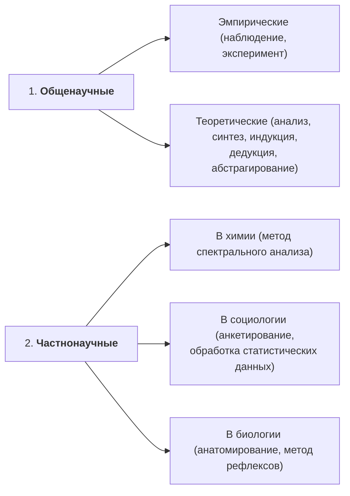

*Рис. 12.1.* **Методы научного познания**

Подводя итог сказанному выше о философском смысле гносеологии, коротко можно сформулировать следующие тезисы.

1. Мировоззренческо-методологическая ценность философии в определяющей мере зависит от характера знаний, используемых в ней. Отсюда выбор и оценка данных о мире — важнейшая и необходимая задача философии.

2. Решая эту задачу, философы создают теорию познания, предназначение которой — раскрыть тайну рождения и качество знаний, необходимых для духовно-практической деятельности человека. Как и человеческий опыт, философию здесь интересуют процессы получения истинных и ценных знаний.

3. При разработке философской теории познания анализу подвергаются все виды познавательной деятельности: простые аналогии и живое созерцание; эстетическое чувство и его оценки; возможности интуиции и творческой фантазии; сила абстрактного мышления и математического анализа и т. д.

После ознакомления с предложенным материалом и рекомендуемой литературой попробуйте осмыслить и еще раз критически проанализировать следующие вопросы.

1. Таков ли мир по своей природе и структуре, чтобы человек, опираясь на свои силы, мог его познать?

2. Есть ли «мировые тайны», недоступные человеческому познанию, ограничивающие его возможности?

3. Не устроен ли мир так, что главное, существенное в нем не может быть постижимо разумом и чувствами человека?

4. Достаточно ли у человека средств и таковы ли эти средства, чтобы сих помощью можно было познать суть бытия?

### Рекомендуемая литература

1. Ильин, В. В. Теория познания. Введение. Общие проблемы / В. В. Ильин. — 2-е изд. — Москва : Либроком, 2010.

> [!example]- Оригинал страницы (PDF 355)
> 

---

###### Страница 349 · PDF 356

2. Иоселиани, А. Д. Место и роль гипотезы в становлении современного научного знания / A. JI. Иоселиани. — Москва, 1999.

3. Лекторский, В. А. Субъект, объект, познание / В. А. Лекторский. — Москва, 1980.

4. Степин, В. С. Теоретическое знание / В. С. Степин. — Москва, 2000.

5. Теория познания. В 4 т. / под редакцией В. А. Лекторского, Т. И. ОЙзермана. — Москва, 1992—1994.

6. Философия : учебник для бакалавров / под редакцией А. Н. Чумакова. — Москва : Вузовский учебник, 2014.

7. Философия : учебное пособие / под редакцией профессора В. Н. Лавриненко, В. П. Ратникова. — Москва : ЮНИТИ-ДАНА, 2001.

8. Швырев, В. С. Научное познание как деятельность / В. С. Швырев. — Москва, 1984.

### Вопросы и задания для творческого осмысления проблемы

1. Раскройте этимологию слов «гносеология», «эпистемология».

2. Покажите неразрывную связь онтологии и гносеологии.

3. Какие аспекты познавательного отношения человека к природе вы знаете?

4. Что является результатом творческой, мыслительной деятельности человека?

5. В чем состоит различие в понимании познаваемости мира между материализмом и объективным идеализмом?

6. Какие типы познания вам известны?

7. Назовите отличительные особенности обыденного, художественного и научного познания.

8. Какие направления, концепции в учении о познании вы знаете?

9. В чем суть сенсуализма?

10. Какова основная доктрина рационализма?

11. В чем недостаток рационализма и сенсуализма?

12. Чем отличается диалектическое понимание процесса познания ото всех других концепций, существующих в теории познания?

13. Что такое субъект и объект познания?

14. Какую роль могут выполнять условия в процессе познания?

15. Какие уровни (ступени) познания вы знаете?

16. Какие формы чувственного познания вам известны? Прокомментируйте коротко каждую из них.

17. Назовите и коротко объясните формы рационального познания.

18. Какова роль интуиции в процессе познания?

19. Как вы сами относитесь к проблеме интуитивного знания?

20. Что такое истина?

21. Как вы понимаете субъективность и объективность истины?

22. Что такое конкретная, относительная и абсолютная истины?

23. Что является критерием истины? Раскройте суть этого вопроса.

24. Докажите, что практика ставит познанию цели, формирует его социальные задачи.

> [!example]- Оригинал страницы (PDF 356)
> 

---

###### Страница · PDF 357

25. Какова роль гипотезы в формировании научных знаний?

26. Что такое заблуждение и чем оно отличается от лжи?

27. Чем отличается знание от мнения?

28. Какое знание может быть охарактеризовано системностью, обосно-ванностью и логичностью?

29. Как вы понимаете термин «метод познания»?

30. Назовите общенаучные философские методы познания.

31. Какие методы познания называются частнонаучными?

> [!example]- Оригинал страницы (PDF 357)
> 

---

###### Страница 351 · PDF 358

## Тема 13. Философская антропология. Проблема человека в философии

После ознакомления с материалом и указанной литературой студент должен:

знать

Образ человека в философии. Философское постижение сущности человека. Социокультурный смысл проблемы человека.

Проблема человека в истории философии. Человек в историко-философской мысли: природа, сущность, предназначение. Социальная сущность человека.

Личность, индивидуальность, личность. Роль личности в истории.

О смысле человеческой жизни. Проблема жизни и смерти в духовном опыте человечества. Смерть и бессмертие.

Творчество как способ бытия человека,

Человек в современном техногенном мире. Человек и обыденность. Проблема идеала.

Человек и общество. Общество как саморазвивающаяся система. Материальная и духовная жизнедеятельность людей. Феномен культуры.

Человек в сфере культуры.

Искусство как своего рода квинтэссенция духовной культуры.

Наука в отношении к культуре. Ее роль в жизни общества. Наука и нравственность,

Человек в мире нравственных отношений. Сущность морали. Моральные ценности и ценностные ориентации.

Рационализм и свободомыслие. Государство и церковь.

Человек — одна из самых больших загадок для самого себя. По мнению французского мыслителя Б. Паскаля, «самое непостижимое явление природы — человек».

Философия издавна интересуется этим вопросом, пытается постичь и объяснить человека и его сущность.

Пожалуй, нет ни одного значительного мыслителя, который бы не обозначил проблему, как и нет такого, который скольконибудь удовлетворительно ее решил.

ХХ век не внес ясности. По мнению Н. А. Бердяева, человек — по-прежнему «загадка в мире и величайшая, может быть, загадка».

> [!example]- Оригинал страницы (PDF 358)
> 

---

###### Страница 352 · PDF 359

Для начала вспомните, что такое антропология, какова этимология этого слова.

В каждую поворотную историческую эпоху предлагалась новая трактовка проблематики, связанной с антропологией.

Всякое живое существо (имеется в виду животный мир) рождается на свет уже наделенный богатым набором инстинктов, которые заранее обеспечивают его приспособленность к условиям обитания. Их, конечно, в какой-то мере можно приручить, научить каким-то элементарным действиям, присоединить к их естественным инстинктам еще что-нибудь, но никакая нужда не научит волка вести себя как лиса или другие животные.

А человек? Человек, как сказал Маркс, может вести себя «по мерке любого вида». Его можно научить чему угодно. Люди относятся к биологическому виду, который называется Homo Sapiens (человек разумный). Чем (человеческое) общество отличается от так называемых псевдосоциальных объединений животных?

Прежде всего тем, что общество является единством культурных норм. Общества нет там, где нет культуры, нормативно-ценностной системы.

Второе — людей можно отличать от животных наличием сознания и абстрактного мышления.

Третье — наличием у человека членораздельной речи, языка.

Четвертое — если животные только пользуются природой, употребляют готовое, то человек производит необходимые для него жизненные средства, перерабатывая природные ресурсы.

Пятое — наличием религии, веры как особого сознания.

Иногда студенты, пытаясь критически проанализировать предложенные аспекты отличия человека от всех живых существ, не соглашаются с некоторыми из них, например с аргументом «наличие сознания и мышления». Так называемым контраргументом является мысль, что у высокоразвитых животных тоже есть сознание, они способны мыслить... Но дело в том, что, развивая последовательно это рассуждение, отрицание качественного различия между мышлением человека и животных, если его проводить последовательно и до конца, порождает гилозоизм, предположение, что вся материя живая: и камень чувствует и мыслит, только в меньшей степени. (Об этом речь шла и в предыдущих темах.) В нем мышление незаметно. Это, конечно, крайность. Но не меньшей крайностью было бы утверждение, что ничего похожего на сознание в JKUBOTном мире нет и не было, что оно характерно исключительно для человека и проявляется только в человеческой деятельности. Проблема возникновения сознания в таком случае окончательно повисает в воздухе, непонятными становятся его корни. Снимается вопрос о естественных предпосылках сознания. Конечно, между

> [!example]- Оригинал страницы (PDF 359)
> 

---

###### Страница 353 · PDF 360

разумной деятельностью человека и тем, что определяется иногда как «сознательное» поведение животных, дистанция громадная. И все же. Разве случайно Ч. Дарвин, проводя ряд экспериментов сдождевыми червями, позволил себе допущение: «Черви, несмотря на низкую степень своей организации, обладают известной долей мышления».

Загадочными выглядят и «нормы жизни» муравьев, пчел: распределение функций, четкая координация действий, поражающая «архитектурная» точность... Наука стала говорить о «роевом интеллекте». «Роевой интеллект» — еще не разум, но, возможно, как раз глубинная его предпосылка. Появилась мысль о квазисоциальной¹ общности в живом мире, о взаимопомощи как одном из решающих факторов сохранения и развития живого вообще.

Но поднимемся еще выше по ступеням эволюции. А поведение пернатых? К примеру, некоторые виды коршунов «додумались» разбивать яйца эму, «бомбардируя» их камнями. Элементы «мышления» находят ныне даже у осьминогов.

Возможности психической деятельности у животных возрастают по мере усложнения их мозга. Совсем поражают дельфины — существа с высокоразвитой психикой и уникальной сообразительностью; их поведение иной раз расценивается как сенсация.

Конечно, просто отмахнуться от них нельзя, тем более что наука открывает все новые и новые факты, требующие осмысления.

Генетический материал человека и шимпанзе идентичен на 99 %; родство между ними, с точки зрения генетиков, приблизительно такое же, как между лошадью и зеброй. Можно ли, однако, говорить об интеллектуальном родстве? В науке по этому поводу царит запутанный и неразрешенный спор, имеющий многовековую историю. Но он разгорелся с новой силой, когда В. Келер опубликовал результаты своих многолетних опытов с шимпанз. (Вспомните опыт «Бананы и обезьяна»: как она «додумалась» достать подвешенные под потолком бананы, присоединяя две палки друг к другу.) На этом основании исследователь признал за подопытными животными способность совершать разумные действия. Небезынтересно, что те же шимпанзе, а также орангутаны обладают, возможно, элементарным представлением о собственном «Я», т. е. самопознанием, которое до последнего времени считалось качеством, доступным исключительно человеку. Простое наблюдение, позволяющее сделать подобный вывод: если шимпанзе нанести на лоб пятно каким-нибудь красителем, то, увидев его на своем зеркальном отображении, она начинает энергично стирать краску со лба. Многочисленные эксперименты показывают, что обезьяны после ряда опытов могут овладевать навыками по изготовлению

> [!note]- Сноски
> ¹ Квазисоциальная общность — лжесоциальная общность.

> [!example]- Оригинал страницы (PDF 360)
> 

---

###### Страница 354 · PDF 361

и применению достаточно сложных для них орудий труда. Более того, буквально во вчерашней телепередаче о животных было сказано, что в одном из научных центров США экспериментаторам удалось научить обезьяну выговаривать 350 слов с применением жестов.

Однако следует отметить, что проведение усложненных операций, изготовление простых орудий труда для обезьяны является неразрешимой проблемой, если ее не обучит этому человек.

Какой вывод следует после всего сказанного? Если животное обладает «разумом», то что, собственно, выделяет человека из животного мира? Степень интеллекта или что-то иное, специфически ему и его интеллекту присущее? Пути исследователей и сегодня резко расходятся. Правда, все меньше и меньше тех, кто настаивает на существовании пропасти, разделяющей животных и человека. Споры вместились в несколько иную плоскость: чем отличается мышление человека от проявлений рассудка у некоторых животных? А к этой проблеме тесно примыкает другая: что в конечном итоге стало решающим фактором, позволившим нашему далекому предку выделиться из животного мира? На основе чего у нас возникли качественно новая память и собственно человеческий интеллект? Радикальное отличие между обезьяной и человеком не в том, что никакая обезьяна не способна изготовить нечто, напоминающее по своим функциям человеческое орудие труда. Человек регулярно делает и совершенствует орудия труда. Это — необходимое условие его существования, благодаря чему он и выделился из животного мира.

Известный американский исследователь проблемы Морган имел основания определить человека как существо, изготавливающее орудия труда. Становление предсознания происходит вне труда как такового, но для того, чтобы возникло сознание, необходима вовлеченность в постоянную трудовую деятельность. Это как раз высокоразвитым животным и не дано.

Итак, в самом общем виде проблема, казалось бы, уже решена. Способом существования человека стал труд. Он изменил его биологические характеристики, а главное, породил потребность в полноценной речи. Труд и речь стали мощными импульсами формирования человеческого сознания.

В современных условиях, однако, этот общий ответ недостаточен. Без осмысления новых и новейших данных науки, а также результатов наблюдений и экспериментов он становится неубедителен.

Можно утверждать, например, что в известном смысле сознание предшествовало труду, т. е. без определенного интеллектуального начала регулярная трудовая деятельность была бы просто невозможной.

> [!example]- Оригинал страницы (PDF 361)
> 

---

###### Страница 355 · PDF 362

В современной науке нередко употребление терминов «предсознание», «предтруд» и «предречь». Все это ученые пытаются найти не только у наших ближайших предков.

В истории человечества выработано множество определений самого человека: «человек — венец природы», «человек — существо разумное», «человек — существо, обладающее самосознанием», «человек — существо моральное и свободное», «политическое животное», «мыслящий тростник», «человек сведущий» и другие. Мудрецы словно состязаются в том, чтобы выразить главенствующий штрих в определении человека.

Природа — это единый глобальный процесс. Содержание природы подразделяется на два вида: материальную и духовную энергию. Материальную энергию человек изучает в физике, химии и т. д., духовную изучает в духовной культуре и искусстве всех видов, где получает духовные знания.

Но, кроме указанных выше двух учений, существует и третий вид учения, в основу которого положена вера человека, продукты этого учения не являются продуктом фантазии человека, они реально существуют. Два первых вида учений называются соответственно материальной и духовной наукой, а третий вид учения называется религией. Полезность этих трех видов учений определяется тем, в какой степени каждая из них способствует улучшению жизни живого человека.

Материальная и духовная энергии могут взаимно преобразовываться. Также взаимно могут воздействовать духовные и материальные процессы, в результате которых эти процессы изменяются. Это имеет место при гипнозе, так называемом колдовстве, лечении человека без лекарств, не касаясь его тела и др.

Целью жизни и деятельности человека является повышение качества его материальных и духовных процессов, а также максимальное удовлетворение материальных и духовных потребностей.

Повышение качества материальных процессов связано с повышением здоровья, повышение материальных потребностей связано с получением физического удовлетворения (любимая пища, одежда, вещи).

Повышение качества духовных процессов связано с повышением духовной культуры во всех областях жизнедеятельности человека. А повышение духовных потребностей связано с ощущением наибольшего счастья и духовного удовлетворения.

Целью жизни человека, т. е. законом природы является так же построение такого общества, которое обеспечивало бы наиболее высокое качество материальных и духовных потребностей каждого человека. Законом природы является также стремление человека, чтобы его живое состояние продолжалось наиболее длительное время или просто долго.

> [!example]- Оригинал страницы (PDF 362)
> 

---

###### Страница 356 · PDF 363

Вопрос, что такое человек, его сущность и назначение, занимал философов с античных времен. Приведем небольшие отрывки из трудов мыслителей разных эпох о сущности человека, а более подробный сравнительный анализ понимания данных вопросов в разные исторические периоды жизни человечества сделаем чуть ниже.

Аристотель в своем сочинении «Политика» писал: «То, что человек есть существо общественное в большей степени, нежели пчелы и всякого рода стадные животные, ясно из следующего: один только человек из всех живых существ одарен речью. Голос выражает печаль и радость, поэтому он свойствен и остальным живым существам. Но речь способна выражать и то, что полезно и что вредно, равно как и то, что справедливо и что несправедливо... Это свойство людей, — продолжает Аристотель, — отличает человека от остальных живых существ, только человек способен к восприятию таких понятий, как добро и зло, справедливость и несправедливость и T. IL».

По мнению Николая Кузанского, «человек есть бог, только не абсолютно; раз он человек, он человеческий бог. Человек есть также мир, но не конкретно все вещи, раз он человек; он микрокосм, или человеческий мир».

Эразм Роттердамский понимает человека как состоявшего из разных сложных частей: «Человек, — пишет он, — это некое странное животное, состоящее из трех чрезвычайно разных частей: из души (anima), некоего божества (питеп) и тела — вроде бессловесной скотины. В отношении тела, — продолжает философ, — мы настолько не превосходим животных другого рода, что по всем своим данным находимся гораздо ниже них. Но что касается души, она способна пролететь мимо ангелов и соединиться с богом. Эти две столь отличающиеся друг от друга природы высший творец объединил в столь счастливом согласии».

В Новое время Томас Гоббс в своем произведении «Человеческая природа» писал: «Природа человека есть сумма его природных способностей и сил, таких как способность питаться, двигаться, размножаться, чувство, разум и Т. д.».

Упомянутый выше французский моралист XVII в. Блез Паскаль не считал нужным сравнивать человека с животным: «Опасное дело — убедить человека, что он во всем подобен животному, не показав одновременно и его величия. Не менее опасно убедить в величии, умолчав о низменности. Еще опаснее не раскрыть ему глаза на двойственность человеческой натуры». Паскаль в определении сути человека акцент всегда делал на то, что человек — мыслящее существо, что он сотворен для того, чтобы думать, в этом — главное достоинство человека. Известно его выражение: «Человек — всего

> [!example]- Оригинал страницы (PDF 363)
> 

---

###### Страница 357 · PDF 364

лишь тростник, слабейшее из творений природы, но он тростник МЫСЛЯЩИЙ».

Вспомним о Людвиге Фейербахе, философе, который учение о человеке поставил на высокий уровень (антропология) и назвал человека «вершиной природы». «В чем заключается сущность человека? — ставит вопрос Фейербах, — каковы отличительные признаки истинного человеческого в человеке? Разум, воля и сердце. Совершенный человек обладает силой мышления, силой воли и силой чувства. Сила мышления есть свет познания, сила воли — энергия характера, сила чувства — любовь. Разум, любовь и сила воли — это совершенство. В воле, мышлении и чувстве заключается высшая, абсолютная сущность человека как такового и цель его существования.

Человек существует, чтобы познавать, любить и хотеть, — пишет дальше Фейербах. Но какова цель разума? Разум. Цель любви? Любовь. Воли? Свобода воли. Мы познаем, чтобы познавать, любим, чтобы любить, хотим, чтобы хотеть, т. е. быть свободными».

Итак, человек — существо природы, поэтому имеет столь особое, сверхприродное, сверхземное назначение. Любое существо предназначено только для того, для чего оно есть: животное назначено быть животным, растение — быть растением, человек — быть человеком. Каждое существо имеет целью своего существования непосредственное свое существование; каждое существо достигло своего назначения тем, что оно достигло существования. Существование, бытие есть совершенство, есть исполненное назначение. Жизнь есть самодеятельное бытие. Сознательное существо достигло своего назначения тем, что действует как существо сознательное.

Из глаз младенца светится его радость по поводу своего совершенства, радость, что он есть, и притом есть как существо сосущее, вкушающее, видящее, ощущающее себя и другое. Для чего ребенок есть (существует)? Разве его назначение находится по ту сторону его детства? Нет, ибо для чего бы он был тогда ребенком? Природа каждым шагом, который она делает, завершает свое дело, достигает цели, совершенствует, ибо в каждый момент она есть, и значит столько, сколько она может, должна и хочет быть. Ребенок существует не ради того, чтобы стать взрослым, дитя есть ради самого себя; поэтому он удовлетворен и блажен сам в себе.

В чем назначение юноши? В том, что он юноша, что он радуется своей юности, что он не выходит в потусторонний мир своей юности... В чем назначение мужчины? В том, что он мужчина, что он действует как мужчина, что он прилагает свою мужскую силу. То, что живет, должно жить, должно радоваться своей жизни. Радость жизни есть беспрепятственное выражение жизненной силы. «Человек есть человек, — как говорил Фейербах, — а не растение, не животное, т. е. не верблюд, не осел, не тигр и т. д.; значит, у него

> [!example]- Оригинал страницы (PDF 364)
> 

---

###### Страница 358 · PDF 365

нет иного назначения, как проявлять себя тем существом, какое он есть, — а он есть, он живет как человек».

После определения сущности человека на историческом фоне попробуем ответить на вопрос, в чем же смысл существования, жизни человека. Сначала несколько слов о смысле самой этой проблемы. Смысл жизни человека — это его главные цели, которые определяют характер его деятельности. Если деятельность человека соответствует этим целям, то он считает, что жизнь его протекала не напрасно, не бессмысленно.

Цели жизни человека определяются законами природы, относящимися к человеку. Эти законы природы связаны с наиболее полным удовлетворением материальных и духовных потребностей, заложенных природой в человеке.

Но эти материальные и духовные потребности человека весьма разнообразны. Каждый человек выбирает из них те, которые в его индивидуальном понимании являются наиболее важными и соответствуют его индивидуальным наклонностям.

Основную свою деятельность каждый человек направляет на решение выбранных им самим задач (важных, по его мнению), что является для каждого человека смыслом его жизни.

Отсюда следует, что не существует единого, одинакового смысла жизни для всех людей, поиски единого смысла жизни для всех являются ошибкой.

Каждый человек в качестве смысла жизни по своим индивидуальным наклонностям может иметь одну или несколько целей. У различных людей смысл жизни может содержать одинаковые или разные цели, а также одну цель или несколько.

Является ли, на ваш взгляд, человек по существу злым и порочным или он добр по своей натуре и способен к самосовершенствованию? Попробуйте привести свои аксиологические оценки человека.

Человек рано или поздно задается вопросом о конечности своего индивидуального существования. Он единственное существо, которое осознает свою смертность и способен размышлять о ней, и, как правило, собственная смерть человеком воспринимается не как отвлеченная истина, а вызывает эмоциональное потрясение,

Возможно, вы спросите: почему «Человек и смерть»? Почему, размышляя о человеке, мы обращаемся к теме смерти, теме ухода человека из жизни? Может быть, уже потому, что смерть — это единственное событие в жизни каждого из нас, которое нельзя отменить. Даже рождение, как мы знаем, может не состояться или закончиться той же смертью. Стало быть, смерть — явление универсальное. Это один из тех феноменов, о которых мы ежедневно слышим, читаем, который иногда видим собственными глазами.

> [!example]- Оригинал страницы (PDF 365)
> 

---

###### Страница 359 · PDF 366

Смерть неизбежна. Но с неких пор разговоры о ней как бы отменили. Мы долгое время молчаливо исходили из постулата, что смерть всегда есть смерть, люди рождались, страдали и умирали, и обсуждать здесь, собственно, нечего.

Но от умолчания смерть не исчезает, страх от ее неизбежности не проходит. Современная наука признает, что смерть и все, что с ней связано, — явления в высшей степени фундаментального порядка, изучение которых способно пролить свет на всю этическую систему, принятую в обществе, прежде всего — на отношение людей к жизни и ее основным ценностям.

По мнению многих ученых, отношение к смерти — это своего рода эталон, индикатор характера цивилизации, а в самом восприятии смерти отражаются сокровенные тайны человеческой личности.

Очевидно, что многие этические ценности на протяжении веков формировались в рамках той или иной религии, именно религиозному сознанию присуще особое внимание ко всему, что связано со смертью, — посмертный суд, воздаяние, ад и рай и т. п.

Думаю, невозможно проникнуть в глубинную сущность человека, обходя такую важнейшую тему, как феномен смерти, но и сама мысль о подобных размышлениях многим кажется кощунственной.

А почему? Ведь это зависит от направления мысли, от содержания наших размышлений. Конечно, если неотступно думать о себе как о «прахе и тлене», и прочих загробных реалиях, вряд ли такие размышления принесут пользу.

Гораздо важнее узнать, как воспринималась смерть в разные времена, разными народами, представителями разных религий. И может быть, самое важное — осознать, сколь естественна смерть, понять, что она часть нашей жизни, что она полна смысла и значения, что она определяет наше отношение к бытию.

«Смерть есть тайна, о которой известно только то, что она есть», — говорили древние. Особое отношение человека к смерти на протяжении всей его жизни определялось еще и тем, что смерть одновременно и проста (естественна), и таинственна. Появился ли наш мир случайно, или в результате действия каких-то законов, или в итоге акта творения — смерть при любомраскладе не может быть явлением случайным и бессмысленным. Стало быть, нужно найти ее скрытый смысл; очевидно, что в этих поисках мы всякий раз с неизбежностью будем приближаться к поиску смысла жизни.

Тайну смерти не раскрыла до конца ни одна из религий, не объяснила ни одна наука. Но это не означает, что человек не должен искать и находить ответ лично для самого себя. В течение тысячелетий смерть пытались постичь сначала философы и теологи, затем ученые. Взгляд на самого человека, как и на тайну его смерти, безусловно, менялся и меняется до сих пор.

> [!example]- Оригинал страницы (PDF 366)
> 

---

###### Страница 360 · PDF 367

Нашему веку присущ взгляд аналитический, даже скептический. Может быть, потому что не один век не давал столько страшных и жестоких поводов для разочарования в человеке, как ХХ век.

А из чего следует, что я являюсь венцом творения? Кто сказал, что именно я властелин природы? Эти вопросы, как и многие UM подобные, человек задал себе и с переменным успехом ищет и находит ответы. Однажды задумавшись о себе, о смысле своего существования, о тайне, в нем сокрытой, человек уже никогда не оставлял этой увлекательной темы.

Загадочного в человеке так много, что нас не удивляет неспособность науки и религии объяснить эту тайну.

Человек — существо странное, двойственное. Ведь, помимо разума, он обладает еще и душой. И эта неуловимая душа порой вопреки логике чувствует и воспринимает такое, что разуму и не снилось. Именно душе свойственны высокие озарения, превосходящие пределы научного понимания. Но душа — не «научное» понятие и долгое время о ней, как и о смерти, говорить считалось как бы неприличным. Между тем в истории мировой культуры эти два понятия неразрывны.

Меняемся мы, меняется и наше представление о мире. У человека должен быть выбор — во всем, в том числе и в знаниях. Приобщение к разнообразию знаний о его жизни и смерти дает возможность войти в мировой дом общечеловеческих ценностей. Расширяются границы привычных представлений и с ними — научная картина мира. Многое продолжает существовать на уровне догадок, предположений, гипотез.

Да, многие материалы не подтверждены пока официальной наукой, но в данной ситуации важно не достижение некой научной истины последней инстанции. Важен сам процесс мышления, важен поиск ответов на сложнейшие вопросы жизни и смерти, важно направление этого поиска. Что же все-таки то тайное, которое живет в каждом человеке и проявляется по-разному? Его называют то судьбой, то кармой, карой, сгустком энергии, тонким телом.

Существует интересная книга (несколько больших томов), в которых обсуждается та сторона бытия человека и мира, которые называются трансцендентальными. Книга, которая (вместе с автором) прошла всякого рода запретов, гонения, уничтожения в нашей стране, книга, которая стала причиной расстрела в сталинское время многих людей...

Речь идет о книге «Живая этика», автором которой является Елена Ивановна Рерих¹.

> [!note]- Сноски
> ¹ Вообще известно целое поколение Рерихов, они все занимались проблемами тайны человека, бытия, души человека и др. Сталиным им запрещено было жить в Советском Союзе... и они поселились в богом забытой долине Индии. Во время Трансгималайской экспедиции они попали в Шамбалу — место, где осуществляется

> [!example]- Оригинал страницы (PDF 367)
> 

---

###### Страница 361 · PDF 368

### 13.1. Индивид. Личность. Человек

Понятие индивида указывает, во-первых, на отдельную особь как представителя рода Homo Sapiens, и, во-вторых, на отдельный «кирпичик» общества. Это понятие описывает человека в аспекте его отдельности и обособленности: каждый человек имеет право на свою особенность — это право дано ему природой и подтверждено обществом. Индивид характеризуется рядом свойств: целостностью морфологической и психофизической организации, устойчивостью во взаимодействии со средой, активностью. Понятие индивида — это лишь первое условие обозначения предметной области исследования человека, содержащее возможности для последующих уточнений с учетом специфики каждой новой личности.

Личность. В настоящее время существуют две концепции личности: личность как функциональная (ролевая) характеристика человека и как его сущностная характеристика.

Первая концепция опирается на понятие социальной роли человека; при всем значении этого аспекта для социологии он не позволяет раскрыть внутренний мир, фиксируя только поведение, которое не всегда является отражением внутренней сущности человека.

Более глубокая интерпретация понятия личности раскрывает ее уже не в функциональном, а в существенном плане: здесь она понимается как сгусток ее регулятивных потенций, центр самосознания, источник воли и ядро характера.

Личность — это индивидуальное средоточие и выражение общественных отношений и функций людей, субъект познания и преобразования мира, прав и обязанностей, этических, эстетических и всех иных социальных норм, объединение биологического и социального начал в человеке.

Принято считать, что критерием личности является здоровая психика. Если человек не в состоянии адекватно оценить свои поступки, осознать их, т. е. его психика расстроена, и медициной это доказано, то данный человек, имеющий все права гражданина данного государства, не может быть личностью.

Человек. Каждый из нас уверенно выделяет человека из остального мира. Его отличие от всех других существ считается совер-

> [!note]- Сноски
> связь Земли с Космосом, место, в котором магнитная стрелка никогда не отклоняется от оси. В этих местах бывает так, что, если вы хотите пройти — не сможете двигаться дальше; вас никто не держит, но не можете сделать шагу; конь не может оторвать копыто от земли. Такие места есть и в нашей стране в горах Алтая, где веточка возгорается, если ее просто приложить к скале. Мир и человек загадочны, Что мы собой представляем? Раскрывать эту загадку в «Живой этике» автор начинает с вопроса, что такое кармический закон, карма, рок, судьба, закон причины и следствия (с этой точки зрения). Мы здесь не будем излагать теорию Рерихов. Если Вас таинственная сторона собственной жизни интересует, советую вам прочитать «Живую этику» Е. Рерих.

> [!example]- Оригинал страницы (PDF 368)
> 

---

###### Страница 362 · PDF 369

шенно очевидным. Но, как говорил испанский философ Х. Ортегаи-Гассет, философия оправдана тем, что выходит за пределы очевидности. Выходит она за такие пределы и в исследовании человека. И в этом своем мнении испанский мыслитель не одинок. Еще И. Кант пришел к выводу, что в философии существует всего три вопроса, на которые она призвана ответить: что я могу знать, на что я могу надеяться, что я должен делать? И покрываются они, как писал мыслитель незадолго до смерти в своей «Логике», одним вопросом: что такое человек? Об этом поговорим ниже.

Загадка человека, действительно, существует. В книге французского писателя Веркора «Люди или животные?» сюжет построен на своего рода мысленном эксперименте. Экспедиция, состоящая из нескольких европейцев, отправляется в Анды и в недоступном месте обнаруживает некое дикое племя или стадо то ли людей, то ли животных. Волею случая один из них убит. Возникает вопрос: кого убили? Если человека, должна иметь место уголовная ответственность за убийство. Если убито животное, такой ответственности нет. Но как определить, относятся представители этого племени к людям или к животным? Сделать это кажется нетрудным, нужно только указать критерии, отличающие человека от животного. Начинается обсуждение. Называются разные критерии: нравственность, религиозность, речь, сознание и др. Однако оказывается, что ни один из этих признаков критерием служить не может. Наряду с нравственными людьми существуют и безнравственные, не перестающие от этого быть людьми. К тому же нравственность не содержит в себе самой основания для различения добра и зла. То же можно сказать о религии. Есть люди, не верящие в бога, и таких, пожалуй, все больше и больше. Речь тоже вряд ли может служить четким критерием, при всей ее важности. Даже критерий сознания небезупречен. И животные проявляют много ловкости и смекалки, отнюдь не сводимых к безусловным и даже условным рефлексам, но свидетельствующих о развитой психике. Оказывается, то, что представляется интуитивно ясным, в подобных ситуациях не срабатывает.

Именно в этих выражениях говорили о человеке многие мыслители. Человек, как писал Ф. М. Достоевский, есть тайна, я занимаюсь этой тайной, ибо хочу быть человеком. Для Достоевского очевидно не только то, что человек есть тайна, но и то, что соответствовать своему понятию он может, только занимаясь этой тайной, причем занимаясь, как пишет он в другом месте, всю жизнь.

В качестве предметного существа человек есть, прежде всего, природное существо, живой чувственный предмет с руками, ногами, глазами, зубами, предметным образом относящимся к предметному миру. В качестве природного предметного существа он обладает природными силами, свои проявления жизни он осуществляет

> [!example]- Оригинал страницы (PDF 369)
> 

---

###### Страница 363 · PDF 370

на других природных предметах и, в свою очередь, является страдающим существом, предметом проявления сил других предметов. Предметность есть единственная форма существования жизни. Непредметное существо — недействительное, нечувственное, только мыслимое, только воображаемое, продукт абстракции.

Человек, однако, не только природное предметное существо, но и общественное предметное существо, живущее в собственно человеческом, общественно-предметном мире. Последний, с одной стороны, создается человеком, с другой, формирует человека, социализирует его. Поэтому не только сам человек, но и его чувства — зрение, слух, обоняние и остальные — культурно ориентированы. К тому же, наряду с этими чувствами возникают принципиально новые, духовно-практические чувства, к которым можно отнести волю и любовь. Каждый общественный предмет — посредник между людьми и, более того, средство соединения человека с человеком.

Человек реализует себя как целостность не только потому, что для него свойственна нераздельность тела и духа, аффективной, волевой и ментальной способностей и т. д., но и потому, что не только человек — момент движения общественной системы, но и 00- щество — момент движения человека. Он не только конечное и единичное существо, но в то же время бесконечное и всеобщее существо, тотальность. Таким образом, то, что возникает из глубокого единства человека с природой в ходе исторического развития, оказывается тем, что выделяет и глубоко отличает человека от его природных предков.

### 13.2. Биологическое и социальное в человеке

Нетрудно видеть, что в подпочве различных пониманий сути антропосоциогенеза таится вопрос о соотношении биологического и социального в человеке, или, говоря иначе, вопрос о природе человека. В философской литературе сложилось две позиции по этому вопросу. В соответствии с одной природа человека всецело социальна. В соответствии с другой она не только социальна, но и биологически нагружена. При этом речь не идет о ТОМ, что жизнедеятельность человека имеет и биологические детерминанты, определяющие зависимость человека от набора генов, баланса вырабатываемых гормонов, обмена веществ и бесконечного множества других факторов.

Существование этих факторов признают все. Речь идет о том, существуют ли биологически запрограммированные протосоциальные¹ схемы поведения человека. Вопрос этот очень сложный и за-

> [!note]- Сноски
> ¹ Протосоциальное — досоциальное. Первая часть слова имеет значение первичности, предшествования (прототип, протоистория).

> [!example]- Оригинал страницы (PDF 370)
> 

---

###### Страница 364 · PDF 371

путанный. Сторонники и того и другого подходов черпают доводы из серьезных источников. Сторонники первого, утверждая, что человек рождается с единственной способностью, «способностью приобретать человеческие способности» (выражение А. Н. Леонтьева) ссылаются на эксперимент, поставленный самой природой и продолженный человеком¹.

Сторонники второго подхода ссылаются на данные современной социобиологии, усиленно развивающейся с 1975 r., когда ее основоположник Э. Уилсон опубликовал книгу «Социобиология: новый синтез», Согласно социобиологии большинство стереотипных форм человеческого поведения свойственно и млекопитающим, а более специфических форм — поведению приматов. Среди этих стереотипных форм Э. Уилсон выделяет взаимный альтруизм, защиту определенного место обитания, агрессивность, следование отработанным эволюцией формам сексуального поведения, непотизм (семейственность), что в данном случае означает приверженность не только родственным, но и внутрипопуляцнонным образованиям, наконец, социализацию с помощью отработанных эволюцией способов и механизмов и др. При этом нужно иметь в виду, что, когда речь идет об альтруизме, защите место обитания, непотизме и прочих названных формах человеческого поведения, соответствующие термины употребляются метафорически.

Если, к примеру, какие-то действия именуются альтруистическими, это не значит, что каждому соответствующему действию предшествует сознательное намерение, основывающееся на различении добра и зла. Когда биологи говорят об альтруизме, пишет исследователь этого направления Майкл Рьюз, они подразумевают социальное взаимодействие, которое расширяет эволюционные возможности там, где они сопровождаются повышением репродуктивного успеха. Признавая решающее влияние культурной эволюции, социобиологи стараются обратить внимание на то, что на формы, в каких мы мыслим и действуем, оказывает тонкое, на структурном

> [!note]- Сноски
> ¹ Речь идет о слепоглухонемых детях (родившихся или ставших такими в самом раннем детстве) из специальной школы в Загорске. До школы они были даже не животные, а растения. У них были оборваны все важнейшие каналы связи с миром, причем еще до того момента, как они могли освоить хотя бы малую часть культурного содержания, необходимого для становления человека. Само же по себе это содержание не формировалось. У них отсутствовал даже исследовательский рефлекс, якобы открытый И. П. Павловым. Они могли умереть, даже если пища была рядом. И только в школе, с использованием специальных методик. основанных на концепции предметной деятельности, их постепенно приучали к орудийной деятельности, начиная с приема пищи и кончая сложными навыками письма. С разбивкой по операциям их учили произносить членораздельные звуки, затем говорить, затем читать и писать с помощью азбуки Бройля. В результате формировались люди, хотя и продолжавшие оставаться слепыми и глухими, но во всех других отношениях вполне нормальные, что подтверждается тем, что четверо из них окончили психологический факультет Московского университета.

> [!example]- Оригинал страницы (PDF 371)
> 

---

###### Страница 365 · PDF 372

уровне, влияние и наша биология. Но они отнюдь не утверждают, пишет М. Рьюз, что биология наполняет нас врожденными идеями, которые, якобы, приводят к ясному пониманию того, что «Бог существует» или «2 + 2 = 4».

Социобиология ведет речь, как мы видим, о единой природе человека, в корпусе которой находит место и биологическим влияниям. Однако существуют и экстремистские «теории», согласно которым природа каждой человеческой расы различна, существуют низшие и высшие расы, отличающиеся друг от друга многими признаками, начиная от строения головы и лица и кончая умственными способностями.

Подытоживая все сказанное в определениях человека и его сущности, философия определяет: человек — единство природного и общественного. Философия человека не только понимает его как общественно-социальное существо, но и рассматривает в совокупности всех биологических (природных) и психологических качеств. Сущностью человека является именно его социальность.

Понимание обсуждаемой проблемы будет явно односторонним, если не дополнить его картиной интеллектуальной жизни человека, его деятельности в сфере, которая определяется как общественное сознание.

Сознание присуще отдельной личности. Общественное сознание — это абстракция, но абстракция необходимая. Она позволяет обнаружить в бесконечном многообразии, неповторимости проявления сознания у отдельных личностей главное, основное, существенное.

Нельзя не заметить при этом, что общественное сознание имеет как бы два уровня. В нем без труда можно выделить обыденное сознание, стержень которого — общественная психология, т. е. чувства, настроения, переживания, привычки, предрассудки, иллюзии и др. Они формируются в повседневной жизни людей на основе опыта и личных наблюдений. Из психологии вырастает идеология. В ней мнения, настроения людей систематизируются, разрабатываются теоретически, принимая характер социальных доктрин и КОНцепций. В этом смысле идеологию можно определить как осознанную психологию, хотя достаточно очевидно: грани между ними условны, Трудно представить чистую идеологию без больших или меньших моментов психологии и наоборот.

Столь же очевидно: общественное сознание и на уровне психологии, и на уровне идеологии не есть нечто застывшее. Оно постоянно развивается, хотя, если иметь в виду социальную психологию, даже на поверхности ее нетрудно обнаружить противоречивость, стихийность, бессистемность, а также большую или меньшую долю консервативности. Но одновременно из глубины прорываются здравый смысл и народная мудрость.

> [!example]- Оригинал страницы (PDF 372)
> 

---

###### Страница 366 · PDF 373

Другими словами, обыденное сознание практически ориентирует людей. Оно далеко не столь наивно, как нередко представляется. Наивность отчетливо проявляется лишь там и тогда, когда человек начинает рассуждать о вещах и явлениях, далеких от его непосредственного опыта. Здесь выходят на поверхность «факты» искусственные, надуманные или весьма специфически переосмысленные.

Нельзя жить в обществе без социальных ценностей, без идеалов. Стремление к ним естественно, желание их отстоять закономерно. Но уже потому, что предлагаемые обществу ценности различаются, их можно пропагандировать, но нельзя навязывать. Должна сохраняться среда, благоприятная для своего рода конкуренции, соперничества идей. Оно не даст уйти далеко от жизненной правды, реальных интересов людей.

Двумя уровнями общественного сознания выступают общественная психология и общественная идеология.

Как формы общественного сознания традиционно выделяют экономическое, политическое и правовое сознание, мораль, искусство, точнее, нравственное и эстетическое сознание, науку и философию.

Почему люди, несмотря на неоднократные попытки, не смогли до сих пор создать общество, в котором имела бы место полная гармония этого общества с запросами отдельно взятого человека?

Человек может и должен даже в неблагоприятных условиях сохранять нравственное достоинство: честность, великодушие, милосердие. В этом его духовная сила, подлинная человечность.

Но что же такое нравственность? Прежде всего, это традиции, обычаи, обуславливающие поведение людей, их отношение друг к другу и обществу. Формирующаяся личность усваивает принятые нормы поведения настолько, что они входят в привычку, воспринимаются как что-то глубоко естественное. Обоснование норм как таковое может отсутствовать, выступать на уровне «так все делают», «как люди, так и я», «наши отцы, деды и прадеды так поступали», «так исстари повелось» и т. д. Нравственность опирается на силу общественного мнения, которое, одобряя одни поступки и осуждая другие, регулирует поведение личности, подталкивая ее к соблюдению моральных норм. Честь, доброе имя, общественное признание дорого стоят, как и стыд, если эти нормы нарушаются.

Личность невозможна без морали. Потребность в ней сродни потребности в пище, труде и отдыхе. Трудно себе представить самооценку, оценку других людей и отношение к ним вне критериев нравственности. Даже если не говорят, всегда имеют ввиду, честен или нет человек, совестлив ли, обладает или нет чувством долга, и, если есть сомнения, порядочные люди стараются не иметь с ним дела. Показательно, что мораль возникла в глубокой древно-

> [!example]- Оригинал страницы (PDF 373)
> 

---

###### Страница 367 · PDF 374

сти, хотя нормы, которыми руководствовались древние люди, могли бы показаться нам по меньшей мере странными.

Обобщенной характеристикой нравственного мира личности являются ее моральные качества, добродетели и пороки. Платон говорил о четырех добродетелях: мудрости, умеренности, мужестве и справедливости. Христианская этика добавляет к ним еще три: веру, надежду и любовь. В итоге — семь добродетелей, освященных авторитетом церкви. В христианском учении говорится и о семи смертных грехах, наиболее опасных и недопустимых пороках. Это гордыня, алчность, похоть, зависть, чревоугодие, гнев и лень. Вообще же палитра нравственных качеств, ценимых или отвергаемых человеком, была даже в Средние века намного больше.

Рядом с моралью идет искусство, усиливая, делая непосредственными, эмоционально насыщенными нравственные постулаты. У морали при ближайшем рассмотрении обнаруживается одна особенность, ограничивающая возможности нравственного воздействия на личность. Моральная ориентация основана на долженствовании: человек обязан, он не имеет права поступать такто и так-то. Искусство ни к чему не обязывает напрямую, но оно увлекает, завораживает. Недаром говорят о волшебной силе искусства.

Французский авангардист Кокто задался однажды вопросом: искусство необходимо, но если бы я только знал, для чего. В самом деле, масса людей посещает театры, слушает музыку, а зачем? Говорят, что искусство позволяет отдохнуть, отвлечься от жизненных проблем. Но это ответ, который ничего не объясняет, поскольку возникает другой вопрос: а почему позволяет отвлечься искусство и какой в этом смысл? Еще Аристотель, пытавшийся решить эту проблему, говорил о таком свойстве творения художника, как катарсис — душевное просветление, очищение. Философ писал в «Поэтике», что трагедия благодаря вызванному в зрителе состраданию и страху как бы очищает страсти. Но опять тот же вопрос: каков «механизм» этого очищения? И вообще, в чем «тайна» искусства и какова его роль в обществе?

Искусство выполняет в конечном итоге две взаимосвязанные функции: оно формирует, воспитывает человека и одновременно расширяет его возможности познания.

Чтобы понять специфику искусства как средства познания, достаточно сравнить его с наукой. Она обогащает нас знаниями, считая главным аргументированность, доказанность выдвигаемых положений. Искусство же ничего не доказывает, оно показывает. Человеческий опыт весьма ограничен. Можно, конечно, почерпнуть кое-что из жизненного опыта близких тебе людей, Многое дает наука. Но это не заменяет искусства с его уникальными возможностями постижения мира.

> [!example]- Оригинал страницы (PDF 374)
> 

---

###### Страница 368 · PDF 375

Следующей формой общественного сознания является религия. На протяжении веков религия играла исключительно важную роль в духовной жизни людей. Она накладывала неизгладимый отпечаток на всю мировую историю. Принятие значительной частью Азии буддизма, проповедь христианства в античном мире, стремительная экспансия ислама, крещение Руси, реформация западной церкви, как бы их ни оценивали, — подлинные вехи в жизни человечества.

Нетрудно заметить: религия, как и мораль, и искусство, не есть нечто застывшее.Меняясь вместе с людьми, их представлениями о мире и о самих себе, она живет в колоссальном временном интервале: от эпохи каменного топора до космической эры. И у нас нет ныне достаточных оснований для утверждения, что когда-нибудь потребность в религии исчезнет, и она прекратит свое существование. Осознание человеком себя как человека, самое первое, самое примитивное, уже было вплетено в канву соответствующих религиозных представлений. Много позже возникло безбожие (атеизм), но оно не могло сокрушить веру.

Так что же такое религия? В самом общем смысле это фантастическое отражение мира и человека в головах людей, связанное с верой в чудо, деление мира на две части: потустороннюю и посюстороннюю.

На заре человечества люди воспринимали природу как чтото живое: не только стихии, но солнце и луна, река и деревья — все живое и могущественное, во всяком случае, неизмеримо сильнее человека. Значит, нужно каким-то образом угодить своему окружению, войдя с ним в контакт. Тогда природа, возможно, снизойдет к людям — подарит теплую погоду, дождь вовремя, не оставит без сладких кореньев и зверя в лесу, спасет от грозных стихий. Воображение услужливо рисовало приятные ситуации, удачу, которой можно достичь благодаря обращению к сверхъестественным силам. И если через некоторое время действительно выпадала удача, люди верили: помогли те силы, к которым они с мольбой обращались накануне. Возникающие ритуалы были весьма примитивными и по форме, и по содержанию. Большую роль здесь играл случай.

Создавая мир условностей и подчиняя им людей, религия вырывала их из животного состояния и погружала в специфический мир, где все большую роль начинал играть символ. Именно для человека характерно символическое видение окружающих предметов и явлений, необходимый шаг в становлении интеллекта. Показательно, что символическое видение мира питало и питает не только религию, но и искусство, и в какой-то мере мораль.

Если это так, то религия может и должна рассматриваться на известном историческом этапе не столько как фантазия, сколько как способ основанного на определенном жизненном опыте познания

> [!example]- Оригинал страницы (PDF 375)
> 

---

###### Страница 369 · PDF 376

человеком окружающего мира и себя в этом мире, хотя понятно, что речь идет о весьма специфически интерпретируемом опыте.

Существуют три мировых религий: христианство, ислам и буддизм. Атеизм теснейшим образом связан с наукой. Это его естественный мировоззренческий фундамент. Столь же очевидно, что рассмотрение науки только как основы свободного от религии взгляда на мир означало бы выделение одной из многих ее сторон, в конечном итоге далеко не главных, если иметь в виду многообразие функций науки и ту громадную роль, которую играет она в жизни общества.

Наука является еще одной формой общественного сознания. Она тесно связана с техникой, основанной на ее достижениях. Современная цивилизация оценивается как техногенная. Это название неслучайно. Сегодня развитие науки и техники находится на таком уровне, когда техника сама создает новые технические узлы и машины. Формирующееся ныне общество — это мир, где нет проблемы доступа к базам данных, а компьютер столь же привычен, как бытовая техника.

В наше время все чаще с нескрываемой тревогой говорят и пишут о нравственной деградации общества, моральном оскудении личности. Как вы думаете, в чем основная тому причина? Является ли данное обстоятельство чисто российским явлением, обусловленным глубоким кризисом в стране, или оно носит по сути глобальный, общечеловеческий характер?

Пытливо всматривается человек в окружающий его социальный мир, пытаясь понять, что же представляет собой общество, как и почему оно развивается, какое место занимает в нем сам человек. Уже античная мысль искала ответы.

Идея цикличности в развитии общества была возрождена в более зрелой, естественно, форме мыслителями Нового времени. Итальянец Д. Вико был убежден: каждый народ в своей истории проходит определенные этапы: эпоху богов — детство, эпоху героев — юность, и эпоху людей, которая знаменует собой зрелость человечества. На последнем этапе торжествует свобода и «естественная справедливость». Это вершина развития, после чего наступает упадок; общество возвращается к первоначальному состоянию. Затем вновь начинается движение по восходящей линии.

Особо следует выделить Г. В. Ф. Гегеля с его убеждением, что люди творят историю не по прихоти, и К. Маркса.

Подумайте и выработайте свое решение вопроса: правы ли те, кто утверждает, что главными причинами и главными движущими силами развития общества в наше время являются творцы и реализаторы новых информационных технологий. Как вы для себя решите вопрос о причинах и движущих силах развития общества?

> [!example]- Оригинал страницы (PDF 376)
> 

---

###### Страница 370 · PDF 377

Многие авторитетные современные исследователи, пытающиеся понять, как, на основе чего развивается общество, идут по сути тем же путем, что и К. Маркс. Выделяется, правда, не материальное производство в целом, а, как у Д. Белла, степень его индустриализации. Белл считал, и эта точка зрения довольно широко распространена на Западе, что в мировой истории можно было наблюдать три главных типа социальной организации — доиндустриальный, индустриальный и постиндустриальный. Все они существуют в настоящее время.

Доиндустриальный тип господствует в Африке, некоторых странах Латинской Америки и Южной Азии. Для него характерно преобладающее значение земледелия, рыболовства, скотоводства, горнодобывающей и деревообрабатывающей промышленности. В этих областях хозяйственной деятельности занято более половины работоспособного населения. Главным, определяющим началом жизнедеятельности в таких обществах является состязание человека с природой.

Индустриальный тип охватывает государства, расположенные в Северной Америке, Европе и Японии. Здесь главное — развитие производства товаров массового потребления за счет широкого применения различного рода техники. Главное в таком производстве, по мнению Д. Белла, — состязание человека с преобразованной природой.

И, наконец, третий, постиндустриальный тип социальной организации. Он, по Беллу, начинает в настоящее время реализовываться в наиболее развитых странах. На первое место выходит производство услуг. А доминировать здесь будет не состязание человека с преобразованной природой, а соперничество между людьми.

Как вы считаете, имея в виду современное положение экологии на Земле, Не перешагнуло ли человечество тот предел, когда спасти, восстановить природу уже невозможно¹

### 13.3. Историко-философский экскурс: понимание проблемы сущности человека в истории философии

Чтобы разобраться с проблемой человека и ее многоаспектностью, обратимся к истории философии и покажем особенности понимания проблемы человека в разные эпохи!.

Проблема сущности и бытия человека принадлежит к разряду «вечных» философских проблем. Но необходимо понять, что это

> [!note]- Сноски
> ¹ Дополнительно рекомендую прочитать «Мир философии». Книга для чтения. T. 2, раздел 5: «Сущность и назначение человека» и «Проблемы жизни, смерти и бес- смертия».

> [!example]- Оригинал страницы (PDF 377)
> 

---

###### Страница 371 · PDF 378

не только «вечная», но и вечно новая проблема, поскольку меняется историческое бытие, сам человек, а следовательно, и само ее содержание. Течение жизни и работа мысли всегда ставили и будут ставить проблему человека перед человеком и настоятельно требовать от него ее решения.

Однако обратите внимание, что эта проблема не всегда одинаково волнует людей, не всегда становится предметом мучительных жизненных забот, философских раздумий и исканий. История показывает, что особенно остро она встает в переломные периоды жизни человечества, требующие максимального напряжения всех духовных и физических сил человека.

Философское исследование и осмысление проблемы человека имеет многообразный характер. Здесь возможны различные подходы, различные уровни рефлексии и не совпадающие друг с другом мировоззренческие и методологические позиции. Однако следует понять, что общие философские проблемы человека в известном смысле традиционны: они касаются важных факторов и отношений человеческого бытия. К их числу относятся:

- проблема взаимоотношений человека с природой и обществом;
- роли и места человека в историческом развитии и культурном творчестве;
- внутренней эмоциональной и духовно-нравственной жизни;
- отношения человека к самому себе и другим людям.

В современных условиях, сопровождающихся разрушением старых, отживших форм жизни, переоценкой ценностей и идеалов, утратой привычных убеждений и представлений, поисками новых жизненных установок, вышеперечисленные проблемы становятся особенно актуальными для судьбы нашего государства.

Иррациональная природа современного российского общества ведет человека к утрате доверия к объективным основам своего существования, к мироощущению потерянности и трагичности, вызывает в нем потребность защитить свою свободу и индивидуальность. Сегодня, как никогда ранее, становится очевидной тесная взаимосвязь самых различных общественных явлений и процессов. Обнаруживается внутреннее единство объективных и субъективных факторов жизни, человеческого и конкретно-индивидуального, общественного и личного. Все эти вопросы переплетаются еще и с национальными отношениями. Поэтому столь сложные OTHOшения действительности требуют и иного подхода к философскому осмыслению проблемы человека.

Сегодня предметом рассмотрения оказывается не только ОТношение человека с объективными сферами и принципами его существования, но и сам механизм его внутренней, сознательной деятельности, его духовно-волевая организация и нравственная

> [!example]- Оригинал страницы (PDF 378)
> 

---

###### Страница 372 · PDF 379

природа. Попытаемся на примере развития истории философской мысли проследить эволюцию различных подходов к трактовке проблемы человека.

#### 13.3.1. Проблема человека в античной философии

Представления о человеке возникли задолго до того, как сложилась философия. Мифологические и религиозные формы самосознания встречаются уже у народов древности, в их преданиях и священных писаниях. Их идеи отчетливо формулируются в философии древних греков. Это антропоморфизм древнегреческой религии и космогонии и антропологический поворот эпохи расцвета греческой культуры Известный швейцарский исследователь античной культуры А. Боннар писал: «Человек и мир в представлении греческой цивилизации являются отражением один другого — это зеркала, поставленные друг против друга и взаимно читающие одно в другом». Эти слова можно в полной мере отнести и к греческой философии, развивавшей философское учение о человеке. В ней как в зеркале отразились сложные перипетии греческой истории, насущные проблемы, тяготы и заботы, надежды и чаяния, жизненные принципы и идеалы эллинского человека.

В античной философии господствовало представление о человеке как о составной части объективного бытия миропорядка: кос- Moca, природы, логоса, вечных идей и сущностей. Однако студенту необходимо при этом уяснить, что представления о включенности человека во всеобщий и обязательный порядок не отрицали его познания и утверждения как существа самостоятельного, отличного от объективных сфер.

В греческой философии человек не существует сам по себе. Его внешнее состояние определяют независимые от человека космические силы, которые переживаются им как всеобщая сила рока, судьбы. У представителей милетской школы человек выступает лишь в качестве частного момента всеобщего космического процесса. Но следует подчеркнуть, что при этом космологический объективизм древних был проникнут этическими и эстетическими моментами. Их натурфилософия не была лишь философией природы, отвлеченной от человеческих проблем. Она была обращена к бытию в целом, а следовательно, и к человеку, как его составной части.

Исследуя философию натурализма и антропоморфизма древней Греции, попытайтесь выявить и понять ее характерную черту, которую можно выразить тезисом — все космично, природно и божественно, но вместе с тем все человечно. Обратите внимание на то, что этот подход исключает важную для современной философии проблему — возможности однократного, неповторимого существования, момент творчества.

> [!example]- Оригинал страницы (PDF 379)
> 

---

###### Страница 373 · PDF 380

В эпоху высшего расцвета греческой культуры и начавшегося ее упадка складывается философия жизненной мудрости. Создателем первой философии человека принято считать Сократа. Необходимо уяснить при этом, что Сократ выступил родоначальником лишь одной определенной традиции в философии человека, сузившей последнюю до философии этики, до учения о душе. Впоследствии эта традиция получила развитие и распространение через платоновское учение о душе.

Антропологическому повороту греческая философия больше обязана софистам. Свою задачу они видели в просвещении. Центром их внимания оказались вопросы как внутренней жизни человека, так и его поведения.

Софисты выдвинули свой лозунг просветительства: «Добродетели можно научиться». При этом под добродетелью понимались не только моральные качества, а вся совокупность человеческих способностей. С их точки зрения человек творит и в культурной деятельности, и в познании. Наши истины в такой же мере являются продуктом человеческого творчества, в какой и наши общественные институты и культура, говорили они. Именно это содержание заключено в знаменитой фразе Протагора: «Мера всех вещей — человек, существующих, что они существуют, а не существующих, что они не существуют». Это положение было направлено против ранней метафизики и обыденного сознания, подчеркивало относительный характер нашего знания, его истинность, имевшую смысл лишь для человека.

Обратите внимание на то, что если у софистов человек — центр культуры, ее творец, движимый в своих поступках волей, чувствами и впечатлениями, то у Сократа — тот, кто познает и творит добро. Сократ обращается к внутреннему миру, душе человека, его нравственным качествам и возможностям. «Познай самого себя» — ценность и центральный тезис философии Сократа. Углубляясь в одну сферу человеческого бытия, он утрачивает целостный взгляд на человека и сводит его к этике.

Как у Демокрита, у Платона человек рассматривается и понимается как составная часть неких общезначимых объективных порядков. В первом случае он подчиняется всеобщему детерминизму материальных природных отношений, во втором — абстрактным принципам нравственного поведения, законам и нормам, происхождение которых потустороне по отношению как к человеку, так и ко всякой конкретной реальности.

В философии Платона живая человеческая душа лишается жизненных истоков, творческих порывов и выступает как безличное выражение абсолютных начал. Человек должен не творить, а реализовывать уже существующую идею. Там, где он отклоняется от этой идеи и проявляет творческую самостоятельность, он порождает не-

> [!example]- Оригинал страницы (PDF 380)
> 

---

###### Страница 374 · PDF 381

что негативное, недоброе. Платон определяет человека не с точки зрения его деятельности, а с точки зрения познания данной идеи и следования ей.

Обратите внимание, что творческое приносится Платоном в жертву консервативному, свобода открытых возможностей заменяется прочной колеей вечных идей и сущностей. Собственно человеком у Платона выступает лишь душа, а его тело — лишь враждебная этой душе материя.

Ратуя за высшее и достойное в человеке, он утверждает эти качества вне живого и конкретного человеческого существа.

Антитезу объективного и субъективного, общего и индивидуального, необходимого и случайного пытается преодолеть в своей философии Аристотель. У него наряду со всеобщей сущностью человека выступает и его индивидуальная природа.

Попытайтесь понять, как в учении Аристотеля синтезируются две антропологические тенденции: религиозно-этическая и космологически-натуралистическая.

С одной стороны, человек Аристотеля — это вершина мировой иерархии, существо, внутренне связанное с миром. Однако в процессе развития единой органической природы не происходит эволюционного перехода телесного в духовное. Поэтому, с другой стороны, человека у Аристотеля отличают лишь душа, мышление, память, осознанная воля, склонность к искусству.

Философия человека антропологического толка получает свое продолжение и развитие во взглядах киников, киренаиков, скептиков, Эпикура и стоиков. Все они противостоят платоновскому учению о человеке, в них дают о себе знать материалистические и натуралистические моменты, сочетающиеся с идеалистическими и религиозными положениями.

Киники и киренаики дают своеобразную трактовку сократовскому понятию добродетели. Для них добродетель, выражающаяся в разумном образе жизни, делает человека счастливым не плодами своими, а сама по себе. Над мудрым и добродетельным человеком судьба не имеет власти. Они видят счастье человека в автономности человеческой личности, ее независимости от окружающего социального мира. Обратите внимание, что при этом гедонизм является существенным элементом их этики. Эпикур говорит о земной природе человеческого счастья, связанного с удовлетворением потребностей в еде, дружбе, любви, творчестве. Радость и счастье человека заключены в жизни разумной, духовной, свободной от страхов и предрассудков. Эпикур проповедует философию индивидуального спасения. Он отвергает консервативно-идеалистическую утопию идеального государства Плато-

> [!example]- Оригинал страницы (PDF 381)
> 

---

###### Страница 375 · PDF 382

на. Его философия была своеобразным учением реалистического гуманизма.

Итак, в античной философии антропологическая проблематика, как мы видели, занимает большое место. Она нашла свое выражение в различных, нередко противоположных друг другу по своим основным принципам философских учениях. Здесь складываются многие принципы понимания человека.

#### 13.3.2. Христианский человек

В противовес выдвигавшейся античной философией идее человека космически всеобщего раннее христианство защищает идею бессмертия отдельной человеческой души, а вместе с ней утверждает разрушающую всякие границы духовную общность человечества.

Христианская идея бессмертия души, однократности и самоценности человеческой личности получает свое развитие внутри христианской философии, а позднее в идеалистической и в религиозной философии нового и новейшего времени.

Личный бог, личная любовь, индивидуальное бессмертие, грехопадение и спасение — вот те элементы христианского учения, которые противостоят всеобщему и безличному миропорядку античной философии.

Греческая философия смотрела на человека и на весь человеческий род как на частный случай неизбежной закономерности мирового процесса. Для христианства же мир, внешняя природа есть лишь арена, на которой разыгрывается драма человеческой истории, человеческих отношений и, прежде всего отношений человека к божеству. И эта драма провозглашается подлинной сущностью мировой истории. Грехопадение и искупление признается истинным метафизическим содержанием мировой действительности, а история — царством неповторяющихся свободных поступков личностей. И эти поступки имеют религиозное значение.

В Средние века человек провозглашается составной частью порядка, исходящего от бога. Как абсолютное и всеопределяющее начало бог заранее предрешает судьбу мира и человечества, действует за спиной у человека, превращает его в слепое орудие, автоматически выполняющего божественную волю.

Впервые с концепцией, противостоящей «объективистским системам» античности, выступил Августин, который придавал большое значение христианским идеям бессмертия человеческой души, грехопадения и искупления.

У Августина человек остается во власти абсолютных и общезначимых сущностей божественного миропорядка.

Душа человека рассматривается Августином в различных ее проявлениях как некая в себе самой замкнутая субстанция. Решаю-

> [!example]- Оригинал страницы (PDF 382)
> 

---

###### Страница 376 · PDF 383

щее значение для нравственной жизни у него имеет не интеллект, а воля. Любовь противопоставляется теории, вера — знанию.

В отличие от Августина Фома Аквинский связывает христианское учение с философией Аристотеля. Бытие бога он понимает в духе христианской религии, признает творение мира и бессмертие человеческой души. Человек является частицей установленного богом миропорядка и занимает заранее отведенное ему там место.

#### 13.3.3. Эпоха Ренессанса и проблема человека

Религиозной идее извечной греховности человека, аскетизму Возрождение противопоставляет доказательство врожденного стремления человека к добру, к счастью и всестороннему совершенству, целостности человеческой природы, неразрушимого единства духовного и телесного. В этике эпохи Возрождения получает свое развитие и распространение эпикуреизм, что соответствовало тогда идеалам гуманизма, той жажде земного счастья, которые были характерны для этапа становления системы новых общественных отношений.

Новое понимание человека нашло свое мистифицированное выражение в протестантизме — специфической религиозной форме философии индивидуализма и свободного предпринимательства.

Обратите внимание на тот факт, что в эпоху Возрождения процесс обновления европейской культуры и философии происходит в тесной связи и на основе античной и средневековой традиций. И все же натурфилософия и гуманизм оставались его характерной чертой. Разрабатывая философию как науку о человеке и жизненной мудрости, философы эпохи Возрождения в качестве основной выдвигают проблему роли и места человека в мироздании.

В эпоху Возрождения продолжается процесс обособления философии от теологии. Метафизика веры раздваивается: сверхчувственное предоставляется религиозной догме, а опытный мир вещей утверждается за философией, которая изучает откровение бога в природе.

Натурфилософия Ренессанса провозглашает принцип божественного единства всего живущего и отождествляет бога и мир. Коперник своим учением разрушает средневековый антропоцентризм, что позволило выработать новый взгляд на значение человека во Вселенной. Земля и человек перестали быть средоточием Вселенной и всех явлений мира. Бруно создает учение о множественности возникающих и снова умирающих миров, и процесс этот он считает проявлением единого божественного принципа. Эта космологическая философия дополнялась и уравновешивалась концепцией человеческой природы самих космических сил: человек познает Вселенную, поскольку он сам есть Вселенная. Человек принадлежит к материальному миру и соединяет в себе сущность всех явлений,

> [!example]- Оригинал страницы (PDF 383)
> 

---

###### Страница 377 · PDF 384

поэтому он и может понимать материальный мир. Одновременно как интеллектуальное существо, «божья искра» он может сознавать и само божество.

Человек в философии Возрождения обнаруживает как целостность, самостоятельность своего индивидуально-телесного существа, так и свое органическое единство со Вселенной. На основе этой целостности человеческого существа и строятся этические концепции Возрождения, учения о всестороннем развитии и совершенствовании человека.

#### 13.3.4. Концепция человека в Новом времени

Философия Нового времени с ее концепцией человека сложилась в русле гуманистической оппозиции средневековой схоластике, на основе естественнонаучных открытий и методов, которые содержались в учениях Кеплера, Галилея и Ньютона. Так, у Френсиса Бэкона натурализм приобретает и социально-антропологическую направленность. Научное познание у Бэкона имеет своей целью достижение человеком господства над миром, а исследование природы служит средством подчинения ее человеческому духу. Наука обещала стать руководительницей человека в его победах над природой, силой, преобразующей человеческую жизнь. И это сказалось на характере учений мыслителей XVII в. Философским системам этого времени присуще стремление объяснять явления внешнего мира исключительно естественными причинами.

Все это находит свое отражение и в учениях о человеке. В одном случае человек оказывается существом, всецело включенным в систему природных отношений и выступает наряду с другими сущими как предмет научного познания. В другом случае при своих специфических особенностях он выводится за рамки науки и объясняется средствами метафизики. Например, у Гоббса человек всецело относится к сфере научно-философского познания, которое исследует его в самых различных проявлениях: как биологическое существо наряду с другими животными и как этическое и социальное существо.

Иначе решает проблему Декарт. Разделяя общий для того времени принцип научного исследования человека, он также признает, что человека можно исследовать как природное тело средствами современной ему науки — медицины, зарождающейся физиологии, механики. В духе рационалистической традиции Декарт видит сущность человека главным образом в мышлении, в его разумности. Его исходный философский принцип «Я мыслю — следовательно, существую» в качестве единственно достоверного признака человеческого существования утверждает мышление, интеллект. Исследование человека как природного существа не позволило ему найти в нем ни одной функции, зависящей от мышления и принадлежа-

> [!example]- Оригинал страницы (PDF 384)
> 

---

###### Страница 378 · PDF 385

щей только ему. Поэтому для объяснения происхождения чисто человеческих функций Декарт прибегает к предположению, что бог создал разумную душу и что он соединил ее определенным образом с телом.

Спиноза в отличие от Декарта в своей материалистической концепции соединяет бога и природу в единую объективно существующую реальность. Он преодолевает существующее у Декарта противоположение теоретической и практически-волевой деятельности, противоречие между утверждаемой им исключительно разумной сущностью человека и его свободной волей. Декарт строго отличает свободную волю от чисто разумной необходимости. Спиноза же утверждает единство разума и воли, их внутреннюю связанность.

Несмотря на все различие точек зрения, Декарта и Спинозу объединяет понимание разумности как свободного и активного действия на основе познания объективной необходимости. Разумность согласно господствовавшему в философии XVII—XVIII вв. убеждению является тем отличительным качеством, которое и определяет сущность человека. Необходимо понять, что это представление родилось не на почве чистой теории, оно отражало важнейшие тенденции социальной жизни той исторической эпохи. Сознательно или непроизвольно теоретические, философские суждения о сущности человека, его свободе и активности тесно увязывались с социальной жизнью общества.

#### 13.3.5. Классическая немецкая философия и проблема человека

Характерная для философии XVII—XVIII вв. тенденция вовлечения человека в абсолютно независимые объективные сферы и разумный порядок в различных формах сохраняется и развивается в идеалистических системах немецкой классической философии, получая свое наиболее законченное выражение в панлогизме Гегеля.

Здесь абстрактно-всеобщее разумной природы материи, противопоставленное философией ХУШ в. абстрактной субъективности христианства, его спиритуализму, приобретает абстрактно-логическую завершенность, и вместе с тем в мирском обличии утверждается всевластие некогда отвергнутого абсолютного спиритуалистического начала религии. Вновь проявляет себя характерное для философии прошлого противоборство объективного и субъективного в понимании человека, дуализм души и тела. Это сказалось в дуалистическом компромиссе кантовской философии, в интеллектуалистическом волюнтаризме Фихте и, наконец, в панлогизме Гегеля.

Кант утверждает двойственную природу человека и мира. С одной стороны, человек — это обладатель рассудка и законодатель

> [!example]- Оригинал страницы (PDF 385)
> 

---

###### Страница 379 · PDF 386

подвластного ему мира явлений, с другой стороны, он обладатель чистого разума и воли, законодатель нравственного мира свободы и абсолютных ценностей. Как часть чувственного мира явлений человек подчинен причинной закономерности, необходимости, как носитель духовного начала он свободен и примыкает к сверхъестественному миру высших нравственных ценностей и идеалов. Трансцендентальная теория познания Канта определяет характер его философского учения о человеке. В ней он подчеркивает активную созидательную роль абстрактного познающего субъекта. Здесь у Канта обнаруживается важная для развития последующей философии тенденция утверждения человека в качестве автономного первоначала и законодателя своей теоретической и практической деятельности. Согласно Канту, для того чтобы человек непрестанно стремился к моральному совершенству и верил в возможность достижения идеала и счастья, необходимо убедить его в существовании свободы, бога и бессмертия души.

Сохраняет и защищает идею первенства нравственного (практического) разума над теоретическим Фихте. Он называет «Я» изначальной деятельностью и чистой активностью. Мир предметов не имеет значения сам по себе, он служит материалом для творчества субъективного «Я», для его нравственно-практической деятельности,

В философии тождества Шеллинга характерный для Канта и Фихте переход к приоритету нравственного, практического разума находит свое выражение в приоритете теоретического и эстетического разума. Шеллинг уравнивает философию природы и философию духа. Если у Фихте в центре внимания находятся этико-волевые элементы сознания, у Шеллинга — эстетико-эмоциональные, то у Гегеля — логико-рациональные. В его философии отдельное, конкретное, личное в человеке становится преходящим моментом в абстрактно-логическом процессе. Саморазвитие абсолютной идеи конкретизируется в мире человеческой истории. Принцип приоритета всеобщего перед единичным приобретает решающее значение в гегелевской концепции человека. Гегель пытался представить историю как процесс в развитии свободы, но вопреки его утверждениям история выступает у него не сферой реализации свободы, а сферой последовательного осуществления необходимости. Гегелю не удалось показать, как историческая необходимость превращается в свободную деятельность реализующих ее людей. Всеобщее в конечном счете подавило свободу отдельного человека и поглотило его.

Немецкие идеалисты в известной мере преодолевают созерцательность старого рационализма картезианского и спинозовского типов.

> [!example]- Оригинал страницы (PDF 386)
> 

---

###### Страница 380 · PDF 387

Против всеобщего рационализма, панлогизма Гегеля и той рационалистической традиции, которая берет начало у Декарта, выступает Кьеркегор. Он призывает от абстрактной философии чистого мышления вернуться к философии конкретного человеческого существования, к экзистенциальной философии. Декартовское «Я мыслю — следовательно, существую» он заменяет принципом: «Существую, — значит, мыслю», имея ввиду под существованием духовную жизнь индивида, его субъективность. Свою задачу Кьеркегор видит в пробуждении человека и, прежде всего, христианина. Он призывает к осознанию собственного существования, к восхождению экзистенции, под которой он понимает «жизнь во Христе». Объективной, предметной, вещественной истине у Кьеркегора противостоит субъективная истина, истина чувств, любви и ненависти, интереса и ценностного отношения, личного мнения. Экзистенция иррациональна, она остается непостижимым чудом, к которому мы приобщаемся, лишь предчувствуя и веря. Экзистенция — это парадокс. Лучшим средством постижения своего истинного существования для человека выступает страх.

Кьеркегор развивает крайне индивидуалистическую концепцию человека, предлагает пути «индивидуального спасения» Подлинное бытие человека, полагает он, «есть отношение к самому себе, а через него — и отношение к другому». Иначе говоря, личность есть познание самого себя и своей внутренней зависимости от бога.

Если философия Кьеркегора — это своеобразный способ «защиты» отдельной человеческой личности и очеловечивания самого бога, то учение Фейербаха является попыткой утверждения самоценности и значимости живого, конкретного человеческого индивида во всей полноте его чувственного и духовного бытия. Фейербах правильно отмечает факт «раздвоенности» и «самоотчуждения» человека в религии и идеалистической философии и пытается религиозное отображение человеческой сущности свести к его земной, человеческой основе.

Центральным пунктом его философии становится человеческий индивидуум. Антропологический монизм Фейербаха устраняет утверждаемый идеализмом конфликт между духом и плотью, ведет к признанию природы, материи единственной субстанцией, порождающей самого человека. Материальное тело служит основой целостности человеческого существа. Основанные на чувстве отношения между людьми, особенно между людьми разного пола, составляют подлинный центр фейербаховской философии человека. Он стремится преодолеть однозначность и бесплотность рационалистически понятого человека. Однако, рассматривая человека как природное существо, он отрывает его от конкретных общественных связей, условий жизни, которые и определяют его разумность и чувственность, делают его тем, кем он является в дей-

> [!example]- Оригинал страницы (PDF 387)
> 

---

###### Страница 381 · PDF 388

ствительности. Несмотря на то что Фейербах преодолевает разрыв между человеком и объективной действительностью, делает он это за счет утраты специфических особенностей человеческого бытия. Он не раскрывает социальной природы человека как активного, практически-деятельного существа.

#### 13.3.6. Марксистская концепция человека

Марксистское учение о человеке продолжает ту философскую традицию, которая берет свое начало в материалистических и гуманистических концепциях Демокрита и Эпикура, затем развивается мыслителями Возрождения, материалистами XVII—XIX вв. В нем получают развитие материалистическое истолкование и положения о творческой и активной природе человека, специфических формах человеческого бытия, разработанные видными представителями идеализма прошлого. В центре внимания марксистской философии находится живой конкретный человек с его интересами, чаяниями и надеждами. В отличие от Кьеркегора и Фейербаха Маркс рассматривает человека не как изолированную в себе, замкнутую духовную монаду или отдельного чувственного, природного индивида, а как конкретно-исторического человека, органически включенного в общественные отношения, как представителя определенной социальной группы, как существо, которое в своем развитии поддерживается обществом и в то же время в определенных социальных условиях подавляется и угнетается отчужденными силами.

В своей философии Маркс освобождает человека из-под власти потусторонних абсолютных сил и сущностей, предопределяющих его природу и назначение. Он раскрывает специфику исторического и человеческого бытия, показывает, что законы и принципы человеческого существования не могут и не должны сводиться к законам других областей объективной реальности.

Для объяснения человека марксизм обратился к общественноисторической действительности, к социальной жизни. Но эта социальная действительность понимается им не как инобытие абсолютной идеи или природы, а как специфическая область реальной действительности, в которой человек проявляет себя во всей полноте своего бытия как чувственно-природное, духовно-нравственное и практически-деятельное существо. Здесь последовательно проводится материалистический принцип в объяснении всех сфер бытия: природы, общества, человека.

Марксизм не просто распространяет материалистическое понимание одной сферы бытия на другую, а материалистически истолковывает каждую из этих сфер, исходя из анализа внутренних в специфических для них отношений, и в них самих обнаруживает основание и принципы единства всего существующего. Именно такое диалектическое применение материалистического принципа

> [!example]- Оригинал страницы (PDF 388)
> 

---

###### Страница 382 · PDF 389

привело Маркса к пониманию истории, общественной жизни как некой специфической, отличной от природной и имманентной человеку формы бытия, как такого процесса объективного развития, который происходит независимо от нас самих, а в результате нашей предметно-практической деятельности и духовно-нравственного освоения действительности.

Определив практическое и творчески-активное отношение к действительности как подлинную сущность конкретно-исторического человека и установив решающее значение практики для исторического познания, Маркс диалектически разредил традиционное метафизическое противопоставление субъекта и объекта, субъективного и объективного.

С помощью диалектико-материалистического принципа в марксистской трактовке человека преодолевается метафизическое противопоставление идеального и материального и связанный с ним антропологический дуализм души и тела, разума и воли, рассудка и чувственности, рационального и иррационального. Человек выступает здесь как определенное телесно-духовное единство, которое в своем телесном бытии, в своих чувствах и страстях, во всяком жизненном проявлении остается человеком. Человек рассматривается не как абстрактное, а как социальное существо, являющееся концентрированным и конкретным выражением всей системы 06- щественных отношений, сознательный и активный носитель и творец этих отношений.

#### 13.3.7. Концепция человека в современной западной философии

Среди современных субъективистских концепций человека в западной философии особое положение занимает экзистенциализм, персонализм и «философская антропология».

Поворот современной философской мысли к проблемам человека был идейно подготовлен, прежде всего, философией жизни и феноменологией. Философия жизни (экзистенциализм) лишает человека всяких общезначимых связей и погружает его в иррационалистический динамический поток становления. Основополагающим началом в ней выступает жизнь. При этом жизнь в различных системах понимается то биологически (Ницше), то как внутренняя жизнь человека (Дильтей), то как живое интуитивное познание (Бергсон).

Для Ницше человек значительно более движем инстинктом, чувством жизненности, нежели рассудком. Не сознание, дух и разум составляют природу человека, а необузданная бессознательная жизнь, переливающаяся через край сила, темный хаотический избыток инстинктов. Эта инстинктивно-витальная природа человека включает его в общий поток становления жизни. Человек не есть, он стано-

> [!example]- Оригинал страницы (PDF 389)
> 

---

###### Страница 383 · PDF 390

вится. Жизнь у Ницше лишена всякой субстанциональности, она непрестанное течение, исключающее какие-либо прочные постоянные формы бытия и закономерности. Существо жизни понимается Ницше как воля к власти, спонтанная, выходящая за пределы своих собственных границ. Индивидуум у Ницше в конечном счете оказывается заблуждением. Иррациональная жизнь постоянно обнаруживает свое первенствующее значение и фактически поглощает все индивидуальное, личностное, Им провозглашается культ сверхчеловека, в котором осуществляется подлинная индивидуальность, личность.

В феноменологии Гуссерля дух оказывается единственной субстанцией, которая на эмпирический манер непосредственно созерцает предмет и в то же время выступает как некая полнота особых, присущих сознанию изначально «интенциональных» актов, в которых предметы строятся так же, как в кантонском трансцендентальном идеализме. Движение жизни принимает направление, противоречащее своей сущности, и создает ситуации отчуждения. Мир перестает отвечать «подлинным интенциям», первоначальным целям человека и становится непонятным, иррациональным, превращается в бесчеловечный мир. Выход из ситуации отчуждения Гуссерль видит в возврате к «интенциональной жизни» сознания, к тому изначальному смыслу и значению, которое наше сознание придало предметам.

И феноменология, и философия жизни выступают против применения естественнонаучных методов к объяснению явлений духовной и биологической жизни. Вместе с тем эти два философских направления в конечном счете остаются во власти объективного процесса иррационального становления. Однако философия жизни носит характер антиинтеллектуализма, а феноменология претендует на своеобразный рационализм.

Для современной субъективистской философии человека характерно выдвижение на первый план индивидуального, личностного, особенного и единичного. Так, М. Шеллер развивает персоналистскую философию человека. Личность, с его точки зрения, являет собой некое духовное динамическое единство, недоступное научному познанию. Подчеркивая индивидуальность личности, ее духовность, постоянное становление и свободу от низших сфер бытия. Шеллер связывает ее с царством общезначимых ценностей, поэтому человек утверждает свою подлинную человечность, осуществляя эти ценности. Дух и инстинктивные (витальные) порывы, страсти — вот два основных начала, которые живут в человеке и не могут быть сведены друг к другу. Человек — это пункт иррационального всеобщего космического процесса, где происходит противоборство духа и ин- CTUHKTOB.

> [!example]- Оригинал страницы (PDF 390)
> 

---

###### Страница 384 · PDF 391

Следующий шаг в сторону последовательного философского субъективизма делают представители экзистенциализма (К. Ясперс, М. Хайдеггер, Г. Марсель, Ж.-П. Сартр). Экзистенциалисты стараются представить свое учение как преодолевающее односторонность и рационалистической, и иррационалистической философии. В их философии проявляют себя две основные тенденции: а) решительное отрицание существования всяких всеобщих сущностей и ценностей; 6) попытка построить и вывести различные общезначимые формы и нормы из самого человека, из самого субъекта. Экзистенциализм характеризуется рядом общих положений и черт и одновременно значительными различиями его наиболее крупных представителей.

Так, в центре внимания Ясперса находится автономная, самоконституирующаяся человеческая личность с ее постоянной ВОЗМОЖНОстью выхода к потустороннему, трансценденции. У Хайдеггера речь идет о конкретной человеческой экзистенции, но не просто об отдельно существующем человеке, а о некоторых всеобщих условиях возможности экзистенции, о ее способности открывать бытие, придавать ему смысл.

Философия экзистенциализма отрицает жизнь, а мир у нее чужд и враждебен человеку. Подчеркивая однократность, неповторимость человеческой экзистенции, ее непредметность, экзистенциалисты отрицают способность науки понять и объяснить действительность и человека.

### Рекомендуемая литература

1. Борзенко, И. М. Человечность человека: Основы современного гуманизма : учебное пособие для вузов / И. М. Борзенко, В. А. Кувакин, А. А. Кудишин. — 2-е изд. — Москва, 2005.

2. Борзенков, В. Г. Философская антропология : учебное пособие / В. Г. Борзенков, Б. Г. Юдин. — Москва, 2005.

3. Гаранина, О. J]. Философия человека / О. JI. Гаранина. — Москва, 2006.

4. Гуревич, II. С. Человек / П. С. Гуревич. — Москва, 1995.

5. Камю, А. Бунтующий человек / А. Камю. — Москва, 1990.

6. Молодцова, Е. И. Традиционное знание и современная наука о человеке / Е. И. Молодцова. — Москва, 1996.

7. © человеческом в человеке. — Москва, 1991.

8. Олпорт, Г. Становление личности: Избранные труды : перевод с аНглийского / Г. Олпорт. — Москва, 2002.

9. Тейяр де Шарден П. Феномен человека / П. Тейяр де Шарден. — Москва, 2002.

10. Философия : учебник для бакалавров / под редакцией А. Н. Чумакова. — Москва : Вузовский учебник, 2014.

11. Философское понимание человека. — Вып. 1, 2. — Москва, 1988.

> [!example]- Оригинал страницы (PDF 391)
> 

---

###### Страница 385 · PDF 392

12. Фромм, 3. Душа человека / 3. Фромм. — Москва, 1992.

13. Человек. Мыслители прошлого и настоящего о его жизни, смерти и бессмертии XIX в. — Москва, 1995.

14. Это человек. Антология. — Москва, 1995.

### Вопросы и задания для творческого осмысления проблемы

1. Ккакому биологическому виду относится человеки чем он отличается от всех живых существ?

2. Homo sapiens. Две крайности в решении проблемы возникновения и сущности сознания.

3. В чем заключается сущность человека?

4. Раскройте этимологию понятия «антропология».

5. В чем смысл понятия «антропосоциогенез»?

6. Чем отличается философское понимание человека от трактовок проблемы человека другими науками?

7. Ha каком основании можно утверждать, что сущность человека имеет биосоциальную природу, а не только биологическую или социальную?

8. Отличите друг от друга религиозно-идеалистические и естественно-материалистические подходы к рассмотрению вопроса о происхождении человека.

9. Какое значение имеет для человека вопрос о поиске смысла жизни?

10. Можно ли, на ваш взгляд, сформулировать единый, одинаковый для всех людей смысл жизни? Обоснуйте свой ответ.

11. Что такое духовный мир (психика) человека и какова его структура?

12. В чем проявляется активность психического в духовно-практической деятельности человека?

13. Что такое проблема бессмертия человека и какое значение имеет для него вера в бессмертие?

14. Что такое общество?

15. Назовите характерные особенности общества как объекта философского осмысления.

16. Каково ваше мнение о причинах и движущих силах развития общества?

17. В чем конкретно состоит диалектика общественного бытия и общественного сознания?

18. Какова социальная структура общества? Какие формы общественного сознания вы знаете?

19. Можно ли создать такое общество, в котором имела бы место полная гармония этого общества сзапросами отдельно взятого человека? Обоснуйте ваш ответ.

20. Возможно ли общество полной социальной справедливости? Почему?

21. Как вы понимаете проблему свободы личности?

22. Что, на ваш взгляд, является критерием личности?

23. Отличите друг от друга понятия «человек», «личность», «гражданин».

24. Какие факторы могут влиять на формирование личности?

25. Что такое индивидуальность личности?

> [!example]- Оригинал страницы (PDF 392)
> 

---

###### Страница · PDF 393

26. В чем предназначение человека?

27. Что такое телеология?

28. Раскройте суть понятия «политика».

29. Какова взаимосвязь политической и экономической сфер жизни общества?

30. Дайте определение цивилизации.

31. Человек как одна из центральных проблем в философии.

32. Как менялись представления о человеке, его сущности с развитием философского знания?

33. Каковы современные оценки человека, его предназначения?

34. Что такое гилозоизм? Его метафизическая природа и научная несостоятельность.

35. Проблема «предсознания». Ее философский смысл.

36. Как понимать тезис, высказанный в свое время Ф. Энгельсом: «Нам общи с животными все виды рассудочной деятельности»?

> [!example]- Оригинал страницы (PDF 393)
> 

---

###### Страница 387 · PDF 394

## Тема 14. Аксиология. Этика. Эстетика

После ознакомления с материалом студент должен:

знать

Аксиология как учение о ценностях. Этапы развития аксиологии.

Природа, классификация и функции ценностей.

Мораль. Основные социальные функции морали. Структура морального сознания.

Правила и нормы поведения в обществе. Обычаи и традиции. Нравы и законы.

Виды этики в современной философии.

Эстетика. История развития эстетики.

Эстетическое сознание. Виды и типы эстетического знания.

Аксиология (греч. axios — ценный, [0g0s — наука) — теория ценностей, философское учение о природе ценностей, их месте в социальной действительности и структуре ценностного мира.

Аксиология — это область, которая изучает не только характеристики и структуры ценностного мира, но и его иерархии, способы познания и онтологический статус. Эта дисциплина также занимается природой и спецификой ценностных суждений.

В центре внимания аксиологии лежит вопрос о соотношении ценности и оценки. Это ключевая проблема теории познания, этики и эстетики. Важно отметить, что признание ценности истины, доброй воли и красоты не означает их тождественности с благами или ценностями оценки.

Ценности играют важную роль, придавая смысл человеческим действиям. Они являются своеобразными ориентирами, влияющими на выбор и оценку действий и явлений в жизни человека.

Термин «аксиология» был предложен французским философом Полом Лапи в 1902 г. Однако уже в 1904 г. Э. фон Гартман представил его как одну из основных составляющих философских дисциплин. Р. Г. Лотце, известный исследователь аксиологии, сыграл значительную роль в распространении категории «ценности» в философии.

Основная задача аксиологии — определение природы, места, возможности ценностей в общей структуре бытия и выявление

> [!example]- Оригинал страницы (PDF 394)
> 

---

###### Страница 388 · PDF 395

ее взаимосвязи с предметами, явлениями, отношениями реальности.

Основной вопрос аксиологии: «Что есть благо?», сущность блага.

Этапы развития аксиологии. Впервые вопрос о ценностях был поставлен Сократом (470—399 гг. до н. э.), сделавшим его центральным пунктом своей философии.

Благо есть реализация ценностей — полезность.

Изучение ценностей в философии прошло через несколько ключевых этапов со временем. В древности они рассматривались преимущественно в определенном контексте и не привлекали значительного философского внимания. Понятия ценностей и 06- суждения вокруг них оставались за пределами активного интереса философов. Но с середины XIX в. эта тематика стала приоритетной для европейской философской мысли. История развития аксиологии как отдельной философской дисциплины выделяет по меньшей мере три ключевых периода.

1. Предклассический период — 1860—1880 — Лотце, Ритчль, Брентано, Ницше.

2. Классический период — 1890—1920 — Шелер, Э. фон Гартман, Мюнстерберг.

3. Постклассический период — с 1930-х гг.

Природа ценностей. Ценности — это не просто абстрактные понятия, которые нигде не существуют на самом деле. Они играют огромную роль, как будто переносят что-то духовное внутрь нас и помогают взаимодействовать с нашим сознанием. Это как ключик, который открывает дверь от обычной жизни, когда ты просто существуешь, к жизни, где есть что-то большее.

Важно заметить, что благодаря ценностям наше сознание становится уникальным по сравнению с тем, что нас окружает. Они как основа, на которой строится вся наша жизнь. Они примерно как цели и идеалы, которые определяют, куда мы движемся и что для нас важно. Через них мы осознаем не только то, что нам нравится, но и то, что дает смысл тому, что мы делаем и какие выборы делаем в жизни.

«Ценность напоминает атмосферное давление, которое невозможно увидеть, но все его чувствуют». (Американский социолог Г. Лассуэлл)

В современной философской литературе существует несколько точек зрения на природу ценностей:

1) ценность отождествляется с предметом, приносящим пользу человеку;

2) ценность понимается как идеал, представляющий высшую цель человеческих устремлений;

3) ценность рассматривается в качестве нормы, определяющей поведение людей;

> [!example]- Оригинал страницы (PDF 395)
> 

---

###### Страница 389 · PDF 396

4) ценность трактуется как значимость чего-либо вообще как для индивида, так и для социальной группы, общества;

5) ценность понимается как осознание вещей и их свойств, удовлетворяющих потребности людей.

Классификация ценностей.

Витальные ценности: главная ценность — жизнь!

Социальные ценности.

Политические ценности.

Моральные, этические ценности (духовные).

Религиозные ценности (духовные).

Эстетические ценности.

Функции ценностей. Главная функция ценностей — регулятивная.

Для того чтобы чувствовать себя полноправной частью общества, важно постоянно оценивать свои действия, свой уровень развития и образ жизни. Когда мы осознаем, что соответствуем этим критериям, это приносит удовлетворение и душевный комфорт. Но осознание несоответствия вызывает дискомфорт.

Контроль обычно осуществляется через оценку со стороны общества и правовых органов. Однако внутренний контроль лежит в основе ценностей, которые мы усваиваем, общаясь и взаимодействуя с окружающими.

Ценности играют важную роль в формировании личности, так как осознание несоответствия побуждает нас стремиться к лучшему. Они являются своего рода двигателем развития.

Наши ценности в конечном счете определяют направление нашей жизни. Они выступают в роли ориентиров, которые характеризуют зрелость личности и формируют такие качества, как активность, стремление к целям и преданность принципам.

Кроме того, ценности играют важную роль в предсказании. Они определяют образ будущего, к которому стремится личность. В конечном счете они влияют не только на наше настоящее, но и на то, как мы видим свое будущее.

### 14.1. Этика

Этика (греч. ethos — нрав, обычай, привычка) — философская дисциплина, объектом изучения которой являются мораль и нравственность.

Этика есть система знаний о природе, законах, содержании и целях нравственной жизни людей, а также она есть теория о должном и достойном образе жизни и мысли человека.

Этика:

1) определяет место морали в системе общественных отношений;

> [!example]- Оригинал страницы (PDF 396)
> 

---

###### Страница 390 · PDF 397

2) исследует природу морали и ее роль как социального института;

3) теоретически обосновывает конкретную систему нравственности;

4) изучает происхождение и развитие нравственности в истории человечества.

Объектами этики являются:

1) человек: его общение, традиции, право, мораль, этикет, социальные нормы, программные установки, этические оценки;

2) поведение людей:

- поведение, развивающееся на основе моральных мотивов,
- причины, порождающие такие мотивы,
- общественные условия их воспроизводства,
- факторы, определяющие моральные мотивы,
- факторы, определяющие поведение людей,
- нравственные отношения.

Мораль — это система правил, которые регулируют, как мы взаимодействуем друг с другом. Она не только указывает, как вести себя, но и определяет, как мы общаемся и какие отношения считаются приемлемыми в нашем обществе. Это своего рода набор правил, который определяет, что можно считать хорошим или плохим в поведении и отношениях между людьми в определенном обществе.

Мораль — одна из форм общественного сознания, способ духовного существования личности, один из рычагов духовного развития общества.

Чаще всего моральные принципы действуют как невыраженные правила, которые помогают контролировать поведение людей в обществе. Моральные установки отличаются от юридических законов тем, что не всегда являются формальными и написанными, но при этом оказывают серьезное воздействие на наши жизнь и поведение.

Истоки морали тесно связаны с понятием обычая. Каждый человек в процессе формирования своей личности и интеграции в общество усваивает основные нравственные ценности. Это происходит в ходе личной социализации и определяет основы его нравственности.

Мораль существует на двух уровнях: общечеловеческом и лич- HOCTHOM.

Основные социальные функции морали:

- регулятивная. Мораль играет значительную роль в регулировании поведения как в обществе, так и на уровне индивида. Ее важность проявляется особенно там, где существует свобода выбора в определении наилучшей линии поведения. Она предоставляет возможность предпочтения одного действия другому, устанавливая рамки, в которых осуществляется этот выбор. Одним из ключевых

> [!example]- Оригинал страницы (PDF 397)
> 

---

###### Страница 391 · PDF 398

аспектов морали является ее способность координировать и объединять человеческие стремления в единую систему ценностей;

- оценочно-императивная. Понимание человеком окружающей действительности часто сводится к разделению всех социальных аспектов на две категории: «добро» и «зло». Эти простые, но мощные метки становятся основой для оценки всех проявлений общественной жизни. Именно через эту призму происходит анализ событий и поступков. Сформировав своеобразный фильтр из «добра» и «зла», мы автоматически назначаем соответствующие реакции и поведенческие стандарты. Это выстраивает систему императивов для индивида: совершай определенные поступки, потому что они относятся к категории «добра»;
- познавательная. История морали представляет собой не только процесс изменения нравственных устоев, но и динамичное отражение того, как общество видит себя и стремится к самосовершенствованию через развитие своих моральных ценностей. Каждая эпоха преподносит свой набор нравственных устоев, который является своеобразным диагностическим средством для самопознания общества. Функция заключается не только в выражении ценностей общества, но и в определении того, что оно считает гуманным, достойным и перспективным для своего развития. Мораль становится гидом, направляющим эволюцию общества и служащим ориентиром для лучшего становления человека в его социальной среде;
- социализирующая. Мораль вливает человека в данный социум, предлагает идеалы доброго, разумного, общечеловеческого.

Мораль выполняет целый ряд важных функций, каждая из которых способствует определению ее социальной роли: воспитательную, ориентирующую, прогностическую, коммуникативную.

Мораль способствует формированию отношений, основанных на добре, справедливости, счастье и других нравственных категориях.

Мораль включает в себя не только нормы и принципы, но и нравственные качества личности, такие как милосердие, благотворительность и добродетельность. Эти качества дополняют структуру морали, делая ее более цельной и олицетворяющей высшие ценности человечества.

Объект морали — любые человеческие намерения, поступки, стремления и отношения.

Мораль отличается от нравственности. Мораль — это общественные требования в их нормативной форме. Нравственность же — практика исполнения личного долга.

Уникальность морального способа регуляции общества состоит в его независимости от необходимости религиозной поддержки или создания специальных учреждений и институтов для наказания нарушителей. Моральное регулирование преимущественно проис-

> [!example]- Оригинал страницы (PDF 398)
> 

---

###### Страница 392 · PDF 399

ходит за счет внутреннего осознания индивидом соответствующих норм и принципов, определяющих его поведение в обществе.

Структура морального сознания. Люди строят свою мораль на разных уровнях, каждый из которых влияет на то, как мы воспринимаем и принимаем решения в повседневной жизни.

Первый уровень — это основные правила, явные и простые, типа «не убивай» или «не кради». Они напрямую влияют на то, что мы делаем.

Второй уровень касается не только действий, но и наших внутренних качеств, таких как мужество или сострадание. Эти требования затрагивают нашу внутреннюю этику, то, как мы ощущаем мир.

Третий уровень — это абстрактные нравственные принципы, выраженные в виде понятий. Они могут быть рациональными или теоретическими, как, например, патриотизм или альтруизм.

Четвертый уровень связан с идеалом нравственности — это своего рода цель развития. Идеал приходит изнутри и имеет духовную природу, он представляет собой образ идеального положения вещей, к которому мы стремимся.

На пятом уровне располагаются высшие моральные ценности, такие как добро, свобода, смысл жизни и счастье. Они охватывают общие идеи, определяющие наше моральное поведение в целом, предоставляя основу для наших убеждений и поступков.

Правила и нормы поведения в обществе. Социальные нормы — это набор правил, по которым люди ведут себя друг с другом. Они определяют, как вести себя в различных ситуациях, и создаются обществом для регулирования взаимоотношений между людьми. Нормы становятся основой взаимодействия, формируются и утверждаются в социальной среде.

Обычаи — это привычные формы поведения в повседневной жизни. Они часто становятся традицией и представляют собой повторяющиеся действия, которые формируются в обществе. Привычки, напротив, — это устойчивые схемы поведения, возникающие в определенных ситуациях или условиях.

Манеры — это внешние проявления поведения человека в обществе. Это способ общения и поведения, который отражается во взаимодействии с другими людьми.

Этикет — это система правил, определенная в социальных кругах, которая устанавливает правила приличия.

Традиции — это ценности, обычаи и обряды, передаваемые из поколения в поколение. Обряды состоят из определенной последовательности действий, имеющей символическое значение и осно - ванной на обычаях общества.

Нравы — это образцы поведения, которые общество одобряет и уважает.

> [!example]- Оригинал страницы (PDF 399)
> 

---

###### Страница 393 · PDF 400

Право — это система обязательных норм, регулирующих поведение людей и основные отношения между ними. Оно контролируется государством и устанавливает правила и ответственность за их нарушение.

Табу — это система запретов на определенные действия, слова или предметы, считаемые обществом неприемлемыми.

Ценности — это представления большинства людей о добре и зле, социально одобряемые и разделяемые в обществе.

Религиозные нормы содержат правила поведения из священных текстов или установленные церковью.

Правовые нормы — это правила поведения, установленные государством, обязательные для всех и предусматривающие ответственность за их нарушение.

Что такое социальные нормы?

Поведение людей и их образ жизни не просто вырастают из личных предпочтений, но и складываются под воздействием общественных норм и правил. Наше знакомство с этими правилами и установленными обществом стандартами начинается с самого детства. Этот набор правил помогает нам регулировать свои поступки и быть осознанными в своем поведении.

Нормы определяют границы того, что считается приемлемым или неприемлемым в обществе. Каждой категории людей — от мужчин и женщин до детей и взрослых — предписаны свои правила поведения, которые мы усваиваем и которым мы следуем. Наше знакомство с этими правилами начинается в детстве, даже если они представлены в игровой форме.

Игры становятся первым шагом в понимании социальных норм взрослого мира. Дети, играя в «дочки-матери» или «врач и пациент», имитируют поведение взрослых. Важно отметить, что для них игрушечные куклы становятся не просто игрушками, а средством управления воображаемыми взрослыми, где они создают сценарии и выражают важные для них идеи через персонажей.

Игры, такие как «больница» или «школа», позволяют детям экспериментировать с ролями взрослых, где они воссоздают обстановку больницы или школы и принимают соответствующие роли. Это помогает им понять и усвоить социальные нормы, которые будут им полезны в будущем при взаимодействии в обществе. Такие игры помогают подросткам проникнуться миром взрослых, где ключевую роль играют правила и социальные нормы, формирующие основу общения в обществе.

Обычаи и традиции. Слово «обычай» уходит своими корнями в повседневную жизнь людей, отражая их обычные поведенческие модели. Оно пропитывает образ жизни, строясь на привычках, выработанных через повторение. Ведь привычки, как чистка зубов или

> [!example]- Оригинал страницы (PDF 400)
> 

---

###### Страница 394 · PDF 401

закрытие дверей, становятся нашей ежедневной рутиной, не вызывая особых реакций окружающих.

Но есть и те привычки, которые могут называться вредными, такие как громкие разговоры за столом или грызня ногтей, свидетельствующие о несколько неприличных манерах. Эти манеры — это наша внешность, основанная на привычках, оцениваемых окружающими как хорошие или плохие.

Хорошие манеры требуют обучения: умение поддерживать аккуратный вид, слушать собеседника и вести себя правильно за столом. Они становятся неотъемлемой частью жизни культурного и воспитанного человека.

Манеры, объединенные вместе, формируют элементы культуры, которые вместе составляют этикет — набор правил поведения, принятых в определенных социальных средах. Этикет существует в различных общностях, от королевских дворов до дипломатических кругов.

Обычаи играют ключевую роль в жизни общества, являясь привычными формами поведения и общим достоянием народа. Они отражают коллективные ценности и традиции, такие как гостеприимство, уважение к старшим и празднования.

Нарушение этих обычаев может вызвать негативную реакцию общества. Если привычки и обычаи передаются из поколения в поколение, они становятся традициями — наследием, которое включает в себя ценности, нормы, поведенческие образцы и идеи.

Традиции, будучи повседневными или связанными с праздниками, всегда олицетворяют культурное наследие, заслуживая уважения как объединяющий фактор. Они сопровождаются обрядами, установленными обычаем, которые отражают религиозные или бытовые традиции, олицетворяя важные этапы жизни, такие как рождение, свадьба и смерть.

Нравы и законы. Нравы — это нечто большее, чем просто обычаи или традиции, они определяют моральные ценности и отражают наши убеждения и стандарты поведения. Нравственность тесно связана с этими ценностями и принципами, являясь их выражением.

Огромное значение нравов проявляется в общественной оценке. Нарушение нравов часто рассматривается серьезнее, чем нарушение обычаев или традиций, оно может быть проявлением неприемлемого поведения или действий, несовместимых с установленными нормами.

Одним из проявлений нравственности служит концепция табу, которая запрещает определенные действия, слова или предметы. В древности табу определяли основные правила общества, а сегодня могут затрагивать святыни, памятники, национальные символы и другие аспекты, связанные с патриотизмом и уважением.

> [!example]- Оригинал страницы (PDF 401)
> 

---

###### Страница 395 · PDF 402

Ценности играют важную роль в системе нравов, представляя собой общепринятые представления о добре, справедливости, патриотизме и гражданственности. Они служат образцом для всех членов общества, ставя идеалы для подражания.

Для верующих людей также важны религиозные нормы, определяющие правила поведения и содержащиеся в священных текстах или установленные церковью.

Регулирование поведения в обществе также осуществляется через правовые нормы, закрепленные в законах государства. Они четко определяют границы приемлемого поведения и предусматривают наказания за их нарушение, защищая такие основные ценности, как права человека, государственная безопасность, собственность и человеческое достоинство.

В современной философии выделяют разные виды этики.

Прикладная этика. Прикладная этика — это область знания и практики, предметом которой являются практические моральные проблемы, которые возникают в публичных сферах жизни, предполагающих и требующих профессионального регулирования и контроля, в зонах институционального поведения, где поступки имеют осознанный характер.

Для решения этих проблем необходима профессиональность суждений, поскольку моральная обоснованность выбора сопряжена с адекватным знанием предмета выбора.

Биоэтика. Биоэтика — это важная область философского знания, тесно связанная с изменениями в общей этике, особенно в медицинской и биологической сферах. Ее формирование связано с увеличением внимания к правам человека и развитием новейших медицинских технологий, вызывающих нравственные дилеммы.

Ранее существовали различные подходы к нравственности в медицине.

Модель Гиппократа («не навреди»): Гиппократ, считаемый «отцом медицины», определил принципы врачевания. Он установил обязанности врача перед пациентом, основной из которых был принцип «не навреди».

Модель Парацельса («делай добро»): врач Парацельс в Средние века сформулировал эту модель. В отличие от принципа Гиппократа, где важно избегать вреда, здесь акцент делается на эмоциональном контакте между врачом и пациентом для построения лечебного процесса.

Деонтологическая модель (принцип «соблюдения долга»): сформировавшаяся в Новое время, она базируется на строгом соблюдении моральных предписаний и установленных правил медицинского сообщества. Врач должен обязательно следовать этим правилам, опираясь на свои совесть и волю.

> [!example]- Оригинал страницы (PDF 402)
> 

---

###### Страница 396 · PDF 403

В медицинской сфере каждая специальность имеет свой собственный набор норм и принципов, известный как «кодекс чести». Этот кодекс представляет собой основу этических стандартов, которые регулируют поведение врачей. Несоблюдение этих норм может повлечь за собой серьезные последствия, включая дисциплинарные взыскания или даже исключение из медицинского сообщества.

Исторически существовали определенные модели, которые рассматривались как «идеальные» в этой области. Однако сегодня на практике реализуются более реалистичные модели, учитывающие не только этические, но и юридические аспекты взаимоотно-шений в медицине. Эти модели охватывают различные правовые аспекты, регулирующие отношения между врачами, пациентами и другими участниками здравоохранения.

Этическая проблема эвтаназии. Эвтаназия, или «хорошая смерть» по-гречески, — это осознанное решение принять меры, направленные на обеспечение быстрой и безболезненной смерти человека, у которого нет никаких шансов на выздоровление. Основная цель — прекратить нестерпимые страдания больного.

Существует два основных подхода к этому вопросу: либеральный и консервативный. Поддерживающие эвтаназию выдвигают несколько оснований для ее рассмотрения:

- это способ окончания страданий, потому что смерть рассматривается как последнее средство избавления больного от боли;
- это забота о близких, так как человек может желать не быть бременем для своих родных;
- это выраженное желание больного умереть достойно.

Принцип целесообразности связан с прекращением бесплодных мероприятий по продлению жизни безнадежно больных людей и предполагает экономические аспекты, включая затраты на лечение и поддержание жизни тяжелобольных людей.

Противники эвтаназии высказывают несколько основных аргументов против этой практики. Они опираются на религиозные убеждения, основанные на запрете убийства и принципе любви к ближнему. Эти аспекты воспринимают эвтаназию как нарушение этических и моральных норм.

Другой аргумент против эвтаназии — это редкие случаи излечения и прогресс в медицине. Противники считают, что медицина должна бороться со страданиями и смертью и что эвтаназия может помешать этому процессу. Они также утверждают, что при наличии активной социальной поддержки общества инвалиды могут быть реабилитированы, и поэтому эвтаназия не является необходимой.

Среди самых активных противников эвтаназии выделяются духовные лидеры. Они считают, что любая форма эвтаназии, будь то активная или поощрение самоубийства пациента, нарушает за-

> [!example]- Оригинал страницы (PDF 403)
> 

---

###### Страница 397 · PDF 404

коны, установленные Богом, и рассматривают это как убийство или поощрение самоубийства, что противоречит их вероучению.

Экологическая этика. Экологическая этика представляет собой область, в рамках которой проводятся исследования, охватывающие моральные и духовные аспекты взаимоотношений человека и общества с окружающей природой. Это междисциплинарное направление изучает не только нравственные принципы, но и фундаментальные вопросы, касающиеся нашей связи с окружающим миром.

Предпринимательская этика. Предпринимательская (деловая) этика представляет собой важную часть прикладной этики, специфическую для хозяйственной деятельности в условиях рыночной экономики. Она известна также как этика бизнеса. Под предпринимательством обычно понимают тип хозяйственной деятельности, который основывается на нескольких принципах.

Экономическая свобода действий: это свобода выбора направления деятельности, планирования, управления и организации процессов. Предприниматели имеют возможность самостоятельно определять стратегии и тактики своего бизнеса.

Права собственности: предпринимательская деятельность базируется на правах собственника на средства производства и продукцию. Это дает возможность владельцам бизнеса контролировать свои активы и результаты своего труда.

Доходность: предполагает наличие конкурентной среды и поддержание нравственно-психологического климата в обществе. Это создает условия для получения прибыли от предпринимательской деятельности.

Политическая этика. Политическая этика тесно связана с нравственностью в обществе и социальной этикой. Она представляет собой взаимодействие между моралью и политикой, где обе стороны оказывают влияние друг на друга.

Моральные ценности оказывают влияние на политические решения и направления, определяя их этическую составляющую. В свою очередь, политика формирует свое воздействие на моральное восприятие общества.

Ключевыми концепциями являются насилие и ненасилие. Ненасилие отличается от насилия главным образом тем, как общество определяет добро и зло. Оно базируется на понимании взаимосвязи всех людей в контексте добра и зла. Современные концепции ненасилия отражают убеждение в том, что человеческая душа становится полем борьбы между добром и злом.

Насилие определяется как использование принуждения или причинение ущерба вопреки воле тех, на кого направлены его действия. Оно нарушает свободу воли человека и является атакой на основные свободы личности.

> [!example]- Оригинал страницы (PDF 404)
> 

---

###### Страница 398 · PDF 405

### 14.2. Эстетика

Эстетика, происходящая от греческого слова aisthetikos (чувствующий, связанный с чувственным восприятием), представляет собой раздел философии, занимающийся законами восприятия реальности через чувства, а также изучающий природу и формы творчества в соответствии с законами красоты.

В середине ХУШ в. немецкий философ-просветитель Александр Готлиб Баумгартен (автор «Эстетики», 1750 г.) ввел термин «эстетика» в научный обиход и выделил ее как самостоятельную философскую дисциплину. Для Баумгартена эстетика означала науку, изучающую познание через чувства, которое он считал более низким уровнем, чем познание через логику. Он утверждал, что логические утверждения основаны на четких представлениях, в то время как «чувственные» утверждения зависят от менее определенных представлений. Первые считались суждениями разума, вторые — суждениями вкуса.

Искусство и прекрасное всегда привлекали внимание и изучались. Эстетика развивалась в рамках философии, теологии, художественной практики и критики на протяжении более двух тысячелетий. Ее история насчитывает множество веков, и за это время отношение к ней и ее место в системе философского знания неодно-кратно изменялись.

Эстетика в своих основах утвердилась еще в древности, пройдя через различные философские школы и концепции.

Античность подарила первоначальные основы эстетического понимания. У пифагорейцев и греческих натурфилософов эстетика занимала важное место в их философских представлениях, став частью общей картины мира.

Софисты воспринимали эстетику как чисто субъективное отношение к миру. Их взгляды были основаны на релятивизме, где ценности определялись исключительно субъективно.

Сократ стремился выявить объективные основы эстетических представлений, утверждая тесную связь между эстетикой и этикой.

Платон развивал концепцию Сократа, связывая ее с пифагорейской традицией и пониманием эстетических ценностей как численного выражения.

Эстетика, введенная Аристотелем, стала областью, исследующей философские аспекты красоты и художественного творчества, Он стремился создать систему эстетических понятий и определить их взаимосвязь.

В Средневековье эстетика стала важной в богословии, где внимание уделялось роли искусства и красоты в связи с Богом.

Эпоха Возрождения привнесла изучение природы и ее связи с творчеством, аналогично подошел к этому Леонардо да Винчи.

> [!example]- Оригинал страницы (PDF 405)
> 

---

###### Страница 399 · PDF 406

В Просвещении эстетика занялась особенностями художественного понимания мира согласно взглядам Баумгартена.

У Гегеля эстетика сосредоточилась на изысканном искусстве как основе изучения, он разработал систему категорий, отталкиваясь от их истории и превращения из одной формы в другую. Он выделил прекрасное, возвышенное и безобразное, соответственно отражающиеся в классическом, символическом и романтическом искусстве.

Чернышевский критиковал Гегеля, считая, что эстетика должна охватывать все многообразие эстетического отношения человека к миру вне зависимости от его типа или формы.

### 14.3. Эстетическое сознание

Эстетическое сознание отражает восприятие бытия через призму эстетического идеала, эстетического чувства и эстетического вкуса. Оно является способностью воспринимать и анализировать разнообразные формы бытия в контексте эстетических понятий.

В каждой эпохе эстетическое сознание включает в себя множество рефлексий о прекрасном и искусстве, формируя своеобразную картину мира искусства. В его состав входят представления о природе искусства, его языке, художественные вкусы, идеалы, концепции, оценки и критерии, развиваемые эстетической мыслью.

Эстетическое чувство является первоначальным элементом этого сознания. Оно заключается в том, что человек может чувствовать эмоции при виде красивых вещей. Когда это чувство развивается, оно порождает потребность в красоте, желание видеть и приумножать прекрасное в повседневной жизни.

Эстетические чувства и потребности проявляются через эстетический вкус. Это способность оценивать красоту в искусстве или в обыденных событиях. Человек может различать прекрасное, оценивать его и наслаждаться им, выражая свои предпочтения и оценки в отношении всего этого прекрасного.

Виды и типы эстетического знания. В зависимости от философских и методологических установок авторов, пишущих об эстетике, различают эстетику эмпирическую, психологическую, формальную, нормативную, спекулятивную.

В зависимости от характера субъект-объектных отношений различают эстетику эксплицитную и имплицитную.

Сфера эстетического принадлежит культуре, хотя и внекультурные достижения цивилизации могут использоваться в ней, например, в искусстве, в качестве материала и средств.

Искусство — это не просто картины и скульптуры. Оно мощный инструмент, наполненный глубокими ценностями, который непрерывно влияет на наш взгляд на мир и наши моральные устремле-

> [!example]- Оригинал страницы (PDF 406)
> 

---

###### Страница · PDF 407

ния. Оно не просто отражает эти ценности, а помогает нам осознать реальность, освещая ее через призму этих самых ценностей.

Художественные произведения обладают удивительной силой воздействия на наши эмоции, волю и разум. Они становятся неотьъемлемой частью нашего духовного роста и успешного функционирования в различных сферах жизни.

Понимание и восприятие искусства занимают вершину списка человеческих потребностей. У всех людей, достигших определенного уровня осознанности, есть потребность в художественном воздействии, но далеко не у всех художников она выражена настолько ярко, чтобы определять их жизнь.

Эстетический опыт человечества, накопленный за тысячелетия, богат и многообразен. Этот накопленный культурный багаж придает огромное значение эстетике как для отдельного человека, так и для всего человечества в целом. Эстетические переживания способны принимать огромные масштабы, отмечая важные этапы в истории человечества.

Через эстетические переживания мы углубляем связь с высшими и универсальными аспектами бытия. Они открывают путь к духовной свободе, помогая нам увидеть новые перспективы и идеи. Как отмечал Шиллер, красота является дорогой к совершенству и гармонии, способствуя объединению чувственных и духовных сил.

А Достоевский считал: красота спасет мир!

> [!example]- Оригинал страницы (PDF 407)
> 

---

###### Страница 401 · PDF 408

## Тема 15. Современное техногенное общество и глобальный мир

После ознакомления с материалом и указанной литературой студент должен:

знать

Информационное общество. Инфосфера. Особенности этапов цивилизационного развития сельскохозяйственного, индустриального, постиндустриального, технотронного и информационного общества. Всемирно-исторический процесс информатизации общества.

Приоритеты и ценностные ориентации в глобальном информационном обществе, Взаимосвязь техносферы и инфосферы. Философия техники. Проблема социальной и психологической адаптации в информационном обществе.

Информация как ценность и товар. Эволюция средств коммуникации. Проблема массовой компьютеризации общества и формирования компьютерной этики.

Духовная жизнь и личность и семья в информационном обществе. Интернет.

Проблема виртуальной реальности. Личность в виртуальной реальности.

Тенденции к интеграции и глобализации мира. Глобальная экономика и политика. Специфика российского общества на этапе вхождения страны в глобальный мир. Глобализация и устойчивое развитие цивилизации. Культура и глобализация.

### 15.1. Сущность глобализации

Данная тема посвящена проблемам, которые волнуют все человечество, всю современную цивилизацию, ибо они глобальны по своим масштабам. Речь пойдет о тех тенденциях и направлениях в развитии современного мира, которые возникли совсем недавно, можно сказать, буквально вчера, однако они успели не только стать планетарными, но по значимости и важности являются судьбоносными, переломными и революционными.

> [!example]- Оригинал страницы (PDF 408)
> 

---

###### Страница · PDF 409

Начнем с раскрытия феномена глобализации, рассмотрим тенденции развития цивилизации к планетарному единению и строительству нового мирового порядка. Затронем (на уровне постановки вопроса) проблему антиглобалистского движения.

Затем прокомментируем концепцию информационного общества, попытаемся раскрыть его суть и обозначить тенденции развития. Поговорим также о социальной адаптации в информационном обществе, негативных сторонах массовой информатизации и технизации общества, рассмотрим и попытаемся спрогнозировать, какие изменения произойдут в социальном институте семьи и брака в информационном обществе.

Затем коротко коснемся экономических аспектов глобализации и создания единой инфосферы, а также попытаемся дать общие философские трактовки и комментарий проблем глобализации мировой экономики.

#### 15.1.1. Понятийный дискурс

Для начала хотелось бы дать необходимые комментарий к основным понятиям, используемым в тексте: «глобализация», «глобальные проблемы» и «глобалистика». Отождествлять их, как это иногда имеет место, нельзя, так как они имеют разные содержание, объем и соответственно логико-лексическое применение.

Глобализация есть процесс планетарной интеграции и строительства нового мирового порядка через формирование единого мирового рынка.

Глобальные проблемы современности — это те проблемы, которые волнуют все человечество и каждое отдельно взятое государство. К глобальным проблемам современности относятся такие проблемы, как: экологические, демографические, предотвращение войн (в первую очередь термоядерной), преодоление разрыва между развитыми и развивающимися странами, рациональное использование природных ресурсов, освоение Мирового океана и космического пространства, гуманистическое использование достижений НТП и предвидение его отрицательных последствий, адаптация человека к динамизму и противоречиям постиндустриального, т. е. информационного общества.

Глобалистика — по своему объему более широкое понятие, нежели предыдущие два. Она есть область знания, изучающая все глобальные проблемы, их классификацию, причины возникновения, а также процессы цивилизационной глобализации во всех сферах человеческого бытия — в экономике, политике, культуре, социосфере и т. д.

> [!example]- Оригинал страницы (PDF 409)
> 

---

###### Страница 403 · PDF 410

Как известно, само понятие «глобализация», употребляемое для выражения той волны трансформаций, которой охвачен современный мир, происходит от слова «глобальный»! (global).

С точки зрения содержания глобализации, среди ученых нет единого мнения, она трактуется по-разному.

К примеру, по определению Э. А. Азроянца, глобализация представляет собой характеристику реализации жизненного цикла мегасоциума (архетипа) в целом, процесса, который включает этапы зарождения, роста и развития.

Так, М. А. Чешков с глобализацией связывает мироцелостность, глобальную общность человеческого рода.

В свою очередь, Р. Робертсон глобализацию определяет как понятие, имеющее отношение к сжатию мира.

С точки зрения Э. Гидденса глобализация есть мультиказуальный (мультипричинный) процесс, полный случайности и неопределенности, процесс неравномерного развития.

Во всех приведенных дефинициях общим является акцент на тенденции к глобальной целостности мира, на многомерности исторического процесса.

Глобализация есть планетарный процесс объединения, строительства нового мирового порядка. Как иногда говорят коротко: строительство One World, One Market.

Один из подходов при определении глобализации может заключаться в том, чтобы попытаться точно определить, где возможно, завершение процесса глобализации или как может выглядеть полностью глобализированный мир. Предполагается, что при этом будет существовать единое сообщество и культура, охватывающая всю планету. Общество и культура при этом не должны быть с необходимостью гармонично интегрированы.

Одним из самых важных и неотъемлемых звеньев планетарного явления глобализации признана техносфера. В этом процессе роль техники (особенно электронной, компьютерной и информационной) велика. Поэтому глобализацию следует обсуждать в сопряжении с техносферой.

Сегодня не существует такой области практической деятельности человека, где не использовались бы техника и технологические процессы. Формирование глобального экономического, политического, экологического и т. д. пространств невозможно без технического инструментария и технологических процессов.

Выход техносферы на новый космический уровень обеспечивает включение всего человечества, всей планеты в единую глобальную информационную сеть, и таким образом создается объединенное

> [!note]- Сноски
> ¹ Согласно Оксфордскому английскому словарю данное понятие существует более 400 лет, использование таких слов, как «глобализация», «глобальный» появляется не ранее 60-х гг. ХХ в. При этом выделить можно несколько значений: сферический, нечто универсальное и распространенное по всему миру, мировой.

> [!example]- Оригинал страницы (PDF 410)
> 

---

###### Страница 404 · PDF 411

мировое сообщество — когнитариат', где основной ценностью становится информация, передаваемая, сохраняемая и превращаемая в товар через технику и высокие технологии.

Широкое понимание глобализации предполагает поиски ее предпосылок еще в древние времена, в постепенном развитии человечества. Приобретение планетарных масштабов и углубление какого бы то ни было явления не происходит «вдруг», спонтанно.

Глобализация есть результат длительного по времени исторического процесса с чередованием замедления и ускорения темпов развития, сопровождаемого качественными рывками научно-технического прогресса.

В этом процессе неизмеримо велика роль техники и технологий как средства, инструмента глобализации, при этом техносфера сама является объектом, испытывающим глобализацию.

Техника в этом контексте представляет собой предмет целенаправленного воздействия. Она создается и совершенствуется для ускорения НТП, сутью которого она же и становится.

Двигателями глобализации современного техногенного мира стали:

- нарастающая угроза экологической катастрофы;
- планетарный характер научно-технического прорыва;
- осознание необходимости нового мирового порядка на принципах сотрудничества и партнерства;
- становление интегрального постиндустриального социокультурного строя и планетарного сознания;
- понимание общности интересов всего человечества в борьбе за выживание, за спасение от природных и техногенных катастроф.

Исторический процесс глобализации в нашу эпоху приобрел лавинообразную форму. Это можно объяснить многими объективными причинами. Одна из них — небывало быстрый темп научно-технического прогресса¹

Предпосылки глобализации складываются постепенно, в результате великих открытий, модернизации уже имеющихся достижений, интернационализации и т. д.

#### 15.1.2. Хронологические рамки глобализации

Существуют две основных позиции относительно начала процесса планетарной интеграции.

> [!note]- Сноски
> ¹ Когнитариат — народ, вооруженный знаниями.
> ² По оценке Питирима Сорокина, если за 1300 лет античной цивилизации в западном мире было сделано 243 естественнонаучных открытия и 107 технических изобретений, то в Средние века эта волна спадает: за 850 лет — 31 открытие и 49 технических изобретений. Однако за 400 лет предындустриальной цивилизации темп прогресса резко нарастает — 1153 открытия и 489 изобретений. Этот темп развития сегодня еще больше ускоряется.

> [!example]- Оригинал страницы (PDF 411)
> 

---

###### Страница 405 · PDF 412

1. Часть исследователей склоняются к тому, что глобализация это результат широкого развития, внедрения и применения высоких технологий за последнее столетие.

2. Оппозиционная точка зрения — антропоисторический подход, наоборот, относит начало глобализации к истокам западноевропейской цивилизации.

Глобализация является доминирующей тенденцией современного мирового развития, но она не возникла вчера, скажем, с появлением Интернет, микроэлектроники, кибер-, нано- и биотехнологий, да и они есть результат поэтапного, поступательного развития электронной и другой техники.

История глобальных отношений начинается с первых контактов соседей (родов, племен, этносов), протекающих в разнообразных формах войны и мира, обмена, переселения народов и т. п.

Вторая точка зрения более корректна, так как преемственность глобального процесса лучше характеризует сущность качественно нового этапа мирового развития.

Глобализация связана с информационной революцией, представляющей современную, более высокую ступень мирового научно-технического прогресса.

Описывая процесс отмирания индустриальной цивилизации, известный исследователь Э. Тоффлер отмечал, что техносфера, социосфера, инфосфера, сфера власти и др. претерпевают революционные изменения. Возникающая цивилизация, по его мнению, высокотехнологична и антииндустриальна, она будет опираться на более дифференцированную технологическую базу и самым важным сырьем будет информация.

Несмотря на то что в процессы глобализации пока вовлечено явно меньше половины всех стран мира, их интенсивность и агрессивность столь велики, что проблемы глобализации стали серьезнейшими вызовами всему мировому сообществу.

Глобализация имеет ярко выраженные ядро и периферию, субъективную и объективную составляющие, разные «правила игры»: для тех, кто находится в центре явлении, и для тех, кто пребывает вдали от него; для тех, кто доволен, и для тех, кто недоволен возникающими последствиями.

Практически всю картину глобализационных процессов формирует, в основном, группа высокоразвитых стран. В результате, с одной стороны, они определяют вектор и интенсивность глобализации, а с другой — регламентацию процесса для периферии.

Характеристику современного мира как глобального вряд ли можно считать однозначной, поскольку в ее интерпретации тесно переплетается спорное и бесспорное.

К бесспорным моментам характеристики мира как глобального можно отнести:

> [!example]- Оригинал страницы (PDF 412)
> 

---

###### Страница 406 · PDF 413

- растущую взаимосвязь людей, общественных институтов и государств;
- все возрастающее влияние на государственную политику таких внешних факторов, как экологические, политические и экономические;
- формирование единых пространств (финансового, информационного, научно-технологического);
- тенденцию углубляющего разрыва между центром и периферией, богатством и бедностью;
- политику вестернизации и двойных стандартов;
- возникновение и интенсивное нарастание протестных движений, в том числе и асоциального, преступного характера;
- порожденные глобализацией процессы интеграции и дезинтеграции.

К спорным моментам характеристики мира как глобального некоторые авторы относят тезисы:

- мир идет к однополярной модели развития;
- нет альтернативы догоняющему типу развития, а перспектива выражена успехами вестернизации, модернизации, а также либерализацией экономики и стремлением к «открытому» обществу.

Прочно укоренился миф, что глобализация — это то, что делает Запад. И потому тех, кто протестует против этой политики, называют антиглобалистами. В такой трактовке и глобализм, и антиглобализм субъективны. Поэтому если мы меняем оценку и принимаем политику Запада за объективный процесс, тогда антиглобалисты правы: глобализм — «чума ХХ! в.».

Если же эта позиция неверна, то бороться нужно не с глобализмом, а с конкретными субъективными формами проявления эгоизма и жестокости в политике, осуществляемой участниками глобализации, и с его последствиями.

Глобализация в ее современных формах выгодн аменьшинству и опасна для большинства. В глобализирующемся мире проявляются тенденции, которые приводят к сближению интересов и недовольства значительной доли населения и стран — несогласных и протестующих против принципа «доходы — сильным, издержки — слабым». Они демонстрируют свое отрицание разрушительных последствий глобализации, называя ее чумой, распространяющей бедность и гибель. Протестное движение охватывает и слаборазвитые, и высокоразвитые страны. Многие страны ищут не только альтернативу вестернизации, но и механизмы противодействия ее проникновениюивлиянию на собственную культуру.

Реальностью глобализирующегося мира стал международный терроризм — страшная асоциальная сила такого масштаба, которая способна бросать вызов признанному гегемону мира, демонстрируя хрупкость и уязвимость цивилизационной организации.

> [!example]- Оригинал страницы (PDF 413)
> 

---

###### Страница 407 · PDF 414

В процессах глобализации в мире наблюдаются следующие явления:

а) предпринимаются попытки убедить людей в том, что тотальная унификация мира безальтернативна, а следовательно, это жестокая борьба разного;

6) культурная экспансия конвертируется в экономическую зависимость. Если раныше идеологизировался капитал, то сейчас коммерциализируются идеология и культура;

в) воздействие на сознание людей превратилось в высокодоходный бизнес. Если раньше товар искал формы удовлетворения потребностей человека, то сегодня в человеке формируют потребности под конкретный товар.

Говоря о цели глобализации, я бы предложила такую ее формулировку: на современном этапе исторического развития цель глобализации заключается в том, чтобы создать условия качественного перехода общества (экономического, политического, социального) в глобальное общество, доминантой которого станет духовное производство; нужен равноправный диалог культур при помощи бесконфликтного сотрудничества, веротерпимости, толерантности и выравнивания цивилизационного уровня развития.

Антиглобалистское движение. В 1990-х гг. в США возникает антиглобалистское движение как реакция на формирование мировой власти банкиров и усиленное навязывание миру американских стандартов жизни.

Антиглобалисты выступают против такого названия: по их словам, это придуманный СМИ термин, а сами они свою организацию называют «Интернэшнл Экшн Центр» — «Международный центр действий», и признают себя именно глобалистами, только в смысле противостояния глобальным силам зла.

В контексте НТП антиглобалисты не считают себя противниками развития техники и высоких технологий, они выступают, и довольно яростно, за экологию, за внедрение и широкомасштабное использование только безвредных и экологически безопасных технологических новшеств.

Что касается антиглобалистского движения в России, то оно стало достаточно масштабным. Есть множество организаций, секций антиглобалистов, которые проводят различные мероприятия, научно-практические конференции и принимают разного рода программы, постановления, обращения.

С точки зрения антиглобалистов:

1) глобализация является элементом установления «нового мирового порядка» — схемы мироустройства, в которой управление нашей планетой захватывается международным финансовым капиталом. Так называемый Новый мировой порядок опирается, прежде всего, на правящие элиты стран «золотого миллиарда»;

> [!example]- Оригинал страницы (PDF 414)
> 

---

###### Страница 408 · PDF 415

2) Россия, по утверждению антиглобалистов, в создаваемой глобалистской структуре отнесена к той основной части человечества, которая призвана быть поставщиком природных и интеллектуальных ресурсов для стран «золотого миллиарда».

Антиглобалисты высказывают опасение, что стратегической целью глобалистских сил является дальнейшее расчленение России, последующее уничтожение ее государственности, превращение нашей страны в протекторат США и их союзников, а тактической целью — беспрепятственная выкачка природных ресурсов, превращение России в свалку для радиоактивных и токсичных отходов, перемещение на территорию России экологически вредных производств. Россия должна осуществлять собственную экономическую стратегию, основанную на географических, климатических и исторических особенностях нашей страны.

#### 15.1.3. Экономические аспекты глобализации. Глобализация мировой экономики

Глобализация особенно ярко проявляется в области экономики. Эксперты МВФ определяют глобализацию как «растущую экономическую взаимозависимость стран всего мира.

В принципе понятие «глобализация» носит широкий и во многом универсальный характер. Поэтому его различные аспекты являются объектом изучения многих наук. Например, представители технических наук рассматривают такое понятие, как «техноглобализм», проявляющийся в возникновении глобальных «технологических макросистем» в сферах связи, телекоммуникаций, транспорта, промышленного производства и т. д.

Социологи и философы связывают понятие глобализации с тенденциями сближения образа жизни людей разных стран и регионов в результате универсализации культуры и человеческих ценностей.

Процессы глобализации протекают и в области политики, что по-новому ставит вопрос о месте и роли наиболее авторитетных международных институтов (прежде всего, ООН) в урегулировании возникающих в ходе глобализации проблем.

Но наиболее динамично процесс глобализации протекает в экономической области, Глобализация мировой экономики тесно связана с ее либерализацией, когда все более свободной становится международная миграция (перелив, перетекание) из страны в страну товаров, услуг, рабочей силы и капиталов.

Глобализация мировой экономики вовсе не протекает гладко и бесконфликтно, а находит свое проявление в целом ряде противоречий в системе современных международных экономических отношений, к примеру, таких противоречий, как:

- противоречия между странами;

> [!example]- Оригинал страницы (PDF 415)
> 

---

###### Страница 409 · PDF 416

- между группой ведущих развитых стран с рыночной экономкой (страны т. н. «золотого миллиарда», которые получают максимальный экономический эффект от глобализации «глобальный выигрыш») и остальными странами;
- внутри самой группы ведущих стран мира;
- между странами и международными институтами, например МВФ! или ВТО?;
- между ТНК? и МФЦ;
- между самими крупнейшими ТНК и ТНБ> и т. д.

Эти противоречия проявляются практически во всех формах современных международных экономических отношений: от международной торговли товарами и услугами до международного информационного бизнеса,

Таким образом, конкурентная борьба в международной сфере выходит на качественно новый — глобальный — уровень.

А «правила игры» в этой глобальной экономике определяются в результате взаимодействия трех основных сил:

1) глобализирующегося капитала (ТНК + МФЦ);

2) ведущих стран современного мира и их группировок (ECS, НАФТА’, АТЭС);

3) наиболее авторитетных международных экономических организаций (МВФ, ВТО).

В связи с этим особое значение приобретает вопрос о месте России в глобализирующейся мировой экономике, осуществлении ею продуманной и целенаправленной внутренней и внешнеэкономической политики.

Не меньшее значение имеют и проблемы стратегии и реальной практики той экономической политики, которую проводит (или должен проводить) российский корпоративный бизнес.

Внутренняя противоречивость (а в некоторых аспектах и конфликтность) процесса глобализации экономики требует от отечественного корпоративного бизнеса выработки долговременной стратегии научно-технического и экономического развития, ориентированной на завоевание и закрепление соответствующих сегментов современных мировых рынков товаров, услуг и капиталов.

Однако если указанные направления в деятельности отечественного бизнеса — дело долгосрочной перспективы, то формирование

> [!note]- Сноски
> ¹ МВФ — Международный валютный фонд.
> ² ВТО — Всемирная торговая организация.
> ³ ТНК — транснациональные корпорации.
> ⁴ МФЦ — мировые финансовые центры.
> ⁵ THB — транснациональные банки. © ЕС — Европейский союз.
> ⁷ НАФТА — Североатлантическая ассоциация свободной торговли.
> ⁸ АТЭС — Азиатско-Тихоокеанское экономическое содружество.

> [!example]- Оригинал страницы (PDF 416)
> 

---

###### Страница 410 · PDF 417

и реализация антикризисной стратегии, развитие действенных форм антикризисного управления — вопрос сегодняшней текущей политики.

Действительно, не решив проблемы антикризисного управления, не выработав соответствующих механизмов, трудно рассчитывать на успех в современной глобализирующейся экономике.

В экономической науке, к сожалению, до настоящего времени преобладает описание, а не анализ новейших мировых тенденций. Разница между ними в следующем: описание есть подчеркивание внешних признаков и характеристик, а анализ — раскрытие внутренней логики, причинной связи и выявление глубинных характеристик.

В этой связи необходимо разобраться в глубинной сущности происходящих в мировой экономике процессов, чтобы в полной мере использовать знание их сущности на благо российских экономических реформ.

В настоящее время глобализация экономики стала объектом пристального внимания ученых, политиков и общественных деятелей многих стран. Однозначного, единообразного определения этого явления пока не существует. Идет дискуссия на самых различных уровнях: от заседаний международных организаций до интернетовских сайтов.

Тем не менее многочисленные взгляды на глобализацию можно систематизировать и условно выделить в них два направления.

Первое направление представлено глобалистами, которые считают, что глобализация являет собой новый феномен, принципиально изменивший мировую экономику.

Концепции глобализации мировой экономики концентрируются в первую очередь на анализе сформировавшихся глобальных рынков с их глобальной конкуренцией.

Часть представителей этого направления оценивает последствия глобализации довольно оптимистично, описывая те выгоды, которые она может принести человечеству.

А вторая часть представителей в большей степени отмечает негативные стороны глобализации экономики и настроены более пессимистично. Кроме того, «пессимисты» отмечают и доказывают, что степень глобализации в отдельных экономических сферах сильно преувеличивается.

Как правило, для теоретиков данного направления типичны требования денационализации, широкой приватизации в рамках национальных экономик.

Именно в этих условиях глобализация, по их мнению, получит простор для развития. И это будет победой наднациональных принципов и глобальных рыночных сил над властью отдельных государств, которые якобы сдерживают позитивные тенденции в раз-

> [!example]- Оригинал страницы (PDF 417)
> 

---

###### Страница 411 · PDF 418

витии. Национальные культуры должны быть заменены на некую глобальную культуру.

Второе направление представлено концепциями, в которых признается наличие глобализации, однако их авторы не считают глобализацию чем-то феноменальным. Они считают, что в масштабах мировой экономики происходит перераспределение мощи и влияния стран, компаний, банков, а это уже не раз имело место.

Различия взглядов ученых по отдельным аспектам глобализации наглядно представлены в табл. 15.1.

*Таблица 15.1*

**Взгляды ученых на различные аспекты глобализации**

| Вопросы | Первое направление — глобалисты | Второе направление — эволюционисты |
|---|---|---|
| В чем сущность глобализации? | Она есть принципиально новая стадия развития мировой экономики | Она есть беспрецедентно высокий уровень взаимозависимости национальных экономик как результат исторического развития |
| Каковы движущие силы глобализации? | Движущими силами глобализации являются рыночная экономика и новые технологии | Движущей силой глобализации является модернизация международного разделения труда |
| Какова роль национальных правительств? | Их роль сокращается («смерть» национальных правительств) | Она изменяется и перестраивается |
| Каковы последствия глобализации? | Удовлетворительные | Двойственные, неопределенные |
| Каковы основы теоретических концепций? | Переустройство всех сфер жизни на принципах глобальности | Интернационализация, регионализация, перестройка международных отношений |
| Каковы перспективы развития человечества? | Появление глобальной цивилизации | Интеграция при одновременной регионализации |

В настоящее время радикальный глобализм в экономике стал вызывать бурные протесты населения различных стран. Массовые демонстрации проходили в Праге против МВФ, в Сиэтле (США) против ВТО, в Вашингтоне против «Большой семерки», Марши протеста против глобализации экономики прошли в Сеуле и Монреале. Это совершенно новое явление в общественной и экономической жизни.

> [!example]- Оригинал страницы (PDF 418)
> 

---

###### Страница 412 · PDF 419

По мнению многих исследователей, глобализация приносит больше проблем и опасностей, чем выгод.

Несколько слов о том, в чем заключается важнейшая черта глобального характера современной интернационализации.

Интернационализация экономики, с точки зрения отдельных национальных экономик, простирается вовне и внутри страны:

- вовне — когда проводится агрессивная политика продвижения своих товаров, услуг, инвестиций на внешние рынки;
- внутри — когда активно привлекаются иностранные товары, услуги, капиталы и т. д. на национальные рынки,

Характерной чертой современного этапа интернационализации является то, что международные потоки товаров, услуг, капитала и информации контролируются в первую очередь не национальным, а международным законодательством.

Это внешнее проявление двух факторов глобализации — объективных и субъективных, в основе объективных факторов лежит интернационализация производства и капитала на уровне компаний и банков, которые выходят за рамки национальных границ. Субъективная сторона дела выражается в сознательном регулировании и конструировании глобализации международными организациями.

Результатом углубления интернационализации является дальнейшее усиление взаимозависимости национальных экономик. Национальные (народные) хозяйства все больше увязываются с наднациональными структурами, в пользу которых отдается часть национального экономического суверенитета.

В конечном итоге возникает сложная ситуация с точки зрения управления мировой экономикой. Если такая сфера, как международная торговля, имеет единый направляющий центр в лице ВТО, то движение частного капитала такому регулированию не подлежит.

А что если уклониться, отказаться от участия в глобализации экономики?

Уклониться от участия в глобализации означает, что все равно придется в ней участвовать, но «играть» по чужим правилам, так как они будут сформированы исходя из интересов других государств. В этой связи некоторые экономисты считают, что активное участие России в международных экономических организациях, а также вступление в ВТО остро необходимо.

В обсуждении проблем глобализации мировой экономики, так же как и других аспектов процесса глобализации, не существует единого мнения.

С точки зрения некоторых авторов, неверно отождествлять глобализацию с существованием ТНК (транснациональных корпораций) и ТНБ (транснациональных банков), которые являются всего

> [!example]- Оригинал страницы (PDF 419)
> 

---

###### Страница 413 · PDF 420

лишь высшим проявлением интернационализации эпохи индустриального развития. ТНК и ТНБ сами являются объектом проникновения в них информационных технологий, приводящим к качественным, революционным изменениям в характере производительных сил, а также превращения их в постиндустриальные.

Постиндустриальные структуры, или так называемая новая экономика, на сегодня являются всего лишь укладом в море индустриальных сил.

Вместе с тем отличие генезиса этого уклада от генезиса всех прежних исторических укладов заключается в том, что почти с самого начала его становление протекает в мировых рамках. Тем не менее изначально зарождение нового уклада — новой экономики — происходит в самых высокоразвитых странах, которые и пожинают главные плоды этого научно-технологического прогресса.

Таким образом, неравномерность развития отдельных человеческих обществ сохраняется и углубляется. Это приводит к крайне негативным социально-экономическим и политическим последствиям: даже те немногие развивающиеся страны, которые за последние 10—20 лет преуспели в экономическом развитии, снова оказались в ситуации «догоняющего развития».

Всякий возникающий уклад создает в обществе напряжение, а в экономике — новое противоречие. После первоначального бума (связанного с эмоциональной переоценкой реально достигнутого прогресса), после стремительного забегания вперед наступает кризис и откат назад, но, конечно, не до нулевой отметки, а до более реалистического уровня.

Но вследствие глобализации информационных технологий кризис, возникающий в одной точке, волнами расходится по всему миру. Менее всего страдают обычно страны, наименее вовлеченные в орбиту постиндустриальных информационных технологий.

Процессы глобализации протекают неравномерно и внутри ядра высокоразвитых стран между различными отраслями экономики.

Проникновение в одни отрасли (скажем, в финансы, торговлю) происходит быстрее и массово, а другие (особенно отрасли тяжелой промышленности) более «консервативны» и воспринимают информационные новшества с трудом.

Долгое время были не очень восприимчивы к информационно-технологическим новшествам и те отрасли, которые считались и без того высокоприбыльными. Например, по словам вице-президента РАН Симония, нефтегазовая промышленность лишь в последние годы стала проявлять интерес к внедрению в свой производственный процесс информационных технологий.

Между прочим, неслучайно первые кризисы и потрясения, связанные с глобализацией, происходят именно в той сфере, которая

> [!example]- Оригинал страницы (PDF 420)
> 

---

###### Страница 414 · PDF 421

быстрее всех восприняла информационные технологии, а именно — финансовой.

В настоящее время в мире используется несколько моделей хозяйствования: американская, германская, шведская, японская, китайская.

Каждая ТНК, размещая свои филиалы в других странах, неизбежно должна трансформировать правовые и экономические механизмы, применяемые на головном предприятии, приспосабливать их к законам и экономическим отношениям страны размещения.

Даже развитые страны не всегда могут заимствовать из других стран, доказавшие там свою эффективность методы хозяйствования: так было с попытками американских предпринимателей использовать на своих заводах многие элементы японского механизма — все они потерпели крах. То же самое случилось со стремлением отечественных младореформаторов перенести на российскую почву американскую модель. Реципиенты не приняли чужеродных структур.

ТНК добиваются успеха экспансии своего производства только в том случае, когда они сочетают в едином целом технологические составляющие производства с культурно-историческими и потому уникальными особенностями менталитета каждого народа.

Изменения претерпевает и язык науки. В научный обиход вошли новые категории и понятия: геоэкономический атлас мира, высокие геоэкономические и геофинансовые технологии, техногенное изматывание, этноэкономическая транснационализация, неоэкономика и т. д. и т. п. То есть язык вообще и язык науки в частности чутко реагируют на те изменения и нововведения, которые происходят в бытии человечества.

#### 15.1.4. Политические аспекты глобализации

Как мы уже отметили выше, глобализация усиливает неравно-мерность социально-экономического развития мира. Это чревато новым обострением отношений между Севером и Югом.

Стихийные и не совсем стихийные выступления против глобализации, против МВФ, Международного банка реконструкции и развития, ВТО, стран «Большой семерки» и т. п. — это лишь верхушка айсберга той накапливающейся негативной энергии, которая, вырвавшись наружу, может вызвать открытую конфронтацию.

Создается впечатление, что глобализацию и информационные технологии эффективнее всего «оседлали» международные террористические организации. Международный терроризм вышел на качественно иной уровень, свидетельством чему недавние события — трагедии в мире.

> [!example]- Оригинал страницы (PDF 421)
> 

---

###### Страница 415 · PDF 422

Политологи выделяют три причины усиления, активации терроризма в мире.

Во-первых, наличие гигантских финансовых средств.

Во-вторых, распад СССР, который был сдерживающим прессом мусульманского мира Средней, Центральной и Южной Азии. Экспансия мусульманского настроя сдерживалась наличием такой непроницаемой преграды, каким был СССР.

В-третьих, утверждение в 1996 г. талибанского режима в Афганистане. Это событие, которое произошло при поддержке разных стран (в том числе и США), а также разных сил, которые считали, что союз с радикальным исламом в борьбе с коммунизмом может быть использован для стабилизации ситуации в Азии и прежде всего в самом Афганистане.

С другой стороны, есть и иные трактовки вопроса.

Во-первых, что не ислам и его приверженцы являются опасными для мира, а экстремистские ответвления ислама, которые искажают суть и догматы этой мировой религии.

Во-вторых, появление экстремизма в исламе есть результат естественного развития сравнительно молодой (возникшей в VII в.) религии. То есть она проходит этап самоутверждения, этап развития, который, например, христианством пройден в Средние века (крестовые походы и т. д.).

Попробуем теперь обобщить и подытожить сказанное выше.

1. Техногенное глобализирующееся мировое сообщество уже не может выдерживать все возрастающую нагрузку. Такая ситуация ведет к межцивилизационным столкновениям.

2. Под воздействием новой цивилизационной — неоэкономической — парадигмы:

- во-первых, происходит наложение техногенных принципов на этнонациональные;
- во-вторых, культурные условия существования общества и геоэкономическое пространство претерпевают различного рода преобразования (трансформации), которые можно рассматривать как своеобразную реакцию на возникающие вызовы и угрозы.

3. Что касается глобализации — она есть весьма противоречивый процесс, не только несущий прогресс человечеству, но и бросающий ему серьезные вызовы и создающий новые угрозы экономической, социальной и политической безопасности целых государств и отдельных индивидов.

Это означает, что для нейтрализации негативных аспектов глобализации необходимо концентрировать усилия на национальном и международном уровнях, в том числе и в рамках научных сообществ, неправительственных и других организаций.

4. И по поводу России: она является активным участником мировых глобальных процессов, и в этой связи российским ученым

> [!example]- Оригинал страницы (PDF 422)
> 

---

###### Страница 416 · PDF 423

предстоит отказаться от многих устаревших концепций и сформировать собственную доктрину развития страны в ХХ! В., которая была бы разработана в новом цивилизационном измерении.

### 15.2. Информационное общество

Информационное общество — социологическая и футурологическая концепция, полагающая главным фактором общественного развития производство и использование научно-технической и другой информации.

Концепция информационного общества является разновидностью теории постиндустриального общества, основу которой положили 3. Бжезинский, Д. Белл, О. Тоффлер.

В 50—70-е гг. ХХ в. стало очевидно, что человечество вступает в новую эпоху, дорогу к которой проложило бурное развитие техники, в первую очередь компьютеров, и НТР в целом.

Ни один из исследователей, писавших о данной проблеме, не сомневался в радикальном обновлении всей жизни человечества, но большинство из них анализировали проблему односторонне, будь то с политической, экономической или социальной точки зрения. Это породило огромное количество разнообразных названий и определений.

Любопытно заметить, что почти все предложенные названия имеют латинскую приставку «пост-», т. е. «после-», словно их создатели ожидают какого-то всемирного катаклизма, глобального переворота в технике и в сознании людей, после которого вдруг начнется новая эра, новая эпоха, возникнет новое общество.

Именно поэтому было так важно найти принципиально новое название, одновременно показывающее преемственность и принципиальную новизну грядущего общества. И таким названием стало придуманное Тоффлером «информационное общество».

Мощной единой базой процесса глобализации является вся культура, созданная человечеством, а мощным инструментом создания реалий современной культуры, глобализации информационного пространства — техника и сложные технологические процессы.

Стремительное превращение человечества в глобальное информационное сообщество имеет свои объективные и сложные онтологические (бытийственные), гносеологические (познавательные), исторические, социокультурные, аксиологические (ценностные) и другие основы.

В 70— 80-е гг. ХХ в. появилось множество концепций, рисующих будущее техносферы в рамках супериндустриального, технотронного, кибернетического, информационного и другого общества. Для них характерны две посылки.

> [!example]- Оригинал страницы (PDF 423)
> 

---

###### Страница 417 · PDF 424

1. Одним из факторов появления этого общества считается информационная техника, в силу чего термин «информационное 06- щество» постепенно вытесняет все другие.

2. Выделение информационного общества в качестве особой стадии эволюции техносферы, исторического, культурного и социально-экономического развития общества.

Согласно Тоффлеру, вся история человеческого развития укладывается в три волны: первая связана с аграрной культурой, вторая — с индустриальной, третья — с информационной, или постиндустриальной.

Информация становится более важной составляющей, чем земля, труд, капитал, сырье, а массовое, стандартизированное производство заменяется новой системой индивидуального «ремесленного» производства, в основе которого лежит умственный труд, базирующийся на информатике и супертехнологии. Будущее техносферы определяет будущее общества.

Главными характеристиками информационного общества, согласно Тоффлеру, выступают: а) демассификация и дестандартизация всех сторон экономической и социальной жизни; 6) высокий уровень инноваций, скорость происходящих в обществе изменений.

В связи с формированием информационного общества на базе развития техносферы среди проблем, с которыми в ближайшее время столкнется человечество, отметим:

- необходимость осуществления психологической подготовки человека к новой жизни в информационном обществе;
- создание среды массовой компьютерной грамотности;
- формирование информационной культуры и др.

Это повлечет за собой изменение всей ноосферы: произойдут существенные изменения в духовной жизни общества, мышлении, образе жизни, появится новая «среда обитания», сформируется так называемая инфосфера.

Ускоренное движение к информационному и компьютерному обществу сегодня является, пожалуй, самой ярковыраженной характерной чертой современности.

Раньше пути электронизации инфосферы рисовались как расплывчатые предположения, граничащие порой с научной фантастикой. Но сегодня реально созданы технологические средства, благодаря которым кардинально изменены привычные информационные инфраструктуры, традиционные системы общения на расстоянии, устранены культурные и языковые различия.

Новые технологии и достижения в этой области широко внедряются в материальное производство, науку, культуру, образование и повседневную жизнь человека.

Радикально меняются представления человека о мире, его мировоззрение, взгляды на природу, социум, самого себя, свое мышле-

> [!example]- Оригинал страницы (PDF 424)
> 

---

###### Страница 418 · PDF 425

ние. В связи с этим постепенно меняются и материальная и духовная культура.

Социум с устойчивым типом социального строя, традициями, общественными ценностями, господствующими стереотипами, парадигмами, мифами, типами рациональности и ментальности претерпевает сущностное изменение,

В информационном обществе двигателем развития является информация. Эволюция техносферы в инфосферу превращает информацию в товар: ее производят, продают и покупают.

Авторы концепции «информационного (постиндустриального) общества» так и не пришли к единому мнению, что первично в их исторической концепции — духовная (как предлагает Ясперс) либо материальная сфера (как утверждает Тоффлер).

Культура нового общества представляет собой весьма неодно-родную массу, ибо находится в процессе формирования, завершения которого следует ждать, по всей очевидности, к середине ХХ! в.

Теперь обратимся к философскому анализу такого фундамента глобального технизированно-информатизированного сообщества, как искусственный интеллект, т. е. ЭВМ и всемирная информационная сеть Интернет.

### 15.3. Искусственный интеллект. ЭВМ и Интернет

Исследования искусственного интеллекта можно сгруппировать по трем направлениям.

1. Информационное, эвристическое, Оно заключается в создании программ, с помощью которых можно автоматизировать интеллектуальные виды человеческой деятельности.

II. Бионическое. Это направление связано с использованием программ искусственного интеллекта для объяснения процессов, происходящих в человеке при решении задач. Речь идет о программах, имитирующих процесс получения результата человеком, и о создании техническими средствами самого субстрата, в котором развертываются психические процессы, протекающие на физиологическом и биохимическом уровнях.

О достижениях этого направления говорят такие факты, как создание компьютера, системы которого охлаждаются кровью, или создание Марком Люсенте естественного интерфейса и программы управления компьютером жестами и голосом. Однако, на мой взгляд, эти изобретения можно назвать зловещими удобствами.

Ш. Эволюционное направление сводится к экспериментальной попытке заменить процесс моделирования человеческого интеллекта моделированием процесса его эволюции. Действительно интел-

> [!example]- Оригинал страницы (PDF 425)
> 

---

###### Страница 419 · PDF 426

лектуальными программы станут, когда приобретут способность обучаться.

Важнейшие результаты как фундаментального, так и прикладного характера получены в рамках направления, рассматривающего компьютер в качестве инструмента и использующего термин «искусственный интеллект» в метафорическом смысле.

Инструмент может быть плох или хорош, для него могут быть написаны плохие или хорошие программы, пользователь может хорошо или плохо уметь на нем работать. Но инструмент, в том числе и компьютер, — не более чем инструмент, он не является объектом изучения, улучшения или сопоставления с человеческим мозгом.

В свое время была развернута дискуссия, может ли вычислительная машина мыслить? Некоторые авторы приписывают ей это свойство, а отдельные исследователи подтверждают наличие в компьютерах даже чувствования и сознания. Причиной разногласия в этом вопросе является осмысление самого понятия «мышление».

Если мышлением назвать логическое описание процессов обработки информации, то можно сказать, что компьютер мыслит. Но если под «мышлением» понимать осознанные действия, осознанную обработку информации или самосознание, то ответ, безусловно, будет отрицательным. Одних варьирующих комбинаций недостаточно для того, чтобы признать машину мыслящей. Оппоненты сторонников «компьютерного мышления» подчеркивали такие характеристики мыслительной деятельности человека, которые никак не могут быть приписаны компьютеру, например способность к творчеству, эмоциональность, самосознание.

В действительности за сформулированной таким образом проблемой видится влияние метафор на наше сознание. При анализе становится очевидной неадекватность, метафоричность самих терминов «искусственный интеллект», «электронный мозг», «мыслящее устройство», «интеллектуальная машина». При использовании этих терминов происходит систематическая подмена одной реальности другой. Эти метафоры обозначают восхитительные успехи вычислительной техники, которая имитирует многие виды человеческой деятельности. Однако в электронных цепях вычислительной машины не протекают те же процессы, что и в мозгу человека.

Более правильно понимать компьютер не как искусственный интеллект, а как инструмент интеллектуального действия, как инструмент интеллекта. В самом деле, говоря о топоре, пиле или молотке, мы говорим о ручном инструменте, об орудийных действиях человека, и не называем эти инструменты «человеческой рукой». Аналогично следует поступать и в случае со сложнейшей формой человеческой деятельности — интеллектом.

> [!example]- Оригинал страницы (PDF 426)
> 

---

###### Страница 420 · PDF 427

Как бы ни был сложен компьютер, его все-таки нельзя отнести к классу сложных систем, таких как биологические, социальные или экономические. Дистанция между живой мыслью человека и так называемым искусственным интеллектом сегодня очень велика.

Взаимоотношения людей и машин, как известно, во все эпохи складывались непросто. Никто не знает точно, какой была первая машина и когда она была сделана. Скорее всего, это случилось много тысяч лет назад на Древнем Востоке. Вероятнее всего, первенство могут оспаривать водяное колесо и метательная машина: созидательные и разрушительные силы природы одновременно вступили в соревнование за обладание человеческим разумом. И именно с создания первой машины природа уступила власть на земле человечеству.

Феномен компьютерной цивилизации — инфосфера (четвертый мир) — отражает физический мир, мир ментальных состояний и мир объективного содержания мышления.

В инфосфере актуализируется проблема возникновения рациональной компьютерной этики, которая станет выражением «духовности» информационного общества. Компьютерная этика и компьютерное право должны стать рефлексией мудрости нового общества.

Компьютерная этика включает широкий круг проблем, в том числе:

- проблемы моральной ответственности профессионала — разработчика, производителя, пользователя компьютерных систем — за последствия своей деятельности;
- проблемы охраны информации и права интеллектуальной собственности;
- проблемы этических ограничений на характер задач, решаемых компьютером.

Если ранее этические отношения понимались как имеющие место только между людьми, то теперь в сферу этических отношений включают также и машины.

По оценке специалистов, будущее — за интеллектуальными робототехническими системами, т. е. системами, управляемыми компьютером, способными к самостоятельному целенаправленному взаимодействию с окружающей средой.

При переходе к роботизированным производствам нет необходимости сохранять то, что было вызвано участием человека в производственном процессе. Помещение, где работают роботы, может не иметь освещения, поскольку роботы могут пользоваться инфракрасным диапазоном для зрения; температура в рабочем помещении допустима сколь угодно высокая, лишь бы конструкции робота выдерживали ее; атмосфера может быть полностью лишена кислорода, если его присутствие мешает процессу производства и т. д.

> [!example]- Оригинал страницы (PDF 427)
> 

---

###### Страница 421 · PDF 428

Отпадает необходимость в строительстве многих зданий, производство может быть скрыто под землей и т. д.

Все это замечательно. О позитивности интеллектуализации и технизации бытия человека не спорят. Однако так ли все безоблачно, как кажется на первый взгляд?

Уже появляются некоторые опасные отрицательные последствия интеллектуализации и технизации человеческого бытия. Речь идет о том, что ранее всякое решение, связанное с изменением окружающей среды, всегда принималось человеком — существом, наделенным чувством ответственности. Динамика инфосферы подводит к изменению этого положения. Интеллектуальные системы не просто хранят информацию, а используют ее для принятия решений и поиска ответов на поставленные вопросы. Они могут объединять усилия с другими системами, получать такую информацию, © которой не шла речь в первоначальной постановке задачи.

Чем глубже проникает в жизнь вычислительные машины, тем опаснее становится, что однажды человек не сумеет понять ни смысл принимаемых машинами решений, ни тот логический путь, по которому были машиной получены так называемые программы-мутанты. Это актуализирует необходимость четкого контроля над интеллектуальными помощниками человека.

Могут возникнуть опасения, касающиеся возможной деградации способностей человека к реакции на изменение внешних условий и в аварийных ситуациях

Еще одна возможная сложность интеллектуализации заключается в повышении требований к образовательному уровню членов общества. Деятельность, требующая неквалифицированного труда, будет сокращаться. Многие окажутся безработными поневоле, и общество вынуждено будет взять их под свою социальную защиту.

Возможно появление своеобразных интеллектуальных тунеядцев, полностью доверяющих машинам и стремящихся не совершать никаких интеллектуальных усилий.

Будущее развитие должно исходить из главного: сохранить ту драгоценность, что дала эволюция, — жизнь человечества. Это не означает, однако, замораживания научных исследований, а скорее означает новое начало.

Стремление человечества к компьютеризации всего бытия неудержимо. Не окажется ли человек в кабальной зависимости от компьютера, не станет ли он рабом машины? Каковы социальные, психологические, физические воздействия компьютеризации, которая идет очень быстрыми темпами? Этот вопрос пока не изучен.

Человек имеет возможность через Интернет получить и отправить информацию в любое время в любую точку земного шара. Это сказывается на характере массовой культуры, выводит ее на каче-

> [!example]- Оригинал страницы (PDF 428)
> 

---

###### Страница 422 · PDF 429

ственно иной уровень, происходит изменение пирамиды ценностей, мировоззрения и даже индивидуальных качеств личности.

Массовая информатизация общества и ускоренное развитие компьютерной технологии формируют новый вид реальности, искусственную технологическую псевдосреду — «виртуальную реальность».

В последние годы в мире прогрессирует новая болезнь, которую специалисты определили как интернет-зависимость, Как правило, этой болезни подвержены люди, имеющие трудности в реальном общении, люди, которых по тем или иным причинам не принимают в обществе, в виртуальной реальности они становятся теми, кем хотели бы, но не могут стать в реальной жизни. Они надевают маску, прячась под которой пытаются в мнимом пространстве реализовать настоящие потребности. На самом же деле они обманывают как окружающих их в Интернете людей, так и, что самое опасное, себя. Но таким образом они обретают и некую свободу, уверенность в себе. Конечно, неплохо, что человек хотя бы так создает психологический комфорт. Однако когда наступает необходимость перенести наработанные в Интернете навыки общения в реальную жизнь — ничего не получается. Интернет-зависимого постигает разочарование, и он еще больше отгораживается от общества, глубже уходит в себя.

Можно привести пример. Известно, что в Интернете некоторые люди пытаются найти спутников жизни, находят их, создают семьи. Однако, по статистике, из 100 браков, заключенных таким образом, разводами заканчиваются почти все.

Интернет-зависимость, так же как, к примеру, наркозависимость, вытесняет собой другие потребности человека, у него пропадает желание что-либо делать в реальном мире. Она не носит региональный характер, это уже болезнь планетарного масштаба. Число интернет-зависимых неуклонно растет.

Компьютер стал неотъемлемой частью жизни людей, который преобразует их повседневность, профессиональный труд, обучение, досут, лечение, способы общения как между собой, так и с окружающей природой.

Постепенно формируется новый тип личности. Предполагается появление особой социальной группы — «когнитариата», владеющего организованной информацией.

### 15.4. Философия техники

Техника и технологии XXI в. являются поистине всемогущим фактором развития цивилизации и НТП. Технические устройства, в первую очередь электронные носители хранения, передачи и об-

> [!example]- Оригинал страницы (PDF 429)
> 

---

###### Страница 423 · PDF 430

работки информации, проявили себя фундаментальным качеством современного общества, изменили не только образ культуры, но и характер социальных связей.

Изменения структуры социальных связей и в первую очередь неизмеримо возросшее влияние на них информационных технологий влекут за собой трансформацию традиционных систем повседневности.

Самой характерной чертой ХХ! в. является все расширяющееся внедрение техники в разных сферах социальной жизни. Техника применяется в области управления, она влияет на выбор тех или иных путей общественного развития. Эта новая функция техники может превратить ее в социальную силу, которая, в свою очередь, усилит мировоззренческую функцию техники и повысит ее роль как непосредственной производительной силы.

Раскрыть суть философии техники невозможно без определения самой техники. Существует множество вариантов таких определений, однако изменчивость и быстрое развитие этого явления заставляет исследователей пересмотреть ранее предложенные формулировки.

В классических определениях техники она понимается как продолжения человеческих органов (Kann, 1877), как «реализация и материализация идей» (Десауэр, 1956) или как продуктивная самореализация посредством изменения природы и вторжения в нее (Маркс).

Технику современные исследователи определяют также:

- как совокупность средств человеческой деятельности, создаваемых для осуществления процессов производства и обслуживания непроизводственных потребностей общества;
- способ существования отрефлексированных искусственных систем;
- особую динамичную среду, состоящую из артефактов, созданных человеком для преодоления собственной биологической недостаточности и для господства над естественной и над общественной сферой человеческого бытия, а также над его собственной деятельностью.

В этих определениях подчеркивается множество особенностей техники и ее аспектов, но они лишь вместе взятые могут охарактеризовать, охватить сложный феномен современного технического развития.

Как считает Х. Ленк, технику или технологию, даже сущность техники нельзя охарактеризовать одной чертой, лишь плюралистическая теория техники может охватить все ее основные характеристики. Это означает, что философия техники должна быть плюралистической дисциплиной.

> [!example]- Оригинал страницы (PDF 430)
> 

---

###### Страница 424 · PDF 431

Возникшее в античной философии понятие «технэ» означало всякое искусство изготовления вещей, начиная от скульптур и картин и заканчивая техническими изделиями, военными машинами. В Новое время Бэкон тоже затрагивал вопрос об изготовлении машин, технических изделий и подчеркивал их удобство и пользу. Однако это обсуждение не раскрывает сущность техники, так как она в обществе еще не воспринималась в качестве самостоятельной области знания. Таковою философия техники становится в XIX в.

Анализ культурно-исторических изменений в понимании феномена техники показывает, что в архаической культуре орудия, простейшие механизмы и сооружения воспринимались, исходя из анимизма. Люди думали, что в орудиях присутствуют духи, которые либо помогают, либо препятствуют человеку. А в культуре Нового времени развитие техники привело к тому, что в технике видели действие законов природы. Понятая в качестве духа, техника трактуется по одной логике, имеет другую степень свободы; техника, понятая как проявление божественного творчества (в культуре Средневековья), — по другой логике, а понятая как процесс, сила природы, — по третьей.

Важным методологическим вопросом философии техники является проблема ее редукции к таким реалиям, как деятельность, ценности, техническая рациональность, разные аспекты культуры. Во многих определениях техники, происходит ее «распредмечивание», технику подменяют формы деятельности человека, ценности, аспекты культуры, дух и т. д. Такая редукция необходима для познания и понимания сути техники, однако, возникает опасность утратить вовсе специфику техники как объекта изучения.

Техника сегодня стала предметом изучения не только технических, но и естественных, общественных дисциплин, в том числе и философии.

Разумеется, ремесленнику при решении практических задач не нужна философия техники, но подлинная творческая работа необходимо выводит на проблемы методологии и философии.

Философия техники — это область знания, изучающая тенденции и закономерности развития техники как культурного феномена, ее функционирования и генезиса, а также природу технической деятельности людей.

Философия техники исследует технику как цивилизационное явление в целом, место техники в социальном развитии и формировании технического сознания, представляет собой особое направление анализа, сочетающее классические элементы философско-методологического подхода с неклассическими. Единство этих элементов

> [!example]- Оригинал страницы (PDF 431)
> 

---

###### Страница 425 · PDF 432

позволяет увидеть феномен техники объемным, многогранным, социально значимым для настоящего и будущего человечества.

К неотъемлемым составляющим технической среды относятся используемые в ней знания и техническое поведение людей. Сущность техники раскрывает ее природу, отношение техники к науке, искусству, практической деятельности людей, влияние на природу и дает возможность прогнозировать перспективы развития цивилизации.

Название «философия техники» указывает на философскую рефлексию техники — познавательную, онтологическую, ценностную, этическую, эстетическую, а также включает историческую, методологическую, футурологическую проекции.

Главная задача философии техники — исследование технического миропонимания. Для достижения этой задачи она выполняет следующие не менее важные задачи:

- осознание природы и сущности техники. Эта задача была продиктована кризисом современной «техногенной цивилизации» экологического, эсхатологического, антропологического и культурного характера. В этом глобальном кризисе техника является одним из факторов детерминации;
- вторая задача философии техники, носящая методологический характер, заключается в поиске в философии техники путей разрешения кризиса самой техники.

Некоторые философы связывают с техническим развитием кризис культуры и цивилизации. Например, М. Хайдеггер пишет, что современная техника поставила себе на службу самого человека, превратила его в функциональный элемент техники. Эту же мысль развивает К. Ясперс, который отмечал, что человек становится одним из видов сырья и не может освободиться от власти созданной им же техники. В конечном итоге человек и природа, ставшие материалом бездушной машины, деградируют и разрушаются. А Мэмфорд причиной кризиса называет преувеличение значения «мегамашин» и призывает разрушить их.

Некоторые философы верят в то, что кризисы, порожденные техникой, можно решить с помощью более гуманной, совершенной техники. Так, Дж. Мартин утверждает, что человечеству легче уничтожить саму планету, чем ликвидировать или исправлять нанесенный ей ущерб, и тем не менее считает, что хотя и данная проблема создана технологией, однако единственное ее решение — не сдерживать, а всячески развивать ее. Отказаться от технологии, считает он, — значит обречь человечество на невиданные лишения. Необходимо развивать те технологии, которые находятся в единой гармонии с природой.

Скалимовски критикует такой подход и убеждает, что техника для человека превратилась в физическую и ментальную опору

> [!example]- Оригинал страницы (PDF 432)
> 

---

###### Страница 426 · PDF 433

в столь извращенной и всеобъемлющей степени, что человек, осознавая, как она опустошает окружающую среду, думает о какойто другой технике, которая может исправить все это.

Таким образом, одни философы ратуют о необходимости гуманизации техники, а другие уверены, что гуманизация современной техногенной цивилизации, внедрение в нее человеческих ценностей невозможны, поскольку система способна проявить по отношению к таким косметическим операциям высокую стойкость. Обе точки зрения достаточно убедительно аргументированы.

Если философия техники все же решает указанные выше задачи, то ее статус — это скорее философия, дополненная методологией и междисциплинарными исследованиями. В таком случае философия техники является полноценной неклассической философской дисциплиной. Поэтому, по мнению В. Г. Горохова и В. М. Розина, в философию техники следует включать прикладные задачи и проблемы, такие как определение основ научно-технической политики, разработка методологии научно-технических и гуманитарно-технических экспертиз, методология научно-технического прогнозирования, проектирования и др.

Философское осмысление феномена техники может раскрыть роль техники в истории цивилизации, выявить основные тенденций и закономерности развития техники.

#### 15.4.1. К истории философии техники

Термин «Философия техники» впервые был употреблен Э. Каппом. В ХХ в. изучением проблем философии техники были заняты Ф. Дессауэр, А. Дюбуа-Реймон, Э. Чиммер и другие. Много трудов посвятили анализу философских вопросов техники К. Ясперс, М. Хайдеггер, Н. А. Бердяев, Х. Ортега-и-Гассет, Ч. Йонас, Л. Мэмфорд, Ж. Эллюль и другие философы.

В Германии и России в конце XIX — начале ХХ в. появились работы, затрагивающие философскую проблематику техники и оказавшие существенное влияние на дальнейшее осмысление феномена техники. Рационально-аналитический подход положил начало созданию веера теоретических схем-объяснений и теорий техники. В истории техники выделяют две основные линии: первая — идущая от «философствующих инженеров» (Э. Гартиг, Фр. Рело и А. Ридлер), вторая — от философов — I. Kann, A. Эспинас, Ф. Бон. Таким образом, были обозначены дисциплинарная и междисциплинарная (философская) тенденции в осмыслении феномена техники.

Эрнст Капп (1808—1896) — первый философ, который соединил понятия «философия» и «техника» и назвал работу «Основные направления философии техники». В понятийный аппарат философии техники ввел категории «антропологический критерий» и «прин-

> [!example]- Оригинал страницы (PDF 433)
> 

---

###### Страница 427 · PDF 434

цип органопроекции». Теория органопроекции по сути была первой попыткой осмысления зарождения техники и ее антропных начал.

Капп четко разграничивает естественное и искусственное. Созданный человеком искусственный мир становится затем средством самопознания.

Капп находит могучие культурные средства, которые имеют характер систем. Например, сложная сеть железных дорог и телеграфа. Железные дороги при соединении рельсовых путей и пароходных линий в единое целое являются отражением системы кровеносных сосудов в организме. Это своеобразная коммуникационная артерия, по которой циркулируют продукты, необходимые для жизни человечества. Это Капп и называет органопроекцией.

Концепция органопроекции Каппа получила дальнейшее развитие в трудах французского социолога и философа Альфреда Эспинаса и немецкого философа Фреда Бона, который понимал технику как средство достижения человеческого счастья.

Большую роль в развитие отечественной философии техники сыграл Петр Климентьевич Энгельмейер, который в докладе на IV Международном философском конгрессе в 1911 г. в Болонье обосновывал право философии техники на существование как важной области знания и направления науки.

Как писал П. К. Энгельмейер, философия техники должна найти ответы на следующие вопросы.

1. Во всяком акте перехода от идеи к вещи, от цели к ее достижению человек проходит через технику. Но все эти техники имеют между собой много общего. Одна из главных задач философии техники как раз и состоит в том, чтобы выяснить, что же такое это общее.

2. Каковы отношения техники с культурой?

3. Как соотносится техника с экономикой, наукой, искусством и правом?

4. Как разработать вопросы технического творчества?

По мнению Энгельмейера, между философией техники (техницизма) и теорией деятельности, которую он впоследствии называет «Активизм», существует тесная связь. Для него важной и весьма значимой является теория технического творчества. Механизм творчества, убеждает Энгельмейер, есть трехакт: первый акт есть функция интуиции, второй — рассуждения, третий — организованного рефлекса. В первом акте задается цель, во втором — формируется план действия, в третьем план реализуется. В составлении плана действуют как интуиция (бессознательное начало), так и рационально-логическое мышление.

Основанная Энгельмейером теория технического творчества в дальнейшем разрабатывалась в течение всего ХХ в. в трудах Г. С. Альтшуллера, А. Осборна и других.

> [!example]- Оригинал страницы (PDF 434)
> 

---

###### Страница 428 · PDF 435

Осмысление философских основ технического творчества позволяет, с одной стороны, повысить его эффективность, а с другой — выявить его смысл, особенно в контексте обострения «глобальных проблем современности».

Следует отметить, что первые теоретики технического творчества поставили проблему гуманизации инженерной деятельности и инженерного образования.

Идеи гуманизации техники разрабатывались такими учеными, как Мэмфорд, Ортега-и-Гассет, Хайдеггер, Эллюль. Проблемы социальных последствий технического развития волновали Бердяева, который технику называл «Голгофой природы». Трагизм будущего связывался с научно-техническим прогрессом, определившим стандартизацию социальной и личной жизни человека, ограничение его свободы и угасание духовности.

Каково соотношение техники и науки? Исторический и теоретический анализ техники фактически выступает поиском методологии ее объяснения и понимания, а этапы эволюции теории техники являются этапами осмысления взаимосвязи философии науки и философии техники.

Существуют следующие основные подходы к трактовке соотно-шения техники и науки:

- техника понимается как прикладная наука, поскольку спектр ее развития таков: наука — производство знания, техника — применение знания;
- развитие науки и техники есть автономный, но скоординированный процесс. Наука на определенных этапах своего развития использует технику для получения научных результатов, и наоборот, техника задает условия для научного поиска, а наука — для технического развития;
- развитие науки опосредовано техническими аппаратами и инструментами, и одновременно наука изучает способ функционирования этих инструментов. Однако развитие науки не может определяться развитием техники, а скорее наоборот;
- измерение и эксперимент, как методы науки, техника науки, во все времена опережали технику повседневной жизни;
- для современной технической науки, в отличие от XIX B., характерно регулярное применение научных знаний в технической практике. В XIX в. имела место так называемая сциентификация техники, которая сопровождалась «технизацией науки».

История технического развития показывает, что техника мало была связана с наукой; люди изготавливали устройства, не вникая и не понимая, почему они так работают. В XVII в. такая изолированность науки и техники была преодолена в результате научной революции. Достигнутое единство приносит первые плоды лишь

> [!example]- Оригинал страницы (PDF 435)
> 

---

###### Страница 429 · PDF 436

к XIX B., а в ХХ в. наука становится основным источником HOBBIX, более сложных видов техники и технологии.

С донаучного времени постепенно формировались три типа технического знания: практико-методические, технологические и конструктивно-технические.

Позднее, с середины XVIII до XIX в. зародилась техническая наука через формирование научно-технических знаний.

На классическом этапе развития науки, до середины XIX B., были построены многие фундаментальные технические теории.

В настоящее время осуществляются комплексные исследования, происходят одновременно интеграция и дифференциация технических наук. Техническая наука интегрируется с естественными и социальными науками.

В настоящее время ситуация изменилась: в поле методологического анализа техники попадают процессы гуманизации, глобализации, компьютеризации и обусловленные ими возникновение общества знаний, сетевая социальность, интерактивность, коммуникация.

#### 15.4.2. Особенности современной философии техники

Оценки роли техники в эволюции глобализующегося мирового организма неоднозначны и зачастую противоречивы. С одной стороны, техника является великим благом человечества и через нее достигается огромное количество других благ, но с другой, развитие техники генерирует новые реалии, негативно влияющие на жизнь. Как бы ни складывалось и оценивалось отношение к технике, человек не склонен и уже не сможет отказаться от нее. Техника не только окутывает повседневный быт человека, теперь она вживляется внутрь живого организма. Развитая до космических масштабов и нанотехнологий, сегодня она становится неотъемлемой составляющей социального развития. Именно в связи с этим техника стала предметом философского дискурса.

Технические достижения непосредственно влияют на развитие общества, тогда как наука лишь косвенно связана с социальными событиями. Однако границы между наукой и техникой весьма условны, и, кроме того, процессы технизации науки и «сциентификации» техники всегда детерминируют APYT друга.

Одним из направлений современной философии техники является анализ техносферного развития в контексте глобальных проблем современности и в сопряжении с процессами глобализации.

Уровень развития техники в ХХ! в. все ярче проявляет ее амбивалентный характер, который состоит в том, что, с одной стороны, без техники невозможно развитие человечества, а с другой, техника есть мощная и опасная сила, способная вызвать трагические последствия.

> [!example]- Оригинал страницы (PDF 436)
> 

---

###### Страница 430 · PDF 437

Многие ученые стали изучать особенности современной «техногенной эры», исследовать проблемы влияния технического развития на общественную жизнь, формирование системы ценностей в индустриальном и постиндустриальном обществе, вопросы технического образования и воспитания. Эти проблемы волнуют все человечество.

Современные исследователи видят опасность не только в необратимых изменениях естественной среды, но и в том, что сам человек испытывает глубокие негативные изменения сознания, ценностных ориентаций, мировоззрения и т. д.

В ХХ в. в связи с усилением негативного влияния техники на человека актуализировался вопрос роли технической интеллигенции в современном мире, так называемая технократическая концепция. Так, Т. Веблен писал, что в ХХ в. техническим специалистам следует объединиться и занять ключевые позиции в промышленности, осуществляя рациональное управление обществом. Идеи Веблена подхватили А. Берл, А. Фриш, Дж. К. Гэлбрейт и другие. Позиции технократии стали отражаться в концепциях «технотронного общества» 3. Бжезинского, «постиндустриального общества» Д. Белла, в которых они ставили вопрос о необходимости перемен в организации и управлении производством и современным обществом.

Позже, со второй половины ХХ в. техницистские прогнозы развития общества оценили как несостоятельные и идеи технократии стали критиковать. В рамках современной философии техники проблема технократии продолжает оставаться острой. Критики технократии отмечают, что философия с помощью фундаментальных социальных, этических, философско-правовых установок и интерпретаций в состоянии убедить общество в неприемлемости технократической перспективы прогресса. Так, О. Шельски уверен, что в обществе «технической цивилизации» человек — не только «конструктор мира», но и объект конструирования.

На протяжении столетий техническая, так же как и научная деятельность считалась морально нейтральной, поэтому вопрос об ответственности инженера и ученого вообще не ставился. Но сегодня одним из центральных вопросов науки и философии техники является ответственность ученого и инженера. В современном глобализирующемся техногенном мире в контексте проблемы «выживания с техникой» пути выхода из кризиса ищут в осознании ответственности ученых, инженеров, техников.

В условиях глобализации меняется не только сам характер технической базы, но и теории, ее описывающие. Эти теории поливариантны, порой противоречивы и контекстуальны.

Развитие сложных технологий, создание глобальной технической окружающей среды — техносферы, опосредованное техникой антропогенное давление на природу влечет за собой коренные из-

> [!example]- Оригинал страницы (PDF 437)
> 

---

###### Страница 431 · PDF 438

менения в социуме: происходит смена парадигм, появляются новые духовные и материальные реалии бытия, формируются новые принципы жизни, мировоззрения и ценности. В конечном итоге возникает новая глобальная реальность, сопровождающая практическую деятельность человека.

Через современную технику осуществляется качественно иная форма коммуникации человека. Люди не могут поддерживать жизнь, не ставя между собой и природой как источником сырья технические приспособления. Человек не в состоянии отвергнуть связь с техникой,однако он способен преобразовывать технику, сохраняя свою идентичность.

Компьютер, глобальная интернет-среда, виртуальный мир, ставшие неотъемлемой частью жизни людей, преобразуют повседневность людей, профессиональный труд, обучение, досуг, лечение, способы общения как между собой, так и с окружающей природой.

Эволюцию техники и человека с точки зрения взаимной адаптации нельзя считать завершенной. Поскольку логика развития постиндустриального общества представляет собой во многом продолжение логики индустриального, то и трансформация его идеалов и ценностей также включена в общий «технологичный», хотя и качественно иной, фон мировоззренческих установок.

Новые информационные системы и сети увеличивают человеческие силы в организации и интеграции, но одновременно подрывают традиционную западную концепцию сепаратного, независимого субъекта.

Разумеется, развитие техники и оформление техносферы — перманентный, долгий и сложный процесс, и ход сопутствующих этому изменений не всегда предсказуем. Но как бы то ни было, оценка появляющихся в результате развития техники, техносферы, новых парадигм, новой реальности требуют иных критериев и императивов, философских ориентиров, разработки нового понятийного аппарата и языка науки, а также переосмысления старого. Смысловое поле глобальной техники включает в себя сегодня такие концепты, как «глобальная инфосфера», «информационная экономика», «информационная парадигма», «поворот от техносферной парадигмы к экологической» и др.

Глобальные изменения, происходящие в мире сегодня, меняют социальную картину и будущее семьи информационного общества. Сегодня часто говорят, что семья как «ячейка общества» распадается. Распад семьи сегодня является частью общего кризиса индустриализма — развала всех институтов, порожденных индустриальной эпохой.

Когда говорят о семье, как правило, имеют в виду не семью во всем обилии вариантов возможных форм, а только один частный вид семьи, ставший классическим — семью индустриального мира,

> [!example]- Оригинал страницы (PDF 438)
> 

---

###### Страница 432 · PDF 439

«ячейку общества». Они обычно учитывают следующий расклад: зарабатывающий муж, домохозяйка жена и несколько детей.

Несмотря на то что существует множество видов семьи, цивилизация индустриальной эпохи идеализирует, делает преобладающей и распространяет по миру именно тип нуклеарной семьи. Такой тип стал стандартной, социально одобряемой моделью.

Как считают некоторые социологи, семья как социальный институт изжила себя. Если мы действительно хотим сохранить в постиндустриальном обществе семью индустриальной эпохи, нам следует быть готовыми к тому, чтобы восстановить всю цивилизацию «второй волны» в целом — заморозить не только технологию, но и саму историю. Так пишет Э. Тоффлер в книге «Шок будущего».

Сегодня происходит не смерть семьи как таковой, а окончательный развал семейной системы индустриальной цивилизации. Появляются разнообразные типы семьи. Так же как мы делали уже немассовыми наши средства информации и производство, мы делаем немассовой семейную систему при переходе в цивилизацию постиндустриальной, т. е. информационной эпохи.

Наступление эпохи информационного общества, разумеется, не означает конца нуклеарной семьи. Просто семья уже не может служить единственной и идеальной социальной моделью.

На фоне радикальных социальных изменений зарождаются новые типы семейных отношений или распространяются старые, но ранее не доминирующие типы семьи. Такие как, например гражданский брак, бездетный образ жизни и др.

Когда три американских психиатра — Келлам, Энсминджер и Тернер — попытались составить карту «разнообразия типов семьи», исследованных в одном бедном негритянском районе Чикаго, они установили «86 различных сочетаний взрослых», включая многочисленные типы семьи «мать и бабушка», «мать и отчим», «мать и тетка», «мать и другие».

Итак, каково будущее семьи в информационном мире? Прогностические предположения могут быть разными, но однозначно можно утверждать: поскольку нуклеарная семья утратит господствующее положение, ее заменит какой-то другой тип. Более правдоподобным кажется, что в информационной эпохе не будет одного преобладающего типа семьи на протяжении длительного времени. Вместо этого мы увидим огромное разнообразие структур семьи, скорее не массу людей, живущих в единообразном семейном устройстве, а людей, проходящих через эту систему.

Но это не означает полного исчезновения или «смерти» нуклеарной семьи. Это просто значит, что с этих пор семья-ячейка станет только одним из многих социально принятых и одобренных типов. Цивилизация информационного общества не будет заставлять каждого создавать единственно существующий тип семьи. Поэтому

> [!example]- Оригинал страницы (PDF 439)
> 

---

###### Страница 433 · PDF 440

возникающая система семьи даст каждому человеку возможность найти собственную нишу, выбрать или определить стиль семьи или образ жизни, соответствующий его нуждам.

### Рекомендуемая литература

1. Бек, У. Что такое глобализация? / У. Бек. — Москва : Прогресс-Традиция, 2001.

2. Бердяев, Н. А. Человек и машина / Н. А. Бердяев // Вопросы философии. — № 2. — 2005.

3. Бучило, Н. Ф. Философия : учебное пособие / Н. Ф. Бучило, А. Н. Чумаков. — 5-е изд., перераб. и доп. — Москва : Проспект, 2008. (Философия : электронный учебник // Электронные данные. — Москва : КноРус, 2009).

4. Вайцзеккер, 3. Фактор четыре. Новый доклад Римскому клубу / Э. Вайцзеккер, Э. Ловинс, Л. Ловинс. — Москва, 2000.

5. Глобалистика : Персоналии, организации, издания : энциклопедический справочник / главные редакторы И. В. Ильин, И. И. Мазур, А. Н. Чумаков. — Москва : Альфа-М, 2012.

6. Глобалистика: Международный междисциплинарный энциклопедический словарь / главные редакторы И. И. Мазур, А. Н. Чумаков. — Москва ; Санкт-Петербург ; Нью-Йорк, 2006.

7. Иоселиани, А. Д. Глобализация техносферы и формирование информационного общества / А. Д. Иоселиани. — Москва, 2002.

8. Иоселиани, А. Д. Техносфера в контексте глобализации / А. Д. Иоселиани // Социально-гуманитарные знания. — 2002. — № 1.

9. Кастельс, М. Информационная эпоха: экономика, общество и культура / М. Кастельс. — Москва, 2000.

10. Мамфорд, Л. Миф машины. Техника и развитие человечества / Л. Мамфорд. — Москва, 2001.

11. Мартин, Г.-П. Западня глобализации, Атака на процветание и демократию / Г.-П. Мартин, Х. Шуманн. — Москва, 2001.

12. Негодаев, И. А. На пути к информационному обществу / И. А. Heroдаев. — Ростов-на-Дону, 1999.

13. Салихов, Г. Г. Человек эпохи глобализации / Г. Г. Салихов. — Москва: Наука, 2008.

14. Современные глобальные проблемы. — Москва : Аспект Пресс, 2010.

15. Современные философские проблемы естественных, технических и социально-гуманитарных наук : учебник для аспирантов / под редакцией В. В. Миронова. — Москва : Гардарики, 2006.

16. Тоффлер, А. Третья волна / А. Тоффлер. — Москва, 2000.

17. Уткин, А. И. Глобализация: процесс и осмысление / А. И. Уткин. — Москва, 2001.

18. Философия : учебник для бакалавров / под редакцией А, Н. Чумакова. — Москва : Вузовский учебник, 2014.

19. Хантингтон, С. Столкновение цивилизаций / С. Хантингтон. — Москва : АСТ, 2003.

20. Черняк, В. 3. История и философия техники : пособие для аспирантов / В. 3. Черняк. — Москва : КноРус, 2012.

> [!example]- Оригинал страницы (PDF 440)
> 

---

###### Страница 434 · PDF 441

21. Чумаков, А. Н. Глобализация. Контуры целостного мира / А. Н. Чумаков. — Москва, 2005.

22. Чумаков, А. Н. Метафизика глобализации. Культурно-цивилизационный контекст / А. Н. Чумаков. — Москва, 2006.

23. Шпенглер, О. Человек и техника / О. Шпенглер. — Москва, 1995,

24. Энгельмейер, П. К. Философия техники / П. К. Энгельмейер. — Москва, 1912.

25. Ясперс, К. Смысл и назначение истории : перевод с немецкого / К. Ясперс. — Москва : Политиздат, 1991.

### Перечень тем для творческого осмысления проблем и дискуссий

Сущность концепции информационного общества. Инфосфера. Динамизм современного мира, тенденции к интеграции. Всемирно-исторический процесс информатизации общества. Социокультурные предпосылки формирования инфосферы. Императивы современного информационного общества. . Приоритеты и ценностные ориентации в глобальном информационном обществе.

7. Противоречивость социальных последствий процесса информатизации.

8. Современные концепции о будущем цивилизации (Э.Тоффлер, J. Белл, 3. Бжезинский).

9. Социокультурные предпосылки техногенной цивилизации,

10. Особенности этапов развития сельскохозяйственного, индустриального, постиндустриального, технотронного и информационного общества.

11. Техносфера как социально-исторический феномен.

12. Этапы развития техники и технологий и формирование глобальной техносферы.

13. Взаимосвязь техносферы и инфосферы.

14. Обусловленность формирования информационного общества НТП и уровнем развития техники и технологий.

15. Технико-технологические и социальные факторы формирования глобальной инфосферы.

16. Проблема социальной и психологической адаптации в информационном обществе.

17. Информация как ценность и товар в информационном обществе.

18. Информационная безопасность и деятельность СМИ в информационном обществе.

19. Эволюция средств коммуникации как основа кардинальных общественных преобразований.

20. Проблема массовой компьютеризации общества и формирования компьютерной этики.

21. Духовная жизнь и личность в информационном обществе.

22.. Негативные стороны массовой информатизации и технизации общества.

23. Социальный институт семьи и брак в информационном обществе.

> [!example]- Оригинал страницы (PDF 441)
> 

---

###### Страница · PDF 442

24. Интернет. Проблема виртуальной реальности.

25.Личность в виртуальной реальности и психология интернет-зависимости.

26. «Искусственный интеллект» — понятийный и концептуальный анализ.

27. Эволюция компьютерных систем и их влияние на социальную жизнь.

28. Тенденции развития цивилизации к планетарному единению и строительству нового мирового порядка.

29. Глобализация как планетарный процесс, ее характер и принципы.

30. Особенности духовного, социального и природного в мегасоциуме.

31. Глобализация и движение антиглобалистов.

32. Экономические аспекты создания глобальной инфосферы.

33. Глобализация: субъективные и объективные факторы.

34. Специфика российского общества на этапе вхождения страны в глобальный мир.

35. Глобализация и устойчивое развитие цивилизации.

36. Проблема оптимизации взаимосвязи естественной и искусственной среды.

> [!example]- Оригинал страницы (PDF 442)
> 

---

###### Страница 436 · PDF 443

## Тема 16. Глобальные проблемы современности

После ознакомления с материалом и указанной литературой студент должен:

знать

Сущность глобальных проблем; происхождение, критерии, содержание. Приоритетная глобальная проблема: самосохранение человечества благодаря предотвращению войн.

Научно-технический прогресс и угроза самоуничтожения, экокатастрофы. Роль экономических факторов в обострении глобальных проблем,

Глобальный экологический кризис: сущность и формы проявления. Проблема нового экобытия человечества. Необходимость экологизации всей материальной жизни человечества, гуманизации всей техносферы. Гармонизация отношений человека с природой. Опасность экологической катастрофы на планете, рациональное использование природных ресурсов, гуманистическое использование достижений НТП, демографические проблемы в обществе.

Современный человек в демографическом измерении.

Социально-политические условия решения глобальных проблем.

### 16.1. Глобальные проблемы современной цивилизации: вызов человечеству

Современная техногенная цивилизация в конце второго тысячелетия оказалась перед сложнейшей проблемой выживания, сохранения уникальности человека, достижений культурного прогресса. На планете бытие всего живого поставлено перед угрозой катастрофы.

На наших глазах происходит антропологическая катастрофа. Во весь устрашающий рост встали глобальные проблемы современности: угроза термоядерного апокалипсиса, экологической катастрофы, исчерпания природных ресурсов, демографического давления на окружающий мир, деградация человеческой телесности и разумности... философская мысль может с полным основанием обозначить это как «антропологическую катастрофу» конца ХХ столетия.

> [!example]- Оригинал страницы (PDF 443)
> 

---

###### Страница 437 · PDF 444

Причин создания такой ситуации множество, они сложны и каждая из них имеет глубокие корни. Ответственность за антропологическую катастрофу возлагается и на техносферу, на сферу, созданную самим человеком для собственного блага.

Человек преобразует природу, применяя все достижения научно-технического прогресса. Процесс создания искусственной природы влечет за собой деградацию естественного начала, замену природного искусственным. А это, в свою очередь, вызывает возникновение новых духовных и материальных реалий бытия. Формируется не только «вторая», рукотворная природа, но и новые принципы жизни, новая реальность, сопровождающая практическую деятельность человека, — технос.

Сущность современной трагической ситуации, в которой оказалось все человечество, по мнению мыслителя и гуманиста, основателя Римского клуба А. Печчеи, можно выразить одной короткой фразой: современная цивилизация должна измениться или исчезнуть.

### 16.2. Глобальные проблемы: происхождение, критерии, классификация

Во второй половине ХХ столетия происходит формирование нового междисциплинарного научного знания, призванного сыграть исключительно важную роль в судьбах человечества. Это научное знание получило название «глобалистика». Она исследует различные аспекты глобальных проблем, их динамику, внутреннюю взаимосвязь, системный характер и разрабатывает стратегию решения этих проблем.

Большое значение для формирования у человечества глобального мышления имеет деятельность Римского клуба. Это организация, возникшая в 1968 г. по инициативе А. Печчеи, объединяющая ученых и общественных деятелей более 50 стран мира. Римский клуб является инициатором научного исследования различных аспектов глобальных проблем, составления прогнозов социальных, экологических и иных последствий научно-технического развития, разработки путей выживания современного человечества. Свою историческую миссию деятели Римского клуба видят в том, чтобы способствовать солидарности человечества, усовершенствованию мирового порядка и предотвращению глобальной мировой катастрофы, Как вы думаете, насколько близко подошло человечество к той роковой черте, переступив которую, уже не сможет вернуться к привычным отношениям с окружающей средой?

> [!example]- Оригинал страницы (PDF 444)
> 

---

###### Страница 438 · PDF 445

Глобальные проблемы являются объектом анализа со стороны естественных, технических, социально-экономических, медицинских и гуманитарных наук. Им посвятили свои труды видные зарубежные и отечественные ученые.

Важной методологической проблемой является выделение критериев глобальных проблем, позволяющих отличить их от проблем региональных и локальных. В настоящее время сложилась следующая интерпретация критериев глобальных проблем. Во-первых, глобальные проблемы имеют общепланетарный характер, они относятся ко всем народам, государствам, регионам, ко всему мировому сообществу. Во-вторых, эти проблемы неразрывно связаны с фундаментальными процессами эволюции цивилизации; от их решения зависит настоящее и будущее человеческих поколений, судьба всего человечества. В-третьих, решение глобальных проблем возможно только усилиями всех стран, народов, правительств, государств, всего мирового сообщества. В-четвертых, все глобальные проблемы органически взаимосвязаны между собой, они не могут быть решены каждая в отдельности, решение их возможно путем подхода к ним как к целостной системе.

Подумайте, возможно ли осуществление мысли, которая сегодня все чаще и все настойчивее звучит: «Чтобы выжить, человечество должно измениться, объединившись вокруг высших гуманистических идеалов». Обоснуйте свой ответ.

Важное познавательное и методологическое значение имеет и проблема классификации глобальных проблем. В научной литературе признано деление глобальных проблем на три большие группы.

Первую группу составляют так называемые интерсоциальные¹ глобальные проблемы, связанные с отношениями между ОСновными социальными общностями человечества. Это такие глобальные проблемы, как предотвращение войн, в первую очередь термоядерной, установление безъядерного и ненасильственного мира; формирование нового, справедливого и разумного мирового порядка; преодоление разрыва в уровнях социально-экономического развития между развитыми и развивающимися странами.

Вторую группу глобальных проблем составляют те, которые отражают современный этап взаимодействия человечества и природы: необходимость гармонизации взаимоотношений общества и биосферы; обеспечение человечества природными ресурсами, которые нужны для выживания и прогресса цивилизации (энерге-

> [!note]- Сноски
> ¹ Интерсоциальный — слово состоит из двух корней: лат. inter — между и socialis — общественный.

> [!example]- Оригинал страницы (PDF 445)
> 

---

###### Страница 439 · PDF 446

тическо-сырьевые, продовольственные); рациональное освоение Мирового океана и космического пространства.

К третьей группе принадлежат те, которые выражают отношения между человеком и обществом: демографическая проблема; гуманистическое использование достижений научно-технического прогресса (развитие образования, здравоохранения); адаптация человека к динамизму и противоречиям формирующегося информационного общества; предвидение отрицательных последствий научно-технического прогресса и создание социально-экономических и юридических механизмов их предотвращения.

Подумайте и напишите тезисы на тему: «Экология вчера, экология сегодня». Подытожьте ваши выводы о том, какие изменения произошли в экологии со вчерашнего дня до нашего времени, и попытайтесь построить ваш прогноз относительно перспектив на экологию будущего.

Значительный теоретический и практический интерес представляет вопрос о происхождении глобальных проблем современности. Совершенно ясно, что они не навязаны человечеству извне, какойто внешней силой. Они в конечном счете порождены стихийным развитием цивилизации, самим характером научно-технического прогресса, неравномерностью формирования и эволюции различных сфер общественного организма, неравномерностью в развитии разных стран и регионов, а также (что весьма существенно) возрастанием разрыва между темпами научно-технического прогресса и несовершенством социальной организации и нравственного уровня общества.

Формированию глобальных проблем как целостной системы способствовали процессы интернационализации производственной и социокультурной жизни человечества, развития научно-технической революции, которые обусловили тенденции к глобализации основных проблем человеческой жизнедеятельности в ХХ в., усилили интегрированность, взаимосвязь современного мира.

Чрезвычайная острота глобальных проблем на рубеже третьего тысячелетия, угроза самоуничтожения человечества ставят задачу эффективного комплексного изучения их динамики, противоречивой взаимосвязи, долгосрочных последствий, рассмотрения всей совокупности глобальных проблем как целостного сложнейшего социоприродного объекта. Важно учитывать, отмечает известный специалист в области теории управления, создатель системной динамики Джей Форрестер, что «в любой сложной системе воздействие на один ее элемент или признак, каким бы обдуманным оно ни было, как правило, ухудшает параметры системы как единого целого»¹.

> [!note]- Сноски
> ¹ См.; Кинг А., Шнайдер Б. Первая глобальная революция, Доклад Римского клуба. М., 1999.

> [!example]- Оригинал страницы (PDF 446)
> 

---

###### Страница 440 · PDF 447

Достижение успеха в области изучения глобальных проблем с выходом в область практических решений предполагает интеграцию усилий различных научных дисциплин, согласованную деятельность научных сообществ стран мира. В условиях развития всемирно-исторического процесса информатизации общества возможности использования интеллектуальных технологий как новейшего средства познавательной деятельности познание такого рода можно рассматривать как прообраз функционирования коллективного человеческого интеллекта, разума всего мирового сообщества.

### 16.3. Основные глобальные проблемы: содержание и взаимосвязь

Приоритетной интерсоциальной глобальной проблемой является обеспечение выживания, самосохранения человечества путем предотвращения войн. В истории цивилизации войны всегда сопровождались огромными человеческими жертвами, приносили чудовищные бедствия и страдания народам многих стран. Сформировавшийся в процессе эволюции общества социальный институт войны базировался на многообразных видах человеческой деятельности (экономической, политической, технической, интеллектуальной и др.) и служил целям массового уничтожения людей, массового насилия.

В индустриальном обществе социальный институт войны вобрал в себя все новейшие технико-технологические достижения, приобретя невиданные раньше возможности разрушения и уничтожения. Это наглядно показали первая и вторая мировые войны, когда враждующие группировки осуществили тотальную мобилизацию всех ресурсов для уничтожения противника. Масштабы человеческих потерь в ходе этих войн были беспрецедентны: они составили более 70 млн человек. В период холодной войны происходит адаптация института войны к новым условиям. Военные стратеги на базе математических моделей военных конфликтов осуществляют «интеллектуализацию войны». Дело дошло до разработки стратегии «звездных войн».

Однако создание ядерного оружия, несущего угрозу всеобщего истребления, поставило вопрос о бессмысленности его применения для любой стороны. Постепенно в сознании мирового сообщества происходит размывание прежних ложных стереотипов об абсолютной необходимости постоянного увеличения военных ядерных арсеналов. Фундаментальные исследования различных групп зарубежных и отечественных ученых в начале 1980-х rr., обобщенные в моделях «ядерной ночи», «ядерной зимы» и «ядерной осени», меж-

> [!example]- Оригинал страницы (PDF 447)
> 

---

###### Страница 441 · PDF 448

дународные конференции и симпозиумы подвели мировое сообщество к пониманию, что физические, атмосферные, климатические, экономические и психологические последствия ядерной войны, если она будет развязана, приведут к необратимым катастрофическим последствиям для всего человечества.

Английский писатель Р. Кларк в изданной в 1986 г. книге «Атакованный Лондон», обобщающей результаты различных исследований и расчетов, так устрашающе образно описывает возможный катастрофический финал ядерной войны: «Выживание в ядерной войне — это... не звуки национального гимна и не речь премьерминистра. Не будет ни системы управления, ни сигнала отбоя, ни телефонов, ни воды, ни продовольственных карточек. Не будет дома, семьи, соседей, любимых, коллег или друзей, здоровья, надежды и счастья. Выживание будет означать страх, истощение, болезни, боль и долгое одинокое страдание. Есть только один путь предотвращения такой судьбы — это предотвращение самой ядерной войны»¹.

Это понимание самоубийственного характера ядерной войны для всех участвующих в ней сторон означало для мирового сообщества осознание возможности гибели, исчезновения человечества, цивилизации, жизни на нашей планете. Думается, такого рода осознание можно с полным основанием оценить как значительную духовно-нравственную революцию в истории цивилизации, имеющую исключительно важное значение для ее будущего. Увидев возможность своей смерти в результате самоуничтожения, человечество глубже постигло свое родовое единство, единство своего происхождения, предназначения, истории, единство своей судьбы. Весь опыт как прошлого, так и современного исторического развития свидетельствует, что для мирового сообщества установление безъядерного и ненасильственного мира является высшей социальной ценностью. Кроме того, наличие такого мира представляет собой необходимую предпосылку для решения всех других глобальных проблем.

Установление прочного и справедливого мира на Земле было давней мечтой, идеалом гуманистической общественной мысли. Так, И. Кант считал необходимостью для человечества установление вечного мира, правового международного порядка, в рамках которого будут осуществляться гармоничные отношения между государствами. Великий философ в своем сочинении «К вечному миру» мудро предвидел, что войны нельзя упразднять так называемым равновесием вооружений или образованием какого-то «всемирного государства»,

> [!note]- Сноски
> ¹ Цит. по: Ученые предупреждают. М., 1988. С. 32.

> [!example]- Оригинал страницы (PDF 448)
> 

---

###### Страница 442 · PDF 449

По мнению Канта, для вечного мира необходим такой союз народов, который не был бы государством народов и внутри которого народы сохраняли бы свободу и политическую самостоятельность.

Сложная и противоречивая история человечества в последней трети ХХ столетия свидетельствует о том, что путь ко всеобщему миру на нашей планете возможен, но для этого требуются значительные усилия со стороны мирового сообщества, народов, общественных течений, правительств всех стран.

В настоящее время можно констатировать усиление тенденций к оздоровлению международной обстановки, ослаблению имевшей место в период «холодной войны» конфронтации. В создании всеобщей системы безопасности, призванной обеспечить священное право человека жить в условиях мира и свободы, системообразующую роль играет разоружение:

- во-первых, прекращение ядерных испытаний (наземных, подземных, воздушных, подводных), так как систематическое проведение ядерных испытаний не только совершенствует оружие массового уничтожения, но и усиливает радиационные нагрузки на окружающую среду, на все живое, неся угрозу истребления жизни;
- во-вторых, полное запрещение производства, хранения и применения химического и бактериологического оружия;
- в-третьих, сокращение обычных вооружений и вооруженных сил;
- в-четвертых, ограничение и сокращение военно-воздушных сил и морских вооружений.

Хотя в близкой перспективе вряд ли возможно избавление человечества от оружия массового уничтожения, движение в этом направлении, пусть и весьма постепенное, крайне необходимо. Значительную опасность для бытия современного человечества представляют локальные войны и конфликты: они несут угрозу эскалации, экологических катастроф в результате возможного разрушения объектов типа АЭС, химических комбинатов в промышленных регионах.

Подумайте, оправдывает ли экономическая выгода, полученная от использования атомной энергии, те опасности и негативные явления, происходящие в нашей действительности, которые связаны с нею.

Непосильным, гибельным бременем для современной цивилизации является милитаризм, такие его последствия, как сброс радиоактивных отходов в моря и океаны, подводные взрывы (0СОбенно ядерные) и т. п. Мировые военные расходы составляют один триллион долларов в год. А для воплощения в жизнь плана ООН

> [!example]- Оригинал страницы (PDF 449)
> 

---

###### Страница 443 · PDF 450

по сохранению тропических лесов — «легких планеты» — нужно 1,3 млрд долл. в год на протяжении пяти лет; эта годовая сумма равна мировым военным расходам за полдня. План ООН по борьбе с опустыниванием предполагает использование 4,5 млрд долл. в год на протяжении последних лет ХХ столетия; это равно мировым военным расходам за неполные два дня.

Продолжите ряд: «парниковый эффект», «озоновые дыры», опустынивание...

Милитаризм пожирает настоящее и будущее человечества, производство вооружений создает единственные «ценности» — «ценности уничтожения». Нельзя не согласиться с образным высказыванием канадского ученого, специалиста по проблемам изучения агрессии и войны А. Рапопорта о том, что ныне институт войны представляет собой аналог раковой опухоли, разрушающий организм посредством его же собственных клеток.

Однако разоружение, каким бы важным оно ни было для процесса установления мира, не может решить всей проблемы прекращения насилия на нашей планете. В настоящее время мы являемся свидетелями появления его новых форм — международного терроризма и наркомафии, которые распространяются в планетарном масштабе. Провозглашенная более 2,5 тыс. лет назад великая заповедь «Не убий» не стала категорическим повелением для человека. Возникает вопрос о природе насилия, человеческой агрессивности. Науке известны различные подходы к этой сложнейшей проблеме бытия человечества: эволюционно-биологический, поведенческий, социопсихологический, идеологический, политический.

Помнению Хантингтона, междивилизационные противоречия представляют собой последнюю фазу противоречий в современном мире, причем границы цивилизационных разломов станут линиями будущих столкновений, способных перерасти из локальных в глобальные. В итоге Хантингтон все же выдвигает оптимистическую гипотезу: хотя в обозримом будущем универсальная человеческая цивилизация и не сформируется, различные цивилизации смогут прийти к совместному сосуществованию.

Концепция Хантингтона является апологетической по отношению к интересам западной, техногенной цивилизации, но в ней, несомненно, отражены объективные процессы, характерные для различных цивилизаций, составляющих современное мировое сообщество.

В настоящее время существует обоснованная точка зрения: возможное противостояние цивилизаций на границах цивилизационных разломов обусловлено не наличием самих по себе культурно-религиозных различий, а лежащим в иной плоскости фактором. Возникла необходимость в модернизации технико-технологической базы цивилизации, новом устройстве планетарного сообщества,

> [!example]- Оригинал страницы (PDF 450)
> 

---

###### Страница 444 · PDF 451

удовлетворяющем требованию экологического императива: а это связано с глубинными процессами нового, современного этапа антропогенеза, которые должны стать объектом философского анализа.

Для решения глобальной проблемы предотвращения войн, установления безъядерного и ненасильственного мира существенное значение имеет решение другой интерсоциальной глобальной проблемы — формирования нового, справедливого и разумного мирового порядка. Понятие «новый мировой порядок» является сложным, многоаспектным, включающим в себя экономические, социальные, политические, правовые и другие параметры. Образование такого порядка, выступающее как исторический общецивилизационный процесс, предполагает демократизацию и гуманизацию международных отношений, достижение нового качества взаимодействия государства и общественно-политических течений независимо от идеологических разногласий,

Фундамент развития нового мирового порядка в целом должен составлять общечеловеческий интерес, а мировое хозяйство — постепенно интегрироваться в единый организм. В современной исторической ситуации, когда идеологические расхождения не выполняют прежней системообразующей функции в отношениях между государствами, эффективность формирования нового мирового порядка определяется в значительной мере экономическими факторами. Поэтому в нынешних условиях экономическое мышление, гуманистически ориентированное и свободное от наследия технократизма, превращается в существенный общецивилизационный феномен, от которого во многом зависит будущее планетарного сообщества.

Но на тернистом пути человечества к справедливому и гуманному мировому порядку перед ним встает его извечный друг-враг — эгоизм. Проблема сущности и функций эгоизма проходит через всю философскую мысль, колеблясь между его оценкой как принципа себялюбия (гедонизм¹, эвдемонизм?) и как принципа «разумного эгоизма», способного совмещать индивидуальную выгоду с общественной пользой (Гельвеций, Гольбах).

Экономическая мысль Нового времени рассматривала эгоизм как универсальное измерение человеческой активности. В современных неоклассических экономических концепциях, верных парадигме «рационального экономического человека», Homo Ekonomicus

> [!note]- Сноски
> ¹ Гедонизм (от греч. hedone — наслаждение) — принцип обоснования моральных требований, согласно которому добро определяется как то, что приносит наслаждение и избавление от страданий, а зло есть то, что влечет за собой страдание.
> ² Эвдемонизм (от греч. eudaimonia — блаженство, счастье) — принцип этики, по которому главным критерием нравственности и основой морального поведения человека является стремление к счастью.

> [!example]- Оригинал страницы (PDF 451)
> 

---

###### Страница 445 · PDF 452

выступает как рыночный агент-эгоист, ориентированный только на свою выгоду.

Проблема формирования нового мирового порядка предполагает переход от анализа эгоизма индивида к национально-государственному эгоизму. В настоящее время в мировом сообществе приоритетное положение занимает национально-государственная форма организации общества, и национальные интересы выступают как преобладающие в мировых экономических и политических интересах.

Однако процесс формирования все более целостного и интегрированного мира, оказавшегося под дамокловым мечом глобальных проблем, настоятельно ставит вопрос о сочетании национально-государственного эгоизма с глобальными интересами планетарного сообщества, ибо в современных условиях стремление к достижению собственного благополучия за счет других может в конечном счете привести к всеобщей катастрофе.

Поэтому для выживания мирового сообщества необходима выработка новых принципов и механизмов функционирования мирового хозяйства: обеспечение прогресса должно осуществляться через поиск общечеловеческого консенсуса. Без сомнения, можно согласиться с мыслью, что страны, играющие первую скрипку в мировой экономике и политике, должны подходить с глобальных позиций к участию в мировых делах, сделав их составной частью собственного национального интереса.

Таким образом, извечная философская проблема содержания и функций человеческого эгоизма, его соотношения с общими интересами приобрела в настоящее время судьбоносное значение для цивилизации. Если когда-то, на заре человеческой истории, эгоизм был движущей силой эволюции общества, его прогресса, то теперь, приобретя гигантские масштабы, мощь и возможности, он может подвести человечество к глобальной катастрофе. Чтобы выжить, человечество (и богатые, и бедные страны) должно обуздать свой эгоизм именно через формирование нового, справедливого и гуманного мирового порядка.

С двумя рассмотренными интерсоциальными проблемами тесно связана глобальная проблема преодоления разрыва в уровне социально-экономического развития между развитыми и развивающимися странами. Проблема слаборазвитости имеет всечеловеческое значение, ее решение исключительно важно для современного и будущего эффективного функционирования всего мирового сообщества.

В слаборазвитых странах проживает большая часть населения планеты и на их территории находятся значительные запасы ресурсов природы. Национальный доход Японии при населении в 120 млн

> [!example]- Оригинал страницы (PDF 452)
> 

---

###### Страница 446 · PDF 453

человек скоро должен (это отмечалось еще в 1992 г.) превысить доход проживающих в развивающихся странах 3,8 млрд человек.

Глобальная проблема слаборазвитости органически связана с другими глобальными проблемами, взаимообусловлена с ними — проблемами демографической, экологической, продовольственной, топливно-сырьевой и др. Слаборазвитость развивающихся стран выражается в низком уровне технико-технологического базиса всей экономики, преимущественном экспорте сырья, затрудняющем социокультурное развитие, «демографическом давлении», неконтролируемой урбанизации¹, в удушающей петле растущей внешней задолженности, экологическом геноциде развитых стран, размещающих в развивающихся наиболее жесткие по отношению к окружающей среде производства и т. п.

С точки зрения цивилизованности, слаборазвитость — это разрастающиеся язвы бедности, беспросветность, отчаяние, агрессивность, социальная нестабильность, неплатежеспособность огромных масс населения Земли, это чудовищный потенциал социальной напряженности.

Все это свидетельствует о том, что слаборазвитость в условиях современного, все более целостного и интегрированного мира создает опасный глобальный полюс нестабильности, угрожающий нормальной жизнедеятельности всего планетарного сообщества. Поэтому очень важно ослабить тенденции национального эгоизма, имеющего место как в развитых, так и в развивающихся странах. Ученые, разрабатывающие различные аспекты преодоления слаборазвитости, пути движения развивающихся стран к уровню мировой цивилизованности, указывают на три наиболее важных подхода к решению этой острейшей глобальной задачи: приобщение третьего мира к научно-техническому прогрессу, использование возможностей и ресурсов государства для мобилизации национальных усилий с целью преодоления отсталости, развитие международного сотрудничества.

Преодоление слаборазвитости в современном мире — это в СВОем самом глубоком измерении проблема антропологически-экзистенциальная. Суть ее состоит в вопросе, смогут ли люди разных цивилизаций осознать свое родовое единство землян и совместно создать на планете стабильную и процветающую цивилизацию.

Группу глобальных проблем, связанных с современным этапом взаимодействия общества и природы, целесообразно начать с экологической проблемы, ибо ее сущность состоит в необходимости гармонизации взаимоотношений человечества с биосферой. Тер-

> [!note]- Сноски
> ¹ Урбанизация (от лат. urbanus — городской) — исторический процесс распространения городского образа жизни, который связан с ростом удельного веса и роли городов в расселении человечества.

> [!example]- Оригинал страницы (PDF 453)
> 

---

###### Страница 447 · PDF 454

мин «экология» (буквально греч. — «учение о доме, местопребывании») стал в настоящее время для человечества словом-идолом. Он был введен в научный оборот в 1866 г. крупным немецким биологом-дарвинистом Э. Геккелем¹ для обозначения «общей науки об отношениях организмов к окружающей среде». В настоящее время сформировался целый комплекс научных дисциплин, в основе которых лежат фундаментальные принципы биоэкологии, в число которых входят социальная экология, экология человека, урбоэкология, информационная экология.

Глобальная экологическая проблема в том виде, в каком с ней столкнулось человечество в конце ХХ столетия, является порождением техногенной цивилизации. Быстрое развитие этой цивилизации в Западной Европе, ее экспансия в другие регионы мира, формирование индустриально-потребительского общества, все большее упрочение утилитаристских ценностных ориентаций в различных слоях общества окончательно изменили положение человека в окружающем мире, его взаимоотношения с природной средой.

Формирование техногенной цивилизации закрепило новый способ взаимодействия природы и общества. Первым способом их взаимодействия был коэволюционно-собирательский, при котором человеческая деятельность вписывалась в природную среду и не нарушала функционирования природных процессов. Такой была ситуация на заре человечества, в условиях палеолита. Неолитическая революция, начавшая отсчет производящей человеческой деятельности, означала движение человечества по производственно-некоэволюционному пути, который характеризуется ускоренным социально-экономическим развитием за счет природы, соединяя в этом типе социоэкоразвития в одно целое социальный прогресс и экологический регресс.

На современном этапе взаимоотношений цивилизации и биосферы происходит катастрофическое увеличение антропогенных нагрузок на все элементы биосферы — атмосферу, гидросферу, литосферу, почву, фауну и флору. Имеющий место экологический кризис приобрел самые разнообразные формы проявления: загрязнение воздуха и воды, гибель растительного и животного мира, опустынивание, глобальное потепление, появление озоновых дыр.

Подумайте над словосочетанием «экологическое варварство». Что это означает и как можно изменить такого рода отношение человека к природе? Какую роль может в этом деле сыграть экологическое воспитание?

> [!note]- Сноски
> ¹ Американский историк науки Б. Оксер выявил, что термин «экология» был употреблен в 1858 г. американским философом, писателем и натуралистом Генри Дэвидом Торо в одном из его статей в значении «природоведение». Но этот факт не отменяет научного приоритета Э. Геккеля.

> [!example]- Оригинал страницы (PDF 454)
> 

---

###### Страница 448 · PDF 455

Известный ученый и общественный деятель ФРГ, специалист в области теории системного анализа Э. Пестель считает наиболее опасными климатические изменения на Земле, глобальное потепление, связанное с усилением действия так называемого парникового эффекта. Глобальное потепление, ведущее к повышению средней температуры на планете, может привести к катастрофическим и необратимым климатическим последствиям (расширение засушливых зон, изменение теплых и холодных океанических течений, подъем уровня морей и океанов и др.).

На ваш взгляд, какую роль может играть в деле самовосстановления природных ресурсов природоохранное законодательство?

В настоящее время биосфера потеряла свою способность к самовосстановлению; уподобляя ее живому существу, можно сказать, что она испытывает антропогенный стресс. Биосфера — это своего рода «кожа» Земли. Известно, если у человека сгорает значительная часть кожи, он погибает. Такая же участь грозит и Земле в случае гибели биосферы. В течение многих сотен миллионов лет главными факторами стабильности биосферы были разнообразие составляющих ее элементов, в том числе видов Животных и растений, и способность к самовосстановлению. Ныне человечество подорвало в значительной степени и продолжает подрывать действие этих факторов. Гибель биосферы, экокатастрофа означали бы исчезновение цивилизации, вообще всего живого на нашей планете. Поэтому проблемы экологии находятся сейчас в центре внимания общественной мысли. Человечеству необходимо обрести новое экологическое бытие, новые взаимоотношения с биосферой, природой, чтобы обеспечить свое выживание, священное право на жизнь в среде обитания, не угрожающей его телу и разуму.

Изучение экологической проблемы требует комплексного подхода, который бы учитывал все ее аспекты: научно-познавательный, социально-экономический, технико-технологический, политический (включая международно-правовой), этико-гуманистический. В решении экологической проблемы можно выделить два узловых момента. Первый связан с необходимостью экологизации всей материальной жизни человечества, второй — экологизации духовной жизни, ценностных ориентаций.

В первую очередь необходима экологизация материального производства, транспорта как основных источников загрязнения окружающей среды. Речь идет о гуманизации техносферы, гармонизации ее отношений с биосферой. Поскольку достижения научно-технического прогресса действуют разрушающе на все компоненты биосферы, то возникает вопрос, возможны ли какие-либо альтерна-

> [!example]- Оригинал страницы (PDF 455)
> 

---

###### Страница 449 · PDF 456

тивы, которые могли бы ослабить эти негативные последствия уже в настоящее время.

Ученые сформулировали следующие наиболее фундаментальные альтернативы. Первая именуется как радикально-негативная. Ее суть состоит в отказе от достижений научно-технического прогресса и возврате к домашним формам ремесленной деятельности. Совершенно очевидно, что эта альтернатива неприемлема для современного общества: она означает гибель сотен миллионов людей из-за нехватки продовольствия, медикаментов, отказ от достижений культуры. Вторая альтернатива может быть обозначена как радикально-позитивная. Она ориентирована на тотальную замену биосферы техносферой. Подобного рода альтернатива тоже губительна для цивилизации, ибо несет в себе угрозу разрушения человеческой телесности и духовности, которые генетически и исторически неразрывно связаны с функционированием биосферы.

Несомненно, единственно перспективной для выживания и прогресса цивилизации является третья, радикально-умеренная альтернатива. Она не отрицает научно-технический прогресс и не противопоставляет его биосфере, а направлена на то, чтобы гармонизировать их взаимодействие. Это возможно осуществить в перспективе на основе технолого-экологической революции, для которой принцип биосферосовместимости станет основополагающим: будут внедряться только те технологии, которые совместимы с функционированием биосферы. Однако в настоящее время такие технологоэкологические революционные преобразования производства только развертываются, поэтому ныне реальна четвертая альтернатива, суть которой состоит в регулировании наиболее жестких, вредных для биосферы технологий, чтобы ослабить их разрушающее давление на природу и в ближайшем будущем перейти к третьей альтернативе.

Экологическая ситуация в России очень сложная, а в ряде районов — кризисная. Происходит сброс загрязненных сточных вод и разного рода промышленных отходов в гидросферу, загрязнение воздушного бассейна, сокращается видовой состав растений и животных. Надо при этом учесть также значительную протяженность и устарелость различного рода энергетических трубопроводов в России, опасность промышленно-экологических катастроф. Подобная экологическая ситуация оказывает отрицательное воздействие на состояние здоровья населения. Вместе с тем Россия, обладая 25 % мировых запасов лесных ресурсов, богатейшими водными (в число которых входят болота) и значительными земельными ресурсами, имеет реальную возможность за счет рационального природопользования улучшить свою экологическую ситуацию.

Важно отметить, что в настоящее время экологическое состояние страны выступает как фундаментальное измерение националь-

> [!example]- Оригинал страницы (PDF 456)
> 

---

###### Страница 450 · PDF 457

ной безопасности государства. Поэтому экологическая функция государства, отражаясь в правовых отношениях, является принципиально новой: речь идет «о беспрецедентном совмещении законов развития общества и законов развития природы».

Существенным фактором оптимизации отношений с природной средой является экологизация науки, в первую очередь экономического мышления. Роль экономического знания в экологизации материального производства весьма существенна. Экологическая парадигма требует от современного рыночного механизма обязательного сочетания экологических и экономических подходов, обеспечения интеграции условий экологической устойчивости в экономические модели. Экономическая наука призвана ориентироваться на соотношение экономического развития с защитой интересов человека: на первом месте должен быть не абсолютизированный критерий «минимум затрат», а критерий «минимум ущерба» человеку и окружающей среде.

Решение вопросов оптимизации отношений общества с природной средой невозможно без экологизации духовной жизни человечества, всех ценностных ориентаций культуры. Это означает, что необходимо формирование «человека экологического», способного преодолеть утилитаристски-потребительский подход к природе. Важные функции в формировании экологической культуры принадлежат системе образования. В настоящее время ее гуманистическая задача состоит в том, чтобы дать каждому человеку экологические знания и соответствующие им умения и навыки деятельности в разных условиях, помочь формированию экологических духовных ценностей и мотивов активного участия в работе по сохранению природной среды, способствовать воспитанию гражданской ответственности за судьбу природы.

Большое значение для экологизации духовной жизни общества имеет ныне деятельность религиозных организаций. Вопросам взаимоотношений человека и природы в последние десятилетия было посвящено много представительных симпозиумов, конференций, проводимых различными церквями, в том числе Всемирным советом церквей.

При всей исторической и догматической специфике разных конфессий можно выделить то общее, что присуще им в подходе к экологической проблеме. Оно состоит в следующем. Космос, природа, как и человек, представляют собой единое, целостное творение бога: человек неотделим от природы, нечеловеческих форм жизни; он должен беречь и сохранять их, ибо жизнь есть божественный священный дар, и ее уничтожение является святотатством. Любое осквернение природы, причинение ей страданий являются греховными, подрывающими не только биологические и экономические основы существования человека, но и основы его духовной жизни.

> [!example]- Оригинал страницы (PDF 457)
> 

---

###### Страница 451 · PDF 458

Богословское истолкование происхождения экологической проблемы исходит из того, что она есть результат разрыва человека с божественными установлениями, а это привело к нарушению его гармонических отношений с природой, которая отвернулась от человека, поэтому разрешение экологического кризиса зависит, в первую очередь, от состояния религиозно-духовного бытия человечества.

Для сохранения, восстановления природной среды необходимы экологически ориентированная деятельность как каждого человека, так и общественных движений, организаций, многостороннее международное сотрудничество государств. Для спасения Земли нужно новое глобальное партнерство, которое требует международного сотрудничества и координации. Только совместными усилиями всего мирового сообщества можно выработать и провести в жизнь спасительную для человечества общепланетарную экологическую стратегию.

Чрезвычайно обострилась в настоящее время глобальная проблема обеспечения человечества природными ресурсами, которые необходимы для выживания и прогресса цивилизации. В группу природных ресурсов включают обычно и продовольствие, но такая классификация представляется условной.

Строго говоря, глобальная продовольственная проблема в силу своей многоаспектности может выступать в разных отношениях: и как интерсоциальная, и как функционирующая в системе «человек — общество».

История взаимоотношений человека и природы выражается диалектикой двух противоположных тенденций. Одна из них состоит в том, что происходит ослабление зависимости общества от стихийных природных сил благодаря познанию их законов и использованию ресурсов природы для социально-экономического и культурного развития цивилизации. Другая тенденция находит свое выражение в том, что, используя во все большей степени ресурсы природы для удовлетворения своих быстрорастущих потребностей, человечество неизбежно усиливает свою зависимость от природы.

Имеются различные классификации природных ресурсов. Представляется, что на первое место среди них следует поставить биологически жизнеобеспечивающие человека (воздух, вода, почвенный покров, флора и фауна). Далее можно выделить энергетические ресурсы — невозобновимые (нефть, газ, уголь и т. п.) и возобновимые (энергия солнца, ветра и т. п.), — а затем минеральные (полезные ископаемые). Мировое использование всех видов природных ресурсов, особенно энергетических, потребление которых считается важным критерием уровня развития цивилизации, растет быстрыми темпами. Так, 10 наиболее развитых стран потребляют 70 % всей энергии, вырабатываемой в мире.

В глобальной проблеме обеспечения современного человечества ресурсами можно выделить два аспекта. Один состоит в угрозе

> [!example]- Оригинал страницы (PDF 458)
> 

---

###### Страница 452 · PDF 459

их полного истощения, прежде всего невозобновимых энергетических ресурсов, которые можно считать бесценным подарком человечеству, сделанным всем предшествующим геологическим развитием планеты. Существуют оптимистические и пессимистические прогнозы сроков такого истощения, однако совершенно ясно, что природные ресурсы ограничены, и их в лучшем случае хватит на несколько столетий.

Второй аспект проблемы состоит в их крайне неравномерном, неравноправном использовании в мировом сообществе между развитыми и развивающимися странами. В исследованиях по энергетической проблеме отмечается, что истина состояла и поныне состоит в том, что Западная Европа, США и Япония потребляют гораздо больше энергии, чем получают из своих собственных ресурсов. Предприятия этих стран требуют такого количества нефти, что если бы ее источники стали сокращаться или поступления прекратились вовсе, то вся промышленная структура западного мира потерпела бы крах.

Лауреат Нобелевской премии Ян Тинберген считает, что две важнейшие проблемы ресурсов — это, по-видимому, снабжение энергией и водой. В прошлом промышленно развитые страны потребляли чрезмерное количество энергии и при этом имели место ее чудовищные потери. Возможно, обеспеченность водой — самый важный фактор, который может способствовать улучшению благосостояния небогатого большинства населения мира. Около 70 % жителей Земли лишены безвредных и надежных источников воды. Последствия этого чудовищны. Болезни, передающиеся через воду, убивают ежедневно более 25 тыс. человек¹

В последнее время все большую роль в жизни мирового сообщества стал играть такой глобальный объект, как Мировой океан. Его освоение тесно связано с решением многих глобальных проблем: он обладает гигантскими запасами минеральных, биологических, энергетических, водных и иных ресурсов. Мировой океан — это истинный друг человечества, способный его накормить, одеть и обогреть.

Только «в последние десятилетия, — пишет в указанной работе Тинберген, — человечество начало осознавать, какие невероятные скрытые возможности таят в себе океаны — малоисследованная гигантская оболочка, покрывающая 2/3 земной поверхности... Значение океанов велико и будет возрастать в процессе поиска новых путей решения “земных” проблем... Океаны — это последняя и в некотором отношении самая большая надежда планеты. Они также поле битвы, где сталкиваются противоречивые интересы. Они яв-

> [!note]- Сноски
> ¹ Подробнее эти вопросы можете посмотреть: Тинберген Я. Пересмотр международного порядка. М., 1980.

> [!example]- Оригинал страницы (PDF 459)
> 

---

###### Страница 453 · PDF 460

ляются “общим наследием” и поэтому не принадлежат ни странам, располагающим возможностями разработки океанских ресурсов, ни одним лишь прибрежным государствам или могущественным морским корпорациям».

Но, пожалуй, главное для человечества заключается не в экономических богатствах Мирового океана. Мировой океан — это фундаментальная составляющая биосферы, придающая ей устойчивость, способность к самовосстановлению. Он играет огромную роль в сохранении жизни на планете и требует к себе гуманного, самоценного отношения как к великому и дорогому живому существу.

В решении глобальной проблемы обеспечения человечества природными ресурсами значительная роль принадлежит экономической науке, призванной разрабатывать новые эффективные методы управления ресурсо- и трудосберегающими технологиями. Новые подходы экономической мысли на основе развития высоких технологий должны обосновать такой тип экономического развития, который бы осуществлялся главным образом за счет использования возобновляемых природных ресурсов и в значительно меньшей степени — за счет использования невозобновляемых.

Но глобальная проблема «человек — природные ресурсы» не представляет собой только экономическую или технико-технологическую проблему. Ее главный философский стержень — это социокультурная форма бытия человека, его ценностные ориентации. Современное человечество, пропитанное духом технократизма, утилитарного, количественного подхода к природе, проявляет поразительную расточительность в уничтожении великих даров природы. Поэтому современный человек находится перед одним из самых важных за всю свою историю нравственным выбором, имеющим решающее значение для его будущего: осуществлять безудержную погоню за престижными стандартами или пойти по пути разумного самоограничения?

В группе глобальных проблем, связанных со взаимоотношениями человека и общества, на первое место следует поставить демографическую проблему. Появление Homo sapiens — человека разумного — явилось переломным этапом в эволюции земли, биосферы. Исторически человеческая предметная деятельность стала фактором нарастающего негативного воздействия на биосферу, особенно в связи с ростом численности населения планеты. Специфика этого роста, как отмечают специалисты, состоит в том, что он идет убыстряющимися темпами, удваиваясь через сокращающиеся промежутки времени.

Так, на рубеже новой эры демографы условно определяли численность мирового населения в 200 млн человек: его удвоение до 450 млн имело место в 1500 г.: 1 млрд 200 млн мировое население мира достигло в 1850 г., а уже через 100 лет, в 1960 r., население

> [!example]- Оригинал страницы (PDF 460)
> 

---

###### Страница 454 · PDF 461

мира стало равняться 3 млрд человек. Всего через 30 лет, в 1990 г., мир населяло уже 5,2 млрд человек.

Прогнозы на рубеж ХХ и XXI столетий составляют по среднему и высшему варианту от 6,1 до 6,3 млрд человек: в 2025 г. — от 8,2 до 9,2 млрд человек: к середине XXI столетия — от 9,5 до 10 млрд человек. Из этих данных можно сделать вывод, что с 1980 по 2050 г. — т. е. за 70 лет — население мира удвоится. Предполагается, что численность населения Земли стабилизируется только к концу XXI в.

Рост численности мирового населения обусловлен разными факторами. Большое значение имеют исторически сложившиеся ценностные установки, связанные с отношением к семье, количеству детей; они в значительной степени зависят от традиций, религиозных предписаний. Определяющими факторами динамики народонаселения являются уровень смертности, рождаемости, средняя продолжительность жизни. Гуманистические завоевания цивилизации, связанные с развитием культуры, медицины, привели к значительному превышению рождаемости над смертностью, росту средней продолжительности жизни.

Эти процессы характеризуются разными тенденциями в различных регионах мира. В развитых странах имеет место падение рождаемости, значительный рост средней продолжительности жизни и старение населения. Дальнейший значительный рост населения планеты еще более усилит дефицит естественных ресурсов.

В самой общей форме суть глобальной демографической проблемы можно было бы сформулировать следующим образом: обеспечить сохранение и улучшение физического и психического здоровья человека и рациональное воспроизводство численности жителей Земли. Печчеи очень жестко связывает и перспективы эволюции цивилизации с контролем над ростом численности населения Земли: «Если род человеческий окажется не в состоянии поставить под контроль рост численности своего населения, то он не сможет решить ни одной из стоящих перед ним важных проблем. В любом случае нынешнее поколение не имеет никакого права вести себя так, будто ему дана привилегия размножаться как заблагорассудится, лишая тем самым прав на это своих же собственных потомков, которым волей-неволей придется ввести еще более жесткий контроль над рождаемостью».

Этот контроль имеет отношение к развивающимся странам, поскольку для развитых стран в связи с низкой рождаемостью и старением стоит иная задача — обеспечить воспроизводство населения. Пути контроля над ростом численности населения специфичны в разных странах (поощрения, санкции, применение принудительных мер и др.). Наиболее обоснованными, гуманными являются рекомендации, сформулированные Тинбергеном и Печчеи. Тинберген

> [!example]- Оригинал страницы (PDF 461)
> 

---

###### Страница 455 · PDF 462

считает, что в развивающихся странах значительный размер семьи обусловлен нищетой. Он пишет, что нельзя ожидать от мужчины и женщины сознательного стремления к ограничению размера своей семьи, если они знают, что из шестерых их детей пятеро умрут в возрасте до 3 лет, и если большая семья служит единственной защитой от безысходности и нужды в старости. Тинберген полагает, что главное состоит в том, чтобы разорвать «порочный круг» нищеты и высоких коэффициентов рождаемости.

Подумайте над проблемой: «угроза голода вчера и сегодня». Какие, На ваш взгляд, существуют реальные возможности обеспечения человечества продуктами питания¹

Печчеи предлагает совмещение естественного права семьи иметь детей и интересов человечества в рациональном воспроизводстве населения планеты посредством регулирования репродуктивного права семьи. Речь идет о планировании семьи. Общество и семья заключают между собой социальный договор: общество гарантирует каждому гражданину определенный минимальный уровень жизни, образования, медицинскую помощь; гражданин же со своей стороны принимает на себя ответное обязательство не превышать допустимый для общества уровень деторождения.

Современная история развивающихся стран свидетельствует, что бурный, неконтролируемый рост народонаселения, создаваемое им так называемое демографическое давление на окружающую среду выступают существенным тормозом на пути их социально-экономического развития, значительно ухудшают экологическую ситуацию.

Человечеству необходимо новое демографическое, точнее, экодемографическое бытие. В настоящее время обосновывается такая точка зрения, что сама по себе стабилизация населения Земли явно недостаточна для выживания человечества. По мнению большинства экологов, демографическая емкость нашей планеты составляет 1—1,5 млрд человек. Так что в настоящее время планета перенаселена более чем в пять раз.

Поэтому для экодемографической безопасности планеты необходима депопуляция!. Есть мнение, что депопуляция может быть достигнута за счет формирования социально-нравственного механизма сознательного материнства, ориентированного на наличие одного ребенка в семье. Переход к экологизации демографической стратегии, к сознательно регулируемой и гуманной депопуляции позволит снизить разрушающее антропогенное давление на биосферу и сохранить ее от гибели.

> [!note]- Сноски
> ¹ Депопуляция — уменьшение общей численности населения.

> [!example]- Оригинал страницы (PDF 462)
> 

---

###### Страница 456 · PDF 463

Гуманный характер сознательной депопуляции выражается в том, что она «не должна вести к исчезновению «социального разнообразия» — рас, этносов, малых народов и даже сохранившихся еще в труднодоступных местах Америки и Австралии первобытных племен. Важно сохранить все разнообразие «видов» людей, их социоприродных общностей, всего популяционного разнообразия рода человеческого».

Важным цивилизационным показателем демографического бытия человечества являются типы его расселения. Известно два основных таких типа — деревня и город. Ведущей тенденцией в расселении современного населения Земли является урбанизация, усиливающаяся концентрация жителей в городах. Возникнув как производительные и культурные центры цивилизационного развития человечества, города, особенно крупные, приобрели в настоящее время ряд антигуманных аспектов (высокая степень загрязнения окружающей среды, криминальность, безработица, стрессы как результат темпа жизни и лавинообразности информационного давления и т. п.). Образование мегаполисов в странах «третьего мира» — свидетельство усиления античеловеческого характера процесса урбанизации: противоречие между железобетонным монстром и человеком, их отчуждение друг от друга получают невиданную раньше остроту.

В настоящее время в некоторых развитых странах имеет место субурбанизация — переселение некоторой части состоятельного населения в пригороды. Есть точка зрения, что в исторической перспективе может получить развитие тенденция к деурбанизации в формирующемся информационном обществе (электронные деревни, коттеджи). Таким образом, возможно формирование нового пространственного бытия человечества на базе использования интеллектуальных технологий.

Демографическая ситуация в России в условиях современных преобразований является очень сложной. В последние годы, начиная с конца 1991 г., наблюдается абсолютное сокращение численности населения, которое охватывает все больше регионов и в основе которого лежит отрицательный естественный прирост. Происходит старение населения, и в перспективе в России длительное время будет иметь место суженное его воспроизводство. В этих условиях возрастает значение качества человека, качества населения.

К показателям такого качества можно, очевидно, отнести состояние здоровья, способность адаптироваться к процессу информатизации общества, восприимчивость к социокультурным, экономическим и технико-технологическим инновациям, умение и желание эффективно трудиться, профессионализм, нравственно-гуманистические ценностные ориентации, гражданскую ответственность. Решение демографической проблемы в России связано с нормали-

> [!example]- Оригинал страницы (PDF 463)
> 

---

###### Страница 457 · PDF 464

зацией социально-экономической обстановки, выделением необходимых ресурсов для поддержки семьи как естественной и основной ячейки общества.

Проблемам народонаселения планеты значительное внимание уделяет мировое сообщество, ООН. За последние два десятилетия проведено много региональных и международных конференций, на которых демографическая проблема рассматривалась в связи с другими глобальными проблемами, необходимостью обеспечения устойчивого развития всего мира.

В рассматриваемой группе глобальных проблем тесно связаны между собой проблемы гуманистического использования достижений научно-технического прогресса (развитие здравоохранения, образования) и адаптации человека к динамизму и противоречиям формирующегося информационного общества. Создаваемые в этом обществе высокие лечебные, диагностические, фармакологические технологии позволяют здравоохранению эффективно действовать по предотвращению опасных эпидемических, инфекционных заболеваний и организовывать борьбу с «болезнями цивилизации» (сердечно-сосудистыми, нервно-психическими и др.).

Сложная задача стоит перед современным образованием в масштабе цивилизации в условиях значительных социально-экономических и культурных различий стран, народов и регионов, обусловленных особенностями исторического социокультурного развития. Однако в целом можно сказать, что речь должна идти о подготовке людей, способных к профессиональной деятельности, обладающих общей культурой, глобалистским видением современного мира, неприятием насилия, гуманными идеалами и нравственными ценно-стями, чувством гражданской ответственности.

Здравоохранение и образование должны подготовить человека к полноценной жизнедеятельности в современном обществе посредством развития его телесного и интеллектуального адаптационного потенциала, сохранить физическое и психическое здоровье человеческой популяции.

Особое значение приобретает развитие здравоохранения в России из-за отмеченных выше негативных демографических тенденций.

Что же касается образования, то вполне можно согласиться с точкой зрения, что оно (в первую очередь высшее) представляет собой единственный способ сохранить, репродуцировать и создать новую интеллектуальную элиту и тем самым обеспечить переход России на стадию современного индустриально-информационного общества... Знания и технологии должны войти в состав высших национальных и социокультурных ценностей России.

Усиление экономической и социокультурной интегрированности современного мира, высокая степень технологического риска новей-

> [!example]- Оригинал страницы (PDF 464)
> 

---

###### Страница 458 · PDF 465

шего производства, возможности гигантских по своим последствиям промышленных катастроф делают предвидение отрицательных последствий НТП и создание социально-экономических, юридических механизмов их предотвращения глобальной проблемой современности. Неспособность человечества к такого рода предвидению представляет угрозу бытию всей цивилизации. Современный человек, чтобы выжить, должен быть «человеком предвидящим».

И, наконец, осмыслив тот факт, что глобальные проблемы представляют собой грозный вызов истории, брошенный всему человечеству, всему живому на Земле, попытайтесь заглянуть в будущее и представить, что ждет цивилизацию в Ш тысячелетии: конец или триумф человека? Сможет ли человек спасти свой дом — планету Земля?

### Рекомендуемая литература

1. Бучило, Н. Ф. Философия : учебное пособие / Н. Ф. Бучило, А. Н. Чумаков. — 5-е изд., перераб. и доп. — Москва : Проспект, 2008. (Философия : электронный учебник // Электронные данные. — Москва : КноРус, 2009).

2. Глобалистика: персоналии, организации, издания : энциклопедический справочник / главные редакторы И. В. Ильин, И. И. Мазур, А. Н. Чумаков. — Москва : Альфа-М, 2012.

3. Глобалистика : энциклопедия / главные редакторы И. И. Мазур, А. Н. Чумаков ; Центр научных и прикладных программ «Диалог». — Москва : Радуга, 2003.

4. Глобальные проблемы и общечеловеческие ценности. — Москва, 1990.

5. Гудожник, Г. С. Глобальные проблемы в истории человечества / Г. С. Гудожник, В. С. Елисеева. — Москва, 2007.

6. Данилов-Данильян, В. И. Экологический вызов и устойчивое развитие / В. И. Данилов-Данильян, К. С. Лосев. — Москва, 2001

7. Один мир на всех: контуры глобального сознания. — Москва, 1990.

8. Печчеи, А. Человеческие качества / А. Печчеи. — Москва, 1985.

9. Реймерс, Н. Ф. Надежда на выживание человечества. Концептуальная экология / Н. Ф. Реймерс. — Москва, 1992.

10. Салихов, Г. Г. Человек эпохи глобализации / Г. Г. Салихов, — Москва: Наука, 2008.

11. Современные глобальные проблемы. — Москва : Аспект Пресс, 2010.

12. Социальные конфликты в контексте процессов глобализации и регионализации. — Москва, 2005.

13. Стиглиц, J. Глобализация: тревожные тенденции / JI. Стиглиц. — Москва, 2003.

14. Философия : учебник для бакалавров / под редакцией А. Н. Чумакова. — Москва : Вузовский учебник, 2014.

15. Чумаков, А. Н. Философия глобальных проблем / А. Н. Чумаков. — Москва, 1994,

16. Чумаков. А. Н. Философские проблемы глобализации / А. Н. Чумаков, А. Д. Иоселиани. — Москва : Университетская книга, 2015.

> [!example]- Оригинал страницы (PDF 465)
> 

---

###### Страница 459 · PDF 466

### Вопросы и задания для творческого осмысления проблемы

1. Какие проблемы принято считать глобальными для современности?

2. В чем суть глобальных проблем современности и какое значение они имеют в современных условиях?

3. Как называется организация (клуб) всемирного значения, который впервые забил тревогу по поводу возможной гибели всего человечества? Кто создатель этого клуба?

4. Кто впервые ввел в науку понятие «экология» и что оно означает?

5. Какие возможные пути и методы решения экологических проблем вы можете назвать?

6. Какие существуют критерии глобальных проблем, позволяющие отличить их от локальных?

7. На какие группы принято делить глобальные проблемы современности?

8. Что, на ваш взгляд, является самым существенным критерием прогресса в конце ХХ в.?

9. Какие признаки устойчивого развития цивилизации, обеспечивающие выживание человечества, вы можете назвать?

10. Как вы понимаете проблему «антропогенного давления на природу»?

11. Кчему может привести человечество ограниченность компенсаторных механизмов биосферы?

12. Сформулируйте самую приоритетную интерсоциальную проблему.

13. В чем заключаются экономические аспекты глобальных проблем?

14. Каковы социально-экономические последствия глобализации гонки вооружений и накопления ядерного оружия?

15. Какие глобальные проблемы можно выделить в системе «человек — общество — природа»?

16. Почему проблема мирного освоения космоса получила в настоящее время большую актуальность?

17. Каковы особенности, возможности и перспективы освоения космоса и околоземного пространства?

18. Какие основные направления и меры международного сотрудничества в решении глобальных проблем вы можете выделить?

19. Можно ли считать разоружение ключом к решению глобальных проблем? Аргументируйте ваш ответ.

20. Назовите причины хищнического отношения человека к природе.

21. Как вы считаете, Не переступило ли человечество тот предел, когда спасти, восстановить природу уже невозможно?

22. Могут ли появиться новые глобальные проблемы? Если да, то какие?

23. Насколько близко, по вашему мнению, подошло человечество к той роковой черте, переступив которую, оно уже не сможет вернуться к привычному отношению с окружающей средой? Ответ обоснуйте.

24. В чем суть учения В. И. Вернадского о ноосфере?

25. Современная экологическая ситуация. Угроза глобального экологического кризиса.

> [!example]- Оригинал страницы (PDF 466)
> 

---

###### Страница · PDF 467

26. Назовите примеры позитивного решения экологических проблем.

27. Урбанизация. Проблема оптимизации взаимосвязи естественной и искусственной среды.

28. Экологическое варварство. Возможности экологического воспитания,

29. Демографическая ситуация в мире. Тенденции ее развития.

30. Расщепленный атом — благо или опасность для человечества?

31. Ядерный конфликт и его неизбежные следствия.

32. Проблема захоронения ядерных отходов.

33. Что вы знаете об организации «Гринпис» и им подобным? Считаете ли вы необходимым лично участвовать в их деятельности?

> [!example]- Оригинал страницы (PDF 467)
> 

---

###### Страница 461 · PDF 468

## Приложение 1

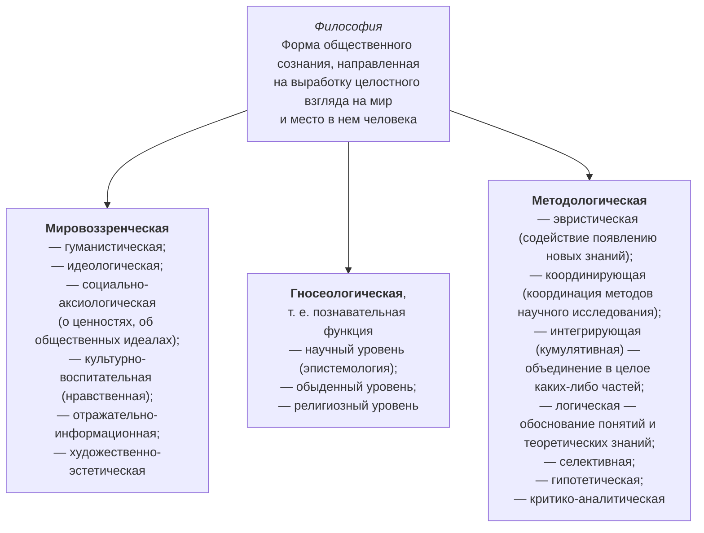

*Рис. 1.* **Основные функции философии**

> [!example]- Оригинал страницы (PDF 468)
> 

---

###### Страница 462 · PDF 469

*Рис. 2.* **Связь философии, религии, мифологии**

*(На схеме различие «затрагивает чувства… опирается на веру» относится к религии, «обращена к разуму…» — к философии.)*

*Рис. 3.* **Типы мировоззрения**

> [!example]- Оригинал страницы (PDF 469)
> 

---

###### Страница 463 · PDF 470

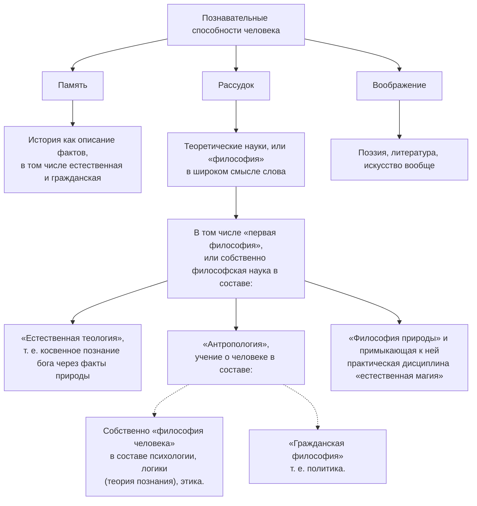

*Рис. 4.* **Бэконовская классификация наук**

> [!example]- Оригинал страницы (PDF 470)
> 

---

###### Страница 464 · PDF 471

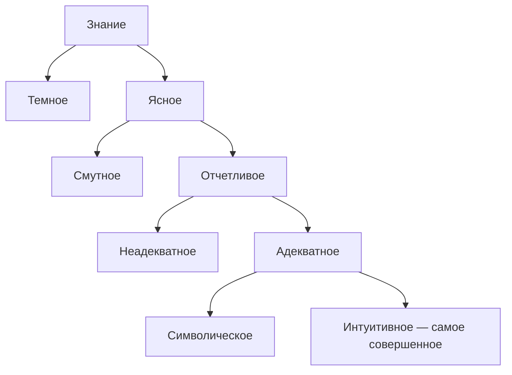

*Рис. 5.* **Лейбницевская схема знаний**

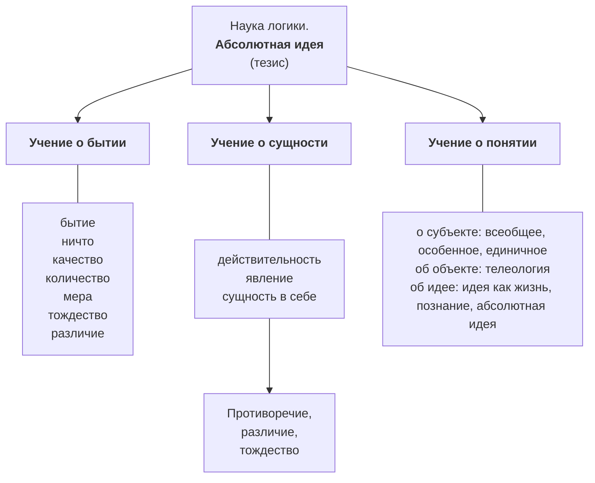

*(Окончание схемы — на следующей странице, рис. 6.)*

> [!example]- Оригинал страницы (PDF 471)
> 

---

###### Страница 465 · PDF 472

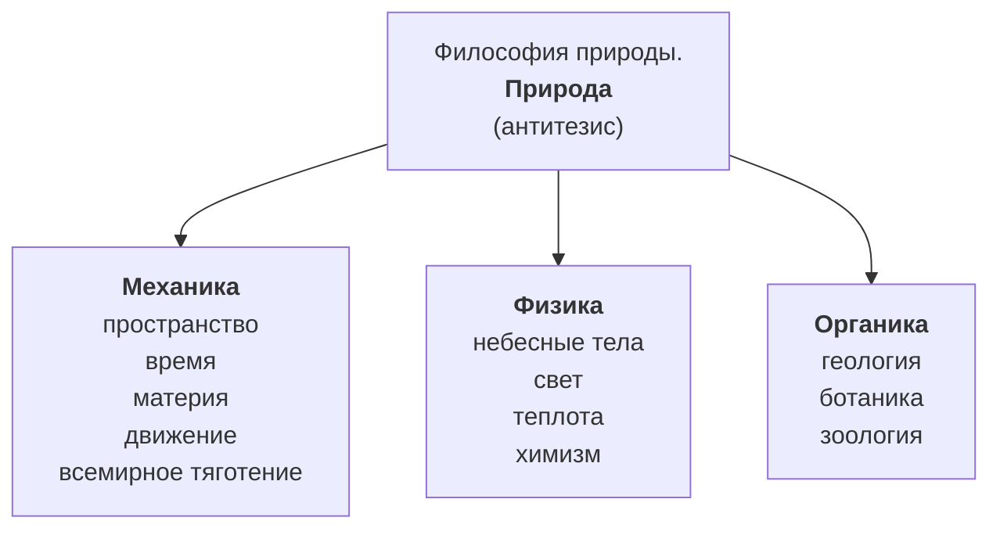

*Рис. 6.* **Структура гегелевской философской системы. Используется принцип триады**

> [!example]- Оригинал страницы (PDF 472)
> 

---

###### Страница 466 · PDF 473

*Рис. 7.* **Общая характеристика основных законов диалектики**

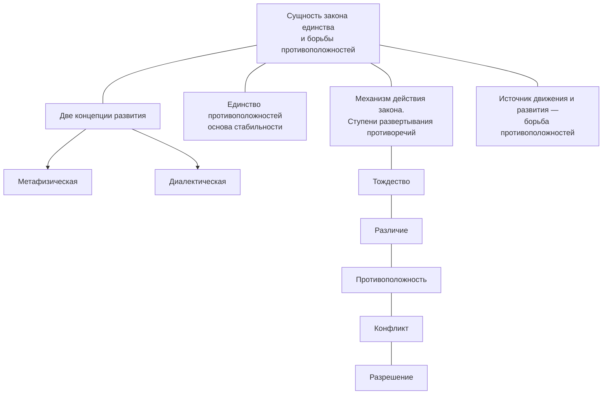

*Рис. 8.* **Закон единства и борьбы противоположностей**

> [!example]- Оригинал страницы (PDF 473)
> 

---

###### Страница 467 · PDF 474

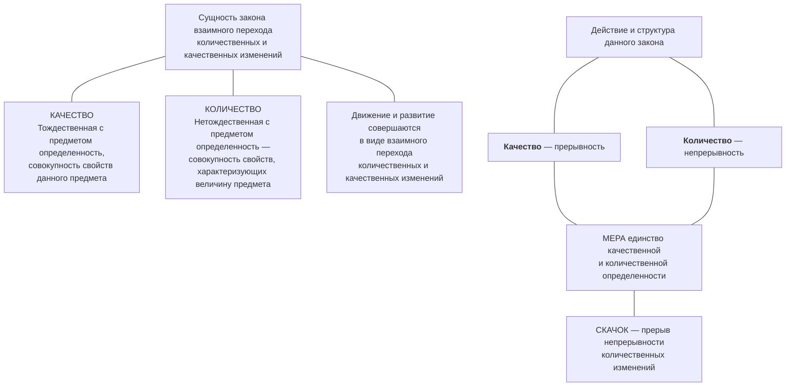

*Рис. 9.* **Закон взаимного перехода количественных и качественных изменений**

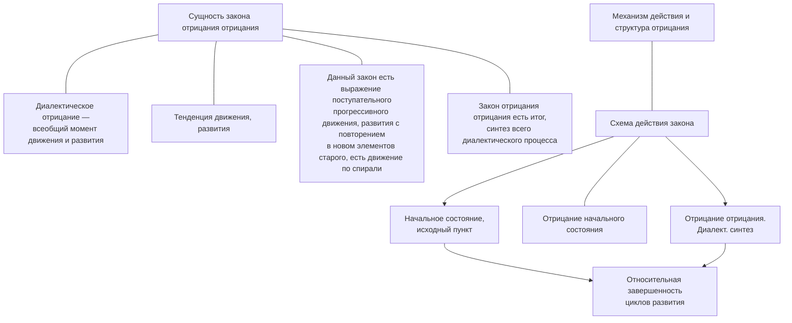

*Рис. 10.* **Закон отрицания отрицания**

> [!example]- Оригинал страницы (PDF 474)
> 

---

###### Страница 468 · PDF 475

*Рис. 11.* **Онтология — учение о бытии**

*Рис. 12.* **Классификация форм движения материи**

> [!example]- Оригинал страницы (PDF 475)
> 

---

###### Страница 469 · PDF 476

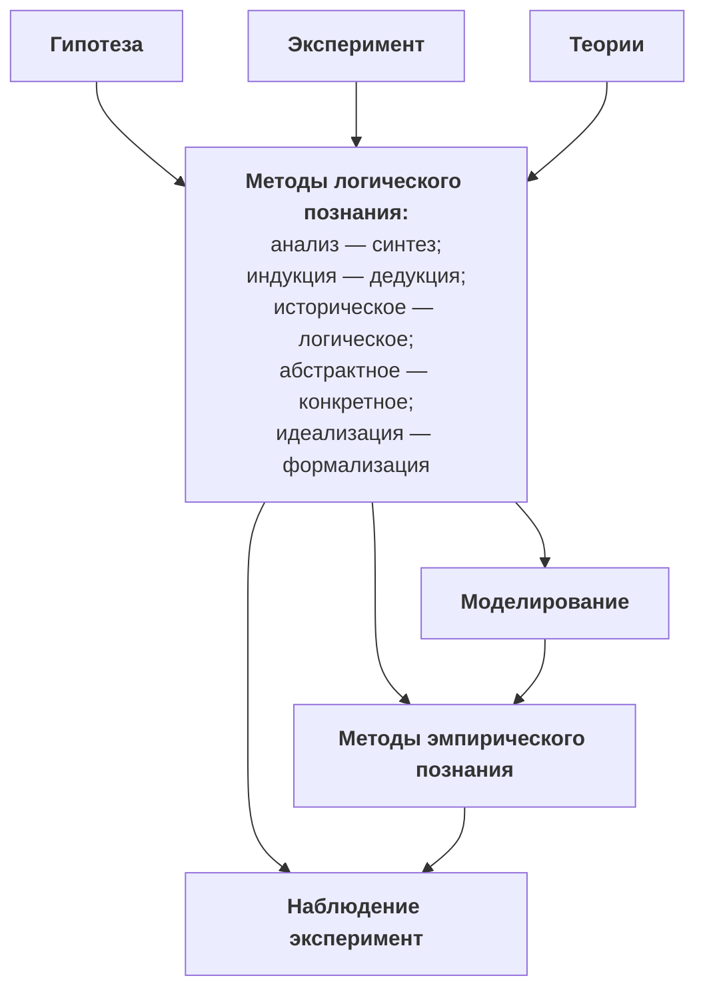

*Рис. 13.* **Познание**

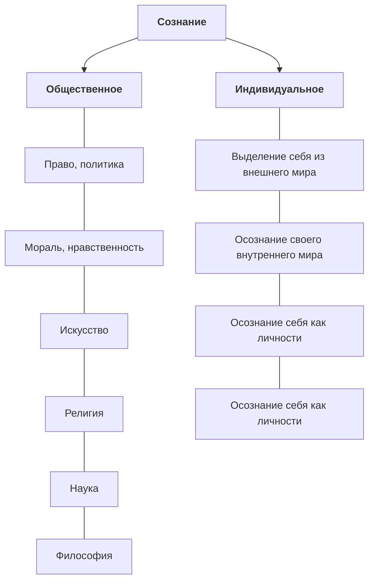

*Рис. 14.* **Сознание**

> [!example]- Оригинал страницы (PDF 476)
> 

---

###### Страница 470 · PDF 477

**Сознание** есть свойство высокоорганизованной материи (т. е. мозга), детерминирующее **отражение** объективной действительности. Сознание представляет собой единство психических процессов, активно участвующих в осмыслении человеком объективного мира и своего собственного бытия.

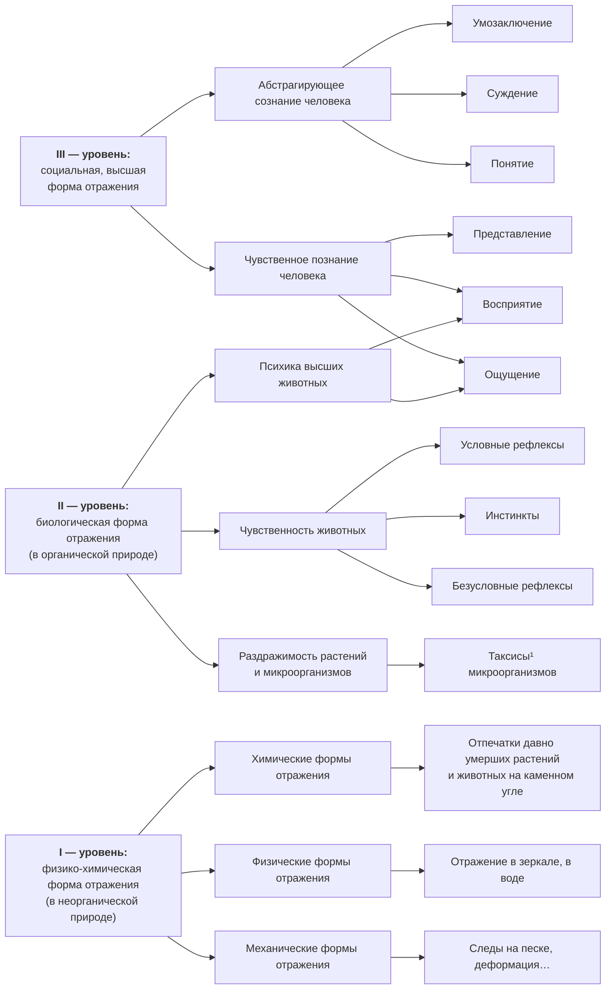

*Рис. 15.* **Происхождение сознания**

> [!note]- Сноски
> ¹ **Таксисы** — расположение, направление движения организмов под влиянием раздражителей (света, температуры, химических веществ и др.).

> [!example]- Оригинал страницы (PDF 477)
> 

---

###### Страница 471 · PDF 478

## Приложение 2 Практические задания по курсу

Внимательно прочитайте приведенные в практических заданиях тексты (цитаты, высказывания, определения) и выполните задания, поставленные в них.

Практическое задание 1.

В философии «случайность» понимается как «форма проявления необходимости».

Задания:

1. Приведите конкретный пример из жизни, доказывающий данное суждение.

2. Для какой теории характерна парная категория «случайность и необходимость»?

Практическое задание 2.

Процесс познания, по словам В. И. Ленина, «идет от живого созерцания к абстрактному мышлению и от него к практике».

Задания:

1. Раскройте смысл этого суждения.

2. Дайте Ваше понимание понятий «живое созерцание», «абстрактное мышление». Исчерпывается ли ими процесс познания? Обоснуйте свой ответ.

Практическое задание 3.

О философии, для определения ее роли в обществе, часто говорят: «когда философия управляет поведением человека, — она идеология, а когда вырабатывает парадигмы поведения, — она наука».

Задания:

1. Прокомментируйте эти подходы к пониманию философии.

2. Назовите функции, выполняемые философией в обществе и жизни человека.

Практическое задание 4. Ф. М. Достоевский об идеальном общественном устройстве писал: «Я хочу не такого общества научного, где бы я не мог делать зла,

> [!example]- Оригинал страницы (PDF 478)
> 

---

###### Страница 472 · PDF 479

а такого именно, где я мог бы делать всякое зло, но не хотел бы делать его сам»¹.

Задания:

1. Прокомментируйте высказывание Достоевского.

2. Возможно ли, на Ваш взгляд, построить такое общество, © котором говорит Достоевский, или оно утопично?

Практическое задание 5.

«Цель оправдывает средства» — этот иезуитский лозунг в качестве закона политической морали проводил итальянский мыслитель эпохи Возрождения Николло Макиавелли.

Задания:

1. Выразите свое отношение к данному суждению.

2. Приведите примеры, когда эта идея была реализована в истории, жизни. Прочитайте нижеприведенный текст, проанализируйте его и выполните задания:

Практическое задание 6.

«Ценности упорядочивают действительность, вносят в ее осмысление оценочные моменты, отражают иные по сравнению с наукой аспекты окружающей действительности... Ценности придают смысл человеческой жизни» (П. С. Гуревич).

Задания:

1. Назовите универсальные идеалы и ценности, предпочитаемые человеком.

2. Соотносите понятия «ценность» и «оценка», «ценность» и «истина», «ценность» и «норма». Какие бывают ценности?

Прочитайте нижеприведенный текст, проанализируйте его и выполните задания.

Практическое задание 7.

«Паук совершает операции, напоминающие операции ткача, и пчела постройкой восковых ячеек посрамляет некоторых людейархитекторов. Но и самый плохой архитектор от наилучшей пчелы с самого начала отличается тем, что, прежде чем строить ячейку из воска, он уже построил ее в своей голове. В конце процесса труда получается результат, который уже в начале этого процесса имелся в представлении человека, т. е. идеально» (К. Маркс).

Задания:

1. Раскройте суть «идеального». В каких формах оно существует? Приведите примеры идеального.

> [!note]- Сноски
> ¹ Цит. по: Достоевский Ф. М. «Записные книжки», M., 2000.

> [!example]- Оригинал страницы (PDF 479)
> 

---

###### Страница 473 · PDF 480

2. На какие сущностные черты сознания как идеального обращает внимание К. Маркс?

Прочитайте нижеприведенный текст, проанализируйте его и выполните задания.

Практическое задание 8.

C. JI. Франк в известной работе «Смысл жизни» пишет: «этот “проклятый вопрос” “о смысле жизни” волнует и мучает в глубине души каждого человека. Человек может на время, даже на очень долгое время, совсем забыть о нем, погрузиться с головой в будничные интересы сегодняшнего дня, в материальные заботы о сохранении жизни, о богатстве, довольстве и земных успехах … но жизнь уже так устроена, что совсем и навсегда отмахнуться от него не может и самый тупой, заплывший жиром или духовно спящий человек... Этот вопрос — не теоретический, не предмет праздной умственной игры; этот вопрос есть вопрос о смысле самой жизни, он даже страшен — и, собственно, говоря, еще гораздо более страшнее, чем при тяжкой нужде вопрос о куске хлеба для утоления голода...».

Ответьте на вопросы аргументированно:

1. Почему, на Ваш взгляд, вопрос о смысле жизни стал одним из важных для человека? Какие мнения есть по этому вопросу среди философов, теологов, ученых?

2. В чем Вы видите смысл своей жизни?

Практическое задание 9.

Парменид писал: «Бытие есть, небытия вовсе нету».

А Аристотель считал: «Небытие существует нисколько не менее, чем бытие».

Задания:

1. Раскройте смысл приведенных высказываний и выявите противоречие в них,

2. Как, на Ваш взгляд, соотносятся между собой понятия «бытие» и «небытие», «небытие» и «ничто», «ничто» и «нечто»?

Практическое задание 10.

В. М. Бехтерев, ученый, академик, врач, почти сто лет назад, выступая на открытии института в Петербурге, сказал: «В наше время высшие школы преследуют только профессиональные качества, они готовят юристов, врачей, архитекторов и т. д. Но при этом упускают из виду, что в центре этой работы должен быть поставлен человек, что для государства, кроме профессиональных деятелей, нужны лица, которые понимают то, что такое человек, как и по каким законам развивается его психика».

> [!example]- Оригинал страницы (PDF 480)
> 

---

###### Страница 474 · PDF 481

Вопросы:

1. Насколько актуальна это проблема сегодня?

2. Могут ли образование, его качество повлиять на решение глобальных проблем современности? Чего Вы ждете от высшего образования?

Практическое задание 11.

Известный древнегреческий афоризм гласит: «Не будь ни слишком грубым, ни слишком упрямым, ни слишком склонным к доказательствам, ни слишком гневливым. Упрямство обижает, мягкость вызывает презрение, излишние доказательства обижают, слепая вера делает смешным, неверие ведет к пороку».

Задания:

1. Проиллюстрируйте афоризм несколькими примерами из жиз- HH.

2. Сформулируйте закон диалектики, к соблюдению которого призывает афоризм, и кратко раскройте его суть.

Практическое задание 12.

Как известно, свобода — одна из неоспоримых общечеловеческих ценностей.

Задания:

1. Сформулируйте основное значение этого понятия.

2. В чем отличие «свободы ОТ...» от «свободы для...»? Приведите примеры.

Практическое задание 13.

«Когда мы говорим, что наслаждение есть конечная цель, то мы разумеем отнюдь не наслаждение распутства или чувственности, как полагают те, кто не знает, не разделяет или плохо понимает наше учение, — нет, мы разумеем свободу от страданий тела и от смятения души. Ибо не бесконечные попойки и праздники делают нашу жизнь сладкою, а только трезвое рассуждение, исследующее причины всякого нашего предпочтения и изгоняющее сомнения, поселяющее тревогу в душе».

Задания:

1. Определите этическую позицию философа.

2. Насколько такой подход к этической проблеме актуален для современной жизни?

Практическое задание 14.

«...В области приобщения к философскому знанию мы имеем дело с фундаментальным просчетом, касающимся природы самого дела, которому в мыслях своих хотят научить. Речь идет о природе философии, о природе того гуманитарного знания или гуманитарной

> [!example]- Оригинал страницы (PDF 481)
> 

---

###### Страница 475 · PDF 482

искры, ее производящей духовной клеточки, которая описывается в понятиях философии и связана с духовным развитием личности... Но у философии есть своя природа... Философия не представляет собой систему знаний, которую можно было бы передать другим и тем самым обучить их. Становление философского знания — это всегда внутренний акт, который вспыхивает, опосредуя собой другие действия. Действия, в результате которых появляется картина, хорошо сработанный стол или создается удачная конструкция машины, требующая, кстати, отточенного интеллектуального мужества»! (М. К. Мамардашвили).

Задания:

1. Можно ли, на Ваш взгляд, научить философии? Почему¹

2. Исходя из приведенного отрывка, философия — это:

а) возвышенный эмоциональный настрой человека;

b) форма гуманитарной культуры;

с) акт психологической реконструкции мира;

Я) духовный мир человека.

Практическое задание 15.

Д. Анахт (475 г. — 1-я половина VI B.), подводя некоторый итог, писал: «Имеется шесть определений философии. Первое — философия есть наука о сущем как таковом. Второе — философия есть наука о божественных и человеческих делах. Третье — философия есть забота о смерти. Четвертое — философия есть уподобление богу в меру человеческих возможностей. Пятое — философия есть искусство искусств и наука наук. Шестое — философия есть любовь к мудрости...». И далее: «...философия не является чем-то бесполезным... Философия существует для того, чтобы облагородить и украсить человеческую душу и перевести ее из материальной и окутанной туманом жизни к божественной и нематериальной»²

Задания:

1. Выскажите свое суждение о философии и ее предназначении.

2. Какую роль философия выполняет непосредственно в Вашей жизни и профессиональном росте?

Практическое задание 16.

« … Бытие Божие может быть доказано пятью путями.

Первый и наиболее очевидный путь исходит из понятия движения... Второй путь исходит из понятия производящей причины... Третий путь исходит из понятий возможности и необходимости и сводится к следующему... Четвертый путь исходит из различных

> [!note]- Сноски
> ¹ Цит. по: Мамардашвили М. К. Как я понимаю философию. М.: Прогресс, 1990, С. 14—26.
> ² Анахт Д. Сочинения. М., Мысль, 1975.

> [!example]- Оригинал страницы (PDF 482)
> 

---

###### Страница 476 · PDF 483

степеней, которые обнаруживаются в вещах. Мы находим среди вещей более или менее совершенные, или истинные, или благородные; и так обстоит дело и с прочими отношениями такого же рода... Пятый путь исходит из распорядка природы. Мы убеждаемся, что предметы, лишенные разума, каковы природные тела, подчиняются

Задания:

1. Покритикуйте данные доказательства с позиции материализма или обоснуйте их с позиции религии.

2. Противоречит ли данное высказывание главной линии философии Средних веков¹

Практическое задание 17.

«Олигархия переходит в демократию примерно следующим 0бразом: причина здесь в ненасытной погоне за предполагаемым благом, состоящим якобы в том, что надо быть как можно богаче.

Демократия, на мой взгляд, осуществляется тогда, когда бедняки, одержав победу, некоторых из своих противников уничтожат, иных изгонят, а остальных уравняют в гражданских правах и в замещении государственных должностей, что при демократическом строе происходит большей частью по жребию.

В демократическом государстве нет никакой надобности принимать участие в управлении, даже если ты к этому и способен; не обязательно и подчиняться, если ты не желаешь, или воевать, когда другие воюют, или соблюдать, подобно другим, условия мира, если ты мира не жаждешь. И опять-таки, если какой-нибудь закон запрещает тебе управлять либо судить, ты все же можешь управлять и судить, если это тебе придет в голову»²

Задания:

1. Можно ли применить платоновскую трактовку демократии к современной ее форме? Почему?

2. Выберите цель существования государства, обоснованную философом:

а) социальная справедливость;

b) личная собственность;

с) общее благо;

f) порядок;

е) отсутствие войн.

Практическое задание 18. О воспитании Конфуций говорил: «Если в человеке естественность превосходит воспитанность, он подобен деревенщине. Если же вос-

> [!note]- Сноски
> ¹ Антология мировой философии в 4-х т. T. 1. Ч. 2, М.: Мысль, 1969. С. 828—831.
> ² Платон. Государство (http: //lib.ru/POEEAST/PLATO/gosudarstvo. txt).

> [!example]- Оригинал страницы (PDF 483)
> 

---

###### Страница 477 · PDF 484

питанность превосходит естественность, он подобен ученому-книжнику. После того как воспитанность и естественность в человеке уравновесят друг друга, он становится благородным мужем».

Задания:

1. Насколько, на ваш взгляд, сочетается данное морально-этическое наставление древнекитайского мудреца с современными антропологическими идеалами и пирамидой ценностей? Аргументируйте свой ответ.

2. Попробуйте создать свою пирамиду ценностей, венчать которую будут высокие моральные, нравственные качества личности, которые Вы считаете самыми важными и необходимыми в социальной жизни, а внизу будут расположены «низкие» качества личности.

Практическое задание 19.

«...хозяйство, рассматриваемое как творчество, есть и психологический феномен, или, говоря еще определеннее, хозяйство есть явление духовной жизни в такой же мере, в какой и все другие стороны человеческой деятельности и труда. Дух хозяйства (напр., «дух капитализма», о котором теперь много пишут, и притом такие выдающиеся представители экономической науки, как Зомбарт и Макс Вебер) есть, опять-таки, не фикция, не образ, но историческая реальность. Всякая хозяйственная эпоха имеет свой дух и, в свою очередь, является порождением этого духа, каждая экономическая эпоха имеет свой особый тип «экономического человека», порождаемый духом хозяйства... Понимание хозяйства как явления духовной жизни открывает глаза на психологию хозяйственных эпох и значение смены хозяйственных мировоззрений. Им выдвигается также чрезвычайно важная проблема не только научного, но и практического характера — именно о значении личности в хозяйстве»¹

Задания:

1. Разделяете ли Вы такую оценку хозяйства, что оно есть явление духовное? Обоснуйте свою позицию.

2. Каковы, согласно автору текста, философские основания «хозяйства» как экономической категории:

а) личность;

Ь) религия;

с) православие;

d) техника.

Практическое задание 20. По мнению В. С. Соловьева, в стремлении к высшему Добру отправной точкой служат природные данные ума и сердца человека

> [!note]- Сноски
> ¹ Конфуций, Лунь Юй. M., 2001 2 Булгаков С. Философия хозяйства.

> [!example]- Оригинал страницы (PDF 484)
> 

---

###### Страница 478 · PDF 485

и прежде всего стыд, жалость и благоговение, которые индивидуальны, но общим формирующим условием для всех является нравственная свобода, без которой нет доступа в нравственный мир.

Задания:

1. Раскройте смысл понятий: стыд, жалость, благоговение, нравственная свобода.

2. Какие качества человека составляют основу нравственности, по вашему мнению¹

Практическое задание 21.

Французский философ Гельвеций сравнивал процесс познания с судом, где пять органов чувств — это пять свидетелей, которые только и могут дать истину. Его оппоненты, однако, возражая, заявили, что Гельвеций забыл судью.

Задания:

1. Прокомментируйте аллегории, используемые в приведенном тексте. Что имели в виду оппоненты Гельвеция под «судьей»?

2. Как можно охарактеризовать гносеологическую позицию философа, чем она отличается от современного научного понимания процесса познания?

Практическое задание 22.

«Сама в себе свобода заключает в себе бесконечную необходимость осознать именно себя и тем самым становиться действительной, потому что по своему понятию она есть знание о себе, она является для себя целью, и притом единственной целью духа, которую она осуществляет. Эта конечная цель есть то, к чему направлялась работа, совершавшаяся во всемирной истории; ради нее приносились в течение долгого времени всевозможные жертвы на обширном алтаре земли»!.

Задания:

1. Приведите свои аргументы за или против такого понимания свободы.

2. Свобода, по мнению Гегеля — это:

а) состояние индивида;

b) социальный идеал;

с) осознанная необходимость;

d) независимость.

Практическое задание 23. Р. Оуэн в работе «Катехизис нового нравственного мира» задаётся вопросом: «В чем состоит счастье и несчастье человека?» —

> [!note]- Сноски
> ¹ Гегель Г. В. Ф. Философия истории (http://e-libra.ru/read/362195-filosofiyaistorii.htm).

> [!example]- Оригинал страницы (PDF 485)
> 

---

###### Страница 479 · PDF 486

и отвечает: «Счастье человека состоит в приятных ощущениях или в умеренном удовлетворении всех его потребностей. А несчастье состоит в болезненных ощущениях, или в том, что потребности, вытекающие из его физических, умственных и нравственных способностей, не удовлетворяются, и человек не получает наслаждения»².

Задания:

1. Определите, смысл какого философско-этического направления выражен в приведенной выдержке из труда Р. Оуэна.

2. Актуальна ли данная социальная проблема в обществе современного глобального мира? Обоснуйте свой ответ

Практическое задание 24.

а) «Техника есть обнаружение силы человека, его царственного положения в мире. Она свидетельствует о человеческом творчестве и изобретательности и должна быть призвана ценностью и благом...»?;

Ь) « … В мире техники человек перестает жить прислоненным к земле, окруженным растениями и животными. Он живет в новой металлической действительности, дышит иным, отравленным воздухом. Машина убийственно действует на душу... Машина есть распятие плоти мира, вознесение на крест благоухающих цветов и поющих птиц. Это — Голгофа природы. В неотвратимом процессе искусственной механизации природа как бы искупает грех внутренней скованности и вражды. Природный организм должен умереть, чтобы воскреснуть к новой жизни. И вот чудовища-машины умертвляют природную органическую целостность и косвенно, мучительными путями высвобождают дух из природной связанности»³.

Задания:

1. Проведите сравнительный и концептуальный анализ высказываний а и b.

2. Какая из приведенных цитат соответствует духу современной цивилизации и более точно отражает линии развития информационного общества?

Практическое задание 25.

«Всякий труд есть, с одной стороны, расходование человеческой рабочей силы в физиологическом смысле, — и в этом своем качестве... труд образует стоимость товаров. Всякий труд есть, с другой стороны, расходование человеческой рабочей силы в особой целесообразной форме, и в этом своем качестве конкретного полезного труда он создает потребительские стоимости» (К. Маркс).

> [!note]- Сноски
> ¹ Мир философии. T. 2., 1991. P. Оуэн. С. 30.
> ² Бердяев Н. А. О назначении человека. М.: 1993, С. 383, 3 Бердяев Н. А. Дух и машина // Судьба России. С. 273.

> [!example]- Оригинал страницы (PDF 486)
> 

---

###### Страница · PDF 487

Задания:

1. Какой закон диалектики раскрывает К. Маркс в данном рассуждении о природе труда?

2. Подчиняется ли процесс мышления законам диалектики? Обоснуйте свой ответ.

> [!example]- Оригинал страницы (PDF 487)
> 

---

###### Страница · PDF 488

**Наши книги можно приобрести:**

**Учебным заведениям и библиотекам:**  
в отделе по работе с вузами  
тел.: (495) 744-00-12, e-mail: vuz@urait.ru

**Частным лицам:**  
список магазинов смотрите на сайте urait.ru  
в разделе «Частным лицам»

**Магазинам и корпоративным клиентам:**  
в отделе продаж  
тел.: (495) 744-00-12, e-mail: sales@urait.ru

**Отзывы об издании присылайте в редакцию**  
e-mail: gred@urait.ru

**Новые издания и дополнительные материалы доступны на образовательной платформе «Юрайт» urait.ru, а также в мобильном приложении «Юрайт.Библиотека»**

---

*Учебное издание*

**Иоселиани Аза Давидовна**

**ОСНОВЫ ФИЛОСОФИИ**

Учебник и практикум для СПО

Формат 70×100 ¹/₁₆.  
Гарнитура «Charter». Печать цифровая.  
Усл. печ. л. 37,24

**ООО «Издательство Юрайт»**  
111123, г. Москва, ул. Плеханова, д. 4а.  
Тел.: (495) 744-00-12. E-mail: izdat@urait.ru, www.urait.ru

> [!example]- Оригинал страницы (PDF 488)
> 

---
