> [!info] О файле
> Текст распознан автоматически (OCR) со сканов страниц, возможны опечатки распознавания.
> Под каждой страницей в свёрнутом блоке лежит изображение оригинала — разверните его, чтобы сверить текст, таблицы и схемы.
> Номера «стр.» — печатные номера книги, «PDF» — номер страницы в исходном PDF.

**М. Ю. Коноваленко**

# ПСИХОЛОГИЯ ОБЩЕНИЯ

**УЧЕБНИК И ПРАКТИКУМ ДЛЯ СПО**

3-е издание, переработанное и дополненное

Рекомендовано Учебно-методическим отделом среднего профессионального образования в качестве учебника для студентов образовательных учреждений среднего профессионального образования

*(QR-код)* Курс с практическими заданиями и дополнительными материалами доступен на образовательной платформе «Юрайт», а также в мобильном приложении «Юрайт.Библиотека»

**Москва • Юрайт • 2025**

> [!quote]- Оригинал: PDF 2
> 

---

УДК 659(075.32) ББК 60.56я723

Автор:

Коноваленко Марина Юрьевна, доцент, кандидат психологических наук, доцент кафедры коммуникационных технологий — Института международных отношений и социально-политических наук Московского государственного лингвистического университета.

Коноваленко, М. Ю.

Психология общения : учебник и практикум для среднего профессионального образования / М. Ю. Коноваленко. — 3-е изд., перераб. и доп. — Москва : Издательство Юрайт, 2025. — 396 с. —

(Профессиональное образование). — Текст : непосредственный. ISBN 978-5-534-20162-8

В курсе представлены теоретические основы деловой коммуникации, коммуникативный  категориальный аппарат, общие закономерности, сходства и различия видов, уровней, форм коммуникации, являющихся необходимым условием успешной деятельности современного специалиста. Курс ставит — главной — задачей — формирование — самостоятельного эффективного — коммуникативного — стиля, — способности — и навыков продуктивного делового поведения, реагирования, — взаимодействия и делового общения.

Предназначен для студентов образовательных учреждений среднего профессионального образования.

УДК 659(075.32) ББК 60.56я723

Все права защищены. Никакая часть данной книги не может быть воспроизведена в какой бы то ни было форме без письменного разрешения владельцев авторских прав.

ISBN 978-5-534-20162-8 © Коноваленко М. Ю.. 2024

- Коноваленко М. Ю., 2024, сизменениями
- ООО «Издательство Юрайт», 2025

> [!quote]- Оригинал: PDF 3
> 

---

### Предисловие от редакции

Данный учебник является малой частью обширного курса. Мы рекомендуем вам обратиться к полному набору учебных материалов, доступных на Образовательной платформе «Юрайт».

На платформе вы найдете тесты, интерактивные задания и другие дополнительные ресурсы для самостоятельного обучения, которые помогут вам углубить свои знания и навыки.

Не упустите шанс максимально использовать все доступные возможности для успешного освоения дисциплины!

> [!abstract] Схема: ресурсы курса на Образовательной платформе «Юрайт»
> - **Групповая работа**
>     - Тесты / Задания / Экзамены
>     - Аудио / Видео / Ссылки
>     - **Этот учебник** = Лекции на платформе
>     - Конструктор курсов
>     - Шаблоны рабочих программ
>     - Входное тестирование · Тотальный экзамен · Конституционный экзамен · Культурный уровень
> - Мобильное приложение
> - Интеграция с MOODLE
>
> *Значки в оригинале обозначают: «Для студентов» и «Для преподавателей».*

*(QR-код)*

**ОБРАЗОВАТЕЛЬНАЯ ПЛАТФОРМА «ЮРАЙТ»**

> [!quote]- Оригинал: PDF 4
> 

---

### Преподавателю

### Работа с курсом на Образовательной платформе Юрайт

Создавайте группу студентов и назначайте им курсы

Группы помогут вам в обучении и аттестации студентов

на нашей платформе. Вы сможете:

- получать результаты тестов студентов по назначен-

ным курсам;

- выдавать студентам задания для самостоятельной работы; студентов
- проводить промежуточную и итоговую аттестацию;
- смотреть цифровую активность студентов группы на платформе.

Работа с группами студентов:

- группу можно создать в разделе личного кабинета Преподавателя «Группы студентов»;
- добавить студентов в группу можно по ФИО, адресу электронной почты или загрузить их списком Ехсе];
- назначить курс группе можно на странице любого курса на плат-

форме.

Выдавайте студентам тесты

ших студентов:

- проверяйте знания по конкретным темам или по всему курсу, указывайте сроки и количество попыток;
- выдавайте тесты студентам индивидуально или всей группе;
- платформа автоматически проверит ответы и пришлет вам результаты в личный кабинет;
- используйте анализ тестов, чтобы узнать с какими вопросами и темами у студентов проблемы;
- после прохождения теста студенты получат индивидуальные рекомендации и смогут сразу перейти к повторению нужных тем.

Работа с тестами:

- результаты тестов доступны в разделе личного кабинета Преподавателя «Результаты тестов студентов»;
- выдать тест можно на странице любого курса, который содержит тесты.

> [!quote]- Оригинал: PDF 5
> 

---

Выдавайте студентам задания для самостоятельной работы

Задания помогут вам с подбором образовательных за-

дач, которые структурируют самостоятельную работу

студентов в онлайне, делают её интерактивной, разно-

образной и удобной:

- на платформе доступно 28 видов заданий для формирования профессиональных навыков студентов, в том числе кейсы, деловые игры и групповые дебаты;
- студенты могут выполнять задания как индивидуально, так и работая в команде;
- указывайте сроки и критерии выполнения самостоятельной работы;
- общайтесь со студентами и отвечайте на вопросы во время выполнения задания с помощью комментариев;
- отправляйте на доработку сданные работы, которые выполнены не полностью или не соответствуют критериям.

Задания

Работа с заданиями:

- результаты самостоятельной работы студентов доступны в разделе личного кабинета Преподавателя «Задания»;
- выдать студентам самостоятельную работу можно на странице любого курса, который содержит задания.

Проводите со студентами промежуточную и итоговую аттестацию

Сервис «Экзамен» поможет вам просто и оперативно провести зачеты и экзамены в онлайне:

- назначайте экзамен из одной или двух частей: тестовой и заданий, требующих развернутого ответа;
- выбирайте только необходимые вам для контроля темы курса;
- по окончании экзамена получайте цифровую ведомость, которую можно выгрузить в Excel;
- назначайте пересдачу для студентов с плохими результатами или пропустивших экзамен.

Экзамены

> [!quote]- Оригинал: PDF 6
> 

---

Работа с экзаменами:

- результаты экзаменов доступны в разделе личного кабинета Преподавателя «Экзамены»;
- назначить студентам экзамен можно на странице любого курса, который подходит для экзамена.

> [!quote]- Оригинал: PDF 7
> 

---

### Студенту

### Работа с курсом на Образовательной платформе Юрайт

Добавляйтесь в группу к своему преподавателю

Группы помогут вам полноценно изучать курсы, наз- назначенные преподавателем, и пользоваться сервисами

платформы:

- смотрите список своих преподавателей и курсы, которые они вам назначили;
- переходите в чат группы в социальных сетях при наличии в группе ссылки на него;
- делитесь быстро результатами тестов с преподавателем;
- выполняйте задания, выданные преподавателем;
- проходите экзамен, назначенный преподавателем.

Мои преподаватели

Как добавиться в группу преподавателя:

- после регистрации и авторизации на платформе получите ссылку на группу от преподавателя и перейдите по ней;
- преподавателя можно добавить в разделе личного кабинета Студента «Преподаватели».

Проходите тесты

Тесты в наших курсах помогут вам проверить знания по различным дисциплинам:

- проверяйте знания по конкретным темам или по всему курсу;
- после прохождения теста получайте индивидуальные рекомендации и сразу переходите к повторению нужных тем;
- платформа автоматически проверит ответы и пришлет вам результаты в личный кабинет;
- делитесь результатами тестов с преподавателем и с сокурсниками в соцсетях.

Работа с тестами:

- пройти тест можно на странице любого курса, который содержит тесты;
- результаты тестов доступны в разделе личного кабинета Студента «Тесты».

> [!quote]- Оригинал: PDF 8
> 

---

Выполняйте задания

Задания помогут развить навыки, востребованные на рынке труда:

- на платформе доступны различные типы заданий для формирования профессиональных навыков;
- выполняйте выданные преподавателем задания индивидуально или в команде с другими студентами и одногруппниками;
- общайтесь с преподавателем и отвечайте на вопросы во время выполнения задания с помощью прикрепления файлов и комментариев;
- получайте обратную связь и оценку знаний.

Работа с заданиями:

- вы можете получить самостоятельную работу от преподавателя на основе материалов любого курса, который содержит задания;
- результаты доступны в разделе личного кабинета Студента «Задания».

Проходите промежуточную и итоговую аттестации

Сервис «Экзамен» поможет вам просто и оперативно сдать зачеты и экзамены дистанционно:

- сдавайте экзамен в спокойной домашней обстановке;
- счетчик покажет, сколько осталось времени на экзамен;
- оставляйте ответы на платформе или прикрепляйте файлы.

Экзамены

Работа с экзаменами:

- о назначении экзамена вам придет уведомление с датой и временем на сайте и на почту;
- в назначенное время вы сможете начать проходить экзамен;
- ответьте на тестовую часть экзамена и прикрепите развернутый ответ на вторую часть экзамена в окошке на платформе;
- система автоматически проверит ваши ответы на первую часть экзамена;
- преподаватель проверит ответы второй части и выставит оценку за обе части;
- результаты экзаменов доступны в разделе личного кабинета Студента «Экзамены».

> [!quote]- Оригинал: PDF 9
> 

---

## Оглавление

- [[#Введение|Введение]] — 6

**Раздел 1. ПСИХОЛОГИЯ ДЕЛОВОГО ОБЩЕНИЯ**

- [[#Тема 1. ПСИХОЛОГИЧЕСКИЕ ОСОБЕННОСТИ МЕЖЛИЧНОСТНЫХ КОММУНИКАЦИЙ|Тема 1. Психологические особенности межличностных коммуникаций]] — 11
	- [[#1.1. Характеристика и содержание общения|1.1. Характеристика и содержание общения]] — 12
		- [[#Структура общения|Структура общения]] — 16
		- [[#Типы межличностных коммуникаций|Типы межличностных коммуникаций]] — 18
	- [[#1.2. Перцептивная сторона общения как люди воспринимают друг друга|1.2. Перцептивная сторона общения: как люди воспринимают друг друга]] — 22
		- [[#Принципы формирования первого впечатления|Принципы формирования первого впечатления]] — 24
	- [[#1.3. Коммуникативная сторона общения|1.3. Коммуникативная сторона общения]] — 28
		- [[#1.3.1. Особенности понимания в процессе коммуникации|1.3.1. Особенности понимания в процессе коммуникации]] — 28
		- [[#1.3.2. Психология поведения человека в процессе коммуникации|1.3.2. Психология поведения человека в процессе коммуникации]] — 33
		- [[#1.3.3. Принципы эффективного общения|1.3.3. Принципы эффективного общения]] — 45
- [[#Тема 2. ВЕРБАЛЬНАЯ КОММУНИКАЦИЯ ПСИХОЛОГИЧЕСКИЕ ХАРАКТЕРИСТИКИ РЕЧИ|Тема 2. Вербальная коммуникация: психологические характеристики речи]] — 50
	- [[#2.1. Основы устного общения|2.1. Основы устного общения]] — 51
		- [[#2.1.1. Виды речи|2.1.1. Виды речи]] — 52
		- [[#2.1.2. Речь как источник информации|2.1.2. Речь как источник информации]] — 61
	- [[#2.2. Формы вербальной коммуникации|2.2. Формы вербальной коммуникации]] — 70
	- [[#2.3. Культура речи|2.3. Культура речи]] — 72
- [[#Тема 3. НЕВЕРБАЛЬНАЯ КОММУНИКАЦИЯ|Тема 3. Невербальная коммуникация]] — 74
	- [[#3.1. Сходство и различие вербальной и невербальной коммуникации|3.1. Сходство и различие вербальной и невербальной коммуникации]] — 74
	- [[#3.2. Структура невербальной коммуникации|3.2. Структура невербальной коммуникации]] — 76
		- [[#Акустическая система отражения невербального поведения человека|Акустическая система отражения невербального поведения человека]] — 78
		- [[#Оптическая система отражения невербального поведения человека|Оптическая система отражения невербального поведения человека]] — 79
- [[#Тема 4. ФОРМЫ ДЕЛОВОЙ КОММУНИКАЦИИ|Тема 4. Формы деловой коммуникации]] — 85
	- [[#4.1. Деловые переговоры и деловая беседа|4.1. Деловые переговоры и деловая беседа]] — 85
		- [[#4.1.1. Модели и стили переговоров|4.1.1. Модели и стили переговоров]] — 89

> [!quote]- Оригинал: PDF 10
> 

---

- [[#4.1.2. Эффективные тактики переговорного процесса|4.1.2. Эффективные тактики переговорного процесса]] — 98
		- [[#4.1.3. Особенности полемики в переговорном процессе|4.1.3. Особенности полемики в переговорном процессе]] — 103
		- [[#4.1.4. Ведущие факторы переговорного процесса|4.1.4. Ведущие факторы переговорного процесса]] — 107
		- [[#4.1.5. Виды переговоров|4.1.5. Виды переговоров]] — 113
	- [[#4.2. Публичное выступление|4.2. Публичное выступление]] — 120

**Раздел 2. КОММУНИКАТИВНАЯ КОМПЕТЕНТНОСТЬ СПЕЦИАЛИСТА**

- [[#Тема 5. ОСНОВЫ КОММУНИКАТИВНОЙ КОМПЕТЕНТНОСТИ СПЕЦИАЛИСТА|Тема 5. Основы коммуникативной компетентности специалиста]] — 133
	- [[#5.1. Психологические методы убеждающего воздействия|5.1. Психологические методы убеждающего воздействия]] — 135
	- [[#5.2. Построение аргументации|5.2. Построение аргументации]] — 142
	- [[#5.3. Типы вопросов и способы их использования|5.3. Типы вопросов и способы их использования]] — 152
	- [[#5.4. Барьеры коммуникации|5.4. Барьеры коммуникации]] — 166
		- [[#5.4.1. Окружающая среда как фактор барьера коммуникации|5.4.1. Окружающая среда как фактор барьера коммуникации]] — 167
		- [[#5.4.2. Коммуникативные барьеры в межличностных коммуникациях|5.4.2. Коммуникативные барьеры в межличностных коммуникациях]] — 168
		- [[#5.4.3. Технические барьеры|5.4.3. Технические барьеры]] — 176
		- [[#5.4.4. Барьеры коммуникации в организациях|5.4.4. Барьеры коммуникации в организациях]] — 177
- [[#Тема 6. КОММУНИКАЦИИ В КОНФЛИКТНЫХ СИТУАЦИЯХ|Тема 6. Коммуникации в конфликтных ситуациях]] — 181
	- [[#6.1. Виды конфликтов|6.1. Виды конфликтов]] — 182
	- [[#6.2. Причины конфликтов|6.2. Причины конфликтов]] — 186
	- [[#6.3. Функции конфликтов|6.3. Функции конфликтов]] — 194
	- [[#6.4. Возникновение и развитие конфликтов|6.4. Возникновение и развитие конфликтов]] — 196
	- [[#6.5. Анализ конфликтов|6.5. Анализ конфликтов]] — 200
	- [[#6.6. Способы разрешения конфликтов|6.6. Способы разрешения конфликтов]] — 210
	- [[#6.7. Особенности поведения в конфликтных ситуациях|6.7. Особенности поведения в конфликтных ситуациях]] — 221
	- [[#6.8. Психотехнологии воздействия на оппонента в конфликтных ситуациях|6.8. Психотехнологии воздействия на оппонента в конфликтных ситуациях]] — 227
- [[#Тема 7. БИЗНЕС-КОММУНИКАЦИИ В УСЛОВИЯХ ИСКАЖЕНИЯ ИНФОРМАЦИИ|Тема 7. Бизнес-коммуникации в условиях искажения информации]] — 230
	- [[#7.1. Классификация видов искажений информации|7.1. Классификация видов искажений информации]] — 231
	- [[#7.2. Диагностика искажения информации партнером в процессе бизнес-коммуникаций|7.2. Диагностика искажения информации партнером в процессе бизнес-коммуникаций]] — 240
	- [[#7.3. Принципы эффективного выявления неистинной информации|7.3. Принципы эффективного выявления неистинной информации]] — 242
	- [[#7.4. Показатели неискренности человека, наблюдаемые в процессе общения|7.4. Показатели неискренности человека, наблюдаемые в процессе общения]] — 244
		- [[#7.4.1. Психофизиологический уровень|7.4.1. Психофизиологический уровень]] — 245
		- [[#7.4.2. Психологический уровень|7.4.2. Психологический уровень]] — 251
		- [[#7.4.3. Социально-психологический уровень|7.4.3. Социально-психологический уровень]] — 255

> [!quote]- Оригинал: PDF 11
> 

---

- [[#7.5. Проявление показателей неискренности в зависимости от индивидуально-психологических особенностей личности коммуникатора|7.5. Проявление показателей неискренности в зависимости от индивидуально-психологических особенностей личности коммуникатора]] — 262

**Раздел 3. ПРОФЕССИОНАЛЬНЫЕ КОММУНИКАЦИИ**

- [[#Тема 8. КОММУНИКАЦИИ В ОРГАНИЗАЦИЯХ|Тема 8. Коммуникации в организациях]] — 271
	- [[#8.1. Характеристики групповых процессов в организации|8.1. Характеристики групповых процессов в организации]] — 271
	- [[#8.2. Коммуникация как функция управления организацией|8.2. Коммуникация как функция управления организацией]] — 296
		- [[#8.2.1. Характеристики внутриорганизационных коммуникаций|8.2.1. Характеристики внутриорганизационных коммуникаций]] — 301
		- [[#8.2.2. Виды коммуникаций между руководителем и подчиненными|8.2.2. Виды коммуникаций между руководителем и подчиненными]] — 309
	- [[#8.3. Внутрикорпоративный Public Relations|8.3. Внутрикорпоративный Public Relations]] — 330
		- [[#8.3.1. Формирование коммуникаций внутри компании|8.3.1. Формирование коммуникаций внутри компании]] — 331
		- [[#8.3.2. Средства внутриорганизационных коммуникаций|8.3.2. Средства внутриорганизационных коммуникаций]] — 336
		- [[#8.3.3. Внутрикорпоративный PR-проект от разработки до внедрения|8.3.3. Внутрикорпоративный PR-проект: от разработки до внедрения]] — 345
		- [[#8.3.4. Информационные технологии в деловых коммуникациях|8.3.4. Информационные технологии в деловых коммуникациях]] — 350
- [[#Тема 9. КУЛЬТУРА ДЕЛОВЫХ КОММУНИКАЦИЙ|Тема 9. Культура деловых коммуникаций]] — 357
	- [[#9.1. Этикет. Основы деловой этики|9.1. Этикет. Основы деловой этики]] — 357
	- [[#9.2. Национальные особенности делового общения (этики)|9.2. Национальные особенности делового общения (этики)]] — 360
	- [[#9.3. Атрибуты делового общения|9.3. Атрибуты делового общения]] — 368
- [[#Тема 10. РЕКЛАМНАЯ КОММУНИКАЦИЯ|Тема 10. Рекламная коммуникация]] — 373
	- [[#10.1. Схема рекламной коммуникации|10.1. Схема рекламной коммуникации]] — 373
	- [[#10.2. Психология рекламных коммуникаций|10.2. Психология рекламных коммуникаций]] — 379
		- [[#10.2.1. Психологические факторы формирования интереса к рекламе|10.2.1. Психологические факторы формирования интереса к рекламе]] — 379
		- [[#10.2.2. Виды рекламного психологического воздействия|10.2.2. Виды рекламного психологического воздействия]] — 383
- [[#Список использованной литературы|Список использованной литературы]] — 395

> [!quote]- Оригинал: PDF 12
> 

---

### Введение

Процесс модернизации отечественной высшей школы обусловлен вхождением государства в общеевропейское образовательное пространство, продуктивным включением российской системы образования в мировую конкуренцию на рынке образовательных услуг и обеспечением соответствия образовательной деятельности высших учебных заведений страны требованиям международных стандартов и запросам профессиональных сообществ.

Предметом курса «Деловые коммуникации» является организационный механизм управления коммуникациями для соответствующей коммуникационной поддержки протекания организационных процессов, функций организационных структур, развития коммуникационных сетей и обслуживания организационной культуры.

Данный курс призван ориентировать будущих специалистов на понимание того, что коммуникации выступают платформой организационного порядка, аккумулируют в себе внутренние источники его соблюдения, сохранения и развития.

Курс составлен в соответствии с актуальными требованиями Федерального государственного образовательного стандарта высшего образования (ФГОС ВО) и с учетом потребностей рынка труда; может быть рекомендован в качестве базового для студентов прикладного и академического бакалавриата, а также для слушателей курсов повышения квалификации и программ профессиональной переподготовки.

Рекомендуется для направления подготовки:

38.03.04 — Государственное и муниципальное управление;

38.03.03 — Управление персоналом;

38.03.02 — Менеджмент (все профили);

42.03.01 — Реклама и связи с общественностью;

43.03.02 — Туризм;

43.03.01 — Сервис;

40.03.01 — Юриспруденция;

38.05.02 — Таможенное дело;

42.03.02 — Журналистика;

41.03.05 — Международные отношения;

39.03.02 — Социальная работа;

38.03.06 — Торговое дело (коммерция; маркетинг в торговле);

44.00.00 — Образование и педагогические науки;

39.03.01 — Социология;

> [!quote]- Оригинал: PDF 13
> 

---

37.03.02 — Конфликтология;

44.03.01 — Педагогическое образование.

Цели курса:

- сформировать у студентов систематизированное представление о деловых коммуникациях как средстве сотрудничества, взаимодействия, обеспечения достижения целей работников, целей организации и целей общества;
- сформировать соответствующее понимание того, что культура деловой коммуникации содействует установлению и развитию конструктивных деловых связей и партнерства между субъектами деловых отношений и взаимодействий;
- сформировать теоретико-методологический базис для последующего освоения социально-коммуникационных и профессиональных дисциплин, входящих в структуру ООП бакалавриата, реализуемой вузом;
- содействовать формированию лидерских и коммуникативных качеств, ответственности (в том числе личной, социальной и социокультурной), наклонности и стремления сотворчества и сотрудничества; привить необходимые правила деловой этики и норм поведения, принятых в профессиональном сообществе.

Задачи:

- изучение теоретических основ деловой коммуникации, освоение коммуникативного категориального аппарата, общих закономерностей, сходств и различий видов, уровней, форм коммуникации, являющихся необходимым условием успешной деятельности современного специалиста;
- формирование самостоятельного эффективного коммуникативного стиля; способности и навыков продуктивного делового поведения, реагирования, взаимодействия и делового общения;
- изучение специфики использования теоретических основ и технологий деловой коммуникации;
- понимание возможностей практического приложения полученных в ходе изучения дисциплины знаний, умений и навыков.

Место курса в структуре ООП

Требования к входным знаниям, умениям и компетенциям студента, необходимым для изучения дисциплины, соответствуют стандартам, заложенным в процесс освоения следующих предшествующих дисциплин: «Социология», «Психология», «Психология менеджмента», «Основы бизнеса», «Организационное поведение», «Управление персоналом организации», «Конфликтология», «Этика деловых отношений», «Управление стрессами в трудовой деятельности», «Теория организации», «Методы принятия управленческих решений», «Теория управления», «Основы управления персоналом», «Инновационный менеджмент», «Социология управления», «Управленческий консалтинг» и др.

> [!quote]- Оригинал: PDF 14
> 

---

Курс «Деловые коммуникации» является параллельно осваиваемым или предшествующим для курсов «Методы принятия управленческих решений», «Управление человеческими ресурсами», «Разработка управленческих решений», «Антикризисный РВ», «Основы управленческого консультирования», «Основы предпринимательской деятельности», «Управление трудовыми конфликтами», «Менеджмент», «Маркетинг», «Принятие и исполнение государственных решений», «Связи с общественностью в органах власти», «Основы административного управления», «Политическое управление» и др.

> [!quote]- Оригинал: PDF 15
> 

---

# Раздел 1. ПСИХОЛОГИЯ ДЕЛОВОГО ОБЩЕНИЯ

> [!quote]- Оригинал: PDF 16
> 

---

*(на странице нет текста)*

> [!quote]- Оригинал: PDF 17
> 

---

## Тема 1. ПСИХОЛОГИЧЕСКИЕ ОСОБЕННОСТИ МЕЖЛИЧНОСТНЫХ КОММУНИКАЦИЙ

Человек — существо социальное. Людям более комфортно находиться в обществе себе подобных, чем в одиночестве или среди иных сущностей. Мы живем и работаем в окружении людей. Практически в любой ситуации нам приходится, подчас независимо от нашего желания, с кем-то общаться. При этом одни люди нам нравятся, к другим мы относимся достаточно нейтрально, тогда как третьих буквально терпеть не можем.

Если мы внимательно присмотримся и понаблюдаем за собой, то поймем, что люди не просто одновременно и слаженно вместе со своим окружением осуществляют какую-то деятельность. Мы взаимодействуем с другими людьми. Для нас имеет большое обусловливающее значение наша роль, место и влияние в окружающем мире, как оценивают и воспринимают нашу деятельность значимые для нас представители социума. Но и со своей стороны мы критически воспринимаем других людей, оцениваем их поступки и высказывания. В процессе коммуникации мы обмениваемся с ними своими переживаниями, испытываем на себе влияние их мнения, подчас по тем или иным причинам подражаем другим людям, перенимая их опыт, манеру поведения и даже мировоззрение. Мы часто изменяем свои пристрастия (т. е. собственные устоявшиеся психологические и поведенческие реакции на те или иные внешние раздражители) под влиянием моды (усредненного, изменчиво-неустойчивого мнения некоторой части нашего окружения, которое декларируется как общее и безапелляционное, на те или иные внешние раздражители). Принимая свое решение по важному и определяющему для нас вопросу, мы, чаще и прежде всего, стараемся учесть не собственные интересы, а мнение окружающих. При этом с одними людьми мы работаем продуктивно, тогда как с другими взаимодействие не получается.

Человек живет и развивается в социуме, обмениваясь с другими его представителями вербальными и невербальными сообщениями как информационного, так и эмоционального характера. Все это происходит благодаря общению. Категория «общение» является базовой в понимании того, как люди взаимодействуют между собой.

> [!quote]- Оригинал: стр. 11 · PDF 18
> 

---

Существует множество подходов к этому феномену. Остановимся на классических характеристиках данного понятия.

В социально-психологической науке и практике доминирует взгляд на общение как на коммуникативную деятельность.

### 1.1. Характеристика и содержание общения

Общение — это коммуникативно-информационное взаимодействие людей. Межличностное общение связано с непосредственными контактами людей в группах или парах. Общение является сложным и многогранным процессом. Мы редко задумываемся о том, что же представляет собой общение, что, какие факторы делают его более эффективным, что помогает, а что мешает договориться с другим человеком. Именно системное понимание сущности общения, его многофункциональности поможет сделать его более продуктивным.

В российской психологии само понятие «общение» охватывает широкий круг явлений, в который включены процессы взаимодействия, взаимовлияния, взаимопонимания, сопереживания. Общение многогранно по своему содержанию и формам проявления. Существуют различные психологические концепции общения. Общение рассматривается:

- как средство передачи информации;
- деятельность (Б. Г. Ананьев, А. Н. Леонтьев);
- специфическая форма взаимодействия (Б. Ф. Ломов);
- способ познания другого человека (А. А. Бодалев, В. Н. Мясищев и др.);
- условие жизнедеятельности (А. А. Бодалев);
- способ передачи культурного и общественного опыта (А. А. Леонтьев и др.);
- способ влияния (В. М. Бехтерев, Е. Л. Доценко, А. Ю. Панасюк и др.);
- средство раскрытия субъективного мира личности (Г. М. Андреева и др.).

В целом межличностное общение может осуществляться с преимущественной опорой на две парадигмы психологических воздействий: «субъект-объектную», т. е. неравноправную, а, следовательно, манипулятивную, и «субъект-субъектную» — равноправную, развивающую.

Существуют различные классификации видов общения. А. Ю. Панасюк [15] приводит следующую классификацию видов общения:

- субординационное, служебно-товарищеское, доверительное;
- в виде монолога, диалога и полилога;

> [!quote]- Оригинал: стр. 12 · PDF 19
> 

---

- в форме совещаний, переговоров, выступлений, выслушивания, дискуссий;
- непосредственное и опосредованное и пр.

В. Г. Крысько[^p020-1] классифицирует общение:

- как вербальное и невербальное;
- межличностное и массовое;
- межперсональное и ролевое;
- доверительное и конфликтное;
- кратковременное и длительное;
- законченное и незаконченное;
- прямое и опосредованное;
- личное и деловое.

Л. Д. Столяренко? предлагает различать:

- «контакт масок»;
- примитивное общение;
- формально-ролевое;
- деловое;
- манипулятивное;
- светское общение.

Структурные компоненты общения (по А. Н. Леонтьеву):

- Предмет общения — партнер по общению.
- Потребность в общении заключается в стремлении субъекта к познанию и оценке других людей и через них — к самопознанию и самооценке.
- Коммуникативные мотивы общения — акт коммуникативной деятельности, адресованный другому человеку. Здесь можно выделить две базовых категории действий общения — инициативные и ответные.
- Задачи общения — та цель, на достижение которой в данной коммуникативной ситуации направлены различные действия, совершаемые в процессе общения.
- Средства общения — операции, при помощи которых осуществляются действия общения.
- Продукт общения — образования материального и духовного плана, создающиеся в итоге общения.

Общение как деятельность представляет собой систему элементарных актов. Каждый акт определяется:

- субъектом — инициатором общения;
- субъектом, которому адресована инициатива;
- нормами, по которым организуется общение;
- целями, которые преследуют участники общения;
- ситуацией, в которой совершается взаимодействие.

[^p020-1]: Крысько В. Г. Социальная психология. М. : ВЛАДОС-ПРЕСС, 2001. С. 62. 2 Столяренко Л. Д. Психология делового общения и управления. Ростов н/Д : Феникс, 2001. С. 7.

> [!quote]- Оригинал: стр. 13 · PDF 20
> 

---

Отечественные исследователи[^p021-1] выделяют несколько основных функций общения:

- коммуникативная, связанная с собственно передачей информации;
- аффективная, проявляющаяся в передаче эмоционального отношения;
- регулятивная, побуждающая к изменению поведения и отношений;
- перцептивная, связанная с познанием человека человеком.

Цели общения отражают потребности совместной деятельности людей. Общение предполагает некоторый результат — изменение поведения или деятельности других людей. Таким образом, межличностное взаимодействие представляет собой «последовательность развернутых во времени реакций людей на действия друг друга»?. Говоря о целях общения и обобщая данные психологических исследований, необходимо отметить такие цели, как:

- контактные,
- информационные,
- побудительные,
- координационные,
- амотивные,
- установочные,
- развивающие,
- связанные с достижением понимания и взаимопонимания,
- оказание влияния,
- познание другого и самопознание.

Зачастую в процессе общения происходит сочетание нескольких целей.

Содержательный характер взаимодействия субъектов определяется предметом общения. На основании данного критерия можно рассматривать следующие виды общения:

- межличностное
- деловое,
- специально-профессиональное,
- научное,
- социально-политическое,
- информационно-коммуникативное и др. [16].

В общении различают инструментальную направленность (на выполнение социально значимой задачи, на дело, на результат) и личностную направленность (на удовлетворение личностных потребностей) [16].

[^p021-1]: Проблема общения в психологии / под ред. Б. Ф. Ломова. М. : Наука, 1981. 2 Петровский А. В., Ярошевский М. Г. Основы теоретической психологии. М. : ИНФРА-М, 1999. С. 293.

> [!quote]- Оригинал: стр. 14 · PDF 21
> 

---

Деловое общение является предметно-целевой деятельностью и направлено на организацию и оптимизацию того или иного вида предметной деятельности: производственной, научной, педагогической и пр. По мнению Ю. М. Жукова[^p022-1], в деловой коммуникации предмет общения и отношения участников к нему (их предметные позиции) являются основными определяющими процесса общения. Умение понимать предметные позиции партнеров, в том числе и собственную, является необходимым условием успеха коммуникации. Основной задачей деловой коммуникации можно назвать продуктивное сотрудничество, стремление к сближению целей, установление и улучшение партнерских отношений.

Деловая коммуникация, по мнению А. П. Панфиловой, предполагает реализацию следующих условий [16].

1. Обязательность контактов всех участников общения, независимо от симпатий и антипатий.

2. Предметно-целевое содержание коммуникации.

3. Соблюдение формально-ролевых принципов взаимодействия с учетом должностных ролей, прав и функциональных обязанностей.

4. Взаимозависимость всех участников деловой коммуникации в достижении конечного результата и при реализации личных намерений.

5. Коммуникативный контроль участников взаимодействия.

6. Формальные ограничения:

а) конвенциональные ограничения, т. е. соблюдение правовых, социальных норм, следование регламентации (соблюдения правил внутреннего распорядка, инструкций и пр.);

6) ситуативные, т. е. с учетом ситуации делового общения (совещание, презентация, переговоры и пр.). Взаимодействие целенаправленно, в определенном регламенте, с использованием адекватных коммуникативных средств и достижением ожидаемого результата;

в) эмоциональные, т. е. проявление стрессоустойчивости, умение управлять своими чувствами и эмоциями в напряженной деловой ситуации;

г) насильственные, т. е. допустимо прерывание контакта любой из сторон в тех ситуациях, когда содержание информации перестает носить предметный характер, когда реакции партнера по общению неадекватны ожиданиям и установленным нормам поведения.

Способы взаимодействия зависят от целей общения, особенностей его организации, эмоционального настроя собеседников, уровня их культуры. Необходимо также отметить, что как диалектический процесс общение представляет собой единство двух противоположных тенденций: к сотрудничеству, к интеграции, с одной сто-

[^p022-1]: Жуков Ю. М. Эффективность делового общения. М. : Знание, 1988. С. 37.

> [!quote]- Оригинал: стр. 15 · PDF 22
> 

---

роны, и к борьбе, дифференциации — с другой. Наиболее заметен дуализм общения в такой его разновидности, как деловое общение.

Ученые выделяют следующие основные характеристики общения:

- функции,
- содержание,
- стороны,
- манера,
- стиль [17].

Общение может иметь различное содержание, которое выражается в следующем:

- передача информации от человека к человеку;
- восприятие друг друга;
- взаимооценка;
- взаимовлияние партнеров по общению друг на друга;
- взаимодействие партнеров;
- управление групповой или массовой деятельностью и др.

Поскольку деловое общение является предметно-целевой деятельностью, содержание каждой коммуникативной формы (переговоры, дискуссия, доклад и пр.), а также каждой речевой конструкции (вывод, мнение, реплика, критическое замечание) зависят от коммуникативного намерения и ожидаемого результата. Каждая конкретная цель в деловом общении требует того содержания коммуникации, которая позволяет ее осуществить и добиться необходимых результатов. Успех деловой коммуникации, по мнению Ю. М. Жукова[^p023-1], зависит от адекватности установок, понимания своей предметной и межличностной позиции, знания закономерностей различных форм общения и правил поведения в разнообразных ситуациях, умения сформировать тактический план и реализовать его на основе имеющихся социальных навыков. Особенно важно данное положение в тех ситуациях, когда есть предположение о возможной неискренности делового партнера. В качестве норм общество вырабатывает определенную систему образцов поведения, нарушение которых включает механизмы социального контроля, который, в свою очередь, и обеспечивает коррекцию отклоняющегося поведения.

#### Структура общения

Исследования отечественных ученых (Г. М. Андреева, Б. Ф. Ломов, А. В. Петровский, М. Г. Ярошевский и др.) свидетельствуют, что любое общение содержит три взаимосвязанные стороны (рис. 1.1):

- коммуникативную — это передача и обмен информацией;
- интерактивную, т. е. взаимодействие;
- перцептивную — взаимовосприятие, взаимооценка в общении.

[^p023-1]: Жуков Ю. М. Эффективность делового общения. С. 52.

> [!quote]- Оригинал: стр. 16 · PDF 23
> 

---

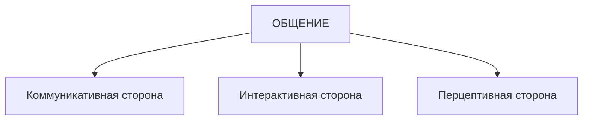

*Рис. 1.1. Структура общения*

Остановимся на них более подробно.

Коммуникативная сторона общения характеризуется:

- умением устанавливать психологический контакт;
- учетом особенностей коммуникативного воздействия;
- «аргументированностью, логичностью и адекватностью ситуации общения;
- эффективностью использования вербальных (слова) и невербальных средств общения.

В коммуникативном процессе выделяют обычно вербальную (в качестве знаковой системы используется речь) и невербальную Снеречевые знаковые системы) коммуникацию.

Невербальная коммуникация структурно представляется следующими системами:

- визуальная — это жесты, мимика, позы, кожные реакции (покраснение, побледнение, потоотделение), пространственновременные организации общения, а также вспомогательные средства общения — подчеркивание или сокрытие особенностей телосложения (признаки пола, возраста, расы). Характер движений отображает эмоциональные реакции человека;
- акустическая — это такие особенности речи, как темп, смех, плач, покашливание, паузы;
- тактильная — это прикосновения, пожатие руки, объятие, поцелуй.

Интерактивная сторона (взаимодействие). Общение как взаимодействие характеризует непосредственную организацию совместной деятельности. Цели общения отражают потребности совместной деятельности людей. Мотивы, по которым люди вступают во взаимодействие, могут быть различны. Перечислим виды мотивов, по которым человек вступает во взаимодействие с другими людьми:

- мотив максимизации общего выигрыша (мотив кооперации);
- мотив максимизации собственного выигрыша (индивидуализм);

> [!quote]- Оригинал: стр. 17 · PDF 24
> 

---

- мотив максимизации относительного выигрыша (конкуренция);
- мотив максимизации выигрыша другого (альтруизм);
- мотив минимизации выигрыша другого (агрессия).

Характер социальной мотивации участников взаимодействия определяет и средства общения, и результат взаимодействия, и отношения между партнерами по общению. Соответственно существуют и различные тактики поведения во взаимодействии.

Перцептивная сторона (восприятие, познание и взаимопонимание) включает:

- познание себя в процессе общения;
- познание и понимание собеседника;
- прогнозирование поведения партнера по общению.

Для эффективного общения очень важно понимать другого человека и уметь прогнозировать его поведение. Именно поэтому важно знать существующие закономерности, формирующие «рисунок» общения.

#### Типы межличностных коммуникаций

Межличностная коммуникация осуществляется в тех видах общения, которые предполагают прагматические цели и конструктивность решений, а также готовность каждого партнера к адекватному поведению. А. П. Панфилова различает пять видов коммуникации:

- познавательную,
- убеждающую,
- экспрессивную,
- суггестивную,
- ритуальную.

Для каждого из этих видов коммуникации характерны свои цели, ожидаемый результат, условия организации, а также коммуникативные формы и средства.

Познавательная коммуникация.

Цель: расширить информационный фонд партнера, передать необходимую информацию, прокомментировать инновационные сведения.

Ожидаемый результат: освоение новой информации и применение ее в практической деятельности, внедрение инноваций и саморазвитие.

Условия организации коммуникации: учет познавательных возможностей конкретных деловых партнеров, их индивидуальных установок на получение новой информации и интеллектуальных возможностей для ее переработки, понимания и восприятия.

Коммуникативные формы: доклады, сообщения, лекции, консультации, семинары, беседы, отчеты, а также письменные работы (рефераты, контрольные, курсовые, дипломные, проектные), позво-

> [!quote]- Оригинал: стр. 18 · PDF 25
> 

---

ляющие оценить степень усвоения теории вопроса, просмотр обучающих программ.

Коммуникативные средства и технологии: комментарий, аргументация и доказательство; характеристика причинно-следственных связей, сравнительный анализ; интерпретация новой лексики, резюмирование, использование вербальных и невербальных ключей доступа в аудиальный, визуальный и кинестетический каналы, речевая культура и ораторское мастерство.

Убеждающая коммуникация.

Цель: вызвать у делового партнера определенные чувства и сформировать ценностные ориентации и установки; убедить в правомерности стратегий взаимодействия; сделать своим единомышленником.

Ожидаемый результат: привлечение партнера на свою позицию, изменение личностных установок, взглядов, убеждений, переориентация целей.

Условия организации коммуникации: опора на восприимчивость партнера, его личностную мотивацию и интеллектуально-эмоциональную культуру.

Коммуникативные формы: убеждающая, призывающая к действию речь, пресс-конференция, дискуссия, спор. Переговоры, напутствие, комплимент, беседа, презентация, «круглые столы».

Коммуникативные средства и технологии: аргументация, демонстрация и доказательство; разъяснение и сравнительный анализ; факты, цифры и примеры, показывающие преимущества; опора на эмоциональный настрой партнера и включение его кинестетического канала с помощью вербальных и невербальных ключей доступа; учет контраргументов партнера; психологические приемы присоединения, формирование аттракции, создание атмосферы доверия.

Экспрессивная коммуникация.

Цель: сформировать у партнера психоэмоциональный настрой, передать чувства, переживания, побудить к необходимому действию.

Ожидаемый результат: изменение настроя партнера, провоцирование необходимых чувств (сострадания, сопереживания), вовлечение в конкретные акции и действия.

Условия организации коммуникации: опора на эмоциональную сферу партнера, использование художественно-эстетических средств воздействия на все сенсорные каналы партнера.

Коммуникативные формы: речи по специальному поводу, презентации; беседы и собрания; митинги; рассказы о ситуации, о фирме, о человеке; брифинги; мозговой штурм, синектика, демонстрации видео-, кинофрагментов; анализ возможных последствий; лозунги и призывы.

> [!quote]- Оригинал: стр. 19 · PDF 26
> 

---

Коммуникативные средства и технологии: аудио-, видео- и художественные средства; краткость речевых конструкций; эмоционально окрашенная, образная лексика; актерское мастерство: улыбка, голос, взгляд; яркость жестикулирования, мимики; демонстрация конгруэнтности; опора на актуальные потребности слушателей; искренность демонстрируемых чувств.

Суггестивная коммуникация.

Цель: оказать внушающее воздействие на делового партнера для изменения мотивации, ценностных ориентаций и установок, поведения и отношения.

Ожидаемый результат: изменение поведения партнера, смена установок, ценностных ориентаций.

Условия организации коммуникации: внушаемость партнера, его недостаточная информированность, недостаточная критичность ума, слабый уровень контрсуггестии, высокий авторитет сутгестора (осуществляющего внушение), создание атмосферы доверительности.

Коммуникативные формы: беседы, митинги, пресс-конференции, брифинги, дебаты, реклама, собрания, консультации, тренинг.

Коммуникативные средства и технологии: разъяснение внушаемых установок; управление эмоциональным напряжением; внушение через приемы: идентификация, ссылки на авторитет, персонификация; предупреждение, угроза, шантаж, психологический террор, моббинг и другие приемы манипулирования; психологическое присоединение.

Ритуальная коммуникация.

Цель: закрепить и поддерживать конвенциальные отношения в деловом мире; сохранять ритуальные традиции фирмы, предприятия, создавать новые.

Ожидаемый результат: формирование чувства патриотизма и национальной гордости; сохранение традиций, закрепление новых ритуалов.

Условия организации коммуникации: ритуальный (церемониальный) характер акций, художественно оформленная пространственная среда; соблюдение конвенций; опора на национальные, профессиональные традиции и нормы общения.

Коммуникативные формы: торжественная, рамочная, траурная речи, ритуальные акты, церемонии, обряды; праздники, посвящения, чествования; презентации и торжественные собрания.

Коммуникативные средства и технологии: использование вербальных и невербальных ключей доступа в аудиальный, визуальный и кинестетический каналы участников; включение участников в активную массовую деятельность; неординарность сюжетов при сохранении традиций.

Данные виды коммуникации позволяют определить особенность, грамотно использовать жанр, коммуникативные средства

> [!quote]- Оригинал: стр. 20 · PDF 27
> 

---

и технологии, получить планируемый результат, более эффективно подготовиться к коммуникативной деятельности, разработать сценарии вербального и невербального поведения в конкретной ситуации делового общения и учесть особенности делового партнера.

Для специалиста, работающего в парадигме «человек — человек» особого внимания заслуживают также визуальная, мифологическая и перформансная коммуникации.

Визуальная коммуникация — это передача информации посредством жестов, мимики, телодвижений. Согласно данным исследователей, невербальными средствами передается около 65% информации. Преимущество визуальной коммуникации в том, что она понятна большинству.

Мифологическая коммуникация основывается на мифах. Использование мифологических структур позволяет коммуникатору осуществлять скрытое влияние на аудиторию. В силу неосознаваемости и автономности существования этих структур аудитория не может противостоять им. Например, это используют в своих целях политики: реальные социальные проблемы заменяются упрощенным представлением о вечной борьбе двух мифологизированных общностей: красные — белые, коммунисты — капиталисты, Восток — Запад ит.д. Отношение к этим группам строится по принципу «мы — они»: мы — хорошие, они — плохие». Более подробно это будет рассмотрено в соответствующей теме. М. Элиаде, рассматривая функции мифа, отмечает, что каждый герой повторяет архетипические действия, каждая война возобновляет борьбу между Добром и Злом, несправедливость отождествляется со страданиями Спасителя. Благодаря такому подходу миллионы людей могли в течение столетий терпеть могучее давление истории, не впадая в отчаяние, не кончая самоубийством и не приходя в состояние духовной иссушенности, которое неразрывно связано с нигилистическим видением истории,

Миф, таким образом, представляет определенную грамматику поведения и несет свою эстетическую направленность. Он является моделью и до некоторой степени оправданием всех человеческих поступков. Миф разворачивается в каком-то нетрадиционном пространстве, где есть опасность или внеобыденность. Но мифологическое пространство не только нетрадиционно, оно еще и не реализуемо: ведь если все Золушки будут превращаться в принцесс, то кто будет мыть посуду? Миф актуален и сегодня. Современные средства коммуникации, в особенности телевидение и Тпгегпе{, конструируя реальность, формируют свое мифологическое пространство. Появляются новые мифы и герои, под воздействием которых происходит трансформация современной культуры. Реальные или мифические герои продолжают оказывать влияние на сознание. Они являются образцами для подражания и указателями приоритетного направления развития социума.

> [!quote]- Оригинал: стр. 21 · PDF 28
> 

---

Перформансная (рег/огтапсе — представление, спектакль) коммуникация основывается на ритуалах. Ритуалы — важная составляющая жизни любого общества. Они несут в себе символически выраженные коммуникативные сообщения. Перформансная коммуникация часто характеризуется театральностью со своими правилами и ролями. Под ее влиянием происходят не только культурные, но и политические мероприятия. В рамках связей с общественностью, например, ритуалы превращаются в такое явление, как презентации.

### 1.2. Перцептивная сторона общения: как люди воспринимают друг друга

Для понимания последующего материала считаем целесообразным ознакомиться с ключевыми понятиями и определениями:

- Восприятие — психический познавательный процесс, заключающийся в целостном отражении в психике человека непосредственно воздействующих на его органы чувств вещей, предметов, явлений в целом, а не отдельных их сторон и качеств, как при ощущении.
- Перцепция социальная — восприятие, изучение, понимание, оценка людьми социальных объектов (других людей, самих себя, групп, социальных общностей и т. д.); процесс формирования в общественном и индивидуальном сознании образов социальных объектов как результат восприятия, познания, понимания людьми друг друга.

Восприятие человека человеком в процессе межличностной коммуникации основано на законах социальной перцепции и включает в себя восприятие, понимание и оценку людьми друг друга, что позволяет сформировать адекватный образ собеседника и выбрать соответствующий стиль общения и взаимодействия. В целом в ходе социальной перцепции осуществляется эмоциональная оценка другого, попытка понять причины его поступков и прогнозировать его поведение. Восприятие и понимание партнера может быть осложнено тем фактором, что собеседник зачастую не является пассивным, а может сам влиять на коммуникатора, стремясь создать положительное впечатление.

В процессе общения происходит «познание другого человека» (А. А. Бодалев). Под этим подразумевается восприятие не только физических характеристик объекта, но и его поведенческих характеристик, формирование представления о его намерениях, мыслях, способностях, эмоциях, установках и пр. На основе внешней стороны поведения собеседники как бы «читают» другого человека, расшифровывают значение его внешних данных, от меры «прочтения» другого человека зависит успех взаимодействия с ним.

> [!quote]- Оригинал: стр. 22 · PDF 29
> 

---

Поскольку межличностное восприятие является одной из сторон общения, особую роль играют ожидания, желания, намерения, прошлый опыт человека как особые составляющие той или иной жизненной ситуации. Все это необходимо учитывать, когда познание другого человека рассматривается как основание не только для понимания партнера, но и для установления с ним согласованных действий. В ходе познания другого человека синхронно решается целый ряд задач: эмоциональная оценка партнера по общению, попытка понять совокупность его поступков и основанная на этом стратегия изменения его поведения и, соответственно, построение собственной стратегии. При построении собственной стратегии взаимодействия коммуникатору необходимо принимать в расчет не только потребности, мотивы, установки собеседника, но и учитывать то, как он понимает потребности, мотивы и установки коммуникатора[^p030-1]. Знание механизмов процесса восприятия и понимания другого человека (идентификация, каузальная атрибуция, рефлексия, эмпатия, обратная связь и др.) помогает понять, каким образом субъекты общения пропускают подчас очевидные сигналы искажения информации в процессе коммуникации. Рассмотрим данные механизмы.

Идентификация — процесс неосознаваемого отождествления субъектом себя с другим человеком (группой людей, образом), когда предположение о внутреннем состоянии собеседника строится на основе попытки поставить себя на его место.

Эмпатия (от греч. ЕтрагПета — сопереживание) — качество личности, ее способность проникать с помощью чувств в душевные переживания других людей, сочувствовать им, разделять их переживания, это эмоциональный отклик.

Рефлексия — внутренняя психическая деятельность человека, направленная на осмысление своих собственных действий и состояний; самопознание человеком своего духовного мира; осознание человеком того, как он воспринимается партнером по общению.

Обратная связь — основывается на ответных реакциях партнера по общению.

Обратная афферентация — процесс коррекции поведения на основе получаемой мозгом информации извне о результатах протекающей деятельности.

Каузальная атрибуция — причинное объяснение поступков другого человека, когда информация об этих причинах отсутствует. Осуществляется чаще всего неосознанно либо на основе идентификации, либо путем отнесения партнера по общению к определенной категории лиц, в отношении которой выработаны некоторые стереотипные представления. Г. Келли выделяет три типа атрибуции:

[^p030-1]: Жуков Ю. М. Эффективность делового общения. С. 121.

> [!quote]- Оригинал: стр. 23 · PDF 30
> 

---

личностную, стимульную и обстоятельственную. Учеными было выявлено [1], что наблюдатель чаще использует личностную атрибуцию, а участник чаще объясняет совершающееся обстоятельствами.

«Содержание межличностного восприятия зависит от характеристик как субъекта, так и объекта восприятия потому, что они включены в определенное взаимодействие, имеющее две стороны: оценивание друг друга и изменение каких-то характеристик друг друга благодаря самому факту своего присутствия» [1]. Как субъект, так и объект социального восприятия воздействуют друг на друга и, как правило, стремятся при этом произвести позитивное впечатление, что особенно важно учитывать в условиях неискреннего делового общения. Здесь необходимо добавить, что в процессе взаимодействия решается также и ряд коммуникативных задач: происходит процесс обмена информацией, уточнение не проясненных данных, что позволяет получить более точную характеристику объекта восприятия.

На процесс понимания человека человеком большое влияние оказывают также некоторые искажения представления о другом человеке. Это: эффекты первого впечатления (установки), ореола, первичности и новизны, стереотипизации. Наличие данных эффектов особенно важно учитывать в условиях неискреннего убеждающего воздействия.

#### Принципы формирования первого впечатления

Процесс восприятия человека человеком является важным этапом в построении межличностной коммуникации. Этой проблеме посвящено много теоретических и прикладных исследований, проведенных как у нас, так и за рубежом. Особое внимание в этих работах уделяется феномену формирования первого впечатления, который достаточно длительное время играет роль своеобразной психологической установки на восприятие личности. Исследования, помогающие понять, как именно складывается первое впечатление, проведенные российским ученым А. А. Бодалевым, показали, что оно формируется в течение первых 2—3 мин и потом подсознательно оказывает влияние на человека, потому что обладает определенной устойчивостью. Влияние на восприятие человека человеком феномена первого впечатления может оказывать воздействие на наши суждения достаточно длительное время. Очень часто люди судят о других именно по первому впечатлению. Хотя зачастую первое впечатление бывает обманчивым.

А. А. Бодалев выделяет пять компонентов, которые влияют на формирование первого впечатления о человеке:

- характеристика внешнего облика человека;
- оформление внешности (в том числе стиль одежды, прическа);

> [!quote]- Оригинал: стр. 24 · PDF 31
> 

---

- экспрессия человека (переживаемые или транслируемые эмоциональные состояния);
- поведение;
- предполагаемые качества личности.

Именно в силу того большого значения, которое отводится формированию первого впечатления, так важно при первом знакомстве произвести впечатление человека успешного, уверенного в себе (не путать с самоуверенностью!), грамотного специалиста.

На первое впечатление влияют три фактора (по Г. В. Бороздиной):

- фактор превосходства — когда человек, который превосходит наблюдателя по важному параметру, оценивается им выше и по остальным значимым параметрам, т. е. происходит своего рода личностная переоценка;
- фактор привлекательности — существует закономерность, что внешне привлекательного человека люди и по другим параметрам оценивают гораздо выше;
- фактор отношения к наблюдателю — людей, которые хорошо к нам относятся или разделяют какие-то важные для нас идеи, мы оцениваем позитивно и по другим показателям.

Здесь также необходимо отметить, что в процессе общения возможны различные варианты самоподачи, которые могут послужить источником ошибок при восприятии другого человека:

- самоподача превосходства (обычно основывается на объективных признаках и знаках превосходства, таких как одежда, манера речи и поведения);
- самоподача привлекательности (чаще всего основана на личном обаянии);
- самоподача отношения (умение показать партнеру свое хорошее отношение к нему);
- самоподача актуального состояния и причин поведения (умение привлечь внимание собеседника к тем причинам поведения, которые считаются наиболее приемлемыми).

Для достижения эффективности взаимодействия необходимо знать закономерности восприятия человека человеком, его понимание и оценку, которая может быть адекватной, а может не соответствовать действительности. Существуют различные эффекты, которые искажают восприятие. Они могут оказывать влияние на формирование первого впечатления, которое необходимо учитывать. Рассмотрим их.

Эффект ореола означает влияние общего впечатления о человеке на восприятие и оценку частных свойств его личности. Если общее впечатление о человеке благоприятное, то его положительные качества переоцениваются, а отрицательные либо затушевываются, либо, так или иначе, оправдываются. И наоборот, если общее впе-

> [!quote]- Оригинал: стр. 25 · PDF 32
> 

---

чатление отрицательное, то даже благородные поступки не замечаются или истолковываются как своекорыстные. В повседневной жизни это явление называют «приклеиванием ярлыков».

Эффект первичности состоит в том, что на мнение о человеке наибольшее влияние оказывают те сведения, которые предъявлены в первую очередь. Первая информация сильнее последующей. А если дело касается знакомого человека, то самыми значимыми становятся последние сведения о нем.

Эффект бумеранга — люди подсознательно оказывают противодействие сильному давлению извне, в чем бы оно ни выражалось, поскольку любое давление со стороны другого человека воспринимается обычно как покушение на их право свободного выбора.

Эффект снисходительности — щедрая, излишняя благожелательность, т. е. некритичность при оценке другого человека.

Эффект новизны — о человеке хорошо знакомом наиболее значимой информацией оказывается последняя, более свежая информация (вспомним советский фильм «Самая обаятельная и привлекательная», когда главная героиня, которую все считали «синим чулком», вдруг пришла на работу совершенно преображенная, в новом наряде; или пример из другого известного советского фильма Э. Рязанова — «Служебный роман», там тоже есть похожий эпизод).

Стереотипизация — устойчивое представление, сформировавшийся образ человека, которым пользуются как штампом. Стереотипы возникают как результат обобщения личного опыта личности, и оказывают значительное влияние на восприятие других людей. Новые впечатления об объекте категоризируются на основе сходства с прежними впечатлениями, что дает основание для стереотипизации.

Как отмечает А. А. Бодалев, у каждого человека в процессе жизни формируются «требования к людям, связанные с занимаемым ими конкретным положением в обществе и выполняемой ими ролью в том или ином виде деятельности. Соответственно этим требованиям у него возникают и определенные “эталоны”, с которыми он сопоставляет лиц, выполняющих данную общественную функцию... у человека вместе с тем формируются “представления-образцы” о людях, которые отвечают этим требованиям в меньшей степени или совсем не соответствуют...

Все эти “эталоны”, формирующиеся у человека в процессе совместной деятельности его с другими людьми, по мере развития этой деятельности и с изменением самого человека как личности, постоянно обогащаются новыми чертами, переосмысливаются, становятся все более обобщенными. Однако это не меняет их функции в процессе познания людьми друг друга, и для взрослого человека... они выполняют роль “мерки”, которую он прикладывает к лично-

> [!quote]- Оригинал: стр. 26 · PDF 33
> 

---

сти, так или иначе проявляющей себя в труде, в общении, в познании...

Вместе с тем на формировании этих “эталонов”, этих “мерок”, которые используются человеком при оценке окружающих его людей, в очень сильной степени сказывается его личный опыт труда, познания и общения». Если же опыт общения человека ограничен, то его суждения могут быть неверными в силу поспешного обобщения. Привыкнув доверять «людям в форме», «людям в белых халатах», человек зачастую некритично относится к остальному происходящему. Форма затмевает все остальное. «Не меньшее значение в формировании впечатления о другом человеке имеют “стереотипы”, которые актуализируются в сознании оценивающего лица, когда оно располагает информацией об общественно-профессиональном статусе оцениваемой личности».

Стереотипизация в процессе познания людьми друг друга может привести к упрощению процесса познания другого человека, либо к возникновению предубеждения, если упрощение заменяется оценкой. Если прошлый опыт был негативным, то всякое новое восприятие представителя той же самой группы окрашивается неприязнью (Г. М. Андреева, А. А. Бодалев и др.). Специалисты выделяют три основных вида эталонов-стереотипов, связанных:

- свнешним обликом человека — антропологические,
- оформлением внешности, физическим обликом человека, особенностями поведения и общения — эмоционально-эстетические;
- социальным статусом, родом деятельности субъекта — социальные.

По мнению В. Г. Зазыкина, наиболее точная оценка получается при опоре на различные эталоны-стереотипы, причем, чем больше внутри них градаций, тем точнее оценка и тем меньше в ней схематизма.

Эффект проекции — неосознаваемая тенденция переносить (проецировать) нежелательные для себя качества и свойства на другого человека.

В процессе делового общения происходит восприятие и оценка внешнего облика и поведения собеседника, психологических особенностей наблюдаемого, в результате чего у наблюдателя (например индуктора) складывается собственное отношение к наблюдаемому (реципиенту), и в зависимости от этого происходит прогнозирование его возможного поведения, что определяет построение дальнейших взаимоотношений с собеседником. Учитывая, что в условиях неискреннего убеждающего воздействия понимание затруднено стремлением собеседника ввести коммуникатора в заблуждение, становится понятной вся важность умения разбираться в ЛЮДЯХ.

> [!quote]- Оригинал: стр. 27 · PDF 34
> 

---

В ходе исследований, проведенных психологом В. В. Знаковым, были выявлены следующие зависимости:

1) объективно воспринимаемые черты физического облика другого человека могут в значительной степени трансформироваться и даже искажаться под влиянием сложившейся самооценки, уровня притязаний и характера взаимоотношений воспринимающего с воспринимаемым;

2) имея перед собой один и тот же объект восприятия — внешность другого человека, люди видят его под разными углами зрения, выделяют разные стороны и свойства.

На точность восприятия различных объектов могут негативно влиять также следующие факторы:

- отсутствие необходимой психологической подготовки;
- определенные индивидуальные психические особенности, недостаточное развитие внимания, памяти, мышления;
- предвзятое, тенденциозное отношение к объектам восприятия и познания.

Как свидетельствуют социально-психологические исследования, люди зачастую видят то, что хотят увидеть, слышат то, что хотят услышать. То есть, вся информация, поступающая из окружающего мира, проходит через своеобразные «фильтры» восприятия, обусловленные образом жизни, системами ценностей человека и другими факторами. Реальность и восприятие реальности зачастую достаточно сильно отличаются друг от друга. В зависимости от особенностей человека по-разному интерпретируются слова, понятия, тексты, действия другого человека.

### 1.3. Коммуникативная сторона общения

Как было отмечено выше, коммуникативная сторона общения характеризуется:

- умением устанавливать психологический контакт;
- учетом особенностей коммуникативного воздействия;
- «аргументированностью, логичностью и адекватностью ситуации общения;
- эффективностью использования вербальных (слова) и невербальных средств общения.

Рассмотрим особенности коммуникативной стороны общения более подробно.

#### 1.3.1. Особенности понимания в процессе коммуникации

В процессе коммуникации решаются и другие самостоятельные коммуникативные задачи. В процессе общения происходит обмен информацией между людьми, которая может быть как истин-

> [!quote]- Оригинал: стр. 28 · PDF 35
> 

---

ной, так и недостоверной. Информация в процессе взаимодействия не только передается, но и формируется, анализируется, уточняется, трансформируется, развивается и пр. Из этого следует, что в процессе общения возможно решение следующих коммуникативных задач: уточнение не проясненных данных, получение дополнительной информации, что позволяет реально оценить ситуацию и адекватно построить дальнейшее взаимодействие с партнером. Необходимо также учитывать, что посредством системы знаков партнеры могут повлиять друг на друга, т. е. воздействовать на поведение друг друга (Г. М. Андреева).

В ходе взаимодействия люди обмениваются между собой содержательными сообщениями, пожеланиями, интересами, настроениями, установками и пр. Набор сведений при этом можно рассматривать как информацию и тогда сам процесс коммуникации может быть воспринят и обозначен как процесс обмена информацией. В процессе общения информация передается, формируется, уточняется, развивается и т. д. При этом собеседники стремятся выработать общий смысл, а это становится возможным, если информация принята, понята и осмыслена. Поэтому в каждом коммуникативном процессе в единстве даны деятельность, общение и познание.

Общение возможно только при помощи знаковых систем. При этом посредством системы знаков собеседники могут повлиять друг на друга. Различают вербальную и невербальную коммуникации, которые используют различные знаковые системы. Вербальная коммуникация использует в качестве знаковой системы речь, при помощи которой кодируется и декодируется информация. Коммуникативное влияние, как результат обмена информацией возможен лишь в тех случаях, когда собеседники обладают единой или сходной системой кодификации и декодификации. Если будут использованы различные системы, то взаимопонимание будет невозможно, так как произойдет искажение информации уже на стадии ее передачи. Необходимо также учитывать, что из-за социальных, политических и возрастных особенностей, а также из-за разного понимания ситуации общения возможна разная интерпретация одних и тех же слов. Основными характеристиками вербальной коммуникации являются: значение, свойства, функции и виды речи и языка.

В ходе диалога выявляется смысл речевого сообщения. Важным инструментом этого является обратная связь. Обратная связь в общении — это фиксирование внешних проявлений (сигналов) реагирования сознания слушающего на излагаемую информацию, определение их причин и в соответствии с ними корректировка речи (С. Ф. Касаткин). Осознанное умение пользоваться обратной связью очень важно для эффективного общения в условиях неискренности собеседника. Она позволяет корректировать воздействие прямой связи, помогая тем самым достигать желаемого результата.

> [!quote]- Оригинал: стр. 29 · PDF 36
> 

---

Использованию речи сопутствуют процессы, которые могут препятствовать достижению взаимопонимания:

- возможность использования двух типов значений: денотативных (формальные определения) и коннотативных (связанных с эмоциональными ассоциациями);
- полисемия (многозначность определения одного и того же слова);
- синонимия (использование различных слов для обозначения одного и того же явления).

Важную роль в условиях неискреннего убеждающего воздействия играет фактор понимания. Чтобы правильно сформировать представления о человеке, надо обязательно его понять. В психологии понимание рассматривается, прежде всего, как способность постичь смысл или значение чего-либо, а также как достигнутый благодаря этому результат. Основными признаками понимания являются:

- узнавание, т. е. отнесение какого-либо предмета, явления или отношения к определенной группе или категории;
- выявление причины, т. е. мотивов того или иного поведения, понимание того, что именно побуждает человека к деятельности и активности. Поэтому одним из главных моментов в познании человека человеком является выяснение мотивов поведения, причин тех или иных поступков. Особенно это важно в ситуациях выявления неистинной информации;
- определение следствий, к которым приводят действия, определенные причиной. Таким образом, устанавливаются причинноследственные связи, простраивается мысленная модель ситуации. И от того, насколько точно будет соответствовать действительности выстроенная модель, настолько точными будут и прогнозы возможных последствий. Для понимания причинно-следственных связей в поведении людей большое значение имеет понимание смысла (т. е. отношение человека к реальности) и значения (т. е. индивидуальное усвоение исторического опыта) их поступков:
- выяснение логических оснований, из которых следует то, что осмысливастся человеком. Так люди понимают математические законы, теоремы, различного рода доказательства;
- понимание устройства предмета или явления и существующих связей между частями или элементами, из которых он состоит;
- понимание речи занимает важное место во взаимодействии людей. При этом важно понимать не только смысл и значение сказанного, но и подтекст, т. е. то, что не выражается буквально, но смысл которого понимается.

Необходимо также рассмотреть процессуальную сторону понимания. «Как процесс понимание связано с поиском еще неизвестного субъекту способа объединения в единое целое разрозненных

> [!quote]- Оригинал: стр. 30 · PDF 37
> 

---

элементов ситуации, вот почему развернутый процесс понимания обязательно содержит гипотезы, сравнения, пробы и даже ошибки. Вообще он имеет некий итерационный характер, что типично для любого мыслительного процесса, связанного с познанием» (В. Г. Зазыкин). Первоначально необходимо выяснить суть проблемы (проблемной ситуации). На этом этапе выясняются противоречия, сравниваются различные точки зрения, изучается информация и источники данной информации. Происходит процесс последовательного выделения промежуточных составляющих и определяются существующие между ними связи и способы взаимодействия. На основе этого выстраиваются те или иные гипотезы и предположения. Затем проверяется правильность гипотез. Для этого используют такой психологический механизм, как сравнение, которое выступает в качестве обратной связи и приводит непосредственно к пониманию. Уже сам по себе анализ поведения партнера по общению помогает отстраниться, дистанцироваться от ситуации, превратить ситуацию в исследовательский случай, в материал для определенных выводов. Алгоритм анализа ситуации помогает преобразовать проблему в задачу, которую нужно решить.

А. Ю. Панасюк приводит шесть необходимых условий для достижения понимания человека человеком:

1) единство национального языка;

2) учет знаний профессионального языка;

3) учет уровня интеллекта;

4) полнота информации;

5) логичность изложения;

6) сконцентрированность внимания.

Необходимо также отметить, что понимание слов и речи собеседника — это соотнесение его слов с собственным словарным запасом, с собственными знаниями. В ситуациях, когда человека пытаются в чем-то убедить, он сравнивает получаемую извне информацию с собственными знаниями и убеждениями. Поэтому качество понимания зависит от того, насколько доступным языком передается та или иная информация.

Полнота информации подразумевает: чем более подробно объяснить человеку задачу, тем меньше вероятность того, что канал передачи информации послужит источником ее искажения. Точное и четкое понимание информации также зависит от того, насколько логично и последовательно ее излагают. Отсутствие внутренней логики изложения, частая смена тем затрудняют понимание. Определить, насколько полна информация, полученная собеседником, можно по количеству уточнений и эмоциональным реакциям собеседника.

Внимание к теме разговора также важно для процесса понимания информации. Если собеседники постоянно отвлекаются, слож-

> [!quote]- Оригинал: стр. 31 · PDF 38
> 

---

но достигнуть взаимопонимания: большая часть информации собеседником не будет воспринята и понята.

Необходимо учитывать, что люди запоминают в основном смысл сообщения, а не слова, которыми оно передавалось. Если смысл неправильно понят, то возникают ошибки. Другой аспект возможного искажения информации — разное толкование одних и тех же слов в зависимости от интонации, знаков препинания, контекста или ассоциаций, возникающих у разных людей на одни и те же слова.

Использование психологической установки на восприятие и понимание сказанного. Дадим определение установки. Установка — это готовность человека к той или иной деятельности, актуализирующаяся при предвосхищении им появления определенного объекта, явления, несущая на себе черты целостной структуры личности с постоянным набором характеристик. Иными словами — это предрасположенность к определенной форме реагирования. Для улучшения понимания можно использовать два вида:

- содержательную (формируется направленность на определенную тему, поэтому любая информация будет воспринята и понята, если она соответствует интересующей теме);
- целевую или функциональную (в этом случае тема не определена, зато четко поставлена цель; собеседник сам выбирает информацию, не ориентируясь на ее форму).

Также распространенной установкой могут быть положительные высказывания значимой личности о вас, ссылки на ваш опыт и знания.

Выделение признаков. При взаимодействии необходимо учитывать, что объяснение результата или сути проблемы зачастую бывает недостаточно для достижения понимания. Следует специально выделять существенные признаки ситуации или будущего результата. Опираясь на них, можно существенно улучшить понимание и, как следствие, взаимодействие. В. Г. Зазыкин описывает такие группы признаков:

- вербализируемые признаки (описываемые лучше всего словами). Подобное описание должно быть образным и эмоциональным;
- признаки, представляемые в наглядных образах. Это иллюстрации, примеры, яркие сравнения. Здесь необходима максимальная наглядность;
- чувственные признаки. Их лучше всего воспринимают кинестетики, т. е. люди, которые воспринимают мир через ощущения. Чувственные признаки встречаются наиболее часто у эмоциональных людей, представителей различных творческих профессий;
- понимание через включенность в ситуацию. Чтобы легче понять суть проблемы, бывает достаточно описать ситуацию партнеру и попросить его мысленно проиграть ее, стать действующим лицом.

> [!quote]- Оригинал: стр. 32 · PDF 39
> 

---

Если ситуация достаточно четко и точно описана, то этот вариант может дать очень хорошие результаты.

Для достижения понимания человека человеком, по мнению А. Ю. Панасюка, необходима также логичность изложения. Некоторые эмоции, особенно страх, могут мешать логической последовательности речи, так как отвлекают от упорядочения последовательности слов. Однако необходимо учитывать феномен, описанный Д. Халперн: логичность или алогичность рассуждений зависит от типа решаемой задачи. Очень часто личные установки и убеждения человека влияют на выбор логического заключения. Под влиянием эмоций человеческие рассуждения могут становиться алогичными. Рациональная часть ума подыскивает доводы, обосновывающие наши предпочтения. В статье о связи логики с мышлением М. Хенле отметила, что в повседневном мышлении люди обычно не следуют формальным правилам логики. Они определяют истинность суждений не только на основе предоставленной информации. Вместо этого предлагаемые им утверждения изменяются согласно их собственным убеждениям, а затем проверяются, следует ли заключение из измененных ими суждений. Получается, что люди действуют согласно определенной субъективной логике, в которой пользуются своими собственными представлениями о мире для формулирования заключений по интересующему вопросу. В реальной жизни иногда люди рассуждают логически, а иногда законы логики противоречат ситуации, последствиям и общепринятым правилам вывода заключений. В реальной жизни, определяя, вытекает ли заключение из посылок, субъект добавляет к предлагаемым фактам собственное мнение и знания. Это практический подход к задачам логического мышления, который применяется в большинстве повседневных ситуаций и который необходимо учитывать в процессе общения.

#### 1.3.2. Психология поведения человека в процессе коммуникации

Мы знаем, что все люди разные. Отличаются люди, отличаются их поступки. Существует много различных теорий, которые со своих позиций так или иначе объясняют и прогнозируют поведение людей. Теория личности обеспечивает смысловой контекст, в котором можно описать и интерпретировать поведение человека. Она, с одной стороны, объясняет причины поведения людей, с другой — прогнозирует их поведение.

Фундаментом, на котором базируется вся современная наука о психическом мире человека, по праву можно назвать психоанализ. Его основоположник — венский врач Зигмунд Фрейд (1856—1939).

Психоанализ помогает понять, почему в тех или иных ситуациях люди ведут себя так, а не иначе. Сопротивление сотрудника чему-

> [!quote]- Оригинал: стр. 33 · PDF 40
> 

---

либо или просто некорректное поведение того или иного человека может быть объяснено теми или иными причинами, неосознаваемыми комплексами, скрытыми желаниями признания и другими подобными вещами. Поведение людей редко можно объяснить логически, потому что зачастую свои истинные желания и потребности люди не осознают. Поэтому-то так важно узнать скрытые мотивы поведения людей, их истинные желания и потребности. Понимая скрытый смысл того или иного поведения, у менеджера появляется понимание того, как необходимо действовать в той или иной ситуации.

Зигмунд Фрейд считал, что сознание и интеллект — то, чем так гордится человек — это совсем не самое главное в человеческой психике. Наше поведение определяют таинственные силы мира бессознательного. Это то, что скрыто от нас самих и о чем мы можем только догадываться. Термин «психоанализ» имеет три значения.

1. Теория личности.

2. Метод терапии личностных расстройств.

3. Метод изучения неосознанных мыслей и чувств человека.

Нас интересует, безусловно, третий аспект: в обычной жизни каждому человеку очень важно научиться понимать другого, чтобы правильно выстраивать свою линию поведения. Внимательно слушая другого человека, можно понять многие вещи, о которых собеседник не только не собирался вам говорить, но которые он и сам подчас еще до конца не осознал — его смутные желания и намерения. Вы сможете понять даже то, что зачастую запрятано от него самого в глубинах его души. Это очень удобно — «видеть другого человека насквозь», особенно в бизнес-коммуникации, понимать другого, анализировать его поведение и прогнозировать дальнейшие поступки. Тогда практически ничто, никакая ситуация не будет для вас неожиданной. Например, представьте себе такую ситуацию: ваш партнер собирается расстаться с вами. Расставание зачастую связано с разного рода потерями. В этой ситуации очень важно заранее обезопасить себя и свой бизнес от возможных неприятностей. Если в глубине души у партнера уже зреет подспудное желание расстаться с вами, а вы сможете заранее это понять, сможете «просчитать» это по его поведению, по его речи, вы будете иметь шанс и принять соответствующие меры по нейтрализации возможных убытков.

Психоанализ построен на двух доктринах.

1. Доктрина психологического детерминизма. Фрейд считал, что все события во внутренней жизни человека взаимосвязаны. Нет таких мыслей, чувств, воспоминаний, действий, которые возникли бы «просто так». Каждое действие, каждая мысль имеют свою причину. Каждое действие, каждое событие, даже, казалось бы, самое

> [!quote]- Оригинал: стр. 34 · PDF 41
> 

---

неожиданное, спонтанное определяется тем, что было до него, что ему предшествовало.

2. Доктрина первостепенной значимости бессознательных процессов. Именно они играют наиболее значимую роль в формировании поведения и мышления, нежели сознательные процессы. Зачастую человек не понимает и не осознает своих истинных мотивов и желаний.

Рассмотрим точку зрения Фрейда на организацию психики. Ее еще называют «топографической моделью». Согласно этой модели в психической жизни человека можно выделить три уровня:

- сознание;
- предсознательное;
- бессознательное.

Область сознания состоит из переживаний и ощущений, которые вы осознаете в данный момент времени. Только небольшая часть ваших мыслей, чувств, памяти входит в эту сферу. Сейчас, например, вы можете думать о содержании этой книги. Но это будет осознаваться вами лишь в течение небольшого отрезка времени. Затем ваше внимание переключится на что-то другое, и знания содержания этой книги перейдут на другой уровень — предсознательное.

Уровень предсознательного (его иногда называют «доступной памятью») включает в себя опыт, который вы в данный момент не осознаете, но можете легко вернуть его в сознание либо спонтанно, либо в результате небольших усилий. Например, все мы помним таблицу умножения или что Волга впадает в Каспийское море, мы помним имена близких нам людей и места, где мы отдыхали. С точки зрения Фрейда, предсознательное наводит мосты между тем, что находится в сознании и бессознательным.

Бессознательное — это самая значимая область человеческого разума. Именно в бессознательном хранятся наши примитивные инстинкты, неприятные эмоции и воспоминания, которые настолько неприятны и болезненны, что подавлены и вытеснены на бессознательный уровень. Иногда бессознательное еще называют подсознанием. Что же это такое?

Что такое по своей сути наше бессознательное? В него можно включить:

- инстинкты,
- фантазии,
- сны,
- побуждения,
- запретные желания,
- оговорки,
- описки и очитки,
- ошибочные движения,
- непредвиденные «случайности»,

> [!quote]- Оригинал: стр. 35 · PDF 42
> 

---

- забытые травмы детства,
- подавленные враждебные чувства к родителям,
- подавленные сексуальные желания, которые вы не осознаете.

Это то, что мы хотим на самом деле, но не догадываемся об этом, то, что скрыто от нас самих. Давайте используем эти знания, долгое время остававшиеся тайной за семью печатями для нашей с вами прикладной задачи — развивать бизнес и управлять людьми. А посему ограничимся психологией человеческих взаимоотношений и пониманием того, как, используя эти знания, оказывать максимальное влияние на других людей и на самого себя.

Фрейд верил, что по-настоящему значимые аспекты поведения человека оформляются и направляются внутренними импульсами и побуждениями, которые находятся вне сферы сознания. Бессознательные переживания, в отличие от предсознательных, не осознаются. Более того, если они начинают осознаваться или открыто выражаться в поведении, это встречает сильное внутреннее сопротивление человека.

Однако этот материал может выразиться в замаскированной или символической форме. И поэтому важно научиться понимать, где и как неосознаваемое человеком прорывается наружу.

Начнем с того, что наша жизнь полностью детерминирована, в ней нет случайностей. Есть строгая закономерность. За каждой случайностью в поведении ищите скрытый мотив. Не спешите спорить. Рассмотрим те примеры, которые привел Фрейд в своей книге «Психопатология обыденной жизни» (1997, с. 299):

«Когда молодая женщина во время свадебного путешествия теряет свое обручальное кольцо, это дурное начало; впрочем, обыкновенно оказывается, что она куда-нибудь положила его и потом находит. Я знаю одну даму, теперь она уже развелась с мужем, которая сплошь да рядом подписывала свои бумаги — по имущественным делам — своей девичьей фамилией, и это за много лет до того, как она стала ее носить вновь на самом деле».

Фрейд на основании этих наблюдений делает однозначные выводы о неудовлетворенности браком этих двух женщин. Фантастика? Вовсе нет. Давайте рассмотрим эти случаи более подробно. На сознательном уровне все замечательно, люди внешне могут быть даже довольны своим браком. Но в глубине души человек просто боится себе признаться в том, что на самом-то деле он хочет противоположного — уйти от этого человека подальше, что ему этот союз неприятен и ни о какой любви здесь речи не идет. Правда, чаще всего этот внутренний голос заглушают. Цензура нашего сознания всегда на страже и не допускает возникновения крамольных мыслей.

Фрейд приводит еще один пример: женщина имеет привычку играть обручальным кольцом, снимая и одевая его на палец. Отсюда он делает вывод — она уже созрела для любовного похождения.

> [!quote]- Оригинал: стр. 36 · PDF 43
> 

---

Как мы видим, бессознательное сигнализирует о своих предпочтениях именно с помощью подобных знаков-символов, которые воспринимаются людьми как досадные мелочи или невинные случайности. Бессознательное разговаривает с нами, используя окольные маневры. Этими обходными путями и являются те случайности и недоразумения, которым мы обычно не придаем никакого значения. К сожалению, немногие люди умеют распознавать подобные сигналы. И тогда бессознательному, чтобы настоять на своем, приходится переходить к репрессиям.

Поэтому возьмите себе за правило обращать внимание прежде всего на, казалось бы, несущественные детали в поведении других людей. Задайте себе вопрос: «А что стоит за этим поведением?». И пусть принцип оценки ситуации с учетом детерминированности станет вашим привычным поведением, войдет в ваше подсознание.

Вспомните, когда вы:

- куда-то опаздывали, например, на встречу с кем-то;
- совершенно забывали о своих обещаниях;
- забывали вовремя отправить письмо;
- забывали свое намерение что-то сделать;
- говорили одно, а делали другое.

А теперь вспомните, когда люди, с которыми вы общаетесь, поступали подобным образом. Попробуйте рассмотреть все эти «случайности» через призму детерминированности поступков. И тогда получается, что:

- если человек опаздывает, значит, он бессознательно не очень стремится к этой встрече;
- если что-то забывает, значит, бессознательно ему это не хочется помнить;
- если забывает послать вовремя письмо, значит человек, которому он пишет, в глубине души ему неприятен, но это почему-то вытесняется;
- забыли о своем намереньи? Значит, на самом-то деле вам совсем не хочется это делать. Теперь, осознав это, вы уже вправе выбирать: делать то, что вам на самом деле делать не хочется, или сказать «нет». В любом случае выбор за вами. И выбор осознанный.

Ничто не забывается просто так. Вы когда-нибудь забывали о чем-то важном и значимом для вас? Но как только человек получает не особо существенную или неприятную информацию, он предпочитает забыть о ней. Получая порцию проблемной информации, сознание предпочитает «вытолкнуть» ее в бессознательное. Мне вспомнился один случай из собственной жизни. В седьмом классе у меня была очень неприятная и болезненная ссора с моей лучшей подругой. Я помню, что тогда очень переживала по этому поводу. Но вот сейчас я не могу даже вспомнить повода ссоры, не говоря

> [!quote]- Оригинал: стр. 37 · PDF 44
> 

---

уже о всех ее подробностях. Информация вытеснилась из сознания. Таким образом, мы не забываем, мы вытесняем.

У вас назначена деловая встреча, а ваш партнер опаздывает. Или вы встречаетесь на его территории. Вы пришли вовремя, а он чемто занят. А дальше делайте выводы сами.

Вы собирались и забыли подписать какие-то бумаги? Суета, рассеянность тут совершенно ни причем. Просто вы вытеснили намерение из своей памяти. Задайте себе вопрос: почему вам так не хочется это делать?

Что такое намерение? Это импульс к действию, который вы уже одобрили, но выполнение которого почему-то на время отложили. Следовательно, если вы забыли выполнить запланированное действие, то можно сделать вывод о вашем нежелании это делать.

Ничто не забывается просто так, без основания. Человек хочет что-то забыть и вытесняет это. Фрейд, например, описывает, как он забыл название улицы, на которую ему предстояло пойти с неприятным визитом.

Интересны случаи потери какой-либо вещи в собственной квартире. Фрейд, например, описывает такой случай: жена делает мужу подарок — интересную книгу. Муж ее благодарит, кладет книгу и забывает, куда он ее положил. Достаточно долгое время он не может ее найти. О чем говорит этот случай? О его достаточно прохладном отношении к жене. Что-то в их семье не ладится, но пока еще на неосознаваемом уровне. Потом мать этого молодого человека заболевает, жена самоотверженно за ней ухаживает, отношение молодого человека к ней меняется и вскоре обнаруживается пропажа. Книга лежала поверх других в верхнем ящике стола. Мистика? Нет. Внутреннее отношение одного человека к другому, которое подавляется и потому не осознается. Бессознательно же отношение к жене переносится на отношение к ее подарку.

Забывание имен. Обычно имя забывается в двух случаях: когда само имя напоминает что-то неприятное или же оно ассоциативно связывается с другим, которое также напоминает вам о каком-то неприятном моменте. Проанализируйте свою забывчивость.

Обмолвки. При обмолвке прорывается та мысль, которую человек хотел бы подавить. При этом говорящий может как осознавать то, что он пытается скрыть, так и не осознавать этого. Необходимо также учитывать, что обмолвки, как и забывание имен, заразительны.

Люди не любят признаваться в своих обмолвках, потому что не хотят выдавать свои истинные мысли и побуждения. Они предпочитают прятать свои тайные мотивы глубоко- глубоко от посторонних глаз, а порой и от самого себя. Как известно, у большинства поступков людей есть два мотива: один, лежащий на поверхности, который хорошо выглядит, и другой — истинный, таящийся в глубине души и подчас неосознаваемый.

> [!quote]- Оригинал: стр. 38 · PDF 45
> 

---

Иногда к обмолвке или замене слова на противоположное вынуждает самокритика, внутренний протест против собственных слов. И тогда ошибка показывает неискренность сказанных слов.

Бормотание, заикание от смущения также выдают внутренний конфликт. Искажается не отдельно взятое слово, нарушается ритм речи и изложений. Это тоже является вариантом самокритики.

Попробуйте проследить тот круг мыслей, которые собеседник пытается скрыть даже от самого себя. Иногда достаточно некоторой натянутости выражения, чтобы заметить, что какая-то мысль была вытеснена и что мотивация у собеседника совершенно иная. Такой аналитический подход помогает лучше понимать других людей, их истинные мысли и намерения,

Действия, совершаемые по ошибке.

«В последние годы, с тех пор, как я начал собирать такого рода наблюдения, мне случилось еще несколько раз разбивать или ломать предметы, имеющие известную цену, но исследование этих случаев убедило меня, что это ни разу не было действием простого случая или ненамеренной неловкости... То равнодушие, с которым во всех этих случаях относишься к причиненному ущербу, может служить доказательством, что при совершении этого действия имелось налицо бессознательное намерение.

Случаи, когда роняешь, опрокидываешь, разбиваешь что-либо, служат, повидимому, очень часто проявлением бессознательных мыслей...

Когда случается уронить самого себя, оступиться, поскользнуться, это тоже не всегда нужно толковать непременно как случайный дефект моторного акта».

3. Фрейд. «Психопатология обыденной жизни» (1997, с. 280).

Казалось бы, случайные действия являются ненамеренным исполнением желания. Поведение меняется таким образом, чтобы получить желаемое. Очень часто люди получают то, что они хотят обходными путями. Например, для того, чтобы получить внимание и заботу близких, человек заболевает. И получает внимание на вполне «законных» основаниях. А почему не позволить себе просто «быть», а не «казаться»?

Симптоматические и случайные действия. Потеря вещей, подаренных кем-то, говорят о том, что этими отношениями не оченьто и дорожат и что в глубине души человеку не нужен ни этот предмет, ни лицо, его подарившее. Потери очень часто являются сигналами, потому что они идут навстречу тайным желаниям и намерениям пострадавшего лица.

Потеря ценных вещей может служить своего рода жертвой, подобной той, какую приносили раньше языческим богам. Человек неосознанно хочет от чего-то откупиться. Сразу же можно задать вопрос: от чего? Порой удивляет тот факт, что даже сознательному намерению никак не удается помешать ошибочному действию. Если один путь не удается, подсознание выбирает другой окольный путь, но все равно добивается своего.

> [!quote]- Оригинал: стр. 39 · PDF 46
> 

---

Иногда даже удивляет внутреннее стремление человека к правде даже в тех случаях, когда он сознательно идет на обман. Очень часто люди под предлогом забывания, ошибки, непреднамеренности проявляют такие внутренние импульсы, в которых лучше было бы признаться и самому себе и другому, если уж их нельзя утаить. Мы все в той или иной мере пользуемся этими внутренними знаниями. Теперь же у вас есть возможность делать это вполне осознанно.

Сопротивление и защита.

Очень часто мы сталкиваемся в жизни с таким явлением, как сопротивление — и своим собственным, и чужим. Сопротивление представляет собой бессознательную силу, препятствующую тем или иным действиям, ведущим к изменениям личности или ситуации, которые могут оживить те или иные неприятные ощущения.

Наше бессознательное делает все, чтобы оградить нас от неприятных эмоций. Мы неохотно вспоминаем неприятные события в нашей жизни, чаще же мы о них просто забываем — срабатывает процесс вытеснения, который также объясняется сопротивлением. Попробуйте провести простой эксперимент. Вспомните событие, которое было для вас психологически неприятным, болезненным. Это может быть чья-то смерть или ситуация, в которой вас унизили, оскорбили. Отметьте прежде всего отсутствие желания и интереса к тому, чтобы ясно вспоминать его, сопротивление против того, чтобы говорить об этом событии. Возможно, у вас появится сомнение: а нужно ли вообще это делать. Или вы внезапно вспомните о неотложных делах. Вам захочется отвлечься, отдохнуть, сходить попить чайку. Все ваши «посторонние» мысли и сомнения интерпретируйте как сопротивление. Для того, чтобы преодолеть свое сопротивление, зачастую достаточно бывает просто осознать его. Осознав сопротивление, продолжите работу воспоминаний. Кроме почти физического ощущения сопротивления, вы добьетесь того, что освободитесь от значительной части своих внутренних конфликтов и внутреннего напряжения.

И сопротивление, и вытеснение выполняют определенные защитные функции. Однако наша психика использует гораздо больше приемов и способов защиты. Эти приемы получили название эго защиты, У всех у них одна универсальная цель — препятствие оживлению неприятных чувств и снижение тревожности.

Все защитные механизмы обладают двумя общими характеристиками.

1. Они действуют на неосознанном уровне и поэтому являются средствами самообмана.

2. Они искажают, отрицают или фальсифицируют восприятие реальности, чтобы сделать тревогу менее угрожающей для человека.

Отрицание — это попытка игнорировать реальное, но почемуто неприятное событие. «Этого не может быть»,— утверждает че-

> [!quote]- Оригинал: стр. 40 · PDF 47
> 

---

ловек вопреки всякой логике и не замечает противоречия в своих суждениях. Человек начинает неправильно вспоминать события, трансформировать описание каких-либо событий, даже не замечая этого. Это один из достаточно примитивных механизмов психологической защиты. Если определять эту защиту при помощи слов, то точнее всего ее можно определить при помощи формулировки: «Не замечай этого».

Проекция — человек приписывает собственные неприемлемые мысли, чувства и поведение другим людям. Когда что-то осуждается в других, то именно это человек и не принимает в себе. Он не может или не хочет признать, что эти же качества присущи и ему. Этот способ защиты используется для нейтрализации чувства неприятия себя и окружающих людей как результат эмоционального отвержения с их стороны. Приписывая другим какие-то негативные качества, человек, таким образом, обосновывает причину того, что он их не принимает и на этом фоне ему легче принять самого себя. Он как бы «перевешивает» свои неприемлемые чувства и желания на других людей: это не я этого втайне хочу, этого хочет вот этот человек. Сюда же можно отнести феномен «козла отпущения» — приписывание кому-то другому своих негативных качеств. Обычно людям очень сложно принять существование этого механизма защиты. Зачастую неприятно сознаваться самому себе, что тот негатив, который ты видишь вокруг себя и который ты отвергаешь, глубоко и удобно устроился в тебе самом. Если вы обращали внимание, то «звезды» кино в своих интервью частенько говорят о зависти со стороны коллег. А все дело в том, что они сами завидуют другим, только не сознаются или не осознают это. Метафорой данного вида защиты может послужить выражение: «Обвини это». В конфликтах этот механизм защиты выступает своего рода катализатором, усиливая враждебность противоборствующих сторон.

Регрессия — возвращение на ранний, детский уровень развития. Обычно это более простой способ поведения, свойственный детям. Почти все люди периодически пользуются этой защитой, чтобы «выпустить пар». Люди могут напиться, они курят, читают разные «страшилки», играют в азартные игры, смотрят фильмы-ужасы, быстро и рискованно ведут машину, спят днем, дерутся и мечтают, борются с авторитетами и подчиняются им, фантазируют, хнычут, хандрят, сплетничают, читают детективы, бесцельно бродят по улицам, задираются без видимой причины, наряжаются, ничего не делая валяются на диване и т. п. Цель данной защиты — нейтрализация чувства неуверенности в себе, страха неудачи, связанных с проявлением инициативы. Метафорически это можно выразить так: «Вы должны мне помочь», «Плачь об этом». Подобное поведение в детстве может неосознанно поощряться родителями, дедушками и бабушками. В результате ребенок вырастает инфантильным.

> [!quote]- Оригинал: стр. 41 · PDF 48
> 

---

В эту же группу можно добавить также механизм двигательной активности («Сделай что-нибудь»). В этом случае для снятия напряжения используются различные формы непроизвольных действий, которые, по сути, не помогают решению ситуации, например, человек «прыгает от радости» и т. п.

Замещение — проявление инстинктивного импульса, чаще всего гнева, раздражения, переадресовывается от более угрожающего объекта или личности к менее угрожающему. Эту защиту можно выразить фразой: «Напади на что-то, замещающее это». Высвобождение скрытых эмоций происходит на тех субъектах, которые воспринимаются как менее опасные, нежели те, которые действительно вызвали эмоции, но от которых человек боится получить либо ответную агрессию, либо отвержение. Так, например, муж приходит с работы после нагоняя у начальства и критикует жену, ребенка — всех, кто попадается под руку. Знакомая картина? Промолчав у начальника, он отыгрывается на близких ему людях, которые если и накричат в ответ, все равно это будет менее значимо. Это может выражаться в нанесении ударов по любому находящемуся поблизости предмету — столу, стене, дереву. Человек может нагрубить, обругать, нахамить, оскорбить, посмеяться, сказать любую гадость тому, кто просто «подвернулся под руку». Замещение может быть направлено также и против самого себя: негативные импульсы, предназначенные другим, направляются на себя и это вызывает чувство подавленности, самоосуждения. Если кто-то начинает рассказывать партнеру о любви, ненависти, гневе, раздражении по отношению к другим людям, это зачастую можно интерпретировать как выражение своих чувств именно к данному человеку. Таким образом, бессознательные и неприемлемые для человека желания переводятся в иные, более приемлемые формы. Результатом этого вида психологической защиты могут быть, в частности, ошибки, невротические симптомы, определенные сновидения и т. п.

Вытеснение — «мотивированное забывание». Удаление из сознания мыслей и чувств, причиняющих страдание. Метафора: «Не помни об этом». Происходит «выдавливание», «выталкивание» неприятных мыслей в бессознательное, либо удерживание его там. Именно благодаря этому механизму неприемлемые для человека в силу тех или иных причин желания не осознаются им, часто используется для сдерживания и нейтрализации эмоции страха, чтобы не попасть в зависимость от агрессора. Страх блокируется при помощи забывания реального стимула и всех фактов и обстоятельств тревожащей ситуации и ассоциативно с ней связанной. Человек может проявлять демонстративное безразличие к данной сфере. Психическая же энергия подавленных желаний, присутствующая в человеке, независимо от его сознания, находит свое выражение

> [!quote]- Оригинал: стр. 42 · PDF 49
> 

---

в различных психогенных заболеваниях. Так, следствием подавления могут быть головные боли, истерические симптомы, астма, артрит, гастрит, язва, вялость, фригидность, страхи, импотенция и пр. Сновидения, шутки, оговорки — это прорыв вытесненного материала к открытому выражению. В эту же группу можно включить такие защиты, как изоляция и интроекция.

Изоляция — происходит восприятие или воспоминание эмоционально травмирующих, тяжелых воспоминаний без чувства тревоги, что было бы естественно, а как бы эмоционально отстранено («Это было где-то далеко и давно; как бы не наяву; как будто не со мной»).

Интроекция — человек принимает без критического осмысления точку зрения другого человека и трансформирует в свое собственное. Это делается с целью предотвращения конфликта и угроз с его стороны. Люди, использующие подобный вариант защиты, часто говорят не от своего имени, а от лица коллектива, группы: не «Я», а «МЫ». Наиболее точно ее можно выразить такой метафорой: «Не знай, откуда у тебя это».

Интеллектуализация или бессознательный контроль над эмоциями путем опоры на рациональное истолкование событий: все можно объяснить. В результате происходит обесценивание. «Переосмысли это» — так можно выразить данный вид защит одной фразой. Этот механизм развивается у человека для сдерживания и нейтрализации негативных эмоций, вызываемых ожиданием и предвидением развития ситуации. Ученые считают, что этот вид защиты связан с переживаниями, которые испытывает ребенок при проигрывании в конкурентной борьбе сверстникам. Подобный вид защиты дает иллюзию собственного контроля над любой ситуацией. В эту группу можно внести такие виды защит, как аннулирование, рационализация, сублимация.

Рационализация — это нахождение приемлемых моральных, логичных обоснований и аргументов для объяснения и оправдания неприемлемых форм поведения, мыслей, поступков, желаний. Рационализация затушевывает, скрывает наши настоящие мотивы и делает действия морально и социально приемлемыми. Это искажение реальности и, таким образом, защита самооценки. Иными словами, «найди оправдание этому». По своей сути это самообман, выражающийся в оправдании своих действий. При этом способе самозащиты используются такие приемы, как дискредитация цели или жертвы, преувеличение роли обстоятельств, как в известной басне про лисицу, которая, не сумев дотянуться до высоко висящей грозди винограда, посчитала его зеленым и невкусным. «Зелен виноград, зачем он мне?» — сказала она и побежала прочь,

Реактивное образование — замена действия, мысли, чувств, отвечающих подлинному желанию, на диаметрально противопо-

> [!quote]- Оригинал: стр. 43 · PDF 50
> 

---

ложные поведение, мысли и чувства. Это можно видеть в любом преувеличенном поведении, особенно социально одобряемом, которое при этом выглядит преувеличенным и негибким. Человек может проявлять излишнюю чистоплотность в качестве защиты от желания быть все время грязным. Главная черта реактивного образования — преувеличение и экстравагантность. Метафорой может быть такое утверждение: «Обрати это в противоположное». О формировании противоположной реакции можно говорить в таких случаях, например, когда мальчики дергают за косичку девочек, которые им нравятся или как-то иначе досаждают им, проявляя негативную реакцию в ответ на подавленное стремление к близости и т. п.

Сублимация — это защита зрелой личности. Агрессивная энергия направляется в другие области деятельности. Сублимация позволяет изменить цель или объект импульсов без сдерживания их проявления. Это могут быть интеллектуальная, художественная, культурная деятельность. Фрейд утверждал, что сублимация сексуальных инстинктов послужила главным толчком для великих достижений в культуре и искусстве. Метафорой могут служить слова «Трансформируй это».

Компенсация — это самый поздний защитный механизм, который развивается и используется достаточно осознанно. Служит для нейтрализации негативных эмоций по поводу реальной или мнимой потери, недостатка, утраты и пр., выражается в попытках найти подходящую замену реальной или мнимой, физической или психологической несостоятельности личности. «Постарайся приобрести это» — вот наиболее точное выражение, характеризующее данный вид защиты. Действие этого механизма обычно связывают с понятием «комплекс неполноценности».

Идентификация (отождествление) — бессознательный процесс, благодаря которому человек (например, ребенок) ведет себя, думает и действует так, как это делал бы другой человек (например, мать или отец). «Будь как он (чтобы не потерять его)»,— так можно выразить этот вид защиты.

Фантазия — использование воображения для ухода от реальных проблем или избежания внутреннего конфликта и нейтрализации различных негативных переживаний. «Мечтай об этом» — такова метафора данного вида защиты. Строя «воздушные замки» и реализуя таким образом свои несбывшиеся желания, человек сбрасывает накопившееся напряжение.

Периодическое использование защитных механизмов присуще каждому человеку. Для того чтобы лучше понять механизм их работы, проанализируйте и попробуйте отследить свои собственные защиты. Как правило, люди пользуются всеми видами защит, но предпочтение отдается тем или иным способам. Зная особен-

> [!quote]- Оригинал: стр. 44 · PDF 51
> 

---

ности проявления подобных механизмов, становится легче понять себя и окружающих. Постарайтесь определить, какие виды психологических защит характерны для вас, для ваших близких. Поняв это, можно отказаться от наиболее непродуктивных способов межличностной коммуникации, тех, которые сдерживают ваше движение вперед.

Вспомните, как вы учились водить автомашину или играть на музыкальном инструменте. Точно так же постепенно, шаг за шагом, нужно осваивать и различные психологические приемы. Осознав это, поняв, какие виды защит, используемых вами, являются для вас непродуктивными, вы сможете избавиться от них. В любом случае, учитывая влияние психологических защит на организацию эффективного коммуникативного взаимодействия, поможет вам быть более эффективным в общении.

#### 1.3.3. Принципы эффективного общения

Правила успешного взаимодействия (по Г. Бройнингу).

1. Длинные предложения затрудняют понимание. Короткие предложения (8—15 слов) более наглядны, легче воспринимаются и понимаются.

2. Голос является сильным инструментом убеждения — он может вызвать как симпатию, так и антипатию к человеку.

3. Паузы являются очень мощным, но часто недооцениваемым инструментом воздействия. Они усиливают внимание, успокаивают, подчеркивают сказанное. После длинной паузы можно, например, легко сменить тему разговора.

4. Чаще используйте в своей речи глаголы. Они придают высказыванию наглядность и побуждают к действию. Прилагательные придают речи оттенок чего-то личного.

5. Чем абстрактнее то или иное понятие, тем многозначнее его можно интерпретировать. Поэтому уже в начале разговора нужно объяснить партнеру смысл, который вы в него вкладываете.

Сюда же хочется добавить еще несколько рекомендаций:

- Говорите ровно столько, сколько нужно, чтобы другой человек понял вас. Не стоит «увязать» в деталях и забрасывать собеседника ненужной уточняющей информацией. При необходимости это можно сделать потом.
- Не отклоняйтесь от темы разговора.
- Избегайте двусмысленных выражений.

Прежде чем начать разговор, подготовьтесь. Только необыкновенный человек может прийти на переговоры или начать важный разговор по телефону

- запомнить все, о чем хотел сказать,
- изложить это в логической последовательности,
- быть кратким и не отклоняться от главной темы.

> [!quote]- Оригинал: стр. 45 · PDF 52
> 

---

Запишите ключевые слова на небольшую карточку. Во-первых, это поможет структурировать ваши собственные мысли. Вовторых, поможет сосредоточиться на основных моментах вашей речи. В-третьих, если при разговоре с людьми вы что-то забудете, карточка с ключевыми словами поможет вам восстановить это в памяти.

Не спорьте из-за пустяков. Если вы любите спорить и давить на людей, вы можете нажить себе кучу врагов, даже если ваши утвердительные положения вполне логичны. Человека невозможно убедить в чем-то, если он сам этого не хочет. Любой спор изначально бесперспективен. Один раз озвучив свою позицию, человек предпочитает ее придерживаться. Это общая закономерность, Человека можно, конечно, переспорить, задавить в споре неопровержимыми, казалось бы, доказательствами. Только при этом вы не измените его мнения. На тренингах многократно наблюдается ситуация, когда в споре человек «уходит в глухую защиту» и тогда он уже не слышит своего оппонента. И тут можно говорить даже самые разумные доводы — все равно без толку. Какой из этого выход? Задавайте вопросы: «Не кажется ли вам...?», «Не лучше ли это сделать так...?» и т. д. Вопросы помогут избежать утвердительных предложений. Вопросы не давят на людей так, как утверждения. Ваш сдержанный тон найдет благожелательный прием у людей. Вопросами такого рода можно «убить двух зайцев»:

- сообщить другому человеку то, что думаете;
- сделать ему при этом комплимент, спрашивая его мнение.

Несистематизированная информация хуже воспринимается. Если обрушивать на собеседника поток несистематизированной информации, вы совершенно собьете его с толку. В такой ситуации очень сложно отделить главное от второстепенного. Это может быть приемом с целью окончательно запутать противника. Информация, поданная мелкими порциями, также не позволяет ею эффективно воспользоваться, так как при этом пропадает целостность восприятия. Но если вы хотите, чтобы собеседник вас понял, то постарайтесь изложить свой материал последовательно и логично. Поэтому, если перед вами стоит задача «заболтать» собеседника, выдавайте информацию в несистематизированном виде отдельными кусочками. Если же вы хотите, чтобы вас не только услышали, но еще и поняли, структурируйте свою информацию.

Люди очень часто верят словам. Гораздо целесообразнее больше уделять внимание поведению людей, их делам и поступкам. Поменьше обращайте внимание на то, что люди говорят в пользу того, что они ДЕЛАЮТ. А заодно еще неплохо и проанализировать связь или расхождение слова и дела

Разрыв шаблона. Интересным приемом является «разрыв шаблона». Вы вводите в ситуацию неуместное замечание, которое

> [!quote]- Оригинал: стр. 46 · PDF 53
> 

---

само по себе представляет вразумительное сообщение, но не дает другому человеку дать единственный ответ на первоначальную ситуацию.

Хорошим средством прервать ход мысли собеседника — это неожиданно сказать ему: «Вот видите!» (или «Я же говорил!»).

Негативные и позитивные слова. Многие люди несознанно используют слова, которые на подсознательном уровне отталкивают собеседника. Попробуйте внести коррективы в стиль своих высказываний, изменить эмоциональную окраску своих слов, сделать ее более спокойной.

Негативные слова Позитивные слова Должен Хотел бы Необходимо Предпочел бы Нужно Желательно Ужасно Не так хорошо, как могло быть

Идет вразрез с ожиданиями Могло бы быть и лучше

Страшно Немного тревожно

Неудача Неполная победа Иной поворот событий

##### Растерянный Отдающий неполный отчет в сложившейся ситуации

Провал Затруднительное положение

Говорите спокойно. Если человеку начать что-то объяснять на повышенных тонах, то понимание будет затруднено. И чем более чувствителен человек, тем это заметнее. Эту закономерность легко объяснить. Дело в том, что все внимание человека, на которого обрушивается поток негативно окрашенных слов, сосредоточено не на смысле слов, а на отношении к нему говорящего. В результате внимание сдвигается и блокирует анализаторскую деятельность мозга. Поэтому все слова, сказанные на повышенных тонах, слушающим просто не воспринимаются. Это является защитной реакцией организма, которую нужно учитывать. Для того чтобы нейтрализовать подобные явления, можно пользоваться, например, фразой: «Если вы будете говорить спокойно, я смогу вас лучше понять», против этого сложно что-либо возразить. Эта фраза не вызывает в ответ агрессивную реакцию, потому что она нейтральна.

Изменение смысла сообщения при помощи интонации. Большое значение в процессе общения имеет тон голоса. По-разному расставляя акценты, можно в значительной степени изменить смысл посылаемого сообщения. Например, фразу «Эту проблему мы должны решать совместно» можно сказать абсолютно по-разному.

> [!quote]- Оригинал: стр. 47 · PDF 54
> 

---

| Выделение голосом | Смысл утверждения | Намерение партнера |
|---|---|---|
| Эту | А не какую-либо другую | Концентрация внимания |
| Проблему | А не рядовую задачу | Определение степени сложности |
| Мы | А не кто-либо другой | Коллективная ответственность |
| Должны | А не хотели бы | Уровень решения |
| Решать | А не только обсуждать | Уровень решения |
| Совместно | А не в одиночку | Метод решения |

Приемы, повышающие эффективность коммуникации.

Существует множество приемов повышения эффективности 0бщения, преодоления коммуникативных барьеров. Назовем некоторые из них.

Прием «имя собственное» основан на произнесении вслух имени-отчества партнера, с которым общается работник. Это показывает внимание к данной личности, способствует утверждению человека как личности, вызывает у него чувство удовлетворения и сопровождается положительными эмоциями, тем самым формируется аттракция, расположение работника к клиенту или партнеру.

Прием «зеркало отношений» состоит в доброй улыбке и приятном выражении лица, свидетельствующем, что «я — ваш друг». А друг — это сторонник, защитник. У собеседника возникает чувство защищенности, что образует положительные эмоции и вольно или невольно формирует аттракцию.

Прием «золотые слова» заключается в высказывании комплиментов в адрес человека, способствующих эффекту внушения. Тем самым происходит как бы «заочное» удовлетворение потребности в совершенствовании, что ведет также к образованию положительных эмоций и обусловливает расположенность к работнику.

Прием «терпеливый слушатель» вытекает из терпеливого и внимательного выслушивания проблем клиента. Это приводит к удовлетворению одной из самых важных потребностей любого человека — потребности в самоутверждении. Ее удовлетворение, естественно, ведет к образованию положительных эмоций и создает доверительное расположение клиента.

Прием «личная жизнь» выражается в привлечении внимания к хобби, увлечениям клиента (партнера), что также повышает его вербальную активность и сопровождается положительными эмоциями.

Приемы, позволяющие расположить к себе собеседника.

- Проявляйте искренний интерес и внимание к людям и их проблемам.
- Будьте приветливы, доброжелательны.
- Запоминайте имя человека и все, что можно о нем узнать — семейное положение, увлечения, слабости. Это поможет найти 0б-

> [!quote]- Оригинал: стр. 48 · PDF 55
> 

---

щие темы для разговора. Ничто так не располагает человека к взаимодействию, как общие интересы, общие хобби.

- Умейте терпеливо слушать других. Проявляйте внимание и сочувствие.
- Никогда не унижайте человека, даже если он не прав.
- Дайте человеку почувствовать его значимость, подчеркните его компетентность, поощряйте, говорите комплименты, применяйте похвалу. И делайте это искренне. Фальшь легко распознается.
- Искренне признавайте достоинства собеседника. Задавайте ему вопросы «на понимание» вопросов той области, в которой он является экспертом.
- Обращая внимание на ошибки, делайте это в косвенной форме.
- Прежде чем критиковать другого, скажите о своих собственных ошибках.
- Задавайте вопросы вместо того, чтобы отдавать приказания.
- Дайте возможность человеку «спасти свое лицо».
- Хвалите человека за каждый его даже скромный успех и будьте при этом искренни.
- Отдайте должное его действительным успехам и достижениям.
- Делайте так, чтобы людям было приятно исполнить то, что вы хотите.

> [!quote]- Оригинал: PDF 56
> 

---

## Тема 2. ВЕРБАЛЬНАЯ КОММУНИКАЦИЯ: ПСИХОЛОГИЧЕСКИЕ ХАРАКТЕРИСТИКИ РЕЧИ

Одним из главных социообразующих и основных средств коммуникации является человеческая речь. Исследования ученых показали, что общение между людьми на две трети состоит из речевого взаимодействия.

Язык как способ передачи информации при помощи определенных звуков возник достаточно давно. Он постепенно вырабатывался каждым народом в отдельности в процессе своего развития. Язык — инструмент коммуникации. Слова — наша знаковая структурная система. Слово — это зачастую сложный и многофункциональный знаковый символ, который может обозначать разные предметы. Сравните: кнопка дверного звонка; кнопка — вздернутый нос на круглом лице и т. д. «Круглое» можно отнести и к подсолнуху — плоскому предмету, и к яблоку — объемному предмету, и к солнцу — предмету, определяемому обывателем весьма условно, неопределенно.

Язык является мощным социокультурным фильтром нашего опыта. В любом словаре представлено множество слов, значение большинства которых среднестатистический человек может если не объяснить, то хотя бы примерно истолковать. Однако в обиходе быта мы довольно часто пользуемся одними значениями, причем весьма скудными, и пренебрегаем другими. Почему? Все очень просто: как говорю, так и мыслю, как мыслю, так и живу. Язык избирательно направляет наше внимание на наиболее значимые для нас в этой социальной среде объекты.

К основным, общим функциям речи (по М. А. Василик) в процессе коммуникации относятся:

- коммуникативная (функция обмена информацией);
- апеллятивная (воздействие на адресата);
- экспрессивная (экспрессия — выражение и выразительность).

К частным функциям относят:

- конструктивную (формулирование мыслей);
- фатическую (обмен ритуальными, традиционными или этикетными формулами общения);

> [!quote]- Оригинал: стр. 50 · PDF 57
> 

---

- метаязыковую (функция толкования; используется при необходимости проверить, пользуются ли собеседники одним и тем же кодом);
- поэтическую;
- эмотивную (непосредственная эмоциональная реакция на ситуацию);
- волюнтативную.

Функцию, которую выполняет язык в процессе коммуникации, определяет вид высказывания и отбор слов. В зависимости от целей, которые преследуют участники коммуникации, выделяют следующие типы высказываний:

- сообщение,
- мнение,
- суждение,
- рекомендация,
- совет,
- критическое замечание,
- комплимент,
- предложение,
- Вывод,
- резюме,
- вопрос,
- ответ,
- приказание (указание) и пр.

Информацию, содержащуюся в человеческой речи, можно определить как вербализованную передачу уже добытых, осмысленных и организованных в структурную систему представлений человека о различных фактах объективной действительности.

### 2.1. Основы устного общения

Если под вербальной коммуникацией в целом понимается речевое общение людей в процессе их совместной деятельности, устноречевая коммуникация отражает взаимообусловленные речевые произведения говорящего и слушающего.

Устноречевая коммуникация характеризуется, как правило, низким уровнем подготовки, необратимостью, связью с конкретным временем и условиями протекания, автоматизмом в употреблении речевых средств и способов изложения информации.

Задача устноречевой коммуникации всегда одинакова — добиться того, чтобы в сознании слушателя появилась та информация, которую транслировал говорящий.

Это возможно только в том случае, если в сознании собеседников варианты решения задачи совпадут, тогда информация будет

> [!quote]- Оригинал: стр. 51 · PDF 58
> 

---

воспринята и осознана одинаково. В противном случае ситуация осложнится: говорящему будет нужно найти более удачную форму высказывания, а слушающему попытаться его понять.

#### 2.1.1. Виды речи

Говорение как вид устноречевой коммуникации (по М. А. Василик).

Говорение является видом устноречевой деятельности, обусловленным выражением мыслей и чувств как в инициативной, так и в реактивной формах. Ярко выраженную динамичную, демонстрационно спонтанную и инициативную творческую речь с полной уверенностью можно отнести к наивысшему уровню говорения как виду устноречевой коммуникации.

Роль говорящего субъекта продуктивна. Говорящий не только передает слушателям информацию, но и транслирует свое отношение к ней, опосредованно воздействуя на процесс восприятия слушателей.

В ситуации речевого взаимодействия могут возникнуть проблемы оформления устного текста, связанные с определением предмета разговора, неумением вникнуть в суть этого предмета, осмыслить его, разобраться в логической структуре информации, использовать адекватные способы выражения содержания отсутствием или недостаточной развитостью языковых и речевых умений.

Слушание как вид коммуникации.

Слушание — рецептивный вид речевой деятельности, посредством которого осуществляется прием и последующая переработка речевого сообщения на основе деятельности слухового анализатора.

Цель слушания реализуется в предмете деятельности и заключается в раскрытии смысловых связей, осмыслении поступающего на слух речевого сообщения, произведенного говорящим, в восстановлении и понимании этой мысли.

Предметное содержание чужой мысли в слушании раскрывается на основе вероятностного прогнозирования через анализ смысловых связей высказывания и их последующий синтез.

Единицей слушания называют смысловое решение, обычно предшествующее действиям в плане обратной связи.

Механизмами слушания являются общефункциональные механизмы памяти, опережающего отражения и т. д.

Продуктом слушания становится умозаключение, к которому приходит человек в процессе слушания и которое базируется на результатах операций внутреннего оформления чужой мысли, отбора (выбора), сличения и установления внутрипонятийных соответствий, смысловых связей.

> [!quote]- Оригинал: стр. 52 · PDF 59
> 

---

Осмысление — процесс раскрытия и установления смысловых отношений между выраженными словами понятиями. Результат осмысления может быть положительным (понимание) или отрицательным (непонимание).

Слушание, как и все виды речевой деятельности, мотивируется потребностями, психологическими установками, задачами слушающего. Мотивы, потребности в получении конкретной информации связаны с условиями ситуации, сферы деятельности, в которую погружен человек.

Умение целенаправленно и активно слушать других имеет большое значение для взаимопонимания. Но слышать и слушать — это не одно и то же. Слышать означает физически воспринимать звук, тогда как слушать — это сосредотачиваться на воспринимаемом, понимать значение принимаемых звуков.

Умение слушать является необходимым условием точного понимания позиции партнера. Умение слушать включает в себя:

- восприятие информации от говорящих, при котором человек воздерживается от выражения своих эмоций;
- поощряющее отношение к говорящему, помогающее ему продолжать общение;
- незначительное воздействие на говорящего, помогающее развитию мысли говорящего.

Три уровня слушания [3].

Уровень 1. Слушание — сопереживание.

На этом уровне слушающие воздерживаются от суждений по поводу говорящего, ставя себя как бы на его место. Этот уровень характеризуется:

- ощущением присутствия в данном месте в данное время;
- чувством уважения к говорящему, ощущением контакта сним;
- сосредоточенностью на поступающей информации;
- концентрацией внимания на говорящем, его манере общения, сопереживание его мыслям и чувствам;
- игнорирование своих собственных интересов, мыслей и чувств — внимание направлено исключительно на процесс слушания.

Уровень 2. Мы слышим слова, но на самом деле не слушаем.

На этом уровне собеседники не воспринимают всю глубину сказанного, они не пытаются понять поступившую информацию. На этом уровне слушатели стараются слушать, опираясь на логику, сосредотачиваясь в основном на содержании информации, чем на чувствах, остаются при этом эмоционально отчужденными от акта общения. У говорящего при этом может сложиться обманчивое впечатление о том, что его слушают и понимают.

> [!quote]- Оригинал: стр. 53 · PDF 60
> 

---

Уровень 3. Слушание с временным отключением.

В процессе взаимодействия слушатель как бы слушает и не слушает, понимая, что происходит, но сосредотачивается только на себе. На этом уровне процесс слушания пассивен, реакции на высказывания снижены.

Виды слушания (по Келли).

Американский исследователь общения Келли выделяет четыре вида слушания:

- направленное критическое слушание;
- эмпатическое слушание;
- нерефлексивное слушание;
- активное рефлексивное слушание.

Рассмотрим их более подробно.

Направленное критическое слушание. При таком слушании собеседники сначала осуществляют критический анализ сообщения, и только потом делают попытку его понимания. В отдельных ситуациях оно вполне уместно (на деловых совещаниях, дискуссии, конференциях и т. п., т. е. там, где обсуждаются решения, проекты, идеи, новый опыт и пр.). Там же, где обсуждается новая информация, сообщаются новые знания — лекции, информационные доклады, семинар и пр., критическое слушание малоперспективно.

Эмпатическое слушание. При этом виде слушания участник уделяет большое внимание «считыванию» чувств, а не слов, пониманию того, как человек относится к тому, что он говорит. Эмпатическое слушание бывает эффективным, если говорящий вызывает у слушающего положительные эмоции (радость, уверенность в себе, удовольствие, удовлетворение и т. п.) и неэффективным, если говорящий вызывает своими словами отрицательные эмоции (страх, тревога, печаль, огорчение, разочарование, безысходность и т. п.).

Нерефлексивное слушание. Предполагает минимальное вмешательство в речь собеседника при максимальной сосредоточенности на ней. Умение внимательно слушать и молчать, не вмешиваясь со своими комментариями и демонстрируя при этом свою доброжелательность и поддержку, облегчает для говорящего процесс самовыражения и помогает слушающему лучше понять смысл передаваемой информации. Этот вид слушания целесообразен в ситуациях, когда:

- партнер хочет высказать свою точку зрения, отношение к чему-либо;
- собеседник хочет обсудить важные для него вопросы и испытывает при этом отрицательные эмоции (обеспокоен, обижен, чувствует неудовлетворение);
- собеседнику сложно выразить словами то, что его волнует, и любое вмешательство в разговор создает еще ббльшие трудности;
- собеседник застенчив, не уверен в себе, и ему сложно 0бщаться;
- собеседник просит выслушать его до конца.

> [!quote]- Оригинал: стр. 54 · PDF 61
> 

---

При нерефлексивном слушании целесообразно подавать сигналы, показывающие собеседнику ваше внимание и включенность в разговор, такие как: кивок головой «да-да», «понимаю» и т. п. Иногда бывает достаточно просто выслушать партнера, но если ваша точка зрения в значительной степени отличается от мнения партнера, то необходимо перейти к рефлексивному слушанию.

Активное рефлексивное слушание. При этом виде слушания осуществляется такая организация коммуникации, при которой собеседники лучше понимают друг друга. Все более осмысленно высказываются, проверяют и уточняют свое понимание, совместно выясняют степень его адекватности.

При этом виде слушания устанавливается активная обратная связь, которая позволяет собеседникам лучше понимать друг друга. Чтобы обеспечить понимание, слушающий должен дать понять говорящему, какая его информация воспринята точно, а какая нет, чтобы говорящий смог скорректировать свое сообщение и сделать его еще более понятным. Именно такой обмен сигналами прямой и обратной связи представляет собой процесс активного рефлексивного слушания.

Трудности эффективного слушания (по А. П. Панфиловой) [16].

Отключение внимания. Отвлечь внимание может все, что действует необычно и раздражает.

Антипатии к чужим мыслям. Любой человек всегда больше ценит свои мысли, и для него приятнее и легче отслеживать именно их, нежели следить за ходом рассуждения партнера.

Высокая скорость умственной деятельности. Мы думаем в среднем в четыре раза быстрее, чем говорим. Поэтому, когда кто-то говорит, наш мозг большую часть времени свободен от работы по восприятию поступающей информации и отвлекается от речи говорящего.

Избирательность внимания. Мы привыкли воспринимать (в том числе и слушать) одновременно много информации, не уделяя равнозначного внимания различным объектам восприятия (слова, мимика, жесты, позы, интонации и пр.). Попытка внимательно слушать и одновременно фиксировать что-то еще для многих людей является достаточно сложным процессом. Поэтому зачастую люди выбирают то, что для них представляет наибольший интерес. Подобные переключения внимания затрудняют его концентрацию и фиксирование на чем-то одном.

Потребность в ответной реплике. Если речь собеседника вызывает большое желание перебить его и ответить, в этой ситуации человек перестает слушать, потому что мысленно он подыскивает аргументацию для собственного возражения.

Внешние помехи слушания.

- Собеседник говорит недостаточно громко.
- Отвлекающая внешность собеседника, его манеры (жеманность, неадекватность мимики, жестов и т. п.).
- Внешние шумовые помехи (шум транспорта, грохот и т. п.).

> [!quote]- Оригинал: стр. 55 · PDF 62
> 

---

- Слишком высокая или слишком низкая температура в помещении.
- Плохая акустика.
- Окружающая обстановка (картины, витрины в помещении, пейзаж за окном).
- Отвлечение внимания собеседника на посторонние предметы, не значимые для результата коммуникации, например, поглядывание на часы.
- Прерывание разговора телефонными звонками и т. п.
- Акцент у говорящего, монотонность речи, переменный быстрый или медленный темп речи.
- Ограниченность во времени общения.
- Чрезмерная загрузка на работе, необходимость делать сразу несколько дел.
- Неприятные запахи в помещении.

Также можно добавить следующие причины невнимательного слушания:

- Поглощенность собственными мыслями. Не только потому, что нам неинтересен предмет разговора, но и потому, что мы слишком заняты собственными мыслями.
- Эмоциональная неуравновешенность. Потому что не владеем собой и полностью заняты своими внутренними «эмоциональными бурями».
- Уязвленное самолюбие. Потому что неприятно слушать то, что воспринимается нами как покушение на наш авторитет. Вместо того чтобы выслушать, мы сразу готовим защиту.
- Выставление оценок сказанному. Потому что считаем себя умнее остальных и очень заняты оценкой высказываний собеседника.
- Потеря внимательности к близким. Мы часто не слушаем того, кто нам ближе и дороже всех.
- Невладение техникой слушания. Потому что не умеем слушать.

Для того чтобы коммуникация была эффективной, необходимо соблюдать два простых правила.

Правило 1. Лучший собеседник не тот, кто умеет хорошо говорить, а тот, кто умеет хорошо слушать.

Правило 2. Люди склонны слушать другого только после того, как выслушали их.

Для того чтобы стать хорошим слушателем, нужно выполнять следующие рекомендации:

1. Перестаньте разговаривать. У нас есть только один рот, чтобы говорить, и два уха, чтобы слушать. Значит, мы должны слушать в два раза больше.

2. Создайте условия. Помогите говорящему почувствовать, что он может говорить, создайте комфортные условия для говорящего.

> [!quote]- Оригинал: стр. 56 · PDF 63
> 

---

3. Покажите, что желаете слушать. Выглядите заинтересованным. Старайтесь больше слушать, чтобы лучше понять, а не для того, чтобы лучше ответить.

4. Сведите до минимума отвлекающие факторы. Не чертите ничего на бумаге, не стучите пальцами или ручкой, не шелестите бумагой. Отключите телефон, выберите место, где вам не будут мешать. Внимание — это большая ценность.

5. Поставьте себя на место говорящего. Постарайтесь слушать, чтобы понять точку зрения говорящего.

6. Будьте терпеливы. Найдите достаточно времени, чтобы не прерывать говорящего.

7. Удерживайте свои эмоции. Сердитый человек часто интерпретирует слова неправильно.

8. Будьте аккуратны с аргументацией и критикой. Критика заставляет говорящего перейти в защитную позицию. И если вы даже выиграете в аргументах, то все равно потеряете (говорящего).

9. Задавайте вопросы. Это поощряет говорящего и показывает, что вы действительно слушаете.

10. Перестаньте разговаривать. Это первое и последнее, потому что все рекомендации зависят от этой.

На переговорах, во время деловых бесед очень важно быть внимательным слушателем. Это поможет вам лучше понять своего собеседника, поэтому:

- Слушайте, чтобы выявить ключевые слова. В любых переговорах есть свои ключевые составляющие: цены, сроки, количество, условия платежа и т. п. Внимательно слушайте партнера. Вам необходимо понять, на что он рассчитывает. Обращайте внимание на факты.
- Слушайте, чтобы выявить ключевые идеи. Для эффективного взаимодействия нужно понимать истинные намерения и цели партнера. Выясните, что нужно вашему партнеру — обязательна «победа» или возможен компромисс? Когда человеку достаточно не проиграть, он склонен к компромиссу. В этих случаях возможен поиск решения, приемлемого для обеих сторон.
- Слушайте, чтобы определить узкие места. Имеет ли ваш партнер право принимать решения? Ограничен ли он сроками? Есть ли у него финансовые проблемы? Может быть, ему необходимо действовать строго по инструкции? Будет ли у вас в случае необходимости доступ к его руководству?
- Слушайте, чтобы найти возможность маневра. Не пропустите признаки, которые проинформируют вас о возможности договориться, когда партнер начнет склоняться к изменению своей точки зрения или обсуждению нового делового предложения, Сделайте вашу позицию более приемлемой для партнера.
- Слушайте, чтобы уловить противоречия. Внимание к подробностям, изложенным вашим партнером, позволит более точно

> [!quote]- Оригинал: стр. 57 · PDF 64
> 

---

понять его позицию. Ищите противоречия в его точке зрения, акцентируйте внимание на деталях, ищите слабые места. Как только заметите смущение, путаницу, колебания — предлагайте НОВЫЙ Подход.

Ниже мы остановимся на том, какую информацию можно иззвлечь из речи собеседника. Алгоритм активного слушания

**Алгоритм активного слушания**

| Этапы | Действия |
|---|---|
| 1. Несловесная поддержка говорящего. | «Угу», кивки, «поза слушания», «да-да», «конечно», контакт глаз. |
| 2. Фраза отнесения ответственности за высказывание партнеру (парафраз не работает, если в нем не подчеркивается, кто именно высказал эту мысль). | • Вы говорите (думаете, считаете), что…<br>• Значит, ваши сомнения заключаются в следующем: …<br>• Итак, ваши принципы говорят, что…<br>• Значит, вы утверждаете…<br>• Ваше мнение сводится к следующему…<br>• Вы выразились таким образом, что…<br>• Ваши слова таковы… |
| 3. Формулирование содержания высказывания. | На этом этапе надо постараться полностью избавиться от собственных эмоций, оценок, отложить их на потом. |
| 4. Получение согласия собеседника с вашей интерпретацией его мысли. | • Я правильно понял?<br>• Это так?<br>• Я ничего не перепутал?<br>Если партнер не согласен или сомневается, необходимо перефразировать еще раз до полного понимания. |

#### Обратная связь

Выделяют четыре приема установления обратной связи: расспрашивание, перефразирование, отражение чувств, резюмирование.

Расспрашивание или выяснение. Это прямое обращение к говорящему, которое осуществляется с помощью разнообразных во-

просов.

На уточнение (что и как я услышал):

- Уточните, пожалуйста...
- Правильно ли я вас услышал?..
- Повторите, пожалуйста...

При ответе говорящий уточняет, повторяет или подтверждает правильность ранее высказанной информации.

На развитие (получение новой, дополнительной информации).

Используют такие вопросы: что? где? когда? почему? какой? зачем? и т. п. Или: «Не могли бы вы сообщить дополнительно..., разъяснить более подробно...». В этом случае слушающий получает разъяснение, объяснение, новую информацию.

> [!quote]- Оригинал: стр. 58 · PDF 65
> 

---

На отношение (к кому-нибудь или чему-нибудь):

- Как вы относитесь к...?
- Что вы думаете о...?
- Как, по вашему мнению,...?

В данном случае выясняется мнение, суждение.

На понимание (что и как я понял, правильно ли я вас понял?):

- полное повторение тезиса;
- перефразирование;
- основная мысль сказанного;
- отражение своих чувств;
- отражение чувств партнера;
- развитие мыслей партнера;
- подведение итогов того, что понято и как понято.

Просьба дать дополнительные пояснения направлена на то, чтобы облегчить понимание, обратить внимание говорящего на то, что он выражается не совсем точно.

Перефразирование — это значит высказать ту же мысль, но другими словами. Слушающий перефразирует мысль говорящего и возвращает ему суть сообщения, чтобы он смог оценить, правильно ли его поняли.

Для перефразирования можно использовать такие фразы:

- Насколько я вас понимаю...
- Итак, вы полагаете...
- Иными словами, вы считаете...
- Если я вас правильно понял...
- Вы думаете...

Как правило, этот прием используют для выделения главных мыслей партнера. Акцент делается только на смысловом значении мысли, идеи, а не на установках и чувствах собеседника. Используя этот прием, можно пользоваться либо своими словами, либо точно повторяя сказанное собеседником (так называемая «эхо-па-

рафраза»). Польза применения парафразы для вас:

| | Польза применения парафразы |
|---|---|
| **Позволяет** | — нейтрализовать негативные эмоции на услышанное;<br>— отсрочить ответ (дает выигрыш во времени);<br>— снять иллюзию понимания;<br>— обдумать услышанное. |
| **Помогает** | — поддержать разговор;<br>— закрепить точку зрения собеседника;<br>— детализировать и конкретизировать сказанное;<br>— отфильтровать главное содержание высказывания;<br>— расставить акценты по степени важности для себя;<br>— понять, что на самом деле хочет сказать клиент;<br>— обобщить и резюмировать длинные мысли;<br>— уточнить мысль клиента. |

> [!quote]- Оригинал: стр. 59 · PDF 66
> 

---

Заставляет — быть собранным и бдительным;

- отказаться от субъективных оценок;
- контролировать свое эмоциональное состояние;
- удерживать и запоминать все нюансы сообщения.

Польза применения парафразы для вашего собеседника:

Позволяет — детализировать и иллюстрировать сказанное;

- получить впечатление, что его слушают;
- быть уверенным, что его поняли.

Помогает — осознать, что же он выразил не так;

- уяснить, что именно вы понимаете или не понимаете;
- лучше понять и выразить свою собственную мысль;
- обнаружить, что является важным для вас.

Заставляет — удерживаться на одной теме;

- говорить понятно для слушающего;
- отделять содержание разговора от эмоций.

Отражение чувств. При использовании этого приема основное внимание уделяется не содержанию сообщения, а чувствам, которые выражает говорящий, эмоциональной составляющей его высказываний. Особенно важно использовать этот прием в тех случаях, когда заметно несоответствие между тем, что человек говорит и невербальными сигналами, которые он демонстрирует. Отражение чувств помогает говорящему осознать свое эмоциональное состояние.

Эмоциональная реакция очень важна для взаимопонимания, поскольку человек проявляет эмоции тогда, когда информация для него особенно значима. И задача слушающего в этой ситуации показать собеседнику, что понимает и разделяет его чувства (или нет). Но даже, если вы не разделяете чувства собеседника, целесообразно продемонстрировать ему сочувствие. Отражая эмоциональное состояние говорящего, следует учитывать и степень интенсивности проявления его чувств.

Резюмирование. Обобщение помогает связать отдельные части услышанной информации в единое целое. Тем самым, подводя итоги сказанному, собеседник дает понять говорящему, что его основные мысли поняты и восприняты. Такой способ установления обратной связи уместен в дискуссии, деловом совещании, конференции, на переговорах, круглом столе в ситуациях, когда прения и дебаты затянулись, высказано много точек зрения, конструктивных предложений и необходимо восстановить суть проблемы, подытожить сказанное. Резюмирование полезно также, когда следствием разговора должны быть какие-то действия со стороны слушающего.

> [!quote]- Оригинал: стр. 60 · PDF 67
> 

---

#### 2.1.2. Речь как источник информации

Речь в ее устном бытовом варианте может многое рассказать о человеке: что человек хочет, чего он опасается, что для него важно, его мотивы и т. д. и т. п., поэтому очень важно быть внимательным в процессе коммуникации. Информативно буквально все: содержание речи, ее скорость, такие показатели, как многословность, сдержанность, лингвистические характеристики речи и то, как человек произносит слова. Кроме этого, очень показательно такое качество собеседника: умеет ли человек слушать, внимателен ли он к сообщению. Речь людей с богатыми интонационными характеристиками, выразительными паузами, ударениями свидетельствует об их стремлении произвести хорошее впечатление, завоевать расположение. Этим они осознанно или неосознанно стараются дать вам понять, что выделяют вас среди окружающих, отдают предпочтение. Обилие намеков с их стороны несомненный признак того, что вас считают умным и тонким человеком. Поэтому в процессе коммуникации нужно фиксировать изменение речевого поведения собеседника и обращать внимание на этот фактор. Например, человек, который говорил быстро, вдруг стал делать длительные паузы — на это следует обратить самое пристальное внимание. Пауза — это возможность обдумать то, что человек собирается сказать. Естественно, не каждая пауза говорит о том, что вас хотят обмануть, но это повод задуматься о том, почему они вдруг появились.

Чтобы точно разобраться в человеке, правильно сформировать представления о нем, его надо обязательно понять. В психологии понимание рассматривается, прежде всего, как способность постичь смысл или значение чего-либо, а также как достигнуть благодаря этому необходимого результата. Понимание характеризуется ощущением ясной внутренней взаимосвязи рассматриваемых явлений и отношений. Оно начинается с узнавания, т. е. отнесения какоголибо явления или отношения к той или иной категории, группе. Понимание также связано с выявлением причины, т. е. мотивов того или иного поступка, поведения, понимания того, что именно побуждает человека к активности и к данной деятельности. Именно поэтому одним из главных моментов в познании человека человеком является выяснение мотивов поведения человека, причин тех или иных его поступков. Именно таким образом и устанавливаются причинно-следственные связи. В процессе коммуникации как бы выстраивается возможная модель ситуации. И то, насколько верной будет построенная модель, насколько точно она будет соответствовать действительности, настолько точны будут и прогнозы возможных последствий. Для понимания причинно-следственных связей в поведении людей большое значение имеет понимание смысла (т. е. отношение человека к реальности) и значения (т. е. индивидуальное усвоение исторического опыта) их поступков [8].

> [!quote]- Оригинал: стр. 61 · PDF 68
> 

---

Содержание смысловых конструкций. Искажение информации можно выявить и по речи собеседника — потому что он не позаботился заранее тщательно продумать стратегию и тактику искажения информации. В итоге то, что он говорит, либо внутренне непоследовательно, либо не согласуется с другими фактами, известными к этому времени или установленными позже. При повторах обнаруживаются различного рода неточности и противоречия. Это все является следствием «неподготовленного» искажения информации. Подобные противоречия появляются, когда начинается конкретное обсуждение тех деталей, которые человек, если он говорит правду, неизбежно должен был знать.

Содержание заранее подготовленного выступления фальсифицировать гораздо легче, поэтому оно и является менее информативным для диагностики истинности либо неистинности передаваемой информации. Но и в этом случае возможны исключения: если для подготовки неистинного сообщения было мало времени, то его содержание включает некоторые индикаторы. Это могут быть определенные информационные «пустоты», которые образуются в результате сокрытия ряда фактов. Возможно наличие большого количества не относящейся к теме информации, с помощью которой человек стремится эти пустоты заполнить. Поэтому нужно сначала внимательно выслушать человека, дать ему сказать все, что он хочет, не мешая и не перебивая его. И чем больше он будет выдавать информации, тем лучше, потому что если он лжет, то где-то обязательно собьется, что-то в его речи может насторожить, Выслушивание также позволяет лучше узнать потребности человека; тем не менее, оно не может быть достаточным само по себе. За ним должен следовать другой этап. Этап анализа.

Анализ информации с целью выявления неистинных сообщений может проводиться двумя способами: вертикальным, когда сопоставляются сведения, поступившие в разное время от одного и того же источника, и горизонтальным, когда сравнительной проверке подвергается информация, полученная от различных источников,

Логика речи. Еще древние обратили внимание на то, что с помощью логических построений можно как приходить к новым выводам, так и вводить людей в заблуждение. Легенда гласит, что Демосфен, пользуясь законами логики, говорил настолько убедительно, что ему без видимых противоречий удалось доказать, что Живой и мертвый — тождественные понятия. Посудите сами: полумертвый — это то же самое, что и полуживой. Если равны половины, то равны и целые части. Следовательно, живой человек равняется мертвому. Подобным образом, при помощи различных логических приемов, некоторые люди вам легко докажут, что черное — это белое.

> [!quote]- Оригинал: стр. 62 · PDF 69
> 

---

Иногда противоречие находится уже в вопросе, но оно так хорошо замаскировано, что человек сразу же начинает думать в неверном направлении. Например, сколько пирожков можно съесть натощак? Начали считать? Но уже второй пирожок будет не натощак!

Сильные эмоции, особенно страх, не дают человеку логически выстроить свою речь. Психологи и философы были озадачены, когда обнаружили, что при решении одних задач люди пользуются законами логики, при решении же других о логике начисто забывают. Иногда законы логики противоречат ситуации, последствиям и общепринятым правилам вывода заключений. В реальной жизни люди не так часто рассуждают логически. Зачастую они добавляют к фактам свое собственное мнение и знания.

Конгруэнтность слов и поведения. Ложь часто выдает несоответствие между вербальным и невербальным поведением. Происходит рассогласование того, что человек говорит и тем, какую информацию выдает голос, тело, лицо. Дело в том, что подсознание человека работает автоматически и независимо от него. Именно поэтому бессознательные жесты и телодвижения обманщика не сочетаются с тем, что он говорит. Более подробно об особенностях невербального поведения можно прочитать в соответствующем разделе.

Речевые ошибки включают междометия (такие, как «ах», «а-а-а», «э-э-э»), повторы (типа «я-я-я» хочу сказать, «я действительно...»), обрывки слов («мне дей-действительно понравилось»).

Оговорки. Даже осторожного человека может выдать то, что Зигмунд Фрейд первым определил, как оговорку. Обмолвки, забывание знакомых имен, ошибочные действия, ошибки при чтении и в письме не случайны, а значимы и говорят о внутренних психологических конфликтах. Определяя, что именно выдает оговорка, обращайте внимание на контекст, в котором она произошла.

Паузы между словами формируют ритмический рисунок речи. В ситуациях искажения информации паузы собеседника могут быть слишком продолжительными или слишком частыми. Колебание перед началом реплики, особенно если это происходит при ответе на вопрос, должно вызвать подозрение. Точно так же, как и более короткие паузы в процессе речи, если они достаточно часты. Необходимость обдумывать каждое слово прежде, чем его произнести — взвешивать альтернативы, подыскивать слова или мысли может проявиться в паузах. При ответах на неожиданные вопросы очень важна реакция человека: если он не владеет истинной информацией, то, как правило, делает паузу, собираясь с мыслями и выбирая наиболее удачный ответ. Такая пауза сама по себе уже является сигналом удвоить бдительность.

Паузы часто используются и для ситуативных переключений: оценки реакции партнера, передачи инициативы в разговоре. Ис-

> [!quote]- Оригинал: стр. 63 · PDF 70
> 

---

пользование пауз можно эффективно использовать для манипулирования собеседником: неожиданная и определенно предоставленная инициатива способна сильно напрячь, заставить внутренне суетиться. Поэтому те, кто чувствует себя очень тревожно и боится «повиснуть в пустоте» или спровоцировать опасный поворот беседы, иногда избегают пауз.

Тирады. Это еще один способ, которым человек в ситуациях искажения информации может себя выдать. Тирада отличается от оговорки. Информация в этом случае льется потоком, а не ограничивается одним или двумя словами. Если человек обманывает, он вдруг становится многословным и дает гораздо больше информации, чем нужно, либо же наоборот, уклоняется от прямых ответов. Также фиксируйте ваше внимание и на уклончивых ответах.

##### Речевые приемы, используемые в процессе искажения информации

Неистинные сообщения могут быть импульсивными, эпизодическими. Однако выделяют и стратегическое искажение информации, направленное на постепенное манипулирование путем создания желаемого образа в глазах партнера по общению. В этом случае искажение информации более сложно организовано. Ее соотношение с правдивой информацией обычно заранее рассчитано, формируются специальные коммуникативные комбинации, подчиненные единой манипулятивной цели. Человек, использующий неистинные сообщения, надевает на себя нужную ему маску, создает образ, привлекательный для объекта воздействия.

А бывает, что искажение информации происходит не по вине источника информации, а в процессе ее передачи, т. е. источником дезинформации служит сам канал передачи. Люди редко задумываются, насколько часто причиной непонимания нами друг друга служат ошибки, возникающие при передаче сообщения. Люди запоминают в основном смысл сообщения, а не слова, которыми оно передавалось. И если смысл неправильно понят, то дальше уже идут ошибки. И тогда на входе и на выходе мы имеем совершенно разную информацию.

Другой аспект возможного искажения информации — разное толкование одних и тех же слов в зависимости от интонации, знаков препинания, контекста или ассоциаций, возникающих у разных людей на одни и те же слова. Некоторые люди так умеют строить фразы, что, фактически обманывая своего собеседника, формально остаются правыми. Вспомним хотя бы ситуацию из детского мультфильма. В зависимости от того, где будет поставлена запятая, смысл фразы полностью меняется: «Казнить нельзя помиловать».

Как известно, обмануть критически настроенного человека намного сложнее, поскольку в этом случае в уме взвешивается каждое

> [!quote]- Оригинал: стр. 64 · PDF 71
> 

---

слово, каждый жест собеседника. И наоборот, если человек доверяет собеседнику, он ведет себя свободно и раскованно.

Для того чтобы внушить своей жертве доверие, используются различные средства:

- формирование соответствующей репутации;
- создание имиджа правдивого человека;
- создание определенной легенды, которая бы обеспечивала некритическое восприятие со стороны жертвы;
- лесть;
- игра на индивидуальных личностных особенностях (вспомним фильм нашего детства «Приключения Буратино» и песню из него лисы Алисы: «На дурака не нужен нож, ему с три короба наврешь, и делай с ним, что хошь»);
- формирование у потенциальной жертвы чувства собственной значимости. Еще Дейл Карнеги писал, что почти каждый встречающийся вам человек считает себя в каком-то отношении выше вас, и вы найдете верный путь к его сердцу, если ненавязчиво дадите ему понять, что признаете ту важную роль, которую он играет в своем маленьком мирке, и признаете ее искренне.

Известные исследователи вопросов обмана, такие как Пол Экман, Юрий Щербатых, Рамиль Гарифуллин и др., описали ряд приемов, используемых в процессе искажения информации.

Манипуляции с информационным потоком — существует много способов манипулирования информацией для создания у человека ложной модели окружающей действительности. Некоторые из этих приемов мы рассмотрим отдельно.

Умолчание (сокрытие) — это передача неполной истинной информации, в результате чего жертва совершает ошибку. Индуктор утаивает какую-то часть информации. Он не обманывает в полном смысле этого слова. Он просто что-то не договаривает, о чем-то умалчивает. Все его слова соответствуют действительности. Только вот сама реальность описывается частично. Из виду упускается чтото очень важное и значимое, Здесь есть одна тонкость; большинство людей считают, что умолчание и ложь — это разные вещи. Именно поэтому, если есть выбор, как солгать, люди чаще предпочитают о чем-то промолчать, не говорить, нежели открыто искажать факты. И еще одна хитрость: у сокрытия масса преимуществ по сравнению с откровенной фальсификацией. Главное — ничего не нужно выдумывать. Нет риска попасться из-за того, что вся «легенда» не отработана заранее. Скрывать легче, чем подтасовывать факты.

Да и впоследствии, если такой обман обнаружится, можно будет его легко оправдать: мол, хотел сказать об этом позже, но забыл... Да мало ли что еще можно придумать, когда ложное слово не сказано. В подобных ситуациях человек не заходит слишком далеко. Говоря о своей забывчивости, не нужно запоминать целиком легенду.

> [!quote]- Оригинал: стр. 65 · PDF 72
> 

---

Все, что необходимо помнить, это свое утверждение о плохой памяти. Однако тут важно не переборщить. На потерю памяти можно ссылаться только тогда, когда речь идет о незначительных вещах или якобы незначительных с точки зрения обманщика, либо же о чем-то, случившимся достаточно давно. Иначе вам никто не поверит.

Селекция — это избирательный пропуск к жертве только выгодной обманщику информации. В соперничестве с деловым партнером подчас гораздо проще бывает скрыть от него часть информации, нежели сказать правду, а потом оспаривать ее в полемике.

Передергивание — такой способ подачи информации, когда привлекается внимание только к тем фактам, которые выгодны источнику информации. О негативных же для него фактах даже не упоминается. Сюда же можно отнести создание соответствующего оформления, которое преподносит вопрос под определенным углом зрения. Вспомним одну из рекламных компаний телевизоров весьма известной марки, когда свойство товара, являющееся его недостатком, преподносилось авторами рекламы, как его несомненное достоинство.

Искажение — этот прием состоит в изменении пропорций. Это может быть явное преуменьшение чего-то важного, либо наоборот преувеличение незначительного. Типичным примером этого приема служат сводки с мест боев. Американский психолог Ф. Батлер предложил простой вариант внешне объективной двусторонней аргументации: он советовал приводить в пользу своей позиции наиболее сильные, убедительные аргументы, в пользу же другой стороны — наиболее слабые. Так можно показать несостоятельность любого оппонента, любой теории. Можно также сравнивать заведомо неравноценные категории. Неспециалисты этого даже не заметят. В огороде — бузина, а в Киеве — дядька. Это как раз про этот прием.

Переворачивание — перемена местами, замена «черного» на «белое». Вспомним, что писал по этому поводу польский писатель-юморист Ежи Лец: «Никогда не изменяйте правде! Изменяйте правду!» Одним из примеров этого может быть подмена целей: когда свой интерес выдается за интерес другого человека. Вспомните, например, как красил забор Том Сойер в знаменитом произведении Марка Твена («Красить забор — это круто»).

Дезориентация — это откровенное «забалтывание» вопроса. Обманщиком сообщается все, что угодно, только не по сути дела. Его собеседнику выдается масса информации, никак не связанной с обсуждаемой темой. Он буквально тонет в этой ненужной информации. Этим его отвлекают от существа рассматриваемого дела. Именно поэтому так важно на переговорах «держать свою цель». Широко используются такие виды дезориентации, как лесть и клевета. Этот прием особенно часто и широко используется различными политическими лидерами.

> [!quote]- Оригинал: стр. 66 · PDF 73
> 

---

Полуправда — это смешивание откровенной лжи и достоверной информации; одностороннее освещение фактов; неточная и расплывчатая формулировка обсуждаемых положений; ссылки на источники с оговоркой типа: «Не помню, кто сказал...»; искажение достоверного высказывания с помощью оценочных суждений и т. п. Прием полуправды чаще всего используется тогда, когда необходимо уйти от нежелательного поворота спора, когда нет достоверных аргументов, но надо непременно оспорить противника, когда необходимо, вопреки здравому смыслу, склонить кого-то к определенному выводу. Говорится правда, но только частично.

Подбрасывание ложных доказательств — известно, что люди намного больше доверяют идеям, возникающим в их собственных головах, нежели тем мыслям, которые исходят от другого человека. Поэтому опытные коммуникаторы всегда стараются избегать прямого давления на свои жертвы, предпочитая косвенное, ненавязчивое воздействие.

Как это можно сделать? Например, так: преподнести жертве факты таким образом, чтобы они навели его на определенный вывод, который нужен фальсификатору. Выводы же, основанные на подброшенных фактах, делаются жертвой совершенно самостоятельно. В данном случае очень важно, чтобы был соблюден один важный принцип: доказательства должны быть подброшены вроде бы случайно, косвенно, только тогда они не вызывают подозрения. Отсюда напрашивается вывод: получив доказательства чьей-то вины, подумайте, существуют ли люди, для которых благоприятно такое развитие событий. Возможно, что эти сведения появились у вас далеко не случайно. Примеров тому не счесть: события, которые описал Лермонтов в своей драме «Маскарад», а также Яго, который постепенно, шаг за шагом, подогревал ревность Отелло.

Создание «несуществующей реальности» — при помощи мелких, но выразительных деталей вокруг жертвы создается область фальшивого пространства, который должен придать словам и действиям мошенников особую убедительность. Этим приемом широко пользовались печально известные мошеннические пирамиды: «МММ», «Властилина» и др. У них были шикарные офисы, представительная охрана, т. е. все то, что так ярко свидетельствует о надежности и солидности фирмы.

Маскировка[^p074-1] — представляет попытку скрыть какую-либо существенную информацию с помощью какой-то несущественной информации. Имеется четыре основных варианта маскировки:

- Маскировка существенной лжи несущественной ложью.
- Маскировка существенной истины несущественной ложью.
- Маскировка существенной лжи несущественной истиной.

[^p074-1]: Гарифуллин Р. Иллюзионизм личности как новая философско-психологическая концепция : монография. Казань, 1997.

> [!quote]- Оригинал: стр. 67 · PDF 74
> 

---

- Маскировка существенной истины с помощью несущественной истины.

Ложный вывод — еще один прием, позволяющий избежать произнесения неправды. Он заключается в том, чтобы позволить собеседнику сделать вывод из сказанного самому, но при этом подвести его к тому, чтобы этот вывод был ложным.

Ложная интерпретация — человеку сообщается много-много правды, которую легко проверить, и капля лжи. В потоке истинных фактов легко проскальзывает и ложная информация. На логическом уровне это умение внедрить в сознание некоторые ложные посылки на основе большого количества достоверных и легко поддающихся проверке истинных суждений.

Для их внедрения используют такие приемы, как сообщение большого количества истинной информации, среди которой лишь незначительная часть является ложной. В силу этого обнаружить обман довольно трудно — так же трудно, как найти иголку в стоге сена. Например, многие автолюбители сталкиваются с этим приемом на станциях техобслуживания своих автомобилей. Очень часто при необходимом ремонте того или иного агрегата «мастераремонтники» делают даже то, что делать-то в принципе и не нужно. При этом стоимость работы значительно возрастает,

Изменение контекста — приводится случай из жизни, который был в действительности. Но этот случай переносится в рамки другого контекста. Это дает возможность сохранить в памяти множество мелких деталей, относящихся к данному случаю, что создает иллюзию правдивости рассказа. Отпадает необходимость что-то сочинять и специально запоминать. Например, вы с другом поехали на шашлыки в лес, а жене сказали, что ремонтируете в гараже у этого же друга машину. Машину вы действительно ремонтировали, только неделю назад. Придя домой, вы описываете жене весь свой день, когда вы в поте лица действительно занимались машиной. В вашем рассказе множество мелких деталей, которые вам даже не надо выдумывать, а только вспомнить. Иллюзия правдивости рассказа полная!

Эффект обманутого ожидания. Этот прием заключается в том, что человеку, которого хотят обмануть, выдают некоторую информацию, с учетом которой потенциальная жертва прогнозирует дальнейшее развитие событий в наиболее вероятном направлении. Обманщик же поступает иначе, тем самым нарушая ожидания жертвы. Цель его сообщения в том и состояла, чтобы направить мышление собеседника по пути актуализации наиболее часто встречающихся знакомых ситуаций. Таким образом, сам обманутый всегда является как бы невольным соучастником обмана: он жертва собственных неадекватных представлений о действительности. Также обманщики могут использовать истинную информацию, провоцируя собеседника на ошибочные выводы из нее.

> [!quote]- Оригинал: стр. 68 · PDF 75
> 

---

Обман «от противного» — поймал братец Лис братца Кролика. И просит братец Кролик: «Делай со мной что хочешь, даже съешь меня, только не бросай в терновый куст». «Если он так этого боится,— подумал братец Лис,— то я его туда и брошу». Так умный братец Кролик обманул глупого братца Лиса (из сказок дядюшки Римуса).

Сообщение правды под видом обмана — другой родственный метод. Надо сказать правду, но с передергиванием, так, чтобы жертва не поверила ей, т. е. сказать правду лживо. Отто фон Бисмарк говорил: «Если хочешь одурачить мир, скажи ему правду». Обман при помощи правды — редкая форма надувательства. Он очень хорошо срабатывает, потому что люди, как правило, не ожидают подобной наглости. Но здесь необходимо либо хорошо уметь владеть собой, либо быть хорошим актером.

Ложное объяснение — человек может не таить своих чувств, особенно если у него не получается это сделать, а солгать об их причине. Правдиво признавая переживаемую эмоцию, он вводит в заблуждение относительно причины ее появления. Например, вы обсуждаете вашего начальника, и в это время он входит в комнату. Вы смущены. Однако это смущение можно объяснить чем угодно.

Обманывают тех, кто хочет обмануться. «Мы никого так ловко не обманываем, как самих себя» — это слова Шопенгауэра. И ведь это действительно так! Во многих случаях жертва обмана упускает ощибки человека, искажающего информацию, давая его двусмысленному поведению наиболее благоприятное толкование. Это делается во избежание тех неприятных последствий, которые может повлечь разоблачение. Зачастую жертва одновременно и выигрывает, и проигрывает от неистинной информации или от ее разоблачения, но эти результаты необязательно уравновешены.

Обман путем перестановки — в этом варианте потенциальную жертву просто заставляют примерить на себя роль обманщика. В результате различных психологических манипуляций жертве начинает казаться, что это уже он обманывает других, у него появляется азарт. Настоящие же мошенники до определенного момента старательно поддерживают эту иллюзию. И только в финале все встает на свои места. Как писал еще Ларошфуко, «лучший способ оказаться обманутым — посчитать себя хитрее других».

Фальсификация (подтасовка) — это передача заведомо ложной информации по существу рассматриваемого вопроса. Сюда можно отнести лжесвидетельство, фальшивые заявления и опровержения, фабрикацию фактов, документов, ссылку на несуществующие источники и т. д.

Обычно к фальсификации прибегают тогда, когда одного умолчания недостаточно. В этом случае человек уже делает следующий шаг: он не только утаивает правдивую информацию, но и подает

> [!quote]- Оригинал: стр. 69 · PDF 76
> 

---

ложную как истинную. Реальное положение дел скрывается, до партнера доносится заведомо ложная информация.

Мы рассмотрели различные способы искажения информации. Конечно же, в реальности их модификаций гораздо больше. В любом случае ключевым пунктом в анализе, истинно данное сообщение или нет, является определение мотивов человека, установление причин, по которым он считает нужным умолчать о некоторых известных ему фактах или исказить их.

### 2.2. Формы вербальной коммуникации

Внешняя и внутренняя речь. Устную речь условно можно разделить на внешнюю и внутреннюю.

Внешняя речь включает в себя полилог (определяемый как вид равноправного диалогового общения множества людей), диалог, монолог. Проблема диалога является основной для изучения процесса коммуникации.

Внешняя речь служит для осуществления межличностной коммуникации и, как правило, характеризуется такими качествами, как: персонализм и адресность в процессе общения; спонтанность и непринужденность в условиях непосредственного общения; высокий уровень ситуативности в своей повседневности; эмоциональность. Основными целями внешней речевой коммуникации в повседневном личностно ориентированном общении могут быть как обмен информацией, так и фатическая речь (общение ради общения; ни о чем; о погоде и т. д.). В качестве основного ключевого признака внешней речи можно выделить ее доступность восприятию через слуховой или зрительный канал других людей.

Внутренняя речь понимается как общение человека с самим собой. Но такое общение не является коммуникацией, так как не происходит обмена информацией. Внутренняя речь очень сокращена, свернута и почти никогда не существует в форме полных, развернутых предложений. Объясняется это тем, что смысловые и интерпретационные значения собственной мысли человеку ясны, и поэтому ему не требуется дополнительных развернутых словесных формулировок. Разворачивают внутреннюю речь только в тех случаях, когда испытывают затруднения в процессе мышления.

Устная и письменная речь. В зависимости от того, употребляется ли для осуществления процесса коммуникации в качестве смысловых кодов звуки или письменные знаки, различают такие разновидности внешней речи, как устная (бытовая разговорная; деловая; специально-профессиональная; сленг и т. д.) и письменная речь. Устная и письменная речь обладают своими психологическими особенностями.

> [!quote]- Оригинал: стр. 70 · PDF 77
> 

---

В процессе произнесения устной речи человек воспринимает слушателей, их вербальную и невербальную реакцию на свои знаковые сигналы — сами слова, их смысл, форму, интерпретацию и пр. Получая быструю обратную связь, он может корректировать, изменять свою дальнейшую речь, подстраивая ее под конкретные условия 0братной связи. В дополнение к собственно языковым средствам человек может также использовать внеязыковые (жесты, мимику, темп речи, паузы и т. п.), которые также влияют на степень понимания слушателями его речи.

Диалог (полилог) и монолог. В зависимости от ситуаций общения устная речь приобретает вид диалогической либо монологической речи. Речь, в которой участвуют более двух человек, называется полилогом. В процессе диалога (полилога) люди говорят по очереди. В бытовом разговоре диалогическая речь не планируется. Направленность диалога определяется высказываниями его участников, их замечаниями и репликами, возражениями или одобрениями. Речь каждого участника диалога поддерживается вопросами, ответами, возражениями собеседников. В ряде случаев (например, на экзамене) диалог организуется преднамеренно, чтобы выяснить ряд определенных вопросов, и тогда речь носит целенаправленный характер.

Диалогическая речь предъявляет гораздо меньше требований к построению связного и развернутого высказывания, нежели другие виды внешней речи. В этом случае зачастую предварительная подготовка не требуется, так как собеседники находятся в одинаковой равноправной ситуации, воспринимают одни и те же факты и явления и поэтому сравнительно легко понимают друг друга. Им не нужно излагать свои мысли в развернутой речевой форме. Важное требование к собеседникам при диалогической речи — уметь выслушать собеседника, понять его, его возражения и отвечать именно на них, а не на собственные мысли. Для диалогической речи характерно активное использование внеязыковых (невербальных) средств.

Монологическая речь предполагает, что один человек говорит, а другие слушают. Монологическая речь проявляется в различных выступлениях: доклад, лекция, выступление на радио или телевидении и пр. Общая и характерная особенность всех форм монологической речи — ее ярко выраженная направленность на слушателя.

Цель такой речи — воздействовать на мнение (отношение, мировоззрение, убеждение и пр.) слушателей, убедить их в чем либо, или повлиять на их информационный уровень либо передать им знания. В связи с этим монологическая речь требует связного изложения мыслей, а также не только предварительной подготовки текстового сообщения выступающего, но и скрупулезного изучения и анализа предполагаемой аудитории. Она требует от говорящего умения логически и последовательно излагать свои мысли, выражать их в ясной, доступной и отчетливой форме.

> [!quote]- Оригинал: стр. 71 · PDF 78
> 

---

Письменная речь. При помощи письменной речи, как правило, обращаются к отсутствующему человеку, который сможет прочесть написанное только спустя некоторое время. Отсутствие непосредственного контакта между пишущим и читающим создает некоторые трудности в структурном (диалоговом) построении письменной речи.

Письменная речь не имеет дополнительных внеязыковых средств для лучшего изложения мыслей, как в устной речи: в ней нельзя использовать ни жесты, ни мимику, ни интонацию, ни паузы, она не предполагает знания ситуации адресатом (кроме компьютерных текстов, когда письменную информационную составляющую сообщения можно эмоционально усилить с помощью специально и заранее оговоренных знаковых символов — «смайликов»). Из доступных средств выделения можно воспользоваться только выделением элементов текста шрифтом, курсивом или абзацем. Поэтому письменная речь должна быть развернутой, как семантически, так и грамматически. Пишущий должен строить свое сообщение так, чтобы читающий смог его понять. С другой стороны, у письменной речи, по сравнению с устной речью, есть некоторое преимущество: написанное всегда можно перечитать. Также, в отличие от устной речи, письменная речь позволяет всесторонне, внимательно, скрупулезно и тщательно проработать смысловое содержание текста послания.

### 2.3. Культура речи

Классическая риторика большое внимание всегда уделяла логике построения речи, убедительности аргументации. Однако последние научные данные ученых-филологов и психологов и современная практика межличностных коммуникаций указывают на недостаточность такого подхода. Предметом интереса современной риторики становятся не только выступления с трибуны, но и другие формы коммуникации: публичные выступления на собраниях, митингах, участие в теле- и радиопередачах, выступления на деловых совещаниях, научных конференциях, международных форумах и пр. Поэтому речь не может оцениваться только с точки зрения аргументированности, логичности, как некое одномерное явление. Ситуация речевого общения представляет сложное системное образование со многими входящими в него элементами. Спецификой нового подхода можно считать радикальный поворот к коммуникативной стороне речи. В настоящее время разрабатываются такие техники, как: манипулирование собеседником (его введение в заблуждение, увещевание, лесть, запугивание, эмоциональные призывы и пр.), убеждение и др.

Композиция и стиль речи. Как правило, в риторике композиция понимается как расположение аргументов.

> [!quote]- Оригинал: стр. 72 · PDF 79
> 

---

К стилю относятся:

- выбор аргументов;
- расположение главных аргументов, важных для аудитории и обладающих максимальной силой убеждения;
- расположение второстепенных аргументов;
- выбор слов (если оратор использует нелитературные слова и выражения, он расценивается аудиторией как неавторитетный человек);
- правильное произношение слов (негативное впечатление на слушателей производит неправильное произношение слов, нелитературное ударение и подобные ошибки);
- правильный выбор синонимов (оратору необходимо подбирать слова, которые были бы понятны аудитории).

Фольклорные правила речевого этикета. Ю. В. Рождественский в своей книге «Теория риторики» отмечает, что в фольклоре существуют общепринятые правила этикета речи, которые не являются общими этикетными правилами и относятся исключительно к речи. Правила речевого этикета едины у разных народов и представляют собой универсалию речевого поведения. Универсальны эти правила потому, что без них нельзя построить никакой язык как средство общения.

Понимание продуктивности диалога и гарантия его логосической продуктивности сформулированы в самом истоке речевой деятельности — фольклорных правилах ведения диалога.

Основные правила ведения диалога даны в книге Ю. В. Рождественского «Общая филология» (1979). Они разбиваются на три основные категории: правила организации диалога, правила для слушающего и правила для говорящего.

Правила для организации диалога, в свою очередь, разделяются на три разряда:

Первый разряд определяет отношения людей в диалоге.

1. Оценка человека по знанию форм речевого этикета.

2. Запрещение невежливой речи и рекомендация вежливости.

3. Запрет оскорбления словом.

Второй разряд определяет порядок ведения беседы и содержит следующие правила.

1. Слово идет впереди несловесного действия, предшествует несловесному действию.

2. Слушание предшествует говорению.

3. Значимое умолчание — часть диалога, выражающее восприятие и понимание сказанного,

Третий разряд определяет типичные ошибки в организации диалога.

1. Ошибка в порядке ведения диалога.

2. Ошибка в нарушении предмета диалога.

3. Ошибка в избрании участника диалога.

> [!quote]- Оригинал: стр. 73 · PDF 80
> 

---

## Тема 3. НЕВЕРБАЛЬНАЯ КОММУНИКАЦИЯ

### 3.1. Сходство и различие вербальной и невербальной коммуникации

Изучение основ невербальной коммуникации берет свое начало в глубокой древности — в научных трактатах античных ученых и мыслителей по ораторскому искусству и мастерству. В современном научном знании, в частности, психологии, наибольшее внимание данному виду общения уделяется в таких областях, как паралингвистика, экстралингвистика, психосемиотика, социолингвистика и т. д.

Система движений, рассматриваемых в контексте психологии невербального общения, включает:

- телодвижения, позы;
- движения рук, жесты;
- движения и выражения лица;
- прикосновения;
- движения, выражения и контакт глаз;
- параязык, интонационно-вокальные движения;
- передвижения в пространстве.

В. А. Лабунская выделяет следующие виды невербального общения[^p081-1]:

- деструктивное и конструктивное;
- монологическое и диалогическое;
- личностно-направленное и социально-ориентированное;
- непосредственное и опосредованное средствами массовой информации (радио, телевидение).

Наряду с этими видами невербального общения В. А. Лабунская предлагает выделить в соответствии с социально-психологической классификацией общения (установка или вид направленности; отношение к другому; содержание общения; особенности восприятия партнера; нормативность обращения и т. п.) примитивное, манипулятивное, конвенциональное, доверительное, деловое и личностное невербальное общение.

[^p081-1]: Лабунская В. А. Экспрессия человека: общение и межличностное познание. Ростов н/Д : Феникс, 1999.

> [!quote]- Оригинал: стр. 74 · PDF 81
> 

---

Невербальная и вербальная коммуникации дополняют друг друга и находятся в сложном взаимодействии. Невербальное взаимодействие может:

- дополнять (дублировать, усиливать) вербальные сообщения;
- опровергать вербальные сообщения;
- замещать вербальные сообщения;
- регулировать разговор.

У нас есть два языка, которыми мы пользуемся с самого детства — это язык слов и язык тела. Именно язык тела, если мы его сознательно не контролируем, передает наши желания и мысли подчас лучше, нежели слова, так сказать, в их истинном значении. Вместе с тем необходимо учитывать, что невербальная информация не может быть переведена в код какого-либо языка без значимой потери их смысла для партнеров.

Невербальное поведение основывается на психофизиологическом механизме, который описал И. М. Сеченов в своем фундаментальном труде «Рефлексы головного мозга»[^p082-1]:

«Все бесконечное многообразие внешних проявлений мозговой деятельности сводится окончательно к одному лишь мышечному движению. Смеется ли ребенок при виде игрушки, улыбается ли Гарибальди, когда его гонят за излишнюю любовь к родине, дрожит ли девушка при мысли о любви, создает ли Ньютон мировые законы и пишет их на бумаге — везде окончательным актом является мышечное движение...

Итак, все внешние проявления мозговой деятельности могут быть действительно сведены к мышечному движению. Вопрос через это крайне упрощается... Кроме того... все без исключения качества проявления мозговой деятельности, которые мы характеризуем словами: одушевленность, страстность, насмешка, печаль, радость и пр., суть не что иное, как результаты большего или меньшего укорочения какой-либо группы мышц — акта, как всем известно, чисто механического».

Невербальное поведение (позы, мимика, пантомимика, интонационные характеристики речи) содержит в себе огромную информацию о человеке, обладающую высокой степенью достоверности, поскольку сознательно его контролировать чрезвычайно сложно, а то и совсем невозможно. Невербальный язык к тому же интернационален: все основные эмоции (гнев, страх, счастье, удивление, печаль, отвращение) одинаково проявляются и узнаются в обществах с различными культурой и традициями.

В. Н. Куницына, Н. В. Казаринова, В. М. Погольша выделяют следующие функции невербального поведения [13], которые дают информацию о личности собеседника. Это сведения:

- о темпераменте человека;
- его эмоциональном состоянии в данной ситуации;
- его «Я» — образе и самооценке; его личностных свойствах и качествах;

[^p082-1]: Сеченов И. М. Рефлексы головного мозга. М. : Акад. Мед. наук СССР, 1952. С. 36.

> [!quote]- Оригинал: стр. 75 · PDF 82
> 

---

- его коммуникативной компетентности (то, как он вступает в межличностный контакт, поддерживает его и выходит из него);
- его социальном статусе;
- его принадлежности к определенной группе или субкультуре.

Также невербальное поведение показывает отношение участников коммуникации друг к другу. Оно включает сведения:

- о желаемом уровне общения (социальная и эмоциональная близость или отдаленность);
- характере или типе отношений (доминирование — зависимость, расположение — нерасположение);
- динамике взаимоотношений (стремление поддерживать общение, прекратить его, «выяснить отношения» и т. д.).

Это еще и информация об отношении участников коммуникации к самой ситуации, позволяющая им регулировать взаимодействие. Она также говорит о включенности в данную ситуацию (комфортность, спокойствие, интерес) или стремлении выйти из нее (нервозность, нетерпение).

Невербальные средства так же, как и вербальные, используются для организации обратной связи в процессе общения. Таким образом, невербальная коммуникация выполняет функции контроля, регуляции, информации, диагностики, коррекции взаимодействия. Сочетание вербальных и невербальных компонентов зависит от ситуации общения, при этом невербальное поведение может выступать как средство, дополняющее речь, как «автономный текст», существующий параллельно речи, а также как единственное средство общения.

Между вербальным и невербальным сообщениями возможны соотношения трех типов:

- невербальное сообщение согласуется с вербальным, усиливает его (например, неприязнь к человеку, выраженная словами, дополняется одновременным увеличением дистанции);
- невербальное сообщение противоречит вербальному (например, человек сообщает партнеру о своих симпатиях к нему, но при этом невербальное поведение показывает, что человек ему неприятен);
- невербальное сообщение касается совершенно иного предмета, чем вербальное (например, человек обсуждает деловую проблему, а на невербальном уровне отражается информация об эмоциональных отношениях с партнером).

### 3.2. Структура невербальной коммуникации

Невербальная коммуникация состоит из разнообразных движений. Невербальное взаимодействие людей происходит с помощью различных каналов: зрения, слуха, кожно-тактильного чувства, вкуса, обоняния (табл. 3.1).

> [!quote]- Оригинал: стр. 76 · PDF 83
> 

---

*Таблица 3.1*

**Структурная схема невербального поведения человека (по В. А. Лабунской)**

Ведущие системы отражения невербального поведения человека:

| Система | Акустическая | | Оптическая | | Тактильно-кинестетическая | Ольфакторная |
|---|---|---|---|---|---|---|
| **Подсистема** | Экстралингвистика | Просодика | Кинесика | Физиогномика | Такесика | Запахи |
| **Элементы** | Паузы. Кашель. Вздох. Смех. Плач | Темп. Тембр. Высота. Громкость | Выразительные движения. Мимика. Жесты. Поза. Походка. Контакт глазами | Строение лица и черепа. Строение туловища | Рукопожатие. Поцелуй. Поглаживание. Похлопывание. | Запах тела. Запах косметики |

Акустическая система отражения невербального поведения человека включает просодику и экстралингвистику. Просодическая структура невербального поведения включает в себя такие показатели, как темп, тембр, высоту и громкость голоса. Экстралингвистическая структура включает речевые паузы и психофизиологические реакции человека — плач, кашель, смех, вздох и т. д.

Кинесика — это оптический канал восприятия. Включает движения тела, жесты рук, движения глаз и мимику лица. Центральное место в кинесике занимает экспрессивная подструктура, которая подразделяется на выразительные движения и физиогномику.

'Такесика является тактильно-кинестетической системой. К ней относятся рукопожатие, поцелуй, поглаживание, похлопывание.

Ольфакторная система базируется на обонянии человека и отражает искусственные и естественные запахи. Например, запах тела, запах косметики.

Ядро невербального поведения составляют такие движения (жесты, экспрессия лица, взгляд, позы, интонационно-ритмические характеристики голоса, прикосновения), которые связаны с меняющимися психическими состояниями человека, его отношением к партнеру, с ситуацией общения, и которые рассматривают в качестве экспрессивного поведения. Невербальное поведение, являясь частью поведения личности, несет на себе его основные характеристики. Невербальное поведение становится более понятным при рассмотрении его на пересечении психологии личности и психологии общения.

> [!quote]- Оригинал: стр. 77 · PDF 84
> 

---

#### Акустическая система отражения невербального поведения человека

Паралингвистические компоненты включают в себя: громкость, темп, ритм и высоту звука. Они определят качество голоса, его диапазон и тональность,

Громкость голоса, особенно динамика изменений этого параметра во времени, является важным средством кодирования невербальной информации. Большая громкость голоса сочетается с выраженной побудительной силой высказывания и часто служит намерению повлиять на собеседника.

Темп речи. Характеристики темпа речи человека существенно изменяются с возрастом вследствие ослабления активности артикуляционного процесса. Темп речи является индивидуальной личностной особенностью и связан, прежде всего, с характеристиками темперамента человека. Быстрый темп речи может свидетельствовать об экстравертированности, импульсивности, уверенности в себе, а спокойная, медленная манера указывает на такие личностные качества, как невозмутимость, рассудительность, основательность. Кроме этого, существуют значительные различия по показателям темпа речи между представителями разных культур: «нормальная скорость» речи у французов и итальянцев обычно выше, чем у финнов, эстонцев, немцев и англичан.

Ритм речи. Сбивчивая, прерывистая речь, как правило, указывает на волнение, нервно-психическое напряжение. Когда человек говорит на трудные для себя темы, он сбивается, часто неправильно строит фразы. Чем более прерывиста речь, чем больше в ней запинок, назализации (2... э... э...), слов-паразитов (значит, так сказать ит. п.), тем более некомпетентным он воспринимается слушателями. Нужно иметь в виду, что сбивчивая речь часто принимается и за попытку обмануть партнера.

Высота голоса и ее изменение во времени является носителем информации о возрастных, половых и индивидуально-личностных особенностях человека.

Эмоциональное содержание сообщения может несколько изменять высоту голоса говорящего. Так, гнев сопровождается увеличением звонкости, «металличности», а страх делает голос «глухим», «тусклым», «сдавленным».

Экстралингвистические компоненты представляют собой особенности произношения — речевые паузы, смех, покашливание, вздохи, плач, заикание и т. п.

Паузы являются важной составляющей речи. Они несут также и смысловую нагрузку, подчеркивая те или иные аспекты речи. Умение держать паузу является важным средством ведения разговора. Несколько секунд молчания могут быть красноречивее слов, они

> [!quote]- Оригинал: стр. 78 · PDF 85
> 

---

помогают собраться с мыслями, дают возможность овладеть собой, привлечь или переключить внимание.

Паузы во время разговора делают для того, чтобы:

- предоставить партнеру возможность высказаться;
- выиграть время на размышление;
- придать силу словам, следующим за паузой;
- переждать отвлечение партнера;
- отреагировать на невербальные сигналы, свидетельствующие о желании партнера что-то сказать.

Вздохи, стоны, покашливания, смех представляют собой «говорящие» звуки. Их роль в общении сводится, прежде всего, к выражению определенных состояний (таких как безысходность, нетерпение, недовольство и т. п.).

Интонация — все явления, звуковые средства языка, которые связаны с голосом и не требуют концентрации внимания на содержании сказанного. Интонация — особый способ выражения чувств, эмоций, отношения говорящего к собственным словам и тем людям, с которыми он общается. Так, интонация бывает властная, насмешливая, ироническая, уверенная и т. п.

В системе речевого общения можно выделить следующие виды невербальной информации, передаваемые особенностями звукопроизношения: эмоциональную, эстетическую, индивидуальноличностную, биофизическую, социально-групповую, психологическую, пространственную и др.

Таким образом, смысл высказывания в значительной степени зависит от того, какая интонация, ритм, тембр, были использованы для его передачи. Речевые оттенки влияют на смысл высказывания, дают информацию о состояниях, эмоциях человека, его отношении к коммуникативному процессу.

#### Оптическая система отражения невербального поведения человека

Мимика — координированные движения мышц лица, отражающие состояние, чувства, эмоции. Мимика лица поддается анализу по следующим основаниям:

- непроизвольные движения, обусловленные эмоциями (сведение бровей, прищуренность глаз, вертикальные складки на лбу ит. д.);
- произвольные движения, служащие сознательной передаче определенных сигналов (подмигивание, гримасы, насмешливое выражение и т. д.);
- физиологические параметры (тонус, сила, комбинация мышечных сокращений, динамика, амплитуда, симметрия — асимметрия);

> [!quote]- Оригинал: стр. 79 · PDF 86
> 

---

- социальные особенности (межкультурные типы) выражений лица;
- выражения лица, принятые в определенной культуре, социальной группе;
- индивидуальный стиль выражения.

Жесты рассматриваются как внешние проявления внутреннего состояния человека. Они несут информацию как о психическом состоянии человека в целом, так и об интенсивности его переживаний.

При увеличении эмоционального возбуждения возрастает количество движений руками и ногами, направленными на контакт с телом (нередко такой контакт опосредован каким-либо предметом, например, ручкой или сигаретой), появляется притоптывание ногой или постукивание пальцами рук. Человек начинает ерзать на кресле, чаще изменяет положение туловища, несколько более активной становится жестикуляция.

В психологии невербального общения не выработана общепринятая классификация жестов. В целом жесты можно разделить на естественные (спонтанные) и искусственные (профессиональные жесты, используемые в различных профессиях: у моряков, дирижеров, биржевиков, а также жесты глухонемых).

Диагностическая ценность естественных жестов заключается в их спонтанности, непосредственности, потому что человек чаще всего не осознает свою жестикуляцию, не обращает на нее сознательного внимания. Жестикуляция изменяется в случае эмоционального подъема или волнения, когда происходят события, значимые для человека.

Весь «алфавит» жестовых движений человека П. Экман свел к нескольким основным группам:

1) жесты-эмблемы — это своего рода замена словам или фразам;

2) жесты-иллюстраторы, т. е. жесты, которые иллюстрируют сообщения;

3) жесты-манипуляторы, т. е. привычки человека. Как правило, они связаны с движением рук. Их можно свести в три группы:

- почесывание, подергивание отдельных частей тела;
- поглаживание, перебирание предметов, находящихся под рукой: карандашей, скрепок и т. п.;
- касание партнера.

Остановимся на различных типах движения тела. Первый вид — это эмблемы. Они названы так, чтобы отличить их от всех других жестов, демонстрируемыми людьми. Эмблему невозможно пропустить, если она исполняется в традиционной форме (это, например, пожатие плечами, утвердительный кивок или отрицательное покачивание головой, манящий жест головой или пальцем, приветственный или прощальный взмах рукой, большой палец автостоп-

> [!quote]- Оригинал: стр. 80 · PDF 87
> 

---

щика или какой-то другой культурологически обусловленный жест). Но как бывают оговорки в языке, так бывают оговорки и в движениях тела. Через них просачивается та информация, которую человек пытается скрыть. Есть два признака эмблемы-оговорки, т. е. эмблемы, обнаруживающей скрываемую информацию, а не являющейся намеренным сообщением. Первый — наличие только фрагмента эмблемы, без демонстрации всего движения целиком. Если эмблема — знак утечки, будет показан только один ее элемент и даже он будет незавершенным. Эмблемы могут использоваться вместо слов или тогда, когда слова нельзя использовать. Эмблемы почти всегда исполняются намеренно. Но есть исключения. Второй признак — эмблемы, являющиеся утечкой, никогда не исполняются в традиционной позиции. Если бы эмблема не имела усеченной формы и не исполнялась бы вне традиционной позиции, человек мог бы осознать, что происходит, и процензурировать эмблему. Фрагментарность и нетрадиционная позиция затрудняют для окружающих и для самого говорящего возможность заметить ее. Обычно их не замечают ни сам коммуникатор, ни его собеседник.

Иллюстраторы — другой тип движений тела, они как бы иллюстрируют произносимую речь. Для этого есть разные способы: можно сделать акцент на слове или фразе, можно в воздухе чертить ход мысли, как будто ведя свою речь, руки могут что-то рисовать в пространстве или делать движения, усиливающие сказанное. Именно руки обычно иллюстрируют речь, хотя движения бровей и верхних век также могут служить иллюстраторами, как и все тело или же верхняя часть туловища, могут работать таким же образом.

Иллюстраторы помогают объяснить те мысли, которые трудно выразить словами. Они могут выполнять функцию самоорганизации, помогая человеку выстроить слова в речь. Стиль иллюстрации является благоприобретенным, а не врожденным. Люди, принадлежащие к разным культурам, имеют разные типы иллюстраторов и различаются в объеме иллюстрирования. Количество иллюстраторов возрастает, если предмет речи задевает и волнует говорящего. Люди склонны к иллюстрированию в большей мере, чем обычно, когда они в ярости, ужасе, очень взволнованны, страдают или же в восторженном возбуждении.

Причиной уменьшения количества иллюстраторов может быть недостаточная эмоциональная вовлеченность в предмет речи. Людей, симулирующих участие или энтузиазм, может выдать то, что их речь не сопровождается возрастающим количеством иллюстраторов. Количество иллюстраторов уменьшается и тогда, когда человек испытывает затруднения при формулировании своих мыслей. Если кто-то тщательно взвешивает каждое слово, то иллюстраторов будет мало. Их количество уменьшается и когда речь требует осторожности.

> [!quote]- Оригинал: стр. 81 · PDF 88
> 

---

Манипуляторы — это тип телесных движений, которые могут быть признаком того, что человек расстроен. К манипуляторам относятся такие движения, когда какой-либо частью тела человек поглаживает, массирует, потирает, держит, щиплет, собирает в складки, царапает другую часть тела или еще как-то манипулирует ею. Эти движения могут быть очень краткими или продолжительными. В манипулятивное действие могут включаться опорные предметы: спичка, карандаш, скрепка, сигарета. Манипулятивные движения относятся к границе сознания. Человек привыкает к таким движениям, и большинство людей не могут надолго отказаться от них, даже когда намеренно пытаются это сделать. Количество манипулятивных движений возрастает с усилением дискомфорта. Манипулятивные движения достаточно легко затормозить.

В целом жесты подразделяют на открытые и закрытые. Открытая жестикуляция свидетельствует о психологической открытости собеседника, желании общения и продуктивных контактов. Проявляется в нескрещенных и незамкнутых позициях рук и ног. Закрытые позиции говорят о психологической закрытости, тенденции к отгороженности от ситуации. Проявляются в виде скрещенных рук и ног.

Тактильные средства общения. Эта группа невербальных средств общения используется реже других и менее других изучена и описана. Можно говорить о том, что прикосновение к человеку в различных проявлениях может содействовать установлению контакта с собеседником и в целом воздействию на него.

Поза — определенное положение частей тела человека: головы, туловища, рук, ног, а также движения, которые изменяют это положение или влияют на него. Анализировать позу достаточно трудно, поскольку перечисление отдельных элементов мало что дает для ее понимания.

Позы можно классифицировать по следующим основаниям (табл. 3.2).

*Таблица 3.2*

**Классификация поз**

| Основания для классификации | Виды позы |
|---|---|
| Этапы общения | Позы вступления и выхода из контакта |
| Виды отношений и взаимоотношений | Позы, выражающие: симпатии — антипатии, подчинение — доминирование, включенность — отчужденность |
| Психофизиологические состояния | Позы: напряженная — расслабленная, активная — пассивная |

> [!quote]- Оригинал: стр. 82 · PDF 89
> 

---

*Окончание табл. 3.2*

| Основания для классификации | Виды позы |
|---|---|
| Соответствие поз партнеров в общении | Позы: синхронные — несинхронные |
| Направленность позы | Позы партнеров: лицом друг к другу, спиной друг к другу, лицом к спине |
| Соответствие позы другим элементам экспрессии | Поза: гармоничная — дисгармоничная |

Одинаковые или подобные позы партнеров по общению говорят о сходстве их взглядов на обсуждаемый вопрос, а несогласованные позы — на значительные расхождения в подходах к обсуждаемому вопросу. При этом необходимо учитывать то количество времени, которое партнеры провели в согласованных позах. Это отражает степень их включенности в общение, степень доброжелательности отношения друг к другу. При этом зеркально согласованные позы участников общения являются более надежным показателем того, что партнеры понимают друг друга, чем идентичные позы.

Важным компонентом коммуникации являются также позы собеседников (открытые или же закрытые).

Открытая поза определяется поворотом корпуса и головы к собеседнику, нескрещенным положением ног, расслабленностью мышц, прямым взглядом; эта поза собеседника способна облегчить контакт, продемонстрировать симпатию к партнеру.

Закрытая поза характеризуется отклонением корпуса назад, скрещенным положением рук и ног, напряженностью мыщц.

Контакт глаз. Под контактом глаз понимается обмен взглядами, время фиксации взгляда на партнере и направление взгляда. Контакт глаз является наиболее тонким показателем складывающихся между людьми взаимоотношений.

Глаза дают пять источников информации.

1. Изменения во внешнем виде глаз вследствие сокращения мышц, окружающих глазное яблоко. Движения этих мышц определяют форму век, видимую зону белков и радужной оболочки глаз, а также общее впечатление, которое производят глаза.

2. Направление взгляда. Человек отводит глаза, когда переживает различные чувства: опускает глаза в печали, опускает или отводит в сторону от стыда или чувствуя себя виноватым, отводит взгляд, испытывая отвращение. Но направлением взгляда достаточно легко управлять.

3. Моргание. Усиливается при эмоциональном возбуждении.

> [!quote]- Оригинал: стр. 83 · PDF 90
> 

---

4. Когда человек возбужден, зрачки расширяются. За расширение зрачков ответственна вегетативная нервная система. Это может быть признаком волнения, гнева, страха. Произвольно, по собственному желанию, добиться этого нельзя.

5. Слезы также являются функцией вегетативной нервной системы, они характерны лишь для некоторых эмоций. Слезы вызываются печалью, страданием, чувством облегчения, в некоторых случаях наслаждением и неудержимым смехом. Таким образом, может просочиться страдание или печаль. Но слезы счастья не появятся, если сам смех будет подавлен.

Более всего изучен контакт глаз, связанный с характером взаимодействия и темой разговора. Установлено, что если говорящий смотрит на собеседника в конце каждой реплики и в опорных пунктах сообщения, а слушающий на говорящего, осуществляя, таким образом, информационный поиск и транслируя партнеру о своей готовности слушать.

Как правило, контакт глаз составляет от 30 до 60% всего периода общения. Если два человека во время делового разговора смотрят друг на друга больше 60% времени, то они, скорее всего, больше заинтересованы в личности партнера, чем в предмете контакта. При позитивном развитии отношений партнеры смотрят друг на друга дольше и чаще тогда, когда слушают, а не тогда, когда говорят. В том случае, если отношения приобретают агрессивный характер, то частота и интенсивность взглядов резко увеличиваются.

Контакт глаз существенно связан с отличиями в статусе коммуникаторов: контакт глаз находится на среднем уровне с адресатом очень высокого статуса, достигает максимума при умеренно высоком статусе адресата и снижается до минимума при низком статусе собеседника. Если взгляды участников взаимодействия сконцентрированы на каком-то одном человеке, то это говорит о его явной лидерской позиции в группе.

Таким образом, каждый компонент невербальной коммуникации можно рассматривать как определенный код, так как системы невербальной коммуникации играют большую вспомогательную, а иногда и самостоятельную роль в коммуникативном процессе.

> [!quote]- Оригинал: PDF 91
> 

---

## Тема 4. ФОРМЫ ДЕЛОВОЙ КОММУНИКАЦИИ

### 4.1. Деловые переговоры и деловая беседа

Всем людям, и это факт повседневной жизни, постоянно приходится вступать в такую деятельную коммуникацию, как переговоры. Общение на работе с коллегами и начальством, в условиях быта со своими домашними и близкими, просто на улице с незнакомыми людьми и т. д. Переговоры — это процесс, который постоянно сопровождает нас по жизни. Но хотя это явление происходит каждый день, вести их на деле очень нелегко: это настоящее коммуникативное искусство.

Спектр переговоров очень обширен, они затрагивают самые разнообразные аспекты человеческой деятельности. Вместе с тем этот вид деятельной коммуникации принципиально отличается от других форм делового взаимодействия с различными людьми. Одним из основных отличий является то, что переговоры в своей структурной сущности непременно содержат элемент торга, компромисса, коммерции — т. е. обмена чего-то на что-то. Иногда справедливого и взаимовыгодного, иногда спорного, а иногда граничащего с шантажом — но, тем не менее...

При этом неотъемлемым атрибутом любых переговоров является участие в них как минимум двух сторон и, как правило, структуру их составляет чередование аргументов «за» и «против», высказываемых сторонами по поводу той или иной спорной ситуации.

С. А. Шомова дает следующее определение переговоров: «Переговорами называется диалогическая форма делового контакта двух или более сторон, предпринимаемая с целью совместного нахождения взаимоприемлемого решения какой-либо проблемы».

Структурное построение переговорного процесса всегда имеет конкретные, четкие этапы и фазы, по которым разворачивается сценарий деловой встречи. Основными фазами являются следующие:

- Фаза целеполагания. В этот момент происходит постановка целей, собирается, систематизируется и анализируется информация, прогнозируются возможные исходы переговоров.

<sup>1</sup> Материал подготовлен с использованием книги: Шомова С. А. Переговорный процесс. М., 2005.

> [!quote]- Оригинал: стр. 85 · PDF 92
> 

---

- Фаза планирования. Заключается в мысленной оценке и проработке возможных вариантов ведения переговоров, в создании их конструктивного плана. При этом следует учесть интересы противоположной стороны, продумать возможные компромиссы и т. д.
- Фаза активной дискуссии. Это уже собственно переговорный процесс. Вести его следует не спеша, не торопиться раскрывать все карты. Однако и сверх меры затягивать процедуру переговоров не стоит.
- Фаза взаимоприемлемого соглашения. Поиск такого решения, которое устроило бы всех, и есть цель любых грамотных переговоров. Здесь следует вновь обратить внимание на людей, ведущих переговоры, заручиться если уж не дружеским их отношением, то хотя бы взаимопониманием и удовлетворением от совместно проделанной работы. Особо следует отметить, что у профессионалов неуспешных переговоров не бывает, так как даже проваленные переговоры они рассматривают и оценивают как возможность дальнейшей работы по возобновлению прерванной коммуникации.

Современные переговоры — это особый коммуникативный процесс многогранного и чрезвычайно сложного делового взаимодействия. Он может различаться по разным параметрам и, соответственно, подчиняться различным классификациям. Дать развернутую и всеобъемлющую типологию переговоров весьма сложно, но, тем не менее, основные параметры типологизации данного явления возможно свести к нескольким пунктам.

Прежде всего, переговоры могут отличаться по предметному направлению деятельности (или по объекту переговоров), и тогда среди них выделяют следующие виды: бизнес-переговоры, дипломатические, финансовые, политические, военные переговоры и т. д.

В зависимости от того, каков состав участников переговорного процесса, можно назвать индивидуальные и коллективные переговоры.

Особую типологию составляет деление переговоров по итоговому названию документа, принятого сторонами. Так, существуют политические альянсы, торговые договоренности, военные пакты, таможенные конвенции и т. д.

Какие же документальные акты могут выступать в качестве результата переговоров (иногда они даже дают название всему конкретному переговорному процессу в целом)?

Договор — это такой правовой акт, который устанавливает права и обязанности договаривающихся сторон.

Пакт — это наиболее значимые из основных видов договоров, решающие серьезные вопросы международного характера (пакт Молотова — Риббентропа; пакт Лиги Наций и т. д.).

Конвенция — договор по отдельному вопросу права, экономики или администрирования (между государствами часто существуют санитарные и таможенные конвенции).

> [!quote]- Оригинал: стр. 86 · PDF 93
> 

---

Соглашение — договор по частному вопросу сравнительного небольшого значения или временного характера. Оно заключается на непродолжительный срок (например, соглашение о пользовании пограничными водами).

Протокол — документ, кратко фиксирующий соглашение по отдельному вопросу, а иногда — поясняющий отдельные статьи договора.

Протокол о намерениях — соглашение сторон, не имеющее юридического характера. Его статус — лишь прояснить и в определенной степени согласовать намерения сторон.

Декларация и меморандум — сравнительно редкие документы, в которых стороны торжественно заявляют о том, что будут придерживаться в том или ином вопросе определенной позиции или, например, одинаковой линии поведения.

Джентльменское соглашение — договор, заключенный в устной форме; даже если оно изложено письменно, то, как правило, такое соглашение не имеет статуса официального международного договора (например, Джентльменское соглашение 1937 г. между Францией и Италией о статусе Средиземного моря).

Как особый коммуникативный акт, переговоры имеют и круг специальных понятий (экспозиций)[^p094-1]. Например, прежде чем определить, что, собственно, является предметом переговоров, необходимо сначала разобраться с такими экспозициями, как притязания и претензии сторон. Заметим, что для благоразумного решения переговорного процесса все притязания и претензии сторон должны быть взаимоучтены. Притязание — это ваша заявка на изменение ситуации, которая вас почему-либо не устраивает или, напротив, на сохранение положения, если его пытается изменить ваш оппонент. Претензия — требование к поведению и действиям партнеров по отношению к данной ситуации.

Однако формулировка претензий и притязаний еще не является всеобъемлющей и всеохватной формулировкой позиции. Ведущие специалисты-переговорщики советуют не заявлять свои претензии и притязания как единственно значимые, настаивать на их принятии и определять их как вашу основную позицию (это не конструктивно, так как мгновенно наткнется на подобное же поведение соперника). А неприятие ваших прямых заявлений со стороны оппонента поставит вас перед выбором: или отказываться от столь поспешно заявленной позиции (что способно подорвать ваш авторитет в ходе любых переговоров), либо прекращать переговоры вообще.

Позиция на переговорах формируется из претензий и притязаний сторон, но не путем прямого их декларирования, а методом

[^p094-1]: Курбатов В. И. Как успешно провести переговоры. Ростов н/Д, 1997.

> [!quote]- Оригинал: стр. 87 · PDF 94
> 

---

формирования пакета предложений, торгов по ним и принятия этих пакетов как согласованного решения после необходимых взаимных уступок. В случае построения переговорного процесса данным образом претензии и притязания становятся неявными требованиями. Явные же формулируются в конкретных предложениях в виде взаимовыгодных условий, либо действительных, либо декларированных таковыми. Такой подход к переговорам позволяет добиться многих конструктивных решений и возможных уступок:

- снимается налет субъективности в претензиях (ведь предложения, в отличие от них, даются уже с обоснованиями и аргументами);
- стороны более полно знакомятся друг с другом;
- меняется сама тональность переговорного процесса.

В целом же позицией считается сформулированное одной стороной и принятое другой предложение (или система предложений) о распределении влияний в зоне столкновения сторон.

Отметим, что предметом переговоров при таком подходе начинает именоваться список взаимопринятых предложений из пакетов всех участников переговорного процесса. То есть в предметное поле переговоров входит лишь то, что принято в качестве предложения к обсуждению всеми сторонами: если ваш оппонент в принципе не хочет обсуждать тот или иной вопрос, то он и не входит в предмет данных конкретных переговоров и по нему не принимается никакого решения.

Понятно, что правильная формулировка позиции на переговорах приобретает весьма важное значение. Обозначим несколько требований к этому понятию.

1. Позиция должна быть сформулирована ясно и четко.

2. Ее основные положения должны формулироваться однозначно, без всякой двусмысленности.

3. Она должна формулироваться лаконично и избегать ненужной образности.

4. В позиции не должно быть абстрактных определений.

5. Формулировка позиции не должна содержать никаких внутренних противоречий.

Переговорный процесс, помимо институционализации основных своих понятий, имеет и свой так называемый особый моральный кодекс. Среди наиболее общих моральных постулатов переговоров выделяются следующие:

- «презумпция искренности» (т. е. отказ от постоянной подозрительности в адрес партнеров, если только они уже не доказали свою неискренность делом);
- «категорический императив истины» (можно пользоваться различными тактическими уловками, маневрами, хитростями, но категорически запрещено умышленно вводить партнера в заблуждение, т. е. мошенничать);

> [!quote]- Оригинал: стр. 88 · PDF 95
> 

---

- «конкретность истины» (ни одна сторона не может считать свое суждение единственно верным вариантом решения проблемы, никто не может считать свою позицию непреложной истиной);
- «принцип дела выше дела принципа» (реальные факты, общее решение важнее личного упрямства) и некоторые другие.

В целом же специалисты выделяют три главных качества, необходимых для успешного проведения переговоров: целеустремленность, твердость и терпение.

Целеустремленность — это не твердолобость, а скорее изобретательность и находчивость в отстаивании своей позиции, умение приспособить свои интересы к постоянно меняющимся обстоятельствам.

Под твердостью не имеется в виду демонстрация силы; это умение корректно защищать свои интересы в борьбе с противником. Кроме того, твердость — это еще и способность видеть ту черту, за которой всякие компромиссы теряют смысл: нельзя же продолжать переговоры путем бесконечных односторонних уступок.

Терпение — это умение маневрировать, вынуждая и другую сторону искать пути к компромиссам. Терпение означает также настрой на длительный переговорный процесс и способность довести его до положительных результатов.

И все эти качества вместе необходимы для того, чтобы найти взаимоприемлемое решение даже с самым трудным противником.

#### 4.1.1. Модели и стили переговоров

Любая разновидность переговорного процесса — это всегда разговор особого вида: деловой, целенаправленный. Если обычный разговор принадлежит к формам ситуационного контакта (например, случайный обмен репликами в транспорте и т. д.), то переговоры — это не ситуационный, а предметный контакт.

Переговоры в качестве делового, предметного (целенаправленного) контакта могут проводиться по разным моделям. Среди этих моделей выделяются:

- беседа (в том числе такие ее разновидности, как обсуждение и собеседование);
- спор (дискуссия, полемика, дебаты, прения и т. д.);
- торги;
- многосторонние переговоры и некоторые иные разновидности.

Беседа сама по себе существует в крайне разнообразных вариантах. Например, переговоры при приеме на работу или при увольнении — это разновидности кадровых бесед. Дисциплинарное собеседование может проводиться начальником по отношению к подчиненному. Обсуждение проблемного вопроса может проводиться конкурентами и партнерами. Каждая из таких разновидно-

> [!quote]- Оригинал: стр. 89 · PDF 96
> 

---

стей беседы имеет свою драматургию, законы построения, структуру.

Важно знать, что в ходе беседы участники переговорного процесса передают и принимают не только вербальную (словесную) информацию, но и невербальную (мимика, жесты, выражение глаз), и паравербальную (интонация, тембр голоса, его громкость и т. д.). Специалисты знают, что направленная информация почти никогда не является полностью принятой слушателем: общая, т. е. тотальная информация, включающая контекст встречи, обстановку, ассоциации, возникающие у каждого из участников переговоров, может «не совпадать» у них и по-разному восприниматься людьми.

Обычная структура беседы, как и любого делового разговора, строится из следующих компонентов:

- уяснение сути проблемы и постановка цели (выбор предмета контакта);
- выбор собеседника;
- прояснение взаимных позиций;
- аргументы, доказательства в пользу каждой из них;
- корреляция «права на мнение» и «необходимости и ответственности»;
- оценка эффективности и целесообразности различных методов решения проблемы;
- достижение паритетного соглашения;
- взаимосогласованное решение.

В то же время различные модели беседы могут иметь свою специфику и разновидности. Так, цель круглого стола — выявить идеи и мнения по поводу спорной проблемы; здесь обычно все позиции считаются равными, и никто не имеет права ставить себя выше другого. На круглом столе критика практически недопустима, так как все имеют право высказать любую точку зрения. Мозговой штурм значительно менее демократичен: это беспорядочное обсуждение, не гарантирующее равных прав участникам; здесь новая идея имеет приоритет над равенством и порядком. На мозговом штурме не бывает ни одной идеи без критики других, но при этом критикуются идеи, а не личности. Деловая игра предполагает предложение не просто идей и позиций, но целых проектов, и здесь уже идеи обретают своих сторонников и противников. На деловой командной игре объектом критики может стать любая личность, только критика должна быть конструктивной и доказательной.

Спор также может отличаться один от другого. Этот вид деятельной коммуникации может быть различным по способам аргументации, методике ведения, структуре, композиции, составу участников и пр. При этом базовой характеристикой любого спора является такая составляющая, как понятие обмена мнениями, носящего, по большей части, конфликтный или агрессивно напря-

> [!quote]- Оригинал: PDF 97
> 

---

женный характер. Простейший бытовой спор, научная дискуссия, коммерческая полемика, дебаты на политической арене — все эти виды предметного «выяснения отношений» имеют свою специфику, но при этом все они в равной степени могут быть отнесены к такому коммуникативному процессу, как переговоры.

Торги — еще одна модель переговоров. По наиболее общему определению, торги представляют собой заключение юридической сделки между любыми юридическими или физическими лицами, деятельно участвующими в коммуникативном процессе обмена продуктами своей деловой деятельности и предложившими самые выгодные условия. Торги позволяют максимально учитывать интересы сторон и использовать механизм конструктивной конкуренции, а также добиваться наиболее выгодных результатов, выдвигая более жесткие условия и требования гарантий исполнения. Отметим, кстати, что результатом торгов — в каком бы виде они ни осуществлялись — всегда выступает специфическое соглашение, называемое сделкой.

Специалистами давно определена четкая технология ведения торгов, при этом основные рекомендуемые правила сводятся к следующему:

- вступая в торги, необходимо составить для себя перечень того, что и в какой очередности (а равно и в обмен на что) можно уступать;
- должен быть составлен и список того, что именно желательно приобрести в результате переговоров;
- список уступок должен быть дополнен методикой и тактикой действий;
- необходимо помнить, что каждая уступка должна иметь свою гарантию;
- приобретенное должно быть соотносимо с уступленным и сожидаемой целью;
- разумная тактика торгов рекомендует не мелочиться в большой игре и не блефовать в малой;
- каки в любой другой модели переговоров, в торгах допустимы уловки, но недопустим прямой обман.

Рассматриваемая модель деятельной диалоговой коммуникации (беседа, дискуссия, спор, дебаты, торги и т. д.) часто самой своей сутью определяет ход ведения переговоров, состав участников, статус, сценарий и структуру всего процесса. Определяющей характеристикой данного взаимодействия может служить также и избранный стиль его ведения, от которого зависят методы, принципы и средства, избранные сторонами.

Стиль ведения переговоров обычно определяется в зависимости от степени твердости и гибкости, проявляемых участниками процесса. Будет ли стиль переговоров связан с достижением принципи-

> [!quote]- Оригинал: стр. 91 · PDF 98
> 

---

альной ясности вопроса либо же он изначально будет ориентирован на мелочные придирки к форме и протоколу? Все это не пустые вопросы, ибо стилевые метания в ходе уже начавшихся переговоров, внезапные изменения поведения (от жесткого прессинга к безоговорочной уступчивости) говорят о недоброкачественности отстаиваемой позиции, неуверенности в себе и неуравновешенности переговорщика, его деловой и этикетной неграмотности и профессиональной некомпетентности.

Конечно, партнеры по переговорам могут преподносить друг другу сюрпризы тактического характера, неожиданные факты и аргументы, вопросы и экспертные оценки. Но при всем этом «лицо переговорщика» не должно меняться радикально. И главное, что, какой бы стиль переговоров ни был избран, он должен всегда оставаться безукоризненно деловым, т. е. ориентированным на получение конструктивного результата.

Сутью и главной проблемой конфликта во время переговорного процесса обычно всегда является то, что каждый из его участников пытается достичь удовлетворения собственных своекорыстных целей без учета интересов других сторон. Зачастую в зависимости от этого применяются и различные стилевые стратегии ведения переговоров. Их достаточно много на сегодняшний день, однако основными среди них являются три: стратегия жесткого прессинга, стратегия взаимных компромиссов и стратегия затяжных переговоров и нечестных игр[^p099-1]. Различаются они по целям, характеру обсуждения проблем, приемам и методам ведения переговоров и, разумеется, результатам.

Так, стратегия жесткого прессинга ставит целью победить во что бы то ни стало, любой ценой и любыми методами. Второй стороне отводится безоговорочное поражение. Будучи жесткой, авторитарной по стилю ведения переговоров, эта стратегия использует в качестве методов давление, агрессию, жесткую критику, навязывание собственной точки зрения как единственно правильной и даже унижение противника. Результатом всегда становятся испорченные отношения, которые неизбежны при полной победе одной стороны и полном поражении другой.

Стратегия взаимных компромиссов опирается на взаимные уступки. Целью становится поиск взаимоприемлемого конструктивного решения. Каждый участник сознает свои слабые стороны и готов признать силу аргументации противной стороны (если таковые аргументы находятся). Тон общения — доверительный и гибкий; в качестве методов используются различные коммуникативные техники и приемы (совместные мозговые штурмы, дискуссии, наработка общих подходов и пр.). Однако результат переговоров

[^p099-1]: Андреев В. И. Деловая риторика. М., 1995. С. 177.

> [!quote]- Оригинал: стр. 92 · PDF 99
> 

---

может быть как благоприятный (общее решение проблемы), так и не слишком (проблема иногда загоняется внутрь, стороны идут на поводу у своих компромиссов, а решение принимается половинчатое, не устраивающее по-настоящему ни одну из сторон).

Стратегия затяжных переговоров и нечестных игр характеризуется тем, что стороны стремятся выиграть время, найти самое уязвимое место партнера, постоянно рассчитывают на чужую ошибку. Цель здесь — переиграть друг друга любой ценой; стиль общения — подозрительный, коварный. Методы не отличаются этичностью: подтасовка фактов, ложная аргументация, даже шантаж и угрозы.

Некоторые специалисты придерживаются мнения, что понастоящему эффективной может быть только иная стратегия — не жесткая, но и не мягкая, и уж тем более не коварно-затяжная. Такой стиль поведения называют стратегией принципиальных переговоров; она была разработана американскими специалистами Р. Фишером и У. Юри и получила общее название Гарвардской школы переговоров.

Данная стратегия заслуживает того, чтобы поговорить о ней подробней.

Метод принципиальных переговоров (Гарвардская школа Фишера — Юри) [18].

Опыт проведения переговоров за всю свою историю человечество накопило огромный, и хотя происходят они повсеместно каждый день, вести их бывает нелегко. Обычно люди видят для себя лишь две возможности поведения на них: быть податливыми или быть жесткими. Мягкий по характеру человек идет на неразумные уступки, лишь бы побыстрее закончить дело миром; он хочет полюбовной развязки, но в конце концов остается в проигрыше, «у разбитого корыта». Жесткий человек рассматривает любую ситуацию как бескомпромиссную, принципиальную и жесткую борьбу, как состязание двух непримиримых соперников, обладающих несгибасемой волей и стойким характером. В этом случае он видит для себя единственный правильный шаг в стремлении победить во что бы то ни стало. Часто такие переговоры заканчиваются ничем, ибо жесткость обычно наталкивается на ответную реакцию, выматывающую обе стороны. В результате человек может тешить себя иллюзорной мыслью о своей несгибаемой крутизне, но при нулевом (и это в лучшем случае) или вообще при отрицательном результате. Соглашения-то он не достиг.

Однако есть и третий путь ведения переговоров, предусматривающий позицию, основанную не на жесткости или мягкости, а на принципиальном подходе к переговорам. Этот метод, разработанный Гарвардской школой, состоит в том, чтобы решать проблемы, исходя из сути дела, а не торговаться по поводу позиций участников. Данная стратегия предлагает искать взаимную выгоду, где только возможно.

> [!quote]- Оригинал: стр. 93 · PDF 100
> 

---

Метод принципиальных переговоров означает жесткий подход к рассмотрению существа дела, но предусматривает при этом мягкий подход к отношениям между участниками переговоров.

Гарвардская школа считает, что об эффективности любого метода переговоров надо судить по трем критериям. Во-первых, этот метод должен привести к разумному соглашению, если таковое в принципе возможно (разумным считается такое соглашение, которое максимально отвечает законным интересам всех сторон, является долговременным и принимает во внимание интересы общества). Во-вторых, метод должен быть эффективен. И, в-третьих, он должен улучшить или, по крайней мере, не испортить отношения сторон.

Отличие принципиального метода ведения переговоров (обозначим его для краткости ПМ) от его мягкого собрата (ММ) и жесткого метода ОКМ) можно провести по целому ряду параметров.

Участники переговоров:

ММ — друзья;

ЖИМ — противники;

ПМ — деловые партнеры: вместе решают проблему и находят выход из положения.

Цель: ММ — соглашение; ЖИМ — победа;

ПМ — разумный результат, достигнутый эффективно и дружелюбно.

Стиль поведения и методы:

ММ — доверять, легко менять свою позицию, допускать односторонние потери ради дружелюбия, настаивать на соглашении, поддаваться давлению;

ЖМ — не доверять другим, угрожать, настаивать на своем, требовать односторонних дивидендов, любыми методами защищать собственную позицию, применять давление;

ПМ — продолжать переговоры независимо от степени доверия, анализировать общие интересы, обдумывать взаимовыгодные варианты.

В целом же принципиальный метод Фишера — Юри исходит из того, что позиционный торг (последовательная торговля по разным позициям) неэффективен и приводит к неразумным соглашениям. Кроме того, такой торг угрожает продолжающимся отношениям, и даже дружелюбие, если оно односторонне, не является панацеей от неудачи на переговорах. Весь метод Гарвардской школы переговоров может быть сведен к следующим четырем пунктам.

- Люди: сделайте разграничение между участниками переговоров и предметом переговоров.
- Интересы: сосредоточьтесь на интересах, а не на позициях сторон.

> [!quote]- Оригинал: стр. 94 · PDF 101
> 

---

- Варианты: прежде чем решать, выделяйте круг альтернативных возможностей и вариантов для каждого.
- Критерии: настаивайте на том, чтобы результат основывался на какой-то объективной норме.

Думать о людях, проявлять психологическую грамотность на переговорах означает не забывать о трех истинах. Во-первых, любой участник переговорного процесса — прежде всего человек, а следовательно, необходимо учитывать его восприятие, понимать его эмоции и уметь выстраивать коммуникацию с ним, исходя из полного спектра информации о человеке и личности (возраст, статус, пристрастия, религиозность, положение в обществе и значимых для него социальных группах и т. д.). Во-вторых, каждый участник переговоров преследует двойной интерес: относительно существа дела и относительно сохранения отношений между партнерами. Торговец на рынке не только хочет продать вам фрукты подороже; он хочет еще и сохранить клиента, надеется, что вы вновь придете именно к нему. И это означает, что в цене (по сути дела) он, возможно, склонен будет уступить... В-третьих, люди обычно увязывают отношения с проблемой: мимоходом брошенное мужем «У нас в кухне всегда беспорядок» (обозначение проблемы), скорее всего, будет воспринято женой как «Ты плохая хозяйка» или даже «Я разлюбил тебя» (констатация отношений). Все это нужно учитывать на переговорах. Будьте готовы разбираться с проблемой, а не с людьми!

Сосредоточиться на интересах, а не на позициях означает отказ от позиционного торга. Именно интересы определяют проблему и предмет переговоров, именно их (а не высказанные позиции) и следует примирять! Поэтому необходимо уметь идентифицировать интересы других людей, понимать, что стоит за высказанными словами, уметь говорить об интересах и предлагать решение каждой конкретной проблемы, диктуемой нуждами людей.

Изобретение взаимовыгодных вариантов на переговорах (очень важный третий пункт гарвардской стратегии). Возьмем обычную проблему. Порой кажется, что нет никакого способа «разделить пирог» так, чтобы удовлетворить обе стороны. Очень часто вы договариваетесь лишь о чем-то одном, например, о размерах территории, цене на автомобиль, сроке на аренду, размере комиссионных за продажу. В других случаях вы имеете выбор того или другого, что явно выгодно вам или другой стороне. Кто получит дом при разводе? Кому будет поручена опека детей? Вы можете рассматривать выбор между победой и поражением — и никто не согласится на поражение. Даже если вы выиграете и получите машину, снимете квартиру на пять лет, получите и дом и детей, у вас останется давящее чувство, что вам не позволят позабыть это. Как бы ни сложилась ситуация, похоже, что ваш выбор будет ограничен.

> [!quote]- Оригинал: стр. 95 · PDF 102
> 

---

Один известный адвокат прямо приписывает свой успех способности изобретать решения, выгодные для его клиента и другой стороны. Иными словами, он увеличивает «пирог», прежде чем разделить его. Мастерство в изобретении вариантов — самое полезное качество в переговорах. Тем не менее, слишком часто участники переговоров поступают в конечном счете как те две сестры, что ссорились из-за апельсина. После того, как они, наконец, договорились поделить апельсин пополам, одна из них взяла свою половину и съела фрукт, выбросив корку, а другая очистила корку со своей половины и использовала ее для пирога, выбросив сам фрукт. Если бы они определились со своими целевыми интересам сразу, им не пришлось бы спорить вообще. Но слишком часто стороны заканчивают спор, получив в итоге половину фрукта каждая, вместо того, чтобы сразу отдать корку одной стороне, а сердцевину фрукта другой.

Иметь много вариантов очень ценно, однако люди, вовлеченные в переговоры, редко ощущают в этом необходимость. В большинстве переговоров их участники допускают четыре серьезных просчета, которые препятствуют созданию изобилия вариантов:

1) преждевременное суждение;

2) поиск единственного ответа;

3) убежденность в невозможности «увеличить пирог»;

4) мнение, что «решение их проблемы — это их проблема».

Эти сдерживающие моменты нужно научиться видеть и преодолевать.

Между тем изобретение вариантов действительно нелегкое дело, Ничего нет более вредного в изобретении вариантов, чем критический настрой, когда вы готовы ухватиться за недостатки любой идеи. Суждение препятствует воображению. Вы можете также опасаться, что, изобретая варианты, выдадите какую-то информацию, которая поставит под угрозу вашу позицию в торге.

Увы, по понятиям большинства людей творчество просто не может быть составляющей частью процесса переговоров. Люди видят свою задачу в том, чтобы сузить разрыв между позициями, а не в том, чтобы увеличить число доступных вариантов. Они склонны считать: «Нам и так трудно договориться. Меньше всего нам нужен ворох различных идей». Поскольку конечный продукт переговоров — единственное решение, они опасаются, что свободно текущая дискуссия лишь затормозит процесс и запутает его. Но в стремлении с самого начала найти единственный лучший ответ вы делаете нечто вроде короткого замыкания в разумном процессе принятия решений, который позволяет вам выбирать из большого числа возможных ответов.

Еще одной причиной того, что на столе переговоров бывает так мало хороших вариантов, является стремление каждой из сторон рассматривать ситуацию как крайнюю: или-или. Либо вы получи-

> [!quote]- Оригинал: стр. 96 · PDF 103
> 

---

те то, о чем идет спор, либо они. Переговоры часто выглядят игрой «фиксированной суммы»: если цена на машину на сто долларов больше для вас, это значит, что на сто долларов меньше для меня. Для чего стараться что-то изобретать?..

И последнее препятствие для обдумывания реалистических подходов заключается в заботе каждой стороны о своих сиюминутных интересах. На самом же деле (как бы ни идеалистично это звучало), если ведущий переговоры хочет достичь договоренности, которая отвечает его собственным интересам, он должен предложить такое решение, которое отвечало бы интересу другого. Однако эмоциональная увлеченность лишь одной стороной дела затрудняет возможность оторваться от проблемы, что необходимо для обдумывания разумных способов удовлетворения интересов обеих сторон. «У нас своих проблем хватает, своими они могут заняться сами». Близорукая озабоченность только собственными проблемами способствует тому, что переговорщик занят исключительно своей позицией, воспринимает только свои аргументы и принимает решения, исходя исключительно из своих интересов.

Резюмируя вышеизложенное, следует сказать, что для создания творческих подходов необходимо:

1) отделить изобретение вариантов от их оценки;

2) расширить круг вариантов на столе переговоров, вместо того чтобы искать единственный ответ;

3) искать взаимную выгоду;

4) изобрести способы, чтобы противникам было легко принимать решение.

Виноградарь, делающий хорошее вино, выбирает виноград из ряда сортов. Бейсбольная команда в поисках «звезды» отправит своих охотников за талантами во все местные лиги и команды колледжей по всей стране. Тот же самый принцип подходит и для переговоров. Ключ к разумному принятию решений, будь то в виноградарстве, бейсболе или переговорах, лежит в возможности выбора среди большого числа разнообразных вариантов.

Еще один способ разработки многочисленных вариантов заключается в том, чтобы рассмотреть проблему с точки зрения разных профессий и дисциплин. При обдумывании возможных решений в споре, например, об опеке ребенка, рассмотрите этот вопрос так, как к нему мог бы подойти, скажем, преподаватель, банкир, психолог, адвокат по гражданским делам, министр, воспитатель, доктор, феминист, футбольный тренер или кто-то другой со специфической точки зрения. Если вы ведете переговоры о деловом контракте, предположите варианты, которые могут прийти в голову банкиру, изобретателю, профсоюзному лидеру, торговцу недвижимым имуществом, биржевому маклеру, экономисту, налоговому эксперту или социалисту.

> [!quote]- Оригинал: стр. 97 · PDF 104
> 

---

Наконец, последний, четвертый стратегический пункт метода принципиальных переговоров, — это поиск объективных критериев. Допустим, вы строите дом по цене, которая предусматривает усиленный фундамент, но не определяет четко его глубину. Подрядчик говорит: «Я согласился с вами по поводу стальных балок для крыши. Теперь ваша очередь уступить по поводу фундамента». Ни один владелец, если он в здравом уме, не уступит в этом деле, ведь фундамент — это безопасность! В данном случае необходимо настаивать не на состязании воль и уступок, а на каких-то объективных критериях таких строек. «Послушайте, может быть, предлагаемая вами глубина и достаточна. Но я хочу быть уверен в прочности дома. Давайте узнаем: каковы официальные нормы для этой почвы? Как глубоко залегает фундамент других домов в этом районе?» Эти и другие цифры и будут объективными критериями для решения спора. При этом объективный критерий, как минимум, должен быть независим от желаний сторон.

Что может выступать такими критериями на различных переговорах? Соглашение может базироваться на:

- рыночной цене;
- прецеденте при решении подобных споров;
- научных оценках;
- профессиональных нормах;
- решении суда;
- традициях;
- затратах и т. д.

Мало найти объективные критерии — их надо еще суметь использовать. Для этого существуют особые процедуры. Вспомним древний способ поделить пирог между двумя детьми: один его режет, а другой выбирает любой кусок. Никто из них, в таком случае, не может пожаловаться на несправедливость: ведь каждому была предоставлена возможность действовать по собственному усмотрению.

Покупая дом, вполне естественно вести переговоры так: «Послушайте, вы хотите высокую цену, а я, естественно,— низкую. Давайте поговорим о другом: какова будет справедливая цена такого дома?» И здесь вступят в действие объективные критерии: традиции, рыночные условия, мнения экспертов и т. д.

Таковы основные позиции метода принципиальных переговоров Фишера — Юри. Хотя этой школе переговоров уже более полувека, она до сих пор весьма популярна в деловой среде и является классикой ведения переговоров.

#### 4.1.2. Эффективные тактики переговорного процесса

Помимо разнообразных стратегий, используемых на переговорах, важное значение имеют поведенческие тактики сторон, помогающие добиться желаемого быстро и эффективно. К этим так-

> [!quote]- Оригинал: стр. 98 · PDF 105
> 

---

тикам относятся искусство слушать противника и умение задавать правильные вопросы партнеру по переговорам, способность пользоваться механизмом быстрого реагирования и технологией выхода из тупиковых ситуаций, умение торговаться, мастерство разумных компромиссов и искусство пользоваться кнопкой «пауза»... Об основных из этих тактик имеет смысл поговорить подробно.

Умение торговаться[^p106-1] принадлежит к числу основных умений грамотного переговорщика. Вспомним детские «менялки»: я тебе резинку, а ты мне фантик, марку или машинку. Дети растут, повышаются и их требования к эквивалентному обмену. И каждому из них на переговорах любого ранга необходимо помнить о главных принципах торга.

1. Охотно отдавай то, что не имеет для тебя большого значения.

2. Старайся идти на равноценный обмен.

3. Отдавай только то, что можешь (имеешь право) отдавать.

4. Смотри, не пожалей потом.

5. Не отдавай ничего, не получив чего-либо взамен. Это правило заслуживает особого внимания, так как демонстрирует стремление добиться равноправия в ходе переговоров.

Вернемся снова к примеру детских обменов. Иногда родителям кажется, что их чадо, обменяв шоколадку на бутылочное стеклышко, заключило неравноценную сделку. Но при этом они забывают о шкале детских ценностей, где реальная стоимость товара — это еще не главный показатель его стоимости.

Умение торговаться предполагает знание нескольких речевых оборотов, помогающих совершить сделку. Удачными считаются обороты типа «Предположим, что...», «Что будет, если...» и другие из того же ряда. Использование этих формул помогает участникам переговоров нарисовать картину потенциального развития событий, предложить несколько вариантов дальнейшего действия, наладить диалог с партнером. Специалисты предлагают также использовать фразы «Да..., но» (вы не отказываетесь сразу, но показываете негативность предложения), «Если..., то» (это типичная формула торга: «Если вы задержитесь на работе сегодня до девяти вечера и выполните необходимые дела, я разрешу вам завтра опоздать, так как вы просите») и некоторые другие.

Очень важно во время торга прибегать сразу к «пакетному» 0бсуждению вопроса. Все условия сделки надо обговаривать сразу, не припрятывая чего-либо «в рукаве» в качестве приятного сюрприза для партнера. Иначе возникнет ситуация, как в примере со сдачей дома. Сначала потенциальный квартирант (говоря, что его «почти все устраивает») попросил слегка обновить краску на стенах, потом спохватился, что в саду не установлен летний душ (хозяева пошли

[^p106-1]: Ходжсон Д. Переговоры на равных. Минск, 1998. С. 146 и далее.

> [!quote]- Оригинал: стр. 99 · PDF 106
> 

---

и на эту трату), а затем вдруг сообразил, что у него дорогой автомобиль и ему обязательно нужен стационарный гараж, которого рядом с домом не было. Поэтому все вопросы надо решать комплексно и, уступая в одном, стремиться выиграть в другом.

Еще одна важная поведенческая тактика на переговорах — это тактика грамотного слушания оппонента. Спрашивать, почему искусство слушать так важно на переговорах, — это все равно, что спрашивать, почему нужен бензин для машины. Все способы договориться начинаются, в конечном счете, с умения выслушать.

Специалисты в области переговорного процесса утверждают: предел совершенства в этом искусстве — это умение слышать не только слова, но и понимать скрытый подтекст, читать интонацию, жесты, выражение лица и вообще «мысли» человека в целом. Уметь слушать — это значит:

- правильно понимать те факты, которые излагает противоположная сторона;
- улавливать все нюансы сообщения, сделанного оппонентом;
- распознавать скрытый смысл сделанного вам предложения;
- понимать тайные мотивы, двигающие собеседником.

Что мешает человеку сосредоточиться на речи собеседника? Таких факторов достаточно много (ваша собственная усталость; неуверенность в себе; предубежденность против оппонента; отвлекающие факторы и пр.). Со всеми этими моментами нужно уметь справляться, если вы не хотите оставить ход переговоров на волю случайностей и помех.

Существуют специальные тренинги, развивающие в человеке умение слушать и слышать собеседника. Это тренинги на повышение интеллекта (он необходим, когда нужно адаптироваться к шумовому оформлению переговоров, уловить нить спора, работать, несмотря на отвлекающие моменты, и т. д.); улучшение внимательности; умение отвлекаться от собственных забот и сосредотачиваться на собеседнике и пр.

Сегодня разработана и так называемая методика активного слушания, помогающая услышать то, что говорит партнер. Слушать собеседника активно — это значит следующее.

1. Избегать вредных привычек типа «слушать не слушая», неправильно и скоропалительно истолковывать услышанное, заниматься посторонними делами в процессе слушания и т. д.

2. Учиться активному восприятию всего, что вам говорят.

3. Концентрировать свое внимание на говорящем.

4. Использовать не только речевые, но и неречевые сигналы, чтобы показать, что вы внимательно слушаете собеседника.

5. Задавать наводящие вопросы, демонстрировать понимание сказанного.

> [!quote]- Оригинал: стр. 100 · PDF 107
> 

---

6. Обобщать услышанное по ходу разговора: «Если я вас правильно понял, то вы имеете в виду...», «Если подытожить то, что мы говорили...».

Очень важно также не нарушать этикета слушанья. Есть реплики, которых лучше избегать как на переговорах, так и в любом бытовом общении. Среди них поучение («Это неправильно», «Не следует так оценивать дело»), наставление («В вашем возрасте странно так рассуждать»), унижающее обвинение («Кто вам сказал такие глупости?»), уход от существа проблемы («Давайте поговорим об этом в следующий раз») и некоторые другие.

В целом же основное правило грамотного поведения на переговорах — это внимательно и доброжелательно слушать и не торопиться говорить самому.

Умение задавать правильные вопросы — следующая тактика эффективного поведения на переговорах. Правильно заданный вопрос является неоценимым помощником в любой, самой трудной переговорной ситуации. Он способен помочь не только прояснить дело, но и снять напряжение, избежать лобовой атаки, дать дополнительное время подумать и т. д.

Некоторые вопросы очень продуктивны и сразу дают массу дополнительной информации. Другие менее информативны, но также нужны в некоторых ситуациях. Стандартная методика спрашивания предполагает использование двух основных типов вопросов, каждый из которых имеет свои плюсы и минусы, — открытых и закрытых.

Открытые вопросы открывают предмет обсуждения и подталкивают людей к развернутому ответу. Они всегда начинаются с вопросительного слова: кто, что, почему, зачем, когда, где... «Что именно предлагает вам поставщик?» или «Как обстоят ваши дела в настоящий момент?» — эти вопросы нацелены на то, чтобы помочь собеседнику раскрыться. Есть еще и так называемые косвенные открытые вопросы: «Не могли бы вы уточнить?» или «Расскажите мне, пожалуйста...»

Закрытые вопросы конструируются по другой методике. Они строятся так, чтобы человек мог ответить на них односложно: да или нет. «Вы легко нашли дорогу?» или «Не могли бы вы прислать мне ваш факт-лист?» — такие вопросы предполагают, что тема в основном уже исчерпана и нужно подвести итоги. Тем не менее, такого типа вопросы тоже бывают очень полезны. Если, принимая нового сотрудника на работу, вы хотите удостовериться, насколько он впишется в климат фирмы, где принят здоровый образ жизни, то проще спросить его напрямую: «Вы курите?», нежели ходить вокруг да около: «А как вы относитесь к курению?»

Итак, стандартная методика опрашивания сводится к правилу: если хотите свести разговор к минимуму — задавайте закрытые

> [!quote]- Оригинал: стр. 101 · PDF 108
> 

---

вопросы; нуждаетесь в обширной информации — задавайте вопросы открытого типа. Однако в переговорном процессе существует и нестандартная методика задавания вопросов. Если вам нужно прояснить недостающие детали (мотивацию поступка, подробности развития событий и т. д.) — пользуйтесь методикой «от общего к частному». Напротив, методика «от частного к общему» помогает получить целостную картину событий, увязать один факт с другим.

Очень уместны в переговорном процессе бывают вопросыобобщения («У меня все равно не выйдет...», «Шеф всегда ко мне придирается» — «Ты действительно уверен, что это не получится?», «Шеф и в самом деле каждый раз придирается к тебе?»). В определенных ситуациях уместны бывают вопросы-вызовы («Ты хорошо подумал, прежде чем отказываться от этого дополнительного задания?»); вопросы-выручалочки («Давайте подумаем вместе, что может склонить всех согласиться с этим планом. Каким он должен для этого быть?»); вопросы, проясняющие детали («Какие именно суммы необходимы?», «Как вы лично оценивает этот шаг?»); вопросы, стимулирующие мышление и направленные на достижение согласия («Каким еще путем можно пойти?», «Надеюсь, вы разделяете мою точку зрения на это?»); вопросы для затравки («Как вы смотрите на то, чтобы нашим фирмам поработать вместе?») и некоторые иные.

Существуют и вопросы, которых следует избегать на переговорах. Это, прежде всего, так называемые наводящие вопросы, т. е. подталкивающие оппонента именно к тому ответу, который вам нужен. Примеры таких вопросов: «Вы ведь способны уложиться в названные сроки, не так ли?», «Вы, конечно, все проверите сами, да?»... Почему такие вопросы лучше не использовать на переговорах?

- Вам могут ответить в соответствии с вашими пожеланиями совсем не то, что думают на самом деле.
- На прямые вопросы и ответ будет прямой, вы не получите никакой дополнительной информации.
- Вами смогут манипулировать недобросовестные люди.
- Подобными вопросами можно задеть самолюбие собеседника, и это обусловит его антагонизм.

В целом же очень важно уметь задать спокойный, грамотный и непровокационный вопрос. Вопросы можно задавать и для того, чтобы снизить накал конфликтной ситуации, улучшить атмосферу на переговорах, выведать тайные замыслы противника. Именно поэтому точно заданный вопрос — одна из самых эффективных поведенческих тактик, которые можно использовать в ходе переговоров.

Последняя тактика поведения, на которой хотелось бы здесь остановиться, — это умение пользоваться кнопкой «пауза»[^p109-1]. На-

[^p109-1]: Дональдсон Майкл, Дональдсон Мими. Умение вести переговоры. М. ; СПб. ; Киев, 2000. С. 79—83.

> [!quote]- Оригинал: стр. 102 · PDF 109
> 

---

званная так с легкой руки компьютерщиков, это всего лишь методика сдерживания эмоций в ходе сложных переговоров, способ сохранения сдержанности, умение взять тайм-аут в сложный или напряженный момент. Методика пользования кнопкой «пауза» 03- начает определенный стоп-кадр в ходе переговоров: вы берете перерыв на минуту, на час или на день, чтобы собраться с мыслями и принять решение.

Когда же следует нажимать эту кнопку? В каких случаях такая поведенческая тактика действительно приносит успех?

1. Непосредственно перед началом первого заседания. Действительно ли вы готовы к переговорам? Не упустили ли чего в ходе подготовки? Не торопитесь сесть за стол переговоров — лучше еще раз мысленно окиньте взглядом свои бумаги, планы, заготовленные ходы и сценарий переговоров в целом.

2. Кнопку «пауза» стоит нажимать каждый раз при возникновении критических моментов. Небольшой перерыв позволит проанализировать ситуацию, принять решение о сделке.

3. Пауза нужна, когда зашкаливают эмоции. В этой ситуации особенно необходимо остановиться, оглянуться.

4. Перед тем, как пойти на серьезную уступку в ходе торга, тоже возьмите паузу! Ни одна скидка не должна восприниматься как пустяк. Размен должен быть равноценен.

5. Если на вас оказывают давление, нажмите кнопку «пауза». Не поддавайтесь, не позволяйте торопить вас с принятием решения.

В то же время не следует считать кнопку «пауза» своим личным сверхсекретным оружием. Разумеется, другие участники переговоров тоже могут взять тайм-аут и воспользоваться этой поведенческой тактикой. Это только к лучшему: переговоры будут проходить в более спокойном режиме и закончатся более взвешенным, взаимоприемлемым решением.

#### 4.1.3. Особенности полемики в переговорном процессе

Едва ли не ведущее место среди знаний и умений опытного переговорщика занимает мастерство ведения полемики. Говорят, что в споре рождается истина; это одна из наиболее известных аксиом. Между тем великие умы человечества неоднозначно относились к спору: Кант и Галилей, например, испытывали удовольствие от словесной схватки, а Ньютон имел обыкновение уклоняться от полемики, полагая ее пустой тратой времени, причиной конфликтов и плохого настроения.

Любой спор прежде всего — сражение умов, интеллектов, и оружием здесь служит речь, логика, аргументированные доводы. Существует немало видов спора. Полемикой, например, называют обычно достаточно острую, непримиримую схватку, в которой стороны высказывают интересные, но неоднозначные суждения. Полеми-

> [!quote]- Оригинал: стр. 103 · PDF 110
> 

---

ка — это всегда конфликт мнений, доходящих зачастую до выяснения принципиальной непримиримости позиций.

Дискуссия — это уже коллективное исследование проблемы с преобладанием научного подхода, строгой аргументации со стороны каждой из сторон, с претензией на владение истиной. В прямом переводе с латинского @$сиз510 означает «исследую». Признаки дискуссии связаны с организованностью, упорядоченностью, коллективной деятельностью по прояснению истинности каждого тезиса.

Диспут, дебаты, прения всегда публичны (а вот спор, особенно бытовой, может осуществляться и в межличностной форме).

Если же говорить о споре в целом, то еще с древнейших времен выделяются следующие его типы.

1. Аподиктический (цель — достижение истины). Этот спор основан на логике, законах мышления.

2. Эристический (цель — склонить соперника к своей точке зрения). Это конкурентная интеллектуальная борьба, азартная схватка умов.

3. Софистический (цель — победить соперника во что бы то ни стало). Именно в этом споре допустимы любые софистические уловки и хитрости.

Коварство спорных ситуаций на переговорах заключается в том, что мы обычно не знаем, какую цель (осознанно или неосознанно) ставит перед собой противная сторона, иными словами — каким видом спора она занята. Никакая истина не родится в споре, если мы хотим победить во что бы то ни стало (софистический спор), а оппонент пытается найти оптимальное, истинное решение проблемы (аподиктический спор). Вообще же специалисты советуют на переговорах делать основную ставку на дискуссионное решение проблемы (конструктивное, коллективное исследование вопроса, основанное на аргументации и четких доводах). Хотя мастерство ведения любого спора и называется полемическим, именно дискуссионная составляющая схватки обычно приводит к эффективному решению.

Существует специальная памятка для человека, вступающего на переговорах в дискуссию[^p111-1]. Эта памятка предлагает следующие правила поведения в споре.

1. Излагайте свою позицию кратко, четко и ясно.

2. Конкретно формулируйте свои предложения, подчеркивая всякий раз, в чем их новизна и чем ваше предложение отличается от предложений другой стороны.

3. Уважительно относитесь к оппонентам, внимательно выслушивайте их аргументы и корректно их опровергайте.

4. Не показывайте своего торжества, побеждая соперника в споре. Умейте беречь чужое самолюбие: так вы не наживете врагов.

[^p111-1]: Стешов А. В. Как победить в споре? Л., 1991.

> [!quote]- Оригинал: стр. 104 · PDF 111
> 

---

5. Если вы оказываетесь явно не правы, признавайтесь в этом спокойно, с достоинством и без колебаний. При этом никогда не говорите в лицо собеседнику прямо: «Вы не правы[^p112-1]». Это нужно сделать тоньше.

6. Если вы организуете дискуссию с большим количеством участников, позаботьтесь о том, чтобы все члены переговорного процесса были защищены в социальном и субординационном смысле, т. е. не опасались высказать свою реальную точку зрения.

7. Не пытайтесь одновременно хвалить собеседника и тут же критиковать его. Но если уж вы критикуете — критикуйте конструктивно.

Последнее правило заслуживает отдельного разговора. Очень часто призывы к конструктивной критике наталкиваются на общее непонимание того, что же, собственно, такое конструктивная критика. На самом деле, у нее два правила. Во-первых, критикуя, необходимо не только подчеркивать неприемлемость того или иного решения, но и предлагать свой поворот в поисках. А во-вторых — и это главное — золотое правило критики гласит: «Критиковать нужно конкретный поступок или недостаток, а не человека в целом — носителя недостатка или же совершившего данный поступок».

Кстати, реплики и замечания, отпускаемые в ходе спора, тоже могут быть как конструктивными, так и деструктивными, разрушающими отношениями и затрудняющими решение проблемы. К конструктивным относятся реплики предостерегающие («Давайте не будем решать все проблемы разом! Обсудим их по частям»), успокаивающие («Не будем спешить, давайте спокойно проанализируем ситуацию еще раз»), уточняющие («Не могли бы вы подробнее разъяснить свою позицию по этому пункту?»), констатирующие («Итак, можно считать, что эту часть проблемы мы решили, здесь наши мнения совпадают. Перейдем...»), одобряющие («Благодарю за четкое разъяснение, я понял. Теперь...») и т. д. Деструктивные реплики — это провоцирующие (типа «Вы много здесь наговорили, но я так и не понял, что вы хотели сказать»), злобные, угрожающие, поучающие, льстивые и пр.

Чем можем завершить спор во время переговоров? Существуют следующие варианты исходов спорной ситуации!

- Ситуация «компромисс». В процессе аргументации достигнуто некое равновесие, тезисы сторон (обозначим их Т1 и Т2) оказались практически равнозначны. Это возможно, если еще до переговоров была проведена большая работа, потом оппоненты шли на взаимные уступки и в конце концов получилась «боевая ничья».
- Ситуация «победа по очкам». Т1 был доказан большим количеством аргументов и положений, нежели Т2. Приоритет одной стороны над другой оказался очевиден.

[^p112-1]: Курбатов В. И. Стратегия делового успеха. Ростов н/Д, 1995. С. 271—272.

> [!quote]- Оригинал: стр. 105 · PDF 112
> 

---

- Ситуация «чистая победа». В ходе обсуждения один оппонент вообще был вынужден снять свой тезис как опровергнутый полностью.
- Ситуация «каждому свое». Ни одно положенеие не было опровергнуто полностью, все поработали на общее решение проблемы.
- Ситуация «разрыв дипломатических отношений». Одна из сторон использовала неприемлемые аргументы, нарушила моральный кодекс спора (применила шантаж, угрозы и т. д.). Иногда такая ситуация умышленно провоцируется одной из сторон, если дело идет к ее полному поражению. В этом случае переговоры не просто кончаются ничем — они еще и оказываются причиной возникновения вражды.

Кстати, моральный кодекс спора на переговорах — это достаточно жесткая вещь. Нелояльными (неэтичными) принято считать такие приемы ведения дискуссии, которые нарушают правила ее рационального построения, используют заведомо ложные доводы, приводят к обману противника, основываются на мошенничестве. Среди нелояльных приемов можно выделить, например, уклонение от темы (заведомый перевод разговора на другую тему, более выгодную для одной из сторон). Препятствовать этому можно с помощью четкого определения предметного поля переговоров, очерчивания заранее оговоренного поля дискуссии и настойчивое возвращение к оговоренным, первоначально заявленным тезисам сторон.

Другой нелояльный прием — аргумент к личности, т. е. подмена предмета спора обсуждением личных качеств спорящих. Чаще всего этот прием состоит в различных обвинениях сторон, адресации не к факту и доказательству, а к обвинению и угрозе. В эту группу непозволительных приемов входят так называемые палочные аргументы («кошелек или жизнь» — такие аргументы оппонент вынужден принять не потому, что они доказательны, а из-за страха); инсинуации, намеки, разоблачения; и даже ярлыки и прямые оскорбления.

Аргумент к аудитории выражается в обращении к слушателям, свидетелям, зрителям спора и т. д. В данном случае психологическое состояние аудитории используется для того, чтобы надавить на оппонента. Неразборчивый в средствах участник переговоров стремится завоевать расположение аудитории, заигрывая с ней, даже если он неправ (сценка в очереди, знакомая всем: «Вы не додали мне сдачу...» — «Посмотрите, граждане! Из-за 10 копеек, из-за пустяковой ошибки задерживает всех! Вот я сейчас начну искать в коробке с мелочью эти 10 копеек, а через 5 минут мы закрываемся на обед. И я не успею обслужить никого больше...». Очевидно, на чьей стороне окажутся симпатии толпы).

Аргументы против регламента нацелены на срыв переговоров любой ценой. Например, делегация демонстративно покидает

> [!quote]- Оригинал: стр. 106 · PDF 113
> 

---

комнату для переговоров, заявив: «Нас здесь не понимают, с нами не хотят разговаривать на равных». Никаких доказательств этому не приводится, но регламент нарушен и переговоры сорваны.

Доводы, искажающие предмет дискуссии, принято называть диверсией в споре. Такая диверсия может быть грубой и откровенной (подмена тезиса, умышленное «непонимание» оппонента и др.), а может быть достаточно тонкой. Всем этим нелояльным аргументам нужно уметь противостоять, иначе спор окажется проигранным, а решение проблемы — так и не найдено.

Нарушения морального кодекса спора называют также некорректной диалектикой. Существует целый свод правил и тактических приемов, помогающих противостоять некорректной диалектике[^p114-1], Все эти приемы непременно входят в арсенал грамотного и эффективного переговорщика.

#### 4.1.4. Ведущие факторы переговорного процесса

Успех на переговорах (в политике, в дипломатии, в семейной жизни и т. д.) не всегда определяется тем, насколько сильна позиция того или иного участника. Чаще всего это успех определяется еще и умением анализировать ситуацию, быстро реагировать на какие-то неожиданные помехи, учитывать имеющиеся у сторон источники власти и использовать различные факторы, влияющие на переговорный процесс. Таких элементов переговорного процесса достаточно много — это фактор времени, фактор неожиданности, фактор владения информацией, фактор настойчивости, фактор власти на переговорах и т. д.

Первый фактор, который имеет смысл выделить в этом ряду — фактор власти (влияния) или статус «властьпредержащего». Почему власть важна во время переговоров? Потому что неравенство позиций, разный уровень полномочий и неодинаковая влиятельность сторон заранее ставят стороны в неравные условия: одна из них оказывается в заведомо невыгодном положении. Человек, имеющий ту или иную власть, имеет больше возможностей навязать свое мнение окружающим и добиться более выгодных условий сделки. Именно о таких людях говорят: «Ему хорошо! У него все козыри на руках...»

Что же нужно знать о факторе власти на переговорах? Прежде всего, необходимо уяснить для себя существующие источники влияния и подумать, не располагаете ли вы сами какими-нибудь из них.

Обычно власть делят прежде всего на внешнюю и внутреннюю. Внешняя — это власть, предоставляемая извне, т. е. данная нам другими людьми. Внутренняя власть — это наши внутренние ресурсы: уверенность в себе и своих силах, мощь характера, чувство соб-

[^p114-1]: Энкельман Николаус Б. Преуспевать с радостью. М., 1993. С. 144—146.

> [!quote]- Оригинал: стр. 107 · PDF 114
> 

---

ственного достоинства и т. д. Как правило, демонстрация именно этого вида власти бывает определяющей во многих непредвиденных и спорных ситуациях, поэтому самосовершенствование в области укрепления именно собственного характера зачастую будет являться безусловной гарантией успеха в любой коммуникации.

К основным разновидностям влияния (власти) специалисты относят следующие:

- легитимная власть, дающая право на определенные действия и полномочия (власть директора фирмы, отдающего распоряжения, или контролера, требующего предъявить билет в автобусе);
- власть принуждения, обычно сопровождающаяся властью награды и поощрения (то и другое есть у родителей, у начальников ит. д.);
- власть эксперта (право выносить суждения, получаемое человеком в связи с его знаниями и умениями);
- харизматическая власть (сила воздействия на окружающих, даваемая обаянием, внешностью, особой энергетикой и т. д.);
- власть связей (знакомство с влиятельными людьми, способными повлиять на решение проблемы, протекционизм и пр.);
- физическая власть (вполне ощутимое преимущество, когда речь идет о нелегитимных переговорах бандитов, делящих сферы влияния, однако и в рядовом переговорном процессе этот источник влияния может оказаться нелишним) и др.

Говоря о таком факторе переговорного процесса, как фактор влияния (власти), следует отметить одну весьма любопытную деталь. Располагая властью, вовсе необязательно ее действительно пускать в ход. Достаточно, чтобы оппоненты по переговорам знали, что она у вас есть. Можно и просто убедить людей в том, что такая власть у вас имеется. Кстати, для того, чтобы усилить свою личную власть над людьми, существует множество способов: самому осознавать собственные силы; думать всегда о положительном, а не об отрицательном исходе переговоров; уметь слушать свой собственный голос. А самое главное, необходимо помнить: коль скоро с вами сели за стол переговоров, значит, вы уже имеете определенную власть над своими противниками. От вас чего-то хотят, от вашего решения что-то зависит, ваши оппоненты хотят чего-то добиться от вас путем переговоров. Остается только выяснить, в чем заключается ваша власть над противниками и какова ее реальная величина[^p115-1]

Следующий важный фактор, присутствующий на любых переговорах, — фактор времени. Когда большинство людей подают налоговую декларацию? Когда работник подготовит отчет, если ему отпущено на это семь дней? Когда студент начнет писать курсовую работу, если в целом на нее отпущено два месяца? Человеческая

[^p115-1]: Ходжсон Д. Переговоры на равных. Минск, 1998. С. 91—95.

> [!quote]- Оригинал: стр. 108 · PDF 115
> 

---

психика устроена так, что окончательное решение всегда принимается в конце отпущенного срока. Даже такой дисциплинированный орган, как американский конгресс, оставляет принятие большинства законов на последние дни перед каникулами.

Поскольку самые важные решения на любых переговорах принимаются едва ли не в последний момент, преимущество совершенно явно оказывается на той стороне, которая знает, когда придет срок этому самому последнему моменту. «Если вы принимаете срок окончания переговоров как окончательное условие, а я нет, то преимущество на моей стороне, ибо по мере приближения к этому сроку ваше напряжение нарастает, и вы готовы пойти на уступки»[^p116-1].

Существует несколько рекомендаций по поводу использования фактора времени на переговорах.

1. Помните, что выигрывает терпеливый. Уступки часто оставляются напоследок. Оставайтесь спокойным, даже если вам кажется, что времени остается мало, — но при этом не пропустите момент, когда нужно уже начинать действовать.

2. В переговорах с враждебно настроенной стороной наилучшей стратегией является неразглашение вашего собственного крайнего срока для принятия решения.

3. Помните, что «другая сторона», как бы невозмутимо она ни держалась, всегда так или иначе ограничена во времени — как и вы сами. Умейте воспользоваться фактором времени в свою пользу.

4. Стремительность в действиях хороша только при наличии гарантированного преимущества. Вообще говоря, наилучшего результата нельзя достичь быстро: нужна продуманность, последовательность и планомерность действия. часто в момент приближения к окончательному сроку решения происходит перемена позиций — этим нужно уметь пользоваться для творческого и нестандартного решения.

Еще более, чем фактор времени, важен во время любых переговоров фактор информации. Наличие информации всегда является главным компонентом переговорного процесса, своего рода ключом к успеху. Наличие нужной информации или её нехватка определяют наши решения. Во время переговоров одна или обе стороны нередко стараются скрыть свои действительные интересы, потребности и приоритеты. Они исходят из того, что информация — это сила, особенно в ситуациях, когда оппоненты не слишком доверяют друг другу. Так, опытный покупатель лошадей никогда сразу не дает продавцу понять, какая именно из кобыл его интересует — иначе тот сразу поднимет цену именно на нее.

Как же получить нужную вам информацию? Начинать следует еще до начала переговоров. Занимайте позицию слушающего,

[^p116-1]: Коэн Х. Вы можете договориться. М.. 1998. С. 49.

> [!quote]- Оригинал: стр. 109 · PDF 116
> 

---

а не говорящего, и, возможно, вы узнаете о ваших будущих противниках много интересного. Разговаривать можно с теми, кто работал с ними когда-то, с их друзьями, с клиентами и инвесторами, конкурентами и обслуживающими их клерками. В таких случаях прямые контакты не всегда возможны, поэтому следует использовать и косвенные.

Когда вы находитесь уже в процессе переговоров, для того чтобы получить всю возможную информацию, нужно просто научиться как следует слушать (о необходимости этой техники уже было сказано). Разумный переговорщик умеет «считывать» информацию не только из слов (вербальную), но и из поведения (непреднамеренные оговорки, жесты или мимика лица).

В любом случае перед тем, как приступить к переговорам, нужно постараться получить информацию не только о самой проблеме, но и о людях, с которыми ее придется решать (их позиции, финансовые возможности, готовность вести с вами диалог, психологические особенности, степень подготовки по правовым и техническим аспектам проблемы и т. д.), и о возможных вариантах ведения переговоров, которые можно прогнозировать со стороны оппонентов, и пр.

Следующий фактор, имеющий серьезное значение для хода результатов переговорного процесса, это фактор неожиданности. Все было бы очень просто, если бы люди вели себя так, как мы того ждем от них. Но в реальной жизни не все надежды сбываются, и как бы мы ни страховали себя от поворотов судьбы, все же от неожиданностей не застрахован никто. Люди, с которыми мы ведем переговоры, играют по своим, а не по нашим правилам и, к сожалению, очень часто — вообще без правил. Умение справиться с фактором неожиданности — очень важное умение для всех, кто садится за стол переговоров.

Какие именно неожиданности могут подстерегать нас в ходе переговорного процесса?

- Неожиданное сопротивление другой стороны.
- Неожиданные идеи и предложения.
- Неожиданное сотрудничество.
- Неожиданные ситуации в ходе переговоров.

Кроме всего прочего, достаточно серьезным фактором может стать сам по себе страх перед возможными неожиданностями. Когда мы не знаем, что будет дальше, мы иногда уже заранее боимся не справиться с тем, что нам предстоит. Таким образом, страх перед неожиданностями и страх перед возможной неудачей связаны между собой самым теснейшим образом. Поэтому первая установка в борьбе со своей неуверенностью и страхом — установка: «Я смогу справиться с этим! Мне это подвластно!»

Если же вернуться к различным видам неожиданности, подстерегающим нас, то неожиданное сопротивление — одно из наиболее

> [!quote]- Оригинал: стр. 110 · PDF 117
> 

---

частых препятствий. Шеф вдруг отказывается подписать заявление на отпуск (оказывается, у него есть виды на вас на лето). Партнер по переговорам в самом конце, когда уже все решено, вдруг «упирается рогом» по частной проблеме и не хочет больше идти ни на какие, даже мелкие, уступки. Такие ситуации — нередкость в повседневной жизни. Как же справиться с неожиданным сопротивлением? Мы хотим предложить на рассмотрение несколько следующих несложных рекомендаций и способов преодоления коммуникативного сопротивления.

1. Возьмите себя в руки: не воспринимайте сопротивление как непременную угрозу, не проявляйте агрессивность. Если вы отреагируете чрезмерно эмоционально, напряженность еще больше усилится.

2. Существует эффективный прием, называемый «переобрамление ситуации», т. е. умение переоформить ситуацию в мыслях, посмотреть на нее с другой стороны. Он отказывается идти на уступки? Он и так уже много уступал. Мне не позволяют «гнуть свою линию»? Вот и отлично, поучусь искусству маневрирования прямо здесь и сейчас. Шеф не подписывает заявление на отпуск? Значит, я смогу вытребовать себе какое-то иное поощрение или напомнить ему об этой ситуации, когда мне понадобится его поддержка в чемто другом.

3. Постарайтесь выиграть время. При неожиданном сопротивлении можно прямо сослаться на то, что вы не ждали подвоха в этом вопросе, и попросить тайм-аут на обдумывание ситуации.

4. Задайте нужные вопросы, некоторые из которых могут помочь выиграть какие-то уступки. «Так вы отказываетесь работать по ранее утвержденному плану?», «Разве стоит из-за данного вопроса ставить под угрозу срыва все переговоры?», «Какие именно причины побуждают вас так жестко настаивать именно на этом моменте?». Вопросы о причинах вообще могут позволить преодолеть первый шок от сопротивления и возобновить переговорный процесс, тем более что иногда противная сторона не в состоянии внятно объяснить причины своего упрямства именно в данном пункте.

Если речь идет о такой неожиданности, как неожиданные идеи и предложения, то они связаны обычно с некими нарушениями логики (в вашем представлении слова), допускаемом противоположной стороной. Ведь, готовясь к переговорам, люди обычно прорабатывают возможные варианты сценария их развития. Если же оппонент делает неожиданный ход, которого вы не ожидали, следовательно, в вашу логику ожидания этот ход не вмещается. В этой ситуации сделайте следующее.

1. Призовите на помощь свое любопытство. А вдруг и впрямь эта идея способна потенциально улучшить решение проблемы и от-

> [!quote]- Оригинал: стр. 111 · PDF 118
> 

---

ношения между сторонами. Настройтесь на то, что любые предложения, высказанные другими, имеют как минимум право на обсуждение.

2. Дотошно выясняйте все об этой неожиданной идее. Такое подробное проговаривание позволит либо принять идею, либо отвергнуть ее уже всем вместе, если оппонент убедится в ее авантюрности или недостаточной продуманности.

3. Умейте проявлять твердость, если идея совершенно неприемлема.

Не меньшим сюрпризом бывает на переговорах и неожиданное сотрудничество. Вы уже готовы к тому, что партнер окажет вам серьезное сопротивление, а он вдруг встречает каждое ваше предложение с распростертыми объятиями. Невольно закрадывается подозрение, нет ли у него каких-то скрытых мотивов к такому сотрудничеству. А может быть, вы что-то упустили, в чем-то информированы хуже, чем он?

В такой ситуации можно дать один совет. Умейте принимать неожиданные «подарки» в виде намерения сотрудничать с благодарностью. Не надо впадать в излишнюю подозрительность, всегда ожидать от партнера подвоха. Но при этом помните, что подобные ситуации действительно бывают неоднозначны. Иногда повод для подозрения более чем весомый, и тогда не торопитесь благодарить. Иногда проявить ответную готовность к сотрудничеству означает попросту поласть в ловушку. Поэтому внимательно проанализируйте;

- свои подозрения (что за партнер, давно ли вы его знаете, были ли у вас основания не доверять ему раньше и т. д.);
- этические аспекты дела;
- степень профессионализма партнера и пр.

Кроме всего прочего, иногда сами переговоры возникают как неожиданность. Неожиданные переговорные ситуации не редкость. Вы спокойно идете по коридору в офисе, думая о своих делах, и вдруг на вас налетает коллега из соседнего отдела, предлагая прямо сейчас решить какую-то спорную проблему по поводу раздела влияния между отделами... Что можно посоветовать в этой ситуации? Снова и снова: постарайтесь выиграть немного времени на обдумывание вопроса. Оттяните эти переговоры на час-два. В крайнем случае, сошлитесь на необходимость срочно отлучиться (помыть руки после стрижки газона или отнести бумаги, с которыми вы идете по коридору, по назначению) — и только побыв наедине с собой и подумав, возвращайтесь к оппоненту. Обязательно представьте себе возможные последствия и результаты любого решения, к которому вас подталкивают. Постарайтесь нарисовать себе всю картину ситуации в целом и получить как можно больше информации о происходящем. Только после этого можно садиться за стол переговоров.

> [!quote]- Оригинал: стр. 112 · PDF 119
> 

---

Неожиданности во время переговорного процесса — это реальность. Постарайтесь использовать их не только на благо себе, но и на благо оптимального решения проблемы — и тогда этот фактор, как и факторы времени, информации, власти, послужит успеху переговоров в целом.

#### 4.1.5. Виды переговоров

Переговоры бывают разные — политические и дипломатические, кадровые и телефонные, бизнес-переговоры и переговоры с террористами и т. д. Каждая из разновидностей переговорных ситуаций имеет свою коммуникативную специфику, особую структуру и отличительные характеристики. Рассмотрим наиболее важные из них.

Все, что мы говорили до сих пор, может быть в первую очередь отнесено к такой основной разновидности деятельной диалоговой коммуникации, как торговые переговоры (переговоры в области бизнеса). Поэтому, не уделяя здесь больше этой модели особого внимания, отметим лишь некоторые ее черты.

Прежде всего напомним, что завершением торговых переговоров всегда является сделка. Хорошая сделка — это та, которая хороша при любых обстоятельствах в течение всего времени соглашения. Она предусматривает все непредвиденные обстоятельства еще до того, как они возникнут. Плохая сделка — это та, которая хороша, но не при любых обстоятельствах. В ней есть аспекты, которые ухудшают ваше положение при возникновении новых обстоятельств, или же те, которые хорошо смотрятся на бумаге, но плохо реализуются на практике.

При этом нельзя чересчур обольщаться по поводу термина «взаимовыгодный», которым люди часто и охотно пользуются, говоря о переговорах. Конечно, в переговорном процессе, касающемся бизнеса (как и многих других сторон человеческой деятельности), необходимо так или иначе учитывать интересы партнера. Однако ни одна книга, ни один адвокат не посоветуют вам действовать так, чтобы отказаться от борьбы и полностью подчиниться интересам противоположной стороны. Нельзя приносить в жертву собственные цели и производственные нужды ради достижения согласия. В бизнес-переговорах всегда исходите из того, что в процессе участвуют на равных взрослые самостоятельные люди (кроме тех ситуаций, конечно, когда ваш партнер — ребенок), и каждый из них должен сам позаботиться о своих интересах.

Совершенно особый вид переговоров составляют кадровые переговоры[^p120-1]. Их еще называют управленческой коммуникацией или кадровыми беседами. Такого рода переговоры представляют

[^p120-1]: Романов А. А. Грамматика деловых бесед. Тверь, 1995.

> [!quote]- Оригинал: стр. 113 · PDF 120
> 

---

собой целенаправленную, с заранее планируемым эффектом и результатом коммуникацию, которая призвана решить определенные управленческие вопросы. К кадровым переговорам относятся дисциплинарные беседы, переговоры при найме на работу, переговоры при увольнении и некоторые другие виды деловых контактов.

Кадровые беседы, в том числе дисциплинарные, обязательно строятся с учетом типичных черт характера собеседника, которого руководитель должен знать по совместной работе (это отличает такого рода переговоры от, например, бизнес-переговоров, где порой люди впервые встречаются воочию за переговорным столом). Отношение к своему делу (профессии), к коллективу, к начальнику и к самому себе — вот четыре признака, характеризующие партнера по кадровой беседе, которые способны помочь инициатору переговоров добиться запланированной цели. Такие распространенные типы собеседника, как «лодырь», «нарушитель дисциплины», «самолюбивый карьерист», «сплетник» и т. д., неоднократно описаны в социальнопсихологической литературе и хорошо известны опытным кадровым переговорщикам.

Дисциплинарные переговоры обычно связаны с какой-либо производственной проблемой. «Разнос» ни в коем случае нельзя проводить «по горячим следам», на месте, спонтанно, по типу «кто первый попался под руку». Это, как правило, заканчивается агрессией, которую люди не склонны прощать начальству — результатом могут быть тихий саботаж дальнейших указаний или открытый конфликт с непредсказуемыми последствиями.

Дисциплинарные беседы проводятся один на один, с предварительным изучением всей информации и четким последующим предъявлением должностных инструкций. Необходимо определить «рамки» проблемы и степень ответственности конкретного человека. «Штрафник» не должен чувствовать, что он оказывается наедине с нерешенной проблемой: ему готовы помочь, но основная нагрузка все-таки лежит на нем в силу его профессионализма и должностных обязанностей. При соблюдении техники «речевого милосердия» и проявлении определенного доверия, нельзя все же ориентироваться в таких переговорах только лишь на позитив — ведь беседа не случайно называется «дисциплинарной». При определении наказания не годятся ни запугивание, ни, как другая крайность, сюсюканье и заигрывание. Все должно быть сказано четко, но вежливо и тактично. Обязательное требование: каким бы сложным ни был разговор, он должен закончиться на положительной ноте — если это невозможно в принципе, то с таким работником нужно уже не вести переговоры, а просто расставаться.

Переговоры при увольнении обычно бывают достаточно нелегкими. На западе в крупных фирмах существует особая должность — «менеджер-терминатор» (от глагола «кончать», «убивать»), в обя-

> [!quote]- Оригинал: стр. 114 · PDF 121
> 

---

занности которого как раз и входит так называемое «щадящее увольнение», призванное уменьшить стресс работника.

При увольнении сотрудника целесообразно учитывать следующие правила:

- никогда не мямлить: «Видите ли, это не мое решение... Если бы моя воля...». Нельзя сваливать ответственность на других, пытаясь самому «умыть руки», и нельзя давать человеку неоправданную надежду, что все решено еще не окончательно и может быть пересмотрено;
- проводить подобные переговоры в конце рабочей недели, чтобы сотрудник смог дома успокоиться и собраться. К тому же это сведет к минимуму обсуждение увольнения на рабочем месте с другими сотрудниками;
- проводить переговоры об увольнении сотрудника один на один, никогда не проводить подобные переговоры непосредственно на рабочем месте, чтобы не травмировать ни самого увольняемого ненужным сочувствием оставшихся, ни их самих страхом перед подобной же ситуацией;
- не затягивать разговор более чем на 20 минут, но и не выставлять человека через 3 минуты, не дав ему времени справиться с ударом и «сделать лицо» перед появлением на публике;
- по возможности предложить человеку какие-то «смягчающие процедуры», нечто вроде реабилитационной программы (список вакансий на родственных предприятиях, упоминание о хороших рекомендациях, предложение неделю отдохнуть на базе отдыха предприятия и т. п. — в том случае, если намерение помочь увольняемому действительно существует).

Гораздо менее травматичны, но тоже полны неожиданностей бывают переговоры при приеме на работу. В сущности, они всегда сводятся к восьми основным вопросам, которые необходимо знать инициатору собеседования и на которые надо уметь ответить, если нанимаемый — вы. Эти вопросы сводятся к следующему.

1. Что вы за человек, каковы ваши личностные качества, профессиональный уровень, черты характера и т. д.?

Почему вы вообще ищете работу?

Чем вы можете быть полезным фирме?

Каковы ваши сильные стороны?

Каковы ваши слабости?

Каким, на ваш взгляд, должен быть начальник? Каковы ваши самые крупные достижения?

На какую зарплату вы рассчитываете?

Задавая эти вопросы на кадровых переговорах, специалисты используют массу тонкостей и хитростей (в частности, так называемое «шоковое собеседование» и некоторые иные), к которым противная сторона должна быть готова.

##### омсилор

> [!quote]- Оригинал: стр. 115 · PDF 122
> 

---

Повышенной сложностью и особой спецификой отличаются также переговоры по телефону. На них обращают внимание практически все книги и учебные пособия по деловой коммуникации в целом и переговорному процессу в частности[^p123-1]. Значения телефонных переговоров нельзя преуменьшать: хотя люди часто относятся к этому способу общения как второстепенному, на самом деле это — один из важных способов добиться цели в коммуникации с противной стороной.

Телефонные переговоры подчиняются особым правилам и 0особому же этикету. Существуют специальные тренинги, помогающие усвоить, что можно и чего нельзя говорить по телефону, в какое время нужно звонить, как подзывать собеседника и как отвечать, что человека нет на месте? и т. д. Есть тренинги и для отработки паравербальных характеристик разговора (не относящихся к содержанию речи).

Что касается последнего, то вот на какие моменты следуют обратить внимание специалистам:

- уместная громкость голоса (собеседника нельзя оглушать криком, но он должен слышать вас вполне внятно);
- произношение — слова следует произносить отчетливо, с ясной дикцией, энергично;
- разумный темп (не нужно ни тараторить, но говорить заплетающимся от медлительности голосом);
- правильная интонация (наличие логических и психологических пауз, выделение нужных слов, отказ от монотонности);
- верный тон (не заискивающий и не грубый, а доброжелательный и уверенный);
- отсутствие слов-паразитов.

Совершенно особая и, пожалуй, самая сложная в силу своего трагизма переговорная ситуация, — это переговоры с «асоциальными элементами», правонарушителями и террористами, особенно, если у них в плену заложники. Во всем мире представителей спецслужб специально обучают переговорному воздействию на террористов. Иногда к такой работе привлекают профессиональных психологов.

- том, как именно нужно вести подобного рода переговоры, ставка в которых — жизнь людей, написаны целые диссертации. Существует целый ряд содержательных, технических, психологических и стилевых рекомендаций как по началу таких переговоров, так и по их продолжению и завершению.

Например, считается, что никогда нельзя начинать диалог со слов приветствия: «Здравствуйте, уважаемый господин Пупкин...» Ника-

[^p123-1]: Дональдсон Майкл, Дональдсон Мими. Умение вести переговоры. М. ; СПб. ; Киев, 2000; Честара Дж. Деловой этикет. М., 1999. 2 Ладанов И. Д. Практический менеджмент. М., 1995.

> [!quote]- Оригинал: стр. 116 · PDF 123
> 

---

кого пожелания здравствовать, тем более никакого уважения — эти люди должны знать, что поставили себя вне закона, и что разговор с ними будет вестись адекватно их поступкам и действиям, то есть — с позиции силы. Вместе с тем, переговаривающаяся сторона всячески должна демонстрировать уверенность в своих силах и полномочиях, своих возможностях и психологической устойчивости. Ни в коем случае нельзя давать понять своим оппонентам о неуверенности в своих силах и страхе за собственную жизнь или за жизнь окружающих.

Не рекомендуется отвечать согласием на первое же требование террористов. Представитель компании на месте или работник спецслужб должен дать понять оппонентам, что у него нет полномочий принимать окончательное решение (даже если на самом деле это не так) — таким образом можно снизить давление террористов на переговорщика и потянуть время, нужное для принятия решения и подготовки к решительным действиям.

Переговоры следует вести без явных эмоций, строго и четко. Нельзя лгать им об условиях договора. Нельзя напрямую отвечать на их требования «нет» — это может вызвать взрыв негодования и иметь трагические последствия для заложников. Необходимо всегда стараться показывать, что достигнут определенный прогресс в решении ситуации.

Обычно считается, что переговоры необходимо вести до конца — пока они окончательно не провалятся либо до момента, когда жизнь заложника окажется в явной опасности. По понятным причинам многое в инструкциях по проведению переговоров с террористами остается строго для служебного пользования, однако основы психологического взаимодействия с такого рода «партнерами» по переговорам должны быть в арсенале грамотных коммуникаторов различного профиля.

##### Некорректные переговоры и тактика борьбы с «трудным» противником

Столкновения мнений и интересов с самого раннего возраста сопровождает человека на его жизненном пути. Человек, решая сложные и не очень проблемные коммуникативные ситуации, нередко сталкивается с так называемыми некорректными переговорами. Не все на переговорах бывает гладко. Довольно часто людям приходится иметь дело с «трудным» противником — лгуном, грубияном, самодуром, самовлюбленным гордецом, агрессором, крикуном и т. д. Но дело не только в психологических особенностях личности оппонента. Особенно трудно приходится переговорщикам тогда, когда другая сторона (в силу каких-либо объективных причин) с самого начала оказывается в более выигрышной позиции. Например, если она имеет более сильную ресурсную базу (солидную фир-

> [!quote]- Оригинал: стр. 117 · PDF 124
> 

---

му с раскрученным брендом или устойчиво позитивным имиджем; профессионально подготовленный штат; устойчивые коррумпировано-криминальные связи; власть; более богата материальными ресурсами или статусной известностью; располагает большим временем для решения проблем и т. д.). Вышеперечисленные преимущества отнюдь не исчерпывают полностью весь набор коммуникативных преимуществ. Их может быть великое множество, поэтому подробно останавливаться на каждом мы в нашей работе не имеем возможности. Попытаемся здесь рассмотреть унифицированные способы и правила эффективного влияния и противодействия отрицательным коммуникативным приемам.

Существует определенный свод правил борьбы с противником, который сильнее вас. Выиграть переговоры даже в этой ситуации вполне реально. При этом, разумеется, в расчет не берутся ситуации, когда вы ведете переговоры, например, о покупке автомобиля, имея в распоряжении средства лишь на велосипед — тут уж старайся, не старайся, ничего не выйдет. Если не учитывать подобные крайности, то во всех остальных трудных ситуациях возникают три проблемы:

- как побудить более сильного партнера учитывать и ваши интересы тоже?
- как уберечь себя от коммуникативного прессинга и излишнего давления?
- что противопоставить тем требованиям, которые выдвигает более сильная сторона?

Это, конечно, не полный перечень проблем. Но в любом случае следование следующим семи правилам способно помочь в трудной ситуации,

1. Преодолейте собственные психологические барьеры. Иногда мы настолько боимся сильного противника, что проявляем эмоциональную несдержанность, патологическую подозрительность, догматизм мышления. Наша самооценка падает, и мы совершаем одну ощибку за другой. На переговоры с любым противником — и с сильным тоже — следует идти отважно и «с улыбкой на устах», веря в собственные силы. Чувствуя в противнике страх или неуверенность в собственных силах, более сильная сторона поверит в справедливость и правомочность своей тактики подавления и навязывания, безукоризненность своих поступков и некритичность своего некорректного поведения.

2. Ищите объективные критерии решения проблемы, разрешения конфликта. Даже те, кто явно сильнее вас, вовсе не обязательно поведут себя как «самодуры — тираны — деспоты»: они способны внять голосу разума и справедливости, тем более что компромисс всегда в конечном итоге обходится дешевле, нежели открытая конфронтация. Важно вовремя успеть донести эту мысль вашему более сильному оппоненту.

> [!quote]- Оригинал: стр. 118 · PDF 125
> 

---

3. Обоснуйте выдвигаемые вами критерии, покажите их значимость и объективность как для вас, так и для противоположной стороны. Разрабатывайте свои способности к убеждению, умейте показать выгоду от сотрудничества с вами. Например, ведя переговоры о продаже партии товара, вы особенно настаиваете на цене — она для вас сейчас решающий критерий. Возможно, вам пойдут навстречу, если вы уступите в другом, скажем, в сроках поставки товара.

4. Отделите проблему от людей, которые ее решают. Умейте показать, что для вас важно не только решить дело, но решить его именно миром, сохранить отношения с партнерами.

5. Обдумайте заранее, что вы будете делать в случае провала переговоров. «Подстелите соломку», подготовьте пути для отступления. В этом случае вы будете увереннее чувствовать себя, у вас не будет ощущения, что вместе с неудачным окончанием переговоров заканчивается и сама жизнь. Она продолжается!

6. Ориентируйтесь на определенный предел. Всегда помните, до какого предела вы можете уступить. Не опускайтесь ниже цены, которая делает сделку совсем уж невыгодной для вас. Не уступайте в принципиальных вещах! Если средняя рыночная цена вашего загородного дома 5 млн, то можно искать покупателей на 7, 6 млн, постепенно снижая цену до 5, но ни в коем случае не ниже этого разумного предела. Если вы собираете деньги на машину, то подумайте, как можно сделать эту дорогую покупку быстрее (взять деньги в долг; купить другую марку, более бюджетную, например, и т. д.), но не соглашайтесь на «плащик» вместо «шубы» — это обесценивает всю затею и все ваши переговоры.

7. Ищите альтернативу! Раз и навсегда установленный предел способен, в свою очередь, стать сдерживающим фактором, лишающим вас успеха. Не отказывайтесь от гибкого подхода к делу. Если все покупатели предлагают вам за дом не искомые 5 млн, а только 4, поищите альтернативу. Может быть, отложить продажу на год, а пока сдать дом в аренду? Это будут дополнительные деньги. Или вложиться в косметический ремонт (0,5 млн), но зато продать более выгодно смотрящийся дом уже за 6 млн? Всегда имейте запасные варианты.

Грамотный переговорщик должен владеть контрприемами и против грязных приемов ведения переговоров[^p126-1]. Речь идет, например, о приеме завышенных требований, явном мошенничестве, психологическом прессинге и шантаже, приемах создания психологического дискомфорта, явных и скрытых угрозах. С мошенниками помогает привлечение опытного эксперта, с шантажистами — вызов на вызов или полный отказ от переговоров, при угрозах и прес-

[^p126-1]: © правилах борьбы с трудными противниками, о контрприемах против грязных приемов ведения переговоров см.: Андреев В. И. Деловая риторика. М., 1995.

> [!quote]- Оригинал: стр. 119 · PDF 126
> 

---

синге — выдержка и сбор собственной информации. Очень важно оставаться психологически грамотным собеседникам в любых ситуациях давления, которые опытный специалист может смягчить и даже повернуть себе на пользу.

Переговорщик должен и сам владеть тактическими уловками и приемами ведения сложных переговоров — это не возбраняется моральным кодексом переговорного процесса. К таким уловкам относится определенного рода блеф (просите с самого начала больше, чем рассчитываете реально получить; делайте вид, что готовы вовсе отказаться от приобретения товара и т. д.); манипуляции местом и временем действия; умение не только противостоять угрозам, но иногда и самому воспользоваться ими («Если вы не повысите мне зарплату, то, к сожалению, я вынужден буду сменить место работы — я прикипел к нашей фирме, но мои семейные обстоятельства сегодня таковы, что...») и т. д.!

Владение тактикой и методикой ведения переговорного процесса, его стратегиями и эффективными приемами необходимы для современного образованного человека. Особенно это относится к профессионалам в области коммуникативных технологий, специалистам в сфере Паблик Рилейшнз, журналистики, менеджмента, управления человеческими ресурсами, любого, кто хочет грамотно распорядиться возможностями коммуникации и презентовать самого себя обществу в наиболее выгодном свете.

### 4.2. Публичное выступление

В последние годы огромное распространение получили профессии, где главным условием успеха является умение грамотно общаться и выстраивать коммуникацию с аудиторией. Конференция, совещание, презентация, выступление перед сотрудниками, корпоративные мероприятия, рабочая планерка — мы часто сталкиваемся с ситуациями, когда необходимо выступать перед аудиторией.

Термин «ораторское искусство» античного происхождения (от лат. огагогта). Его синонимы: риторика (от греч. гВеготКе) и красноречие (рус.). Древние греки трактовали риторику как «искусство убеждения». Сегодня специалисты трактуют это понятие следующим образом:

- врожденная способность или приобретенное умение говорить красиво, убедительно;
- ораторский талант;

<sup>1</sup> Ходжсон Д. Переговоры на равных. Минск, 1998. 2 Материал подготовлен с использованием книги; Баландина Л. А. Проблемы эффективной коммуникации. М., 2005.

> [!quote]- Оригинал: стр. 120 · PDF 127
> 

---

- искусная речь, построенная на ораторских приемах;
- высокая степень мастерства публичного выступления.

Многие ошибаются, думая, что ораторское искусство необходимо применять только лишь в качестве говорения для публики. На самом деле применение эффективных способов вербальной и невербальной коммуникации в наш век насыщенного информационного обмена необходим в любых условиях человеческого взаимодействия. Н. Непряхин в своей книге «Гни свою линию: приемы эффективной коммуникации» дает некоторые важные, на наш взгляд, рекомендации по подготовке к публичной речи как способу эффективной коммуникации.

Публичное выступление, и это необходимо понимать, является не просто реализацией «говорительной» функции человека на публике, а весьма сложной и многофункциональной работой со своими условностями, правилами и психологической подосновой. Основная и самая сложная работа, которую необходимо осуществить, происходит на стадии подготовки к выступлению: это выбор темы, определение цели выступления, подбор и анализ материалов доклада, написание текста доклада, подготовка, репетиции и т. д. И все это необходимо сделать для того, чтобы быть уверенным в высокой степени эффективности результата предстоящей коммуникации. Для начала стоит ответить на следующие вопросы,

1. ЧТО? Что вы будете рассказывать аудитории? Ответом на этот вопрос будет формулировка темы выступления. Если тема заранее заявлена (заказчиком, организатором, инициатором общественного движения и пр.) и уже известна аудитории в качестве эталонного слогана, ее необходимо конкретизировать или расширить до стадии повседневно употребляемой речевой конструкции. Если предполагается выступление на «свободную» тему, важно помнить, что предлагаемая информация должна быть актуальна и интерссна аудитории. Это отнюдь не означает, что следует идти на поводу, например, у оголтелой толпы асоциальных элементов и выбирать любую чуждую вам тему. Ваше выступление всегда должно соответствовать вашим интересам, целям, статусу и уровню. Нужно стремиться, чтобы подготовка к выступлению доставляла удовольствие и давала вам новые знания. Выбирайте тему, которая интересна вам, в которой вы разбираетесь. Ведь главная задача — убедить аудиторию в вашем профессионализме в данном аспекте. Задайте себе вопрос: насколько тема актуальна, насколько она увлекательна, насколько она спорная и интересная? Является ли интерпретированная вами тема новостью для большинства слушателей? Сможет ли она, и вы как ее носитель, «зажечь» аудиторию, расшевелить и раскачать ее. Будет ли ваша тема, самое главное, понятной и знакомой аудитории, отвечать ее чаяниям и заботам. Согласитесь, что очень важные и жизненные на самом деле проблемы экологии

> [!quote]- Оригинал: стр. 121 · PDF 128
> 

---

мирового океана или озоновой безопасности мало трогают и не актуальны для голодающих беженцев Сомали или безработных поселенцев из центральных регионов российской глубинки. Самая тяжелая аудитория — это равнодушная аудитория. Поэтому крайне важно определить действительно интересную тему, которая волнует слушателей. Она должна быть актуальной, горячей, социально значимой.

Как определить, насколько тема будет волновать аудиторию? Здесь следует пользоваться одним простым правилом: тема должна быть близка слушателям. Не следует выбирать слишком сложную тему, если регламент не позволяет вам раскрыть ее в полной мере, соответственно, есть вероятность, что ваш доклад останется непонятным и неубедительным для слушателей. Кроме того, многие начинающие ораторы, выбирая сложную тему, не умеют доступно изложить материал.

Когда тема выбрана, необходимо продумать название выступления. Оно должно быть ярким, ясным, четким, кратким, а самое главное, интригующим. Сравните формулировки: «Публичное выступление» или «15 секретов успешных ораторов»; «Коррупция и политика» или «Когда посадят нечестных политиков?»; «Активное слушание» или «Как заставить людей слушать вас в любой ситуации»; «Проблема запрета абортов» или «Легальная смерть в России: десять тысяч убийств в день».

2. ЗАЧЕМ? Определение цели выступления — важная составляющая подготовки любого оратора. Вы должны ясно и четко представлять, с какой целью вы выступаете, какой реакции ждете от аудитории. Когда определена цель выступления, сформулируйте задачи: например, привлечь внимание слушателей к какой-либо проблеме, проинформировать аудиторию о чем-либо, призвать слушателей к действию или удержать внимание публики на протяжении всей речи.

3. КАК? Как вы хотите донести информацию до аудитории? Как построите свою речь? Как будете себя вести во время выступления? Важно подумать над композиционно-логическим оформлением речи, поработать над языком и стилем выступления. Конкретная ситуация предполагает определенный стиль изложения (академично-научный или художественный, публицистический или телеграфный), неодинаковую эмоциональность, различные приемы композиционного построения речи. Ведь композиция — это логическое развитие содержания выступления: важно составить тезисный план или ход рассуждений, определить последовательность тезисов и главный тезис, который будет кульминацией выступления.

4. ДЛЯ КОГО? Кто будет вас слушать? Какова будет аудитория? Необходимо проанализировать будущую аудиторию и учесть следу-

> [!quote]- Оригинал: стр. 122 · PDF 129
> 

---

ющие факторы: каков средний возраст аудитории, каковы профессиональные и личные интересы слушателей, каков их социальный статус, что их может заинтересовать, насколько аудитория знакома с темой выступления и т. д. Именно предварительный анализ аудитории позволит сформулировать тему и подготовить выступление таким образом, чтобы оно действительно вызвало резонанс и интерес. Постарайтесь представить, как аудитория будет воспринимать вашу речь и какова может быть ее реакция.

5. ГДЕ? Где вы будете выступать? Многие начинающие ораторы чувствуют дискомфорт именно из-за того, что незнакомы с местом выступления, аудиторией, помещением, непривычная обстановка психологически давит на них. Постарайтесь выяснить планировку помещения, где будут располагаться слушатели, оратор, каково оснащение аудитории (наличие микрофона, трибуны, стола, стульев ит. д.). Полезно заранее проверить акустику в помещении.

6. КОГДА? Когда вы будете выступать? В какое время? Время выступления имеет огромное значение. Выясните, кто выступает до вас и в течение какого времени. Возможно, аудитория будет уже утомлена, соответственно, придется подкорректировать регламент. Выясните, какие праздники отмечаются в этот день — у вас будет возможность начать речь с поздравления, достаточно заглянуть в календарь, наверняка найдется праздник, удачно сочетающийся с тематикой вашего выступления. Узнайте, возможно, недавно или в ближайшем будущем отмечается день рождения, годовщина свадьбы или выхода первой книги/первого фильма авторитетных и известных ныне людей, присутствующих в аудитории. Еще лучше, если удастся связать тему своей речи со значимыми событиями ит.д.

7. КАК ДОЛГО? Сколько времени аудитория готова слушать? Каков ваш регламент? Ответы на эти вопросы позволят определить оптимальную продолжительность выступления. Оптимальное время выступления — 5—20 мин, в зависимости от цели выступления. Но помните золотое правило: «Лучше меньше, да лучше». Поэтому не стремитесь поразить всех длительностью (и подготовленностью) выступления.

#### Уровни ораторского мастерства

Баландина Л. А. выделяет три уровня ораторского искусства (три условия успеха оратора, его мастерства публичного выступления):

- владение материалом (что говорить);
- владение собой (как говорить);
- образ оратора (кто говорит).

Каждый из уровней включает несколько составляющих компонентов (табл. 4.1).

> [!quote]- Оригинал: стр. 123 · PDF 130
> 

---

*Таблица 4.1*

**Уровни ораторского мастерства**

| Уровень искусства оратора | Составляющие компоненты |
|---|---|
| I. Владение материалом (что говорить) | 1. Грамотная речь (соблюдение лексических, грамматических норм русского литературного языка).<br>2. Словарный запас.<br>3. Композиция (принципы построения) |
| II. Владение собой (как говорить) | 1. Естественность поведения оратора.<br>2. Техника речи (дикция, темп, интонация, голос).<br>3. Контакт с аудиторией |
| III. Образ оратора (кто говорит) | 1. Одежда.<br>2. Положение сидя или стоя.<br>3. Выражение лица (мимика).<br>4. Жесты |

Рассмотрим подробнее эти уровни и их составляющие.

Владение материалом (что говорить).

Грамотная речь — первая составляющая данного уровня, т. е. речь с соблюдением норм современного литературного языка.

Словарный запас. Хороший оратор всегда имеет достаточный словарный запас и обладает способностью извлечь из памяти нужное слово в нужный момент. Словарный запас бывает активным (слова, активно используемые в речи) и пассивным. Активный словарь, как правило, в четыре-пять раз меньше пассивного.

Задача оратора — увеличивать активный словарный запас. Это достигается при регулярном использовании внешнего источника информации: при прослушивании лекций, при просмотре телеи радиопередач, прочтении книг.

Композиция речи обусловлена психологией восприятия человека (речь строится так, чтобы оратору было удобно ее воспринимать). Речи могут быть различными (по типам): академические, политические, судебные, информативные, развлекательные. Но любая речь с точки зрения ее структуры строится по единому принципу.

Структура речи. Речь состоит из трех частей: вступление, основная часть, заключение.

- Вступление. Цель — привлечь внимание слушателей, вызвать интерес к предмету, подготовить аудиторию к восприятию основной части; установить взаимопонимание и доверие аудитории, завоевать симпатию аудитории.
- Основная часть. Задача в том, чтобы сообщить информацию; обосновать свою точку зрения, убедить аудиторию, побудить слушателей к конкретным действиям.

> [!quote]- Оригинал: стр. 124 · PDF 131
> 

---

- Заключение. Сказанное в речи суммируется; необходимо сделать выводы, усилить интерес к предмету речи; закрепить основную мысль в памяти слушателей (повторить вкратце); призвать к действию.

Следует соблюдать пропорции речи. Вступление плюс заключение должны составлять не более 1/3 всего выступления. От того, как построено вступление, зависит первое впечатление слушателей об ораторе. Каждый оратор должен стремиться к тому, чтобы сделать начало речи возможно более конструктивным. Вот некоторые речевые приемы, которые обычно используются ораторами во вступительной части:

- изложение плана предстоящей речи;
- актуальность темы с позиции сегодняшнего дня;
- история вопроса.

При изложении основной части оратор должен следить за тем, чтобы предмет речи оставался неизменным, чтобы на него «нанизывались» все аргументы, подчеркивая и укрепляя те или иные аспекты.

В заключении подводится итог выступления. Здесь особенно важен регламент. Прерванное на полуслове выступление придает речи в целом незавершенность, недосказанность. А излишне затянутое заключение поневоле воспринимается как новая (основная) часть речи. Заключение должно быть естественным, кратким и вытекать из содержания.

Владение собой (как говорить).

Публичная речь — это не только владение информацией, которую мы должны сообщить, но и владение собой. Поэтому оратору важно знать о критериях, по которым его оценивает аудитория. К ним относятся: естественность поведения, техника речи и контакт с аудиторией.

Естественность поведения оратора — это:

- его раскованность, доброжелательный настрой по отношению к слушателям, разговорный стиль общения;
- умение абстрагироваться от текста, не читать с листа, не говорить официальным, заученным тоном; это естественные жесты, естественные позы.

Неестественное поведение оратора сразу же «считывается» аудиторией и настраивает ее против говорящего — это:

- мышечная зажатость, скованность, отсутствие жестов (либо, наоборот, чрезмерная подвижность, суетливость, лишняя активная жестикуляция);
- отстраненность от аудитории (лектор сам по себе, аудитория — сама по себе!);
- угрюмый вид оратора.

> [!quote]- Оригинал: стр. 125 · PDF 132
> 

---

#### Техника речи

Важный критерий оценки выступающего перед аудиторией человека — техника речи. На бытовом уровне хорошая техника речи — это когда «хорошо слышно и все понятно». В своей работе Баландина Л. А. выделяет следующие составляющие.

1. Дикция (от лат. @спо — произнесение) — это произнесение звуков. Дикция важна для ораторов, телеведущих, певцов, актеров. Дикцию можно сравнить с почерком: человек с плохим почерком будет не понят адресатом, а человек с плохой дикцией будет заставлять аудиторию либо переспрашивать информацию, либо «пропускать» ее.

2. Темп. Хорошая дикция тесно связана с темпом. Темп (от лат. {етри5 — время) — это скорость нашей речи, то время, за которое мы произносим наш текст. Нормальный темп русской речи — 120 слов в минуту. (Это означает, что одна страница компьютерного текста размером 14 пунктов, напечатанного через 1,5 интервала, должна читаться за 2—2,5 мин.)

Могут наблюдаться две крайности темпа речи: слишком быстрый темп («строчит как из пулемета») или замедленная речь («вымученная», «нудная», «как воду цедит»). Обе крайности темпа утомляют и нервируют аудиторию.

Говорящему важно уметь менять темп: если требуется что-то подчеркнуть, выделить, сделать акцент, темп нужно замедлить; если же речь произносится с подъемом, внутренним пафосом, темп можно ускорить.

3. Интонация (от лат. пёопаге — громко произносить) — важное смыслоразличительное средство языка. Одно и то же предложение, произнесенное с разной интонацией, приобретает разный смысл.

Вы поедете на юг осенью? (Вы или не вы?)

Вы поедете на юг осенью? (На юг или на север?)

Вы поедете на юг осенью? (Осенью или летом?)

С помощью интонации выражаются основные коммуникативные значения: утверждение, вопрос, восклицание, побуждение. Часто интонации, с которой произнесена фраза, доверяют больше, чем словам, т. е. прямому смыслу фразы. И это уникальное явление в русском языке.

Оратор должен владеть интонацией: делать логические акценты, повышать и понижать тон, придавать речи мелодическое разнообразие, а также делать необходимые паузы. Интонация тесно связана с собственно голосовыми характеристиками.

Голос имеет для оратора большое значение. Это индивидуальная характеристика человека, такая же уникальная, как отпечатки пальцев. Голос имеет многие акустические характеристики. Оратор должен уметь владеть своим голосом:

- говорить достаточно громко для того, чтобы его было хорошо слышно;

> [!quote]- Оригинал: стр. 126 · PDF 133
> 

---

- менять силу звука (громко — тихо) для создания особого сценического эффекта речи;
- заботиться о том, чтобы голос был приятным (не крикливым, не сиплым, без кашля и т. д.).

#### Контакт с аудиторией

Контакт с аудиторией — важнейшая составляющая ораторского искусства, важнейший момент общения, эмоциональное соприкосновение оратора и его слушателей. Два оратора (два лектора) могут говорить одно и то же, но слушать одного интересно, а другого — скучно, даже невозможно.

Контакт с аудиторией необходим:

а) для привлечения внимания слушателей, для того чтобы речь воспринималась легко и с интересом;

6) чтобы воздействовать на слушателей (для этого мы и говорим!).

Контакт с аудиторией начинается с начальной паузы (перед началом выступления, пока люди не сосредоточились). Ошибкой оратора будет одергивать аудиторию, требовать тишины, делать замечания опоздавшим.

Мощное средство контакта с аудиторией — зрительный контакт. Время от времени надо смотреть в глаза слушателям, тогда аудитория чувствует заботу о себе, а оратор видит, интересно ли, не пора ли завершать.

Распространенные ошибки ораторов:

- смотреть поверх голов;
- смотреть в упор на одного и того же человека;
- смотреть только в текст доклада.

Контакт с аудиторией восстанавливается с помощью мастерства изложения материла, это:

1) вопросы к аудитории (тогда аудитория оживляется, принимая участие в обсуждении);

2) интригование («Об этом я скажу чуть позже»; «Сейчас я расскажу удивительный факт...»);

3) так называемые зацепки (автобиографический рассказ, анекдот, интересный факт, легенда);

4) небольшие отступления от темы.

Настраивают аудиторию против выступающего и разрушают контакт и энергетику зала высокомерие, менторский тон, презрение, выказывание превосходства, спор со слушателями, публичные замечания, выражение вслух своих предпочтений или антипатий, враждебные выпады в адрес аудитории.

#### Приемы удержания внимания аудитории

И. Иванова предлагает использовать такие приемы, как «вовлечение» и «присоединение».

> [!quote]- Оригинал: стр. 127 · PDF 134
> 

---

Прием «вовлечение».

Задать вопрос залу.

Как бы ошибаясь, попросить зал поправить.

Попросить поднять руки тех, кто имеет ученую степень, подписан на деловые издания, занимается спортом (зависит от темы выступления); при этом выступающий также поднимает руку, показывая пример реагирования, чтобы сработала цепная реакция.

Попросить подвинуться ближе.

Спросить, не отсвечивает ли доска, не следует ли включить свет поярче.

Таким образом, аудитория вовлекается в принятие решения.

Прием «присоединения».

«Свой/чужой». Обратить внимание аудитории на то, что вас с ней объединяет: общие интересы, возраст, профессия, степень родства с виновником торжества и т. д. Это можно делать и в отношении отдельно взятых людей.

#### Образ оратора (кто говорит)

При первом восприятии оратора внимание слушателей распределяется следующим образом: 60% — КТО оратор, что он из себя представляет; 30% — КАК оратор говорит; 10% — ЧТО он говорит. Образ оратора (то, как он выглядит и каким его видят слушатели) может серьезно повлиять на восприятие того, что говорит оратор.

Общее впечатление, производимое оратором, является синтезом многих факторов, которые необходимо контролировать и которые важны для создания облика оратора.

1. Одежда. Она не должна бросаться в глаза, а должна соответствовать ожиданиям аудитории и характеру ситуации.

2. Положение сидя или стоя. Как произносить речь — сидя или стоя, — зависит от характера выступления и размера аудитории. В небольшой аудитории при неофициальной обстановке можно сидеть. Однако наблюдения показали, что при прочих равных условиях предпочтение отдается выступающему, который стоит во время выступления,

3. Выражение лица. Выражение лица оратора должно быть естественным для него самого.

4. Жесты. Все люди используют жесты в целях подкрепления идеи и помощи в описании. Оратору следует обратить внимание на жесты, которые он применяет, поскольку они придают значимость фрагментам речи, делая ее более выразительной.

#### Цель выступления

Далее важно представить себе то, что режиссер К. С. Станиславский называл «сверхзадачей выступления», т. е. представить себе идеальный результат: чего автор речи хочет добиться? Например,

> [!quote]- Оригинал: стр. 128 · PDF 135
> 

---

при подготовке студентом курсовой работы задача должна быть сформулирована так: «Защитить курсовую работу». А сверхзадача может быть следующей: «Написать работу, которая может стать основой диплома; написать работу, которая покажет, что в будущем автор достоин обучения в аспирантуре».

Очередной шаг подготовки к выступлению — составление предварительного рабочего плана. Это именно план подготовки, а не план самого выступления. Рабочий план подчинен собственной логике, он прямолинеен, в нем еще нет интриги, завязки, деталей. План состоит из 5—6 главных вопросов, которые вы хотели бы осветить в своем выступлении.

Следующий шаг работы над речью — сбор материала. Существует несколько секретов, которые могут значительно облегчить работу на этом этапе. Первое, что нужно иметь в виду: сбор материала — это не сбор информации. Это не столько чтение книг, сколько вынашивание собственных мыслей по поводу данной темы. Поэтому нельзя оставлять сбор информации на последние один-два дня.

На этапе сбора материала необходимо стараться думать о своей теме, не только садясь за рабочий стол, а везде: в транспорте, на прогулке — где угодно. При этом очень полезно все приходящие в голову мысли записывать. Где именно записывать, каждый выбирает сам, и во многом это зависит от организованности человека. Наиболее удобный вариант для записи, конечно, компьютер. Удобно, например, завести отдельный файл «Заметки по поводу» и каждый раз, когда в голову приходит перспективная мысль, заносить ее в этот файл. Помимо этого, нужно для себя определить, как часто (раз в пять дней, в неделю) целесообразно этот файл просматривать. Это очень удобный способ работы. Потом, когда начнется этап компоновки материала, выяснится, что уже процентов на восемьдесят ваша речь готова!

Структура речи. После завершения содержательной подготовки к выступлению необходимо заняться его формой: тщательно продумать структуру речи, последовательность частей и разделов, руководствуясь теперь уже не логикой сбора материала, а логикой его подачи. Работа на этом важном этапе существенно зависит от характера ожидаемой аудитории. Как правило, в структуре речи выделяют три части: вступление, основную часть и заключение.

#### Ответы на вопросы

Никогда не говорите, что не хотите отвечать на вопрос. Начните ответ с фразы: Спасибо за интересный вопрос», «А теперь, пожалуйста, задавайте вопросы», «Буду рад (-а) ответить на ваши вопросы».

Сила действия равна силе противодействия. Не нужно бороться с «интеллектуальными террористами» — одарите их вниманием, обратите внимание зала на глубину и ширину их познаний.

> [!quote]- Оригинал: стр. 129 · PDF 136
> 

---

Маловразумительный вопрос. Попросите повторить. Повторите сами. Попросите несколько минут на размышление, одновременно отвечая на другие вопросы — что-нибудь придумается.

«Самовыражение» слушателя можно остановить фразой «Итак, ваш вопрос».

Вопросов нет. Помогите аудитории. Перед началом можно попросить кого-то из знакомых задать первый вопрос для затравки. Примените прием: «Часто спрашивают...» или «Перед началом выступления мне задали вот какой интересный вопрос...».

Начинающему оратору написать целиком текст выступления очень полезно. Даже психологически, когда вы знаете, что перед вами лежит полный текст, это придает уверенность. На завершающем этапе удобно пользоваться маркерами, выделяя цветом ключевые фразы текста (разметка). Текст выступления должен зрительно легко восприниматься. При одном взгляде на него выступающий должен тут же видеть интересующие его фрагменты. (Что касается ораторов более опытных, то они вполне могут ограничиться подготовкой развернутого плана-конспекта.)

Если выступление предстоит важное, желательно его прорепетировать. Лучше всего, если есть живой слушатель, в крайнем случае можно использовать диктофон.

Мастерство публичного выступления приходит с опытом работы в профессии. И все же узнать о главных «секретах» ораторского искусства и применении их в аудитории полезно как можно раньше, начиная со студенческой скамьи.

> [!quote]- Оригинал: PDF 137
> 

---

Раздел 2 КОММУНИКАТИВНАЯ КОМПЕТЕНТНОСТЬ СПЕЦИАЛИСТА

> [!quote]- Оригинал: PDF 138
> 

---

*(на странице нет текста)*

> [!quote]- Оригинал: PDF 139
> 

---

## Тема 5. ОСНОВЫ КОММУНИКАТИВНОЙ КОМПЕТЕНТНОСТИ СПЕЦИАЛИСТА

Поведение коммуникаторов в процессе общения преследует определенные цели[^p140-1]. Для достижения коммуникативных целей субъекты общения пользуются определенными приемами, которые (в зависимости от уровня рассмотрения) называют коммуникативными стратегиями, коммуникативными тактиками и коммуникативными навыками.

Коммуникативная цель (по Е. В. Клюеву) — это стратегический результат, на который направлен коммуникативный акт. Коммуникативные цели осуществляются не в вакууме, а в среде целей.

Коммуникативная стратегия — это часть коммуникативного поведения или коммуникативного взаимодействия, в которой серия различных вербальных и невербальных средств используется для достижения определенной коммуникативной цели. Стратегия является канвой поведения, его общей рамкой и может включать даже отступление от цели в отдельных шагах.

Коммуникативная тактика — это совокупность практических ходов в реальном процессе речевого взаимодействия. Коммуникативная тактика — более мелкий масштаб рассмотрения коммуникативного процесса по сравнению с коммуникативной стратегией, Она соотносится не с коммуникативной целью, а с набором отдельных коммуникативных намерений.

Коммуникативное намерение (задача) — тактический ход, являющийся практическим средством движения к соответствующей коммуникативной цели.

Е. В. Клюев предлагает схему (рис. 5.1), позволяющую понять соотношение элементов стратегии и тактики в коммуникативном процессе: «используя коммуникативную компетенцию, говорящий ставит перед собой коммуникативную цель (определяя или не определяя коммуникативную перспективу, т. е. возможность вызвать желаемые последствия в реальности) и, следуя определенной коммуникативной интенции, вырабатывает коммуникативную стратегию, которая преобразуется в коммуникативную тактику (или не преобразуется, или преобразуется неуспешно) как совокупность

[^p140-1]: Кашкин В. Б. Введение в теорию коммуникации. Воронеж : Изд-во ВГТУ, 2000.

> [!quote]- Оригинал: стр. 133 · PDF 140
> 

---

коммуникативных намерений (задач), пополняя коммуникативный опыт говорящего»,

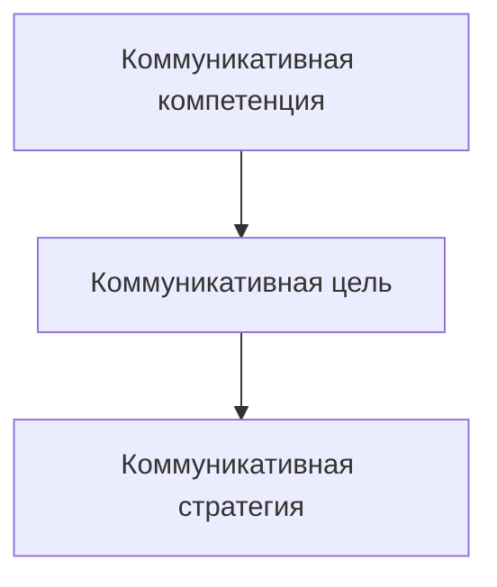

*Рис. 5.1. Стратегия и тактика в коммуникативном процессе*

Коммуникативный опыт (рис. 5.2) имеет непосредственное отношение к формированию коммуникативной личности. Значения слов хранятся как память о прошлых контекстах и результатах их употреблений — так и коммуникативный опыт понимается как совокупность представлений об успешных и неуспешных коммуникативных тактиках, ведущих или не ведущих к реализации соответствующих коммуникативных стратегий.

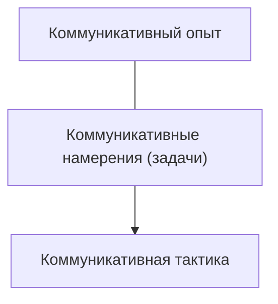

*Рис. 5.2. Коммуникативный опыт*

Успешность и неуспешность интертекстуальна, она включается в контекст сегодняшнего дня.

Специалист, работающий в той или иной сфере общественной коммуникации, должен обладать определенными коммуникативными навыками, т. е. он должен уметь эффективно:

- формировать коммуникативную стратегию;
- пользоваться разнообразными тактическими приемами коммуникации;
- представлять себя (или свою компанию) как участника коммуникативного процесса.

> [!quote]- Оригинал: стр. 134 · PDF 141
> 

---

Под эффективностью здесь подразумевается соотнесение вербальных и невербальных приемов с целями и задачами коммуникации, коммуникативной интенцией и перспективой, системная спаянность элементов коммуникативной стратегии, практическая целесообразность отдельных тактических ходов.

Профессионализм лиц, работающих в парадигме «человек — человек», как определяющее квалификационное качество личности должен включать в себя психологическую компетентность.

Структура психологической компетентности может быть представлена в виде системы, состоящей из взаимосвязанных компонентов — ее специальных видов [8]:

- социально-перцептивная компетентность (или знание людей, непосредственно связана с наблюдательностью и проницательностью);
- социально-психологическая компетентность (знание закономерностей поведения, деятельности и отношений людей, включенных в профессиональные и социальные группы);
- аутопсихологическая компетентность (самопознание, самооценка, самоконтроль, саморегуляция, самоэффективность);
- коммуникативная компетентность (знание различных стратегий, приемов и методов эффективного общения);
- психолого-педагогическая компетентность (знание приемов и методов влияния и воспитания).

### 5.1. Психологические методы убеждающего воздействия

#### Понятие психологического воздействия

Воздействие — это все, что влияет на состояние, отношения, поведение и деятельность субъекта и изменяет их. Основными видами психологического воздействия являются убеждение, внушение, психологическое заражение, воздействие на мотивационную сферу личности и ее интересы.

Наиболее значимыми факторами, повышающими эффективность воздействия личности на объект, служат:

- высокий социальный статус;
- престиж профессиональной деятельности;
- авторитет;
- некоторые личностные качества (харизматичность; авторитарность; уверенность в себе; оптимизм; обаяние и др.);
- позитивный имидж.

<sup>1</sup> Использованы материалы книги: Панасюк А. Ю. Убеждающее воздействие: теория и практика. М., 1989.

> [!quote]- Оригинал: стр. 135 · PDF 142
> 

---

Психологическое воздействие изменяет у личности:

На уровне сознательного:

- ценностные ориентации;
- мировоззрение;
- убеждения;
- отношения;
- мотивы поведения;
- потребности (осознаваемые).

На уровне подсознания:

- эмоциональное состояние;
- потребности (неосознаваемые, в виде влечений или стремлений и т. п.);
- идентификацию собственного внутреннего «Я»;
- поведение (повышает конформизм, влияет на соотношение «доминирование — зависимость»).

Для убеждающего воздействия на сознание реципиента наиболее эффективны такие формы, как: убеждение, влияние, воспитание и обучение; при воздействии на подсознательный уровень — суггестия, влияние, психологическое заражение и подражание.

Поскольку ситуация убеждающего воздействия — это ситуация, когда один человек убеждает в чем-либо другого, то возникла необходимость отразить в названиях участников этого процесса их пространственное положение относительно друг друга (которое, естественно, в ходе процесса общения может меняться). В литературе уже устоялось положение, что лицо, на которое оказывается убеждающее воздействие, называется «реципиент» (от лат. гесерио — прием). Лицо, оказывающее убеждающее воздействие — «индуктор» (от лат. ;паиспо — возбуждение, наведение).

Но большинство авторов (А. Ершов, Л. А. Киселева, Г. А. Ковалев, В. В. Цалобанов, Е. В. Шорохова и др.) выделяют три основные формы психологического воздействия: убеждение, внушение и принуждение. А. Ю. Панасюк дополняет этот список еще одним видом психологического воздедйствия — просьбой.

«Простите, вы не скажете, который час?». Это не убеждение, не внушение, не принуждение, но человек, тем не менее, как правило, совершает нужное нам действие, смотрит на часы и отвечает на наш вопрос — он с желанием тотчас же отозвался на нашу просьбу.

А. Ю. Панасюк считает, что основанием для классификации должна быть цель индуктора; он выделяет две группы целей психологического воздействия:

- когда индуктор желает, чтобы его реципиент в результате воздействия что-либо приобрел, или в структуре его личности появились какие-то новообразования (новые желания, новые установки ит. п.);

> [!quote]- Оригинал: стр. 136 · PDF 143
> 

---

- когда индуктор сам хотел бы благодаря своему воздействию на реципиента что-либо приобрести с помощью реципиента, какимлибо образом «обогатиться» (материально, морально).

К первой группе форм психологического воздействия относятся следующие ситуации:

- передача реципиенту информации («Считаю необходимым сообщить вам, что...»);
- передача реципиенту какого-либо материального объекта («Возьмите, пожалуйста, это теперь ваше»);
- образование у реципиента положительных эмоций («Умница, вы, прекрасно это сделали!»), или отрицательных («Безобразие! Как вы могли?»);
- образование у реципиента новых для него желаний, мотивов деятельности, установок и т. п.;
- создание у реципиента чувства его превосходства над окружающими, в том числе и над индуктором («Так, как вы это делаете, я, конечно, сделать не смог бы, даже если бы постарался!»); своеобразный альтруизм, ибо реципиент утверждается в своих глазах и во мнении окружающих за счет индуктора;
- реализация реципиентом своей потребности в общении, т. е. дать предоставление ему возможности эксплуатировать индуктора в качестве слушателя.

Ко второй группе форм психологического воздействия («самоприсвоения») А. Ю. Панасюк относит следующие ситуации:

- приобретение от реципиента информации («Скажите, пожалуйста, который час?»);
- приобретение какого-либо материального объекта или действия (дайте мне, пожалуйста, эту книгу; передайте, пожалуйста, солонку; передайте за проезд и т. д.»);
- получение от реципиента положительных эмоций, например, чтобы похвалили, пожалели и пр. (стремление получить от реципиента отрицательные эмоции — скорее отклонение от нормы, чем норма);
- стремление сформировать у себя новые установки («Убедите меня в этом и я — ваш сторонник!»);
- стремление утвердиться за счет реципиента, проявление своеобразного эгоизма («Разве так делают? Смотри, как я умею!»);
- стремление высказаться, эксплуатировать реципиента как слушателя.

С точки зрения целей индуктора эта классификация охватывает все возможные типы ситуаций, ибо предметом содержания высказываний являются любые материальные тела, информация, эмоции.

Убеждение — это воздействие на того или иного человека с целью принятия им определенных оценок, суждений и установок. Другими словами, необходимо так преподнести другому человеку информацию (аргументированно и доказательно), чтобы это повлияло

> [!quote]- Оригинал: стр. 137 · PDF 144
> 

---

в нужном направлении на систему его оценок, установок, отношений, которые, в свою очередь, изменят его поведение или деятельность. Важно, чтобы он захотел сделать так, как вы его убеждаете. Для этого необходимо достигнуть взаимопонимания, так как только тогда создаются необходимые основы для принятия сказанного.

Убеждающее воздействие, равно как и внушение, заражение, манипулирование и принуждение, являясь формой психологического воздействия, осуществляется в конфронтационной ситуации, когда реципиент изначально не согласен с позицией индуктора.

В русском языке термин «убеждение» имеет несколько значений. Наиболее распространенными являются два.

1. Убеждение как процесс воспитательного воздействия на личность или социальную группу.

2. Убеждение как продукт, результат такого воздействия, а, следовательно, как характеристика личности.

Убеждения классифицируют по следующим основаниям:

- по истинности — ложности, т. е. по степени соответствия убеждений действительности;
- субъективной истинности, т. е. по степени уверенности субъекта в истинности своих убеждений;
- степени аргументированности;
- классовому содержанию;
- характеру знаний, объекта отражения, типа: патриотические политические убеждения и т. п.;
- творчеству и степени идеологизированности (от слова «идея», а не «идеология»);
- уровню отражения отношению к прогрессу, науке, субъекту, классу;
- уровню развития;
- способу формирования;
- степени осознаваемости концепции;
- направленности действий в отношении объекта («к» или «от»);
- характеру основания убеждения (по силе).

В ходе убеждения одним человеком другого оказывается воздействие:

- на сознание;
- психику;
- подструктуру направленности;
- источник активности;
- регуляторы состояния;
- поведение;
- ценностные ориентации;
- мышление;
- воображение;
- волю.

> [!quote]- Оригинал: стр. 138 · PDF 145
> 

---

В результате убеждения достигаются:

- согласие;
- принятие;
- поведение в нужном направлении;
- действие в соответствии с убеждением;
- защита реципиентом новой позиции;

В результате убеждения активизируются:

- мышление;
- познавательные процессы психики.

В результате убеждения регулируются:

- внешняя и внутренняя деятельность.

В результате убеждения формируются:

- взгляды;
- желания;
- мотивы;
- понимание действительности;
- принципы;
- способность к социальной ориентировке.

В результате убеждения изменяются:

- Взгляды;
- деятельность;
- мотивы деятельности;
- образ жизни;
- ориентации;
- отношения;
- поведение;
- позиции;
- потребности;
- система ценностей;
- смысловое поле;
- сознание;
- способности.

Объединить этот столь разнообразный класс психологических образований может установка, являющаяся универсальным механизмом регуляции поведения людей, определяющая стратегию жизни, пронизывающая все уровни функционирования человека и его психики, представляющая собой состояние готовности к определенной форме реагирования. И. А. Зимняя определяет результат убеждающего воздействия как совокупность социальных установок человека.

#### Психологические методы убеждения

Для того чтобы кого-либо в чем-либо убедить, необходимо:

- чтобы он хорошо понял, в чем его убеждают;
- чтобы в убеждающей информации человек обнаружил значимый для себя личностный смысл.

> [!quote]- Оригинал: стр. 139 · PDF 146
> 

---

При прочих равных условиях люди легче принимают позицию своего собеседника в том случае, если у них сформировалось позитивное отношение к нему или к его образу. И наоборот, позиция неприятного человека чаще отвергается в процессе убеждающего взаимодействия.

Люди легче соглашаются и принимают ту информацию, которая удовлетворяет каким-то их внутренним потребностям. Поэтому, отсюда вывод: сила аргумента — в силе потребности, которая будет удовлетворена. Именно поэтому при прочих равных условиях аргумент, в котором представлен и психологический фактор «личный интерес» реципиента, более действенен, чем тот, в котором такой интерес не представлен.

Если человек должен что-то сделать, это не значит, что он это сделает. Подчинение — это принуждение, которое, как известно, не самая продуктивная стратегия деятельности. Сила вызывает сопротивление силе, а взаимовыгодная заинтересованность — желание сотрудничать. Самый лучший стимул к деятельности — это личный интерес.

При выборе аргументации необходимо учитывать особенности системы ценностей реципиента. Прежде чем формулировать аргументы, необходимо собрать информацию о человеке, которого вы хотите в чем-то убедить: о его характере, о его системе ценностей.

Итак, убеждая человека, необходимо:

1) подготовиться к разговору заранее;

2) быть объективным и правдивым;

3) быть логичным, последовательным и доказательным;

4) опираться на различные, хорошо известные всем факты, т. ©. говорить предельно конкретно;

5) в процессе убеждения выделить одну или две ключевые мысли, к которым следует обращаться не один раз (большее количество аргументов рассеивает внимание);

6) убеждая в чем-то, необходимо высказывать свое личное отношение в той мере, насколько позволяет ситуация (это создает обстановку доверительности);

7) помнить, что лучше воспринимается речь, если в ней есть обоснованный оптимизм, доброжелательность, надежда на лучшее (это создает позитивную психологическую установку);

8) облекать информацию в наглядно-образную форму;

9) включать личный интерес;

10) соответствовать индивидуальным ценностям реципиента;

11) для повышения убедительности следует чаще использовать психологический «эффект края», поэтому наиболее важную информацию нужно давать дважды: в начале (после того, как сформируется внимание) и в конце разговора (тогда она лучше всего воспринимается и запоминается);

> [!quote]- Оригинал: стр. 140 · PDF 147
> 

---

12) приковывают внимание и повышают убедительность речи обращения-восклицания, типа: «Послушайте!», «Обратите внимание!», «Запомните!»;

13) повышают убедительность и вопросы, обращенные к собеседнику: «А как вы считаете?», применение этого приема часто дает необычный эффект: отвечающий невольно начинает занимать позицию спрашивающего;

14) если вы хотите убедить партнера, старайтесь меньше спорить;

15) стремитесь как можно меньше говорить «я», «мне», «меня» и чаще «вы», «вас», «вам»,

Эффект восприятия информации определяется «эффектом установочного фона», т. е. исходной системой установок реципиента. Если исходная установка на данную информацию негативная, то начинать необходимо с более сильных аргументов. Если же исходные позиции реципиента были позитивными, то лучшим по теории установки должен быть вариант, когда убеждают со слабых аргументов, а заканчивают сильными. Действительно, если негативно настроенного клиента убеждать начиная со слабых аргументов, то услышав в самом начале диалога первые, слабые аргументы, он еще больше убедится в своей исходной негативной установке, а последующие в конце аргументации сильные доказательства ложатся теперь уже на еще более окрепшую исходную негативную позицию реципиента. И эффект почти нулевой. Но тот же вариант при доброжелательной установке реципиента давал прекрасный результат. Оказывается, эффект последействия разговора в большей мере определяется содержанием последней части, чем содержанием начала.

Аргументы целесообразно предъявлять следующим образом:

1) если неизвестна исходная установка реципиента, то сильные аргументы — в начало и конец;

2) если исходная установка положительная, то лучше начинать со слабых аргументов и заканчивать сильными;

3) если исходная установка реципиента негативная (явно не дружественная), то начинайте с сильных аргументов, а заканчивать можно и слабыми;

4) когда мало сильных аргументов, приходится брать количеством слабых.

При отсутствии информации о собеседнике следует исходить из худшего: он может быть настроен негативно, поэтому два сильных аргумента ставим в начало и один — в конец.

Умение анализировать аргументацию необходимо применять, когда вы сталкиваетесь с попытками убедить вас в правильности или вероятной правильности предлагаемого заключения. Когда вы привыкнете искать доводы и находить причину, вы увидите, как часто пытаются оказать на вас манипулятивное воздействие, исказить информацию с помощью различных приемов.

> [!quote]- Оригинал: стр. 141 · PDF 148
> 

---

### 5.2. Построение аргументации

Понятие аргументации как коммуникативный термин используется в различных видах наук и научного знания. Он может одновременно принадлежать и риторике — искусству хорошо и красиво изустно изъясняться, и искусству «убеждающего воздействия» — убеждать или влиять на других людей.

Искусная аргументация в арсенале профессионального коммуникатора является мощным и надежным инструментом убеждения. В процессе коммуникации важно правильно оценивать как содержание, так и форму аргументирующей информации. Аргументация, использующаяся для убеждающего воздействия на реципиента, может основываться на различных приемах манипулирования исходными фактами или сведениями. И не обязательно для этого будут использоваться прямые ложные данные. Наоборот, всевозможные комбинаторы от коммуникаций в своем арсенале используют прямую ложь исключительно в редких случаях — это невыгодно. Гораздо чаще используются, например, прием двусмысленных терминов, противоречивых положений, которые сами требуют предварительных доказательств; в процессе аргументации могут использоваться утверждающие безапелляционные заключения, выдвинутые на 0сновании неполного перечисления фактов или приема умолчания; либо на смешении случайных и важных явлений. Поэтому для понимания, сопротивления и успешного противодействия неправомерным коммуникациям убеждающего характера в нашем случае необходимо рассмотреть все основные особенности, по которым строится система аргументации.

Компонентами рациональной информации являются тезис и аргументы, а также связывающие их слова. Тезис — это та идея (мысль, положение, точка зрения, позиция), которую должен принять партнер по общению. Аргументы служат для обоснования, почему этот тезис можно (и нужно) принять. Будет ли сформулированный аргумент приниматься собеседником априори или не будет, зависит, прежде всего, от того, насколько содержание аргумента объективно и соответствует действительности. Аргумент должен соответствовать действительности и должен иметь логическую связь с тезисом, когда тезис вытекает из аргумента. Если существует формальное противоречие, высказываемое собеседником, то на этот аспект обычно сразу же обращают внимание. В условиях, когда необходимо определить наличие или отсутствие в сообщении собеседника искажения информации, необходимо обращать внимание на то, насколько он убедителен и логичен.

Люди легче соглашаются с тем, принимают то, что удовлетворяет какое-то их сильное желание. Если некий предмет (идея, вещь) представляет для человека ценность, — он будет стремиться

> [!quote]- Оригинал: стр. 142 · PDF 149
> 

---

к достижению этого предмета. Следовательно, сила аргумента — в силе потребности, которая будет удовлетворена. Именно поэтому при прочих равных условиях аргумент, в котором представлен и психологический фактор «личный интерес» реципиента, более действенен, чем тот, в котором такой интерес не представлен.

Итак, аргументы должны:

- соответствовать действительности;
- иметь связь с тезисом;
- включать личный интерес;
- соответствовать индивидуальным ценностям.

Однако необходимо учитывать также тот факт, что при прочих равных условиях люди легче принимают позицию того человека, к которому у них эмоционально положительное отношение, симпатию (от простого уважения до влюбленности). И наоборот, труднее принимают (и даже отвергают) позицию того человека, к которому испытывают эмоционально отрицательное отношение, антипатию. Необходимо также учитывать, что для получения согласия собеседника с высказываемой идеей необходимо воздействовать одновременно на две сферы его психики: на рациональную, т. е. аргументировать, и на иррациональную сферу, формируя аттракцию (от лат. айтайеге — привлекать, притягивать социально-психологическое явление формирования восприятия одного человека другим как привлекательного; возникновение симпатии, положительной установки на другого человека[^p150-1]), располагая собеседника к себе. Но если даже человек понял собеседника, то это не значит, что он согласился с ним. Поведением человека управляют его собственные ценности. Поэтому единственный способ убедить человека принять определенную точку зрения — это добиться того, чтобы он принял определенный взгляд на ситуацию и ввел бы его в свою собственную систему ценностей. Именно поэтому следует выбирать средства воздействия на его мотивационную сферу, обращаться к его системе ценностей, которые мотивируют поведение данного субъекта. Но собеседник не примет чужую точку зрения, если она противоречит другим его установкам. Главное — достижение принятия предложенной позиции. И лучший вариант, когда имеется понимание сказанного и доказательность данной позиции.

Для аргументации нужны доводы, даже если они и слабые. В проведенных исследованиях (Гапрег Е. 7., В1апК А., Спапоулиесх В.) было выяснено, что для большинства людей важны не сами доводы, а скорее видимость доводов. Зачастую людей устраивают причины, не связанные с реальными поступками или убеждениями, о которых идет речь. В качестве аргумента в подобных случаях

[^p150-1]: Конюхов Н. И. Словарь-справочник практического психолога. Воронеж : Издво НПО «МОДЭК», 1996.

> [!quote]- Оригинал: стр. 143 · PDF 150
> 

---

могут использоваться суждения, вообще не являющиеся причинами («Разрешите мне пройти без очереди потому, что мне очень надо»). Доводы, не имеющие отношения к делу, зачастую влияют на убеждения и поступки людей, хотя это и нелогично. Такие неубедительные рассуждения, используемые с целью убеждения, называются ложными доводами (софизмами). Важно понять наиболее распространенные используемые методики и понять общие принципы построения ложных доводов. Д. Халперн?! приводит наиболее распространенные ложные доводы, которые применяются с целью ввести собеседника в заблуждение. Каждый из них содержит неприемлемые или противоречивые посылы или посылы, не связанные с заключением, или используется мнение не вызывающих доверие специалистов, или отсутствует важная информация и т. п.

1. Влияние ассоциаций. Один из принципов психологии заключается в том, что если два события происходят близко друг к другу во времени и (или) пространстве, то в человеческом сознании между ними формируется связь. Следовательно, когда происходит одно событие, человек начинает ожидать, что произойдет и второе. Этот принцип обычно используется в политике (например, для создания эффекта ассоциированной вины: если избиратель прочитает в газете, что отрицательная личность поддерживает определенного кандидата, эта поддержка, несомненно, повредит кандидату, даже если он этой поддержки не хотел). Данный принцип достаточно часто используется в политике для создания ассоциированной вины. 'Точно так же можно вызвать и ассоциированную добродетель. Поэтому при анализе сообщения необходимо обращать внимание на наличие и характер приводимых ассоциаций.

Таким образом, следует очень внимательно относиться к сообщениям, основанным на ассоциациях. В случае же выявления данного ложного довода следует проанализировать и остальную часть сообщения, так как она может быть основана на обращение к эмоциональному, а не рациональному фону личности.

2. Доводы против личности (или по латыни — агвитепгасит ай Роттет) — это термин, принятый для обозначения «называния своими именами». При помощи этого довода можно нападать на личность, поддерживающую какое-то дело, а не на само дело.

Это несколько иное применение ассоциативного эффекта. В данном случае ассоциация формируется между идеей и человеком. И если субъекту не нравится человек, поддерживающий определенную идею, то он должен выступать и против идей, так как между ней и человеком существует определенная связь. Так, например, нацисты не принимали теорию относительности, считали ее абсурдной и неверной, потому что ее автором был еврей Альберт Эйнштейн.

<sup>1</sup> Халперн Д. Психология критического мышления. СПб. : Питер, 2000.

> [!quote]- Оригинал: стр. 144 · PDF 151
> 

---

Необходимо учитывать уместность доводов и цель, с которой данные доводы используют.

3. Упор на жалость. Это достаточно часто используемый прием, когда взывают к чувству сострадания, а не к здравому смыслу. Его очень легко выделить в предлагаемой вам посылке: «Сделайте то-то, так как мы нуждаемся в вашей помощи». Подобные посылки могут часто использоваться в суде стороной защиты. При этом не обсуждается вопрос о реальной вине или невиновности подозреваемого, а говорится, какая у него была тяжелая жизнь, как она его кидала, как прискорбно сложились обстоятельства. В обыденной жизни такой тип аргументации замечательно используется людьми с экстернальным (т. е. склонных при любых жизненных ситуациях ссылаться на влияние внешних непреодолимых обстоятельств, якобы не зависящих от самого человека) типом контроля. Данные доводы не имеют никакого отношения к обсуждаемому вопросу.

4. Популярность и рекомендации (известно под названием Бапамазоп — мода, повальное увлечение). Использование метода популярности основывается на потребности большинства людей в конформизме. Человека убеждают поддержать какую-то позицию, потому что «так делают все» — это и является единственным доводом в пользу этой позиции. Предполагается, что люди, для которых предназначается это сообщение, примут определенные убеждения, чтобы ощутить свою принадлежность к определенным группам, упомянутым ранее в сообщении. При этом неявно подразумевается, что раз «так делают все, значит, это правильно». Одним из вариантов этого метода является использование рекомендаций. Оно основывается на чьем-то (чаще всего популярной личности) необоснованном мнении. Ложный довод усугубляется, когда рекомендации даже не касаются той области, в которой популярная личность обладает компетентностью. В последнем случае ложный довод пересекается с «обращением к авторитетам» (о котором будет сказано ниже).

5. Ложная дихотомия. Ложной дихотомией называют упрощение проблемы или «черно-белые» доводы, когда просят выбрать одну из двух позиций, не предлагая никаких других вариантов, в которых бы сочетались различные точки зрения каждого из вариантов выбора. Главная ошибка человека, который столкнулся с подобной ситуацией, заключается в том, что он начинает выбирать «из предложенного», ограничивая, таким образом, собственное поле рассмотрения данной проблемы. В этом случае целесообразно рассмотреть альтернативные варианты решения, так как один из этапов анализа аргументации требует обеспечения недостающих компонентов.

6. Обращение к гордости или тщеславию. В этом случае используется комплимент, лесть и похвала как способ убеждения принять определенную позицию. И хотя сама по себе лесть может

> [!quote]- Оригинал: стр. 145 · PDF 152
> 

---

и не являться злым умыслом, такой способ может использоваться для того, чтобы запутать проблему.

7. Подтасовка или сокрытие информации. Это метод убеждения путем умолчания об информации, говорящей в пользу нежелательной позиции. Поэтому важно учитывать не только высказанные, но и невысказанные суждения.

8. Порочный круг. При этом типе рассуждений посылка является по-другому сформулированным заключением. Если построить структурную схему аргументации такого типа, у вас получится круг, поскольку поддержкой заключения служит переформулированное заключение. Подобные доводы не могут служить обоснованием для заключения.

Например: «Необходимо повысить допустимую скорость движения, потому что существующий предел скорости — слишком низкий».

9. Нерелевантные (не связанные с заключением) доводы. По латыни этот тип ложных доводов называется поп зедийиг, что в буквальном переводе означает «Это не следует». Другими словами, довод или посылка не связаны с заключением. Одно не следует из другого.

Важнейшим критерием убедительности аргумента или рекомендации является наличие посылок, связанных с заключением. «Необходимо ли студентам дополнительно изучать иностранные языки?» «Да, так как это повысит уровень их заработка»,

10. «Под уклон» или континуум. Одним из доводов против принятия судебных постановлений об объединении школ для негров и белых было то, что если мы допустим, чтобы суд решал, какие школы будут посещать наши дети, то суд начнет указывать нам также, кого нам пускать в церковь, кого приглашать в гости и даже на ком жениться. В этом примере действие (объединение школ для негров и белых по постановлению суда) стоит в одном континууме (непрерывном ряду) с такой крайностью, как женитьба по указке суда. Аргументация состоит в том, что если мы отдадим в юрисдикцию суда события, стоящие на одном конце этого континуума, то и над другими событиями, входящими в него, суд приобретет власть. Поэтому данный ложный довод называют или «под уклон» (начав движение под уклон, трудно или даже невозможно остановиться), или континуум.

Большинство жизненных событий можно расположить в виде ряда. Но отсюда вовсе не следует, что действия, касающиеся какойто части этого ряда, будут применимы также и к другим. Этот ложный довод имеет еще одно, более красочное название — «верблюд засунул нос в палатку». Это название намекает на то, что если мы позволим верблюду засунуть нос в палатку, то скоро за носом последует и весь верблюд.

> [!quote]- Оригинал: стр. 146 · PDF 153
> 

---

11. «Соломенное чучело». Соломенное чучело неустойчиво и его легко опрокинуть. Так называется метод, когда умозаключение оппонента представляют в самой слабой форме, а затем легко его опровергают. При этом оппонент, выступающий против определенного заключения, искажает доводы в пользу этого заключения и заменяет их значительно более слабыми.

12. «Часть — целое», Ложные доводы типа «часть — целое» Являются обратной стороной той же ошибки. При использовании такого ложного довода оратор (или автор письменного текста) предполагает, что суждения, верные для целого, верны и для всех его частей, а суждения, верные для частей, верны и для целого. Однако в реальности это не всегда верно.

13. Использование незнания. Особенностью использования незнания является то, что этим способом часто можно поддерживать два или более совершенно различных заключения. Это должно служить для вас признаком того, что приведенные доводы ошибочны. При использовании незнания посылки содержат нечто, нам неизвестное. Наше незнание используется для того, чтобы доказать, что заключение неверно, поскольку нет доводов в его поддержку. Наше незнание вопроса может быть также использовано и для поддержки заключения путем утверждения, что оно верно потому, что нет данных, свидетельствующих против него. Отсутствие данных не может служить основой ни для какого заключения.

14. Слабые и неподходящие аналогии. Использование аналогий — это один из основных навыков мышления. Мы обращаемся к аналогиям, когда сталкиваемся с чем-то новым и стараемся разобраться в нем на основе того, что нам уже известно. Несмотря на то, что аналогии — это чрезвычайно полезный инструмент для понимания, их можно использовать неправильно. Два объекта или события являются аналогичными, если у них есть определенные общие свойства. Когда мы рассуждаем с помощью аналогий, мы заключаем, что суждения, верные для одного объекта или события, верны и для другого.

При рассмотрении аргументации, произведенной по аналогии, важно учитывать природу и характерные особенности отношений сходства. Суждения, верные для одного объекта или события, совершенно не обязательно будут верны и для другого.

15. Обращения к авторитетам. Ложный довод состоит не в самом факте обращения к источнику, а в обращении к источнику, который является ненадежным. Таким образом, нужно уметь определить границы компетентности того или иного авторитета. Примером может послужить обращение к знаменитому эстрадному исполнителю по вопросу того или иного законопроекта. Если при обращении к авторитету этот авторитет неправильно выбран и он не является специалистом в данной области, то основываться на его мнении не стоит.

> [!quote]- Оригинал: стр. 147 · PDF 154
> 

---

16. Неполные сравнения. В неполных сравнениях часто используются оценочные выражения типа «лучше», «безопаснее» и, конечно, «чище». Это особый случай рассмотрения недостающих компонентов умозаключения. Что такое «лучше»? Как его измерить? Кто измерял? По сравнению с чем?

В подобных утверждениях отсутствует вторая часть, тот компонент, с которым необходимо сравнивать.

17. Знание того, чего нельзя узнать. Это ложный довод, в котором приводятся числовые значения величин, которые нельзя определить. Например, если нам говорят, что возросло незарегистрированное число карманных краж, то стоит поставить это сообщение под сомнение. Однако невозможно знать тенденцию изменения тех факторов, которые не были зарегистрированы.

«Нам необходимо увеличить численность полиции, поскольку резко выросла численность незарегистрированных изнасилований», «На данный момент зафиксировано 150 000 наркоманов, однако реальная цифра — 1 000 000».

Нет способа, которым мы можем узнать то, чего узнать нельзя.

18. Ложная причина. Ложный довод имеет место тогда, когда кто-либо утверждает, что из-за того, что два события происходят одновременно или следуют одно за другим, одно из них является причиной другого. Конечно, существует возможность, что одна переменная является причиной появления другой, но для обоснования причинно-следственной связи недостаточно лишь одновременности наступления событий.

«Одновременно с увеличением количества церквей в городе увеличивается и количество проституток». Однако, по мере увеличения городов, возрастает не только количество церквей и проституток, но и школ, магазинов и т. д.

Этот ложный довод основан на особенностях и феноменах восприятия, которые будут рассмотрены отдельно.

Это довод, в котором считается, что одно событие является причиной другого только потому, что они происходят одно за другим или одновременно. Для обоснования причинно-следственной связи недостаточно лишь одновременности наступления событий.

19. Снижение. Принижение противоположной точки зрения так, чтобы слушателю было трудно с ней согласиться. Идет снижение статуса авторитетности оппонента, часто за счет унижения, обращения к эмоциям. Например, могут следовать такие эмоциональные утверждения, как «Только недалекий человек будет поддерживать эту точку зрения!» или «Только глупец будет поддерживать данного кандидата», «Ни один патриот нашей страны не будет возражать». Таким образом, поддерживая данную точку зрения, вы автоматически попадаете в разряд дураков, людей, лишенных патриотических

> [!quote]- Оригинал: стр. 148 · PDF 155
> 

---

чувств или ума и человек, отстаивая свою точку зрения после подобного заявления, сразу причисляется к глупым.

20. Обращение к традиции. «Мы всегда так делали». Всякий, кто пытался изменить какие-либо правила, слышал эту фразу или ее вариант: «Не пытайся починить то, что еще не сломалось». При обращении к традиции используется несформулированное предположение о том, что то, что уже существует, является лучшим. Возможно, существующая система действительно лучше, чем предлагаемые изменения, но может и оказаться, что это не так. Из того факта, что «мы всегда так делали», вовсе не следует, что это хороший или лучщий способ достижения цели. Одним из качеств человека, мыслящего критически, является гибкость. При обращении к традиции отрицается возможность существования более совершенного метода.

Иногда имеет место утверждение, что «новое, конечно, лучше, а может быть, и нет».

Прием, когда в качестве довода используется утверждение, что существующая сейчас методика является лучшей.

21. Ложные обвинения в ложных доводах. «Это ложный довод!» Создается впечатление, что некоторые люди, научившись распознавать ошибочные рассуждения, сразу же называют ложными доводами все, что говорят другие (1,ем1, 1991). Но далеко не все рассуждения являются ложными доводами. Смысл критического мышления в том, чтобы развить определенный скептицизм, сохранив при этом дружелюбное отношение к окружающим, а вовсе не сформировать циничное убеждение, что все всегда лгут. Знать, когда можно считать суждения приемлемыми так же важно, как знать, когда и что нужно подвергнуть сомнению.

Ю. В. Щербатых перечисляет ряд манипуляций с информационным потоком, в результате которых у партнера по общению искусственно создается искаженная модель окружающей действительности.

1. Умолчание: утаивание информации от получателя; акцентирование выгодных и замалчивание невыгодных для искажающего информацию субъекта фактов. Также возможны комбинированные способы искажения информации.

2. Нарушение пропорций, т. е. преувеличение или преуменьшение выгодных фактов.

3. Селекция. Избирательный подход к информации. До собеседника доносится только та информация, которая укладывается в рамки какой-то определенной концепции.

4. Передергивание — способ подачи информации, при котором внимание привлекается к какому-то определенному факту или свойству предмета, явления, который наиболее выгоден для источника информации. К данному методу можно отнести и «эффект рамки»,

т. е. создание соответствующего оформления, преподносящего какое-либо явление под определенным углом зрения.

> [!quote]- Оригинал: стр. 149 · PDF 156
> 

---

5. Искажение. Количественное изменение (преувеличение или преуменьшение чего-то), выделение одних сторон и замалчивание других, искажение пропорций, выдвижение в пользу своей позиции наиболее сильных аргументов, а в пользу позиции оппонента — наиболее слабых. Сокрытие части информации, а затем сравнение заведомо неравноценных категорий, что в глазах неискушенного человека выглядит почти равноценно.

6. Переворачивание. Примером этого приема может быть подмена целей, когда своя цель выдается за цель другого человека.

Рассматривая возможности искажения информации, необходимо остановиться на манипулировании сознанием. Это «создание таких условий, при которых ответная реакция другого человека однозначно определяется действиями обманывающего... Иногда, чтобы вынудить человека на определенные действия, нужно поставить его перед выбором, сделав это таким образом, чтобы одно из решений (которое устраивает обманщика) оказалось также наиболее приемлемо и для другого человека»[^p157-1]. Выделяют несколько вариантов подобных тактик.

7. Подталкивание. Если собеседник колеблется между несколькими возможными стратегиями поведения, то определенными действиями либо же словами его направляют в нужном направлении. Программа действий уже находится в его сознании. Задача коммуникатора состоит только в том, чтобы помочь ее реализовать. Таким образом, получается, что жертва обманывает сама себя.

8. Провокация — реципиента вынуждают к невыгодным для него действиям, представляя это как выгодное, либо просто безобидное для него дело.

9. Обман от противного. Маскировка своей просьбы под противоположную — используется с негативно настроенными партнерами, который заведомо готов сделать все наоборот. В данном случае применяется метод, когда респонденту предлагают занять позицию индуктора и защищать его точку зрения. Индуктор же становится на точку зрения респондента. Таким образом, респондент убеждает самого себя сам. В качестве примера вспомним известную сказку дядюшки Римуса про братца Кролика и братца Лиса (см. выше).

10. Сообщение правды под видом обмана. Это — другой родственный метод. В данном случае ожидаемые установки респондента не совпадают с реальностью, и человек обманывает сам себя. Надо сказать правду, но с передержками, так, чтобы жертва не поверила ей, т. е. сказать правду лживо. Отто фон Бисмарк говорил: «Если хочешь одурачить мир, скажи ему правду». Обман при помощи правды — редкая форма надувательства. Он очень хорошо срабатывает, потому что люди, как правило, не ожидают подобной

[^p157-1]: Щербатых Ю. В. Искусство обмана. М. : ЭКСМО-Пресс, 2000. С. 103.

> [!quote]- Оригинал: стр. 150 · PDF 157
> 

---

наглости. Правда, здесь необходимо либо хорошо уметь владеть собой, либо быть хорошим актером.

11. Обман путем перестановки — респонденту предлагают примерить на себя роль искажающего информацию человека. В результате психологических манипуляций, ему начинает казаться, что уже он обманывает окружающих. Данная иллюзия поддерживается до определенного предела, когда жертва понимает, что на самом деле именно он оказался обманутым. Это один из достаточно распространенных видов мошенничества, когда потенциальную жертву просто заставляют примерить на себя роль обманщика. В результате различных психологических манипуляций жертве начинает казаться, что это уже он обманывает других, у него появляется азарт. Настоящие же мошенники до определенного момента старательно поддерживают эту иллюзию. И только в финале все встает на свои места. Как писал еще Ларошфуко, «лучший способ оказаться обманутым — посчитать себя хитрее других».

Анализируя вербальные методы выявления искажения информации собеседником, П. Экман выделил два фактора:

- утечку информации — это ошибка субъекта, которая может либо раскрыть правду, либо навести на мысль об искажении информации без раскрытия правды;
- признак искажения информации — это поведенческий сигнал неискренности партнера по общению, который свидетельствует о наличии искажения информации реципиентом, но не раскрывает того, что скрывается.

Г. В. Грачев и И. К. Мельник также перечисляют ряд наиболее типичных приемов для введения собеседника в заблуждение, отмеченные ими в экспериментальных ситуациях. Так, участники эксперимента:

- рассказывали о событиях, которые хорошо знали, но которые произошли с другими людьми;
- рассказывали о реальных событиях, но переносили их в другую обстановку, либо смещали во времени;
- разбивали информацию на отдельные блоки, которые передавали сжатыми, продуманными фразами;
- использовали очевидную информацию для искажения информации, которую легко можно было перепроверить, предполагая, что именно поэтому в достоверности не будет сомнений;
- детализировали ложную информацию, чтобы она выглядела более реальной;
- ложную информацию по логике и смыслу связывали с достоверной информацией;
- старались вести себя спокойно, не следили внимательно за поведением собеседника, не отводили взгляд при уточняющих

> [!quote]- Оригинал: стр. 151 · PDF 158
> 

---

вопросах, старались говорить ровным голосом, быстро и уверенно отвечать на дополнительные вопросы.

Умение анализировать аргументацию необходимо применять при попытках убедить в правильности или вероятной правильности предлагаемого заключения. Когда субъект отслеживает доводы и находит причину, он отслеживает и те ситуации, когда на него пытаются оказать воздействие, либо исказить информацию с помощью различных приемов. Д. Халперн предлагает следующий план оценки аргументации.

1. Насколько четко сформулировано заключение и определены необходимые термины?

2. Насколько связаны аргументы с выводом?

3. Убедительна ли аргументация? Насколько сильны аргументы?

4. Насколько признаны те авторитеты, на которые есть ссылки?

5. Правильно ли построен текст, не смешивается ли вместе рассмотрение различных вопросов?

6. Рассмотрены ли в тексте альтернативные точки зрения и контраргументы?

7. Насколько удачны формулировки с точки зрения грамматики и стилистики?

### 5.3. Типы вопросов и способы их использования

Вопросы играют огромную роль в коммуникациях — деловом общении, споре и полемике. С помощью вопросов можно многое для себя прояснить, но многое можно и запутать. Уместный вопрос может высветить слабые стороны позиции оппонента, заставить его привлечь для обоснования своего тезиса дополнительные средства. Умение корректно задать вопрос — искусство. Известно, что правильно заданный вопрос — это уже половина ответа.

С помощью вопроса можно точно и порою остроумно высмеять надуманность, претенциозность, выспренность и излишний пафос. Вопрос может дать пищу для размышлений и выводов. Точно ответив на конкретный вопрос, можно снискать себе уважение слушающих, укрепление их убеждения, что они имеют дело с компетентным человеком. А вот уместный вопрос к собеседнику может проиллюстрировать, что его громогласные заявления не совсем стыкуются с тем, что он представил в качестве ответа.

Вопросы могут помочь захватить инициативу, побудить оппонента больше отвечать, чем спрашивать. Его позиция тогда будет схожа с тем, что требует оправдания. А ведь известно, чем больше оправдываешься, тем сильнее подозрение в вине или несостоятельности.

Вопросы могут предоставить нужную, требуемую ситуацию или информацию. Они могут прояснить проблемную ситуацию, могут

> [!quote]- Оригинал: стр. 152 · PDF 159
> 

---

точно указать, по какому сценарию важно направить развивающиеся реалии делового спора.

Кроме этого, вопросы — реальность тактики делового общения. С помощью вопросов можно усилить давление, переакцентировать спорное положение, навязать противнику свои способы и методы ведения дискурса. Многое можно осуществить, если умело пользоваться вопросами, знать их, различать и уметь хорошо отвечать на них.

Вопросы — особый вид логических понятий, являющихся завуалированными требованиями. Они применяются для выяснения обстоятельств, уточнения информации, разрешения проблемной ситуации. Логическая природа вопроса такова, что в отличие от утвердительных (ассерторических) предложений, квалифицируемых с точки зрения истинности и ложности, вопросы такой квалификации не подлежат. Так, утверждения: «Все люди смертны», «Иван — брат Петра», «Эверест является самой высокой горой на Земле», «Ртуть не является металлом» — могут квалифицироваться как истинные или ложные. В то время как вопрос, например: «Сколько сейчас времени?» — находится вне такой истинностной квалификации. Другое дело, что ответ на этот вопрос может трактоваться как правильный или неправильный. Но это ответ, а не сам вопрос.

Подведем маленький итог. В отличие от суждений и высказываний, которые проверяются (верифицируются и фальсифицируются) стандартным образом, вопросы невозможно оценивать явным образом как истинные или ложные. Однако это не означает, что вопросы не могут быть корректными и некорректными, уместными и неуместными, осмысленными и бессмысленными, предметными и беспредметными, требующими ответа и риторическими. Кроме этого, вопросы могут быть казуистическими, уловками и аргументами в споре, самоотвечающими, шуточными, вопросами-задачами

Существуют различные виды вопросов. Наиболее простая классификация выделяет вопросы: уточняющие и восполняющие; простые и сложные; корректные и некорректные; нейтральные, благожелательные и провокационные.

Уточняющие вопросы направлены на выяснение истинности или ложности информации и требуют ответа «да» или «нет». Их также называют закрытыми вопросами.

Открытые или восполняющие вопросы начинаются с вопросительных слов: «кто», «что», «где», «когда», «как», «почему». Они помогают получить развернутые ответы и новые знания относительно событий, явлений, предметов.

Простые вопросы не могут быть расчленены на более простые высказывания. Сложные вопросы включают в себя два и более простых вопроса.

> [!quote]- Оригинал: стр. 153 · PDF 160
> 

---

Корректные вопросы основываются на истинных суждениях. Некорректные вопросы основываются на ложных или неопределенных суждениях.

Нейтральные вопросы не содержат эмоциональной окраски и никак не воздействуют на личность собеседника.

Благожелательные вопросы подчеркивают расположенность говорящего к собеседнику.

Провокационные вопросы негативно окрашены и содержат скрытое или явное подстрекательство к неверным действиям собеседника.

Умение правильно задавать правильные вопросы помогает и тому человеку, который задает (индуктору), и тому, кому они адресованы (реципиенту). Для поддержания продуктивного коммуникативного взаимодействия лучше задавать разнонаправленные вопросы, нежели произносить монологи. Таким образом, вы включаете собеседника в общение, проявляете к нему интерес. Правильно поставленные вопросы позволяют получить намного больше информации о собеседнике, а также управлять ходом делового общения. Когда вы задаете вопросы «на понимание», то эти же вопросы ставит перед собой и ваш собеседник и отвечает на них. Вопросы — это вроде бы не внушение. Вопросы — это прояснение. А ведь вопрос и ответ — это две противоположные стороны единого целого. Имейте в виду: тот, кто спрашивает, тот и управляет разговором. Вы не навязываете собеседнику свою точку зрения, вы плавно подводите его к ней. Кроме того, с помощью вопросов мы активизируем собеседника, даем ему возможность самоутвердиться. Плюс к этим преимуществам вопросы закрепляют промежуточные результаты переговоров как вида межличностного взаимодействия.

С помощью вопросов можно:

- прояснить интересы собеседника;
- направить его внимание на нужные и важные для вас детали разговора;
- узнать возражения партнера;
- вернуть инициативу в разговоре;
- сообщить собеседнику свою точку зрения;
- смело разрушить уверенность партнера в чем-то;
- построить с собеседником отношения подлинного партнерства;
- занять в процессе общения более выгодную роль лидера мнений, эксперта, рефери, «привратника» и т. д.

Задавайте вопросы! Инициатива в руках у того человека, кто задает вопросы. Вопросы — это единственный способ заставить человека думать. Вопросы по существу, вопросы на понимание развернут мысли вашего собеседника в нужном вам направлении даже если минуту назад он и не предполагал иного поворота событий.

> [!quote]- Оригинал: стр. 154 · PDF 161
> 

---

Метод вопросов имеет целый ряд преимуществ по сравнению с методом утверждений:

- помогает избежать споров;
- помогает избежать излишней говорливости;
- позволяет помочь собеседнику понять, чего же он хочет. Тогда вы сможете помочь ему решить, как добиться этого;
- помогает собеседнику выкристаллизовать мысль. И привнесенная извне идея становится его собственной;
- помогает выявить слабое место при заключении сделки;
- вызывает у другого человека чувство собственного достоинства. Когда вы показываете, что уважаете его точку зрения, то он наверняка станет уважать вашу.

Давайте рассмотрим основные типы вопросов.

Закрытые вопросы.

Они предполагают ответ «да» или «нет».

- Вы будете сотрудничать с нами?
- Устроит ли вас, если..?
- Хотите ли вы, чтобы..?

Старайтесь исключить эти вопросы из употребления, потому что они требуют от человека конкретного и однозначного решения. Ответ «нет» ничего не изменит в жизни собеседника, зато даст ему ощущение безопасности. На своих семинарах, посвященных проблемам искажения информации в деловом общении и методам защиты от обмана, мы рекомендуем в ответ на любое давление говорить «нет!». В жизни же люди принимают такое решение интуитивно. К тому же получив ответ «нет», вы теряете контакт с собеседником. Он, конечно, не обрывается, но ослабевает. Это работает против вас. Даже ответ «да» не очень вам поможет, потому что он не даст возможности понять, что именно ценного для оппонента заключается в вашем высказывании. Хотя закрытые вопросы помогают поставить точку в ситуациях, когда клиент никак не может принять решение. Они помогут его подтолкнуть. Но эффективнее все же использовать другие виды вопросов.

Открытые вопросы.

Эти вопросы начинаются со слов: что, как, какой, сколько, почему и предполагают получение развернутого ответа.

- Что вы об этом думаете?
- Почему вы считаете, что...?
- Какие ожидания вы связываете с нашим дальнейшим сотрудничеством?

Собеседник, отвечая на подобные вопросы, дает нам информацию о своих приоритетах, своих мотивах, упрощая, таким образом, этап сбора информации.

Вместо открытых вопросов можно использовать фразы типа:

- Пожалуйста, расскажите поподробнее...
- Я не совсем поняла, не могли бы вы пояснить?

> [!quote]- Оригинал: стр. 155 · PDF 162
> 

---

- Уточните, пожалуйста, детали.
- Расскажите, пожалуйста, о дополнительных вариантах.
- Пожалуйста, уточните...
- Не могли бы вы дать мне некоторое представление 0...

Подобные вопросы очень важны, когда вы только-только устанавливаете контакт с собеседником.

Альтернативные вопросы.

Эти вопросы предоставляют возможность выбора. Они предполагают быстрое решение. Вы ничего не навязываете. Вы просто предлагаете выбор между тем, что вам нужно и тем, что нужно вам.

- Мы подпишем договор сейчас или после того, как выпьем по чашечке кофе?
- Мы подпишем договор на год или сразу на три года?
- Вам выписать модель А или модель Б?
- Вы хотели бы начать работу над проектом сейчас или после отпуска?

Зеркальные вопросы.

Они состоят в повторении с вопросительной интонацией части только что сказанного собеседником утверждения, чтобы дать ему возможность увидеть его с другой точки зрения. Эти вопросы позволяют, не противореча собеседнику и не опровергая его слов, создавать в разговоре новые элементы, меняющие смысл. Вы же не можете постоянно спрашивать «почему?». Вопрос «почему?» часто вызывает защитные реакции, поиски мнимой причинности. Задавайте зеркальные вопросы! Это очень эффективная техника.

Вопросы для обдумывания.

Цель этих вопросов — создать атмосферу взаимопонимания. Они заставляют собеседника размышлять и комментировать то, что было сказано.

- Считаете лиц вы, что...?
- Правильно ли я поняла вашу точку зрения, что...2?

Вопросы — внушения.

Позволяют без видимого давления донести нужные мысли до собеседника.

- Вы также считаете, что...?
- Вы также придерживаетесь мнения, что...?

Контрольные вопросы.

Их полезно задавать во время любого разговора, чтобы понять, слушает ли вас собеседник или его мысли где-то далеко. К тому же вопросы, заданные партнеру, помогают удержать его внимание.

- Что вы об этом думаете?
- Могу ли я считать, что это развеяло ваши сомнения?

Подтверждающие вопросы.

Задаются, чтобы найти взаимопонимание. Если собеседник три раза согласился с вами, то он автоматически согласится с вами и в четвертый раз. Если вы приехали на переговоры, очень полезно

> [!quote]- Оригинал: стр. 156 · PDF 163
> 

---

начинать разговор с чего-то такого, в чем вы найдете общий язык. Например, с погоды. Банальный разговор о погоде помогает создать атмосферу доброжелательности и взаимного согласия. Тема нейтральна и потому безопасна, поэтому и согласие с собеседником не вызывает сопротивления. Если же вы нашли общий язык по одному вопросу, у вас уже завязалось взаимопонимание и вам намного проще будет достичь понимания и в процессе обсуждения последующих проблем. В любой разговор всегда вставляйте подтверждающие вопросы и делайте акцент на том, что вас объединяет, а не на том, что вас разделяет.

- Вы, наверное, тоже рады тому, что...?
- Если я не ошибаюсь, вы считаете, что...

Вступительные вопросы.

Хорошо поставленный вопрос является хорошим стартом. У собеседника возникает состояние положительного ожидания, заинтересованность.

- Если я предложу вам способ, с помощью которого вы сможете заработать больше денег, ничем при этом не рискуя, заинтересует ли вас это?

Заключающие вопросы.

Их цель — завершить разговор. Лучше сначала задать пару подтверждающих вопросов, лучезарно при этом улыбаясь:

- Смогла ли я убедить вас, в выгоде нашего предложения для вашего предприятия?
- Убедились ли вы, насколько этот прибор прост в эксплуатации?

А затем перейти к завершающему вопросу:

- Оформить вам доставку или самовывоз?
- На чем вы решили остановиться — на аппарате А или Б?

Вопросы бывают казуистическими.

Казуистика (от лат. casus — случай) — разновидность рассуждения, связанного с рассмотрением случаев (казусов) в их связи с общими принципами права, морали, теологии. Обычно методика рассуждения и вопроса по казуистической схеме такова: подведение прецедента под общий случай. В обычном словоупотреблении казуистика понимается как ловкость, изворотливость, искушенность в словопрениях. Вот, например, вопрос, который долгое время, в течение веков обсуждался совершенно серьезно: «Есть ли душа у женщины?». Ничтоже сумнящеся ученые мужи — богословы и теологи, отвечая на этот вопрос, разыскивали ответ в прецедентах, описанных в Священном Писании, начиная от сотворения первой женщины Евы из ребра Адама, замечая, что в тексте Библии явным образом говорится, как, создав Адама, Бог вдохнул в него душу. Но, утверждали они, Библия не содержит указания ни на один прецедент, где бы говорилось о подобном деянии в отношении Евы. Зна-

> [!quote]- Оригинал: стр. 157 · PDF 164
> 

---

чит, делали вывод они, у женщины нет души. И только Ватиканский собор, состоявшийся в ЖХ в., положил конец этим в высшей степени ученым спорам: голосованием (с большинством в один голос!) было раз и навсегда «установлено», что душа у женщины есть.

Вопросы могут быть схоластическими.

Схоластика — такое философско-религиозное мировоззрение, которое характеризуется подчинением знания вере, религиозной догматике, облеченной в псевдонаучную терминологию. Ответ на вопрос в этом случае вычитывается из тех канонов, текстов, которые считаются незыблемыми, ортодоксальными. И все это вместо того, чтобы искать ответ на вопрос в той сфере, к содержанию которой он относится. Вот простой пример: в Средневековье в философии и теологии Аристотель был непререкаемым авторитетом. Ученые мужи, споря, к примеру, о том, сколько ног у мухи, не удосуживались взять да и посчитать. Ответы на вопросы они искали в трактатах Аристотеля, по-своему истолковывая те или иные их фрагменты.

Вопросы могут быть метафизическими.

Применительно к этой сфере таковыми считаются те, которые выходят за пределы наличного опыта. Это, как правило, такие вопросы, на которые нет и не может быть однозначного ответа, которые нельзя ни доказать, ни опровергнуть. Вопросы о том, конечна или бесконечна Вселенная, существует ли свобода воли в аду, имеет ли место зло в раю и т. п.

Легко выделить и вопросы, которые можно назвать псевдокаузальными. В них умышленно или неумышленно сопоставляются события или действия, на деле соседствующие друг с другом, но не находящиеся в отношении причинно-следственной зависимости. А вопрос ставится именно так, что подталкивает того, кому он адресован, к ответу, в котором эта зависимость была бы установлена. В каком-то отношении эти вопросы могут рассматриваться как словесная провокация, в каком-то — как шутка, в каком-то — как игра слов. Вот один из образцов таких вопросов.

Светоний, древнеримский историк, в своем «Жизнеописании двенадцати цезарей» описывает такой вопрос и ответ на него. Александр Великий во время своих завоевательных походов по Индии захватил в плен индийских философов-гимнософистов. Они славились не только тем, что, стремясь быть в единстве с природой, всегда ходили обнаженными, но и тем, что умели давать неожиданные ответы на любые вопросы. Александр и предложил им такой неожиданный вопрос, поставив, согласно Светонию, условие: отвечают гимнософисты так, что устроит царя, получают свободу, нег, как говорится, голова долой. А вопрос был такой: «Что раньше, день или ночь?» Первый же гимнософист, не раздумывая, дал неожиданный, обескураживший царя ответ, на который тот не нашелся,

> [!quote]- Оригинал: стр. 158 · PDF 165
> 

---

что сказать и что возразить. А ответ был следующий. «День раньше по крайней мере на день...» Александру ничего не оставалось, как удовлетвориться этим ответом и отпустить мудрецов восвояси.

В вопросе может быть заложен неразрешимый парадокс, что делает и сам вопрос парадоксальным. Вот один из таких вопросов:

«Если Бог всемогущ, то может ли он создать такой камень, который не сможет поднять?» И версии ответов вводят нас в сферу парадоксальности: «Если может создать (ведь Он всемогущий и может создать все что угодно), то какой же Он всемогущий, если не сможет поднять такой камень? А если же Он в силах поднять любой камень (Он же всемогущий), то это вступает в противоречие с другим аспектом всемогущества: какой же Он всемогущий, если не может создать такой камень, который ему не под силу?» Тут, как говорится, куда ни кинь, всюду клин...

Вопросы бывают софистическими. Любой софизм — это, по сути, софистический вопрос. Например, вопрос, который лежит в основе софизма «Рогатый»: «Верно ли, что ты имеешь то, что не потерял?» Вы, наверное, помните, какие выводы следуют из подтверждения этого; и суждение о том, что отвечающий не терял рогов и заключение о том, что он рогат.

Вопросы, связанные с логическим выводом.

Можно сказать, что существуют вопросы, связанные с логическим выводом. Вот один из них: «Что лучше: вечное бессмертие или бутерброд с сыром?» Вопрос на первый взгляд кажется бессмысленным. Но давайте порассуждаем и опять же с помощью вопросов и ответов на них: — Что может быть лучше вечного бессмертия? — Ничто! — А бутерброд с сыром лучше, чем ничто! — Следовательно, бутерброд с сыром лучше вечного бессмертия!

Данный вывод в вопросах и ответах на них вполне соответствует логическому выводу, основанному на законе транзитивности, Если А лучше В, а В лучше С, то А лучше С. Попробуйте опровергнуть.

Бессмысленные вопросы.

Некоторые вопросы можно назвать бессмысленными. К этому типу можно отнести следующий вопрос: «Что горячее: квадратное или синее?» Бессмысленные вопросы следует отличать от неосмысленных; в первых — абсолютное, бессмысленное сопоставление содержания тех или иных свойств или отношений, в вопросах второго типа не назовешь бессмысленным набор спрашиваемых качеств, но он не является осмысленным и соответствующим реальному положению вещей: «Верно ли, что Панамский канал находится между Азией и Африкой?»

Неточно сформулированные вопросы.

Есть вопросы просто неточно сформулированные. И при получении на них не вполне удовлетворительного ответа нужно просто переформулировать или уточнить вопрос.

> [!quote]- Оригинал: стр. 159 · PDF 166
> 

---

Вопросы, вводящие нас в неразрешимую ситуацию.

Есть такие вопросы, которые вводят нас в неразрешимую ситуацию. Допустим, мы договорились, что ответом на поставленный вопрос могут быть только слова «да» или «нет». Тогда как ответить на следующий вопрос: «Давно ли вы перестали бить своего отца?» сказать «да» — значит подтвердить, что били и давно перестали это делать. Сказать «нет» означает, что вы продолжаете злостно измываться над своим отцом.

Надеемся, что этот небольшой экскурс в каталог разных вопросов убедил вас, что вопросы — такая каверзная логическая реальность, что к ним нужно относиться внимательно. А для этого предпримем небольшой логический ликбез в область логики вопросов.

Вопросы типа «или».

Нужно помнить, что в большинстве вопросов запрашивастся дополнительная информация с предложением сделать выбор между альтернативами; они могут быть явно сформулированы или быть неявными, предполагаемыми. Обычно такие вопросы называются вопросами типа «или». Их логическая форма имеет следующий вид: (А или В?). Например, вы проведете свой отпуск в санатории или в спортивном лагере? В этом вопросе альтернативы сформулированы явным образом и тому, кому адресован данный вопрос, предлагается просто выбрать одну из альтернатив. Такие вопросы называются еще и разделительными.

Разделительные вопросы.

Иногда разделительные вопросы имеют сложную структуру: «Верно ли, что А есть В или С?». Например: «Верно ли, что все углы треугольника бывают острыми или тупыми?». При этом сразу возникает необходимость следования правилам корректности разделительных вопросов. В простом разделительном вопросе (А или В?) одна из запрашиваемых альтернатив должна быть верной. В противном случае вопрос превращается в некорректный (бессмысленный или неосмысленный). В сложном разделительном вопросе вопрос «Верно ли, что А...?» должен подтверждаться одной из запрашиваемых альтернатив. Иначе вопрос тоже превращается в некорректный.

Чтобы вопрос был полным и достаточным, число запрашиваемых альтернатив должно быть исчерпывающим. Так, вопрос об углах треугольника некорректным не назовешь, но он не является полным, поскольку кроме тупых и острых углов существуют еще и прямые.

Вопросы могут быть не только некорректными и неполными. Как мы выяснили, они могут быть еще и бессмысленными и неосмысленными.

Вопрос — это вид требования, а ответ — предоставление (или непредоставление) затребованной информации или ситуации. В любом вопросе должен содержаться элемент наведения на ту информа-

> [!quote]- Оригинал: стр. 160 · PDF 167
> 

---

цию, которую требуется получить. Правда, нередко это наведение является косвенным, неявным. Так, в вопросе «Кто написал роман “Веверлей”?» подразумевается, что имеется роман с подобным названием и если он (роман) существует, т. е. (или был) автор этого романа. Приведенный выше пример относится к вопросам, требующим дополнительной информации к той, которая уже известна. Грамматическим признаком таких вопросов будут слова «Кто?», «Когда?», «Почему?» «Кем?» и т. п. Это прямые вопросительные слова. В вопросах подобного рода тоже содержатся такие элементы, по соотношению которых можно судить об их корректности. Это, прежде всего, смысловые соответствия частей вопроса. Если эти соответствия нарушены, то вопрос становится некорректным.

Вопросы, уточняющие истинность суждения.

Есть вопросы, уточняющие истинность определенного суждения, например, «Есть ли жизнь на Марсе?». Грамматическим признаком таких вопросов служит частица «ли». Они так и называются «ливопросы». И на них распространяются оговоренные выше требования корректности.

В числе других вопросов можно выделить так называемые условные вопросы: «Верно ли, что если растет сопротивление проводника, то напряжение в сети повышается?». Такой вопрос имеет вид: (если А, то В)? Есть соединительные вопросы: «Верно ли, что Аристотель был учителем Александра Македонского и учеником Платона?». На эти вопросы распространяются требования корректности, изложенные выше, но одновременно и требования осмысленности соединительных союзов «и», «если.., то...». Вот такие есть вопросы о вопросах и нужно сказать, что ответами, полученными в данном разделе, каверзы, причиняемые вопросами, не исчерпываются.

Ответы классифицируют как: правильные, неправильные и «не по существу»; позитивные и негативные.

Правильные ответы дают возможность уточнить точку зрения, получить дополнительные сведения и содержат истинные, логически связанные с вопросом суждения.

Неправильные ответы связаны с вопросом, но неверно отражают действительность. Ответы «не по существу» могут быть истинными, но они логически не связаны с вопросом и поэтому не рассматриваются.

Позитивные ответы содержат стремление разобраться в поставленных вопросах.

Негативные ответы выражают отказ отвечать на поставленный вопрос по той или иной причине (некомпетентность, соображения этического характера и пр.).

Тактическое использование вопросов.

Тактическое использование вопросов предполагает применение их как тактических приемов в споре и полемике. К числу таких при-

> [!quote]- Оригинал: стр. 161 · PDF 168
> 

---

емов следует отнести все способы употребления вопросов, имеющих своей целью не прояснение некоторой ситуации, не затребование новой, дополнительной информации, а получение тактического выигрыша.

Зачастую это связано с различными нарушениями регламента, правил и процедуры организованного делового общения. Таким нарушением является непомерно большое число вопросов, которые один участник обсуждения задает другому. Конвенция рационального делового спора предполагает, что каждый вопрос как аргумент особого типа требует получения на него своевременного, точного и конкретного ответа.

Если вопрос оставлен без внимания (без ответа), возможны две оценки этой ситуации:

Оценка 1. Оппонент не в состоянии ответить на поставленный вопрос.

1. Не располагает достаточной информацией.

2. Не понимает вопроса из-за недостаточной квалификации.

3. Не желает отвечать, демонстрируя этим пренебрежение либо регламентом рационального делового обсуждения, либо так выражая пренебрежение по отношению к своему оппоненту.

Оценка 2. Оппонент не отвечает на вопрос, демонстрируя тем самым свое пренебрежение к слушателям.

Как видно, любая оценка не прибавит такому человеку, оставившему вопрос без ответа, ни сторонников, ни популярности, ни авторитета.

Отсюда можно сделать не совсем корректный вывод: чтобы поставить соперника в неловкое положение, в котором он обязательно понесет тактический ущерб, нужно задать ему такое количество вопросов, на которые он будет не в состоянии ответить.

Мы не рекомендовали бы пользоваться таким приемом, хотя его вполне можно квалифицировать как тактический. И не рекомендовали бы прежде всего по следующим соображениям:

- деловое обсуждение превратится в пикировку вопросами;
- в ответ на то, что вы зададите своему оппоненту непомерно большое число вопросов, он вам отплатит тем же;
- спорное положение так и не будет прояснено;
- вообще не стоит применять таких средств против своего оппонента, которые вы не хотели бы, чтобы были применены против вас.

Но даже высказанные соображения не могут послужить гарантией того, что неразборчивый в средствах оппонент, движимый желанием скорой победы, не воспользуется соблазном задать вам столько вопросов, что вы не будете в состоянии ответить. Что же делать в такой ситуации?

> [!quote]- Оригинал: стр. 162 · PDF 169
> 

---

Здесь возникает практически неразрешимая на первый взгляд дилемма:

- ответить на все вопросы из-за их непомерно большого количества просто невозможно;
- не отвечать на вопросы — значит терпеть тактический проигрыш.

Но нет безвыходных ситуаций, и выход из этой ситуации, как и из многих других, чаще всего располагается там же, где и вход.

Контрприемом против непомерно большого числа вопросов является использование метода селекции и оценки вопросов. Этот метод складывается из следующих последовательных шагов.

Шаг 1. Необходимо разделить все заданные вам вопросы:

- на корректные и некорректные;
- осмысленные и неосмысленные;
- предметные и беспредметные;
- уместные и неуместные;
- риторические и деловые;
- относящиеся к предмету обсуждения и не относящиеся;
- конкретные и абстрактно-отвлеченные;
- лояльные и нелояльные.

Шаг 2. Дать оценку некорректного ведения делового обсуждения, связанную с использованием нелояльных средств.

Шаг 3. Отвергнуть все нелояльные, отвлеченные, неконкретные, беспредметные вопросы.

Шаг 4. Дать обстоятельные ответы на все конкретные, предметные, относящиеся к предмету делового обсуждения вопросы.

Сама по себе селекция вопросов и иллюстрация того, что часть из них неуместна, дает вам небольшой тактический выигрыш, а вашему оппоненту незримо начисляются проигрышные тактические очки. Это уже хорошо. Тактический выигрыш следует и из того, что вам удалось предметно ответить на конкретные вопросы. Это показывает вашу компетентность, осведомленность, уважение регламента делового обсуждения и лояльность даже к нелояльно настроенному оппоненту. Это тоже плюс.

Далее, такой прием обычно отрезвляюще действует на неразборчивого в средствах оппонента и он в дальнейшем воздерживается от такого способа ведения делового обсуждения. Процедура селекции вопросов обычно «отвращает» оппонента от злоупотребления вопросами, ибо любое отклонение некачественных вопросов приводит к тому, что он подрывает свою репутацию, доверие к себе.

Если же число вопросов и после этого не уменьшается, то следует выступить с инициативой дополнения конвенции делового обсуждения ради прояснения спорного положения, принять правило, ограничивающее число вопросов, ибо их чрезмерное количество затрудняет конструктивное обсуждение спорного положения. Ваш

> [!quote]- Оригинал: стр. 163 · PDF 170
> 

---

оппонент либо примет это правило, предложенное вами (а это тоже ваш небольшой выигрыш), либо откажется принять (и в этом случае еще раз подтвердит свое намерение торпедировать деловое обсуждение — а это его проигрыш).

В том случае, когда принятая конвенция не срабатывает и оппонент снова злоупотребляет ее нарушением, то деловой спор следует признать при таких способах его ведения бесперспективным и прервать его, возложив ответственность за это на оппонента, который сделал все, чтобы разрушить конструктивный ход обсуждения делового вопроса. А это тоже хоть маленькая, но победа.

Некорректной в деловом обсуждении является пикировка вопросами. Это наиболее зримый образец взаимного нарушения конвенции путем злоупотребления вопросами. И виновным здесь оказывается не только тот, кто первый начал, а обе стороны, которые избрали для себя именно такой способ обсуждения спорного положения.

Контрприем против игнорирования вопросов.

Игнорирование вопросов оппонента, конечно же, не способствует прояснению позиций сторон во время делового обсуждения. Да и к тому же то, что оппонент «не слышит» ваших вопросов, игнорирует их, отнюдь не способствует взаимопониманию. В этом может быть усмотрено и пренебрежение правилами ведения спора, и выражение недоброжелательности.

В ситуации, когда оппонент не слышит, или не хочет слышать, вопрос, тоже имеется на первый взгляд неразрешимая дилемма,

С одной стороны, если вопрос оставлен без ответа, то его нужно повторить, тем более, если это вопрос принципиальный, способный многое прояснить.

С другой стороны, в рациональном споре ничего нельзя повторять, пусть даже самые нужные и правильные заявления. Это неизбежно вызывает чувство раздражения у слушателей, по поводу мнения которых о спорном положении ведется полемика. Повторение приводит к тому, что слушатели усматривают в этом насилие, навязывание мнения, переливание из пустого в порожнее, подозревают в том, что вам просто больше не о чем говорить. Во всяком случае, в каждом повторе может быть усмотрен умысел, что вы не вполне лояльно относитесь к тем, кто является свидетелем делового спора и его пассивным участником. Итак, сформулируем дилемму в чистом виде.

1. Чтобы получить ответ на принципиальный вопрос, который итерировал ваш оппонент, этот вопрос нужно обязательно повторить.

2. В деловом обсуждении ничего нельзя повторять, не рискуя вызвать психологический дискомфорт и неудовольствие тех, за чье мнение идет борьба.

> [!quote]- Оригинал: стр. 164 · PDF 171
> 

---

Разрешение этой дилеммы тоже связано с применением ряда последовательных шагов — приема тактики делового обсуждения.

Шаг 1. Можно единожды повторить оставленный без внимания вопрос, обязательно сопроводив его пояснением, обоснованием, оправданием повтора: «Поскольку я не получил ответа на мой вопрос, я вынужден его повторить...», «Может быть, мой оппонент не расслышал (не придал значения) моего вопроса, поэтому я его вынужден повторить...».

Шаг 2. В том случае, когда и это не подействует на оппонента, который продолжает опять «не слышать» вопроса, можно еще раз повторить свой вопрос, но обязательно пояснив, почему вы вынуждены его повторить, на сей раз исходя из принципиальных оснований: «Поскольку вопрос имеет принципиальное значение для обсуждаемого положения и я так и не получил ответа на него, я опять вынужден повторить его...»

Шаг 3. Возможна ситуация, когда и это не возымеет никакого действия на оппонента по тем причинам, что ему либо просто нечего отвечать, либо он некомпетентен в этом вопросе, либо принципиальный и правильный ответ ведет его к большему тактическому проигрышу, чем оставление вопроса без ответа.

В этом случае можно и нужно повторить вопрос, но обязательно переформулировать его, построить с помощью других слов и выражений. Такой перестроенный вопрос не будет узнаваемым на слух и слушателями воспримется как новый, т. е. у них не включится механизм психического неприятия, отторжения и раздражения от повтора. Это вам и надо. Если и на сей раз оппонент оставит вопрос без внимания, то в глазах слушателей он не ответит уже на второй вопрос. А это еще одно его тактически проигранное очко. Именно из этих мелких проигрышей оппонента и складывается ваша победа над ним.

Шаг 4. Если и это не привело к тому, чтобы оппонент обратил на ваш вопрос свое внимание и удостоил своим ответом, то необходимо снять вопрос с обсуждения. Но сделать это нужно так, чтобы и в этом действии заработать себе «плюс», способствуя тому, чтобы ваш оппонент нажил себе «минус».

Делается это обычно со следующими комментариями: «Ну что же, если мой оппонент не в состоянии (не может, не хочет и т. п.) ответить на принципиальный вопрос, то я снимаю его с обсуждения», «Ну что же, с этим вопросом и без ответа все ясно...», «Если судить по ответам на предыдущие мои вопросы, то ответа на этот вопрос можно было и не ожидать», «Чтобы не утомлять слушателей пустыми отговорками от вопроса и общими фразами, мне, видимо, лучше снять свой вопрос. Он не по силам моему оппоненту...»

Разновидностью тактического использования вопросов является применение отвлеченных вопросов, т. е. вопросов, не относящихся

> [!quote]- Оригинал: стр. 165 · PDF 172
> 

---

к предмету спора. Они затягивают регламент и уводят обсуждение от главной темы. Нужно сразу пресекать такой метод.

Тактическим целям служат и ответы на вопрос вопросом. Такие формы реагирования ничего не проясняют, а лишь затрудняют ведение делового обсуждения. К ним же можно отнести риторические вопросы, т. е. такие вопросы, которые обращены к самому себе, не предполагают никакого ответа вообще.

Ответами на вопросы должны быть конкретные категорические утверждения, предоставляющие новую информацию, а не пространные рассуждения, не разглагольствования, отвлеченные пассажи, жизненные примеры, шутки, каламбуры, поговорки, мимика, жестикуляция или гримасы. Такие формы реагирования необходимо квалифицировать как либо нежелание, либо неспособность ответить на конкретный вопрос.

### 5.4. Барьеры коммуникации

Под коммуникативным барьером обычно понимается все то, что препятствует эффективной коммуникации и блокирует ее. Эта проблема очень актуальна, поскольку неудачная коммуникация может быть чревата серьезными неприятностями для ее участников (переданная информация была принята не полностью, в искаженном виде или не принята вовсе).

Одно из глубочайших заблуждений состоит в том, что люди считают, что достаточно высказать свою мысль, чтобы другие должным образом ее восприняли. В основе такого заблуждения лежит предположение, согласно которому переданное сообщение достигает своего адресата без каких-либо изменений. В действительности часто получается не так: одни говорят одно, а другие их слушают и понимают что-то свое, отличное от того, что имел в виду собеседник. Происходит это потому, что все сообщения подвергаются воздействию многочисленных «шумов» и помех, значительно снижающих результативность коммуникации.

В каждом виде человеческой деятельности — в политике, экономике, культуре и т. д. — присутствуют собственные барьеры, обусловленные спецификой данных видов деятельности. Различные виды и уровни коммуникации (вербальная — невербальная, устная — письменная — электронная, межличностная — групповая — массовая и т. д.) также создают свои специфические барьеры. Поэтому имеют место самые разные попытки систематизации коммуникативных барьеров.

В качестве оснований классификации коммуникативных барьеров целесообразно выделить среду (внешние условия) коммуникации, технические средства коммуникации и самого человека как главного действующего лица любого коммуникативного акта.

> [!quote]- Оригинал: стр. 166 · PDF 173
> 

---

В. Шепель выделяет шесть наиболее явных барьеров[^p174-1]:

- дискомфорт физической среды, в условиях которой воспринимается сообщение;
- инерция включенности, т. е. озабоченность слушателя иными проблемами;
- антипатия к чужим мыслям, стереотипизированность сознания, амбициозность;
- языковый барьер — существенное различие словарного запаса, лексикона коммуникатора и коммуниканта;
- профессиональное неприятие — некомпетентное вторжение коммуникатора в профессиональную сферу коммуниканта;
- неприятие имиджа коммуникатора.

В литературе по психологии и коммуникологии выделяют четыре типа барьеров:

1) фонетический — невыразительная быстрая или медленная речь, речь-скороговорка, акцент, речь с большим количеством звуков-паразитов и т. п.;

2) семантический — различие в системах значений слов;

3) стилистический — несоответствие стиля речи коммуникатора и ситуации общения или стиля общения и психологического состояния партнера по общению;

4) логический — сложная, непонятная или неправильная логика рассуждений.

#### 5.4.1. Окружающая среда как фактор барьера коммуникации

К барьерам коммуникации относятся характеристики внешней физической среды, создающие дискомфортные условия передачи и восприятия информации:

- акустические помехи — шум в помещении или за окном, ремонтные работы, хлопанье дверей, звонки телефона и т. д. Их негативное влияние усиливается, если в помещении плохая акустика, а собеседник говорит слишком тихо или шепотом;
- отвлекающая окружающая обстановка — яркое солнце или, наоборот, тусклый свет, цвет стен в помещении, пейзаж за окном, картины, портреты, т. е. все то, что способно отвлечь внимание собеседников;
- температурные условия — слишком холодно или слишком жарко в помещении;
- погодные условия — дождь, ветер, высокое или низкое давление ит.д.

Каждый из перечисленных факторов может сказаться на результативности коммуникации в силу своего влияния на индивидуаль-

[^p174-1]: Шелель В. Настольная книга бизнесмена и менеджера: Управленческая гуманитарология. М., 1992. С. 118—119.

> [!quote]- Оригинал: стр. 167 · PDF 174
> 

---

ные психофизиологические особенности участников коммуникативного процесса.

#### 5.4.2. Коммуникативные барьеры в межличностных коммуникациях

Зачастую в межличностном общении возникают так называемые коммуникативные барьеры. У них могут быть совершенно разные причины, но их результат можно предсказать заранее: отсутствие взаимопонимания, контакта. Психологическая дистанция между партнерами возрастает, они не понимают друг друга либо понимают друг друга неточно, коммуникация становится дистанционной и менее доверительной. Другими словами, последствия наличия коммуникативного барьера можно выразить следующим образом:

- увеличение психологической дистанции между людьми, участниками процесса коммуникации;
- снижение взаимного доверия;
- изменение характера взаимодействия в общении;
- постепенное отчуждение и, как результат, полное разрушение коммуникативной связи.

Что же приводит к подобным результатам? В силу высокой значимости для взаимного понимания этих своеобразных преград, рассмотрим их более подробно. Возьмем за основу классификацию барьеров, возникающих в общении, предложенную Е. В. Руденским [17];

- барьер темперамента;
- барьер акцентуации характера;
- барьер интеллекта;
- барьер манеры общения;
- барьер отрицательных эмоций;
- барьер непонимания важности сказанного;
- барьеры речи;
- физические барьеры;
- социальные, политические, профессиональные, религиозные, образовательные и иные различия.

Барьер темперамента.

В человеке сочетается биологическое и социальное. Не учитывая индивидуально-типологические особенности человека — партнера, подчиненного, руководителя — с человеком бывает достаточно сложно взаимодействовать.

Темпераментом называют закономерное отношение устойчивых индивидуальных особенностей личности, характеризующие различные стороны динамики ее психической деятельности.

Темперамент является биологическим фундаментом нашей личности. Он основан на свойствах нервной системы, связан с конституцией человека, с обменом веществ в организме.

> [!quote]- Оригинал: стр. 168 · PDF 175
> 

---

Тип темперамента наиболее отчетливо проявляется в способах деятельности человека и его отношениях с другими людьми. Из огромного спектра впечатлений об окружающем мире каждый человек выбирает и воспринимает определенную информацию, останавливая свое внимание на одних явлениях и не замечая другие. Эта индивидуальная избирательность по отношению к явлениям окружающего мира и свой собственный стиль усвоения полученной информации создают базу для формирования разных личностей при одинаковых условиях среды (табл. 5.1).

*Таблица 5.1*

**Характерологические особенности темперамента**

| Тип | Позитивные | Негативные |
|---|---|---|
| **САНГВИНИК** | Высокая подвижность. Высокая адаптивность (легкая приспособляемость). Общительность. Доброжелательность. Жизнерадостность. Выразительность мимики и пантомимики | Деятелен при условии интересного дела. Тяготится однообразием. Малая склонность к самоуглублению. В действиях бывает резок. Отсутствие усидчивости. Недостаточная настойчивость |
| **ХОЛЕРИК** | Высокая активность. Энергичность. Быстро уясняет обстановку. Инициативен. Общителен. Решителен. Возбужденная убедительная речь | Цикличность в работе, переживаниях, настроениях. Вспыльчивость. Резкость в отношениях. Неустойчивость в поведении |
| **ФЛЕГМАТИК** | Ровен в отношениях. В меру общителен. Не обидчив. Отличается высокой работоспособностью. Настойчив. Способен к большому напряжению в работе | Инертность. Малоподвижность. Требует времени для сосредоточенного внимания. Медленно принимает решения |
| **МЕЛАНХОЛИК** | Высокая чувствительность. Сердечность. Тонкая восприимчивость. В привычной обстановке — исполнительный работник | Легко раним и застенчив. Мнителен и замкнут. Пониженная активность. Неуверенность движений. Низкая работоспособность (в неблагоприятных условиях) |

> [!quote]- Оригинал: стр. 169 · PDF 176
> 

---

Тип темперамента наглядно проявляется в поведении человека, в его речи, особенно в таких характеристиках, как перепады интонаций, длительность высказываний, частота обращений к партнеру, легкость включения в разговор, громкость голоса, плавность речи, быстрота реакций, использование пауз, междометий, эмоциональности. Все эти характеристики достаточно легко заметить в процессе общения и по ним достаточно точно определить тип темперамента личности.

Конфликты возникают там, где сталкиваются темпераменты, которым сложно взаимодействовать. Соедините вместе в одном проекте двух холериков, которым чрезвычайно важно быть на виду и получать внимание референтной группы — и вы получите готовый конфликт. Два лидера тоже вряд ли уживутся. Поэтому формирование команды и является таким сложным и ответственным делом.

Столкновение людей с разными типами темперамента может формировать определенные барьеры на пути взаимопонимания людьми друг друга, нередко приводя к конфликтному исходу. Именно поэтому при взаимодействии с людьми так важно учитывать их тип темперамента и структуру характера.

Барьер акцентуации характера.

Как известно, норму от патологии отличает лишь количественная составляющая. Именно на основе данной составляющей мы подразделяем:

- норму,
- акцентуации (или заострение),
- невротизацию,
- психопатизацию.

Невротизация и психопатизация относится к сфере деятельности врачей, поэтому они останутся за рамками данной книги. Остановимся более подробно на акцентуациях характера. Немецкий психиатр Карл Леонгард считал, что у порядка 51% людей некоторые черты характера несколько заострены или акцентуированы. Это приводит к тому, что в большинстве ситуаций они ведут себя сообразно данной акцентуации, что может послужить определенным барьером в общении. Поэтому, зная существующие акцентуации и их поведенческие особенности, можно при помощи метода наблюдения определять их с высокой степенью надежности.

Из зарубежных ученых К. Леонгард наиболее подробно разработал описательный метод оценки темперамента. Он подробно описал акцентуации характера. Таким образом, постепенно изучение темперамента перешло от определения типов к выделению выраженности тех или иных его свойств. В его классификации люди делятся не по типам темперамента, а по его отдельным свойствам. Эта типология найдена эмпирическим путем.

> [!quote]- Оригинал: стр. 170 · PDF 177
> 

---

Барьер отрицательных эмоций.

Как правило, люди недооценивают значение отрицательных эмоций в жизни. Многие считают, что логика — это основа человеческого мышления, человеческого бытия. Однако эмоции сопровождают практически все аспекты жизнедеятельности человека, что и было доказано учеными. Эмоции помогают человеку понять, насколько важно то, что он делает, насколько значимы для него его отношения с другими людьми. Они возникают в ситуациях, когда:

- происходит что-то значительное и определяющее для человека;
- когда человек понимает, что существует определенная опасность, но не может ее избежать;
- при обострении потребности;
- в конфликте;
- при развитии событий, которые не были запланированы;
- в ситуациях с высокой степенью неопределенности.

Как мы видим, эмоции могут быть вызваны, с одной стороны, потребностями человека, а с другой — ситуацией, в которую человек попадает. Эмоции выполняют следующие функции: оценки; побуждения; разрешения ситуации; дезорганизации; организации; регуляции (закрепления — торможения, по П. К. Анохину); подкрепления (по П. В. Симонову); предвосхищения (по В. Вундту); активизации; мобилизации и др.

Эмоции могут стать барьером в общении с другим человеком. Особенно если это устойчивая негативная эмоция (горе, страдание, отвращение, презрение, страх и др.). Остановимся более подробно на подобных барьерах.

Барьер страдания снижает уровень контактности, общительности человека, который переживает страдание и делает тяжелым общение с ним для других людей. Достаточно сложно общаться с людьми, испытывающими глубокое горе. Чем может быть вызвано страдание? Это может быть какое-либо трагическое событие, неудовлетворенность своим положением, физическими болями, заниженной самооценкой и пр.

Барьер гнева особенно сложно преодолеть, поскольку гнев рождается в ответ на оскорбления, препятствия и т. п. факторы. Чем сильнее чувство гнева, тем более агрессивен человек, тем сильнее он пытается обрушить свои чувства на других людей, защищая себя от мнимых или реальных опасностей. Если при этом учесть, что подобное чувство буквально удваивает физическую и психическую энергию человека, то станет понятно, насколько сложно общаться с подобными людьми.

Барьер отвращения и брезгливости возникает при нарушении гигиенических или этических норм. Этот барьер может вызвать;

> [!quote]- Оригинал: стр. 171 · PDF 178
> 

---

- неприятные действия собеседника (почесывание, сморкание, шмыганье носом и т. п.);
- потные ладони рук;
- неопрятный внешний вид;
- запах изо рта;
- гнилые передние зубы;
- рубцы на лице;
- нарушение психологической дистанции общения и пр.

Барьер презрения может быть вызван: аморальными поступками; предрассудками; неприемлемыми чертами характера (трусость, скупость) и т. д.

Барьер страха побуждает свести к минимуму общение с теми людьми, которые являются его источниками. Преодолеть его бывает достаточно сложно.

Барьер стыда и вины возникает чаще всего как реакция на критику, чрезмерную лесть, из страха показаться неловким, неуклюжим, быть уличенным в чем-то и пр.

Барьер плохого настроения. Обычно этот факт учитывается достаточно редко. А зря. Эмоционально негативное настроение переносится на партнера по общению и сводит «на нет» все его старания. Очень часто именно плохое настроение одного из участников взаймодействия служит источником конфликта. Поэтому хочется еще раз отметить, что плохое настроение собеседника зачастую не имеет никакого отношения конкретно к вам. Поэтому лучше всего постараться внутренне дистанцироваться от негативных эмоций и дать возможность человеку успокоиться, оставить его на некоторое время в покое.

Барьер манеры общения.

Барьер недостаточного понимания важности общения. Чаще всего возникает как следствие недооценки одной из сторон производственной коммуникации важности общения как социально-психологического механизма управления людьми.

Барьер внутренних установок. Установка — это благоприятная или неблагоприятная оценочная реакция на что-либо или коголибо, которая выражается во мнениях, чувствах и целенаправленном поведении.

Причем однажды сформированные установки имеют тенденцию со временем становиться лишь прочнее, потому что люди в первую очередь приемлют то содержание, которое согласуется с его установками, усвоенными ранее. Человек, как правило:

- обращает внимание на те сообщения, которые согласуются сего точкой зрения, и пропускает все остальные;
- воспринимает только то, что соответствует его внутренним установкам;
- быстрее и надежнее запоминаются те материалы, которые согласуются с установками данного человека.

> [!quote]- Оригинал: стр. 172 · PDF 179
> 

---

Установки являются достаточно устойчивой структурой психики человека. Люди со сходными установками объединяются в группы, коллективы, которых объединяет их взгляд на мир и которым присуще единство действия.

Можно ли изменить установки того или иного человека? В. Шрамм предлагает следующий путь изменения.

1. Для изменения установок человеку нужно подсказать направленность и содержание этого изменения. Эта мысль должна быть воспринята и понята человеком.

2. Изменение установок произойдет тем успешнее, чем больше указанная мысль будет соответствовать имеющимся у данного человека потребностям и мотивам.

3. Изменение будет более вероятным, если:

- содержание воспринятой информации будет соответствовать признанным нормам группового поведения;
- источник информации будет достаточно добросовестным и компетентным;
- передача будет удовлетворять формальным требованиям, предъявляемым к структуре и способу аргументации.

4. Изменение установок будет более устойчивым, если окружающая человека действительность подтверждает содержание воспринятой информации.

5. Изменение установок будет более эффективным, если пропагандистское воздействие подкрепится другими воспитательными воздействиями.

Барьер стереотипа. Стереотип — это упрощенное, заранее принятое представление, не вытекающее из собственного опыта. Эти упрощения определенным образом влияют на восприятие и понимание явлений окружающей действительности. Т. Марждицкий так описывает черты стереотипа:

- стереотипы являются неправильными обобщениями — слишком широкими, преувеличенными или упрощенными;
- стереотипы являются убеждениями, общими для определенной группы людей в обществе, обычно связанными с представлениями о социально-психологических или антропологических характеристиках других общественных групп;
- стереотипы, будучи системой убеждений и установок, принятых заранее, не формируются через социальный опыт;
- стереотипы передаются с помощью языка;
- стереотипы относительно устойчивы и с трудом поддаются изменению.

Обычно это преувеличенные и упрощенные оценки, например: украинцы — жадные; французы — любвеобильные и т. п. Однако они достаточно сильно влияют на восприятие информации. У человека существует устоявшееся, неизвестно на чем основанное мнение

> [!quote]- Оригинал: стр. 173 · PDF 180
> 

---

и при общении он слепо следует своим установкам и стереотипам. Получается, что человек «не видит» реальной ситуации, реального человека, а реагирует на свое представление об этом человеке или об этой ситуации.

Стереотипы создают барьеры в общении двумя способами: смысл информации может быть искажен стереотипом того человека, который говорит, а также стереотипным мышлением того, кто слушает. Получается, что люди говорят как бы на разных языках.

Необходимо также учитывать в общении, что стереотипы, имеющие ярко выраженную эмоциональную окраску, являются весьма устойчивыми и плохо поддаются изменениям.

Барьер отсутствия интереса. Иногда в процессе общения, которое человеку в принципе не особенно — то и интересно, он перестает придавать значение тому, что ему говорят. Его внимание рассеивается, и человек перестает следить за течением мысли собеседника.

Барьер речи возникает из-за различных ошибок речи, поскольку речь — одно из основных средств общения. Такие барьеры могут возникнуть из-за:

- эмоционального возбуждения;
- неправильного выбора слов;
- слабой аргументации;
- неспособности партнера понять передаваемую информацию.

Искажение информации происходит в процессе передачи информации. Как? Общаясь, люди запоминают смысл сообщения, а не те слова, которыми оно передавалось. Обычно люди не стремятся запомнить детали, особенно мелкие. Отсюда и возникают ошибки: неправильно услышал, чего-то недопонял. Человек услышал информацию, что-то запомнил, что-то нет, передает ее по цепочке, а на выходе мы имеем совершенно иной смысл. К сожалению, большинство людей не умеют работать с текстами и это нужно признать. Человек находит в каждом тексте что-то свое, чем-то ему близкое, сосредотачивает на этом свое внимание и... Суть же сообщения при этом куда-то исчезает. Именно поэтому зачастую подчиненные нечетко поняв распоряжение руководителя, делают что-то не так, а потом их работу приходится переделывать.

Еще один аспект возможного искажения информации — разное толкование одних и тех же слов в зависимости от интонации, контекста или ассоциаций, возникающих у разных людей на одни и те же слова, Вам никогда не приходилось говорить намеками или слышать двусмысленности? И получается, что каждый человек слышит что-то свое, то, что понятно и близко ему.

Н. М. Тимченко выделил следующие причины, которые затрудняют передачу информации:

- неточность высказывания;
- несовершенство перекодирования мыслей в слова;

> [!quote]- Оригинал: стр. 174 · PDF 181
> 

---

- неуместное использование профессиональных терминов;
- неверное истолкование намерений собеседника;
- чрезмерное использование иностранных слов;
- неполное информирование партнера;
- излишне быстрый темп изложения информации;
- наличие смысловых разрывов и скачков мысли;
- неполная концентрация внимания;
- неиспользование различных каналов восприятия;
- витиеватость мысли;
- наличие логического противоречия;
- неадекватные интонация, мимика и жесты, не совпадающие со словами.

Барьер пренебрежения фактами является результатом привычки человека делать поспешные выводы и заключения, не располагая достаточным объемом исходной необходимой информации, либо неправильно понимая и интерпретируя уже полученную информацию и факты.

Невозможно описать и классифицировать все барьеры, которые могут возникнуть между людьми в процессе общения. Поэтому обозначим лишь основные группы.

Физические барьеры.

- Барьеры, возникающие из-за несоответствия места общения его характеру и задачам.
- Барьер, который может возникнуть из-за большой удаленности людей друг от друга.
- Барьер физических состояний — может возникнуть из-за перенапряжения в результате длительного ожидания, неумения регулировать свое внутреннее состояние,
- Барьер, возникающий, если люди не хотят общаться друг с другом и т. д.

Социально-ролевые барьеры.

- Барьер внутреннего противостояния между общающимися людьми.
- Барьер социально-ролевой дисгармонии между участниками общения.
- Барьер социально-ролевого несоответствия ситуации общения.

Информационно-познавательные барьеры.

- Барьер, возникающий из-за различия опыта собеседников.
- Барьер, возникающий из-за различия уровней образования.
- Барьер, возникающий из-за различия типа мышления (одним проще мыслить образами, у других — абстрактно-аналитическое мышление; таким людям сложно понять друг друга и достаточно сложно договориться между собой, поскольку они говорят и думают «на разных языках»).

> [!quote]- Оригинал: стр. 175 · PDF 182
> 

---

Идеологические барьеры.

- Барьер, возникающий при наличии у собеседников различных стереотипов.
- Барьер, возникающий при различии системы ценностей.
- Барьер различия социальных установок и т. д.

Социально-психологические барьеры.

Возникают, если есть непринятие формы общения одной из сторон. Рафинированный интеллигент и продавец с рынка вряд ли смогут длительное время успешно общаться, поскольку у этих людей уровень социально-значимых ценностей разный и находится в разных сферах. Соответственно складывается и отношение к собеседнику.

Каждая из перечисленных групп барьеров может в отдельности или в совокупности быть препятствием эффективного общения. Важно уметь анализировать общение с другим человеком, знать, что помогает, а что мешает установлению взаимопонимания. Тогда на что-то можно не реагировать, какие-то подводные рифы можно обойти, что-то «не услышать», не принимать близко к сердцу те выпады собеседника, которые адресованы кому-то третьему, и всегда помнить, что у любого человека могут быть неприятности, которые не имеют к вам ровно никакого отношения.

#### 5.4.3. Технические барьеры

В технической литературе для их обозначения чаще всего используется понятие «шумы», введенное автором математической теории связи (коммуникации) К. Шенноном. Оно ассоциировалось с технологическими проблемами (например, с плохой телефонной связью или помехами в радиоэфире) и означало возмущения, не являющиеся частью сообщения, передаваемого источником.

Можно также выделить такие технические барьеры коммуникации, которые одновременно обусловлены и человеческим фактором:

- неправильным использованием техники связи (отсутствие навыков работы с техникой, ощибка в адресе электронной почты ит. п.);
- неправильным выбором технического средства для передачи сообщения (например, попытка передать по телефону сообщение, адекватное восприятие которого требует использования аудиовизуальных средств, и др.).

На первый взгляд может показаться, что в мире современных технологий (спутниковая связь, компьютеры, мобильные телефоны и др.) проблемы коммуникаций должны быть решены. В действительности новые технологии обеспечивают лишь новыми средствами связи, которые более компактны, быстрее работают, надежнее, передают больше информации. Однако качество осуществляемой

> [!quote]- Оригинал: стр. 176 · PDF 183
> 

---

сих помощью коммуникации по-прежнему определяется самими людьми. Большинство барьеров коммуникации обусловлено самим коммуникатором.

#### 5.4.4. Барьеры коммуникации в организациях

В коммуникациях на работе также часто возникают специфические барьеры коммуникации. Остановимся на них более подробно.

На личностном уровне причины неудовлетворительных коммуникаций кроются в следующем:

Языковые различия — неправильное или неточное кодирование сообщения руководителями, без учета культуры и установок членов организации (сообщение написано или передано на непонятном языке, содержит много слов, принадлежащих другой субкультуре, или специальных терминов. выбрана область деятельности или знания, малоизвестная членам организации, и т. д.).

Различие социальных установок членов организаций, различных ценностей.

Конфликт между сферами компетенции, основами суждений отправителя и получателя информации (структурный конфликт такого рода может привести к избирательному восприятию информации ее получателем в зависимости от собственных интересов и потребностей и игнорированию интересов отправителя);

Семантические барьеры, возникающие из-за плохо сформулированных сообщений, могут приводить к потере информации при ее передаче. Особенно много проблем такого рода порождается в многонациональной среде.

Невербальные межличностные преграды (жесты, интонации, внутренний смысл и другие формы невербальной символической коммуникации).

Неудовлетворительная обратная связь (например, из-за неумения слушать).

Пути решения. Для того чтобы избежать потерь, возникающих из-за недостатков межличностного общения, можно использовать такие приемы:

- предварительная подготовка к передаче сообщения; например, разъяснение основных положений, содержания сообщения;
- снятие семантических барьеров путем исключения двусмысленности, многозначности понятий;
- постоянное внимание к невербальной коммуникации — своему тону подаче сообщения, жестам, мимике и т. д.;
- проявление эмпатии и открытости при общении и передаче сообщений;
- установление обратной связи, для чего следует: задавать вопросы получателю информации о содержании сообщения и степени его восприятия; оценивать невербальную реакцию получателей

> [!quote]- Оригинал: стр. 177 · PDF 184
> 

---

на сообщение, особенное внимание обращать на жесты, позу и мимику, указывающие на замешательство или непонимание; создавать атмосферу доверия, доброжелательности и готовности обсудить возникающие проблемы с учетом интересов и потребностей получателей информационных сообщений.

В условиях неопределенности могут усиливаться следующие основные виды барьеров в коммуникационных процессах.

Искажение сообщений — явление, при котором поступает информация, не адекватная реальной ситуации. Все искажения в организационных коммуникациях разделяются на три группы:

первая группа — непреднамеренные искажения, которые возникают в силу недостатка информации, неясности ситуации или затруднений в межличностных контактах;

вторая группа — сознательные искажения, которые представляют гораздо большую опасность при принятии решений в организации и постановке целей. В данном случае промежуточное звено в коммуникационной цепочке не согласно с содержанием сообщения (например, не согласно с распоряжением вышестоящего органа управления) и стремится изменить характер его воздействия;

третья группа — фильтрация информации в сообщении, когда отсекается ненужная в данный момент информация, остается только суть. Эта операция может привести к потере информации, вредным упрощениям, которые препятствуют принятию эффективных управленческих решений. Отрицательный эффект фильтрации наблюдается, когда высших руководителей пытаются снабжать только информацией положительного содержания, не доводя до их сведения наиболее острые проблемы; когда существует страх перед наказанием; ощущается бесполезность информации из-за ее неправильной оценки.

Информационные перегрузки возможны в тех случаях, когда члены организации не в состоянии эффективно реагировать на всю необходимую им информацию и отсеивают определенную ее часть (по их мнению, наименее важную). Однако возможна ситуация, когда именно эта часть информации будет особенно необходима для обеспечения нормального функционирования организации или ее подразделения. Особенно часто информационная перегрузка наблюдается у руководителей, замыкающих на себе решение многих (даже самых мелких) вопросов, связанных с управлением деятельностью подразделений организации. Делегирование ряда полномочий и задач может помочь руководителю снизить свои информационные перегрузки.

Недостатки в структуре организации. Самым распространенным из таких недостатков следует признать существование большого количества уровней управления, когда информация при прохождении от уровня к уровню теряется или искажается. Другим

> [!quote]- Оригинал: стр. 178 · PDF 185
> 

---

недостатком является отсутствие устойчивых горизонтальных связей между подразделениями. Еще один существенный недостаток — наличие конфликтов между отдельными группами и подразделениями. Зачастую конфликты заложены в самой структуре организации. Подразделения или отдельные руководители, находящиеся в состоянии конфликта, могут не только способствовать разрыву коммуникационных связей внутри организации, но и использовать коммуникационные сети для достижения собственных целей в борьбе с другими подразделениями или руководителями.

Высокая степень пространственной дифференциации создает преграды для прохождения информации по определенным коммуникационным каналам в силу удаленности отдельных структурных единиц организации. Действительно, с помощью современных средств можно передать необходимый объем информации, но бывает трудно проследить за выполнением распоряжений; кроме того, проблематичны возможности подчиненных связаться с отдаленным центральным органом управления.

Решение проблем структурных коммуникаций. Для снижения отрицательного воздействия этих проблем организация может использовать следующие приемы:

- постоянное регулирование информационных потоков путем создания банка информационных данных, внутреннего рынка информации, пунктов отслеживания и сортировки получаемой извне информации, отслеживания мест информационных перегрузок;
- контроль за процессами обмена информацией, информационными каналами. Для этого можно проводить такие мероприятия, как разработка плана-графика, периодическая отчетность, регулярные встречи с подчиненными для обсуждения возможных перемен в организации и т. д.;
- организация системы сбора информации от исполнителей путем создания действующих каналов от подчиненных к руководству, исключающих фильтрацию информации в ходе ее прохождения по структурным уровням. Это возможно с помощью ящиков для предложений, частной телефонной связи, «кружков качества» и т. д.;
- создание дополнительных каналов для исключения искажения информации или двойственного понимания информационных сообщений путем повторения распоряжений или приказов в специально выпускаемых бюллетенях, информационных листках, регулярных обсуждений или собраний, доски объявлений, демонстрационных витрин, местных средств радио или телевещания и т. д. Кроме того, полезно вовлекать самих пользователей информации в разработку систем и процедур сбора данных (например, упрощение документооборота, самоконтроль и др.);
- использование современных информационных технологий, что подводит руководство организаций к решению проблемы соз-

> [!quote]- Оригинал: стр. 179 · PDF 186
> 

---

дания качественной системы коммуникаций. В частности, к таким мероприятиям относятся внедрение персональных компьютеров на рабочих местах, электронной почты, выход в Интернет, связи с другими организациями и т. д.;

- планирование рабочих мест с учетом функциональных особенностей и способностей работников. При этом возможно создание коммуникационных сетей у работников, функционально связанных между собой в процессе работы. К таким мероприятиям можно отнести пространственное сближение рабочих мест по принципу технологических линий или цепочек;
- предотвращение возникновения барьеров между различными подразделениями и должностными статусами в организации, «снятие функциональных и иерархических перегородок». Действительно, снятие различий между «мы» и «они» и понимание организации как единого организма в значительной степени уменьшают трудности в процессе коммуникации.

В процессе коммуникации очень важно уметь не только слушать, но и слышать то, что вам говорят другие. Неумение понять суть того, что вам говорят, обычно чревато неточным выполнением работы и необходимостью ее переделывать. Отсюда авралы, раздражение, внутренняя усталость и пр.

Мы рассмотрели с вами особенности коммуникативного процесса. Сейчас, в ХХ! в., когда процесс коммуникации выведен на принципиально новый уровень, понимание как происходит коммуникативный процесс, поможет людям, работающим в парадигме «человек — человек», быть более эффективными.

> [!quote]- Оригинал: PDF 187
> 

---

## Тема 6. КОММУНИКАЦИИ В КОНФЛИКТНЫХ СИТУАЦИЯХ

В профессионально-ориентированных коммуникациях достаточно часто возникают ситуации, характеризующиеся предрасположенностью к возникновению конфликта, и поэтому необходимо уметь грамотно с ними работать. Многие ученые в своей научной деятельности уделяют значительное внимание вопросам конфликта. Существует масса различных точек зрения на содержание самого этого процесса, на причины, его вызывающие, и на методы борьбы с ним и противодействия ему. Рассмотрим некоторые из них.

Конфликтология как наука в рамках западной научной парадигмы даже называется в чисто прикладном ключе — «Анализ и разрешение конфликтов». Специалист по разрешению конфликтов (конфликтолог), как правило, входит в число сотрудников любой крупной организации.

Современная конфликтология основывается на постулате, что конфликт естественен, что это не нарушение нормы, а один из элементов нормы, поскольку только «мертвая» структура не имеет конфликтов. Негативные последствия несет не сам конфликт, а неправильное его разрешение. Конфликт — это один из видов коммуникации. Наиболее известной является конфликтологическая модель коммуникации Р. Фишера и У. Юри.

В управленческой практике конфликт определяется как отсутствие согласия между двумя или более сторонами, которые могут быть конкретными лицами или группами[^p188-1].

Модель коммуникации Р. Фишера и У. Юри (конфликтологическая) [18].

В данной модели предлагается три уровня разрешения конфликтов:

- на уровне интересов;
- на уровне права;
- на уровне силы.

Примером разрешения конфликта на уровне права — это обращение в суд, когда необходимо выяснить — кто же прав; на уровне

[^p188-1]: Мескон М., Альберт М., Хедоури Ф. Основы менеджмента. М. : Дело, 1997.

> [!quote]- Оригинал: стр. 181 · PDF 188
> 

---

силы это может быть забастовка, война, драка и пр., т. е. жесткое определение той стороны, которая сильнее. На уровне интереса — любые наши действия по удовлетворению наших потребностей, желаний, заинтересованности и т. д.

Для определения уровня оптимального разрешения конфликта различные авторы задают ряд критериев, таких как стоимость, удовлетворенность результатами, влияние на отношения, повторяемость и пр. Например, в случае забастовки в критерий стоимости входит потеря зарплаты со стороны шахтеров, а для руководства шахты — это потеря прибыли.

В целом наиболее эффективным признается разрешение конфликтов на уровне интересов, нежели на уровне права или силы. Разрешение на уровне силы очень дорого, поскольку требует большого объема ресурсов. Кроме того, уровень силы не является долговременным: силовое воздействие все равно надо будет время от времени проявлять и в дальнейшем. Уровень права также признается дорогим, поскольку он включает дорогостоящие юридические процедуры. Они, безусловно, требуют также такого ресурса, как время. При этом результаты разрешения на этом уровне не всегда удовлетворяют конфликтующие стороны, поскольку юридически правильное решение далеко не всегда считается справедливым.

Эффективная система разрешения конфликтов, по мнению Р. Фишера и У. Юри, должна базироваться на следующих принципах.

1. Быть сфокусированной на интересах:

- переговоры должны начинаться как можно раньше;
- должна быть продумана система переговоров;
- переговоры должны носить многоступенчатый характер;
- повышена мотивация.

2. В систему должны быть встроены возможности возврата к переговорному процессу.

3. Необходимо предоставлять более дешевые процедуры определения прав или определения того, кто сильнее.

4. Переговоры должны предварять консультации, а после переговоров должна вступать в действие обратная связь.

5. Последовательность процедур должна быть расположена в определенной последовательности — от дешевых к дорогим.

6. Предоставляйте необходимую мотивацию и ресурсы.

Разрешение конфликта является коммуникативной процедурой.

### 6.1. Виды конфликтов

Конфликт — это отношение между людьми, которое характеризуется противоборством на основе противоположно направлен-

ных мотивов (потребностей, ценностей, интересов, целей, идеалов,

> [!quote]- Оригинал: стр. 182 · PDF 189
> 

---

убеждений) или суждений (мнений, взглядов, оценок и т. п.). Конфликты возникают если мнения и суждения разных людей расходятся.

Конфликты весьма разнообразны, и их можно классифицировать по различным признакам (табл. 6.1). Различают социальные и внутриличностные конфликты:

- внутриличностные;
- межличностные;
- между личностью и группой (внутригрупповые);
- между двумя или несколькими группами людей (межгрупповые).

*Таблица 6.1*

**Типология конфликтов**

| | | |
|---|---|---|
| Межличностный конфликт *(схема: два человека, стрелка между ними)* | Межгрупповой конфликт, конфликт между организациями *(схема: две пары людей, стрелка между группами)* | Общественный конфликт *(схема: два пунктирных овала, стрелки между ними)* |
| Асимметричный межличностный конфликт *(схема: маленькая и большая фигуры, стрелка между ними)* | Асимметричный межгрупповой конфликт, организационный конфликт *(схема: малый и большой круги с людьми, стрелка)* | Конфликт «большинство — меньшинство» *(схема: малый круг внутри большого, стрелки)* |
| Межличностный многосторонний многопредметный конфликт *(схема: несколько фигур разного размера со стрелками между всеми)* | Межгрупповой многосторонний многопредметный конфликт *(схема: три круга-группы, стрелки между ними)* | Межнациональный, кросскультурный многосторонний конфликт *(схема: большой овал с кругами-группами по периметру)* |

> [!quote]- Оригинал: стр. 183 · PDF 190
> 

---

Внутриличностный конфликт. Для построения типологии внутриличностного конфликта необходимо основание, которое объединяет разнообразие всех внутренних конфликтов. Принятие ценностно-мотивационной сферы личности за основание для построения единой типологии позволяет выделить основные структуры внутреннего мира личности, вступающего в конфликт (по А. И. Шепилову).

Мотивы — отражают стремление личности различного уровня (потребности, интересы, желания, влечения и т. п.). Могут быть выражены понятием «хочу» (я хочу).

Ценности, как принятые личностью, так и навязанные обществом, воплощающие в себе нравственные нормы и выступающие как эталоны должного. Обозначаются как «надо» (я должен).

Самооценка, определяемая как самоценность себя для себя. Оценка личностью своих возможностей, качеств и места среди других людей. Выражается как «могу» или «не могу» (я есть).

Виды внутриличностного конфликта подразделяют:

- на мотивационный конфликт — между «хочу» и «хочу»;
- нравственный конфликт — между «хочу» и «надо»;
- конфликт нереализованного желания — между «хочу» и «могу»;
- ролевой конфликт — между «надо» и «надо»;
- адаптационный конфликт — между «надо» и «могу»;
- конфликт неадекватной самооценки — между «могу» и «могу».

Внутриличностный конфликт может возникнуть, когда производственные требования находятся в противоречии с личностными потребностями или ценностями. Например, сотрудник планирует провести выходные дни дома, с семьей, а начальник просит выйти на работу, чтобы решить сложный вопрос. Внутриличностный конфликт может быть также связан со степенью удовлетворенностью работой. Вспомним, например, Сизифа — его труд вряд ли мог принести ему чувство удовлетворения от работы.

Внутриличностный конфликт в организации может возникнуть:

- из-за противоречивых требований;
- нарушения принципа единоначалия;
- несогласованности организационных и личностных потребностей и ценностей;
- перегрузки или недогрузки на рабочем месте;
- низкой степени удовлетворенности работой;
- неуверенности в себе;
- стресса.

Межличностный конфликт. Это один из наиболее распространенных видов конфликта. Зачастую это борьба руководителей за время использования оборудования, ограниченные ресурсы,

> [!quote]- Оригинал: стр. 184 · PDF 191
> 

---

деньги. Каждый руководитель отстаивает интересы своего участка работы, своего ведомства, своего отдела. Естественно, что при этом интересы разных людей могут не совпадать. Или два человека хотят получить одну и ту же должность. Межличностные конфликты вспыхивают также между людьми, которые в принципе раздражают друг друга. Как правило, при этом принципиально отличаются и их цели.

Межличностный конфликт в организации может возникнуть:

- из-за борьбы за ограниченные ресурсы, капитал и рабочую силу, время использования оборудования;
- одобрения проекта или способа его подачи;
- свободной вакансии;
- столкновения личностей (черты характера, взгляды и ценности).

Конфликт между личностью и группой. В каждой группе существуют неформальные отношения и ценности. Чтобы быть принятым той или иной группой, человек должен соблюдать «правила игры». Обычно подобный конфликт разгорается, если личность занимает позицию, которая отличается от позиции группы в целом. Например, дисциплинарные меры, принимаемые руководителем, могут быть непопулярны среди его подчиненных. Тогда группа может нанести ответный удар — снизить качество своей работы. Вспомним, к примеру, так называемые «испанские забастовки»: человек только создает видимость работы. А дело при этом стоит на месте. В народе это еще называют имитацией бурной деятельности.

Конфликт между личностью и группой в организации может возникнуть из-за:

- различия ожиданий;
- различия позиций;
- непринятия группой формального лидера.

Межгрупповой конфликт. Организации состоят не только из разных отделов и подразделений, но и из множества неформальных групп. Часто из-за различия целей могут конфликтовать функциональные группы внутри организаций. Например, сотрудники магазина могут считать, что рабочие склада плохо выполняют свои обязанности.

Межгрупповой конфликт в организации:

- профсоюз и администрация;
- линейный и штабной персонал;
- функциональные группы или отделы.

Конфликт как тип трудных ситуаций (по А. Я. Анпцупову)

Ситуация может рассматриваться как сложная субъективно-объективная реальность, где объективные составляющие представлены в виде субъективного восприятия и личностной значимости для участника ситуации.

> [!quote]- Оригинал: стр. 185 · PDF 192
> 

---

Трудная ситуация характеризуется наличием сложной обстановки, активностью мотивов личности, нарушением соответствия между требованиями деятельности и профессиональными возможностями.

Основные типы трудных ситуаций.

Трудные ситуации деятельности:

- Проблемные ситуации деятельности.
- Критические (аварийные) ситуации.
- Экстремальные ситуации.

Трудные ситуации взаимодействия:

- Проблемные ситуации взаимодействия.
- Предконфликтные ситуации.
- Конфликтные ситуации.

Трудные внутриличностные ситуации:

- Внутриличностные затруднения.
- Внутриличностные конфликты.
- Внутриличностные кризисы.

Трудные бытийные ситуации:

- Ситуации неизвестности.
- Ситуации опасности.
- Ситуации потери.

### 6.2. Причины конфликтов

Схема причин возникновения конфликтов приведена на рис. 6.1.

Объективные факторы возникновения конфликтов. К ним можно отнести те обстоятельства социального взаимодействия людей, которые привели к столкновению их интересов, мнений, установок и т. п. Объективные причины приводят к созданию предконфликтной ситуации. Объективные причины настолько разнообразны, что не поддаются строгой классификации. Можно выделить следующие.

- Естественное столкновение интересов людей в процессе жизнедеятельности.
- Слабая разработанность правовых и других нормативных процедур разрешения социальных противоречий, возникающих в процессе взаимодействия людей.
- Недостаток значимых для нормальной жизнедеятельности людей материальных и духовных благ.
- Образ жизни, связанный с материальной неустроенностью и радикальными масштабными, быстрыми переменами.
- Стереотипы конфликтного разрешения социальных противоречий.

> [!quote]- Оригинал: стр. 186 · PDF 193
> 

---

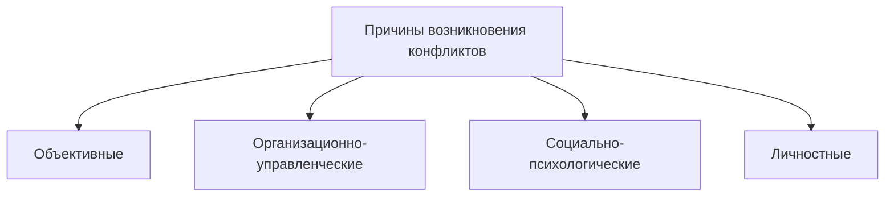

*Рис. 6.1. Причины возникновения конфликтов*

Организационно-управленческие причины конфликта — это обстоятельства, связанные с созданием, развитием и функционированием организаций, коллективов, групп. Можно выделить четыре типа подобных групп.

- Структурно-организационные — несоответствие структуры организации требованиям той деятельности, которой она занимается. Структура организации должна определяться целями и задачами, которые эта организация будет решать.
- Функционально-организационные — неоптимальность связей между структурными элементами организации, организацией и внешней средой. Внешние функциональные связи организации должны максимально соответствовать решаемым задачам и обеспечивать их выполнение. Эффективная работа организации невозможна без отлаженных функциональных связей с внешней средой. Нарушение этих связей приводит к конфликтам.
- Личностно-функциональные — несоответствие качеств сотрудников требованиям занимаемой должности. Существенные требования к личностным качествам работника предъявляют деятельность и необходимость взаимодействия с окружающими. Если человек не соответствует этим требованиям, то возможны конфликты между ним и руководителями, подчиненными, сослуживцами.
- Ситуативно-управленческие — обусловлены ошибками, допускаемыми руководителями и подчиненными в процессе решения управленческих и других задач. Принятие ошибочного управленческого решения объективно создает возможность конфликтов между авторами решения и его исполнителями.

Социально-психологические причины конфликтов обусловлены непосредственным воздействием людей, фактором их включенности в социальные группы. Основными причинами конфликта могут быть следующие.

- Потери и искажение информации в процессе межличностной и межгрупповой коммуникации.
- Несбалансированное ролевое взаимодействие людей.

> [!quote]- Оригинал: стр. 187 · PDF 194
> 

---

- Непонимание собеседниками того, что при обсуждении проблемы несовпадение позиций может быть вызвано не принципиальным расхождением во взглядах, а подходом к проблеме с различных сторон.
- Различия в способах оценки результатов деятельности и личности друг друга.
- Психологическая несовместимость. Существует четыре уровня психологической несовместимости: психофизиологический, индивидуально-психологический, социально-психологический и социальный. Индивидуально-психологическая несовместимость проявляется в неудачном сочетании темпераментов и характеров взаимодействующих людей. При социально-психологической несовместимости фиксируется противоречие в жизненных ценностях и идеалах, мотивах, целях деятельности. Социальная несовместимость может проявляться в несовпадении убеждений, мировоззрений, идеологических установок и т. п. Часто социальная несовместимость проявляется в больших различиях в образовании, социальной принадлежности и т. п.
- Напряженные межличностные отношения.
- Внутригрупповой фаворитизм, т. е. предпочтение членов своей группы представителям других социальных групп.
- Конкурентный характер взаимодействия с другими людьми и группами.
- Ограниченные способности человека к децентрации, т. е. к умению поставить себя на место другого человека и понять его интересы, к изменению собственной позиции в результате сопоставления ее с позициями других людей.
- Стремление к власти.

Личностные причины конфликтов связаны с индивидуальнопсихологическими особенностями его участников. Они обусловлены спецификой процессов, происходящих в психике человека в ходе его взаимодействия с окружающими (рис. 6.2).

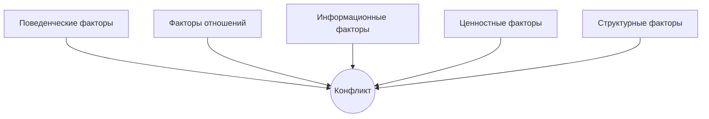

*Рис. 6.2. Причины межличностных конфликтов (по В. Линкольну)*

> [!quote]- Оригинал: стр. 188 · PDF 195
> 

---

Основные причины возникновения конфликта.

- Оценка поведения другого как недопустимого.
- Низкий уровень социально-психологической компетентно-
- Недостаточная психологическая устойчивость.
- Плохо развитая у человека способность к эмпатии.
- Завышенный или заниженный уровень притязаний.
- Тип темперамента, акцентуация характера и др.

Причинами конфликтов в организации могут стать:

- распределение ресурсов;
- различия в целях;
- плохая координация или отсутствие ее;
- взаимозависимость задач (матричная организационная структура — нарушен принцип единоначалия; функциональная — каждая функция уделяет внимание в основном своей области специализации);
- различия ожидания;
- различия в восприятии;
- различия в потребностях;
- различия в представлениях и ценностях;
- различия в манере поведения и жизненном опыте;
- неудовлетворительные коммуникации (причина и следствие конфликта).

Информационные факторы.

Информационные факторы, вызывающие конфликт — это та информация, которая приемлема для одной стороны/сторон и неприемлема для другой стороны/сторон. Включает неточные факты, искажение информации, несвоевременную передачу информации, ненадежные источники информации, обильную и противоречивую информацию, неточные акценты.

Наиболее часто встречающиеся информационные факторы:

- неполные и неточные факты, включая вопросы, связанные с представлением о возникновении проблемы и истории конфликта;
- посторонние факты/группы фактов;
- нежелательное обнародование информации, которая может оскорбить ценности одной из сторон, нарушить конфиденциальность и оставить неприятные воспоминания;
- недооценка фактов и их значения;
- подозрение в умышленном сокрытии фактов;
- невольная дезинформация;
- ненадежность экспертов, свидетелей, источников информации или данных, включая спорные результаты экспертизы и вопросы, касающиеся новых неопробованных технологий, а также неточность переводов и сообщений средств массовой информации;
- слухи;
- вопросы «лучшего доказательства»;

> [!quote]- Оригинал: стр. 189 · PDF 196
> 

---

- вопросы количества;
- вопросы качества;
- произвольная интерпретация использованного языка, особенно выражений типа: «по оценкам», «приблизительно», «около», «значительно», «существенно», «намеренно», «достаточно», «Много», «чрезмерно», «слишком много», «приемлемость», «всеобщее согласие», «довольно честный», «достаточно точный» и т. д.;
- ценность авторитетных источников;
- спорные вопросы законодательства, политики/доктрины, правил, порядка действий, стереотипов, практики.

Поведенческие факторы.

Поведенческие факторы могут дать бесконечный список частных примеров. Сюда можно включить стремление к превосходству, агрессивность, эгоизм, грубость, бестактность, невыполнение данного обещания.

В отношении конфликта нас интересует поведение, которое:

- задевает наши ценности или ценности тех, кто нам не безразличен;
- угрожает нашей безопасности (физической, финансовой, эмоциональной или социальной);
- постоянно (или часто) отвлекает нас, вызывает стресс, неудобство, дискомфорт, смущение, подрывает самооценку;
- кажется односторонним, несправедливым, беспричинным;
- непредсказуемо;
- безответственно;
- эксплуатирует отношения;
- насильственно и вызывает страх;
- не оправдывает положительных ожиданий;
- эгоистично;
- нарушает обещание;
- неуместно, грубо, преувеличенно;
- является результатом конфликтов в прошлом и потому, возможно, неуместно в данной ситуации.

Факторы отношений.

Факторы отношений связаны с наличием удовлетворения от взаимодействия между двумя или более сторонами или его отсутствием. Это любой дисбаланс в отношениях, например, разный образовательный уровень, несовместимость интересов, манеры поведения, разные ценностные ориентиры в жизни, классовые различия, низкий уровень доверия и авторитетности.

Здесь следует обратить внимание на следующие аспекты:

- основа отношений (добровольные/принудительные);
- сущность отношений (независимые, зависимые, взаимозависимые);
- ожидания от взаимоотношений;

> [!quote]- Оригинал: стр. 190 · PDF 197
> 

---

- важность взаимоотношений;
- ценность отношений для разных сторон;
- длительность отношений;
- совместимость сторон в плане ценностей, поведения, личных и (или) профессиональных целей и личного общения;
- вклад сторон в отношения (надежды и мечты, деньги, время, эмоции, энергия и репутация);
- баланс сил в отношениях;
- различия в образовательном уровне, жизненном и профессиональном опыте, классовые различия;
- история отношений;
- обещание, данное непосредственно или подразумеваемое, сдержанное, нарушенное или еще не выполненное;
- уровень доверия и авторитетности;
- негативный осадок от прошлых конфликтов;
- ценности религии, общества, групп, к которым принадлежат стороны, и их давление на отношения сторон.

Примеры.

Конфликт взаимоотношений. В один из отделов Конструкторского бюро был принят новый сотрудник высокой квалификации — профессионал своего дела. Сотрудники отдела, часто проводившие нерабочее время вместе, до этого в таких ситуациях имели в качестве лидера своего руководителя. Вновь принятый сотрудник стал душой коллектива и перенес центр внимания в неформальной обстановке на себя. Это послужило причиной конфликта между руководителем и новым сотрудником, что проявилось в завышении требований к новому сотруднику и занижении оценки его результатов.

Важность фактора отношений. Математик разработал метод оптимального раскроя материала и пришел на завод, чтобы проверить его экспериментальным путем. Директор выслушал его, но не принял предложение. Тогда математик пришел в цех, сел играть с рабочими в домино, обыграл их и тем самым приобрел авторитет. После этого ему уже не составляло труда предложить рабочим раскроить материал по его методу.

Ценностные факторы.

Ценностные факторы — это те принципы, которые мы провозглашаем или отвергаем, которых мы придерживаемся и которыми пренебрегаем, о которых забываем или которые сознательно и даже намеренно нарушаем; принципы, следования которым другие ожидают от нас, а мы от других. Ценности вносят в социальную группу чувство порядка, сознательность и цель существования. Они разняться по силе действия (от санкции до цензуры) и по важности (от мандата до обычаев или общепринятых действий).

Ценностные факторы включают различные культурные, религиозные, политические ценности, различное воспитание, различное

> [!quote]- Оригинал: стр. 191 · PDF 198
> 

---

представление о добре и зле, справедливости и несправедливости,

т. е. различие нравственных критериев и ценностей.

Ценности обычно описывают:

- как личные системы верований и поведения (предрассудки, предпочтения, приоритеты в отношении принадлежности, стремлений, опасений и нужд);
- групповые системы верований и поведения (см. выше);
- системы верований и поведения всего общества (см. выше);
- общие нормативные ценности;
- профессиональные ценности и нужды;
- идеология, способы действия и методы, свойственные отдельным институтам, организациям, профессиям;
- религиозные, культурные, региональные, местные и политические вариации этих ценностей;
- традиционные системы убеждений и поведения и связанные с ними ожидания;
- представления о правильном и неправильном, хорошем и плохом;
- терпимость в отношении иных ценностей;
- восприятие отхода от ценностей в чрезвычайных ситуациях;
- способы и методы оценки уместности, эффективности, справедливости, практичности, реалистичности;
- отношение к прогрессу или переменам, к сохранению старого, к «статус кво»;
- этические аспекты ситуации.

Структурные факторы.

Структурные факторы — это относительно стабильные обстоятельства, которые трудно или даже невозможно изменить. Сюда можно отнести достаточно стабильные объективные обстоятельства, практически не поддающиеся изменению: система управления, право собственности, нормы поведения, социальная принадлежность и т. п.

Они обычно связаны с существованием формальной или неформальной организации социальной группы и могут включать следующее:

- природу законной власти;
- численность, землю, деньги, время, персонал и другие конечные ресурсы;
- структуру подотчетности;
- статус, роли и права мужчин и женщин;
- возраст;
- законодательство;
- географическое положение, добровольную/ вынужденную изоляцию или открытость, а также частоту и интенсивность контактов;

> [!quote]- Оригинал: стр. 192 · PDF 199
> 

---

- системы безопасности;
- роль традиций;
- системы правосудия (закон, поощрения/наказания, правонадзор, равенство и доступность);
- принципы/политику и образ действий;
- контракты, договоры, меморандумы о взаимопонимании и обещания;
- роль религии и ее ритуалы;
- религиозные установления и системы получения и сдерживания обещаний, клятв, получения работы и т. д.;
- линии подотчетности;
- системы передачи сведений;
- наличие первичных и (или) вторичных референтных групп;
- мнения людей, имеющих тот же статус, или широкой публики;
- различные социальные нормы (почитание родителей, уважение к старшим) и стандарты;
- понятие собственности;
- распределение ресурсов, включая денежную систему, компенсацию за труд, распределение товаров и услуг, накопление денег или товаров и т. д.;
- доступность техники и эффективность ее использования;
- общие и частные институализированные или просто подразумеваемые «правила игры» и другие стандарты поведения, включая этические нормы;
- фиксированные доходы, расходы, обстоятельства (дефицит бюджета, взаимоотношения между государствами);
- фиксированные даты, время, меры (праздники, количество часов в сутках, ограничения скорости и т. п.).

При этом структурные факторы часто можно рассматривать как структурные ограничения; законодательные, формальные, организационные. Факторы конфликта можно назвать структурными, когда есть необходимость изменить то, что зафиксировано. При этом структурный конфликт не обязательно связан с законом.

Примеры.

Конфликт из-за противоречия в юридических положениях. После выхода закона об образовании стали возникать конфликты между частными школами и налоговой инспекцией. Закон об образовании освобождает школу от налогов, но налоговая инспекция, руководствуясь инструкциями министерства финансов, требует их выплаты.

Конфликт, вызванный рядом структурных факторов. В детском доме девочку четырех лет, которая была маленькой и худенькой и выглядела младше своих лет, поместили в группу младших детей (трехлетних). Девочка чувствовала себя там прекрасно, стала лидером и любимицей и детей, и воспитателей. Через два года ее,

> [!quote]- Оригинал: стр. 193 · PDF 200
> 

---

согласно инструкции, перевели в подготовительную группу, так как на следующий год она по возрасту должна была идти в школу. Поскольку до сих пор она была в младшей группе и занималась по ее программе, то оказалось, что у нее нет знаний и навыков, которые есть у детей ее группы. Ей не удалось занять положение лидера. В результате у девочки произошел срыв, ее поведение стало неуправляемым, она перестала заниматься, стала капризной и непослушной.

Конфликт из-за попытки нарушения существующей инструкции. Маршал Жуков хотел войти в здание штаба. Часовой остановил его: «Ваши документы?» Сопровождавший Жукова генерал стал отчитывать солдата: «Ты что, не видишь, кто это?» Но Жуков сказал, что часовой прав и действует согласно уставу,

### 6.3. Функции конфликтов

Многие люди относятся к конфликтам достаточно негативно, считая, что любой конфликт есть зло. Отсюда и стремление как можно быстрее разрешить конфликтные коммуникации. Так ли это на самом деле? Всегда необходимо проанализировать и понять: а почему, собственно, он возник. Во всем и всегда можно выделить как деструктивное, так и конструктивное начало. Попытаемся проанализировать конфликты с различных точек зрения.

Деструктивный конфликт ведет к снижению личной удовлетворенности, группового сотрудничества и эффективности организации. Его отличают:

- выраженное негативное воздействие на психическое состояние его участников;
- психологическое и физическое насилие;
- стресс, резкое возрастание вероятности заболеваний, особенно сердечно-сосудистых, а также хронических нарушений желудочно-кишечного тракта;
- истощение личностных ресурсов — материальных, духовных и жизненных сил;
- формирование негативного образа другого — «образ врага», который способствует созданию негативной установки по отношению к оппоненту, готовности действовать в ущерб ему;
- увеличение враждебности и меньшая степень сотрудничества в будущем:
- разрушение традиций общения, взаимосвязей в коллективе, организации;
- отрицательное влияние на взаимоотношения в коллективе и его социально-психологический климат;
- ослабление ценностно-ориентированного единства группы, снижение групповой сплоченности;

> [!quote]- Оригинал: стр. 194 · PDF 201
> 

---

- разрушение совместной деятельности, непродуктивная конкуренция между группами и отдельными людьми, акцент на «победу» больше, чем на решение реальной проблемы;
- ухудшение или распад отношений, плохое общение и взаимодействие между конфликтующими сторонами;
- поддержка своих личных целей или целей различных групп в отрыве от целей организации;
- неудовлетворенность, плохое состояние духа, рост текучести кадров и снижение производительности;
- возможное деструктивное лидерство в коллективе того, кто способен играть такую роль только в конфликтной ситуации.

Однако наряду с этим конфликт выполняет и конструктивную задачу, являясь отражением объективных процессов, происходящих в отношениях между людьми. Перечислим конструктивные функции конфликта.

- Выступает средством активизации социальной жизни группы, поддерживает социальную активность людей, является важным источником развития личности, группы, межличностных отношений. Он позволяет им расширить и изменить сферу и способы взаимодействия.
- Высвечивает нерешенные проблемы в деятельности группы.
- Через открытое противостояние конфликт освобождает группу от внутренних негативных факторов, снижает вероятность застоя и упадка группы.
- Конфликт способствует развитию взаимопонимания между участниками взаимодействия.
- Может способствовать созданию новых, более благоприятных условий, к которым легче адаптируются члены коллектива.
- Способен выполнять функцию сплочения группы перед лицом внешних трудностей — группа приобретает качественно новое состояние.
- Способствует поиску продуктивных решений проблем в коллективах, ориентированных на предметно-познавательную деятельность.
- Оптимизирует межличностные отношения, может благоприятно влиять на взаимоотношения в коллективе, устанавливается более доброжелательная обстановка.

Конструктивный конфликт ведет к повышению личной удовлетворенности, группового сотрудничества и эффективности организации:

- устраняет полностью или частично противоречия, возникающие в силу несовершенства организации деятельности, ошибок управления, отдельных работников и т. п. Конфликт высвечивает нерешенные вопросы;
- позволяет более глубоко оценить индивидуально-психологические особенности людей, участвующих в нем, тестирует цен-

> [!quote]- Оригинал: стр. 195 · PDF 202
> 

---

ностные ориентации человека, относительную силу его мотивов, направленных на деятельность, на себя и т. д., выявляет психологическую устойчивость к стрессовым факторам трудной ситуации;

- позволяет ослабить психическую напряженность — реакцию участников на конфликт. Конфликтное взаимодействие снимает у человека эмоциональную напряженность, приводит к последующему снижению интенсивности отрицательных эмоций;
- служит источником развития личности, межличностных отношений — расширяет сферу и способы взаимодействия с окружающими, дает новый социальный опыт решения трудных ситуаций;
- создает причастность всех к поиску решения проблемы, приемлемого для всех сторон, устраняет трудности в осуществлении решения;
- устанавливает открытое общение и расположенность к сотрудничеству в будущем;
- поддерживает цели организации и увеличивает продуктивность;
- уменьшает враждебность, несправедливость, создает хорошую рабочую атмосферу;
- вырабатывает оптимальные решения с учетом большего количества различных идей;
- создает возможность проработки превентивных мер за счет лучшего анализа причин и альтернативных решений проблем.

Как мы видим, конфликт может быть не только деструктивным по своей сути, но может иметь и конструктивное начало. Это еще раз доказывает, что нужно учиться работать с конфликтами, а не уходить от них, не пытаться их «замазать».

Для того чтобы решить тот или иной конфликт, для начала нужно:

- понять, что же происходит;
- выяснить природу конфликта;
- разрешить конфликт.

### 6.4. Возникновение и развитие конфликтов

Примерно около 70—80% работы менеджера находится под гнетом скрытых и явных противоречий и противостояний, игнорирование которых приводит к конфликтам.

Для эффективного управления конфликтами и их разрешения необходимо следующее.

1. Знание закономерностей возникновения и развития конфликта. Это позволяет ликвидировать конфликты на начальной стадии (в зародыше).

2. Овладение техникой, приемами анализа ситуации, позволяющими проанализировать конфликт. (Анализ большого числа

> [!quote]- Оригинал: стр. 196 · PDF 203
> 

---

конфликтов показывает, что конфликтующие стороны, как правило, не могут сформулировать истинные причины конфликта, «зацикливаясь» на наиболее возмущающих их моментах, лежащих на поверхности и являющихся лишь следствием более глубоких причин. Естественно, что лечение без диагноза обрекает на худший исход.)

3. Овладение техниками и приемами разрешения конфликтов. К таким техникам и приемам могут относиться психологические личностные техники (такие как слушание, невербальное поведение и др.); техники ведения переговоров; различного рода техники посредничества (фасилитаторство, медиаторство и др.) и т. д.

#### Формулы возникновения конфликтов

**Формула № 1. Эскалация конфликтогенов.**

> [!abstract] Схема
> `Первый конфликтоген` + `Более сильный ответный конфликтоген` + `Еще более сильный ответный конфликтоген` = **КОНФЛИКТ**

Конфликтоген — слова, действия или бездействие, могущие привести к конфликту.

Правила бесконфликтного общения:

- Не употребляйте слова-конфликтогены.
- Не отвечайте конфликтогеном на конфликтоген.
- Проявляйте эмпатию к собеседнику. Постарайтесь встать на его место, понять его состояние, ощутить его чувства.
- Делайте как можно больше благожелательных посылов (похвала, комплимент, улыбка, сочувствие, интерес, уважительное отношение, внимание и т. д.).

**Формула № 2. Наложение инцидента на конфликтную ситуацию.**

> [!abstract] Схема
> `Конфликтная ситуация` + `Инцидент` = **КОНФЛИКТ**

Конфликтная ситуация — накопившееся противоречие, содержащее истинную причину конфликта.

Инцидент — стечение обстоятельств, являющихся поводом для конфликта.

Конфликт — открытое противодействие.

Разрешить конфликт, развивающийся по этой схеме, означает:

- устранить конфликтную ситуацию;
- исчерпать инцидент.

> [!quote]- Оригинал: стр. 197 · PDF 204
> 

---

Естественно, устранить конфликтную ситуацию сложнее, но важнее. В том случае, если конфликтную ситуацию устранить невозможно, по объективным причинам, чтобы избежать конфликта, следует проявлять максимальную осторожность, не создавая инцидента.

**Формула № 3. Наложение двух или более конфликтных ситуаций.**

> [!abstract] Схема
> `Конфликтная ситуация` + `Конфликтная ситуация` = **КОНФЛИКТ**

В этом случае конфликтные ситуации являются независимыми, не вытекающими одна из другой.

Данная формула дополняет первую формулу, в соответствии с которой каждая из конфликтных ситуаций своим проявлением играет роль инцидента для другой.

Ключевую роль в разрешении конфликта играет правильное формулирование конфликтной ситуации.

#### Сигналы конфликта (по Х. Корнелиус и Ш. Фэйр)

Кризис.

- Человек рвет свою связь с партнером.
- Насилие.
- Ожесточенные споры.
- Оскорбления, потеря контроля над эмоциями.
- В ходе кризиса обычные нормы поведения, как правило, людьми напрочь забываются, человек становится способным на крайности.

Напряжение.

- Происходит искажение восприятия другого человека и мотивации его действий.
- Возникновение негативных установок и предвзятого мнения.
- Взаимоотношения с человеком становятся источником постоянных переживаний.
- Характеризуется тем, что любое недоразумение может легко перерасти в конфликт.

Недоразумение.

- Возможны различные недоразумения из-за отсутствия желания понять другого человека или искажения понимания его слов.
- Возможно сильное эмоциональное напряжение и «застревание» на одной и той же мысли и искажение ее восприятия.

Инцидент.

- Возникновение различных инцидентов, внутреннего раздражения, которое хотя и быстро забывается, оставляет след в душе. Обычно эти инциденты достаточно незначительны.

> [!quote]- Оригинал: стр. 198 · PDF 205
> 

---

Инцидент позволяет осознать его участникам наличие объективного противоречия в их интересах и целях. С момента его возникновения конфликт становится психологической реальностью для его участников. Он может протекать в двух формах: скрытый (разворачивается на уровне осознания участниками конфликтности происходящего, но при этом может никак не проявляться в их взаимоотношениях) и открытый (представляет собой серию конфликтных действий участников по отношению друг к другу).

Дискомфорт.

- Возникает интуитивное ощущение, что что-то не так.

Воспринимая конфликты как потенциальную возможность и отслеживая сигналы конфликта, вы сможете легче управлять ситуацией.

#### Сигналы межличностного конфликта

«Умный человек найдет выход из любого сложного положения. Мудрый в этом положении не окажется»,—— писал Ханс Рихтер. Гораздо проще разрешить его в самом зародыше, когда еще нет накала страстей и человек в состоянии воспринимать слова и выстраивать диалог, а не только выплескивать эмоции в крике и негативных действиях. Именно поэтому так важно уметь распознать зарождающийся конфликт.

У любого конфликта есть свои предвестники, сигнализирующие о надвигающейся опасности. При появлении таких признаков можно еще успеть предупредить конфликт, уклониться от него или же дистанцироваться для определения своих позиций и выбора оптимальной модели поведения.

Ранняя диагностика конфликтов строится на основе ваших личных наблюдений. Как определить по поведению, что в воздухе витает какое-то напряжение, что в отношениях с партнером что-то нарушилось? Вот признаки, которые помогут вам понять это.

- При встрече партнер отводит глаза, избегает прямых взглядов.
- Увеличивается дистанция комфортного общения, избегает рукопожатий.
- Человек рвет свою связь с партнером.
- Выбирает формальные темы для разговора — погода и т. п.
- Перестает интересоваться вашими делами, не рассказывает о своих проблемах.
- Ожесточенно спорит.
- Опаздывает или не приходит на встречи.
- Обсуждает вас «за глаза», отпускает едкие и ехидные замечания.
- Оскорбляет (т. е. потеряет контроль над эмоциями). В ходе кризиса обычные нормы поведения теряют силу, человек становится способным на крайности.
- При расставании испытывает явное облегчение.

> [!quote]- Оригинал: стр. 199 · PDF 206
> 

---

При появлении этих признаков еще можно уклониться от конфликта, выбрать оптимальную модель поведения, попробовать поговорить «по душам».

#### Сигналы конфликта в коллективе

- Стихийные мини-собрания (беседы по несколько человек).
- Снижение производительности труда.
- Увеличение мини-конфликтов между подчиненными.
- Снижение продуктивности работы.
- Многочисленные увольнения по собственному желанию.
- Негативный эмоционально-психологический фон.
- Распространение слухов.
- Коллективное бойкотирование указаний руководства.
- Рост эмоциональной напряженности.

### 6.5. Анализ конфликтов

#### Структура конфликтов

Конфликтная ситуация имеет весьма определенную структуру (рис. 6.3).

| Внутренняя позиция | Внешняя позиция | **Объект конфликта** | Внешняя позиция | Внутренняя позиция |
|---|---|---|---|---|
| ← СТОРОНЫ КОНФЛИКТА | | | | СТОРОНЫ КОНФЛИКТА → |

*Рис. 6.3. Структура конфликтов*

Как видно из схемы, есть объект конфликта — это что-то, что является причиной спора и стороны конфликта или его участники, в качестве которых могут выступать отдельные люди или группы людей. У каждого участника есть внешняя и внутренняя позиции в конфликте. Внешняя позиция — эта мотивировка участия в конфликте. Она открыто предъявляется противоборствующими сторонами своим противникам. При этом она может как совпадать, так и не совпадать с внутренней позицией, которая представляет собой набор истинных интересов, мотивов и ценностей. Именно внутренняя позиция включает человека или группу в конфликт. При этом зачастую внутренняя позиция является неосознаваемой. Она скрыта не только от оппонентов и наблюдателей, но и от самого человека. Именно поэтому одно только осознание внутренней мотивации является важным шагом к эффективному разрешению конфликта. Наиболее ярким примером может послужить конфликт взрослого и подростка. За внешне агрессивной позицией ребенка зачастую

> [!quote]- Оригинал: стр. 200 · PDF 207
> 

---

стоит потребность в признании, уважении, необходимость поддержания значимости собственного «Я», неосознаваемая им самим.

#### Структура межличностного взаимодействия

Поговорим теперь о характеристиках процесса взаимодействия (табл. 6.2). В данном вопросе очень важно понять, что является главным, а что второстепенным в процессе общения. Это поможет правильно анализировать процесс общения с другими людьми. Р. Бейлом разделил весь спектр межличностных взаимодействий на четыре категории, которые тоже, в свою очередь, могут быть раскрыты:

- область позитивных эмоций;
- область негативных эмоций;
- область решения проблем;
- область постановки проблем.

*Таблица 6.2*

**Структура межличностного взаимодействия**

| Категория анализа взаимодействия | Важнейшие поведенческие проявления |
|---|---|
| Область позитивных эмоций | Солидарность. Снятие напряжения. Согласие |
| Область решения проблем | Предложение, указание. Мнение. Ориентация других |
| Область постановки проблем | Просьба об информации. Просьба высказать мнение. Просьба об указании |
| Область негативных эмоций | Несогласие. Создание напряженности. Демонстрация антагонизма |

Анализируя частоту и форму проявления тех или иных категорий в ходе реального взаимодействия с человеком, можно понять его особенности. Например, в какой именно сфере разворачивается общение, на что оно направлено, было ли поведение участников конструктивно или направлялось на эмоциональное отвержение собеседников и т. д. Этот анализ поможет вам определить свою позицию в конфликте.

Ответьте себе на следующие вопросы.

- Что вы поставили на карту?
- Что важно для вашего оппонента?
- В чем ваши интересы не совпадают?
- Если в ваших позициях есть что-то общее, найдите это.
- Если вы занимаете полностью противоположные позиции, найдите точку, не противоречащую обеим сторонам.

> [!quote]- Оригинал: стр. 201 · PDF 208
> 

---

#### Анализ внутреннего отношения к конфликту

Чтобы проанализировать и понять свое отношение к конфликтам, попробуйте задать себе ряд вопросов:

- Какие чувства я испытываю к оппоненту? Обида? Злость? Гнев? Желание отомстить? Подумайте, насколько обоснованы эти чувства.
- Как я его оцениваю? (Помните, однако, что в мире существуют не только черный и белый цвет. В радуге семь цветов, есть и полутона. Такой ли уж плохой человек ваш оппонент на самом деле?)
- Что вы хотите получить от конфликта? Только ли это восстановление справедливости? А, может быть, это удовлетворение своих амбиций или вам просто хочется отомстить?
- Хотите ли вы решить конфликт конструктивно? Готовы ли вы думать не только о своих интересах, но и об интересах оппонента?

#### Карта конфликта (Х. Корнелиус, Ш. Фэйр, 1999)

Карта помогает нам увидеть и проанализировать то, на что можно было бы просто не обратить внимания. Люди, отправляясь путешествовать, обязательно берут с собой карту. Так же и в конфликте: карта поможет облегчить его разрешение. Давайте составим карту и для любой вашей проблемной ситуации.

Этап 1. В чем проблема?

Опишите проблему одной фразой. Не пытайтесь тут же найти выход, просто сфокусируйте свое внимание на самом главном. Старайтесь не выражать проблему в полярных терминах, это даст вам возможность рассмотреть варианты решения проблемы более широко.

Этап 2. Кто вовлечен?

Кто основные участники конфликта?

Этап 3. Каковы их подлинные потребности?

Известно, что в любом конфликте зачастую происходит следующее: человек предъявляет одну проблему (либо ту, которая подвернулась под руки, либо ту, которая выглядит «красиво»), тогда как в глубине души проблема совершенно иная. Важно выяснить истинную мотивацию, которая стоит за позициями участников в этом вопросе. Люди хотят получить то, что удовлетворяет их потребности, и избегают того, что мешает этому.

Потребности. В широком смысле это все то, что важно для человека. Можно задать наводящий вопрос, который поможет определить потребность собеседника:

- Вы считаете, что я должен сделать это и это. Что это вам даст?

Ответ на этот вопрос может дать информацию о невысказанных потребностях человека.

> [!quote]- Оригинал: стр. 202 · PDF 209
> 

---

Опасения. Их тоже очень важно учитывать. Наши страхи носят как рациональный, так и иррациональный характер. Но от этого они не становятся менее значимыми. И когда вы признаете опасения, вы уже сможете с ними работать. Например, если человек говорит, что он не терпит неуважения, нежели то, что он нуждается в уважении. Так чего же боятся люди?

- Унижения.
- Провала.
- Финансового краха.
- Быть отвергнутым или нелюбимым.
- Потери контроля над ситуацией.
- Одиночества.
- Критики и осуждения.
- Потери работы.
- Неспособности обеспечить себя и свою семью.
- Скучной работы.
- Обмана.
- Опасения, что придется начинать все сначала.

Перечислите потребности и опасения всех сторон. На этом этапе необходимо работать только с этими категориями, а не выдавать уже готовые ответы. Важно, чтобы ответы выявляли реальные нужды и опасения. Эту карту можно использовать как инструмент для работы с конфликтом. В любом случае конфликт значительно легче предупредить, нежели работать с ним. Подобные карты можно использовать:

- при составлении планов,
- при появлении трудностей на работе,
- при подготовке к переговорам,
- при создании рекламных объявлений,
- на совещаниях по планированию.

В любом случае карта позволяет увидеть реальные перспективы развития ситуации. Применяйте ее к актуальным ситуациям. Выявление проблемы помогает задуматься о ней и каким-то образом решить ее. Определите, какие потребности скрываются за требованиями людей. При работе с картой ищите «точки соприкосновения»: общие интересы, общие потребности.

Вопросы, которые необходимо задать при анализе конфликта

ЛЮДИ И ГРУППЫ

1. Основные заинтересованные стороны, группы и отдельные лица. Основные заинтересованные стороны.

- Кто основные заинтересованные стороны?
- Какие из этих сторон участвуют в конфликте?
- Почему они вовлечены в конфликт?

> [!quote]- Оригинал: стр. 203 · PDF 210
> 

---

- В чем конкретные интересы каждой стороны?
- Интересы каких других сторон затрагивает конфликт? Почему они еще не оказались вовлечены в конфликт?
- Почему затронуты их интересы?
- Может ли процесс разрешения конфликта начаться без их прямого участия? Почему? Как?

Второстепенные потенциальные участники.

- Интересы каких сторон затронуты в меньшей степени?
- Как это было установлено? Основываясь на каких интересах?
- Какие еще стороны могут вступить в конфликт по причинам, выходящим за рамки данного конкретного вопроса? Поясните.

Отдельные лица.

- Кто выступает от лица каждой из конфликтующих сторон?
- Какие предложения по разрешению конфликта представляют эти лица?
- Какие еще лица в глазах общественности связаны с этим конфликтом?
- Кто формирует мнение участников?
- Кто может оказывать сильное влияние на участников?
- Кто может быть заинтересован в расширении конфликта?
- Кто может выиграть, раздувая конфликт? Что именно?
- Какие официальные лица отвечают за принятие решения?

Организации.

- Как принимаются решения в каждой организации или группе?
- Насколько сильно внутреннее согласие? Не привело ли оно к организованию коалиций?

2. Ценности — убеждения, которых твердо придерживаются и на основании которых стремятся действовать участники конфликта.

- Каковы основные ценности, лежащие в основании действий каждой из сторон? (Развитие/отсутствие развития; капитал и частная прибыль/общее благосостояние; чисто технические/щадящие решения; долгосрочные или краткосрочные отношения.)
- Существуют ли сильные личности, идеологические, культурные или религиозные различия?
- Связаны ли идеология или ценности лиц или группы с отдельными проблемами?

3. Интересы: нужды и потребности, которые необходимо учесть и удовлетворить для разрешения конфликта.

- Каковы основные интересы, лежащие в основе деятельности каждой из сторон?
- Чем отличаются, чем похожи интересы каждой стороны?
- Существуют ли общие интересы, которые могут стать основой урегулирования конфликта?

> [!quote]- Оригинал: стр. 204 · PDF 211
> 

---

4. Цели / позиции.

- Каковы цели различных сторон? Каковы позиции каждой из сторон по каждой из проблем?
- Очевидны ли цели, или же они скрыты?
- Способна ли группа достичь своих целей?
- Чувствует ли каждая из сторон, что ее цели достижимы?

5. Информация.

- На какие источники информации опираются стороны?
- Одинаковы ли информационные базы (базы данных) всех участников конфликта или же они различны? В чем различия?
- Есть ли источники информации, пользующиеся доверием всех сторон? Общественные они или частные?

6. Власть, сила.

Какой властью, силой располагает каждая из сторон?

- Авторитет;
- человеческие ресурсы;
- умения и знания;
- трудно определяемые факторы;
- материальные ресурсы;
- политическое влияние;
- союзники;
- мощь (военная сила);
- статус;
- характер имеющейся власти;
- репутация;
- личные характеристики;
- общественное мнение;
- кадровые ресурсы;
- закон, политика, правила;
- время;
- возможность оказывать услуги и вознаграждать;
- возможность отвергать и наносить ущерб;
- надежность;
- контроль над ограниченными ресурсами;
- опыт;
- особая подготовка.

7. Отношение/настрой,

- Каково отношение сторон к проблематике? Откуда это известно?
- Существует ли враждебность по отношению к другой стороне? Кем она высказывается и в чем выражается?
- Каковы ожидания сторон в отношении решения конкретных проблем?
- Каковы их ожидания в отношении другой стороны?
- Каковы их ожидания относительно разрешения конфликта?

> [!quote]- Оригинал: стр. 205 · PDF 212
> 

---

- Существует ли какое-нибудь другое отношение к проблемам и к участвующим сторонам? Например, не участвует ли одна из сторон в конфликте, просто чтобы отомстить; доверие/недоверие; уважение к себе/отсутствие самоуважения; правдивость/лживость; оптимизм/пессимизм; уверенность/неуверенность?

8. Представления.

- Как стороны представляют друг друга?
- Отождествляет ли одна сторона другую с силами, непосредственно не участвующими в конфликте, и ожидает ли она, что эта сторона будет вести себя точно так же?
- Чувствуют ли одна/обе стороны, что их роли в конфликте заранее предрешены? Почему?
- Понимают ли обе стороны, что находятся в конфликте?
- Считают ли обе стороны, что участие противостоящей стороны в конфликте законно?
- Считает ли одна из сторон, что другие безответственны, грубы, жадны, непатриотичны, глупы и т. п.?
- Определили ли участники, кто представляет другую сторону?
- Рассматривается ли каждая сторона как монолитное целое или как коалиция различных интересов?
- Рассматривается ли конфликт как отдельное событие или как часть более крупного конфликта?
- Воспринимают ли стороны конфликт реалистично?
- Понимают ли стороны, в каких пределах другая сторона может вести переговоры? Установлен ли «нижний предел» (предельно допустимое отступление)? Существует ли диапазон решений?

9. Мотивация.

- Какова мотивация каждой из сторон?
- Реалистичны или утопичны цели и ожидания, движущие сторонами?
- Какую роль играют прошлые претензии /неудовлетворенность?
- Движет ли сторонами желание отомстить?
- Какую роль играет страх (боязнь изменений, новых людей, потери личного статуса, потери материальных благ)?
- Является ли надежда одним из факторов?
- Какую роль играет стремление к власти? Является ли приобретение и поддержание власти прямым или психологическим интересом?
- Каким образом стремление к материальному выигрышу и/ или алчность влияют на поведение сторон?
- Как способствует вовлечению в конфликт желание принадлежать к группе?
- Как влияет на участие людей в конфликте желание быть самому себе хозяином?

> [!quote]- Оригинал: стр. 206 · PDF 213
> 

---

- Влияют ли личные интересы лидеров на мотивацию членов группы?
- Насколько важна необходимость сохранить прежний образ жизни? существующий образ действий? закон, правила, политику?

10. Стиль.

- Каковы мнения отдельных личностей и группы о роли конфликта в обществе и о том, как конфликт должен разрешаться?
- Какой личный/групповой стиль лучше всего характеризует каждую сторону? (Оборона, нападение, пассивность, склонность к запутыванию, агрессивность, неуверенность, мстительность, эмоциональность.)
- Какое влияние оказал стиль переговоров на то, как стороны ведут себя друг с другом в настоящий момент?
- Направлено ли поведение в конфликте на личное мщение или на разрешение общей проблемы?

ВЗАИМООТНОШЕНИЯ: АНАЛИЗ ВЗАИМООТНОШЕНИЙ МЕЖДУ ГРУППАМИ, ПРЕДСТАВЛЯЮЩИМИ РАЗНЫЕ СТОРОНЫ

1. История.

Сила, власть.

- Потенциально какими видами силы и власти обладают стороны?
- Какие виды силы и власти стороны уже использовали друг против друга и каким образом?
- Применяла ли какая-либо сторона против другой принуждение?
- Вызвало ли применение силы или власти отрицательную реакцию? В чем? К чему это ведет?
- Во что обошлось использование силы, власти?

Коммуникация.

- Какой стиль внутренней коммуникации использует обычно каждая группа (как часто, форма, препятствия, умения, ресурсы ит. д.)?
- Какие стили коммуникации уже были использованы между группами (как часто, форма, препятствия, умения, ресурсы и т. д.)?
- Имели ли члены противостоящих сторон контакты между собой ранее?
- Заняли ли стороны более жесткие позиции вследствие публичных выступлений?
- Идет ли коммуникация между сторонами по одной и той же модели, или она разнообразна?

Понимание.

- Осознавали ли стороны, что проблема существует?
- Как давно стороны знают о существовании проблемы?
- Как они поняли, что конфликт существует?

> [!quote]- Оригинал: стр. 207 · PDF 214
> 

---

- Была ли тенденция избежать конфликта или притвориться, что его не существует?
- Кто понимал, и кто не понимал (или отрицал) существование проблемы? Знают ли о конфликте общественность, пресса и выборные чиновники? В какой степени?

Переговоры и/или другие процессы принятия решений.

- Какие переговоры или другие способы разрешения конфликтов намеревались применить, пытались применить или же применили стороны?
- Какой результат дали эти дополнительные способы?
- Все ли стороны принимали участие (главные, второстепенные)?
- Были ли попытки добиться внешних улучшений, которые скрыли бы существование реального конфликта? Попытки смягчить конфликт? Предложения пойти на компромисс?

2. Настоящее положение дел.

Власть.

- Какие виды власти или силы стороны используют друг против друга?
- Применяла ли одна сторона принуждение относительно другой? Как?
- Правильно ли оценивают стороны, во что обойдется принуждение?
- Каково официальное мнение (на личном, профессиональном, местном районном, городском, областном, государственном уровне) по поводу конфликта?

Коммуникация.

- Какой стиль коммуникации использует в настоящий момент каждая группа (частота, форма, препятствия, навыки, приемы, возможности)?
- Используют ли стороны адекватные способы коммуникации, которые позволяли бы им понять позиции и представления друг друга?
- Идет ли коммуникация между сторонами полностью или частично через средства массовой информации?
- Какое влияние оказывают юристы на коммуникацию между сторонами?

Понимание.

- Насколько стороны отдают себе отчет в существовании проблемы?
- Понимают ли другие участники или юридические лица (отделы, агентства, организации), что существует конфликт?

Переговоры.

- Идут ли переговоры между сторонами?
- Какой вид переговоров имеет место (официальные /неофициальные, ориентированные на интересы или на конкретные проблемы, конфронтационные)?

> [!quote]- Оригинал: стр. 208 · PDF 215
> 

---

- Сосредоточены ли переговоры на главных или второстепенных интересах? Какие конкретные проблемы должны быть решены?

3. Тенденции.

Власть.

- Каковы различные формы власти или силы, которую стороны используют или могли бы использовать?
- Изменяется ли соотношение сил? Если да, то как?
- Становится ли власть самоцелью? Для кого?
- Переходит ли власть к носителям крайних или умеренных взглядов?
- Есть ли возможность подключения более высоких уровней власти у какой-либо из сторон?

Коммуникация.

- Какое направление принимает коммуникация между сторонами?
- Есть ли тенденция к занятию более жестких позиций? В чем это выражается?

Понимание.

- Ведет ли отчетливое понимание того, что конфликт существует, к ощущению кризиса и углублению конфликта?

Переговоры.

- Движутся ли стороны к эффективным переговорам? В чем это выражается?

4. Общая оценка.

- Какие изменения необходимо внести в стиль коммуникации для начала или улучшения процесса переговоров?
- Какие изменения в использовании власти и силы необходимы для начала или улучшения процесса переговоров?
- Какие действия могли бы способствовать окончательному, а не только временному решению? Ваша роль?
- Чем рискует каждая из сторон, используя неконфронтационный способ улаживания конфликта?
- Какой уровень вмешательства необходим, чтобы помочь сторонам выработать совместное решение проблем (согласительная процедура, переговоры, посредничество, арбитраж, судебный процесс)?

#### СУЩНОСТЬ КОНФЛИКТА

1. Основные интересы и связанные с ними проблемы.

- Как каждая сторона описывает свои интересы и связанные с ними проблемы?
- Изменились ли со временем основные интересы?
- Может ли проблематика, связанная с основными интересами, привести к решению, которое создает прецедент?

> [!quote]- Оригинал: стр. 209 · PDF 216
> 

---

- Сходятся ли стороны в вопросе о том, в чем состоят основные интересы друг друга и связанные с ними проблемы?
- Одинаково ли определены сторонами проблемы, требующие разрешения? Сходятся ли стороны в вопросе о том, какие проблемы являются приоритетными?

2. Второстепенные проблемы.

- Какие другие проблемы, кроме основных, могут оказать влияние на процесс и/или его результат?
- Имеют и вносят ли посторонние/союзники новые интересы и/или проблемы, тем самым усугубляя и расширяя конфликт?
- Угрожает ли что-либо «святым ценностям», «личным склонностям», «правам»? Каким образом?

3. Возможные варианты решения.

- Разработаны ли варианты решения по каждой из проблем? Каковы они и по каким проблемам?
- Считает ли какая-либо сторона, что нет вариантов решения, удовлетворяющих их интересы?
- Есть ли варианты, отвечающие интересам всех сторон?
- Достаточно ли просты варианты, чтобы быть применимыми?
- Можно ли раздробить варианты на более мелкие и удобные части?
- Есть ли варианты решений, которые стороны могут рассмотреть, но не публично («при закрытых дверях»)?

4. События.

- Показали ли имевшие место события общественности и другим сторонам, что конфликт существует?
- Указали ли определенные события, о которых не были поставлены в известность другие стороны или общественность, на существование конфликта?

### 6.6. Способы разрешения конфликтов

Исследования показывают, что не само наличие конфликтов, а именно неудачи в разрешении их неконструктивными способами ведут к разрушению взаимосвязей. Взаимоотношения без конфликтов могут быть признаком того, что отношения как таковые отсутствуют, а не признаками наличия хороших взаимоотношений. Разрешение конфликтов конструктивным способом может привести к более высокой степени сближения и более высокому качеству взаимоотношений (рис. 6.4).

Управляя конфликтами, необходимо:

- признавать, что они всегда имеют место;
- рассматривать конфликты как часть более крупной «картины»;
- не давать конфликтам затихнуть, использовать их для продвижения к намеченным целям.

> [!quote]- Оригинал: стр. 210 · PDF 217
> 

---

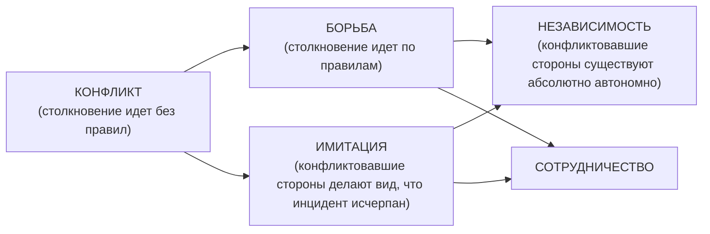

*Рис. 6.4. Модель разрешения конфликта*

#### Управление конфликтной ситуацией

Структурные методы.

Разъяснение требований к работе:

- ожидаемые результаты работы;
- каналы передачи информации;
- система полномочий и ответственности;
- политика, процедуры и правила.

Координационные и интеграционные механизмы:

- иерархия полномочий упорядочивает взаимодействия людей, принятие решений и информационные потоки;
- правило «шеф всегда прав», использование проектных групп, межфункциональных групп, межотдельских совещаний.

Общеорганизационные и комплексные цели:

- эффективное осуществление целей требует совместных усилий всех сотрудников.

Структура системы вознаграждений:

- скоординированное использование системы вознаграждений способствует осуществлению организационных целей и поддерживает внутреннюю политику компании.

Межличностные методы.

- Избегание — не идти на конфликт, уход в сторону, откладывание проблемы.
- Приспособление — пренебрежение своими интересами ради удовлетворения интересов другого лица.
- Конкуренция — отстаивание своих собственных интересов или «прав» за счет других, стремление к «победе».
- Компромисс — поиск взаимоприемлемого решения, частично удовлетворяющего обе стороны.
- Сотрудничество — выработка решения, полностью удовлетворяющего обе стороны; глубокое проникновение в суть вопроса

> [!quote]- Оригинал: стр. 211 · PDF 218
> 

---

и поиск альтернативного решения; открытое общение и эффективное взаимодействие, хорошая рабочая атмосфера.

Стратегии поведения в конфликте.

Ученые выявили шесть основных мотивов, с которыми люди вступают во взаимодействие.

1. Мотив максимизации общего выигрыша (или мотив кооперации).

2. Мотив максимизации собственного выигрыша (или индивидуализм).

3. Мотив максимизации относительного выигрыша (конкуренция).

4. Мотив максимизации выигрыша другого (альтруизм).

5. Мотив минимизации выигрыша другого (агрессия).

6. Мотив минимизации различий в выигрышах (равенство).

Если мотивы общения совпадают или естественно дополняют друг друга, то контакты таких людей будут наиболее успешны. Есть же заведомо «проигрышные», с точки зрения успешности общения, мотивы поведения. Здесь можно, безусловно, выделить агрессию и индивидуализм, которые игнорируют интересы партнера по общению. В соответствии с мотивами можно выделить особенности стратегии поведения.

Давайте представим себе взаимодействие как процесс, разворачивающийся в системе координат (рис. 6.5). По оси ординат мы расположим те стратегии взаимодействия, которые ориентированы на достижение участниками собственных целей. А по оси абсцисс — стратегии, ориентированные на достижение целей партнеров по общению.

| ↑ Направленность на собственные интересы | | | |
|---|---|---|---|
| | **СОПЕРНИЧЕСТВО**<br>Стратегия противодействия | **СОТРУДНИЧЕСТВО**<br>Стратегия сотрудничества | *Активное действие* |
| | **КОМПРОМИСС** (в центре)<br>Стратегия компромисса | | |
| | **ИЗБЕГАНИЕ**<br>Стратегия избегания | **ПРИСПОСОБЛЕНИЕ**<br>Стратегия уступчивости | *Пассивное действие* |
| | → Направленность на интересы другой стороны (организации, сотрудников) | | |

*Рис. 6.5. Стратегии взаимодействия в конфликтной ситуации (сетка Томаса — Килмана)*

> [!quote]- Оригинал: стр. 212 · PDF 219
> 

---

Соответственно, на каждой из шкал может быть выделена точка минимума и точка максимума. Тогда в соответствии с исходной мотивацией участников общения можно выделить пять основных стратегий их поведения в процессе взаимодействия.

- Стратегия противодействия (П) соответствует мотиву максимизации собственного выигрыша. Человек ориентирован только на свои интересы и цели без учета целей партнеров по общению. Это конкуренция, силовое решение проблемы.
- Стратегия избегания (И) соответствует мотиву минимизации выигрыша другого. Смысл этой стратегии состоит в уходе от контакта, истинного взаимодействия, собственных целей ради исключения выигрыша другого.
- Стратегия компромисса (К) позволяет реализовать мотив минимизации различий в выигрышах. Суть данной стратегии в неполном достижении целей партнерами ради условного равенства.
- Стратегия сотрудничества (С) направлена на полное удовлетворение участниками взаимодействия своих социальных потребностей. Данная стратегия позволяет реализовать один из двух мотивов социального поведения человека — мотива кооперации или мотива конкуренции. Эта стратегия является наиболее эффективной во взаимодействии людей. Вместе с тем она достаточно трудна в реализации, так как требует от партнеров по общению значительных психологических усилий по созданию соответствующего климата, разрешению возникающих противоречий в духе взаимопонимания, уважения к интересам другого. Во многих случаях обучение людей навыкам сотрудничества — самостоятельная психологическая задача, которая может быть решена методами активного социально-психологического обучения.
- Стратегия уступчивости (У) ориентирована на реализацию мотива альтруизма. В этом случае человек жертвует собственными целями ради достижения цели партнером. Он приспосабливается к другому человеку и к ситуации в целом.

Нет плохих и хороших способов разрешения конфликтной ситуации. То, что подходит в одном случае, может не подойти в другом. Важнее гибкость в использовании различных стратегий.

Избегание или уход.

Уходя от конфликта и не принимая участия в дальнейшем развитии событий, вы тем самым провоцируете оппонента на завышение требований или ответный уход. Таким образом, проблема так и не будет решена. Зато за время вашего отсутствия она может значительно вырасти. То, что можно было достаточно легко решить на начальном этапе возникновения разногласия, будет достаточно сложно решить, когда проблема разрослась до огромных размеров.

Хотя если ваше разногласие несущественно, а выигрыш невелик, если решение данного разногласия отвлечет вас от более важных

> [!quote]- Оригинал: стр. 213 · PDF 220
> 

---

дел, если жаль тратить свое время на решение несущественной проблемы, а потеря представляется такой мелочью, на которую не стоит даже обращать внимание — проще уйти и забыть, что этот человек вообще существует. Этот способ также хорош, если вам нужно «протянуть время», собрать дополнительную информацию.

Формы избегания:

- Молчание.
- Демонстративный уход.
- Затаенный гнев.
- Депрессия.
- Игнорирование оппонента.
- «Перемывание косточек» обидчика за его спиной.
- Переход на «чисто деловые отношения».
- Индифферентное отношение.
- Полный отказ от любых взаимоотношений с «провинившейся» стороной.

Уступчивость.

Человек пытается любой ценой поддерживать добрые отношения. Острые углы старательно сглаживаются, противоречия «замазываются», свои интересы подавляются. Делается вид, что ничего не произошло, что все замечательно. Конечно, иногда бывает, что конфликты разрешаются только за счет поддержания дружеских отношений. Эта тактика оправдывает себя, если вы оказались не правы, если восстановление отношений для вас важнее сути конфликта, если для вас уступка незначительна, тогда как для оппонента она очень важна или если отстаивание своей позиции требует массы времени и сил. Если ваш оппонент значительно сильнее вас, вам тоже поможет эта тактика.

Формы уступчивости:

- Вы делаете вид, что все в порядке и ничего страшного не происходит.
- Продолжаете вести себя так, будто ничего не произошло.
- Принимаете то, что происходит, чтобы не нарушать покой.
- Подавляете свои негативные эмоции.
- Ругаете себя за свою раздражительность.
- Идете к цели обходным путем, например, используя свое обаяние для достижения цели.
- Молчите, вынашивая в глубине души планы мести.

Противодействие.

Это открытая борьба за собственные интересы, жесткое отстаивание собственной позиции. Предпочтение этой тактики — это подсознательное стремление оградить себя от боли поражения. Она, безусловно, оправдывает себя, если нужны быстрые и решительные меры в сложной ситуации, если для вас очень значим исход и многое поставлено на карту, если у вас нет выбора и терять вам

> [!quote]- Оригинал: стр. 214 · PDF 221
> 

---

уже нечего, а отношения с противоположной стороной вам глубоко безразличны. Но эта тактика редко приносит долгосрочные результаты. Решение зачастую саботируется проигравшей стороной. Опасайтесь потерпевшего поражение!

Формы противодействия:

- Стремление доказать свою правоту и неправоту другого человека.
- Дуться, пока оппонент не передумает.
- Перекричать обидчика.
- Применить физическое насилие.
- «Не слышать» и не принимать отказа.
- Требовать безоговорочных уступок и принятия вашей точки зрения.
- Перехитрить соперников.
- Позвать для поддержки на помощь союзников.
- Требовать согласия для сохранения отношений.

Компромисс.

Можно попытаться урегулировать возникшие разногласия путем взаимных уступок. Способ может быть полезен, если вас устраивает временное решение, если вам важно договориться с минимальными потерями, если времени мало, а решение принять необходимо, если вы хотите хоть что-то получить, нежели все потерять. Однако, если компромисс достигнут без тщательного анализа других возможных вариантов решения, он может быть не самым лучшим исходом переговоров. Но необходимо учитывать, что ни одна сторона не будет придерживаться того решения, которое не удовлетворяет ее нужд.

Формы компромисса:

- В конфликте вы стараетесь поддерживать товарищеские, дружеские отношения.
- Ищите справедливое решение.
- Стараетесь поделить предмет желаний поровну.
- Избегаете напоминаний о вашем первенстве.
- Получаете что-то как для себя, так и для другого.
- Избегаете лобовых столкновений.
- Немного уступаете, чтобы поддержать равновесия.

Сотрудничество.

Эту стратегию еще называют «выиграть/выиграть». Она отличается от других тем, что наличие победителя не означает наличие побежденного. При использовании данной стратегии выигрывают обе стороны. Вы находите решение, удовлетворяющее обе стороны. Когда выигрывают обе стороны, они будут поддерживать принятое решение. В любом случае гораздо лучше и гораздо выгоднее в долгосрочной перспективе обойтись с оппонентом порядочно. Не зря же есть пословица: «Хорошая слава лежит, а дурная впереди бежит».

> [!quote]- Оригинал: стр. 215 · PDF 222
> 

---

Это выгодно даже с экономической стороны. Сейчас, когда конкуренция растет, лучше иметь репутацию порядочного человека. Тогда с вами захотят работать. Основной принцип данного подхода основан на поиске соглашения на основе анализа интереса сторон. Этот подход требует подробного изучения ситуации и вариантов ее разрешения перед принятием окончательного решения. Для этого:

1. Установите, какая потребность стоит за желанием другой стороны.

2. Узнайте, в чем ваши разногласия компенсируют друг друга.

3. Разработайте новые варианты решений, наиболее полно удовлетворяющие потребности каждого.

4. Сделайте это вместе,

Проанализируйте интересы сторон. Для успешного разрешения конфликта необходимо определить истинную причину, его породившую. Повод, лежащий на поверхности, зачастую это только повод. Обычно люди стесняются назвать истинную причину недовольства, предполагая, что это ущемит их гордость или унизит. Нередко одно только выявление настоящей причины участниками конфликта быстро приводит к урегулированию отношений. Работать надо именно с истинной причиной конфликта. Поняв истинные потребности другого, проще договориться. Может быть разногласия основаны на различных интересах, стоящих за выдвигаемыми требованиями. Представим, что ваш сын любит музыку, которую вы не переносите, Как быть? Споры, включать или не включать магнитофон, разрешатся сами собой, если вы купите ему хорошие наушники!

Взаимные уступки. Можно с успехом применять метод, который позволяет договориться: каждый уступает оппоненту те позиции, которые в принципе для него не важны. То есть отдаешь то, что тебе не нужно, но нужно оппоненту, и берешь то, что нужно тебе, но незначимо или малозначимо для противника. Для того чтобы использовать эту тактику, необходима информация о том, что является значимым для противоположной стороны. Это не всегда просто выяснить, так как люди склонны считать, что то, что важно для них, также важно и для другого человека.

Творческое решение проблемы. Если вы рассчитываете на конструктивное решение и дальнейшее сотрудничество, не поленитесь и подготовьте как можно больше различных вариантов предложений, выполнение которых будет работать на обоих оппонентов. Выделите общие интересы, те, которые вы сможете реализовать вместе.

Очень важно, чтобы ваши предложения не унижали оппонента, чтобы они давали ему возможность даже в случае уступок «сохранить свое лицо». Проговорите возможность взаимовыгодного сотрудничества в будущем. Опирайтесь на общие цели и интересы

> [!quote]- Оригинал: стр. 216 · PDF 223
> 

---

сторон. Если необходимо поделить какой-то ресурс, используйте следующую тактику: один делит, другой выбирает (в таком случае все будет «по-честному»).

Совместный поиск решения. Как решать конфликты в реальной жизни? Искать компенсирующие аспекты разногласий и продумывать варианты решений более эффективно совместно. Этим вы показываете, что воспринимаете оппонента как партнера, а не как противника. Для успешного разрешения конфликта начните с достижения согласия именно по незначительным моментам и зафиксируйте на этом внимание вашего оппонента.

Не используйте выражения типа «да, но...». Гораздо продуктивнее не отрицать позицию человека, а мягко выразить свое несогласие с ним. В этом вам помогут фразы типа:

- Вы правы, и вместе с тем...
- Я понимаю ваши чувства, и в то же время...
- Мы с вами пришли к согласию по следующим моментам...

Исключите из своего лексикона частицу «но». Она только усугубляет противоречие. Гораздо эффективнее использование оборотов типа «вместе с тем» или «в то же время». Например: «Я понимаю твои чувства. И все же в глубине души...» Использовав такой простой прием, вы добьетесь расположения человека гораздо быстрее, нежели открытым отрицанием его позиции.

Когда эмоции перехлестывают через край, человек не внемлет никаким доводам. Он чувствует себя орудием справедливости. Поэтому для начала ему надо дать возможность «выпустить пар» и успокоиться. Самое сложное в этот момент самому оставаться спокойным. Постарайтесь максимально дистанцироваться от отрицательных эмоций оппонента и не позволить ему «завести» вас. Гораздо важнее для решения общей проблемы — дождаться спада эмоций и накала страстей. Если же «момент истины» затягивается, вы можете прибегнуть к небольшой хитрости: попросить разрешения позвонить или отлучиться под любым предлогом. Может быть, в такой ситуации будет целесообразно перенести разговор на другое время.

Очень важно сразу же отсечь историю конфликта. Возврат к истокам лишь разжигает страсти и не способствует благополучной развязке. Недаром говорится: «Кто старое помянет, тому глаз вон».

В любом случае в конфликте вы должны держать активную позицию и управлять им. Возьмите инициативу на себя, попробуйте поговорить с оппонентом:

- Давай обсудим, что происходит.
- Что-то у нас с тобой последнее время не клеится.
- Меня волнует, что между нами пробежала «черная кошка».

В этом случае человек либо начинает оправдываться, либо честно говорит, что именно ему не нравится. В любом случае, это уже

> [!quote]- Оригинал: стр. 217 · PDF 224
> 

---

диалог, значит, появляется возможность разрешить напряженную ситуацию. Можно использовать фразы типа:

- Хорошо, предлагай альтернативные варианты решения конфликта.
- Что ты предлагаешь конкретно?
- Мы пришли к согласию, что нам надо работать дальше (эти слова уже ориентируют человека на дальнейшие события, на долговременное сотрудничество).

Перечислим этапы работы.

1. Определите потребности всех участников конфликта.

2. Подумайте, как можно все их удовлетворить.

3. Признайте не только свои, но и чужие ценности.

4. Старайтесь быть объективными, отделяйте проблему от личности.

5. Ищите творческие и нестандартные решения.

6. Не щадите проблему, щадите людей.

Чтобы перейти к стратегии сотрудничества, можно использовать следующие фразы:

- Я хочу справедливого решения для нас обоих.
- Давайте посмотрим, как мы оба можем получить то, что мы хотим.
- Я пришел сюда, чтобы решить нашу проблему.

Проникнуть вглубь разногласий можно, используя следующие вопросы:

- Почему это кажется вам наилучшим решением?
- Какой реальной потребностью это вызвано?
- Что важно для вас в данном случае?
- Допустим, мы решили эту проблему?

Подобные вопросы помогают идти вперед и находить наиболее оптимальное решение.

Там, где выигрывают обе стороны, они более склонны исполнять принятые решения, поскольку они приемлемы для них и обе стороны принимали участие во всем процессе достижения соглашения.

Разрешению конфликта мешают:

- Эмоции: гнев, обида, желание отомстить.
- Нежелание слушать другую сторону.
- Оценка конфликта как неразрешимого.
- Уход от переговоров.

Исследованиями установлено, что приблизительно 80% производственных конфликтов имеют социально-психологическую природу и переходят из производственных в межличностные.

Из-за сильных эмоций сужается сознание, блокируется объективный анализ ситуации. На конфликты и переживания по их поводу тратится около 15% рабочего времени. Если конфликт неизбежен, станьте его инициатором, чтобы управлять ситуацией и, возможно,

> [!quote]- Оригинал: стр. 218 · PDF 225
> 

---

получить удовольствие от борьбы. При этом важно оценить неизбежность конфликта, его цели, средства, силы и поддержку с обеих сторон.

Самое опасное — это не замечать назревшего конфликта, что переводит его во внутренний план, накаляет эмоции и втягивает в конфликт новых участников.

Конфликтом можно управлять.

Руководителю бывает достаточно сложно управлять конфликтом. Как нет одинаковых конфликтов, так и нет единой методики их разрешения. Тем не менее, можно выделить основные шаги.

- Предоставление необходимой информации конфликтующим сторонам, исключение ложной или искаженной информации, устранение слухов, сплетен и т. д.
- Организация эффективного общения между конфликтующими сторонами и их сторонниками.
- Работа с неформальными лидерами и микрогруппами, укрепление психологического климата в коллективе.
- Решение кадровых вопросов с использованием методов «кнута и пряника», поощрения и наказания, изменение условий межличностного взаимодействия. Возможно использование административных методов, таких как перевод на другой участок работы, увольнение и т. д.

В межличностном конфликте для начала выслушайте вашего оппонента. Пусть он говорит, говорит обо всем, что его волнует, раздражает, что ему не нравится. Старайтесь внимательно выслушать человека, дистанцировавшись от своих негативных эмоций. Не перебивайте собеседника, пусть он выговорится. Только тогда вы сможете понять, что его в действительности волнует, в чем истинная причина конфликта, как он воспринимает себя и вас и что именно он хочет на самом деле. Только тогда он сможет услышать вас. Когда захлестывает волна эмоций, слова бесполезны — они, к сожалению, не будут услышаны. В этот момент человек остается глух к любым доводам рассудка. Лучше дождитесь спада эмоций. После этого можно говорить об истинной причине конфликта. Очень часто бывает так, что человека раздражает одно, а говорит он совсем о другом. Подчас незначительный повод дает такой ураган эмоций, который буквально сносит все вокруг. Почему это происходит? Да потому, что истинный повод конфликта остался в тени. Люди конфликтуют только тогда, когда задеваются эмоционально значимые для них интересы. Это могут быть чувство собственного достоинства, деньги, неоправданные ожидания, ревность, ощущение, что их предали, обидели, оскорбили. Это все ощущения достаточно субъективные. Подчас люди предпочитают не называть истинную причину конфликта. А ведь именно ее выявление приводит к быстрому урегулированию отношений. Правда, подчас человек может

> [!quote]- Оригинал: стр. 219 · PDF 226
> 

---

и сам не понимать, что стоит за его такой неожиданно сильной вспышкой гнева. Неприятное вытесняется, не осознается.

Подводя итог, надо отметить, что любой конфликт — Это всего лишь эпизод, малая часть нашей жизни. И не стоит преувеличивать его значение.

#### Характеристика исходов конфликта

Исходы конфликта (формы его разрешения) очень разнообразны. Снять конфликт можно двумя путями: через снятие инцидента и через разрешение конфликтной ситуации.

Снятие инцидента — это попытка каким-то образом приглушить конфликт. Его можно либо перевести на стадию осознания (без конфликтных действий), либо на стадию неосознаваемой конфликтной ситуации. Это можно сделать несколькими способами.

1. Обеспечить выигрыш одной из сторон. В этом случае конфликт полностью решается, конечно, если проигравшая сторона принимает свое поражение, что на практике встречается крайне редко. Победа одной стороны — это всегда временное состояние, которое сохраняется до ближайшего серьезного инцидента.

2. Снятие конфликта с помощью лжи. Это может перевести конфликт в неосознаваемую форму и таким образом дает сторонам отсрочку в решении своих проблем.

Более кардинальные возможности для разрешения конфликта предполагают пути разрешения самой конфликтной ситуации. Этого можно добиться при помощи:

1. Полного физического или функционального разведения его участников. Таким образом исчезает сама почва для конфликта. Однако конфликтные отношения между бывшими оппонентами могут сохраняться еще очень долго из-за того, что они так и не были разрешены. Кроме того, такой путь редко удается реализовать в реальной практике.

2. Внутреннее переструктирование образа ситуации. Смысл данного приема состоит в изменении внутренней системы ценностей и интересов участников взаимодействия. Этим можно добиться того, что объект конфликта становится менее важен для них, либо становятся более важными взаимоотношения с оппонентом. Это достаточно сложная работа и требует помощи со стороны специалиста-психолога, однако именно этот путь может привести к конструктивному разрешению супружеских или семейных конфликтов.

3. Разрешение конфликта через конфронтацию к сотрудничеству. По своему содержанию близок к предыдущему, но касается, как правило, деловых конфликтов. Он не затрагивает глубинные отношения людей, а относится к их социальным или материальным интересам. Подобные конфликты решаются путем нахождения общих интересов и целей, путем сужения зоны разногласий до ми-

> [!quote]- Оригинал: стр. 220 · PDF 227
> 

---

нимума и заключения договоров о сотрудничестве. Большую роль в разрешении таких конфликтов играет участие посредника — человека, владеющего специальными навыками ведения переговоров и разрешения споров.

### 6.7. Особенности поведения в конфликтных ситуациях

В процессе конфликта все люди ведут себя по-разному (рис. 6.6). Патриция Якубовски и Артур Ланж предложили следующие определения разных типов поведения.

**ОТКРЫТОЕ (*Assertive*), ЗАВИСИМОЕ (*Non-assertive*) И АГРЕССИВНОЕ (*Aggressive*) ПОВЕДЕНИЕ**

| Определение | Схема |
|---|---|
| Открытое поведение — это уверенное выражение того, что вы думаете, чувствуете, во что вы верите, и отстаивание, утверждение своих прав, одновременно уважая права других (*Мы на равных*) | 🙂 —— 🙂 «МЫ на равных» |
| Зависимое поведение — это нежелание, неумение или страх уверенно выражать свои мысли, чувства и позволение другим нарушать ваши права (*Вы наверху, Я внизу*) | 🙂 «…ВЫ наверху» / ☹️ «Я внизу…» |
| Агрессивное поведение — это выражение себя посредством запугивания, унижения других людей, попрания их прав (*Я наверху, Вы внизу*) | 🙂 «Я наверху…» / ☹️ «…ВЫ внизу» |

*Рис. 6.6. Типы поведения в конфликтных ситуациях (по П. Якубовски, А. Ланж)*

Открытое поведение. Вы действуете открыто, уверенно — когда вы встаете на защиту своих прав и выражаете свои мысли, чувства, убеждения, мнения прямо, честно, открыто, не нарушая прав других людей. Вы выражаете себя больше своими поступками, чем словами. Ваши слова и действия передают другим людям: «Вот что я думаю. Вот что я чувствую. Вот как я вижу (оцениваю) ситуацию». Вы передаете информацию, не возвышая себя и не унижая других, — вы общаетесь на равных.

Открытое поведение основано на уважении себя и уважении других людей. Защищая свои права, всегда следует помнить о же-

> [!quote]- Оригинал: стр. 221 · PDF 228
> 

---

ланиях и правах других людей. Цель открытого поведения — давать и получать уважение, просить о справедливости и оставлять место для компромиссов, когда ваши права и потребности вступают в конфликт с правами и потребностями других. Такие компромиссы позволяют уважать целостность обеих сторон и дают возможность удовлетворять их интересы. Такой подход позволяет избежать соблазна использовать открытое поведение, чтобы добиваться своих целей, манипулируя другими людьми. Сотрудничество с другими — лучший путь получать максимальные выгоды для обеих сторон.

Зависимое поведение. Когда вы разрешаете другим делать из вас жертву, не говорите открыто о своих чувствах, желаниях, мнениях или выражаете их неподходящим образом (неуверенно, извиняясь, стушевываясь) и другие люди могут легко не считаться с ними — значит, ваши права нарушаются и ваше поведение не открытое.

Зависимое поведение отражает недостаток уважения к самому себе, к своим правам. А это влияет на неуважение вас другими — они воспринимают вас как ненадежного партнера, не желающего брать на себя ответственность и не умеющего решать проблемы. Цель такого поведения — быть приятным для других и избегать всяческих конфликтов.

Агрессивное поведение. Когда вы отстаиваете свои права и выражаете свои мысли, чувства, мнения, не считаясь с правами других — вы ведете себя агрессивно. Такое поведение несет в себе следующее сообщение: «Вот что Я думаю — вы глупы, чтобы думать по-другому. Вот что Я хочу — что вы хотите неважно. Вот что Я чувствую — ваши чувства не имеют значения». Цель — превосходство, доминировать и побеждать, когда другие теряют.

Основой для различия всех этих типов поведения являются личные права человека.

Чтобы ваши действия (поступки) были успешными — они должны быть убедительными. Вы должны верить в то, что вы делаете или собираетесь сделать. Это означает, что необходимо иметь ясное представление о своих правах и правах других людей в каждой ситуации.

Почему люди ведут себя зависимо?

- Не видят разницы между зависимым поведением и вежливостью. Они считают, что:
- невежливо заканчивать разговор, начатый другим человеком;
- возражать людям, которые старше вас;
- соглашаться с комплиментами.
- Скрытые сделки:
- «если я буду оставаться после работы, значит, мне должны повысить зарплату».
- Не видят, не понимают, что у них есть право выражать себя открыто и заботиться о своих нуждах.

> [!quote]- Оригинал: стр. 222 · PDF 229
> 

---

- Считают, что, уступая, они помогают другим людям чувствовать себя полезными.
- Страх, что другие могут обидеться и рассердиться, если поставить свои интересы на первое место.
- Неумение и незнание, как можно вести себя по-другому.

Почему люди ведут себя агрессивно?

- Чувство беспомощности, ожидание угрозы.
- Результат зависимого поведения — когда их права нарушены, они пытаются взять реванш и заставить другого чувствовать себя виноватым.
- Как защитное поведение против вторжения других.
- Ложное понимание баланса — зависимое положение по отношению к тем, кто имеет больший статус и власть, агрессивное по отношению к тем, кто ниже по статусу.
- В прошлом был опыт достижения чего-либо с помощью агрессивного поведения.
- Неумение вести себя по-другому в ситуациях давления, отказа.

ЗАЧЕМ нужно вести себя открыто или как избежать:

- эмоционального стресса;
- беспомощности;
- депрессии.

Человеческий организм устроен так, что посылает сигналы о стрессовом раздражителе, когда мы в опасности, или кто-то вторгается и нарушает наши личные права, Очень часто мы игнорируем эти внутренние сигналы, пытаемся их вытеснять или выплескивать неподобающим образом. А это ведет к депрессивным состояниям.

Депрессия — это длительное и сильное воздействие эмоционального стресса на организм.

Депрессия — это последствие беспомощности.

Депрессия — это отсутствие позитивного подкрепления.

Депрессия — это недостаток признания.

Научиться говорить «нет», прислушиваться к собственным нуждам — трудная, но необходимая задача. Только когда вы ведете себя открыто, вы способны преодолеть негативные последствия эмоционального стресса.

Открытое поведение против агрессии. Как эффективно выражать негативные чувства.

- «Я-сообщения» вместо «Ты-сообщений».
- Защита и отстаивание своих личных прав — это не агрессия. Вы не вторгаетесь на чужую территорию, а защищаете свою.
- Гнев — это не агрессия. Гнев — это законное чувство, которое может выражаться:
- открыто — вы сообщаете о том, что чувствуете;
- агрессивно — вы обвиняете других в том, что вы чувствуете;
- зависимо — вы подавляете в себе это чувство.

> [!quote]- Оригинал: стр. 223 · PDF 230
> 

---

Зачем вести себя открыто? Основные причины.

1. Ваша уверенность в себе и своих силах возрастет.

2. Вы будете меньше зависеть от одобрения или неодобрения со стороны других людей.

3. Вы приобретете большую ответственность за свои желания, потребности, решения.

4. Вы научитесь не позволять негативным чувствам разрушать вас как личность.

5. Вы сможете улучшить свои рабочие взаимоотношения.

6. Вы научитесь контролировать ситуации и свою жизнь.

7. Вы станете более инициативным, без боязни совершить ошибки.

8. Вы сбережете больше времени и энергии, которые обычно затрачиваете на беспокойство и страхи.

9. Вы сможете добиваться справедливого разрешения проблемных ситуаций, когда обе стороны достигают своих целей, вместо стремления к выигрышу любой ценой или избегания конфликта.

Для этого необходимо:

Первое — нужно проанализировать свое настоящее поведение.

Второе — необходимо понять, что в своем поведении вы хотите изменить и улучшить.

Третье — разработать свой личный план: что вы должны перестать делать и что должны начать делать.

Четвертое — начать воплощать свой план.

#### Барьеры открытого поведения

1. Недостаток осознания:

- Знаете ли вы свои права?
- Осознаете ли вы, что Ваши права нарушаются?
- Осознаете ли, как вы строите свое поведение: агрессивно, зависимо, открыто?

2. Тревожность:

- Боитесь ли вы открыто выражать себя, даже если знаете, что хотите сказать?

3. Негативная внутренняя речь;

- Препятствует ли то, что вы говорите себе, открытому поведению?

4. Речевой дефицит:

- Трудно ли вам подбирать слова, чтобы уверенно выражать себя?

5. Поведенческий дефицит:

- Осознаете ли вы, как выглядите со стороны: позы, жесты, Взгляд?

Проанализировать свою реакцию в конфликтной ситуации можно при помощи табл. 6.3.

> [!quote]- Оригинал: стр. 224 · PDF 231
> 

---

*Таблица 6.3*

**Анализ реакции на конфликтные ситуации**

| Стиль решения конфликта | Использую чаще всего | Предпочитаю использовать | Использую реже всего | Чувствую себя при использовании наименее комфортно |
|---|---|---|---|---|
| *Конкуренция* (я активно отстаиваю собственную позицию) | | | | |
| *Уклонение* (я стараюсь уклоняться от участия в конфликте) | | | | |
| *Приспособление* (я стараюсь выработать решение, удовлетворяющее обе стороны) | | | | |
| *Сотрудничество* (я ищу пути совместного решения проблемы, удовлетворяющие обе стороны) | | | | |
| *Компромисс* (я ищу решение, основанное на взаимных уступках) | | | | |

*(Столбцы 2–5 — «Метод использования и отношение к использованию»; таблица заполняется читателем.)*

#### Психологический портрет конфликтной личности

Стоит помнить, что конфликтные люди делятся на две категории. Гипертимы и истероиды. Они способны мгновенно «вспыхнуть» по любому поводу, но, как правило, и быстро «отходят». Чем ярче горит факел, тем быстрее он выгорает. Такие люди не злопамятны

и довольно открыты в выражении своих эмоций.

Ко второй категории относятся люди сдержанные, контролирующие открытое проявление своих эмоций. В конфликтной ситуации они прибегают к шантажу, угрозам, почти не прощают обид и зачастую открыто предупреждают об этом. Таким людям свойственна склонность к маниям преследования, везде им мерещатся заговоры против них, чудятся интриги. Такие люди чрезвычайно опасны

> [!quote]- Оригинал: стр. 225 · PDF 232
> 

---

и, по возможности, общение с ними надо свести к минимуму или прекратить вовсе.

Однако избежать конфликта удается не всегда. Конфликт в нашей жизни — явление естественное. И каждый человек может овладеть методами контроля конфликтной ситуации. Выбор стратегии поведения в первую очередь определяется расстановкой сил и позиций.

Черты характера и особенности поведения конфликтной личности.

- Стремление быть первым, доминировать во что бы то ни стало, его слово всегда должно быть последним.
- Излишняя принципиальность.
- Излишняя прямолинейность в высказываниях и суждениях.
- Критика, зачастую недостаточно аргументированная или необоснованная.
- Вечно плохое настроение, либо оно периодически повторяется.
- Консерватизм мышления, взглядов, убеждений. Человек не хочет менять устаревшие традиции в жизни коллектива, даже те, которые стали тормозом в развитии.
- Стремление сказать правду в глаза.
- Бесцеремонное вмешательство в личную жизнь других людей.
- Стремление к независимости — хорошее качество, но до определенных пределов. Нельзя в жизни делать «все, что хочу».
- Быть настойчивым, особенно в условиях конкуренции, очень важно, но навязчивость раздражает.
- Несправедливая оценка поступков и действий других, умаление роли и значимости другого человека.
- Неадекватная оценка своих возможностей и способностей, особенно их переоценка.
- Чрезмерная инициатива,

#### Конфликт в группе

Если в группе рождается конфликтная ситуация, есть смысл уравновесить группы по следующим признакам:

Экстраверт — интроверт. Экстраверты общительны и открыты, инициативны и откровенны. Если в группе собраны все экстраверты, это будет очень нестабильный коллектив. Экстравертам присуще чувство соперничества. К тому же они не дорожат уже сложившимися отношениями, потому что легко заводят новые. Интроверты скромны, исполнительны, Они дорожат коллективом и сложившимися отношениями с людьми. Поэтому они цементируют отношения в коллективе. Если же группа будет состоять только из одних интровертов, она быстро перестанет развиваться, потому что интроверты, к сожалению, малоинициативные. Экстраверты же вносят «живинку» в любое дело.

> [!quote]- Оригинал: стр. 226 · PDF 233
> 

---

Рассудочный — эмоциональный. Преобладание эмоциональных людей сделает группу плохо управляемой в критических ситуациях. Избыток же людей рассудочных лишит группу живого человеческого общения и взаимопонимания при достижении цели.

Интуитивность — сенсорность. Интуитивы погружены в свои мысли, не замечают своего окружения и того что происходит, Они склонны к абстрактному мышлению. Это теоретики. Скорее стратеги, нежели тактики. Если возникают какие-то спорные ситуации, они предпочитают лучше отступить, надеясь, что само развитие ситуации постепенно решит проблему. Сенсорики же, напротив, постоянно включены в ситуацию, они конкретно мыслят и оперативно реагируют. Они живут по принципу «здесь и теперь». В любой спорной ситуации стремятся тут же разобраться и отстоять свои интересы. Доминирование людей сенсорного типа приземляет группу, вносит высокую напряженность, потому что эти люди достаточно упрямы. Интуитивные же умеют смягчить конфликтную ситуацию, потому что видят ее более адекватно. Если в группе преобладают люди этого типа, их влияние приводит к расслабленности группы.

Рациональность — иррациональность. Рационалист отличается наличием точного плана действий, стремлением к конкретизации, четкому анализу. У него все подчинено разуму. Они строят планы и воплощают их в жизнь. Но им сложно приспособиться к быстро меняющейся жизни. Иррациональные же люди импульсивны, они отличаются определенной непредсказуемостью действий, любят импровизировать, действовать в порыве. Даже если у такого человека есть цель, у него нет четкого плана претворения ее в жизнь. Зато они хорошо приспосабливаются к изменениям, происходящим в жизни.

### 6.8. Психотехнологии воздействия на оппонента в конфликтных ситуациях

В психологии нет одной универсальной методики, которая подходила бы для любой ситуации. Только гибкость в использовании набора приемов и методов помогает безболезненно достичь своей цели.

Работа с клиентом в ситуации конфликта.

1 этап: снять напряжение, расположить собеседника к себе.

2 этап: взаимодействие и воздействие.

Активная позиция в конфликте.

В конфликтах необходимо занимать активную позицию (не путать с агрессивной!), управлять им. Лучше взять инициативу на себя. Человек либо начинает оправдываться, либо говорит, что ему не нравится. Старайтесь как можно больше узнать о позиции

> [!quote]- Оригинал: стр. 227 · PDF 234
> 

---

собеседника, о доводах, которые он собирается использовать, выявить побольше уязвимых мест в системе доводов оппонента, чтобы при необходимости сделать их объектами для критики.

Замечено, что люди, «генерирующие» положительные эмоции — улыбчивые, доброжелательные, обаятельные притягивают к себе окружающих людей. К ним испытывают доверие, охотнее идут навстречу их пожеланиям и предложениям.

Условность принятия доводов оппонента.

Позволяет выяснить позицию оппонента и при необходимости вернуться на исходные позиции:

- Предположим, что это так...
- Допустим, что вы правы...
- Да, продолжайте, пожалуйста...

Люди любят, когда их слушают.

Поэтому дайте возможность человеку выговориться. Этому могут помочь вопросы-уточнения:

- Уточните, пожалуйста...
- Не могли бы вы пояснить это примером...
- Я не совсем понял, что вы имеете в виду...

Внимание и чуткость к словам говорящего формируют у него чувство значимости, что улучшает взаимопонимание.

Вовлечение оппонента в совместную выработку решения.

Процесс поиска решений не менее важен, чем сам конкретный результат. Поэтому любые переговоры должны быть ритуалом участия.

В работе с конфликтом помогают следующие вопросы:

- Хорошо, давайте обсудим другие альтернативные пути решения данной ситуации.
- Что вы предлагаете конкретно?
- Мы с вами пришли к выводу, что нам нужно работать дальше...

В конфликтных ситуациях нужно отталкиваться от тех вопросов, в которых вы пришли к согласию и затем мягко (иначе будет сопротивляться) вести клиента за собой:

- Мы же с вами пришли к согласию в том, что...

Уходите от причин конфликта, ориентируйте его на прогноз событий, на долговременное сотрудничество.

Обороты речи, помогающие в ситуациях взаимодействия.

- Вы как умный человек, конечно же, понимаете...
- И в глубине души вы прекрасно понимаете...
- А сейчас я вам скажу самое главное (выделить голосом)...
- А вот, честно говоря...
- Я прекрасно понимаю, что вы чувствуете...
- Я понимаю, что вы думаете, и в глубине души вы согласны со мной, это вас положение заставляет говорить так...

> [!quote]- Оригинал: стр. 228 · PDF 235
> 

---

- Это хорошо, друзья мои, то, что мы сейчас делаем, а на практике-то...
- А вы как думаете?
- Ачто вы подразумеваете?
- А конкретнее...
- Ато смыслу...

«Вы — подход».

- Я думаю, вы заинтересованы... (эта фраза снимает барьеры, противоречия).
- Мы сейчас будем решать ваши проблемы (не мои, а ваши).

Психологическое айкидо.

Делайте то, что человек от вас менее всего ожидает. Все претензии, которые он может высказать, выскажите первыми и доведите их до абсурда. Противник, не видя вашего сопротивления, проваливается в пустоту. Вы уже перебили нападение и ему уже нечего сказать. А дальше задавайте конкретные вопросы:

- Как лучше: так или так?...
- Давайте вместе подумаем...
- Ты профессионал, скажи, как лучше поступить, так или так...
- Что ты предлагаешь?

Старайтесь сразу сломать ситуацию в свою пользу. Старайтесь чаще задавать вопросы, так как тот, кто спрашивает, тот и ведет за собой. И игра идет уже на поле противника.

Не позволяйте влиять на вас с помощью эмоциональных слов и выражений.

Научитесь распознавать высказывания-уловки, доводящие вас до «белого каления». Не идите на поводу у вашего оппонента.

Старайтесь не повышать голос.

Как показывает житейский опыт, эффективность крика в ситуации, когда нужно в чем-то убедить человека, близка к нулю. Громче не значит убедительнее и понятнее,

Постарайтесь не выводить клиента из заблуждения, в котором он, возможно, находится, считая себя умным, красивым, компетентным и т. п.

В ситуации раздражения используйте прием молчания, поскольку молчание — самый надежный ответ на всякие противоречия. Пауза — это не признак слабости, а признак силы.

Если переговоры зашли в тупик.

Можно задать вопрос:

- Что должно произойти, чтобы это перестало быть проблемой?
- При каких обстоятельствах вы были бы готовы продолжить переговоры?

Данные вопросы помогают оппоненту подумать о том, как обойти поставленную им же самим преграду.

> [!quote]- Оригинал: стр. 229 · PDF 236
> 

---

## Тема 7. БИЗНЕС-КОММУНИКАЦИИ В УСЛОВИЯХ ИСКАЖЕНИЯ ИНФОРМАЦИИ

Каждый человек хотя бы раз в своей жизни сталкивался с тем, что ему сообщали неистинную информацию. Многоликость этого явления люди постигают на собственном опыте на протяжении всего своего существования. С точки зрения морально-этических норм безусловного большинства культур и культурных традиций человечества ложь аморальна. Все люди знают это и, тем не менее, хоть раз в жизни — да солгали. Парадокс? Нет, это реальность нашей жизни,

Сообщение заведомо недостоверной информации, независимо от степени преднамеренности, можно обнаружить в любой сфере деятельности — бизнесе, экономике, политике, т. е. там, где часто возникает положение, при котором посредством искажения информации может быть достигнуто преимущество. Именно поэтому индивид или группа всегда стараются использовать эти механизмы достижения целей. Особенно часто неистинной информацией пользуются в ходе соперничества, враждебной конкуренции, столкновения противоположных интересов. Она часто применяется для достижения победы над противником, его дискредитации, намеренного введения в заблуждение и достижения различных других целей. Достаточно часто обманывают на собеседовании при приеме на работу для того, чтобы получить определенное место или более высокий оклад.

Психологические исследования распознания «лжи — искренности» ведутся вот уже добрую сотню лет. Уже в начале двадцатого столетия в переводе на русский язык вышло несколько произведений, посвященных этому вопросу. Эта тема актуальна и по сей день. В основном тема искажения информации разрабатывалась на Западе.

Каждый человек хотя бы раз в своей жизни сталкивался с тем, что ему сообщали неистинную информацию. Американский ученый, более 20 лет занимающийся этими вопросами, Пол Экман (1999) отмечает, что неистинная информация зачастую настолько естественна, что ее можно отнести почти ко всем сферам человеческой деятельности. В деловом общении, особенно в области бизнеса, управления, политики многое основано на неискреннем общении. Поэтому проблема эффективного общения в условиях неискреннего делового общения значима в политике, дипломатии, для кадровых

> [!quote]- Оригинал: стр. 230 · PDF 237
> 

---

служб различных организаций, таможенников, сотрудников спецслужб и пр. Тема раскрытия случаев криминального, политического или дипломатического искажения информации также всегда была актуальна. Неистинная информация является настолько существенным фактором, что без его учета и анализа невозможно составить полное и глубокое представление о взаимоотношении людей. Неистинные сообщения составляют своего рода атрибутивную черту человеческой коммуникации и поэтому умение лучше понимать и распознавать их важно практически для всех аспектов жизни. Раскрытие искажения информации в процессе делового общения часто является чрезвычайно важным социальным актом, способным предохранить от дальнейших неверных действий. Следовательно, сотрудникам, которые так или иначе связаны с ситуациями сокрытия истинных целей собеседниками, необходимо уметь грамотно распознавать искажение информации в процессе делового общения.

Искажение информации, формы ее проявления и причины, порождающие данный феномен поведения, исследуются философами, психологами, юристами, педагогами. Разобраться в сущности лжи, рассмотреть морально-психологические аспекты данного явления, разработать рекомендации, которые могли бы помочь ограничить искажение информации в общении пытались еще античные философы. Эти темы поднимались в трудах Аристотеля, Н. А. Бердяева, Ф. Бэкона, П. Б. Ганнушкина, Р. Р. Гарифуллина, Г. В. Грачева, Д. И. Дубровского, Ж. Дюпра, Ю. М. Жукова, В. В. Знакова, О. Липман, М. Монтень, Н. Макиавелли, И. К. Мельника, Платона, В. С. Соловьева, Д. В. Хренова, А. Шопенгауэра, Ю. В. Щербатых, П. Экмана и др.

В настоящее время существует несколько направлений исследований, посвященных искажению информации:

- философско-психологическое (Ф. Бэкон, Д. И. Дубровский, В. В. Знаков и др.), которые рассматривают преимущественно философские аспекты данной проблемы;
- собственно психологические (Р. Р. Гарифуллин, Г. В. Грачев, Ю. М. Жуков, И. К. Мельник, А. Мехрабиан, У. Фризер, Д. В. Хренов, Ю. В. Щербатых, П. Экман), рассматривающие данную проблему с точки зрения психологии поведения и понимания;
- психиатрическое (П. Б. Ганнушкин), исследующее предрасположенность к искажению информации как вариант дезадаптации личности.

### 7.1. Классификация видов искажений информации

Одну из первых попыток классифицировать различные разновидности искажения информации сделал арабский мыслитель Абд-ар-Рахман аль-Джавбари в своей книге «Сорванные покровы». Он классифицирует искажение информации, исходя из социально-

> [!quote]- Оригинал: стр. 231 · PDF 238
> 

---

го положения человека. В работе описываются хитрости не только реально существующих людей, но и мифических существ — ангелов и джинов. Абд-ар-Рахман аль-Джавбари выделяет определенные категории людей, для которых обман стал средством к существованию: цыгане, фокусники, мнимые калеки и т. д. Недостатком данной классификации является тот факт, что, во-первых, один и тот же способ искажения информации может быть использован людьми различных социальных слоев, а во-вторых, в этой классификации были учтены также несуществующие фигуры (джины и пр.).

Еще одну классификацию искажения информации предлагает английский философ Фрэнсис Бэкон. В своей работе «Новый Органон» он разделил заблуждения и назвал их «идолами». Таких идолов было несколько.

«Идолы рода» — это заблуждения, связанные с природой человеческого разума.

«Идолы пещеры» — это заблуждения людей, которые связаны с их индивидуальным жизненным опытом.

«Идолы площади» — это ощибки, которые основаны на неправильном толковании слов. Поскольку слова зачастую имеют несколько различных значений, партнеры по общению могут вкладывать в них различный смысл. «Идолы площади» делились Бэконом на две группы — имена несуществующих вещей (например, судьба) и имена существующих, но недостаточно четко обозначенных вещей (например, влажность, облачность).

«Идолы театра» — это заблуждения, возникающие из-за неправильных научных теорий или ошибочных понятий.

Востоковед А. А. Игнатенко предлагает классификацию, которую он разработал при изучении древних восточных трактатов. Автор подразделяет искажение информации:

- на дезинформацию или обман,
- амфиболию (двусмысленность высказывания),
- подмену (вещей, людей),
- лжесвидетельство,
- нарушение клятвы,
- ложные письма (поддельные и подметные),
- оговор,
- заведомо фальшивые предсказания,
- притворство,
- провокации,
- создание ложных обстоятельств.

И хотя перечисленные факторы актуальны и в современной жизни, в данной классификации отсутствует единое основание оценки действий искажающих информацию субъектов.

Ю. В. Щербатых предложил две различные классификации. В одной из них основанием для классификации служит наличие или отсутствие выгоды от искажения информации (табл. 7.1). В ее

> [!quote]- Оригинал: стр. 232 · PDF 239
> 

---

основу положен «прагматический» подход, т. е. обращается внимание на то, кто в основном извлекает выгоду из неистинного сообщения:

- обманывающий извлекает выгоду за счет нанесения вреда другому человеку;
- обманывающий извлекает выгоду без нанесения вреда другому человеку;
- обман без извлечения выгоды;
- обман в пользу другого человека;
- никто не извлекает выгоды от обмана (фантазии).

*Таблица 7.1*

**Классификация искажения информации (Ю. В. Щербатых)**

| Обманывающий извлекает выгоду за счет нанесения вреда другому человеку | Обманывающий извлекает выгоду без нанесения вреда другому человеку или «спровоцированная ложь» | Обман без извлечения выгоды | Обман в пользу другого человека | Никто не извлекает выгоды от обмана |
|---|---|---|---|---|
| Обещание высоких дивидендов («МММ», «Властилина» и пр.) | Опоздавший ученик оправдывает свое опоздание отсутствием транспорта | Обман из вредности, зависти | Обман из благих побуждений: врач обманывает больного | Фантазии, мечты… |

Ю. В. Щербатых также предлагает еще одну, «полярную» классификацию обмана. В ее основу положено количество объектов коммуникации:

- Самообман. Сюда можно включить иллюзии и ситуации, когда человек обманывает сам себя, и что может быть формой психологической защиты.
- Если в коммуникации участвуют два человека, то причина искажения информации может быть в трех звеньях: в том, кто передает ложное сообщение, в канале передачи информации и в том, кто информацию неправильно воспринимает. Каждый из этих пунктов можно разбить еще на несколько подпунктов. Например, ошибки канала передачи информации могут возникнуть на вербальном (когда собеседник неправильно понимает слова) и на невербальном (когда неправильно воспринимаются жесты) уровнях.
- Групповой обман — один человек обманывает многих.
- Массовый — одна группа вводит в заблуждение другую группу людей.
- Два человека вводят в заблуждение друг друга.

> [!quote]- Оригинал: стр. 233 · PDF 240
> 

---

- Взаимный обман, при котором негативные или позитивные эмоции искажают взаимное восприятие людей друг другом, в результате чего объективная оценка становится невозможной.

Интересную классификацию предлагает также В. В. Костиков в своем выступлении в популярной передаче «Что делать?», директор Центра стратегического планирования «АиФ», бывший пресссекретарь первого Президента России Б. Н. Ельцина!

- Идеологический обман — это самый роковой вид, который приводит к самым катастрофическим последствиям.
- Предвыборный обман, когда на людей выплескивается все то, что накопилось из правды, лжи, полуправды.
- Имитация социальной политики, когда люди делают вид, что они что-то делают, а фактически жизненный уровень народа или ухудшается, или стоит на месте. Это очень опасная форма обмана, которую мы наблюдаем сейчас в нынешней политике кабинета министров. Хотя, безусловно, каждый может на своем рабочем месте не делать ничего.
- Умалчивание правды — очень благородный вид обмана.
- Блеф — достаточно распространенный вид обмана, особенно во внешней политике. Это то, что сейчас делает Северная Корея, угрожая Америке атомным ударом — типичный пример такого блефа. Хотя на самом деле это просто демонстрация, которая создает очаг напряженности в регионе.
- Обман, которым занимаются спецслужбы — это особый, наиболее скрытый вид обмана. Они зачастую обманывают даже собственные правительства.
- Иеще два типа обмана, которые между собой связаны — дипломатический и внешнеполитический, когда послы обманывают своего министра.

Такова точка зрения на искажение информации во властных структурах человека, который имеет опыт работы в ситуациях неискреннего делового общения. И хотя данная классификация рассматривает искажение информации только через призму политики, тем не менее, она представляет несомненный интерес для более глубокого понимания данного феномена.

Еще один вариант классификации предлагает Р. Р. Гарифуллин. Он выделяет блеф (обман, введение в заблуждение) как дезинформацию, при которой на основе искажения информации кого-либо убеждают в том, что нечто желаемое, но не существующее существует. Таким образом, блеф является искусственным заблуждением.

1} По материалам телепередачи «Что делать?» от 01.04.2003. Ведущий В. Т. Третьяков. Тема: «Обман в политике: норма или исключение?» (телеканал «Культура»).

> [!quote]- Оригинал: стр. 234 · PDF 241
> 

---

Наиболее эффективным приемом блефования Р. Р. Гарифуллин считает приемы полублефа (полуправды или полулжи), которые основаны на хитрости и умении воспользоваться глупостью других. Р. Р. Гарифуллин выделяет семь приемов полублефа.

1. Умолчание (или передача неполной информации), в результате которой реципиент совершает ошибку.

2. Фальсификация (подтасовка) — это передача заведомо ложной информации по существу рассматриваемого вопроса (лжесвидетельство, фальшивые заявления и опровержения, фабрикация фактов и пр.).

3. Дезориентация (замещение) — передача не относящейся к делу истинной информации с целью отвлечь внимание от существа рассматриваемого вопроса.

4. Пустословие (словоблудие) — трансляция одновременно и истинной, и ложной информации, не относящейся к существу вопроса.

5. Маскировка — попытка скрыть какую-либо существенную информацию при помощи различной несущественной информации. Выделяют четыре варианта:

- маскировка существенной лжи несущественной ложью;
- маскировка существенной истины несущественной ложью;
- маскировка существенной лжи несущественной истиной;
- маскировка существенной истины с помощью несущественной истины.

6. Полуправда — это смешение существенной истинной информации с существенной ложной информацией:

- иррациональная полуправда — это любое хаотическое смешивание истинной и ложной информации;
- рациональная полуправда — логически упорядоченное соединение правды и лжи на основе той или иной рациональной ощибки. Это может быть подмена понятий, извращение смысла сказанного, тенденциозное истолкование текста;
- диалектическая полуправда — это упорядоченное соединение истины и лжи, когда сам факт соединения признается в качестве вполне допустимого «диалектического» противоречия.

7. Переформализация — в процессе формализации знаний вносятся сознательные искажения, например, при переводе с одного языка на другой; многократный повтор информации (в соответствии с принципом «истина есть многократно повторенная ложь»), чередование разнородной информации (используется для снижения уровня критичности мышления, отвлечения внимания).

Однако необходимо отметить, что в данной классификации показаны способы искажения информации, но не даны основания, по которому она проводится, не учитывается отношение самого человека к искажению информации и степень его заинтересованности в данном действии.

> [!quote]- Оригинал: стр. 235 · PDF 242
> 

---

Российский философ Д. И. Дубровский в своей классификации выделяет:

- намеренный обман (корыстный или бескорыстный, т. е. продиктованный соображениями долга, тактичности или вызванный принуждением, шантажом) и ненамеренный;
- влонамеренный и добродетельный;
- полуправда;
- самообман.

Г. В. Грачев и И. К. Мельник предлагают для определения лжи и обмана в негативном аспекте следующие компоненты:

- намеренность (сознательность) действия;
- искажение реальности (действительности, фактов, информации);
- социально не одобряемую, неблагородную, прежде всего корыстную цель, в результате достижения которой приобретается преимущество одним человеком или группой лиц над другим человеком или группой лиц, которым наносится ущерб.

Хотя далее они отмечают, что выделение в качестве критерия оценки социальной одобряемости (неодобряемости) целей субъекта, прибегающего к искажению информации как форме поведения, является достаточно уязвимым моментом.

Американский ученый П. Экман подразделяет искажение информации на две основные формы — умолчание и искажение. При умолчании истинная информация скрывается, но не сообщается ложная. При искажении (фальсификации) не только скрывается правда, но и представляется взамен ложная информация.

Наиболее содержательный анализ данной категории был проведен в работах В. В. Знакова. Проведенный анализ существующих понятий и определений позволил структурировать и обобщить понятия, входящие в категорию «искажение информации». И хотя в данной классификации не отражены различные намерения субъскта, такие как достижение корыстных целей или же справедливости, избежание собственного наказания или защита другого человека, тем не менее, данная классификация представляется наиболее полно освещающей позиции искажающего информацию субъекта.

Так, В. В. Знаков предлагает характеризовать различия по трем основным признакам:

- фактическая истинность или ложность утверждения;
- вера говорящего в истинность или ложность утверждения;
- наличие или отсутствие у говорящего намерения ввести в заблуждение слушающего.

Эти три признака дают основание для классификации разновидностей правды и психологического анализа отличий от ее антиподов — неправды, вранья, лжи и обмана (табл. 7.2).

> [!quote]- Оригинал: стр. 236 · PDF 243
> 

---

*Таблица 7.2* *(в оригинале таблица повернута)*

**Классификация неистинной информации (по В. В. Знакову)**

| Соответствие или несоответствие высказывания фактам → | Утверждение говорящего **соответствует** фактам | | Утверждение говорящего **не соответствует** фактам | | |
|---|---|---|---|---|---|
| **Наличие или отсутствие намерения обмануть партнера ↓** | **Говорящий верит в истинность утверждения** | **Говорящий не верит в истинность утверждения** | **Говорящий верит в истинность утверждения** | **Говорящий не верит в истинность утверждения** | |
| Говорящий не имеет намерения обмануть партнера | **1. Правда** — субъект говорит то, что соответствует фактам, он верит в истинность утверждения и не имеет намерения обмануть собеседника | **2. Правда или «случайная правда»** — субъект сомневается в истинности своего суждения, но по тем или иным причинам делает его | **3. Неправда или заблуждение** — человек верит в реальность существования чего-то, но ошибается — в результате он говорит неправду, считая ее правдой | **4. Неправда** — человек в шутку сознательно искажает правду. Это метафоры, ирония, аллегории | **5. Вранье** — не рассчитано на веру и не ставит целью обмануть собеседника, получить личную выгоду. Фантазии |
| Говорящий имеет намерение обмануть партнера | **6. Обман** — основан на желании создать у собеседника ложное представление о предмете обсуждения без искажения реальных фактов. Обычно основывается на эффекте обманутого ожидания | **7. Мнимая ложь** — человек может думать, что он лжет, сообщая собеседнику истину. Это мнимая, кажущаяся ложь | **8. Самообман** — человек, получая какое-то знание, не верит в его правдоподобие или отрицает его. Субъект знает, что отрицаемое суждение является ложным, и в то же время убеждает себя в его истинности | **9. Ложь** — умышленная передача сведений, не соответствующих действительности | |

> [!quote]- Оригинал: стр. 237 · PDF 244
> 

---

#### Морально-этические оценки неискреннего общения

Вопросы искажения информации, лжи, обмана людей друг другом обсуждались в различных философских концепциях на протяжении многих лет в контексте извечно существовавшей проблемы добра и зла, однако при этом морально-этические оценки данного коммуникативного феномена подчас резко расходятся.

Рассматривая социально-психологические аспекты искажения информации, необходимо также отметить наличие двойных стандартов в принципах взаимодействия различных групп и организаций. Так, внутреннее взаимодействие в группе предполагает честность и открытость, тогда как внешние контакты предполагают ограничение информации, допускают искажение информации во имя защиты интересов конкретной структуры. В качестве примера можно привести работу политиков, разведчиков, дипломатов, следователей, военных, сотрудников спецслужб, где искажение информации считается социально приемлемой. При этом существует даже определенная терминология, обозначающая искажение информации в данных областях деятельности: искажение информации государственными деятелями обозначаются как «дипломатия», «политика»; обман во время войны — это «военная хитрость», «дезинформация»; операции различных спецслужб — это «оперативная комбинация», «легенда»; ложь врача — это «ложь во спасение», «праведная ложь». Изменение же терминологии, обозначающей то или иное социальное явление, ведет и к изменению отношения непосредственно к самому действию. Априори предполагается, что данные субъекты действуют вне личных интересов. Они выполняют социальный заказ и основываются на моральных и нравственных нормах социума, в интересах которого они и осуществляют свою деятельность. Хотя по формальным признакам их поведение подходит под квалификацию лжи и манипулирования. Поэтому необходимы научные исследования, научный инструментарий, который помог бы определить ситуации, в которых допускается в том или ином виде искажение информации людьми. Таким образом, можно отметить двуплановость подхода к допустимости искажения информации. Следовательно, феномен искажения информации невозможно рассматривать вне контекста социальной среды.

В данном случае можно согласиться с высказыванием Д. И. Дубровского: «Для оценки правды существует лишь масштаб общечеловеческих ценностей и смыслов, которые имеют, конечно, конкретно-исторический характер».

Социально-психологические детерминанты склонности к неискреннему общению Существует целый ряд осознаваемых причин, почему люди искажают информацию (В. Н. Куницына, Н. В. Казаринова, В. М. По-

> [!quote]- Оригинал: стр. 238 · PDF 245
> 

---

гольше). Люди боятся самораскрытия и поэтому используют в том или ином виде искажение информации. Распространенность этих явлений свидетельствует о важных психологических функциях, которые они выполняют в процессе общения. Исследование по изучению мотивов искажения информации в повседневных отношениях показало, что:

- примерно 55% опрошенных пользуются ложью, чтобы «сохранить лицо» — свое или партнера. Лжи, как правило, в таких случаях предшествует событие, которое вызывает у человека смущение;
- около 22% опрошенных лгут для избежания напряжения или конфликта, либо же для сохранения отношений;
- примерно 10% используют ложь для управления социальным взаимодействием;
- 3% пользуются ложью для того, чтобы достигнуть личной власти.

На оставшиеся 10% приходятся другие мотивы.

В. В. Знаков выделяет следующие побудительные причины:

- корысть;
- желание избежать наказания;
- страх унижения;
- стремление повысить свой авторитет и т. д.

Г. Вилсон и К. Макклафлин также выделяют несколько побудительных причин:

- самозащита (основной целью является избежать заслуженного наказания или хотя бы «не потерять лицо»);
- ложь как часть служебных обязанностей (разведчики, таможенники, полицейские, фокусники, артисты и пр.);
- лояльность (есть люди, которым проще сказать неправду, нежели сделать что-то неприличное);
- ложь как способ выиграть время.

Анализ возможных потребностей и мотивов человека может помочь понять его цель, а следовательно, поведение. Ю. В. Щербатых перечисляет индивидуальные особенности, которые могут использоваться в ситуациях искажения информации: жадность, любопытство, глупость, страх, преклонение перед всем значительным, неординарным, гордость, тщеславие, честолюбие. В пределах настоящей книги нас будут больше интересовать корыстные мотивы искажения информации.

Ключевым пунктом в анализе, насколько истинно то или иное сообщение собеседника или партнера, должно быть, таким образом, определение мотивов субъекта, установление причин, по которым он может умолчать о некоторых известных ему фактах. Необходимо проанализировать, существует ли какая-то причина или какой-то интерес у этого субъекта умолчать о каких-либо фактах или же вовсе изменить их.

> [!quote]- Оригинал: стр. 239 · PDF 246
> 

---

Р. Р. Гарифуллин перечисляет следующие цели, с которыми один человек вводит в заблуждение другого.

1. Решение собственных проблем (блефующего):

- удовлетворение материальных и духовных потребностей;
- получение политических и экономических дивидендов;
- внушение преувеличенного представления о себе;
- запугивание;
- хвастовство.

2. С целью решения проблем заблуждаемого:

- заблуждение, которое может способствовать выздоровлению;
- заблуждение, которое может способствовать удовлетворению материальных и духовных потребностей заблуждаемого;
- заблуждение, которое способствует решению проблем заблуждаемого.

Д. И. Дубровский отмечает, что в общетеоретическом плане для анализа обмана как социального феномена надо рассмотреть следующие вопросы: кто обманывает?, кого?, как?, зачем? Четкий ответ, по крайней мере, на первые два вопроса обязателен при попытках осмыслить структуру обмана.

### 7.2. Диагностика искажения информации партнером в процессе бизнес-коммуникаций

В условиях неискреннего делового общения необходим комплексный и системный подход к решению задач, стоящих перед коммуникаторами, основанный, прежде всего, на изучении собственно личности, особенностей ее поведения, поскольку, несмотря на то, что каждая личность неповторима, у разных людей можно выявить сходные черты. Сходство проявляется в поведении, внешнем облике, отношениях. Систематизация информации о личности с опорой на выбранное основание позволяет создавать типологии личности, © ПОМОЩЬЮ которых можно определить характеристики личности, прогнозировать ее поведение, на проведении анализа и сопоставлении поведенческих реакций в ситуациях искреннего и неискреннего общения.

Важным фактором в распознании ложности/истинности транслируемого собеседником сообщения может стать такое личностное качество, как проницательность. «Проницательностью принято называть качество личности, зависящее от умения наблюдать, многое замечать, угадывать, а самое главное — предвидеть» [8]. Проницательные люди умеют не только понимать человека, но и предвидеть основные направления его дальнейшего поведения в той или иной ситуации, его эмоциональные реакции. Однако такое умение есть далеко не у всех, поскольку проницательность — это «не только качество личности, но и, прежде всего, система эффективных навыков

> [!quote]- Оригинал: стр. 240 · PDF 247
> 

---

и умений». В процессуальном аспекте проницательность в коммуникативном процессе включает межличностное оценивание, стереотипизацию, классификацию, сравнение, сопоставление, анализ, рефлексию. В итоге формируется образ субъекта общения, происходит понимание детерминант его поведения и отношений. Важной психологической составляющей проницательности, которая помогает определить искажение информации в общении, является наблюдательность. «Наблюдательность — это способность человека подмечать существенные, характерные (в том числе и малозаметные) свойства людей, предметов и явлений... Наблюдательность зависит и от природных особенностей человека, влияющих на развитость его внимания». И. В. Кулькова обосновала, что она зависит:

- от интеллектуальных качеств личности;
- уровня ее рефлексии;
- способности к эмпатии;
- силы мотивации.

Это то качество, которое можно постоянно развивать без какихлибо ограничений, что очень важно с практической точки зрения.

Г. Смит определяет наблюдательскую сенситивность как способность наблюдать (видеть и слышать) другого человека и одновременно запоминать, что он говорил и как он выглядел. Самонаблюдение он также относит к наблюдательской сенситивности. Наблюдению, по его мнению, подлежат:

- речевые акты, их содержание, последовательность, интенсивность, частота, продолжительность, уровень экспрессии, особенности лексики, грамматики, фонетики, интонации и голосовых качеств говорящего, речемоторная синхронизация и пр.;
- выразительные движения лица и тела;
- * — перемещения и позы людей, межличностная дистанция, скорость и направление движений и пр.;
- тактильное воздействие, передача предметов и пр.; запахи;
- сочетание вышеперечисленных признаков и характеристик.

В то же время, по мнению В. Г. Зазыкина, следует иметь в виду, что умение подмечать является всего лишь необходимым условием развития проницательности. Не менее важно умение перерабатывать отмеченную информацию, оценивать ее содержание, причины, следствия, значимость, а это связано с еще одной составляющей проницательности — умением анализировать. Можно наблюдать массу оттенков поведения и настроения другого человека, но не уметь увязать полученные наблюдения в единую, логически выверенную систему.

Для продуктивного делового общения в условиях неискренности партнера существует достаточно надежный путь. Он основывается на фундаментальном психологическом принципе, согласно которому поведение человека, его реакции на внешние воздействия проявля-

> [!quote]- Оригинал: стр. 241 · PDF 248
> 

---

ются сквозь призму внутренних условий. Его называют принципом психологического детерминизма. Внутренние особенности включают в себя особенности высшей нервной деятельности, мотивы поведения, чувства, установки, системы навыков и умений и многое другое. Все это тем или иным образом проявляется в различных особенностях поведения человека, поэтому, понимая эти зависимости, можно решить и обратную задачу — на основе внешних сторон поведения судить об этих «внутренних условиях», в том числе связанных с личностными особенностями и характером. Для получения реальных результатов важнее всего наблюдать за теми признаками и реакциями, которые объект наблюдения делает непроизвольно, без сознательного контроля, ведь непроизвольное реагирование отражает истинные характеристики и побудительные причины, а не те, которые сознательно демонстрируются. Знание психологического содержания, умение зафиксировать данные признаки является основой проницательности и социально-перцептивной компетентности. Подобные навыки и умения позволяют анализировать характер, личностные черты человека, его состояния, направленность активности, искренность его высказываний без каких-либо тестов. Главное достоинство данной диагностики состоит в том, что процесс наблюдения может быть совмещен с общением и получением дополнительной информации, возможностью уточнять непроясненные данные и вносить коррективы в конечные суждения, т. е. в условиях неискреннего делового общения происходит интеграция социально-перцептивной и коммуникативной компетентностей в единое смысловое поле. При этом в неинструментальной диагностике все подчинено тем же закономерностям, что и при тестировании. Однако при этом необходимо учитывать, что влияние установок и стереотипов, опыта приводит к субъективным искажениям образа «Я» и других людей. Желания, предположения, привычные способы восприятия могут «программировать» наблюдение, фокусируя внимание на ограниченных фрагментах поведения человека. Поэтому развитие навыков отграничения того, что МЫ слышим И Видим, от чувств и мыслей по поводу этого является важной задачей.

### 7.3. Принципы эффективного выявления неистинной информации

Вопрос оценки эффективности диагностики неискренности со стороны собеседника важен как в теоретическом, так и в прикладном отношениях. Сложность его связана с выбором надежных критериев и показателей неискренности собеседника. При анализе необходимо использовать комплексный, системный, субъектный подходы.

> [!quote]- Оригинал: стр. 242 · PDF 249
> 

---

Комплексный подход направлен на интеграцию знаний о различных качествах, свойствах, состояниях человека, в которых он осуществляет свою жизнедеятельность.

Сложность вопроса о критериях и показателях эффективности диагностики неискренности партнера в процессе общения связана с выбором самих критериев и показателей неискренности партнера по общению.

Критерий — это признак, на основании которого производится оценка, определение или классификация чего-либо. Он выражает сущностные изменения в развитии объекта. Показатель выступает по отношению к критерию как частное к общему. Однако при анализе необходимо учитывать, что ни один показатель искажения информации не является достоверным для всех людей. Особое внимание при оценке искренности собеседника необходимо уделять тем факторам, которые мало зависят от способности имитировать их согласно сознательному влиянию (В. Г. Зазыкин, А. Ю. Панасюк). Только комплексный анализ поведения человека позволяет определить истинность или ложность его сообщения. Показатели неискренности являются индивидуальными. В первую очередь необходимо обращать внимание на изменение поведения собеседника в процессе коммуникации.

Основные требования к показателям неискренности при общении будут следующие: показатели должны являться качественной характеристикой оцениваемого состояния и быть достаточными для корректного фиксирования изменения внутреннего состояния собеседника. На основании проанализированной литературы представилось возможным выделить следующие формы проявления показателей неискренности:

- на психофизиологическом уровне функционирования психики — вегетативная, кинетическая формы;
- на психологическом уровне — поведенческая, мыслительная, зрительно-моторная формы;
- на социально-психологическом — вербальная, паравербальная, экстравербальная формы.

При диагностике неискренности партнера по общению необходимо учитывать как индивидуальные особенности собеседника, так и специфику его поведения.

Основополагающим фактором предрасположенности человека к искажению информации являются личностные особенности самого человека (П. Б. Ганнушкин, Г. В. Грачев, Ж. Дюпра, К. Леонгард, И. К. Мельник, Ф. Риман, Л. Н. Собчик, К. Юнг и др.). Работы отечественных и зарубежных исследователей подтверждают тот факт, что у экстравертов наблюдается более выраженная тенденция искажать информацию в различных ситуациях, чем у интровертов. «На сегодняшний день не вызывает сомнения то обстоятельство,

> [!quote]- Оригинал: стр. 243 · PDF 250
> 

---

что ряд психологических качеств человека, например, таких как истероидность, или связанная с ней демонстративность, проявляются в приукрашивании собственных возможностей, в том числе с помощью лжи и других способов введения окружающих людей в заблуждение. Для лжи истероидов часто характерно... полное овладение психики собственными выдумками и иллюзиями... Вместе с тем, истероид часто отдает отчет своим поступкам, однако не может или не желает отказаться от выбранной формы поведения, с болезненной настойчивостью отстаивая свои вымыслы и фантазии»[^p251-1] В силу этого экстраверты, особенно демонстративные личности, более склонны к искажению информации — П. Б. Ганнушкин выделяет отдельную группу демонстративных личностей — «патологических лгунов» — конфабуляторов.

Учеными (Г. В. Грачев, И. К. Мельник, А. Ю. Панасюк, П. Экман и др.) было выявлено, что, поскольку многие признаки искажения информации являются косвенными, при определении степени искренности партнера в условиях делового общения необходимо соблюдать ряд принципов, позволяющих более объективно подходить к оценке получаемой информации:

- нецелесообразность быстрых и однозначных выводов;
- необходимость комплексного подхода к оценке известных и наблюдаемых факторов;
- необходимость учитывать личностные факторы, предполагаемые мотивы, а также контекст ситуации;
- необходимость знания технологических приемов искажения информации, а также всесторонний анализ поступающей информации.

За исключением «паталогических лгунов», для большинства людей искажать информацию труднее, чем говорить правду, поэтому внутреннее состояние человека меняется. Следовательно, меняется и поведение. Насколько человеку может быть сложно сказать неправду, зависит от психических качеств данного конкретного человека, ситуативной опасности разоблачения, наличия или отсутствия переживания по данному поводу.

### 7.4. Показатели неискренности человека, наблюдаемые в процессе общения

Описать происходящие реальные процессы можно с помощью составленного на их основе научно-практического инструментария. Авторами было разработано системное описание показателей неис-

[^p251-1]: Грачев Г. В., Мельник И. К. Манипулирование личностью: организация, способы и технологии информационно-психологического воздействия. М. : Алгоритм, 2002. С. 244.

> [!quote]- Оригинал: стр. 244 · PDF 251
> 

---

креннего общения в зависимости от форм их проявления и уровня функционирования психики (табл. 7.3).

*Таблица 7.3*

**Системное описание показателей неискренности человека, наблюдаемых в процессе общения**

| Уровни функционирования психики | Формы проявления показателей неискреннего общения |
|---|---|
| Психофизиологический | Вегетативная форма проявления |
| | Кинетическая форма проявления |
| Психологический | Поведенческая форма проявления |
| | Мыслительная форма проявления |
| | Зрительно-моторная форма проявления |
| Социально-психологический | Вербальная форма проявления |
| | Паравербальная форма проявления |
| | Экстравербальная форма проявления |

#### 7.4.1. Психофизиологический уровень

Данный уровень включает в себя две формы проявления показателей неискренности: вегетативную и кинетическую формы. Рассмотрим их более подробно.

Вегетативная форма проявления показателей неискренности

Показатели неискреннего общения, связанные с деятельностью вегетативной нервной системы.

При эмоциональном возбуждении, которое обычно сопровождает процесс искажения информации коммуникатором, вегетативная нервная система (ВНС) также продуцирует некоторые заметные изменения в теле;

- изменяется способ дыхания (частое/редкое, глубокое/поверхностное);
- человек начинает чаще сглатывать;
- может появиться обильное потоотделение;
- покраснение или побледнение лица и его отдельных частей;
- подрагивание губ;
- расширение зрачков;
- учащенное моргание;
- микронапряжение лицевых мышц и другие изменения;
- задержка дыхания при получении особенно важной информации.

Если субъект испытывает страх, гнев, подавленность, вину или стыд, то для него в значительной мере характерно учащенное дыха-

> [!quote]- Оригинал: стр. 245 · PDF 252
> 

---

ние, вздымающаяся грудь, быстрые глотательные движения, запах или появление пота.

Активность ВНС очень сложно подвергнуть цензуре. Однако подобные изменения сигнализируют о наличии эмоции, а не о том, что это за эмоция. Поэтому в подобных ситуациях уместен вопрос: в связи с чем у собеседника появились сильные эмоциональные реакции?

Изменение цвета кожи.

Считается, что румянец — признак смущения, сопутствующий также стыду и вине. Он более типичен для женщин, нежели для мужчин. Лицо краснеет и от гнева. Но краска гнева и румянец смущения или стыда могут различаться по интенсивности, локализации на лице или продолжительности. Лицо краснеет только при неконтролируемом гневе или если человек пытается обуздать гнев на грани срыва. При более контролируемом гневе лицо может белеть или бледнеть, как и от страха. Побледнение может появиться и если экспрессия гнева или страха скрывается.

Глаза.

При негативных чувствах (боль, страх, злость, гнев) радужная оболочка глаза темнеет, при позитивных (радость, любовь) светлеет. Также происходят изменения во внешнем виде глаз вследствие сокращения мышц, окружающих глазное яблоко. Движения этих мышц определяют форму век, видимую зону белков и радужной оболочки глаз, а также общее впечатление, которое производят глаза. Но движения этих мышц не дают надежных показателей искажения информации.

При эмоциональном возбуждении усиливается моргание. Когда человек возбужден, зрачки расширяются, но произвольно, по собственному желанию этого добиться нельзя, поскольку этот показатель регулируется вегетативной нервной системой. Это может быть признаком волнения, гнева, страха.

Слезы — также являются функцией вегетативной нервной системы, но они характерны лишь для некоторых эмоций. Слезы вызываются печалью, страданием, чувством облегчения, в некоторых случаях наслаждением и неудержимым смехом. Таким образом, может проявиться страдание или печаль. Но слезы удовольствия не просочатся, если сам смех будет подавлен.

##### Кинетическая форма проявления показателей неискренности

Показатели эмоционального возбуждения.

В процессе неискреннего общения у человека возрастает эмоциональное возбуждение и, как правило, увеличивается количество движений руками и ногами, направленными на контакт с телом (подобный контакт может быть опосредован каким-либо предметом, например, ручкой или сигаретой). Человек может притоптывать

> [!quote]- Оригинал: стр. 246 · PDF 253
> 

---

ногой, постукивать пальцами рук, поворачиваться, ерзать на стуле, более активной становится жестикуляция. В ситуациях искажения информации может увеличиться или резко уменьшиться количество движений ног и ступней, люди стараются меньше жестикулировать. Перед тем, как сказать ложную информацию, увеличивается время пауз, заполненных движениями тела: прикосновение к себе, возрастает количество манипуляций руками и ногами, меняется поза и т. д. Переживаемое чувство отражается на лице прежде, чем прозвучат слова, фальшивое — вместе со словами или чуть позже.

Существует три типа сигналов[^p254-1]:

- стабильные (цвет кожи, форма и конструкция лица);
- относительно стабильные сигналы (внешний вид кожи, расположение морщин, тонус мышц лица — признаки, меняющиеся в течение жизни человека);
- нестабильные (кратковременные изменения движений мышц лица).

Среди нестабильных сигналов выделяют эмблематические или символические, т. е. те, которые имеют ясное вербальное значение (например, подмигивание глазом).

Выделяемые в литературе[^p254-2] различные виды жестикуляции также являются показателем неискренности. Например, эмблема-оговорка, может служить четким показателем неискренности. Если эмблема исполняется в традиционной форме, ее невозможно пропустить. Но как бывают оговорки в языке, так бывают оговорки и в движениях тела. Через них и просачивается та информация, которую респондент пытается скрыть. Есть два признака эмблемы-оговорки. Первый — наличие только фрагмента эмблемы, часто незавершенного. Второй — нетрадиционное положение исполнения. Если бы эмблема не имела усеченной формы и не исполнялась бы вне традиционной позиции, коммуникатор мог бы ее осознать и процензурировать эмблему. Фрагментарность и нетрадиционная позиция затрудняют для окружающих и для самого говорящего возможность заметить ее. Такой оговорке можно доверять как верному показателю существования информации, которую человек хочет скрыть. И то, какая эмблема проскользнет, зависит от того, что скрывается.

Иллюстраторы — другой тип движений тела, способных стать показателем неискренности. Однако необходимо учитывать, что неистинную информацию нельзя определить просто по числу или типу иллюстраторов, а необходимо фиксировать их количественные

[^p254-1]: *Ekman P.* Facial expression // Nonverbal behavior and communication. N. Y., 1978. P. 97—115.

[^p254-2]: *Экман П.* Психология лжи. Киев : Логос, 1999; *De Paulo B. M.* и *Rosenthal R.* Telling lies // J. of Personality and Social Psychology. 1979. V. 37. № 10. P. 1713—1722; *Ekman P., Scherer R.* Methodological issues in studying nonverbal behavior // Handbook of methods in nonverbal behavior research. Cambridge, 1984. P. 1—44.

> [!quote]- Оригинал: стр. 247 · PDF 254
> 

---

изменения. Оно возрастает, если предмет речи задевает и волнует говорящего. Люди склонны к иллюстрированию в большей мере, чем обычно, когда они эмоционально возбуждены (в ярости, ужасе, очень взволнованны, страдают или же в восторженном возбуждении). Если же речь требует осторожности, их количество уменьшится. Причиной уменьшения количества иллюстраторов может быть также внутреннее дистанцирование от предмета речи. Людей, симулирующих участие или энтузиазм, может выдать то, что их речь не сопровождается возрастающим количеством иллюстраторов. Количество иллюстраторов уменьшается и тогда, когда субъект испытывает затруднения при формулировании своих мыслей. Если собеседник тщательно взвешивает каждое слово, то иллюстраторов будет мало. Амбивалентность также делает людей осторожными в выборе слов. Важно отличать иллюстраторы от эмблем, так как когда субъект искажает информацию, количество эмблематических оговорок возрастает, а количество иллюстраторов уменьшается.

Манипуляторы. «К манипуляциям относятся все те движения, которыми отряхивают, потирают, держат, щиплют, ковыряют, чешут другую часть тела или совершают какие-либо иные действия с ней. Продолжительность манипуляций может различаться от нескольких мгновений до многих минут. Некоторые из кратких манипуляций внешне имеют определенную цель: поправляют волосы, прочищают ухо, почесывают какую-то часть тела. Другие манипуляции, в особенности продолжающиеся долго, с виду абсолютно бесцельны: это закручивание и раскручивание волос, потирание пальцев, постукивание ногой»[^p255-1]. Их количество возрастает с усилением дискомфорта. Однако их достаточно просто затормозить, поэтому они не являются надежным показателем.

Мимика лица. Роль мимики по сравнению с позой и жестом с фило- и онтогенетическим развитием возрастает.

Проще всего распознать положительные эмоции — счастье, любовь, удивление. Отрицательные же эмоции определяются труднее — печаль, гнев, отвращение. Одним из показателей неискренности может стать легкая улыбка, которая достаточно часто сопровождает ложное высказывание и позволяет замаскировать внутреннее напряжение, хотя зачастую не выглядит естественной. Эмоции ассоциируются с мимикой. Мимика человека также базируется на психофизиологическом механизме, описанном И. М. Сеченовым[^p255-2].

Микроэкспрессия лица.

Микроэкспрессия лица универсальна для разных народов. Лицо может быть ценным источником информации, потому что зачастую

[^p255-1]: Экман П. Психология лжи. СПб. : Питер, 2000. С. 80.

[^p255-2]: Сеченов И. М. Рефлексы головного мозга: избранные произведения. М. : Акад. Мед. наук СССР, 1952.

> [!quote]- Оригинал: стр. 248 · PDF 255
> 

---

оно передает два типа информации: то, что человек хочет показать и то, что он хочет скрыть. Лицо может отразить:

- то, какую эмоцию переживает человек — гнев, страх, печаль, отвращение, страдание, счастье, удовлетворение, волнение, удивление, презрение;
- испытывает ли человек смешанное чувство — зачастую в человеке смешиваются две эмоции и на лице отражаются элементы каждой из них;
- сила переживаемой эмоции — каждая эмоция может варьировать по интенсивности (от раздражения до ярости, от беспокойства до ужаса и т. д.).

Большинству людей не удается определить искажение информации по лицу потому, что они не умеют отделить переживаемую экспрессию от фальшивой. Подлинная, переживаемая экспрессия проявляется, потому что движения лицевых мышц могут происходить непроизвольно, без мысли об этом или таком намерении. Фальшивые же экспрессии появляются в результате сознательного управления лицом, позволяющего помешать проявлению переживаемой эмоции и фальсифицировать иную, не переживаемую в данный момент эмоцию. Однако необходимо учитывать, что произвольные и непроизвольные экспрессии связаны с разными зонами мозга. Когда люди сознательно искажают информацию, их наиболее очевидные, явно выраженные экспрессии, на которые окружающие обращают наибольшее внимание, часто фальшивы. Тонкие признаки того, что это проявления чувств, которые не переживаются в данный момент, и мимолетные намеки на скрываемые эмоции, как правило, упускаются из виду.

Не всеми мышцами, порождающими лицевую экспрессию, одинаково легко управлять. Некоторые лицевые мышцы недоступны для порождения лицевых экспрессий: человек не имеет к ним доступа. Их движения также с трудом можно предотвратить или прервать. Экспрессию можно замаскировать, обычно улыбкой, но это не скроет признаков переживаемой эмоции, проявляющихся в области лба и верхних век. Или же, чтобы удержать подлинную экспрессию под контролем, могут напрячься антагонистические мышцы (улыбку удовольствия могут уменьшить сжатые губы и сокращение мышц подбородка). Однако зачастую использование антагонистических мышц и мышц, участвующих в экспрессии переживаемой эмоции, может придавать лицу вид неестественный и напряженный. Достоверные мышечные движения локализуются главным образом на лбу. Поднятие и опускание бровей относится к наиболее часто встречающимся лицевым экспрессиям. Эти движения часто используются как разговорные сигналы для акцентирования или подчеркивания речи. Поднятие бровей служит также вопросительным или восклицательным знаком, а, кроме того, эмблемой не-

> [!quote]- Оригинал: стр. 249 · PDF 256
> 

---

доверия и скептицизма. Ч. Дарвин называл мышцу, опускающую и сдвигающую брови вместе, «мышцей затруднения». Это движение сопутствует всякого рода трудностям, от поднятия тяжести до решения сложной задачи. Опущенные и сдвинутые вместе брови характерны также для замешательства и сосредоточения. Существует еще одно достоверное движение в области рта: один из наиболее точных признаков гнева — сужение губ. Часто оно возникает, когда человек начинает сердиться, но еще до того, как осознает это. Достаточно сложно сымитировать грусть, гнев, разочарование.

Показатели, которые позволяют предположить, что данное выражение лица притворно:

- асимметрия (на обеих сторонах лица осуществляются одни и те же выражения, но на одной стороне они выражены сильнее, чем на другой. Это показатель того, что человек на самом деле не переживает демонстрируемое чувство);
- временные характеристики (продолжительные — более 5 с экспрессии являются эмблемой или имитацией);
- локализация относительно речевого потока, изменений голоса, телодвижений (если выражение эмоции появляется после слов, то велика вероятность того, что она фальшива).

Особенность эмоций состоит в том, что они оценивают значимость действующих на человека объектов и ситуаций. Эмоции, таким образом, выполняют функции связи между действительностью и потребностью.

П. Экман с сотрудниками на основе изучения лицевой экспрессии выделяет шесть первичных эмоций: страх, печаль, радость и пр. (табл. 7.4).

*Таблица 7.4*

**Показатели фальшивой экспрессии (по П. Экману)**

| Фальшивая эмоция | Поведенческие проявления |
|---|---|
| Страх | Неучастие в экспрессии мышц лба |
| Печаль | Неучастие в экспрессии мышц лба |
| Радость | Неучастие мышц глаз |
| Увлеченность или заинтересованность сказанным | Не наблюдается тенденция к увеличению числа иллюстраторов или же есть ошибки во времени их появления |
| Отрицательные эмоции | Отсутствие потоотделения, изменения дыхания, число иллюстраторов остается прежним |
| Любая эмоция | Асимметричность экспрессии, внезапность ее появления, внезапность или неравномерность ее исчезновения, несвязанность с речевым потоком |

Однако необходимо учитывать, что путем самоконтроля и управления внешними проявлениями чувств и эмоций с помощью ми-

> [!quote]- Оригинал: стр. 250 · PDF 257
> 

---

мики, взгляда и пр., можно ввести собеседника в заблуждение. При этом определить искажение информации зачастую удается именно благодаря анализу выражения лица.

В социальной ситуации человек демонстрирует свою экспрессию, следуя правилам среды, которая и определяет — кто и какую эмоцию, кому и когда может показывать и, соответственно, эти правила требуют усиления или ослабления, маскировки или нейтрализации определенных эмоций.

#### 7.4.2. Психологический уровень

Данный уровень включает в себя три формы проявления показателей неискренности: поведенческая, мыслительная и зрительномоторная формы. Рассмотрим их более подробно.

##### Поведенческая форма проявления показателей неискренности

Наблюдение за позой дает значимую информацию о состоянии человека — напряжен или спокоен, раскован, его настроенность на общение. Любое изменение позы или синхронизация поз собеседников показывает изменение отношений между ними.

Поскольку в европейской культуре принято в большей степени контролировать выражение лица, нежели поведение тела, поэтому и степень контроля убывает «сверху вниз»: так, нижняя часть тела менее подконтрольна и более самостоятельна, тогда как плечи и руки еще могут «подыгрывать» лицу. Основная часть практически любого делового общения происходит за различными столами. Четкое разделение «поперек» работает в тех ситуациях и для тех людей, когда постоянно существует опасность наблюдения и прочтения экспрессии верхней половины тела и одновременно полная свобода для движений ног.

Притворные движения.

Их описал выдающийся русский режиссер К. С. Станиславский[^p258-1]. Они начинаются с конечностей, заканчиваются на лице, выглядят неправдоподобно и имеют следующие недостатки: преувеличивают слабое волнение (демонстрируется усиленное движение); подавляют сильные волнения (ограничивается подвижность рук, ног, туловища, головы).

К. С. Станиславский, наблюдая за работой непрофессионального актера, описал целую серию подобных ложных движений: любовь — прижимание руки к сердцу, коленопреклонение, закатывание глаз, кусание губ, слащавая сентиментальность. Волнение — хождение взад и вперед, дрожание рук. Спокойствие — скука, зевание, потя-

[^p258-1]: Основы Системы Станиславского : учеб. пособие / сост. Н. В. Киселева, В. А. Фролов. Ростов н/Д : Феникс, 2000; Шейнов В. П. Искусство убеждать. М. : Издво «ПРИОР», 2000. С. 96.

> [!quote]- Оригинал: стр. 251 · PDF 258
> 

---

гивание. Радость — хлопки в ладоши, кружение, раскатистый смех, шумливость. Горе — качание головой, сморкание, утирание глаз. Болезнь — кашель, дрожь и т. п. На самом же деле все притворные движения имеют следующие недостатки:

- преувеличивают слабое волнение (демонстрируется усиленное движение руками, импульсивные дерганья корпусом, головой);
- подавляют сильные волнения: ограничивается подвижность рук, ног, туловища, головы.

Конгруэнтность слов и поведения.

При анализе искренности собеседника необходимо соотносить наблюдаемые показатели поведения с содержанием информации. Жестикуляция и телодвижения могут выдать неискренность, если не будут сочетаться с тем, что человек говорит. Однако при этом очень важно использовать индивидуальный подход к определению привычного или «фонового» состояния человека. Необходимо фиксировать естественное поведение, а затем соотносить его с элементами наблюдаемой ситуации. Таким образом, любая реакция может оцениваться в зависимости от того, насколько она естественна для собеседника.

Также были выявлены[^p259-1] факторы, облегчающие или же, наоборот, затрудняющие распознавание лжи. Так, если в рассказе говорящего встречаются куски заведомо правдивого содержания, то процент распознания ложных сообщений значительно повышается. Если же говорящему удается вступить в тесный контакт со слушающим, то испытуемый выполняет задачу распознавания неискренности с меньшим успехом, нежели когда такого контакта нет.

Язык телодвижений менее определен и четок, чем любой из языков вербальных, больше зависим от контекста, но он более объемен и многозначен. Несловесные составляющие общения обладают значительной информацией. Диагностическая ценность жестов заключается в их спонтанности, непосредственности, потому что человек чаще всего не осознает свою жестикуляцию, не обращает на нее сознательного внимания. Жестикуляция изменяется в случае эмоционального подъема или волнения, когда происходят события, значимые для человека.

Невербальное поведение человека подвержено влиянию множества факторов, таких как:

- общая ситуация общения;
- индивидуальные особенности проявления состояний каждым из участников общения;
- пол;
- возраст;

[^p259-1]: Жуков Ю. М., Хренов Д. В. Методический анализ исследований неискренности // Мир психологии, 1999. № 3 (19). С. 219—231.

> [!quote]- Оригинал: стр. 252 · PDF 259
> 

---

- степень значимости партнеров друг для друга;
- культурные и этнические нормы выражения индивидуальных особенностей личности.

Конечно, достаточно сложно учесть все эти факторы в ситуации непосредственного межличностного взаимодействия, поэтому зачастую бывают ошибки в интерпретации невербального поведения. Это в ббльшей степени творческий процесс.

Все рассмотренные данные говорят о том, что в ситуациях сокрытия информации или передачи заведомо ложной информации большая роль в понимании ситуации принадлежит невербальным средствам. Анализ работ зарубежных исследователей (П. Экман, У. Фризер, А. Мехрабиан, Р. Краусс и др.) позволил сделать вывод, что при наличии рассогласования вербальной и невербальной информации предпочтение должно отдаваться именно невербальной информации.

##### Мыслительная форма проявления показателей неискренности

1. Ускоренное или замедленное мышление.

2. Неосознаваемые алогичности.

3. Нелогичность и непоследовательность речи.

4. Противоречия при повторах, рассогласование с уже известными фактами.

##### Зрительно-моторная форма проявления показателей неискренности

Направление взгляда.

Человек отводит глаза, когда переживает различные чувства: опускает глаза в печали, опускает или отводит в сторону от стыда или чувствуя себя виноватым, отводит взгляд, испытывая отвращение. Однако необходимо учитывать, что направлением взгляда достаточно легко управлять.

Еще одним важным показателем искренности или неискренности собеседника являются глазные сигналы доступа к внутреннему процессу партнера (ГСД). В процессе общения взгляд собеседника никогда не остается неподвижным, он постоянно перемещается. Подобные движения (паттерн) не являются хаотическими, а с четкой закономерностью отражают информационные взаимодействия, происходящие в процессе мышления (табл. 7.5). Если при транслировании информации, которая предполагает вспоминание, движение глаз направлено в сторону конструирования информации, это свидетельствует, что выдаваемую информацию субъект не «достает из памяти», а придумывает[^p260-1].

[^p260-1]: Гриндер Д., Бэндлер Р. Из лягушек — в принцы. НЛП / под ред. С. Андреаса. Воронеж : НПО МОДЭК, 1994.

> [!quote]- Оригинал: стр. 253 · PDF 260
> 

---

*Таблица 7.5*

**Глазные сигналы доступа**

| Движения глаз | Ведущая репрезентативная система |
|---|---|
| Вертикально вверх | Визуальная (вспоминание образа) |
| В левый верхний угол | Визуальная (вспоминание образа) |
| В правый верхний угол | Визуальная (конструирование образа) |
| Расфокусированные глаза | Визуальная (образ) |
| По горизонтали | Аудиальная (внутреннее слушание) |
| В левый нижний угол | Аудиальная (внутренний диалог) |
| В правый нижний угол | Кинестетическая (фиксация ощущений) |

Таким образом, главным показателем искажения информации партнера по общению является рассогласование элементов невербальной передачи информации с вербальной. При негармоничном сочетании вербального и невербального поведения необходимо в своих оценках и интерпретациях происходящего в бóльшей степени опираться на невербальное поведение респондента. Данный факт неоднократно проверялся в экспериментальных исследованиях, направленных на изучение возможностей невербального поведения маскировать или обнаруживать неистинную информацию[^p261-1].

При необходимости определения факта наличия искажения информации и при ориентации в большей степени на лицо собеседника чаще обращают внимание на следующие параметры[^p261-2]: «бегающий взгляд» — это наиболее часто отмечаемый показатель неискренности (так как в состоянии тревоги, возникающем при искажении информации, человек часто отводит глаза в сторону). Еще одним показателем является контроль партнера в момент ложного высказывания (сообщая ложь, некоторые участники тренинговых занятий на непродолжительное время концентрировали свое внимание на лице партнера, как бы пытаясь оценить, насколько успешно им удалось ввести его в заблуждение).

***Движения зрачков глаз.***

При наблюдении чаще помогало не то, в какую зону — вспоминания или конструирования пошел взгляд, а анализ несовпадений движения глаза по модальностям с содержанием информации.

[^p261-1]: *Сикорский И. А.* Всеобщая психология с физиогномикой. Киев, 1912; *Carson Th. L., Wokutch R. E., Cox J. E.* An ethical analysis of deception in advertising // Contemporary moral controversies in business. N. Y., 1989. P. 384—394.

[^p261-2]: *Грачев Г. В., Мельник И. К.* Манипулирование личностью: организация, способы и технологии информационно-психологического воздействия. М. : Алгоритм, 2002.

> [!quote]- Оригинал: стр. 254 · PDF 261
> 

---

Например, когда обсуждение касалось каких-то образов, глаз находился не в визуальной, а в аудиальной зоне. Дальнейшее обсуждение подтверждало, что участник, у которого это фиксировалось, действительно не старался представить образ, а был занят другими мыслями.

#### 7.4.3. Социально-психологический уровень

Данный уровень включает в себя три формы проявления показателей неискренности: вербальную, паравербальную и экстравербальную формы. Рассмотрим их более подробно.

Вербальная форма проявления показателей неискренности

Анализируя вербальные методы выявления искажения информации собеседником было выявлено два важных фактора[^p262-1]:

- утечка информации (это ошибка субъекта, которая может либо раскрыть правду, либо навести на мысль об искажении информации, без раскрытия правды);
- признак искажения информации (это поведенческий сигнал неискренности партнера по общению, который свидетельствует о наличии искажения информации реципиентом, но не раскрывает того, что скрывается).

Оговорки.

Ошибочные действия, такие как обмолвки, забывание знакомых имен и ошибки при чтении и в письме не случайны, а значимы и говорят о внутренних психологических конфликтах. При анализе оговорки важен контекст, в котором она произошла.

Тирады.

Одним из показателей неискренности являются многословность, уклончивые ответы, избыточность выдаваемой информации.

Речевые ошибки.

Они включают междометия, такие, как «ах», «а-а-а», «Э-Э-Э»; Повторы типа «я-я-я хочу сказать, я действительно...»; обрывки слов: «мне дей-действительно понравилось».

Показателями неискренности собеседника могут выступить появление в речи выражений, нетипичных для данного человека в обычном общении или исчезновение типичных для него слов и оборотов; демонстративное подчеркивание (выделение) с помощью речевых средств — интонацией, паузами и т. п. фрагментов передаваемой информации, маскируя или искажая истинное к ней отношение. Этот показатель относится к группе приемов, сознательно используемых искажающими информацию субъектами с целью дезориентации собеседника, и может служить в качестве показателя неискренности при сопоставлении с другими данными.

[^p262-1]: Экман П. Психология лжи. Киев : Логос, 1999.

> [!quote]- Оригинал: стр. 255 · PDF 262
> 

---

На основе анализа литературы были выделены следующие приемы, которые могут служить показателями неискренности собеседника[^p263-1]:

- рассказ о событиях, которые субъекты хорошо знали, но которые произошли с другими людьми;
- рассказ о реальных событиях с одновременным переносом их в другую обстановку, либо смещением во времени;
- разбивка информации на отдельные блоки, которые затем передавались сжатыми, продуманными фразами;
- использование очевидной информации, которую легко можно перепроверить, предполагая, что именно поэтому не будет сомнений в достоверности сообщения в целом;
- детализация ложной информации так, чтобы она выглядела более реальной;
- увязывание по логике и смыслу ложной и достоверной информации;
- стремление отслеживания собственного поведения (стремление вести себя спокойно, не следить внимательно за поведением собеседника, не отводить взгляда при уточняющих вопросах, говорить ровным голосом, быстро и уверенно отвечать на дополнительные вопросы).

Также были выявлены следующие вербальные формы проявления показателей неискренности собеседника.

1. В изложении фактов, которые не были реально пережиты, прослеживается расплывчатость и неопределенность. Отсутствие реальной деятельности влияет и на формулирование информации, лишая ее активного компонента, в том числе и на грамматическом уровне.

2. Преувеличенная точность описания событий свидетельствует о предварительном заучивании заранее подготовленной информации, особенно если данные события происходили достаточно давно.

3. Поскольку в силу индивидуально-психологических различий, различия в психическом состоянии, различной меры включенности в события, различных точках наблюдения за событиями, селективности внимания и восприятия, одно и то же событие разные люди воспринимают по-разному, совпадение, даже в мелких деталях, информации, полученной от нескольких человек, сигнализирует о неискренности собеседников. При анализе необходимо учитывать, что привлекают внимание значимые детали, тогда как второстепенные оцениваются и запоминаются по-разному. Следовательно, и характер передаваемой информации должен различаться у разных людей.

[^p263-1]: Грачев Г. В., Мельник И. К. Манипулирование личностью: организация, способы и технологии информационно-психологического воздействия. М. : Алгоритм, 2002.

<sup>2</sup> Грачев Г. В., Мельник И. К. Указ соч. М. : Алгоритм, 2002; Закатов А. Ложь и борьба с нею. Волгоград : Нижне-Волжское кн. изд-во, 1982.

> [!quote]- Оригинал: стр. 256 · PDF 263
> 

---

4. Если событие реально не было пережито субъектом, исчезают несущественные моменты в описании и мелочи, типичные для конкретного человека при реальном переживании подобных событий. Следовательно, в таком описании отсутствуют несущественные подробности и детали.

5. Различное объяснение одних и тех же событий на разных этапах общения.

6. Позитивная информация о самом себе, отсутствие сомнений в трактовке событий.

7. Многократное, настойчивое, внешне беспричинное повторение каких-либо утверждений.

8. ©О предварительном заучивании информации, заранее написанной другим человеком, свидетельствуют не характерные для данного субъекта (с учетом уровня развития и образования) термины, выражения, фразеологические обороты.

9. Неадекватность эмоционального фона личностному смыслу события. Это может быть как чрезмерно утрированная эмоциональность, так и полная эмоциональная невовлеченность,

10. Неоднократные ссылки на свою добропорядочность и незаинтересованность.

11. Уклонение от ответа на прямой вопрос, попытка создать впечатление, что данный вопрос не понят или «забыт».

12. Забывание относительно высоко личностно значимых событий, которое не может быть объяснено психологической защитой или сокрытие того, что данный человек не может не знать.

13. Наличие противоречия как внутри самой информации, так и при сравнении с информацией, полученной из других источников. Искажение информации может носить цепной характер — одно искажение порождает другое, вынуждая вносить коррективы, что требует больших усилий для запоминания содержания сказанного и времени, чтобы заранее все продумать. Основным приемом выявления искажения информации в подобных ситуациях могут служить уточняющие вопросы, направленные на детализацию известных фактов.

##### Паравербальная форма проявления показателей неискренности

Голос.

Является информативным показателем эмоционального состояния человека. Произнесенное слово никогда не является нейтральным. При изменении внутреннего состояния меняются физиологические параметры речевой волны: характер дыхательных движений, пульсация голоса, связанная с кровотоком, изменение основного тона голоса, вибрации мышц голосового аппарата. Можно выделить следующие качества звучания речи: высота, громкость, скорость, ритмичность, тембр, мелодика, звучность, напряженность.

> [!quote]- Оригинал: стр. 257 · PDF 264
> 

---

С помощью голоса легко передаются такие основные эмоции: страх, гнев, радость, печаль, удивление, а также эмоциональные состояния: доброжелательность, тревожность, уверенность. Невербальные аспекты речи передают следующие сообщения:

- какое значение в данной ситуации субъект хочет придать слову или высказыванию, используя для этого такие средства, как интонирование, паузы, ударения;
- 0 самом говорящем — его биографических особенностях (пол, возраст), эмоциональном состоянии, некоторых личностных особенностях.

Не существует голосового показателя неискренности как такового, есть голосовые показатели переживания отрицательных эмоций. Голос, как и лицо, связан с зонами мозга, вовлеченными в эмоцию. Любое возбуждение имеет конкретное проявление в звуке голоса. Изменения в голосе, происходящие при возникновении эмоции, скрыть достаточно сложно. Так, тон голоса повышается, когда человек расстроен. При страхе или гневе голос будет звучать выше и громче, тогда как скорость речи не изменится. При печали речь становится более тихой и медленной. Несоответствие тона голоса и словесного содержания (поскольку тон голоса труднее поддается сознательному контролю, чем содержание высказываний) может являться показателем того, что человек не искренен в своих высказываниях. Темп, соотношение темпов, скорость речи в общении могут быть связаны как с функциональным состоянием говорящего, так и с его темпераментом. Человек возбужденный говорит быстрее, слегка «заглатывая» окончания слов, обычно с некоторым интонационным нажимом. У состояний подавленности, усталости, безразличия другой темп, более медленный. Но если в этот момент человека чем-то заинтересовать, то он начинает говорить быстрее. Если темп речи слишком высок, понимание может ухудшиться, если низок — партнер будет часто отвлекаться. Необходимо учитывать, что если собеседнику задается заведомо неудобный для него темп, то это может быть своего рода ловушкой: заторопившийся с ответом часто начинает сбиваться и путаться, комкает фразы и попадает в невыигрышное положение.

##### Экстравербальная форма проявления показателей неискренности

К неконтролируемым или частично контролируемым показателями неискренности можно отнести плач, стон, смех, вздох и т. п.

Паузы между словами.

Выполняют регулятивную функцию в разговоре, с их помощью можно подчеркнуть важные моменты в речи. Они формируют ритмический рисунок речи и делают ее более выразительной. Паузы также используются для ситуативных переключений: оценки реакции партнера, передачи инициативы в разговоре. Использование пауз может быть и достаточно эффективным средством манипулирования собе-

> [!quote]- Оригинал: стр. 258 · PDF 265
> 

---

седником: неожиданная и определенно предоставленная инициатива способна озадачить, заставить внутренне суетиться. Поэтому те, кто чувствует себя очень тревожно и боится «повиснуть в пустоте» или спровоцировать опасный поворот беседы, иногда избегают пауз[^p266-1].

При искажении информации собеседником паузы могут быть слишком продолжительными или короткими, но частыми. Это может быть, например, колебание перед началом реплики, особенно если это происходит при ответе на вопрос. Необходимость обдумывать каждое слово прежде, чем его произнести — взвешивать альтернативы, подыскивать слова или мысли проявляется именно в паузах речи. При ответах на неожиданные вопросы важно обращать внимание на реакцию реципиента: собираясь с мыслями и выбирая наиболее удачный ответ, он, как правило, делает паузу.

Показателем неискренности может быть появление пауз при ответах на вопросы, которые не должны были вызвать затруднение; слишком быстрые ответы на вопросы, которые должны были заставить задуматься.

Проведенный анализ теоретических работ и эмпирических исследований по данной теме позволил нам систематизировать описанные показатели. Данный материал был структурирован в форме таблицы (табл. 7.6).

*Таблица 7.6*

**Системное описание показателей неискренности человека, наблюдаемых в процессе общения**

| Уровни функционирования психики | Формы проявления показателей неискренности | Показатели неискренности |
|---|---|---|
| **Психофизиологический** | Вегетативная форма проявления | 1. Изменение дыхания (частое/редкое, глубокое / поверхностное и т. д.).<br>2. Изменение тонуса мускулатуры.<br>3. Обильное потоотделение.<br>4. Покраснение или побледнение лица и шеи.<br>5. Расширение зрачков.<br>6. Задержка дыхания при получении особенно важной информации.<br>7. При негативных чувствах (боль, страх, злость, гнев) радужная оболочка глаза темнеет, при позитивных (радость, любовь) светлеет.<br>8. Подрагивание губ.<br>9. Микронапряжение лицевых мышц.<br>10. Могут появиться слезы.<br>11. Непроизвольные глотательные движения |

[^p266-1]: *Кроль Л. М., Михайлова Е. Л.* Человек — оркестр: микроструктура. М. : Класс, 1993. С. 69.

> [!quote]- Оригинал: стр. 259 · PDF 266
> 

---

*Продолжение табл. 7.6*

| Уровни функционирования психики | Формы проявления показателей неискренности | Показатели неискренности |
|---|---|---|
| **Психофизиологический** | Кинетическая форма проявления | 1. Возрастает количество движений руками и ногами, направленное на контакт с телом.<br>2. Увеличивается общая двигательная активность.<br>3. Уменьшается количество иллюстраторов.<br>4. Возрастает количество манипулятивных движений.<br>5. Изменение мимика лица.<br>6. Напряжение антагонистических мышц лица.<br>7. Асимметричность лицевой экспрессии, внезапность ее появления и исчезновения, не связанность с речевым потоком.<br>8. Возрастают временные характеристики существования экспрессии (более 5 с).<br>9. Меняется локализация относительно речевого потока, изменений голоса, телодвижений (если выражение эмоции появляется после слов, то, вероятно, она фальшивая).<br>10. «Фальшивая» улыбка не сопровождается напряжением вокруг глаз.<br>11. Более частое прикосновение к лицу.<br>12. Появляется тремор |
| **Психологический** | Поведенческая форма проявления | 1. Неконгруэнтность слов и поведения.<br>2. «Притворные» движения.<br>3. Недозированная улыбка.<br>4. Десинхронизация правой и левой части тела, либо верхней и нижней ее половины.<br>5. Неадекватность эмоционального фона личностному смыслу события |
| | Мыслительная форма проявления | 1. Ускоренное или замедленное мышление.<br>2. Неосознаваемые алогичности в речи.<br>3. Нелогичность и непоследовательность речи.<br>4. Противоречия при повторах, рассогласование с уже известными фактами |
| | Зрительно-моторная форма проявления | 1. Уменьшение частоты контактов глаз.<br>2. Отводит взгляд.<br>3. «Напряженный», «бегающий» взгляд.<br>4. Изменение глазодвигательного паттерна.<br>5. Увеличивается частота моргания.<br>6. Рассогласование слов и глазодвигательных паттернов |

> [!quote]- Оригинал: стр. 260 · PDF 267
> 

---

*Продолжение табл. 7.6*

| Уровни функционирования психики | Формы проявления показателей неискренности | Показатели неискренности |
|---|---|---|
| **Социально-психологический** | Вербальная форма проявления | 1. Оговорки.<br>2. Тирады (уклончивые ответы, многословность).<br>3. Речевые ошибки, междометия: «ах», «а-а-а», «э-э-э».<br>4. Повторы типа «я-я-я хочу сказать, я действительно…»<br>5. Разрывы слов: «мне дей-действительно понравилось».<br>6. Колебания перед началом реплики, особенно если это происходит при ответе на вопрос.<br>7. Настойчивое, повторение каких-либо утверждений.<br>8. Применение приемов суггестивного воздействия. |
| **Социально-психологический** | Вербальная форма проявления *(продолжение)* | 9. Целенаправленная речевая активность, попытка завязать диалог, отвлечь внимание, сочинение версий.<br>10. Большое количество не относящейся к теме информации, которой человек стремится заполнить «пустоты», образовавшиеся в результате сокрытия каких-либо данных.<br>11. Различное объяснение одних и тех же событий на разных этапах общения.<br>12. Манипулирование информацией.<br>13. Неконкретность и расплывчатость сведений.<br>14. Отсутствие в описании несущественных подробностей и деталей.<br>15. Опора на систему ценностей собеседника, воздействие на его мотивационную сферу, стремление заинтересовать собеседника.<br>16. Преувеличенная точность описания событий.<br>17. Совпадение, даже в мелких деталях, информации, полученной от нескольких человек.<br>18. Появление в речи выражений, терминов, нетипичных для данного человека в обычном общении или исчезновение типичных для него слов и оборотов.<br>19. Уклонение от ответа на прямой вопрос.<br>20. Забывание высоко личностно значимых событий или сокрытие того, что данный человек не может не знать. |

> [!quote]- Оригинал: стр. 261 · PDF 268
> 

---

*Окончание табл. 7.6*

| Уровни функционирования психики | Формы проявления показателей неискренности | Показатели неискренности |
|---|---|---|
| | *(Вербальная форма проявления, продолжение)* | 21. Позитивная информация о самом себе.<br>22. Отсутствие сомнений в трактовке событий.<br>23. Неоднократные ссылки на свою добропорядочность и незаинтересованность, бóльшее количество речевых ошибок.<br>24. Повышенная точность описания событий свидетельствует о заучивании |
| **Социально-психологический** | Паравербальная форма проявления | 1. Изменение темпа речи.<br>2. Если человек расстроен, тон его голоса повышается.<br>3. При изменении эмоционального состояния меняется и звучание голоса: при страхе или гневе — выше и громче, скорость речи обычная; при печали речь становится более тихой и медленной.<br>4. Изменение интонации, тембра голоса, появление дрожи в голосе.<br>5. Речь становится более медленной |
| | Экстравербальная форма проявления | 1. Появляются глотательные движения горла, покашливание.<br>2. Появление продолжительных или частых пауз.<br>3. Появление пауз при ответах на вопросы, которые не должны были вызвать затруднение; слишком быстрые ответы на вопросы, которые должны были заставить задуматься |

Как уже было отмечено ранее, определение искажения информации должно проводиться с опорой на совокупность показателей. Один отдельно взятый показатель не может быть точным индикатором искажения информации в процессе общения.

### 7.5. Проявление показателей неискренности в зависимости от индивидуально-психологических особенностей личности коммуникатора

Для диагностики неискренности партнера в условиях делового общения, необходим подход, основанный, прежде всего, на изучении собственно личности, особенностей ее поведения, проведение

> [!quote]- Оригинал: стр. 262 · PDF 269
> 

---

анализа и сопоставление поведенческих реакций в ситуациях искреннего и неискреннего общения (табл. 7.7).

В основе неискреннего общения могут лежать две основных причины: невротические потребности и инерционные процессы (характерологические особенности, привычки и т. п.), а также такие личностные черты, как лицемерие, хитрость, склонность к клевете, мстительность, язвительность, цинизм, ханжество ит.д.

Индивидуальные личностные особенности также влияют на поведение. Так, например, низко тревожные люди в ситуациях сознательного искажения информации делают выражение своего лица более приятным, чем при передаче информации правдивой. Если же уровень тревожности высок, люди делали приятное выражение лица только тогда, когда говорили правду. Женщины значительно чаще используют пристальные взгляды в беседе с мужчинами, когда пытаются их обмануть. Эти данные противоречат информации о том, что, обманывая, люди отводят глаза в сторону. Человек, искажающий информацию, как правило, меньше обычного улыбается, а если и пытается это сделать, то улыбка получается неискренней. Такая улыбка, как правило, асимметрична, ее не сопровождает напряжение мышц вокруг глаз, а время ее существования кажется либо слишком кратким, либо слишком долгим.

*Таблица 7.7*

**Системное описание показателей неискренности человека, наблюдаемых в процессе общения, в зависимости от пола и индивидуальных личностных особенностей**

| Уровни функционирования психики | Формы проявления показателей неискренности | Показатели неискренности |
|---|---|---|
| **Психофизиологический** | Вегетативная форма проявления | 1. Люди с сильным типом нервной системы (НС) — краснеют, со слабым типом НС — бледнеют, покрываются пятнами.<br>2. Румянец более типичен для женщин, нежели для мужчин |
| | Кинетическая форма проявления | 1. Личностные особенности влияют на актерские умения изображать не переживаемые в настоящий момент чувства. |
| **Психофизиологический** | *(Кинетическая форма, продолжение)* | 2. Женщины демонстрируют более интенсивную лицевую экспрессию по сравнению с мужчинами.<br>3. Низко тревожные люди в ситуациях сознательного искажения информации делают выражение своего лица более приятным |

> [!quote]- Оригинал: стр. 263 · PDF 270
> 

---

*Окончание табл. 7.7*

| Уровни функционирования психики | Формы проявления показателей неискренности | Показатели неискренности |
|---|---|---|
| **Психологический** | Поведенческая форма проявления | 1. Личностные особенности оказывают влияние на степень убедительности поведения реципиента при искажении им информации.<br>2. Для мужчин характерно бегство в агрессию, при формировании интереса со стороны собеседника они чаще используют роль, связанную с демонстрацией статуса.<br>3. Для женщин свойственно «бегство в болезнь», беззащитность.<br>4. Использование стереотипов и установок, связанных с профессией (врач, военный и пр.) |
| | Мыслительная форма проявления | — |
| | Зрительно-моторная форма проявления | 1. Глазодвигательные паттерны отличаются для левшей и правшей.<br>2. Женщины значительно чаще используют пристальные взгляды в беседе с мужчинами, когда пытаются их обмануть |
| **Социально-психологический** | Вербальная форма проявления | Совпадение даже в мелких деталях информации, полученной от нескольких человек |
| | Паравербальная форма проявления | — |
| | Экстравербальная форма проявления | — |

#### Факторы, влияющие на фиксирование собеседником показателей неискренности

На основе анализа литературных источников был выделен также ряд факторов, затрудняющих или, наоборот, облегчающих фиксирование искажения информации собеседником.

1. Факторы, затрудняющие фиксирование искажения информации:

- человек знал, что ему необходимо будет искажать информацию и подготовился;
- перед человеком стоит задача просто скрыть какую-то информацию, а не представить ее в фальсифицированном виде;

> [!quote]- Оригинал: стр. 264 · PDF 271
> 

---

- для человека, которого пытаются обмануть, не будет никаких негативных последствий (в данной ситуации коммуникатор менее подвержен угрызениям совести и чувству вины, негативно влияющих на «качество» искажения информации);
- человек доверяет собеседнику и не ожидает от него неистинной информации;
- искажение информации санкционировано, и ответственность за нее несет кто-то иной, человек анонимен, либо имеет сильно отличающиеся нормы и ценности, что уменьшает чувство вины у искажающего информацию человека;
- человек вынужден скрывать свою подозрительность и должен выглядеть доверчивым. Соответственно, значительные умственные усилия будут затрачиваться на поддержание образа простака, в ущерб тщательному анализу поведения собеседника;
- если искажающий информацию человек захвачен разнообразными сильными эмоциями, это будет затруднять определение смысла тех или иных показателей неискренности (например, от чего собеседник покраснел: от стыда за свою ложь, либо от гнева);
- при необходимости определять искажение информации на слух, когда невозможно видеть собеседника.

2. Факторы, облегчающие фиксирование искажения информации:

- искажающему информацию человеку необходимо скрыть не информацию, а чувства, захватившие его в момент разговора. Особенно сложно скрывать отрицательные эмоции, если необходимо быть эмоционально нейтральным, безучастным, т. е. нет возможности спрятать нежелательную эмоцию под маской другой;
- личное знакомство между собеседниками, а также их принадлежность к одной и той же социальной и культурной группе, что позволяет избежать ошибок восприятия и трактовки поведения человека, связанных с индивидуальными и культурными различиями в вербальном и невербальном поведении;
- человек, которого пытаются ввести в заблуждение, известен как честный и порядочный. Это может вызвать у искажающего информацию собеседника угрызения совести;
- высокая значимость успеха искажения информации для человека, поскольку, чем сильнее стремление полностью контролировать свое поведение, тем более поведение будет казаться отрепетированным и недостаточно спонтанным. Кроме того, в силу невозможности одинаково успешно контролировать все каналы передачи информации, весьма вероятно появление несоответствий, рассогласований, между, например, лицом и телом, лицом и голосом, движениями тела, которые будут передавать отличную (в отношении истинности — ложности) информацию;
- отсутствие непосредственного, лицом к лицу, контакта между собеседниками. Поскольку в ситуации такого контакта приходится

> [!quote]- Оригинал: стр. 265 · PDF 272
> 

---

что-то говорить, следить за темой разговора, внимание человека отвлекается от задачи определения искажения информации.

Однако существуют ситуации, в которых искажение информации по тем или иным причинам не удается: жертва искажения информации может случайно наткнуться на улики, может кто-то выдать, показатели неискренности проявляются в поведении. Возможны также следующие ошибки искажающего информацию человека:

- неудачная линия поведения;
- проявление эмоций;
- страх разоблачения;
- муки совести;
- восторг победы.

Неудачная линия поведения.

Заключается в отсутствии подготовки, неумении придерживаться первоначальной линии поведения, предвидеть необходимость искажения информации и заранее подготовить нужную линию поведения, адекватно реагировать на меняющиеся обстоятельства. Все это транслирует показатели неискренности. Необходимость тщательно обдумывать каждое слово обнаруживает себя паузами, изменением жестикуляции и другими признаками.

Проявление эмоций.

Искажению информации, как правило, сопутствуют какие-либо эмоции. Сильные эмоции достаточно сложно скрыть и еще сложнее фальсифицировать, особенно отрицательные (горе, страх, гнев). Они захватывают людей. Следовательно, для того, чтобы скрыть проявление тех или иных эмоций, нужна определенная внутренняя борьба человека с самим собой. Признаки данной борьбы могут стать сигналом наличия скрываемой информации и обнаружить себя различными показателями неискренности.

Страх разоблачения.

В слабой форме помогает избежать ошибок, так как не позволяет расслабиться. Поведенческие показатели неискренности начинают появляться при среднем уровне страха. В результате длительной практики успешного дезинформирования страх разоблачения уменьшается, что может повлечь за собой ошибки, совершаемые по беспечности или небрежности. Существует закономерность: чем сильнее желание исказить информацию, тем сильнее и страх разоблачения. Страх возрастает, если в результате успеха человек не только получит вознаграждение, но еще и уйдет от наказания. Боязнь разоблачения наиболее высока в следующих ситуациях:

- если у жертвы репутация человека, которого сложно обмануть;
- жертва начинает что-то подозревать;
- у человека мало опыта в практике искажения информации;
- он предрасположен к боязни разоблачения;

> [!quote]- Оригинал: стр. 266 · PDF 273
> 

---

- ставки очень высоки;
- на карту поставлены и награда, и наказание;
- наказание за саму ложь или за поступок настолько велико, что признаваться нет смысла;
- жертве ложь совершенно невыгодна.

Необходимо также отметить, что конфабуляторы искажают информацию легко и зачастую успешно. Такая самонадеянность и отсутствие страха разоблачения являются признаками психопатической личности.

Муки совести.

Могут быть различной интенсивности. Подчас наказание может быть именно тем, что субъекту кажется необходимым для освобождения от мучительного чувства вины. С виной тесно смыкается чувство стыда, но для него есть одно ключевое, качественное различие. Для угрызений совести не нужна публика, человек сам себе судья. А для чувства стыда требуется неодобрение или осмеяние со стороны других. Наибольшую проблему у человека вызывает дихотомия подобной ситуации. Желание облегчить вину побуждает к признанию, а желание избежать унизительного чувства стыда препятствует этому. Отсутствие чувства стыда или вины считается признаком психопатии только в тех случаях, если распространяется практически на все области жизни. Угрызения совести усиливаются, если:

- жертву обманывают против ее воли;
- обман очень эгоистичен;
- жертва не извлекает никакой выгоды из обмана, а теряет столько же или даже больше, чем коммуникатор приобретает;
- обман не дозволен, и ситуация предполагает честность;
- коммуникатор давно не практиковался в искажении информации;
- коммуникатор и жертва придерживаются одних и тех же социальных ценностей (люди чувствуют себя менее виноватыми перед теми, кто живет не так, как следовало бы);
- коммуникатор лично знаком с жертвой;
- жертву трудно обвинить в негативных качествах или излишней доверчивости (если жертва слишком доверчива, то коммуникатор может посчитать, что она сама во всем виновата);
- у жертвы есть причина предполагать обман или, наоборот, коммуникатор сам не хотел бы искажать информацию.

Восторг победы.

Умение искажать информацию может считаться определенным достижением, поэтому коммуникатор может испытывать радостное возбуждение либо от вызова, либо непосредственно в процессе искажения информации, когда успех еще не совсем ясен. В случае успеха может возникнуть удовольствие от облегчения, гордость за достигнутое или чувство презрения к жертве. К этому чувству

> [!quote]- Оригинал: стр. 267 · PDF 274
> 

---

больше всего склонны люди, которые любят похвастаться. Они могут признаваться в искажении информации, ожидая признания и высокой оценки своих способностей. Оно может доставить удовольствие только в тех случаях, если имеется некоторый риск. «Восторгу победы» способствует присутствие людей, предвкушающих триумф искажающего информацию субъекта. Оно возрастает, когда: жертва ведет себя вызывающе, имея репутацию человека, которого трудно обмануть; само искажение информации является вызовом; есть понимающие зрители и ценители мастерства коммуникатора.

Угрызения совести, боязнь разоблачения, «восторг победы» могут обнаружиться в различных формах проявления показателей неискренности: кинетической, поведенческой, паравербальной, экстравербальной и др.

> [!quote]- Оригинал: PDF 275
> 

---

# Раздел 3. ПРОФЕССИОНАЛЬНЫЕ КОММУНИКАЦИИ

> [!quote]- Оригинал: PDF 276
> 

---

*(на странице нет текста)*

> [!quote]- Оригинал: PDF 277
> 

---

## Тема 8. КОММУНИКАЦИИ В ОРГАНИЗАЦИЯХ

### 8.1. Характеристики групповых процессов в организации

Коммуникации в организациях развиваются по законам и в соответствии с динамикой развития коммуникации в малых группах. Поэтому для начала мы познакомимся с основными законами и особенностями малых групп.

Группа сама по себе не является простой суммой вошедших в нее людей, а представляет самостоятельное целостное социально-общественное явление со своими собственными характеристиками, не сводимыми к индивидуальным характеристикам её членов, собственной историей развития и закономерностями жизнедеятельности.

Группа — это самостоятельный субъект социально-общественной деятельности, который может быть рассмотрен с точки зрения своих свойств, процессов и структур. Малой группой обычно называют небольшое число людей, хорошо знающих друг друга, постоянно взаимодействующих между собой, ограниченное общими или совпадающими интересами, целями и ареалом деятельности.

Признаки малой группы:

- контактность — возможность каждого члена группы регулярно общаться друг с другом, воспринимать и оценивать другого члена группы, обмениваться информацией;
- целостность — социальная и психологическая общность индивидов, входящих в группу, позволяющая воспринимать их как единое целое;
- стабильность состава, обусловленная, прежде всего, индивидуальной неповторимостью и незаменимостью участников;
- устойчивость взаимодействия, обеспечивающаяся взаимным положительным подкреплением активности, направленной на успех группы в целом. Если какой-либо член группы перестает вносить необходимый вклад в удовлетворение потребностей других, то он попросту выпадает или изгоняется из данной группы;
- наличие внутренней структуры, включающей систему неформальных социальных ролей и статусов, нормы и правила поведения, а также механизм социального контроля;

> [!quote]- Оригинал: стр. 271 · PDF 278
> 

---

- удовлетворение личных запросов через принадлежность к группе. Малая группа в отличие от большой удовлетворяет наибольшее количество жизненно важных потребностей человека. Если удовлетворение, получаемое в группе, становится ниже определенного уровня, индивид покидает ее.

Функции групповой коммуникации (по М. А. Василик).

Коммуникация в малой группе, помимо информативной, выполняет следующие функции: формирование согласия, обеспечение сотгласованных действий, складывание особой культуры группы.

Одной из главных функций коммуникации в малой группе выступает не просто изменение установок или поведения члена группы под влиянием внешних стимулов, но и формирование общей картины мира участников группы. Это непрерывный процесс, который состоит из последовательного ряда взаимодействий, в результате которого происходит взаимопроникновение картин мира участников группы и возникает согласие между ними. Это позволяет каждому члену группы понимать точки зрения других.

И коммуникация играет в этом процессе важную роль. Особая самобытная и своеобразная культура группы формируется именно в результате коммуникации. В малых группах люди общаются друг с другом иначе, чем с посторонними. В результате общения членов группы между собой устанавливается особая коммуникация, благодаря чему формируется своеобразная культура общения, характерная именно для данной группы и которая может включать в себя свои особые собственные формы проявления, такие как язык, нормы и правила поведения, мифы, традиции и ритуалы. В группах также существует и система определенных санкций, которые приняты только в данной группе по отношению к нарушителям групповых норм и правил.

Таким образом, коммуникация в малой группе выполняет функции социального связующего явления и обмена информацией между ее членами, а также комплекс функций, направленных как на поддержание отношений, так и на поддержание самой группы.

Структуры малой группы.

Если рассматривать группу как субъект деятельности, то, по мнению Г. М. Андреевой [1], и к ее структуре нужно подойти соответственно. Анализ структуры групповой деятельности включает в себя описание функций каждого члена группы в этой совместной деятельности. Вместе с тем весьма значимой характеристикой является эмоциональная структура группы — структура межличностных отношений, а также ее связь с функциональной структурой групповой деятельности. В социальной психологии соотношение этих двух структур часто рассматривается как соотношение «неформальных» и «формальных» отношений.

> [!quote]- Оригинал: стр. 272 · PDF 279
> 

---

Существует ряд формальных признаков структуры группы, которые были выявлены при изучении малых групп. Так, исследователи[^p280-1] выделяют три основные структуры:

- структуру предпочтений или содиометрическую структуру;
- структуру коммуникаций или коммуникативную структуру;
- структуру власти.

Рассмотрим их более подробно.

Социометрическая структура.

Свое название структура получила в соответствии с основным методом ее диагностирования — социометрической и аутосоциометрической методиками.

Структура предпочтений или социометрическая структура — это совокупность соподчиненных позиций членов группы в системе внутригрупповых межличностных предпочтений. Иначе говоря, это система предпочтений и отвержений, эмоциональных симпатий и антипатий между членами группы.

Существуют определенные характеристики, при помощи которых описывают систему внутригрупповых предпочтений — это социометрические статусы членов группы. В соответствии с результатами социометрии статус рассматривается как сумма отвержений и предпочтений, получаемых членом группы. Статусы имеют различный «вес» в зависимости от доли в них положительных выборов, а совокупность статусов всех членов группы формирует статусную иерархию, в которой выделяются:

- социометрические «звезды» — наиболее предпочитаемые члены группы, стоящие на вершине иерархии;
- высокостатусные, среднестатусные и низкостатусные, определяемые по числу положительных выборов и не имеющие большого числа отвержений;
- изолированные — члены группы, у которых отсутствуют любые выборы, как положительные, так и отрицательные;
- пренебрегаемые — члены группы, имеющие большое количество отрицательных выборов и малое количество предпочтений;
- отверженные (или «изгои») — члены группы, не имеющие по результатам социометрии положительных выборов, а только отрицательные.

Однако для точного представления о системе эмоциональных отношений в группе недостаточно только знания величины социометрического статуса. Характеристиками системы также являются:

- Взаимность эмоциональных предпочтений членов группы. Например, у человека в группе может быть только один положительный выбор, но если он взаимный, данный субъект будет чувствовать себя в группе значительно увереннее, чем в том случае, если его предпочитают несколько коллег, но он сам ориентирован

[^p280-1]: Морозов А. В. Деловая психология. СПб. : Союз, 2000.

> [!quote]- Оригинал: стр. 273 · PDF 280
> 

---

на других, не замечающих или, что еще хуже, отвергающих его. Также и для «звезды» важно не просто иметь большое число выборов, но значительное число взаимных выборов, обеспечивающих устойчивость ее положения в группе и комфортное состояние.

- Наличие устойчивых групп межличностного предпочтения. Важно проанализировать не только само наличие — отсутствие таких мини-групп, но и изучить взаимоотношения между ними, понять, по какому принципу они образовывались. Имеет значение, на какие группы ориентированы отверженные и изолированные члены группы, как соотносятся в этих группах люди с различными статусами. Возникающие в группе мини-объединения могут быть очень различны по своему внутреннему строению, сплоченности, могут иметь или не иметь внутри себя членов, отвергающих друг друга, что тоже важно для общей характеристики группы.
- Система отвержений в группе. Социометрическая матрица дает возможность понять, как именно распределяются отверженния в группе. Например, в группе могут быть «козлы отпущения», которых не любит почти вся группа, или наоборот, почти у всех могут быть отвержения, но ни у кого они не преобладают значительно над предпочтениями.

Говоря о социометрической структуре, важно подчеркнуть, что социометрический статус члена группы — величина достаточно устойчивая. Она не только имеет тенденцию сохраняться в данной конкретной группе, но чаще всего «переходит» с человеком в другую группу. Это достаточно легко объяснить: переходя из группы в группу сам человек не меняется, он остается, как правило, с одним и тем же набором поведенческих признаков в каждой из групп. Хотя статус — категория групповая, и вне группы не существует, человек привыкает выполнять роли, предписанные ему его постоянным статусным положением. В поведении закрепляются определенные привычные формы реагирования на слова и поступки других. Мимика, позы и другие невербальные реакции тоже «подстраиваются» под определенную роль. Переходя в другую группу, человек продолжает играть привычные роли, или его роль транслируют определенные элементы поведения, которые, как правило, не осознаются самим человеком. Члены группы воспринимают предлагаемый им образ и неосознанно начинают ему подыгрывать. Именно поэтому перевод не адаптировавшегося студента в другую группу (или сотрудника в другой отдел, бригаду) является неэффективным.

Факторы, оказывающие влияние на величину статуса.

- Внешний вид (физическая привлекательность и оформление облика).
- Успехи в ведущей деятельности (учеба, общение, личные профессиональные качества и пр.).
- Умственная одаренность.

> [!quote]- Оригинал: стр. 274 · PDF 281
> 

---

- Свойства темперамента (общительность, низкая тревожность, стабильность-устойчивость нервной системы).
- Система своих, ценных для той или иной группы, качеств и высокий статус получает тот, кто обладает ими в должной мере.

При этом необходимо учитывать, что статус человека в группе зачастую зависит от его положения в других группах, успехов его внегрупповой деятельности. Так, студент, отличившийся в какомлибо виде спорта, искусстве, может за счет этого улучшить свои позиции в группе. С этой точки зрения большими преимуществами в достижении высокого устойчивого места в системе групповых предпочтений обладают те члены, которые имеют богатый опыт социального общения в различных сферах, с различными людьми.

Для эффективного личностного развития человеку необходима позитивная динамика его статуса. Для этого могут быть использованы такие приемы, как создание разнообразных форм групповых деятельностей, которые потребовали бы от своих исполнителей различного перераспределения функций и обязанностей, различных форм управления, раскрытия и реализации различных личностных возможностей и ресурсов членов группы. Это предоставило бы всем членам группы возможность найти деятельность, повышающую их групповую роль и изменяющую отношение к ним других участников группового общения.

Для повышения статуса отверженного или изолированного члена группы А. В. Морозов[^p282-1] предлагает использовать прием под условным названием «отсвет от звезды». Суть его состоит в том, что высокостатусному члену группы под благовидным предлогом поручается в сотрудничестве с низкостатусным выполнить важную для группы работу. Конечно, ббльшая часть успеха достается «звезде», но отсвет ее славы упадет и на помощника, чья роль в группе после этого может измениться.

Повышению статуса члена группы может способствовать и его успешность в какой-либо внепрофессиональной деятельности. И задача руководителя — активно информировать группу о подобных успехах ее члена.

Практический интерес представляет также вопрос о восприятии членами группы своих статусов, т. е. своего объективного положения в системе групповых предпочтений. Как правило, наименее адекватно воспринимают и оценивают свою групповую роль крайние статусные категории: «звезды», с одной стороны, «изгои» и изолированные — с другой. Неадекватное восприятие, видимо, объясняется защитой, выставляемой этими членами группы на пути негативной информации, а также низкой социальной рефлексией тех, кто устойчиво находится в крайних категориях. Высоко- и среднестатусные члены

[^p282-1]: Морозов А. В. Деловая психология. СПб. : Союз, 2000.

> [!quote]- Оригинал: стр. 275 · PDF 282
> 

---

группы, как правило, не затрудняются отвечать на вопросы аутосоциометрии о том, кто, по их мнению, выбирает их и кто отвергает.

Интересен также и вопрос об отношении человека к своему статусу. Далеко не всегда человеку, имеющему низкий статус, неуютно в группе и хочется свой статус повысить. В различных группах можно встретить «звезд», оценивающих свое положение в группе как неудовлетворительное (такого внимания им недостаточно) и «изгоев», вполне удовлетворенных своим положением. Последний факт может иметь разные причины. Например, «изгой» может быть не заинтересован в группе, иметь другую группу, где его ценят и принимают, разделяют его ценности. Другая причина: он привык занимать в группах такое место, другого не знает и не желает тратить силы на его завоевание. В любом случае нужно быть очень осторожным, принимая решения о необходимости повлиять на статус того или иного члена группы в любом направлении.

Г. М. Андреева [1] считает, что место индивида в группе определяется не только его социометрическим статусом и тем, насколько он пользуется привязанностью членов группы. Не менее важно, как он воспринимается в структуре деятельностных социальных отношений группы. Социометрическая методика, к сожалению, не даст ответ на этот вопрос. Необходимо также учитывать, что статус всегда есть некоторое объединение характеристик индивида, которые определяют его место в группе, но также и субъективного восприятия его другими членами группы. В социометрической методике есть попытка учесть коммуникативный и гностический компоненты статуса, но при этом вновь предполагаются лишь компоненты эмоциональных отношений (тех, которые индивид испытывает к другим членам группы, и тех, которые к нему испытывают другие). При этом объективные характеристики статуса не фигурируют. Так же, оценивая статус индивида в группе, необходимо учитывать и отношения более широкой социальной системы, в которую данная группа входит, т. ©. «статус» самой группы. Это обстоятельство важно для положения члена группы. Однако социометрическая методика упускает из виду и этот важный признак. Данные тонкости необходимо учитывать при проведении оценок статуса индивида.

Роль — еще одна важная характеристика индивида в группе. Роль является динамическим аспектом статуса. Это раскрывается через перечень реальных функций, заданных личности группой, а также содержанием групповой деятельности. Взаимоотношение между статусом, или позицией, и ролью можно рассмотреть на примере семьи. В семье различные статусные характеристики существуют для каждого из ее членов: есть позиция (статус) матери, отца, старшей дочери, младшего сына и т. д. Если теперь описать набор функций, которые «предписаны» группой каждой позиции, то получим характеристику роли матери, отца, старшей дочери, млад-

> [!quote]- Оригинал: стр. 276 · PDF 283
> 

---

шего сына и т. д. Роль нельзя представлять как что-то неизменное, поскольку при сохранении самого статуса соответствующий ему набор функций может сильно отличаться в различных однотипных группах, а главное, в ходе развития как самой группы, так и более широкой социальной структуры, в которую она включена. Пример с семьей ярко иллюстрирует эту закономерность: изменение роли супругов в ходе исторического развития.

Коммуникативная структура группы — это совокупность позиций членов группы в системах информационных потоков, связывающих членов группы между собой и внешней средой, а также концентрация у них того или иного объема групповой информации. М. А. Василик дает следующее определение: «Коммуникативная структура группы — это совокупность позиций членов группы в системах информационных потоков, связывающих членов группы между собой и с внешней средой, и концентрации у них того или иного объема групповой информации»[^p284-1].

Владение информацией является важным показателем положения члена группы в ее иерархии, поскольку доступ к получению и хранению информации обеспечивает человеку в группе особую роль, особые групповые «привилегии», Человека, являющегося информационным центром группы, называют «коммуникативным лидером», по своим возможностям он близок к лидеру, поэтому они достаточно схожи по своему статусу к лидерской позиции. А информация адресуется обычно именно высокостатусным членам группы,

т. е. обладание информацией связано с величиной статуса индивида. Характер сообщаемой информации также зависит от групповой позиции человека: чем выше статус, тем более позитивный характер придается передаваемой информации.

При анализе информационных групповых связей часто используют термин «коммуникативная сеть». Различные виды коммуникативных сетей представлены на рис. 8.1.

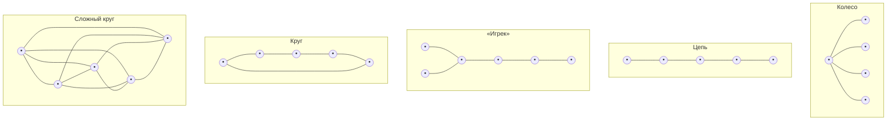

*Рис. 8.1. Типы коммуникативных сетей (структур коммуникаций в группе) (по Г. М. Андреевой): точки — члены группы; линии — каналы коммуникации*

[^p284-1]: Основы теории коммуникации / под ред. проф. М. А. Василика. М. : Гардарики, 2003. С. 411.

> [!quote]- Оригинал: стр. 277 · PDF 284
> 

---

Исследователи выделяют два типа таких сетей: централизованного (рис. 8.2) и децентрализованного (рис. 8.3) типа[^p285-1].

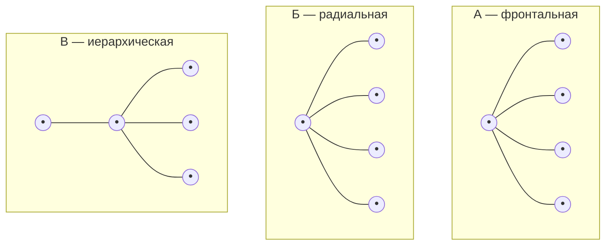

*Рис. 8.2. Виды централизованных коммуникативных структур: А – фронтальная, Б — радиальная, В — иерархическая*

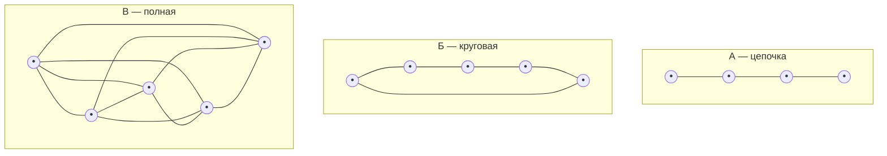

*Рис. 8.3. Виды децентрализованных коммуникативных структур: А — цепочка, Б — круговая, В — полная*

Централизованные коммуникативные сети характеризуются тем, что в них один из членов группы находится в центре информационных потоков и играет основную роль в организации обмена информацией и межличностного взаимодействия. Через него осуществляется общение остальных участников данной деятельности, которые непосредственно между собой контактировать не могут. Существуют различные варианты централизованной сети: фронтальная, радиальная, иерархическая.

- Фронтальная — участники не вступают в контакт, но находятся в поле зрения друг друга. Этот факт во многом помогает им, так как позволяет увидеть реакции и поведение других участников взаимодействия.
- Радиальная — вся информация передается членам только через центральное лицо. Отсутствие единства места и времени передачи информации затрудняет обратную связь с партнерами, которых нельзя увидеть и услышать, зато дает возможность относительно независимо формировать собственную позицию.
- Иерархическая — структура с двумя и более уровнями соподчинения членов группы, причем часть из них может видеть друг друга в процессе совместной деятельности, а часть — нет. Возмож-

[^p285-1]: Основы теории коммуникации / под ред. проф. М. А. Василика. М. : Гардарики, 2003. С. 409—411.

> [!quote]- Оригинал: стр. 278 · PDF 285
> 

---

ности общения при этом ограничены, и коммуникации могут осуществляться в основном между членами группы, занимающими соседние уровни иерархии. Как следует из схемы, у индивида, занимающего верхнюю ступень в иерархии соподчинения, есть непосредственный помощник, которому, в свою очередь, подчинены три остальных участника.

В децентрализованных сетях участники равны, каждый из них может принимать, перерабатывать и передавать информацию, вступая в прямое общение с участниками совместной деятельности. Информация в децентрализованных сетях может передаваться по кругу или по цепи.

Децентрализованные сети используются, когда необходимо решить творческие задачи, не лимитированные временем, задачи повышенной сложности, развить межличностные отношения, повысить удовлетворенность членов группы.

- Цепочка — информация передается последовательно от одного члена группы к другому.
- Круговая — в ней одинаковыми возможностями располагают все без исключения члены группы. Информация может бесконечно долго циркулировать между членами группы, дополняться и уточняться. В такой структуре участники могут непосредственно наблюдать за реакциями друг друга, учитывать их.
- Полная — отсутствуют препятствия для свободного общения и передачи информации.

Общая удовлетворенность работников, как показывают исследования, оказывается наибольшей в случае менее централизованных коммуникативных сетей, а наибольшая удовлетворенность индивида связана с возможностью доступа к максимальному объему информации или максимального влияния на нее?,

Таким образом, особенности коммуникативной структуры малой группы во многом определяются статусно-ролевой структурой, Под статусно-ролевой структурой понимается совокупность отношений между индивидами, в основе которой лежат типичные способы поведения, предписанные, ожидаемые и реализуемые участниками группового процесса в соответствии со своей позицией в группе.

На практике выбор той или иной коммуникативной сети зависит от вида и целей взаимодействия. Необходимость обращения к анализу существующих в группе коммуникативных сетей возникает в случаях, когда общение между ее членами становится неэффективным в свете решаемых задач или нарастает негативный эмоциональный фон во взаимоотношениях.

Таким образом, применение централизованных коммуникативных сетей целесообразно для решения конкретных задач, возложен-

<sup>1</sup> Джуэлл Л. Индустриально-организационная психология. СПб., 2001. С. 568.

> [!quote]- Оригинал: стр. 279 · PDF 286
> 

---

ных на группу, а также в тех случаях, когда необходимо простимулировать развитие лидерства и организационное сплочение группы. Однако надо помнить, что в рамках таких сетей затруднено решение сложных и творческих задач, а также их широкое применение может снижать удовлетворенность групповым членством.

Напротив, использование децентрализованных сетей уместно при решении нестандартных, не лимитированных временем сложных задач, а также в тех случаях, когда организовывающаяся деятельность должна служить развитию межличностных отношений, повышению удовлетворенности членов группы групповым членствам.

Структура социальной власти в малой группе.

Структура социальной власти в малой группе — это система взаиморасположений членов группы в зависимости от их способности оказывать влияние в группе. Группа представляет собой чрезвычайно сложный организм, активность которого разворачивается одновременно во многих направлениях и требует особых усилий по сохранению целенаправленности групповой деятельности, объединения индивидуальных активностей в единое целое. Необходимость социального управления группой очевидна. Социальная власть в группе, реализуемая через право на влияние со стороны определенных членов группы, может осуществляться в различных формах. Функция социального управления, как правило, реализуется через феномены лидерства и руководства.

Оба этих феномена являются проявлениями процесса влияния. Необходимо учитывать, что природа этих социальных явлений различна: руководство — это влияние социально зафиксированной формальной природы, а лидерство подразумевает спонтанно возникающее внутри группы психологическое влияние одного члена группы на других. Остановимся подробнее на характеристике каждого из них.

Лидерство в группе — это процесс межличностного влияния. Лидера порождают не столько личные качества, сколько структура взаимоотношений в группе. Эта система межличностных связей формируется и определяется целями группы, ценностями и нормами, в ней сформировавшимися. На основе этих ценностей и целей выдвигается тот или иной лидер группы. Лидер как бы олицетворяет систему предпочитаемых группой целей и ценностей, является их носителем, активным проводником в жизнь. Лидером принимается и считается тот, чьи установки и ориентации становятся референтными, т. е. исходными эталонами для всех или большинства членов группы в оценке ими значимых аспектов ее жизнедеятельности. За ним признается право вести за собой, быть последней инстанцией в оценке различных групповых ситуаций и обстоятельств.

Лидера можно определить через систему содиометрических выборов как наиболее эмоционально предпочитаемого члена группы.

> [!quote]- Оригинал: стр. 280 · PDF 287
> 

---

Однако необходимо учитывать тот факт, что социометрическая «звезда» не всегда является лидером, хотя индивид в некоторых группах может быть одновременно и «звездой», и коммуникативным лидером (центром) группы. Это происходит, поскольку в основе лидерской позиции и высокого социометрического статуса лежат различные механизмы, эти фигуры создаются или выдвигаются группой для решения различных задач, имеют различную природу. Так, «звезда» может быть охарактеризована как «душа группы», центр ее эмоционального притяжения. Это человек, к которому тянутся в общении, чувствуют себя комфортно рядом с ним. Вместе с тем лидерство в группе — процесс столь многоликий, что могут быть выделены виды лидерства, весьма близкие по своим задачам к социометрической «звезде».

Виды лидерства. В научной литературе различают следующие виды групповой деятельности: инструментальную и экспрессивную. Инструментальные деятельности направлены на выполнение группой ее целевых функций, ради которых она и была создана. Экспрессивные деятельности в основном направлены на поддержание группы как единого целого, ее дальнейшее развитие и сплочение.

Соответственно инструментальное лидерство направлено и характеризуется целью обеспечения управления группой в процессе решения ее целевых задач, а роль экспрессивного лидерства — в обеспечении позитивного внутреннего климата группы, ее стабильности.

Интересно, что в силу своей направленности на определенную сферу деятельности группы тот или иной лидер всегда находится как бы в оппозиции либо к членам группы, ориентированным на общение, либо к задачам и целям группы.

В любой реальной группе может одновременно существовать несколько разноплановых лидеров, занимая в ней свои собственные ниши, определяемые как «экологические», и не вступая друг с другом в серьезные противоречия. Это тем более возможно, что внутри каждой из двух выделенных сфер может происходить еще более глубокая дифференциация лидерских ролей. Так, внутри инструментального лидерства можно выявить лидера-организатора, лидера-инициатора, лидера-эрудита, лидера-мастера, лидера-скептика ит. д. А среди экспрессивных лидеров существуют: лидер эмоционального напряжения (социометрическая «звезда»), лидер-генератор эмоционального настроя и т. д.

Руководство — это процесс управления группой, осуществляемый руководителем как посредником социального контроля и власти на основе правовых полномочий и норм более широкой социальной общности, в которую включена данная малая группа.

Руководство и лидерство, с одной стороны, решают однопорядковые близкие задачи: стимулирование группы, нацеливание ее

> [!quote]- Оригинал: стр. 281 · PDF 288
> 

---

на выполнение определенных задач, поиск средств для их эффективного решения. С другой стороны, лидерство представляет собой психологическую характеристику поведения определенных членов группы, а руководство является социальной характеристикой отношений в группе, прежде всего, с точки зрения распределения ролей управления — подчинения.

Однако в руководстве малой группой всегда присутствуют два пласта — формально-правовой аспект власти — «администрирование»; и психологический аспект власти, сближающий руководителя с неформальным лидером. Утверждение, что в идеальном случае руководитель и лидер должны совмещаться в одном лице является заблуждением. Против такого слияния можно привести несколько важных доводов.

Во-первых, как правило, лидер и руководитель группы имеют различную социально-ролевую ориентацию: руководитель поглощен целью — выполнить поставленную задачу (результат), а лидер больше ориентирован на внутренние интересы группы (процесс). В этом случае, если экспрессивный лидер становится формальным руководителем, он либо разваливает групповую деятельность, либо вынужден переориентироваться на инструментальные функции, вступив в конфликт с группой (он либо не становится руководителем, либо перестает быть лидером).

Во-вторых, можно выделить лишь достаточно специфический род групп, для которых будет эффективным слияние в одном лице руководителя и инструментального лидера. Речь идет, прежде всего, о научных коллективах, продуктивность которых повышается в том случае, если их руководитель способен лидировать в ведущей научной деятельности группы.

В-третьих, существует немало типов социальных групп, где в силу существенных возрастных или статусных различий руководителя и членов группы описанное выше совмещение невозможно. Это в полной мере относится к студенческой группе. Преподаватель, сколь бы близок он ни был своим студентам, может опираться в управлении группой только на свой авторитет руководителя. Истинные неформальные лидеры группы будут выявляться из рядов студентов.

Таким образом, основным инструментом психологического влияния руководителя на группу является его авторитет. Степень авторитетности руководителя зависит от целого ряда факторов, таких как:

- некоторые личностные особенности;
- организаторский и мотивационный потенциал (способность лидировать в качестве лидера-организатора и лидера-мотиватора);
- ценностная привлекательность личности руководителя для членов группы (готовность разделить его принципы и идеалы);
- наиболее существенный фактор — стиль управления, реализуемый руководителем.

> [!quote]- Оригинал: стр. 282 · PDF 289
> 

---

Классификация по характеру и формам организации деятельности:

- случайно организованная группа (например, экскурсионная);
- ассоциация, где взаимоотношения определяются преимущественно личностно значимыми целями (группа друзей);
- корпорация, когда объединение происходит на основании только внутренних целей, их достижение осуществляется любой ценой, в том числе и за счет интересов других групп (черты корпорации может приобрести любая малая группа: семья, учебная группа и пр.);
- коллектив — такая форма организации групповой деятельности, при которой связи и отношения между индивидами опосредованы общественно значимыми целями;
- команда — группа, состоящая из двух человек или более, составляющая ясную, упорядоченную и экономную структуру, направленную на достижение поставленных целей и выполнение задач. Для нее характерны сложившиеся связи как внутри, так и вне ее с другими командами и группами; члены команды в соответствии с отведенной им ролью участвуют в меру своей компетентности в совместном достижении поставленных целей.

Традиционно наибольший интерес для исследователей представляли семья и производственная группа. В последние десятилетия усилился интерес к психокоррекционным группам, а также к особым группам: находящимся длительное время в изоляции (космонавты), спортивным, туристическим и т. д.

Характеристика групповых процессов.

Коммуникации в группе напрямую связаны с динамикой групповых процессов.

Любая группа имеет свои групповые нормы и ценности, которые в той или иной степени должны разделять все участники.

Система «групповых ожиданий» — является важной составляющей характеристики положения индивида в группе. Каждый член группы воспринимается и оценивается другими ее членами. От каждой позиции, каждой роли ожидается качественное выполнение ряда функций. Таким образом, группа контролирует деятельность своих членов через систему ожидаемых образцов поведения, соответствующих каждой роли. В отдельных случаях может быть рассогласование между ожиданиями, которые имеет группа относительно какого-либо ее члена, и его реальным поведением, реальным способом выполнения им своей роли. Для определения системы ожиданий в группе существуют два очень важных образования: групповые нормы и групповые санкции [1].

Групповые нормы. Все групповые нормы представляют собой набор правил, выработанных и принятых группой. Все они являются социальными нормами и поведение членов группы должно им подчиняться, чтобы была возможна их совместная деятельность.

> [!quote]- Оригинал: стр. 283 · PDF 290
> 

---

Таким образом, нормы выполняют регулятивную функцию по отношению к этой деятельности.

Нормы группы напрямую связаны с ценностями группы, поскольку любые правила могут быть сформулированы только на основании принятия или отвержения каких-то социально значимых явлений[^p291-1]. Ценности каждой группы складываются на основании выработки определенного отношения к социальным явлениям, продиктованного местом данной группы в системе общественных отношений, ее опытом в организации определенной деятельности.

Принятие или отвержение групповых норм и правил характеризует взаимоотношения индивида с группой. Более точно эти взаимоотношения можно понять, если определить, какие нормы группы индивид принимает, какие отвергает, и почему он так поступает. Особенно важным это становится в ситуациях, когда возникает рассогласование норм и ценностей группы и общества, когда группа начинает ориентироваться на ценности, не совпадающие с нормами общества. Актуальным также является вопрос границ принятия норм каждым членом группы: как осуществляется принятие индивидом групповых норм, насколько каждый из них отступает от соблюдения этих норм, как соотносятся социальные и «личностные» нормы.

Групповые нормы — это определенные правила, выработанные группой, принятые ее большинством и регулирующие взаимоотношения между членами группы. Группа может воздействовать на своих членов в форме поощрения или закрепления желаемых форм поведения.

Виды групповых норм. Формальные нормы устанавливаются официальными документами, правилами и процедурами организации. Пример: дресс-код, правила безопасности, регламент работы. Неформальные нормы формируются на основе традиций, обычаев и личных предпочтений членов группы. Пример: неформальные способы общения, обычаи празднования дней рождения.

Функции групповых норм.

1. Регуляция поведения. Нормы помогают определить, какое поведение является приемлемым или неприемлемым в группе. Пример: нормы поведения на собраниях, правила вежливости.

2. Поддержка порядка и стабильности. Нормы способствуют поддержанию порядка и предотвращают хаос в группе. Пример: установленные процедуры для разрешения конфликтов.

3. Создание чувства принадлежности. Нормы помогают членам группы ощущать себя частью целого и способствуют формированию групповой идентичности. Пример: совместные мероприятия, ритуалы и обычаи группы.

[^p291-1]: Обозов Н. Н. Психология малых групп и коллективов // Социальная психология. Д., 1979. С. 156.

> [!quote]- Оригинал: стр. 284 · PDF 291
> 

---

4. Усиление социальной сплоченности. Соблюдение норм способствует укреплению связей между членами группы. Пример: поддержка коллег в трудных ситуациях, обмен информацией.

Формирование групповых норм. Нормы формируются вокруг целей и задач группы, чтобы обеспечить их достижение. Пример: нормы производительности и качества работы.

Лидеры и авторитетные члены группы играют ключевую роль в установлении и поддержании норм. Пример: влияние руководителя на рабочие стандарты.

В процессе общения и взаимодействия члены группы договариваются о приемлемых формах поведения. Пример: установление норм поведения в процессе групповых обсуждений.

Прошлые события и накопленный опыт влияют на формирование и изменение норм. Пример: изменения норм после пережитого кризиса.

Влияние групповых норм.

Положительное влияние. Нормы могут способствовать улучшению координации, сотрудничества и достижению целей группы. Пример: соблюдение сроков выполнения задач, взаимная поддержка.

Отрицательное влияние. Чрезмерно строгие или негибкие нормы могут подавлять индивидуальность и творчество. Пример: отказ от инновационных предложений из-за боязни нарушить устоявшиеся нормы.

Конформизм и давление. Соблюдение норм может приводить к конформизму, когда члены группы следуют нормам из-за давления, а не из-за личного согласия.

Группа поощряет тех своих членов, которые соблюдают принятые в группе нормы и правила: повышается уровень их эмоционального принятия, растет статус, применяются другие психологические меры вознаграждения. При необходимости воспитательного влияния на членов группы, не выполняющих групповые нормы и правила, группа использует такие психологические методы воздействия, как бойкот, снижение интенсивности общения с «провинившимся», понижение его статуса, исключение из структуры коммуникативных связей и др.

Особенно остро стоит проблема принятия системы групповых норм для нового члена группы, адаптирующегося к непривычной для него системе отношений. Познавая, какими правилами руководствуются члены группы в своем поведении, какие ценности отношений для них важны, новый член группы встает перед проблемой принятия или отвержения этих норм, правил и ценностей. В целом возможны четыре варианта его отношения к данному вопросу:

1) сознательное, свободное принятие норм и ценностей группы;

2) вынужденное принятие под угрозой санкций группы;

> [!quote]- Оригинал: стр. 285 · PDF 292
> 

---

3) демонстрация антагонизма по отношению к группе (по принципу — не такой как все);

4) свободное, осознанное отвержение групповых норм с учетом всех возможных последствий, вплоть до ухода из группы.

Второй и третий варианты иллюстрируют поведение, зависимое от группы — либо принятие ее норм под давлением, либо противопоставление себя данной группе. При этом и тот и другой вариант позволяют человеку найти свое место в группе — либо в рядах «законопослушных», либо в рядах «козлов отпущения», «бунтарей».

Как показывают исследования, вынужденное принятие человеком норм группы под угрозой санкций или своего устойчивого положения в ней является очень распространенным. Он получил название конформизма и рассматривается сегодня как один из важнейших механизмов поддержания целостности группы, единства ее ценностей и целей.

Групповые санкции являются механизмом, при помощи которого группа заставляет своего члена следовать групповым нормам. Санкции могут быть двух типов: поощрительные и запретительные (основанными на отношении с точки зрения позитива или негатива). Система санкций предназначена не для того, чтобы компенсировать несоблюдение групповых норм, а для того, чтобы обеспечить их соблюдение. Исследование санкций имеет смысл лишь при условии анализа конкретных групп, так как содержание санкций соотнесено с содержанием норм, а последние обусловлены свойствами группы.

Конформизм — это подчинение суждения или действия индивида групповому давлению, возникающее из конфликта между его собственным мнением и мнением группы.

Обычно различают два вида конформизма:

1) внешний, когда мнение группы принимается индивидом лишь «для формы», а на самом деле он продолжает ему сопротивляться;

2) внутренний, когда индивид действительно усваивает мнение большинства. Внутренний конформизм и есть, таким образом, результат преодоления конфликта в пользу группы. В свою очередь внутренний конформизм предполагает две линии поведения: некритическое принятие мнения большинства и сознательное признание личностью норм и стандартов группы.

Конформизм проявляется, когда человек предпочитает выбрать мнение группы в ущерб своему собственному. Причем необходимо разделять конформизм (или социальное приспособленчество) и конформность (черта личности, склонность индивида разрешать конфликт в пользу группы, когда человек убеждает себя в необходимости выбрать точку зрения группы).

Уровень конформности личности зависит:

- от значимости для него высказываемого мнения (чем оно важнее лично для него, тем ниже уровень конформности);

> [!quote]- Оригинал: стр. 286 · PDF 293
> 

---

- от авторитетности людей, высказывающих в группе те или иные взгляды. Чем выше их статус и авторитетность для группы — тем выше конформность членов группы;
- от количества членов группы, поддерживающих ту или иную позицию, от их единодушия. Особенно ярко феномен конформизма работает, когда на человека оказывает давление групповое большинство, и оно единодушно в своих убеждениях;
- от возраста и пола человека. Так, женщины в целом более конформны, чем мужчины, а дети более конформны, чем взрослые. Хотя, если говорить о подростках и старшеклассниках, то они склонны демонстрировать конформизм в общении с группой сверстников и негативизм — в общении со взрослыми.

Референтная группа — это реальная или идеальная группа, на которую ориентирован человек, чьи ценности, идеалы и нормы поведения он разделяет.

Группа членства является антиподом референтной группы. Человек может являться членом этой группы, но внутренне оставаться равнодушным к ее целям и нормам.

Таким образом, конформность является важным механизмом поддержания целостности группы, который служит поддержанию группового постоянства в уровнях изменения и развития группы.

Основой межличностных отношений в группе является, прежде всего, эмоциональная межличностная привлекательность членов группы.

Привлекательность — важный фактор человеческих взаимоотношений, который во многом определяет характер общения и успешность совместной деятельности. Так, чем выше взаимопривлекательность партнеров, тем больше они удовлетворены внутригрупповыми межличностными отношениями. Однако было бы неправильно думать, что вне взаимного притяжения невозможно ни нормальное общение, ни успешная деятельность людей. Связано это с тем, что удовлетворенность внутригрупповыми отношениями может быть высокой и при успешной совместной деятельности, даже если при этом не формируются близкие эмоциональные отношения.

Как показали исследования, удовлетворенность межличностными отношениями членов группы может регулироваться совместимостью партнеров, которая вызывает межличностную привлекательность и срабатываемость, которая рождает удовлетворенность результатами совместной деятельности.

Межличностная совместимость — сложный психологический эффект сочетания, взаимодействия общающихся людей. Различают структурную и функционально-ролевую совместимость.

- Структурная совместимость — это совместимость темперамента, характера и других личностных качеств партнеров.

> [!quote]- Оригинал: стр. 287 · PDF 294
> 

---

Причем, если в отношении двух первых подтверждается гипотеза о комплементарности, взаимодополняемости качеств партнеров, то в отношении личностных свойств нашла экспериментальное подтверждение противоположная идея — сходства и близости. То есть совместимость партнеров высока при обладании ими взаимодополняемыми свойствами темперамента и характера (сангвиник — меланхолик, холерик — флегматик) и сходными личностными ориентациями и особенностями (общительность, тревожность, мечтательность и др.).

- Функционально-ролевая совместимость — это соответствие в представлениях партнеров о тех межличностных ролях, которые они будут реализовывать сами и ожидать от другого в процессе общения и взаимодействия. Если ролевые представления и ожидания участников совпадают, у них много шансов достичь гармоничных отношений, построенных на межличностной привлекательности.

Срабатываемость — это еще один эффект сочетания и взаимодействия людей, который позволяет добиваться высокой успешности совместной работы и удовлетворенности своим трудом и друг другом. Срабатываемость, как правило, не приводит к возникновению таких феноменов межличностного общения, как эмоциональная близость, идентификация, ориентация на интимно-личностное общение партнеров. Это скорее результат успешной реализации группой ее инструментальных функций, позволяющий достигать высокой продуктивности деятельности, высокой удовлетворенности членов группы своим трудом и групповым членством, а также порождает хороший уровень взаимопонимания, адекватного отражения участниками общения всего, что происходит в группе.

В условиях, когда члены группы не смогли достигнуть хорошего уровня срабатываемости или оказались малосовместимыми по своим характерологическим, личностным свойствам или ролевым представлениям, развиваются различные межличностные внутригрупповые конфликты.

Сплочение группы — это процесс, сопровождающий группу на всех этапах ее развития. Он заключается в формировании неповторимого типа связей в группе, которые дают возможность формальную структуру, задаваемую извне, превратить в психологическое сообщество. Сплоченность проявляется по-разному. Это может быть эмоциональная притягательность и взаимопривязанность членов группы, стремление их к сохранению своего группового членства, единство ценностей и целей участников группы.

Сама по себе сплоченность выступает для членов любой группы как привлекательная цель и ценность, как групповое состояние, к которому надо стремиться. Примером этому могут служить подростковые группы, стремящиеся достичь высокого уровня внутригрупповой солидарности и сплоченности. Однако удается это

> [!quote]- Оригинал: стр. 288 · PDF 295
> 

---

не всегда, так как формирование в группе отношений, построенных на сплоченности, зависит от множества психологических факторов.

Факторы, влияющие на процесс сплочения малой группы. Процесс сплочения малой группы зависит от множества факторов, которые могут усиливать или ослаблять чувство единства среди ее членов. Вот основные факторы, влияющие на сплочение малой группы:

Внутренние факторы.

1. Размер группы. В маленьких группах сплочение легче достигается, так как легче установить и поддерживать тесные личные связи. В больших группах могут возникать подгруппы, что может ослабить общую сплоченность.

2. Состав группы.Чем более однороден состав группы (по возрасту, интересам, ценностям), тем выше вероятность сплочения. Разноплановость может как способствовать развитию новых идей, так и усложнять процесс сплочения из-за различий во взглядах.

3. Роли и структура. Ясное понимание ролей и обязанностей способствует снижению конфликтов и улучшению взаимодействия. Эффективное лидерство, которое поддерживает и мотивирует членов группы, способствует ее сплочению.

4. Коммуникация. Открытая и частая коммуникация способствует лучшему взаимопониманию и решению конфликтов.Умение слушать и конструктивно обсуждать проблемы способствует укреплению отношений.

5. Совместная деятельность. Наличие общих целей и задач объединяет группу и усиливает чувство единства. Работа над общими проектами способствует установлению тесных связей и улучшению взаимодействия.

6. Социальная поддержка. Оказание социальной поддержки и признание вклада каждого члена группы способствует повышению сплоченности.

Внешние факторы.

1. Внешние угрозы и конкуренция. Наличие внешних угроз или конкурентов может способствовать сплочению группы для их преодоления. Внешние давления и ожидания могут стимулировать группу к более тесному сотрудничеству.

2. Организационная культура. Поддержка и поощрение сплоченности со стороны руководства способствует укреплению групповых связей. Организационные ценности и нормы, поддерживающие коллективизм, способствуют сплочению.

3. Физическое окружение. Удобные и благоприятные условия для общения и совместной работы способствуют укреплению связей. Организация совместных мероприятий, таких как тимбилдинг, тренинги и корпоративные праздники, также способствует укреплению связей.

> [!quote]- Оригинал: стр. 289 · PDF 296
> 

---

Психологические и социальные факторы.

1. Личностные характеристики. Высокий уровень эмпатии и эмоционального интеллекта у членов группы способствует лучшему взаимопониманию и поддержке. Совместимость личностных характеристик помогает избежать конфликтов и улучшает взаимодействие.

2. Групповая идентичность. Чем сильнее члены группы идентифицируют себя с группой, тем выше уровень сплоченности. Чувство гордости за принадлежность к группе усиливает сплоченность.

3. Предыдущий опыт. Успешное выполнение предыдущих задач и проектов усиливает доверие и сплоченность. Эффективное разрешение прошлых конфликтов способствует улучшению взаимодействия и укреплению связей.

Таким образом, сплоченность малой группы зависит от комплекса факторов, которые могут варьироваться в зависимости от конкретной ситуации и контекста. Понимание и управление этими факторами позволяет эффективно создавать и поддерживать высоко сплоченные группы, что, в свою очередь, способствует достижению общих целей и улучшению общей производительности.

Факторы, влияющие на процесс сплочения малой группы

Эмоциональная привлекательность членов группы. Необходимо отметить, что сам по себе этот параметр не обеспечивает ни эффективной совместной деятельности, ни высокой групповой сплоченности. Однако и без эмоциональной притягательности людей трудно создать сплоченную группу.

Сходство членов группы между собой. Это могут быть различные аспекты сходства: возрастное, социальное, этническое и др. Но самое главное — это ценностное сходство, близость взглядов и социальных ориентаций членов группы, поскольку в этом случае в силу вступает психологический механизм. Он заключается в том, что чем ближе чужое мнение к собственному мнению человека, тем симпатичнее ему лицо, высказывающее данную точку зрения. И наоборот: люди склонны не замечать разногласий и противоречий с позицией привлекательного лица. Этот же феномен работает и в группе: человек более тяготеет к группе, взгляды и ценности которой он разделяет, и в которой его собственные взгляды находят поддержку.

Предпочитаемый группой способ взаимодействия и ведущий социальный мотив членов группы. Более привлекательна для людей и имеет большие шансы стать сплоченной группа, чья деятельность основана не на конкуренции, а на групповой кооперации, и в которой преобладает мотив сотрудничества.

Кооперация выступает причиной сплочения группы, поскольку способствует возникновению в группе ряда важных и привлекательных для членов группы феноменов:

> [!quote]- Оригинал: стр. 290 · PDF 297
> 

---

- при кооперации и мотиве сотрудничества уменьшается число внутригрупповых конфликтов, а также есть все условия для успешного разрешения возникающих объективных противоречий;
- кооперация способствует свободному и открытому общению людей, стимулирует сближение мнений, расширяет обмен информацией между партнерами;
- кооперация обеспечивает взаимную поддержку действий, поскольку только совместные усилия могут привести каждого члена группы к личному успеху;
- кооперация между членами группы способствует сплочению всей группы.

Вместе с тем соревнование между группами в определенных видах деятельности способствует внутреннему сплочению группучастников. Однако важно помнить об одной опасности: межгрупповая конкуренция может привести к возникновению межгрупповой агрессии и неприятия членами групп друг друга, чего ни в коем случае нельзя допускать.

Особенности групповых целей. Цели, которые ставятся группой или перед группой ее руководителем, помогают коллективу сплачиваться в том случае, если они отвечают потребностям членов группы, могут быть приняты ими в качестве своих личных целей (т. е. каждый участник видит личный смысл в том, что делает вся группа), а также если группа может рассчитывать на успех в достижении цели.

Важной характеристикой групповой цели должна быть четкость и однозначность ее постановки. Абстрактные глобальные цели, не конкретизируемые в частные задачи (стать гармонически развитыми людьми, стать дружными и сплоченным и т. д.), подмена цели средством (достижение конкретного оценочного результата) не приносят желаемого эффекта.

Цель деятельности в том случае, когда она действительно может служить источником активности индивида и фактором сплочения группы, должна отвечать следующим требованиям:

- цель должна быть конечна, т. е. иметь четкий результат, достижение которого не очень оттянуто во времени от момента принятия цели;
- цель должна быть ясной, определенной и понятной каждому участнику группы. Обязательно нужно проверить, действительно ли все члены группы одинаково понимают смысл и цель происходящего;
- цель должна быть технологична, т. е. содержать в себе доступные членам группы средства ее достижения;
- цель должна быть личностно привлекательной для каждого члена группы, а для этого содержать в себе какие-либо частные цели и средства, интересные или доступные для него. Деятельность,

> [!quote]- Оригинал: стр. 291 · PDF 298
> 

---

организуемая в процессе выполнения заданий, должна требовать от каждого тех умений, которые у него особенно развиты или которые он хотел бы в себе развить.

Удовлетворенность группы и каждого ее члена групповой деятельностью и своим положением в группе. Чем выше удовлетворенность участников деятельностью группы и самими собой, тем в большей степени будет сплачиваться такая группа. В свою очередь, удовлетворенность возникает при соблюдении ряда условий.

Характер руководства и стиля принятия решений, характерного для группы. Известно, что коллегиальный, кооперативный стиль руководства и возможность для каждого члена группы принимать участие в выработке общего решения способствуют сплочению группы.

Отметим, что сплоченность — это важная характеристика состояния группы, так как сплоченная группа не только представляет собой более эффективно работающий единый организм, но и обладает большей привлекательностью для каждого ее члена. Сплоченная группа характеризуется усилением взаимоудовлетворяющего общения между участниками, близостью мнений и ценностных ориентаций, что позволяет человеку чувствовать себя комфортно. В группе высокого уровня сплочения растет самооценка человека, снижается уровень его тревожности и, кроме того, повышается эффективность любых форм активности такой группы.

Формирование групповой сплоченности и коммуникация в малой группе (по М. А. Василик). Коммуникация в малой группе — это способ деятельности, который облегчает взаимное приспособление поведения людей. Следовательно, суть коммуникативной деятельности состоит в установлении такой кооперации, когда поведение каждого изменяется и в известной степени регулируется фактом участия других индивидов. Коммуникация в малой группе — это обмен, который обеспечивает кооперативную взаимопомощь, делая возможной координацию движений большой сложности. «Интегральной характеристикой системы внутригрупповых связей является степень сплоченности, индексом которой может служить частота или степень совпадения мнений, оценок, установок и позиций члена группы по отношению к объектам, наиболее значимым для группы в целом»[^p299-1].

Сплоченность выступает ключевым понятием разработанной К. Левиным теории групповой динамики[^p299-2]. Сплоченность определяется им как «тотальное поле сил», заставляющее членов группы оставаться в ней. Группа тем сплоченнее, чем больше она отвечает потребностям людей в эмоционально насыщенных межличностных связях. В сплоченных группах создается атмосфера внимательного

[^p299-1]: Основы теории коммуникации / под ред. проф. М. А. Василика. М. : Гардарики, 2003, С. 414.

[^p299-2]: Левин К. Теория поля в социальных науках. СПб., 2000.

> [!quote]- Оригинал: стр. 292 · PDF 299
> 

---

отношения и взаимной поддержки, у ее членов формируется чувство групповой идентичности. Сплоченность порождает также эмоциональную привязанность, принятие общих задач, обеспечивает группе стабильность даже в самых в малой группе обстоятельствах, способствует выработке общих стандартов, которые делают группу устойчивой несмотря на разнонаправленность индивидуальных устремлений.

Одно из главных мест механизма формирования групповой сплоченности принадлежит групповому давлению. В результате его действия происходит подчинение индивида группе в ситуации наличия конфликта между мнением индивида и мнением группы. Такая степень подчинения индивида групповому давлению получила название конформизма (см. выше) или конформного поведения. Впервые модель конформного поведения изучал в экспериментах С. Аш в 1951 г.

Специфическим случаем конформизма, своеобразной конформностью «наизнанку», выступает негативизм — поведение индивида, который противостоит мнению группы даже при оказываемом на него давлении. Однако в этом случае зависимость от группы продолжает сохраняться и проявляется в виде активного продуцирования антигруппового поведения, антигрупповой позиции. Иначе говоря, индивид продолжает сохранять привязку к групповому мнению, хотя и со знаком минус.

В исследованиях конформности, проводившихся М. Дойчем и Г. Джерардом, были выделены два вида группового влияния:

- нормативное, когда давление оказывает большинство и его мнение воспринимается членом группы как норма;
- информационное, когда давление может оказываться меньшинством, члены группы рассматривает это мнение как информацию, на основе которой он сам должен сделать свой выбор[^p300-1].

Нормативный конформизм подразумевает необходимость подчиниться группе, чтобы не быть отвергнутым, сохранить с членами группы хорошие отношения или заслужить их одобрение.

Информационное влияние имеет место, когда ситуация носит двусмысленный характер и мнение окружающих может оказаться ценным источником информации. Интересно отметить, что после того как человек согласился с той или иной группой, у него возникает довольно сильная потребность оправдывать выбранное решение.

Как мы видим, конформизм проявляется не только в ситуациях сильного влияния группы, но и тогда, когда человек чувствует себя некомпетентным, когда задача, которую ему надо решить, кажется ему слишком трудной и он стремится избежать возможных ошибок.

Групповая сплоченность с точки зрения процессов коммуникации в малой группе была исследована также Л. Фестингером.

[^p300-1]: Майерс Д. Социальная психология. СПб., 1996. С. 298.

> [!quote]- Оригинал: стр. 293 · PDF 300
> 

---

Сплоченность анализировалась им на основе данных о частоте и прочности коммуникативных связей, раскрываемых в группе. Центральным понятием, с помощью которого осуществлялся анализ, стало понятие когнитивного диссонанса, т. е. осознания индивидом противоположности своих убеждений мнению другого человека или группы[^p301-1].

По мнению Л. Фестингера, процессы социальной коммуникации и социального влияния тесно связаны с процессами возникновения и устранения когнитивного диссонанса. Для индивида социальная группа является одновременно и главным источником когнитиивного диссонанса, и основным средством его уменьшения или даже полного устранения. Так, информация, получаемая в процессе коммуникации, может содержать элементы, диссонирующие со взглядом индивида на какую-либо проблему или ситуацию. Наиболее эффективным путем устранения диссонанса между мнениями индивида и группы является принятие набора когнитивных элементов, соответствующих точке зрения группы. Причем диссонанс, вызванный столкновением мнений, зависит от следующих факторов:

- Количество когнитивных элементов мнения индивида, совпадающих с противоположным мнением. Чем больше консонативных отношений, т. е. чем больше количество совпадающих когнитивных элементов двух высказываемых мнений, тем меньше вызванный разногласием диссонанс. Таким образом, количественная характеристика определяет, в конечном счете, степень несогласия.
- Важность когнитивных элементов, включаемых в диссонанс. Чем более важным является элемент, тем больше будет диссонанс. Так, чем более значима проблема для отдельного человека или целой группы, тем важнее будут когнитивные элементы, свидетельствующие о существовании иных взглядов на эту проблему, и тем больше будет диссонанс, вызванный выражением несогласия.
- Авторитет человека или группы, выражающих противоположную точку зрения. Диссонанс становится больше, если противоположное мнение высказывается человеком или группой, признанными авторитетными.

Согласно точке зрения Л. Фестингера, если диссонанс существует, одновременно присутствует и стремление к его уменьшению. При этом чем диссонанс больше, тем стремление его устранить сильнее.

Способы выработки единого мнения в группах:

- самостоятельное изменение мнения субъекта на более распространенное. Именно распространенность мнения является обязательным условием уменьшения диссонанса;
- изменение мнения субъекта через влияние;
- утверждение превосходства собственного мнения.

[^p301-1]: Фестингер Л. Теория когнитивного диссонанса. СПб., 1999. С. 223—271.

> [!quote]- Оригинал: стр. 294 · PDF 301
> 

---

Одновременно Л. Фестингер обращает внимание на возможность использования индивидом процессов социального влияния и коммуникации для уменьшения диссонанса. Человек будет прилагать усилия, чтобы получить одобрение членов группы. Он попытается найти тех, кто придерживается аналогичной точки зрения, или повлиять на мнение других. Причем попытки влияния будут направлены главным образом в адрес тех членов группы, которые проявляют наибольшую степень несогласия, так как чем острее разногласия, тем сильнее диссонанс в сознании индивида.

Средовые аспекты жизнедеятельности и коммуникация в малой группе.

Пространственные расположения членов группы влияют на развитие внутригруппового взаимодействия, в частности, его коммуникативной его стороны. Согласно экспериментальным данным Р. Соммера, существует зависимость между пространственным расположением людей в определенном помещении и их взаимодействием и аттракцией[^p302-1].

Близость расположения людей друг от друга влияет на усиление коммуникации, рост аттракции и дружеских отношений. Как правило, люди размещаются в пространстве не в случайном порядке. В большинстве ситуаций можно отметить влечение людей к тем, кто вызывает симпатию, и стремление дистанцироваться от тех, кто не вызывает потребности общаться. Однако этого не происходит в группах с сильным директивным руководителем, который жестко контролирует коммуникативные потоки.

Местоположение в групповом пространстве и коммуникация. Выбор членами группы того или иного местоположения в групповом пространстве показывает определенную взаимосвязь пространственной позиции со статусом владельца. В частности, позиция на пересечении внутригрупповых коммуникаций дает ее обладателю возможность контролировать групповые процессы, и следовательно, возможность повысить свой статус, стать лидером.

В любой малой группе существует также преобладающая «эмоциональная атмосфера», от которой часто зависят самочувствие членов группы и их поступки. Соответственно действия, согласующиеся с доминирующим настроением, в значительной степени облегчаются. Довольно часто сложившаяся и существующая автономно группа негативно воспринимает присоединение новых людей, оценивая это как вторжение в сформировавшуюся в данной группе коммуникативную сеть.

Таким образом, средовые факторы оказываются важным элементом анализа, поскольку нельзя дать адекватную интерпретацию

[^p302-1]: Кричевский Р. Л., Дубовская Е. М. Социальная психология малой группы. М., 2001. С. 165—166.

> [!quote]- Оригинал: стр. 295 · PDF 302
> 

---

коммуникативных процессов в группе, не принимая во внимание конкретных условий их протекания.

Форма стола и коммуникация. Экспериментально было выявлено: сидя за столом квадратной или прямоугольной формы, члены группы чаще обменивались информацией с партнерами, находящимися напротив них, нежели соседями. На основании этих данных был сделан важный в практическом плане вывод о целесообразности размещения участников групповой дискуссии за небольшим круглым столом с целью обеспечения равномерной коммуникации.

### 8.2. Коммуникация как функция управления организацией

Как мы уже знаем, люди представляют собой социальные существа, объединенные в некое цельное сообщество с определенными внешними границами, правилами внешнего и внутреннего поведенческого распорядка, устойчивыми связями, иерархической структурой и т. д. Вне зависимости от функционального предназначения, поставленных целей и форм собственности очень редко, практически никогда, эти своеобразные социальные объединения не предстают перед наблюдателями в виде аморфных и бесструктурных образований. Цельность и спаянность в такой социальной ячейке образуется благодаря определенной системе коммуникативных связей и каналов, принятой и поддерживаемой всеми членами данного образования. Коммуникации в организации — это информационные взаимодействия, преследующие различные цели и задачи, в которые вступают люди при выполнении своих должностных обязанностей в организации.

Роль коммуникации в управлении организацией.

Информационная функция. Обеспечение всех уровней организации необходимой информацией для принятия решений. Формирование общей картины происходящего в организации и за ее пределами, повышение уровня прозрачности.

Координационная функция. Обеспечение согласованности действий различных подразделений и сотрудников для достижения общих целей. Четкое распределение задач и обязанностей между сотрудниками и подразделениями.

Мотивационная функция. Использование коммуникации для повышения мотивации сотрудников, создания позитивного рабочего настроя. Предоставление конструктивной обратной связи, достижений и поощрение сотрудников.

Контрольная функция. Оценка выполнения задач и достижения целей через системы отчетности и контроля. Внесение изменений и корректив на основе полученной информации и данных.

Инновационная функция. Создание условий для свободного обмена идеями и предложениями среди сотрудников. Коммуникация новых стратегий и изменений, поддержка инновационных инициатив.

> [!quote]- Оригинал: стр. 296 · PDF 303
> 

---

Каналы коммуникации включают в себя:

1) формальные каналы: официальные документы: (политики, процедуры, отчеты, письма), собрания и совещания (регулярные встречи, стратегические совещания) и информационные системы (внутренние порталы, базы данных);

2) неформальные каналы: личные встречи и разговоры (неформальные обсуждения, обмен мнениями), социальные сети и мессенджеры (общение через корпоративные мессенджеры и социальные сети) и внутренние мероприятия (тимбилдинги, корпоративные праздники).

Препятствия и барьеры в коммуникации.

Шум и искажение информации. Физические барьеры — проблемы со звуком, технические неполадки. Психологические барьеры — личные предубеждения, стереотипы.

Культурные различия. Различные языки и культурные контексты могут затруднять понимание. Сюда же относятся различия в ценностях и нормах (разные подходы к работе и общению).

Организационные барьеры. Сложная иерархия и бюрократические процедуры могут замедлять процессы коммуникации. То же можно сказать и о сопротивлении сотрудников новым процессам и инновациям.

Стратегии улучшения коммуникации,

Развитие навыков общения происходит в результате обучения сотрудников (проведения тренингов по развитию коммуникативных навыков) и развития лидерских качеств (поддержки и развития навыков общения у лидеров и менеджеров).

Улучшению коммуникационных каналов способствуют оптимизация формальных каналов (повышение эффективности и скорости официальных коммуникационных каналов), а также поддержка неформальных каналов (создание условий для неформального общения и обмена информацией).

Создание открытой культуры общения происходит путем поощрения открытости (стимулирования сотрудников к открытому выражению своих мнений и идей) и поддержки обратной связи (развития культуры конструктивной обратной связи).

Использование современных технологий осуществляется с помощью внедрения информационных систем (использования современных информационных систем для улучшения обмена информацией) и дистанционных коммуникациий (поддержки удаленной работы и онлайн-коммуникаций).

Таким образом, коммуникация как функция управления организацией является критическим элементом, влияющим на эффективность и успех компании. Развитие и поддержание эффективных коммуникационных процессов способствует улучшению взаимодействия, координации и достижению организационных целей.

> [!quote]- Оригинал: стр. 297 · PDF 304
> 

---

Коммуникация считается успешной, если получатель информации понимает ее содержание адекватно тому смыслу, который в нее вложил отправитель. А. Р. Бахарев (Бахарев А. Р. Коммуникации внутри компании: как добиться их эффективности. http://www.iteam.ru/publications/human/section_44/article_2669/) предлагает следующую схему внутриорганизационных коммуникаций, в которой менеджер выступает как информационно-коммуникативный центр (рис. 8.4).

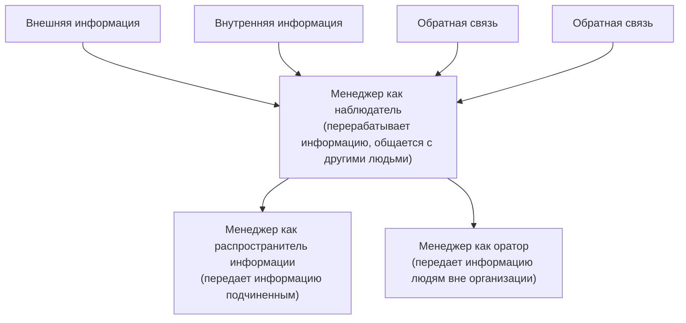

*Рис. 8.4. Менеджер как информационно-коммуникативный центр*

Необходимо отметить, что, как показывает практика, внутриорганизационными коммуникациями недальновидные руководители нередко или полностью пренебрегают, либо уделяют им недостаточно серьезное внимание. Это происходит по многим причинам. Вот некоторые из них:

- нехватка времени у руководителей (важные проекты, давящие сроки, деловые встречи и т. д.);
- общая перегруженность деловой информацией;
- привычная традиция непререкаемых однонаправленных связей сверху вниз.

Коммуникативный процесс в любой социальной ячейке справедливо можно представить в виде простой стандартной схемы: отправитель — сообщение — получатель. Классификация коммуникативных каналов по пропускной способности представлена на рис. 8.5.

Затрудняют деловые коммуникации наряду с объективными и такие субъективные факторы, как предвзятое представление людей об инновациях. Речь идет о наших согражданах, неприемлющих все новое по причине привычки к старому, кажущемуся стабильным и устойчивым, пусть даже и являющимся стереотипным пережитком. В результате коммуникационного взаимодействия с ними искажается смысл и восприятие сообщения, а также, как следствие, снижается уровень эффективности воздействия, его результативность, замедляется процесс обратной связи.

> [!quote]- Оригинал: стр. 298 · PDF 305
> 

---

| Наиболее емкий канал ⟵ | | | ⟶ Наименее емкий канал |
|---|---|---|---|
| Физическое присутствие (контакт лицом к лицу) | Интерактивные каналы (телефон, электронная почта) | Личные статичные каналы (записки, письма) | Безличные статичные каналы (отчеты, меморандумы, циркуляры) |
| Подходят для многозначных, нестандартных, трудных сообщений ⟵ | | | ⟶ Подходят для рутинных, четких, простых сообщений |

*Рис. 8.5. Классификация коммуникативных каналов по пропускной способности (по А. Р. Бахареву)*

По разным причинам эффективность делового коммуникационного воздействия может быть различной. По данным зарубежных исследователей, изучающих прикладные особенности деловых коммуникаций на реальном производстве, результативность горизонтальных связей в среднем достигает 90%, в то время как вертикальных — 20—25% (такое количество исходящей информации от вышестоящих руководителей доходит до работников и правильно понимается ими). Другими словами, исполнители реализовывают свои функции, располагая лишь пятой частью предназначенной им информации. Это происходит из-за наличия в компаниях различных коммуникативных барьеров (социально-ролевых, интеллектуальных, классовых, производственно-иерархических, информационной доступности и пр.).

Эффективность процесса коммуникативного воздействия зависит от «технологических» особенностей психологии восприятия и от структурного построения сообщения. При создании его необходимо соблюдать такую последовательность: от внимания к интересу, от интереса к основным положениям, от фундаментальной основы к уточняющей детализации, от уточнения деталей к возражениям и вопросам, далее — к заключению и призыву к действию. Важно помнить и то, что успех коммуникационных процессов при взаимодействии органически связан с соблюдением этических норм как со стороны получателя, так и со стороны отправителя информации.

Отечественные аналитики, исследующие рынок труда, отмечают тенденцию к критическому восприятию современными работниками распоряжений руководства и другой информации, поступающей по каналам вертикальной коммуникативной связи. Они не склонны слепо повиноваться приказам начальства. Профессионалы сегодня, особенно их молодые представители, обладают большой степенью независимости и автономности в своих суждениях, профессиональных предпочтениях, возможного своего применения и т. д. Они, не задумываясь, уходят из компании, если их что-то не устраивает.

> [!quote]- Оригинал: стр. 299 · PDF 306
> 

---

Для современного молодого поколения исполнителей весьма значимы уровень удовлетворения личных потребностей. В конечном счете, как правило, только от него зависит, сколько усилий прилагают сотрудники при выполнении той или иной работы. Они хотят быть уверенны в своей социальной защищенности и в том, что работодатели заботятся о них. К сожалению, этого не принимают во внимание некоторые руководители. Попытки руководства справиться с корпоративными проблемами экстенсивными методами без учета интенсивных не всегда дают должный эффект. Например: выполнение производственных задач малыми средствами и ограниченными группами исполнителей; внедрение системы оплаты по конечным результатам производственного процесса, включая и его коммерческую составляющую; разработка новой (или передовой) миссии организации и более эффективной мотивационной цели; периодические командные тренинги и модные ныне корпоративные мероприятия и пр. — не гарантируют экономического «прорыва». Людям часто недостает простого, человеческого отношения. Но одно дело признавать, что люди нуждаются в таком к ним отношении, и совсем другое — воплотить идею в жизнь.

Для того чтобы внутрикорпоративные взаимоотношения и коммуникативные связи перешли на более высокий уровень эффективности управления, нужно иметь не только сформулированную цель, но и ясно выраженные принципы, корпоративные ценности. Декларируя их, руководство компании демонстрирует своим работникам, каким образом оно намеревается завоевать доверие персонала.

Разработка шкалы социально значимых ценностей в организации должна осуществляться с привлечением самих работников, а не только группой руководящих сотрудников или привлеченным агентством. Если компания не готова осуществить все вышесказанное, не приходится рассчитывать на быстрый и положительный эффект в построении передового прорывного производства.

Прежде всего разработку программы модернизации внутренних коммуникативных связей следует начинать с мониторинга управленческой среды и общей оценки организационной структуры компании. Затем необходимо внимательно изучить тип и содержательную часть уже существующих коммуникаций. Все это необходимо для того, чтобы оценить степень информационно-эмоциональной удовлетворенности коллектива нынешним состоянием коммуникативных взаимоотношений, необходимо установить, какие формы коммуникаций работники считают наиболее целесообразными и эффективными. Результаты исследования позволят специалистам судить о своевременности управленческих изменений. Или позволят своевременно выявить некоторые сложности управления и напряженность в коллективе, устранив которые, можно избежать кризисной производственной ситуации.

> [!quote]- Оригинал: стр. 300 · PDF 307
> 

---

Ящик предложений, общие собрания и конференции трудового коллектива, разработка и заключение коллективного трудового соглашения, внутрикорпоративная система договоров подряда и т. д. — вот далеко не полный перечень самых распространенных способов построения и осуществления высокоэффективных коммуникаций между работниками и руководством. Но они могут быть дискредитированы. Это происходит тогда, когда предложения, поступающие от работников, не находят должного отклика — в случае формализма, неискренности и безразличия, демонстрируемых управленцами. Иногда руководство предприятия относится формально к самой идее ящиков и не утруждает себя ответами. Чтобы названные методы были эффективны, следует инициировать групповые (командные) предложения, что значительно упрощает процедуру ответов. Важно также не превращать общие собрания в фарс: диалог оппонентов не должен перерастать в монолог одного лица. Не стоит вынуждать работников посещать такие собрания и отсиживать их.

Чтобы выбранный канал коммуникации был эффективным, следует учесть ряд моментов:

- руководителям высокого ранга полезно являться на собрания заранее, общаться с сотрудниками, смешиваться с коллективом — это воодушевляет и сплачивает людей;
- организаторам данных мероприятий надо уметь вовлекать аудиторию в диалог;
- участникам собраний следует готовить вопросы заранее, в удобной для понимания форме;
- обязательно протоколировать мероприятие с последующей возможностью ознакомления и оповещения всех заинтересованных участников.

Важно также установить четкую градацию критериев и качеств, определяющих содержание информации, которая подлежит распространению среди персонала. Такие сведения могут повысить степень доверия персонала к руководству, удовлетворенности компанией и стимулировать производительность труда. Осведомленность о делах компании и осознание своей роли в ней приводит к повышению уровня внутрикорпоративной сплоченности и к некоторому сокращению нежелательной текучести кадров. Напротив, утаивание информации или просто замалчивание ее ведет к появлению слухов и дестабилизирует работу в коллективе.

#### 8.2.1. Характеристики внутриорганизационных коммуникаций

Коммуникации в организациях — это процесс обмена информацией и значениями между членами организации. Эффективные коммуникации способствуют достижению целей организации,

> [!quote]- Оригинал: стр. 301 · PDF 308
> 

---

улучшению взаимодействия между сотрудниками и повышению их удовлетворенности работой.

Внутриорганизационные коммуникации должны обладать рядом характеристик:

- быть ясными и точными;
- информативными;
- «прозрачными» (т. е. понятными, правдивыми, основанными на фактах);
- способствовать установлению доверительных отношений в коллективе;
- легки для понимания.

##### Характеристики групповых процессов в организации

Роли и нормы. В каждой группе существуют определенные роли, которые члены группы выполняют. Роли могут быть формальными (например, лидер, секретарь) и неформальными (например, организатор, медиатор). Группы устанавливают свои нормы и правила поведения, которые регулируют взаимодействие между членами. Нарушение норм может привести к конфликтам или к снижению эффективности группы.

Координация и сотрудничество. Эффективная координация помогает распределить задачи и обязанности между членами группы, что позволяет достичь общих целей. Сотрудничество предполагает совместную работу членов группы для достижения общих целей. Это важно для создания синергии и повышения производительности.

Коммуникация. Формальная коммуникация включает официальные каналы, такие как отчеты, собрания и меморандумы. Неформальная коммуникация происходит через личные беседы, электронные сообщения и другие неформальные взаимодействия. Важным элементом коммуникации является обратная связь, которая помогает корректировать поведение и улучшать процесс работы.

Групповая динамика. Группы проходят через определенные стадии развития (формирование, бурление, нормирование, выполнение, завершение). Лидерство в группе играет ключевую роль в управлении процессами и мотивировании членов группы.

Конфликты и их разрешение. Конфликты внутри группы могут возникать из-за различий во мнениях, целях и личностных характеристиках. Конфликты между группами могут возникать из-за конкуренции за ресурсы или различий в целях и интересах. Существует несколько стратегий разрешения конфликтов, включая компромисс, сотрудничество, избегание, уступку и соперничество.

Культура группы. Культура организации влияет на поведение групп, их нормы и ценности. Каждая группа также формирует свою собственную культуру, которая влияет на взаимодействие членов группы.

> [!quote]- Оригинал: стр. 302 · PDF 309
> 

---

Мотивация и вовлеченность. Разные члены группы могут быть мотивированы различными факторами, такими как признание, финансовое вознаграждение, возможность профессионального роста. Вовлеченность сотрудников в групповые процессы повышает их продуктивность и удовлетворенность работой.

##### Повышение внимания к человеческому фактору

Как отмечают современные специалисты, изучающие проблемы бизнеса, путь к экономическому успеху в нынешних нестабильных и неоднозначных условиях деловых взаимодействий лежит не столько в росте экономико-технологических факторов (индустриализация, капитализация, компьютеризация и т. д. на производстве), сколько в повышении внимания к проблемам человеческого фактора в работе, экологии трудовых отношений и мотивационных условий. То есть через понимание человеческой души, а она остается для многих представителей бизнеса неизученной территорией.

За последние десятилетия, по мнению Дэвида Пэйна, одного из признанных американских специалистов по бизнес-консультированию, президента компании «Рате & Аззостагес», удалось в какойто степени постигнуть потребности работников. Он предлагает ряд своих ключевых наблюдений, которые позволили отойти от понимания бизнеса исключительно с финансовой точки зрения. Его рекомендации состоят в следующем: «Признайте, что отношения работник — работодатель — человеческие, а не просто деловые отношения. Подумайте о них как о браке. Чтобы его сохранить, нужна честность, коммуникации, сотрудничество, преданность, справедливость и любовь. Это именно то, чего так не хватает в деловом мире. Пока же людей преследуют перегрузки, нервное напряжение, нехватка соответствующей подготовки и навыков, конкуренция, сокращения, даже политика. Вот почему столько работников жертвуют работе свое время, но не сердце. У них просто нет причины поступать по-другому. Вот почему столько организаций стали ”вращающимися дверями“ как для своих служащих, так и для клиентов. Как много ярких личностей ушло, например, из государственных агентств США в частный бизнес, основали свое дело или просто ушли из-за того, что работа не приносила им удовлетворения».

Ориентирование системы ценностей на человеческие потребности При разработке в организации нормативной документации (устав, положения, должностные инструкции, план антикризисного управления, план стратегического развития и т. д.) необходимо уделить пристальное внимание построению внутрикорпоративной системы ценностей, мотивации и поощрению работников. Разрабатываемый комплект документов компании должен включать «писаные и неписаные» законы, традиции, ритуалы и прочие правила

> [!quote]- Оригинал: стр. 303 · PDF 310
> 

---

трудовых отношений и взаимодействий, исходя из человеческих, а не из деловых соображений. У работников есть внутренние потребности, которые следует учитывать в целях мотивации производительного и эффективного труда:

- их нужно честно информировать обо всем, что происходит в организации;
- им нужно давать возможность высказаться по поводу себя и своей работы;
- им нужно, чтобы с ними обращались справедливо и одинаково, вежливо и с уважением;
- им нужно ощущение сопричастности со всем коллективом включительно;
- им нужно, чтобы их ценили;
- им нужно работать в атмосфере, свободной от конкуренции с равными себе;
- им нужна стабильность в жизни и возможность личностного и профессионального роста.

Практическая реальность должна корреспондироваться сдекларируемыми ценностями

Это самая сложная часть, которую большинство компаний не в состоянии выполнить. Они разрабатывают честолюбивые и красиво написанные нормативные и установочные документы, образно говоря, «вырезают их в мраморе», выставляют их на всеобщее обозрение в холле под яркими софитами. А затем руководители постепенно ретушируют свои взаимодействия с коллективом сотрудников, они игнорируют их. Проблема состоит в том, что следование провозглашенной системе ценностей и ориентирование на деловое взаимодействие с сотрудниками «с человеческим лицом» требует фундаментальных перемен в ведении бизнеса. Компания Пэйна предприняла, например, следующее, чтобы остаться верной ценностям сотрудничества, справедливости, открытости и высокого качества:

- Она доводит до каждого сотрудника информацию о финансовом состоянии компании, особенно в части ее доходов, чтобы люди знали, когда дела идут хорошо, а когда нет.
- Все получают надбавки в одно и то же время — первого июля, эти надбавки даются автоматически, без соотнесения с индивидуальными результатами, так как последние, как показывает статистика. невозможно адекватно оценить без рассмотрения систем, в которых работают люди. Если дела идут хорошо, то все получают свою долю, если не очень — страдают тоже все.
- Компания отдает работникам 15% своих начисленных до уплаты налогов доходов без каких-либо условий. Пэйн вспоминает, что однажды, когда один из главных клиентов сократил их бюд-

> [!quote]- Оригинал: стр. 304 · PDF 311
> 

---

жет, чем вызвал финансовые трудности, каждый сотрудник добровольно согласился на пятипроцентное снижение зарплаты, чтобы избежать увольнений. Когда же ситуация наладилась, все получили эту разницу в трехкратном размере.

- Коллеги по работе имеют возможность критиковать своих «боссов».
- Вкомпании придерживаются демократического стиля управления. Каждый может высказываться и вносить свои предложения, участвуя в кружках качества.

##### У бизнеса есть и социальная роль

Современное толкование успешного бизнеса основывается на том постулате, что для него не требуется ограничиваться только зарабатыванием денег, а рост финансовых доходов не являются достаточным показателем экономического успеха компании. На современный бизнес, строящийся в условиях политической глобализации, социально-экономической интеграции и кооперации, взаимопроникновения финансовых потоков и т. д., возлагается моральная и материальная ответственность по улучшению жизни общества. Для понимания справедливости данного утверждения приведем аналогию с какой-нибудь преступной организацией по торговле оружием или наркотиками, чья деятельность приносит им огромные доходы, но, к счастью, мы не относим их к успешным предприятиям. Будущее любой компании, ее долговечность и успешность целиком зависит от социальной ориентированности бизнеса. Исходя из этого, требуется оценивать будущее влияние бизнеса, не ограничиваясь в своем анализе пределами только следующего квартала.

Компании должны найти способ содействовать тому, чтобы жизнь их служащих была приемлемой, чтобы они были хорошими родителями, супругами, друзьями и просто людьми. В противном случае, как считает Пэйн, можно увеличить квартальную прибыль, но в долгосрочном плане это приведет к деградации и увяданию бизнеса, а затем и общества в целом.

Внутрикорпоративные коммуникативные связи, направленные на позитивный имидж компании как способ финансовой и временной экономии

Высшая дискредитация успешности и процветания организации осуществляется вследствие плохого управления и отсутствия развивающей динамики бизнеса. Все благие намерения руководства организации в плане налаживания продуктивных коммуникативных связей, продекларированные в любых, самым лучшим образом составленных, документах и не подтвержденные реальными шагами, быстро погибают при наличии неэффективности, потерях, конфликтах и всего того, что сопутствует плохо управляемой организации. Необходимо приложить усилия к тому, чтобы обнару-

> [!quote]- Оригинал: стр. 305 · PDF 312
> 

---

жить способ стать эффективным производством, затем постоянно улучшать его, предоставлять высококачественные услуги клиентам и здоровую рабочую атмосферу служащим. Это должна быть среда, которая вдохновляла бы их оставаться в организации, демонстрировать преданность, рост и продвижение. Пейн предлагает подумать над тем, каким должно быть подобное рабочее место, каким образом оно должно приносить удовольствие от работы, поскольку в случае успеха оно обещает потрясающие результаты.

Джуди Уоллес, известный специалист по корпоративным и маркетинговым связям, считает, что необходимо вырабатывать в работниках позитивное отношение к собственной компании. По ее мнению, это имеет решающее значение для формирования положительного имиджа компании, поскольку общее количество служащих явно перевешивает число тех, кто в силу своих профессиональных обязанностей занимается на фирме связями с общественностью. Поэтому, квалифицированно выстраивая и налаживая правильные коммуникативные связи в компании, можно регулировать взаимоотношения между коллегами, нивелировать противостояние и противоречия между руководством и рядовыми сотрудниками в случае недовольства условиями, сложившимися на работе. Ведь в средства массовой информации наиболее квалифицированные и реалистичные негативные комментарии о деятельности вашей компании могут попасть только от людей, наиболее близко осведомленных о том, что реально происходит внутри организации. Журналисты с удовольствием подхватят новость из «первоисточника», и потребуется огромное количество усилий, чтобы поправить ситуацию. Исходя из этого, забота о служащих — гарантия стабильности компании плюс экономия усилий и средств на профессиональных PR-коммуникациях.

Особенности эффективных корпоративных коммуникаций

Процедура разработки стратегической программы внутренних коммуникаций предусматривает предварительное исследование управленческой среды в компании с последующим анализом и общей оценкой. Для эффективного осуществления этой задачи необходимо предварительно изучить специальную научную литературу, чтобы квалифицированно составить общую картину, что представляет собой ваша организационная структура и какой именно тип внутрикорпоративных коммуникаций применен в ней.

Далее, в ходе исследования выявляется степень удовлетворенности работников общим уровнем коммуникативных связей в организации, какие формы коммуникаций сотрудники считают наиболее целесообразными и эффективными. Как правило, на практике выясняется, что не сами по себе формы коммуникации не удовлетворяют служащих компании, а отношение руководства к их содержа-

> [!quote]- Оригинал: стр. 306 · PDF 313
> 

---

нию и функциональной эксплуатации. Это происходит потому, что, на первый взгляд, качество коммуникативных связей не связано напрямую с главной производственной задачей — получением прибыли и, следовательно, не влияет на материальную составляющую вознаграждения за труд. Кроме того, в большинстве случаев служащие не заинтересованы представлять свои идеи, поскольку во многих компаниях это никак не стимулируется, более того, очень часто целый коллектив предлагает то или иное улучшение, а поощрения либо нет вовсе, либо получает кто-то один, и этот один — представитель руководства, не имеющий к первоначальному предложению никакого отношения.

Что же касается коллективного обсуждения тех или иных управленческих вопросов, то их неэффективность зачастую опять объясняется формальным отношением руководства к результатам подобных собраний. А следовательно, и последующее отношение недоверия и безразличия со стороны подчиненных к подобным мероприятиям. Их главная цель — способствовать диалогу между управленческой верхушкой и служащими — терпит фиаско, так как предполагаемый диалог перерастает в монолог, направленный по коммуникативно-управленческой линии сверху вниз.

Чтобы этот способ коммуникаций стал эффективным, нужно соблюдать ряд моментов:

- руководителям высокого ранга полезно являться на собрания заранее, и как в буквальном, так и в переносном смысле «смешиваться с толпой» на этих встречах (это дает служащим ощущение участия);
- вопросы, поднимаемые и обсуждаемые в процессе коллективного обмена мнениями, должны фиксироваться в протоколе с последующей возможностью доступного и прозрачного отслеживания исполнения;
- при необходимости должно быть обеспечено условие анонимности и безопасности участия работников в процессе общественного обсуждения трудовых взаимоотношений;
- установить правило подачи предложений, мнений, вопросов и пр. — в напечатанной форме, для придания им документального статуса, так как это будет дополнительно дисциплинировать всех участников коллективного обсуждения, как руководителей, так и работников (кроме того, это позволит соблюсти анонимность);
- стараться построить коллективную коммуникацию в форме диалога, вовлекая в обсуждение наиболее конструктивно настроенную и адекватную аудиторию.

Следующий шаг на пути изучения ситуации — это определение того, какая информация подлежит распространению среди персонала, чтобы повысить степень удовлетворенности компанией и стимулировать производительность. Джуди Уоллес считает, что осве-

> [!quote]- Оригинал: стр. 307 · PDF 314
> 

---

домленность о том, что происходит с компанией, и осознание своей роли в ней приводит к тому, что работники поддерживают цели компании, у них вырабатывается уверенность и доверие к руководству. Напротив, утаивание информации или просто замалчивание ее ведет к появлению слухов и дестабилизирует процесс работы.

Результаты проведенного исследования оценивают с точки зрения того, можно ли уже сейчас использовать рядовых сотрудников компании в качестве стратегических партнеров подразделения организации, отвечающего за связи с общественностью или же сперва требуется преодолеть некоторые сложности. При этом, если есть какая-либо напряженность, нужно не допустить ее разрастания.

Как отмечает Д. Уоллес, внутрикорпоративные коммуникативные связи, сообщения управленческого и организационного характера, трудовые общественно-социальные взаимодействия с сотрудниками носят стратегический характер и программа связей должна быть частью любого стратегического плана компании.

##### Планы внутрикорпоративного коммуникативного взаимодействия

Вопрос разработки стратегического плана построения эффективной системы внутрикорпоративного коммуникативного взаимодействия сотрудников организации, как уже отмечалось выше, является очень важным для построения гармоничных производственных отношений, направленных на долгосрочные перспективы развития.

Разработке стратегии предшествует анализ ситуации, призванный выявить связь стратегии и оценки результатов в коммуникационных планах. Для объективности и детализации этого процесса необходимо найти ответы на следующие вопросы:

- на какие сегменты можно разбить служащих?
- какова средняя продолжительность времени службы в компании?
- насколько удобно и как с географической точки зрения размещены служащие?
- каким образом они получают информацию?
- какие деловые цели вы преследуете и поддерживаете?
- как ваша стратегия соответствует этим целям?
- какие группы служащих нуждаются в получении достоверной доступной корпоратирующей информации?
- в какое время наиболее эффективно это организовать и каким образом?
- как вы собираетесь этого добиться?

Уже на стадии разработки стратегии необходимо подумать о том, как вы будете оценивать эффективность вашей коммуникационной стратегии и какие действия предпримете в случае, если бюджет не позволит осуществить непредвзятое исследование с объективны-

> [!quote]- Оригинал: стр. 308 · PDF 315
> 

---

ми результатами. Примером оценки эффективности может служить случайная выборка служащих и их опрос (возможно, по телефону); фокус группы — другой способ узнать об идеях и предположениях людей и пр.

В научной литературе, посвященной описанию исследований в сфере деловых коммуникаций, предлагается также уделять большое внимание эмоциональной составляющей трудового взаимодействия, а не только ограничиваться схемой миссия — стратегия — цели — тактика — оценка эффективности. Конечно, люди будут следовать миссии организации, обыденно и безынициативно выполняя приказ начальства, но если руководитель имеет талант вдохновителя (вождя, трибуна, вожака или просто уважаемого лидера-профессионала), то можно ожидать от подчиненных совсем иного результата. Кроме того, для любого человека важно знать, что именно стоит за выбранной стратегией, ее предпосылки. Ему важно идентифицировать ее со своей ролью в производственном процессе. Степень согласия выражается через действия, которые и нужно отслеживать, оценивая таким образом эффективность претворяемой стратегии.

Для поддержания общей эффективности следует придерживаться правила — осуществляйте коммуникативные связи в комплексном формате, по крайней мере, несколькими путями: личная беседа, меморандум, электронная почта, видео, кабельное телевидение, письма и т. д.. Наконец, активно защищайте свою программу перед руководством. Напоминайте ему, что успешные организации — это те, которые не только декларируют, но и применяют на практике методы public relations, используя практические навыки людей, умеющих их воплощать в жизнь ради выживания и организационного роста.

#### 8.2.2. Виды коммуникаций между руководителем и подчиненными

Руководитель-профессионал отличается, прежде всего, способностью выбора и адекватности соответствующим внешним и внутренним бизнес-факторам:

- структура организации;
- стили руководства;
- уровни руководства.

Виды структур организации Структура организации и стиль руководства эффективны в случае соответствия их специализации, этапу развития и актуальным задачам фирмы. С проблемой необходимости структурирования организации руководитель неизбежно столкнется в процессе ее производственного функционирования. В специальной литературе, как пра-

> [!quote]- Оригинал: стр. 309 · PDF 316
> 

---

вило, рассматриваются три основных вида структуры организации, наиболее характерные по коммуникативно-управленческим связям:

- иерархическая (линейная);
- дивизионная (функциональная);
- матричная (линейно-функциональная).

Иерархическая структура при передаче управленческих сигналов характеризуется преобладанием субординационных линейных связей от вышестоящего звена управления к нижестоящему. В максимально положительном варианте ее восприятия будет создавать у сотрудников ощущение патриархальной семьи, где вся ответственность лежит на человеке, ее возглавляющем. В отрицательном варианте эта же структура будет выглядеть, как жесткий механизм, низводящий живых людей до положения неодушевленных и безличных средств производства. Как правило, подобная структура применяется в организациях, где в силу производственной необходимости исключительное значение имеет единоначалие и соблюдение сотрудниками общей и трудовой дисциплины (организации производства различного вида товаров, строительства, транспорт и энергетика, охранные структуры и т. д.). Графически это изображено на рис. 8.6.

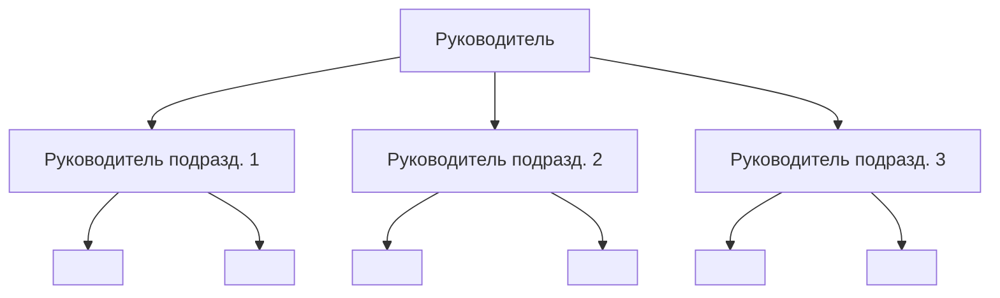

*Подчиненные подразделения*

*Рис. 8.6. Иерархическая структура организации*

Как видно из представленной схемы, в такой организационной структуре все или почти все производственные вопросы решаются через привлечение вышестоящего звена нижестоящим, при этом практически не взаимодействуя друг с другом на одном уровне управления.

Дивизионная (функциональная) структура характеризуется преобладанием горизонтальных управленческих связей, по которым происходит взаимодействие между руководителями или подчиненными одного уровня. В позитивном варианте восприятие такой структуры будет создавать у персонала компании чувство единения

> [!quote]- Оригинал: стр. 310 · PDF 317
> 

---

общими целями и задачами, общей ответственностью за конечный результат труда, коллективистский подход в решении производственных проблем. В негативном варианте данная структура может способствовать развитию личной безответственности, стремлению переложить свои функции на плечи другого, самоустраниться, не раскрывая при этом свой потенциал в полной мере. Доминирование дивизионной структуры в системе управления наиболее наглядно отражено в организациях (а лучше сказать, в учреждениях и группах), где конечным результатом деятельности является какой-либо продукт творческого процесса (общественные организации, благотворительные фонды и акции, социально-политические движения, мероприятия и т. д.). В графическом исполнении такая структура представлена на рис. 8.7.

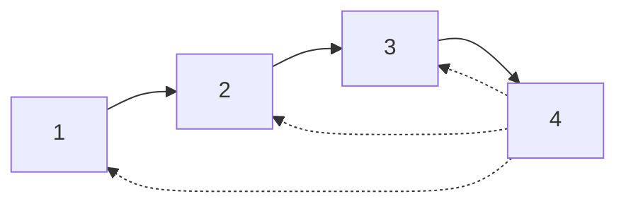

*Рис. 8.7. Дивизионная (функциональная) структура организации*

Из представленной схемы вытекает, что для принятия какого-либо решения каждое звено цепи структуры имеет одинаковое значение и равную статусность. Эти решения характеризуются условием коллегиальности. При выпадении одного из звеньев конечный продукт все равно будет представлен и создан, хотя, возможно, он будет отличатся незначительным качественным показателем.

Матричная (линейно-функциональная) структура характеризуется наличием хорошо и сбалансировано функционирующих как линейных (вертикальных), так и функциональных (горизонтальных) управленческо-коммуникативных связей между отдельными руководителями, структурными подразделениями и исполняющим звеном организации. В статичном состоянии такая система напоминает соты пчелиного улья, но во временнбм факторе, из-за высокой мобильности взаимообразных коммуникационных связей, эта система может видоизменяться в зависимости от поставленной той или иной производственной задачи, технологического процесса и, соответственно этому, могут образовываться рабочие группы, как мозаика в детском калейдоскопе. От руководителя такой компании потребуется максимальное внимание, самодисциплина и высокие трудозатраты для координации успешного функционирования организации в целом. Зато и результаты будут замечательными. Матричная структура будет восприниматься персоналом в одном как улей, где каждый занят своим делом, а в другом — как хаос, где нет, не было и не будет порядка. Графически такую структуру можно видеть на рис. 8.8.

> [!quote]- Оригинал: стр. 311 · PDF 318
> 

---

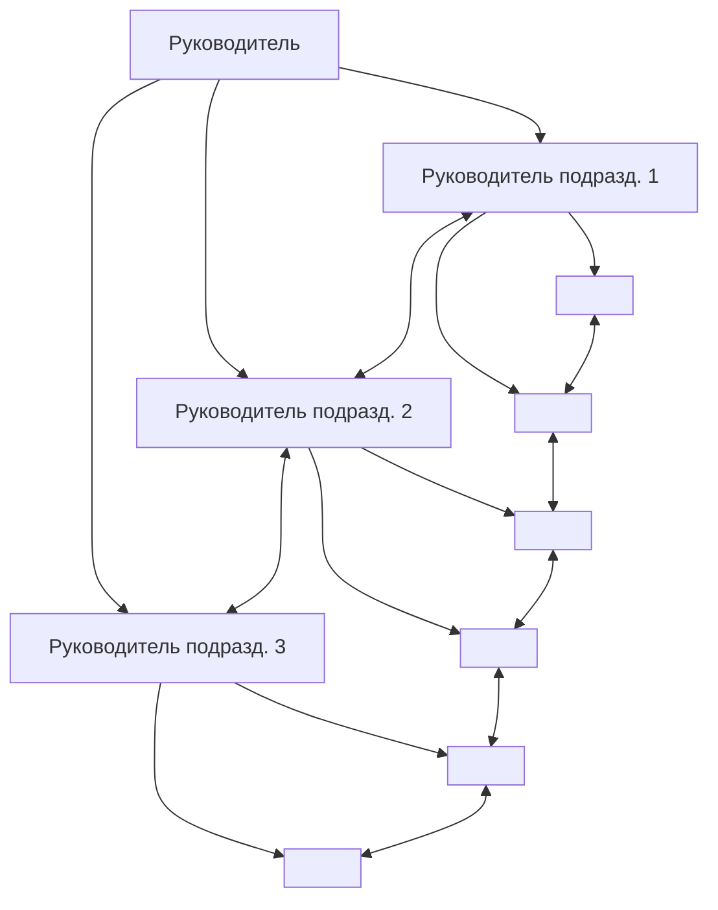

*Подчиненные подразделения*

*Рис. 8.8. Матричная (линейно-функциональная) структура организации*

На схеме видно, что линейные связи носят управляющий характер преимущественно односторонней направленности, а горизонтальные функциональные связи выполняют в основном коммуникативные задачи взаимодействия звеньев производственной цепи.

Кроме представленных выше основных структур управленческих связей, было бы целесообразно упомянуть еще об одном виде, который заслуживает внимания. Эту структуру определяют как «штабную». Ее применение эффективно и наиболее целесообразно на начальном этапе создания организации, когда существует команда единомышленников. Стиль управления в этом случае, безусловно, лидерский. Существует единоначалие, но подготовка решения и разработка основополагающих стратегических задач происходит путем коллегиального творческого процесса. Управленческие вопросы решаются не по типовым схемам администрирования, а путем согласования и коллективного принятия решений. Несмотря на недолговечность, из-за своей значимости этот период в жизни организации должен быть выделен и отражен в таких нормативных актах предприятия, как «Положение о структурных подразделениях», «Должностные инструкции руководящего состава организации», «Устав» и т. д. (рис. 8.9).

С течением времени, когда организация приобретает устойчивость на рынке, стабилизируются производственные процессы, необходимость в такой системе отпадает и тогда возникает потребность в переходе к линейно-функциональной системе управленческих связей. На практике это влечет за собой пересмотр основополагающих положений нормативных документов и актов организации (устав, штатное расписание, инструкции, положения и др.), что делать совершенно необходимо. Этот болезненный процесс роста организации неизбежен, и поэтому относиться к нему следует соответственно.

> [!quote]- Оригинал: стр. 312 · PDF 319
> 

---

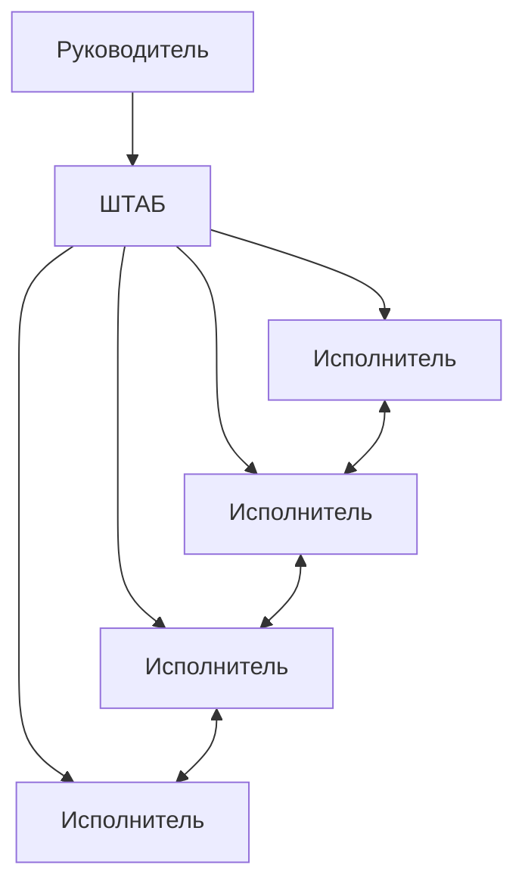

*Рис. 8.9. Штабная структура организации*

Справедливости ради нужно иметь в виду, что в чистом виде, изолированно друг от друга, данные структуры встречаются редко. Чаще можно видеть их различные комбинации, которые, динамично развиваясь, переходят одна в другую с течением времени в зависимости от той или иной производственной задачи, которая ставится перед организацией различными изменяющимися внутренними и внешними факторами. В то же время следует отметить, что в нашей стране в большинстве случаев традиционно используются структуры коммуникативно-управленческих связей с явным доминированием признаков линейности и иерархичности. Наследие ли это социалистического способа производства или более ранних отечественных традиций, условностей и законов в области организации трудового процесса, не является предметом для обсуждения в пределах данной книги. Факт остается фактом. И поэтому структурную схему организации и уровней руководства мы рассмотрим, исходя из данного наблюдения. В графическом виде это изображено на рис. 8.10.

Следуя логике представленной схемы, становится ясно, что каждому звену управления соответствуют свои цели, задачи, планы, обязанности и права. Соответственно, и мотивы в осуществлении своей трудовой функции у представителей разных уровней структуры организации различны. Поэтому и мотивация персонала должна отличаться одна от другой. Она не может быть универсальной и единой для всех, кроме наличия общей направленности к единой цели. Игнорирование, смешение или подмена этих внутрикорпоративных факторов может привести к нарушению коммуникативноуправленческих связей, дисгармонии производственного процесса, нестабильности и анархии в организации, увеличению числа стрессовых и конфликтных ситуаций и, как следствие, вообще к прекращению функционирования предприятия.

> [!quote]- Оригинал: стр. 313 · PDF 320
> 

---

**Структурная схема руководящего состава организации**

| Иерархия управления | Статус | Наименование, название | Функциональные задачи |
|---|---|---|---|
| Высшее звено | Собственники | Собрание акционеров | *Волеизъявление* |
| Высшее звено | Собственники | Ассамблея, правл., генеральный или управляющий совет собственников | *Волеформирование. Волеобразование* |
| Первое звено | Наемные рабочие | Генеральный директор (президент) | *Волеисполнение.* Разработка и постановка стратегических задач, планирования и развития, контроль исполнения |
| Второе звено (среднее) | Наемные рабочие | *Заместители г.д. (вице-президенты):* по фин.-экон. вопросам, производству; юр. вопросам, кадровой политике; маркетингу и т.д. | *Волеисполнение.* Выполнение стратегических задач, разработка и постановка тактич. задач перспективн. краткосрочного текущего планирования и развития, контроль |
| Третье звено (низшее) | Наемные рабочие | Руководители структурных подразделений, департаментов, самостоятельных отделов и групп, имеющих соответствующий статус | *Волеисполнение.* Непосредственное исполнение задач, поставленных вышестоящим руководством |
| | | ↓ **Исполнители** | |

*Рис. 8.10. Структурная схема руководящего состава организации*

##### Стадии управленческой деятельности

Все качественные изменения в организации сопровождаются изменением уровня руководства, сменой стадий управленческой деятельности руководителя. Этот объективный процесс обусловлен временными, качественными и количественными факторами жизнедеятельности организации. На первом этапе это коммуникатив-

> [!quote]- Оригинал: стр. 314 · PDF 321
> 

---

ная стадия. В этом случае все делают всё в условиях «тусовки». Все друг друга знают, взаимоотношения уже давно и прочно налажены, роли распределены и нет необходимости соблюдать субординацию.

С ростом организации и увеличением числа сотрудников наступает второй этап. Руководитель уже не может, да и не должен общаться и взаимодействовать со всеми сотрудниками, коммуникативная стадия управленческой деятельности сохраняется на уровне отделов. А на уровне первых лиц дополняется информационной стадией. Это значит, что руководство определяет круг вопросов и периодичность поступления информации. Эта стадия сопровождается процессом создания информационной системы внутри организации. Начальники отделов начинают играть роль «адапторов» и «проводников» информации снизу вверх и обратно.

Финансовая стадия управленческой деятельности руководства характерна для крупных организаций, в которых руководитель контактирует лишь с крайне ограниченным кругом лиц, как правило, не превышающим десяти человек, а информацию получает в стандартизированном и обобщенном виде (для всестороннего воссоздания целостной картины развития и функционирования организации). В дополнение хотелось бы отметить, что именно в таких организациях наиболее предметно встает задача целенаправленного создания позитивного имиджа руководителя как одного из инструментов административного управления.

В современных динамичных условиях отечественного бизнеса абсолютное большинство организаций малого и среднего звена (а в некоторых случаях и крупные предприятия) настолько стремительно проходят все этапы развития, что не успевают закрепить и освоить произошедшие изменения. Это состояние может грозить неприятными последствиями для дела. Например, может не оформиться информационная система, или руководитель высшего звена будет брать на себя функции начальников отделов, стремясь сохранить коммуникативную стадию управленческой деятельности, решая задачи, не свойственные его статусу, распыляясь по мелочам, упуская время и стратегически важные дела. В результате этого процесса атмосфера и обстановка в успешно развивающейся организации будет восприниматься самими сотрудниками как хаотическая, нестабильная, нервирующая. То есть в этом случае сложившийся имидж такого руководителя будет явно демотивирующим фактором для продуктивной работы персонала.

##### Стили руководства

Эффективность руководства в значительной мере зависит от его стиля. Под этим понятием понимаются «стабильно проявляющиеся особенности взаимодействия руководителя с коллективом, формирующиеся под влиянием как объективных и субъективных условий

> [!quote]- Оригинал: стр. 315 · PDF 322
> 

---

управления, так и индивидуально-психологических особенностей личности руководителя»[^p323-1].

Традиционно в специальной литературе, посвященной проблемам менеджмента и психологии профессиональной деятельности, выделяют три основных блока типов стилей руководства. В различных источниках им дают разные названия и определения, хотя суть содержания понятий при этом не изменяется. Это:

- авторитарный (автократический, диктаторский, директивный и т. д.);
- демократический (парламентарный, «метод длинных вожжей» и т. д.);
- отстраненный (анархичный, либеральный, попустительский ит. д.).

Зарубежные источники отмечают, что большинство руководителей на предприятиях используют автократические методы руководства людьми. Это считается оправданным и беспроигрышным, поскольку запланированные и тщательно подготовленные руководством мероприятия наталкиваются на преграды человеческого фактора, скрытое или открытое сопротивление и даже саботаж исполнителей. Этот стиль характеризуется, прежде всего, наличием официальности в отношениях с подчиненными, отсутствием доверительности, нежеланием считаться с мнением работников и сопровождается повышенной конфликтностью не только в отношениях с отдельными подчиненными, но и целых рабочих групп. Лидер лично обращается к членам коллектива, чтобы узнать их позицию в удобном для себя порядке. Прерывает аргументацию говорящего, если считает ее неверной или несхожей со своей собственной позицией, давая понять каждому сотруднику его место, самостоятельно делает выбор из предложенных вариантов. Парадоксальным является тот факт, что авторитарный руководитель может добиться более высоких результатов в производительности труда работников, используя такие отрицательные с психологической точки зрения явления, как: агрессивную направленность деятельности личности работника, стресс-методы управления и т. д., правда, при этом практически совсем не берется в расчет, что за таким подъемом, как правило, всегда наступает период спада и депрессии. Работник порой просто не успевает восстановиться до уровня нормального трудоспособного состояния. И длительное его пребывание в таком производственном режиме, в конце концов, может привести к эмоциональному срыву и даже к потере здоровья. Сторонники применения этого стиля в управленческой деятельности нередко ссылаются на 3. Фрейда, аргументируя свою позицию его высказыванием о том, что «продук-

[^p323-1]: Русаликова А. А. Некоторые характеристики руководителя как субъекта управления трудовым коллективом // Трудовой коллектив как объект и субъект управления. Л., 1980. С. 101.

> [!quote]- Оригинал: стр. 316 · PDF 323
> 

---

тивная работа отчасти является функцией выражения агрессивности по отношению к лидеру». При благоприятных обстоятельствах авторитарный руководитель будет восприниматься подчиненными как глава клана или семьи в патриархальном смысле этого понятия. В противном случае — как символическая фигура, олицетворяющая жесткость и бесчеловечность иерархической структуры.

На практике встречаются различные типы авторитарного стиля руководства. Рассмотрим некоторые наиболее характерные из них.

Диктаторский (рис. 8.11).

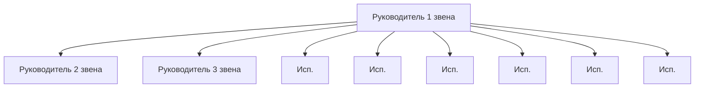

*Рис. 8.11. Диктаторский тип стиля руководства*

Данный тип стиля руководства характеризуется односторонней безоговорочной направленностью управленческой коммуникации непосредственно от руководителя к исполнителям, минуя средние и низшие звенья управления.

(+) Бывает необходим и наиболее эффективен при решении оперативных, безотлагательных и кризисных профессиональных задач, когда любое промедление способно повлечь необратимые или катастрофические последствия.

(—) Практически недопустимо применение в продолжительном временном отрезке работы организации, так как может привести к распылению руководящей функции менеджера и потери им ориентации в решении стратегических задач.

Авторитарный (рис. 8.12).

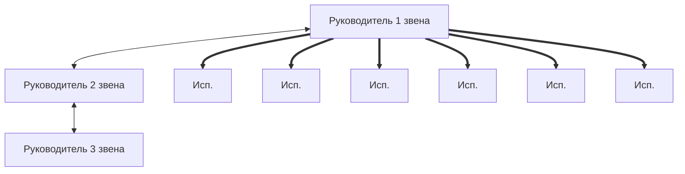

*Рис. 8.12. Авторитарный тип стиля руководства*

Этот тип стиля руководства является разновидностью предыдущего. Его отличие заключается в том, что к характеристикам

> [!quote]- Оригинал: стр. 317 · PDF 324
> 

---

первого стиля добавляется некоторая возможность корректировки решений руководителя первого звена управления — мнениями, рекомендациями других менеджеров. То есть они до некоторой степени имеют возможность влияния на управленческую коммуникацию. Выделен в отдельный тип классификации исключительно потому, что задачи, которые призван решать этот стиль, носят совершенно иной характер, чем в предыдущем случае.

(+) Бывает необходим и наиболее эффективен при решении оперативных и безотлагательных задач, возникающих на самой первой стадии организации работы предприятия, когда от скорости прохождения решения от первого звена до последнего, участвующего в производственном процессе, зависит успешность в подъеме и становлении организации как структурного конкурентоспособного участника рынка.

(—) Аналогично предыдущему случаю.

Дисциплинарный (рис. 8.13).


*Рис. 8.13. Дисциплинарный тип стиля руководства*

Дисциплинарным этот тип стиля руководства организацией специалистами назван по аналогии с армейским или командирским (еще его называют иерархическим). Он характеризуется односторонней безоговорочной направленностью управленческой коммуникации, строго следуя иерархии управления.

(+) Необходим и наиболее эффективен в организациях, где в силу производственных условий очень большое значение имеет дисциплина труда, непрерывность производства и четкое разграничение функциональных обязанностей на всех уровнях технологического процесса, где не бывает или практически не бывает промежуточных этапов в создании продукта, а весь результат работы организации можно оценить и определить только на окончательном этапе. Организация функционирует как единый механизм.

(—) В силу своей природы такой тип стиля руководства не предполагает высокого уровня креативности в организации. При возникновении кризисных ситуаций, форс-мажорных обстоятельств или при неожиданном выпадении одного из звеньев цепи на решение проблем затрачивается неоправданно значительное количество времени. В этих условиях представленный тип неэффективен. Кро-

> [!quote]- Оригинал: стр. 318 · PDF 325
> 

---

ме того, есть опасность разрыва коммуникации или представления неистинного, искаженного объема и качества информации на различных отрезках технологической цепи.

Названия, данные каждому из этих типов стилей управленческой деятельности, весьма приблизительны и, в сущности, не играют значительной роли для понимания сути их характерных черт и различий. Применение авторитарного стиля руководства проходит двойной путь: от менеджера к подчиненному, а затем от них — в виде обратной связи — о принятии или отторжении этого стиля. А вот характер ее сущности может быть порой неоднозначным и непредсказуемым.

Современные отечественные и зарубежные ученые исследователи проблем управления, психологии и социологии все больше убеждаются в том, что на предприятиях не хватает «человеческого лица». Это означает, что всем руководителям, начиная с самого верхнего звена управления и кончая «низовым», нужно менять стиль управления и внедрять персонифицированные отношения с работниками. Современные управленцы часто упрекают исполнителей за то, что у них отсутствует «менеджерское отношение» к труду, творческое начало в работе. В этой связи возникает вопрос: как можно этого ожидать при стиле управленческой деятельности руководства, самой своей сутью низводящей простых сотрудников до уровня слепых исполнителей? Реальная ситуация такова, что подчиненный, возможно, и хочет быть и активным, и полезным, и нужным своей организации, но ему, как правило, отказывают в творчестве. Мнения некоторых практиков современного управления сводятся к тому, что они рекомендуют руководителям компаний использовать для улучшения отношений с персоналом стили менеджмента из блока демократических типов при условии, когда это не противоречит требованиям производственной необходимости. Эти стили предоставляют значительную свободу творческим людям, новаторам, исследователям, изобретателям и пр., а также представителям тех профессий, где креативность является неотъемлемой частью успешного производственного процесса. Это могут быть журналисты, специалисты в области РВ, 1Т, рекламы, дизайнеры, имиджмейкеры и т. д. Демократический стиль руководства главной своей чертой имеет наличие постоянного контакта с людьми. Лидер, придерживающийся его в своей работе, характеризуется склонностью к делегированию власти и коллегиальным подходом в отношении обсуждения важных производственных вопросов. При данном стиле приветствуется и поощряется самостоятельность и неординарность мышления у персонала, а также их решительность при принятии на себя ответственности в силу своей компетентности. При таком стиле, как правило, в организации отсутствует агрессивность у сотрудников по отношению друг к другу, конфликтные ситуации

> [!quote]- Оригинал: стр. 319 · PDF 326
> 

---

и стрессы в производственном процессе сведены к минимуму и, как правило, носят локальный и непродолжительный характер. Любые творческие начинания, инициатива и устремленность на общие цели и задачи, а также дружелюбие у исполнителей приветствуется. Имидж такой компании носит ярко выраженную направленность на потребности и интересы клиента. Все члены коллектива высказываются в свободном порядке, каждый аргументирует свою позицию и концепцию. Менеджер участвует в дискуссии наравне со всеми, а выбор решения осуществляется, исходя из победившей среди экспертов точки зрения. Руководитель, использующий преимущественно данный стиль управленческой деятельности, может восприниматься в одном случае как заботливый, мудрый старший товарищ, в другом — как человек, не способный проявить последовательность и твердую волю.

Целесообразно обратить внимание на следующие характерные типы демократического стиля управленческой деятельности и руководства.

*Полудемократический* (рис. 8.14).

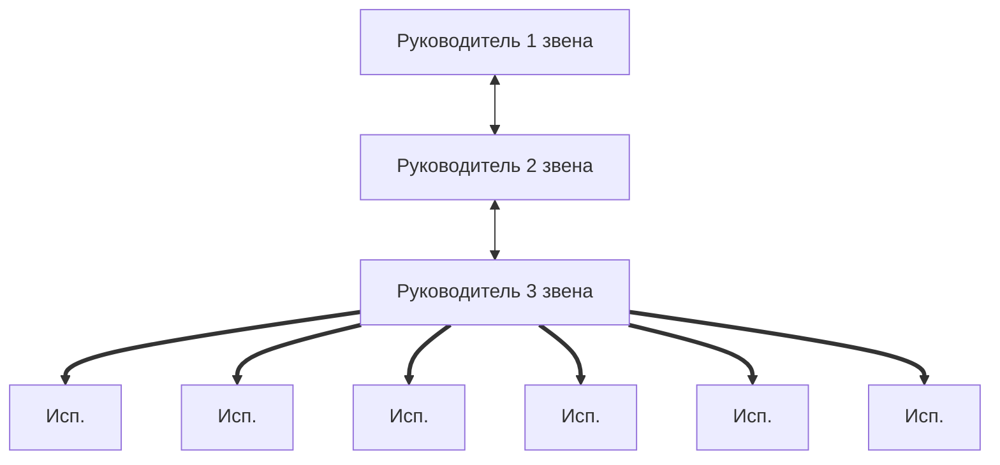

*Рис. 8.14. Полудемократический тип стиля руководства*

Представленный здесь тип стиля руководства еще называют «штабным». Он характеризуется тем, что, в отличие от предыдущих рассмотренных случаев, в управленческой коммуникации уже появляются элементы взаимодействия, а не просто одностороннего действия. На уровне руководства присутствуют коллегиальный подход в обсуждении производственных вопросов и принятии по ним решений, хотя вся ответственность возлагается на вышестоящее руководство. Но при этом сохраняются субординационные отношения и иерархическая структура организации. Исполнительскому же звену исключительно отводится роль слепого орудия исполнения воли и распоряжений вышестоящих звеньев.

(+) Эффективность применения данного типа стиля управленческой деятельности наиболее высока в организациях, где производственный процесс носит комбинированный характер, когда результаты творческого труда, креативный продукт, нуждаются в реальном, материальном воплощении в виде физически ощутимого продукта. Это различного рода конструкторские бюро, науч-

> [!quote]- Оригинал: стр. 320 · PDF 327
> 

---

но-производственные объединения, некоторые наиболее крупные рекламные и PR-агентства, издательства и т. д.

(—) В силу производственного дуализма при такой организации труда существует предрасположенность к возникновению конфликтных ситуаций между сотрудниками одной организации. Например, в некоторых случаях возникает конфронтация между менеджером, отвечающим за качество дорогостоящей продукции и руководителем, отвечающим за реализацию этого товара, так как сталкиваются их интересы. Руководитель верхнего звена управления в такой ситуации оказывается в большом затруднении: как найти нужную линию поведения, поскольку на него будут направлены влияния его подчиненных с прямо противоположными интересами. Для успешного решения проблемы потребуются не столько логико-аналитические выкладки и аргументы, сколько коммуникабельность во взаимодействии со своей командой и даже ловкость в умении поставить задачу, быстрота ответов, красноречие и т. п. приемы.

Демократический (рис. 8.15).

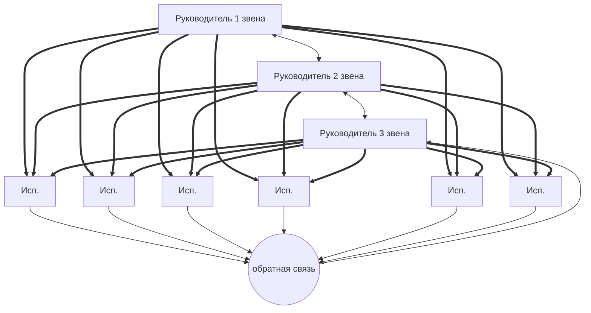

*Рис. 8.15. Демократический тип стиля руководства*

Характерной чертой представленного типа стилей руководства является истинное, а не декларируемое взаимодействие всех участников производственного процесса в обсуждении, подготовке и реализации того или иного решения вне зависимости от статусного расположения на иерархической лестнице. При этом коллегиальность полная или почти полная. Это команда единомышленников. Но во время самой реализации принятого решения ответственность распределяется в соответствии с компетенцией и квалификацией сотрудников, участвующих в проекте.

(+) Данный тип стиля управленческой деятельности в настоящее время хорошо представлен в организациях и учреждениях, результатом деятельности которых является продукт с большой долей креативной составляющей, если не целиком состоящей из нее. Это могут быть различного рода учреждения, образовательные структуры, политические партии, общественные объединения и т. п.

> [!quote]- Оригинал: стр. 321 · PDF 328
> 

---

(—) В организации с таким типом стиля управленческой деятельности всегда присутствует вероятность образования наряду с формальной лидерской управленческой группой, которая обладает всеми соответствующими полномочиями, правами и обязанностями, равноценной ей по своему сущностному содержанию неформальной группы. Такая своего рода оппозиция может привнести деструктивизм в процесс работы организации.

Позиционарный (рис. 8.16).

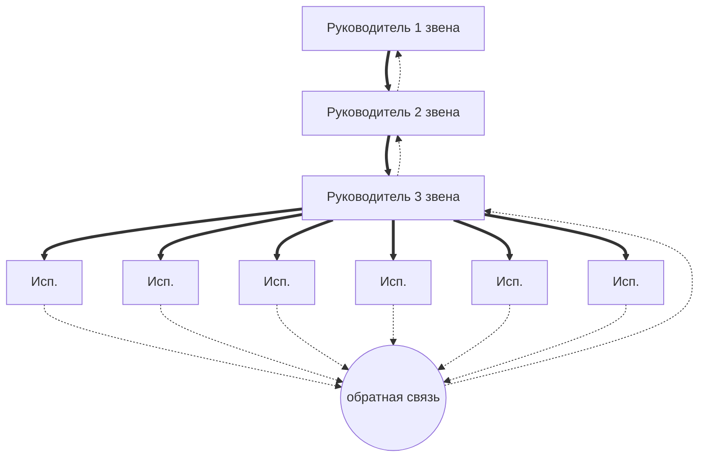

*Рис. 8.16. Позиционарный тип стиля руководства*

Строго говоря, данный тип стиля управленческой деятельности к демократическому блоку можно отнести весьма условно. Руководители, прибегающие к нему, на самом деле могут исповедовать какие угодно другие стили и методы, прикрывая их псевдодемократическим стилем, при этом демонстрируя или позиционируя себя как приверженцев передового и нового. Тем не менее, мы будем рассматривать этот тип стиля и именно в этом спектре, так как:

- в этом случае обязательно присутствуют все характерные признаки демократического типа стиля руководства;
- вне зависимости от истинных целей руководителя, прибегнувшему к данному стилю, он является предвестником неизбежной трансформации старого стиля управленческой деятельности, т. е. возникает классическая ситуация перемен, когда «верхи не могут, а низы не хотят...».

(+) К позитивным факторам позиционарного типа можно отнести то, что с его помощью организация в целом может избежать или, как минимум, амортизировать конфликтно-кризисную производственную ситуацию, либо ее последствия (например, забастовки подчиненных, стачки, голодовки и т. п.), смягчить остроту противоречий между руководящим составом и подчиненными сотрудниками. Нередко на практике случается, что ошибки исполнения принятого решения обнаруживаются только на стадии его реализации или завершения. Это происходит потому, что руководитель не всегда в состоянии увидеть просчеты в своих выводах и заключениях и это прямой путь к конфронтации. Научно доказано, что эффективным может быть только такое решение, которое принимается как

> [!quote]- Оригинал: стр. 322 · PDF 329
> 

---

руководителем, так и самим исполнителем с учетом качества этого решения. И вот именно здесь находится законное место применения указанного типа стиля управленческой деятельности.

(—) Возможны варианты нарушения взаимоотношений между управленческим и исполнительским звеньями организаций, когда руководитель внимательно выслушивает высказывания подчиненных или делает вид, что слушает с целью отвергнуть эти предложения, несмотря на их инициативу по улучшению решений. А затем, по прошествии некоторого времени, прибегает к использованию ранее предложенных чужих улучшений, выдавая их за свои. Нет более эффективного способа подавить инициативу подчиненных и, с точки зрения интересов учреждения, подобный поступок является уничтожением самого ценного его достоинства — морального духа коллектива. Психологическим последствием такого подхода к работникам является возникновение отрицательной мотивации к труду.

Еще один блок стилей управленческой деятельности, который является в нашем рассмотрении, — это либеральный (отстраненный, попустительский, анархический и пр.). Несмотря на явный негативизм этих типов управления, они нередко встречаются на практике в некоторых организациях. Там имеют место:

- панибратские отношения;
- согласие у руководства с мнением подчиненных;
- слабое распределение обязанностей;
- отсутствие целеустремленности;
- наличие у руководителя неуверенности в себе при принятии ответственных производственных решений;
- весьма велика вероятность возникновения конфликтов без конструктивного их решения.

Как правило, в таких организациях руководитель не вмешивается в порядок и содержание групповой дискуссии экспертов. Аргументация каждого эксперта заслушивается полностью, вне зависимости от качественных показателей предлагаемого решения. Лидер не высказывает своей позиции и, в лучшем случае, задает вопросы. Обсуждения и совещания носят сумбурный характер, отклоняются от заданной темы, переходя на малозначительные и второстепенные детали. В результате резолюция не принимается вовсе, либо для этого тратится неоправданно значительное количество времени. Решение лидер принимает единолично, часто в отрыве от альтернатив, выработанных в процессе обсуждения проблемы. Оно либо самостоятельное, либо принимается, когда руководитель идет по пути наименьшего сопротивления, на поводу у кого-то одного или группы лиц. Такие решения часто носят бессистемный характер и противоречат одно другому (например,

предыдущему).

> [!quote]- Оригинал: стр. 323 · PDF 330
> 

---

В одном случае руководитель будет восприниматься подчиненными как прогрессивная личность, способная принять все точки зрения и не зажимающая инициативу, в другом случае как равнодушный, самоустраняющийся субъект. Психологической причиной этого является проявление стереотипов мышления и инерции у руководителей, страх перед ответственностью при принятии того или иного решения, боязнь совершить промах или ошибку. Отсюда стремление самоустраниться и предоставить все воле случая. Парадоксом является и то, что многие высококвалифицированные менеджеры просто оказываются нечувствительными к внешним переменам, от которых в сущностной степени зависит деятельность фирмы. Практикой подтверждено, что в любой организации существует стандартный набор привычек решать проблемы определенными, хорошо отработанными способами. Поэтому руководители не стремятся находить новые средства решения во вновь возникающих проблемах, а большинство из них и вовсе не хотят никаких изменений, так как понимают, что перемены требуют больших усилий как со стороны руководителя, так и со стороны персонала. Для такого руководителя в личностном плане это чревато тем, что в недалеком будущем он со своим стереотипным отношением к новым проблемам будет находиться в отрыве от действительности и станет совсем неэффективным, что с неизбежностью отразится на его индивидуальной карьере. Что касается организации, то она будет стремиться избавиться от таких руководителей. В противном случае она перестанет быть конкурентоспособной. Тем не менее, с объективной точки зрения, когда возникает такая ситуация в организации, как и при любом другом кризисе, можно говорить о присутствии некоторого положительного аспекта. Речь идет о возникновении объективных причин выхода из стагнации в процессе жизнедеятельности организации и необходимости изменений в структурных и ситуационных условиях существования фирмы. Неизбежность преобразований тем более становится очевидной, чем глубже укореняется кризис в управленческой деятельности руководства.

Ниже предлагаются три схемы (рис. 8.17—8.19).

```mermaid
graph TD
    R1[Руководитель 1 звена] <--> R2[Руководитель 2 звена]
    R2 <--> R3[Руководитель 3 звена]
    R3 <--> e1[Исп.] & e2[Исп.] & e3[Исп.] & e4[Исп.] & e5[Исп.] & e6[Исп.]
```

*Рис. 8.17. Либеральный тип стиля руководства*

> [!quote]- Оригинал: стр. 324 · PDF 331
> 

---

```mermaid
graph TD
    R1[Руководитель 1 звена] -.-> R2[Руководитель 2 звена]
    R2 --> R1
    R2 -.-> R3[Руководитель 3 звена]
    R3 --> R2
    R3 -.-> e1[Исп.] & e2[Исп.] & e3[Исп.] & e4[Исп.] & e5[Исп.] & e6[Исп.]
    e1 & e2 & e3 & e4 & e5 & e6 --> FB(("обратная связь")) --> R3
```

*Рис. 8.18. Попустительский тип стиля руководства*

```mermaid
graph TD
    R2[Руководитель 2 звена] --> R1[Руководитель 1 звена]
    R2 -.-> R3[Руководитель 3 звена]
    R3 --> R2
    R3 -.-> e1[Исп.] & e2[Исп.] & e3[Исп.] & e4[Исп.] & e5[Исп.] & e6[Исп.]
    e1 & e2 & e3 & e4 & e5 & e6 --> FB(("обратная связь")) --> R3
```

*Рис. 8.19. Отстраненный тип стиля руководства*

Все три типа стиля управленческой деятельности, представленные здесь, по своей сущности являются одним и тем же типом. При всей своей видимости сохранения структуры как единого организма они ею, строго говоря, не являются, так как не предполагают ответственного руководства в обсуждении, принятии, продвижении и исполнении производственных решений, направленных на результат труда. Друг от друга они отличаются лишь разницей в позиции руководителя. В первом случае менеджер выступает как равноправное и равнозначное звено, без принятия на себя ответственности. Во втором — имеет совещательный статус и идет на поводу у обстоятельств. В третьем — он вообще устранен или самоустранен из производственного процесса, выступая в роли «свадебного генерала», и занимает созерцательную позицию.

(+) К позитивным факторам в этой ситуации можно отнести то, что эти стили руководства позволяют максимально использовать творческий потенциал коллегиального подхода в решении производственных задач. Креативная компонента коллектива никоим образом не подавляется авторитетом руководства организации. Здесь можно с наибольшей эффективностью применять, например, такие инновационные методы поиска решения, как «мозговой штурм» и аналогичные. Единственное, что стоит не забывать, так это — временной фактор, который при значительной продолжительности

> [!quote]- Оригинал: стр. 325 · PDF 332
> 

---

ситуации применения этих типов стиля руководства организации может сыграть отрицательную и даже разрушительную роль, о чем уже говорилось выше. На короткий период времени данные типы бывает целесообразно применять на выходе из конфликтной производственной ситуации в послекризисный период. Это хорошо сглаживает остроту противоречий во взаимоотношениях между сотрудниками одной организации в условиях такой коммуникации, как «начальник — подчиненный».

(—) Негативной стороной является то, что если появилась необходимость применения этих типов стилей управленческой деятельности, это подает сигнал для высшего звена управления (собственников) о необходимости поиска выхода из данной ситуации с помощью, например, небезызвестных из нашего прошлого «оргвыводов». Кроме того, может возникнуть прецедент искусственного создания в дальнейшем представителями неформальных лидерских групп персонала предприятия спекулятивных ситуаций, предрасполагающих к применению этих типов стилей руководства.

Как наиболее одиозный и деструктивный тип стилей руководства данного блока управленческой деятельности, можно рассматривать следующий случай (рис. 8.20).

```mermaid
graph BT
    e1[Исп.] & e2[Исп.] & e3[Исп.] & e4[Исп.] & e5[Исп.] & e6[Исп.] --> R1[Руководитель 1 звена] & R2[Руководитель 2 звена] & R3[Руководитель 3 звена]
    R1 -.-> R2 -.-> R3
    R3 -.-> e6
```

*Рис. 8.20. Анархический тип стиля руководства*

Данный тип является, как правило, следствием слишком затянувшегося попустительского или отстраненного типа стиля управленческой деятельности или каких-либо иных форс-мажорных кризисных управленческих ситуаций. Он характеризуется тем, что:

- изменилась полярность (направленность) управленческой коммуникации на прямо противоположную и фактически исполнительные звенья и звенья руководства поменялись местами;
- управленческая коммуникация напрямую фиксируется от исполнителей к руководителю, т. е. приобретает черты диктаторского типа руководства, только наоборот.

(+) С точки зрения жизнедеятельности организации, прямых позитивных факторов у данного типа мало. Их практически нет. К опосредованным можно отнести то, что наличие данного типа

> [!quote]- Оригинал: стр. 326 · PDF 333
> 

---

служит показателем глубокого и серьезного конфликта, протекающего как в открытой, так и в скрытой форме на начальной стадии.

(—) Основной негативной чертой этого типа, как и любой другой анархической системы, является невозможность конструктивного управления без радикальных изменений в организационной структуре, непредсказуемость общей коммуникационной ситуации, дестабилизация отношений и психологического морального климата, лихорадка или полная стагнация в производственном процессе. Если не принять срочных мер по стабилизации и переменам, ситуация окончательно может выйти из-под контроля и наступит агония предприятия.

Каждый стиль руководства имеет свои плюсы и минусы. Выбор того или иного стиля зависит не только от конкретной ситуации, сформированности коллектива, стоящих перед ним задач, но и от характера руководителя, его психологической, коммуникативной и квалификационной компетентности. Каждый стиль предъявляет свои требования к средствам, которыми пользуется лидер. Средства должны быть адекватны выбранному стилю. Например, если руководитель относится к «жесткому» типу и явно показывает, что сотрудники для него ничего не значат, и он рассматривает их только как обременительный «фактор издержек», то тем самым он весьма активно и действенно демотивирует сотрудников. Никакие в дальнейшем благие побудительные призывы такого руководителя не будут эффективны и не достигнут своей цели.

Представленные выше типы стилей управленческой деятельности руководителей и их основные характеристики весьма удачно отражены в так называемой управленческой матрице, впервые описанной в 60-е годы американскими психологами Р. Блейком и Д. Мутон[^p334-1].

Представленную таблицу, которая является инструментарием по оценке качественных показателей эффективности организации с точки зрения управленческой деятельности, еще называют «решеткой менеджмента» (рис. 8.21). Так, о компаниях, находящихся в секторе 1.1, можно сказать, что здесь — неэффективный менеджмент и ленивые работники. В секторе 1.9 — основная задача компании — удовлетворить потребности персонала, своеобразный «клуб по интересам». Сектор 9.1 характеризуется девизом «Все для победы, несмотря ни на что», здесь к сотрудникам относятся как к необходимому одушевленному средству производства, без учета их целей и мнения. В средней части матрицы, в секторе 5.5 — находятся компании с относительно устойчивой производственной ситуацией, но без активного творческого и трудового энтузиазма сотрудников, отрабатывающих положенное рабочее время. Сек-

[^p334-1]: Кунц Г., О’Доннел С. Управление. Системный и ситуационный анализ управленческих функций. Т. 2. Ч. 6. М., 1981.

> [!quote]- Оригинал: стр. 327 · PDF 334
> 

---

тор 9.9 — почти совершенство, с идеальными условиями труда персонала, при высоком коэффициенте производительности, с эффективной системой управленческой деятельности.

| Забота о людях ↑ \ Забота о производстве → | 1–3 (незначительная) | 4–6 | 7–9 (значительная) |
|---|---|---|---|
| **7–9 (значительная)** | **1.9.** Max внимание к людям, min внимание к работе | | **9.9.** Высокая ориентация на эффективную работу с доверием и уважением к людям |
| **4–6** | | **5.5.** Умеренное внимание к работе и к людям | |
| **1–3 (незначительная)** | **1.1.** Min внимание к людям и к производству | | **9.1.** Max внимание к работе, min внимание к людям |

*Рис. 8.21. Управленческая матрица (по Р. Блейку и Д. Мутону)* — сетка 9 × 9: по вертикали «Забота о людях» (от незначительной к значительной), по горизонтали «Забота о производстве».

В любой компании важнейшим вопросом является полномочность в принятии решений. Полемика среди современных менеджеров о том, нужно ли допускать простых работников к участию в принятии решений, не прекращается до сих пор. Многие управленцы придерживаются мнения, бытовавшего еще во времена основателя американской научной школы управления Ф. У. Тейлора: «Пускай рабочий думает, но не решает». Далеко небезызвестный американский социальный психолог Д. Мак-Грегор заявлял, что «…если работникам позволят влиять на решение, их касающееся, то скоро они захотят участвовать в таких решениях, до которых им нет дела»[^p335-1]. Тем не менее, современные научные разработки содержат противоположные выводы и рекомендации. Многие управленцы понимают, что персонал исполнительского звена способен к изобретательской деятельности, и организация очень много теряет, лишая простых ра-

[^p335-1]: *McGregor D.* The human side of enterprise / D. McGregor. N.Y., 1960.

> [!quote]- Оригинал: стр. 328 · PDF 335
> 

---

ботников творческого отношения к труду. Ученые предлагают более современные и полные параметры стилей руководства. Например, Т. Коно[^p336-1] построил четырехстилевую модель поведения высшего хозяйственного руководителя. В соответствии с его концепцией целесообразно выделить новаторско-аналитический (партисипативный или соучаствующий), новаторско-интуитивный, консервативно-аналитический и консервативно-интуитивный стили руководства. В своей работе он делает вывод о том, что только партисипативный стиль способен обеспечить выживание организации в условиях острейшей рыночной конкуренции. Основными чертами этого стиля являются: доверительное отношение между руководителем и подчиненными, основанные на взаимном уважении; коллегиальность в разработке и принятии организационных решений, планирование и осуществление производственных изменений; делегирование руководителем подчиненным ряда полномочий автономно разрабатывать и формировать новые идеи и т. д. Как мы видим, соучаствующий стиль корреспондируется с рассмотренным нами ранее демократическим стилем.

Однако при всей своей привлекательности и видимой универсальности для использования этот стиль требует соответствия определенным условиям, которые включают три группы факторов:

- характеристику руководителя;
- характеристику подчиненных;
- характеристику задач, стоящих перед организацией.

Руководитель должен обладать: уверенностью в себе, высоким интеллектуальным и образовательным уровнем, умением ценить способности и предложения подчиненных, ориентацию на оценку сих стороны и ожидания от них креативных решений, развитыми морально-этическими качествами и т. д.

Параметры персонала: высокий уровень профессионализма, выраженная потребность в независимости, стремление к личностному росту и творчеству, интерес к работе, ориентация на саморазвитие и перспективные цели, стремление к равенству в отношениях и пр.

Характеристика организационной (групповой) задачи: предполагается множественность решений, требуется глубокий теоретический анализ и высокопрофессиональное исполнение, выполняется средними по напряженности усилиями.

Основными препятствиями для партисипативного (соучаствующего) стиля управления являются:

- отстраненное и высокомерное поведение руководителя, нежелание делиться властью с подчиненными;
- низкий профессиональный уровень персонала, боязнь ответственности и самостоятельности в реализации принятых решений;
- плохое информационное обеспечение организации, что мешает выработке необходимых решений;

[^p336-1]: Коно Т. Стратегия и структура японских предприятий. М., 1987.

> [!quote]- Оригинал: стр. 329 · PDF 336
> 

---

- недостаток организационных стимулов (отсутствие верной и адекватной мотивации и заинтересованности для включения в процесс соучастия);
- дефицит времени, отводимого для выполнения задания;
- специфика самой задачи, требующей для своего решения более жестких методов руководства.

Из вышеизложенного со всей определенностью следует, что стиль руководства, взятый сам по себе, без учета конкретных условий его реализации еще ничего не решает. Это справедливо по отношению ко всем типам стилей управленческой деятельности. Стили руководства всегда должен быть соотнесен с эффективностью функционирования соответствующего коллектива и его особенностями.

### 8.3. Внутрикорпоративный Public Relations

Внутрикорпоративные коммуникативные связи, выполняющие информационную, управленческую и объединяющую (разрозненные части социума в единое социальное целое) функции, выполняют внутри компании важную задачу менеджмента, которая устанавливает и поддерживает отношения между организацией и ее сотрудниками. Определяющая цель мероприятий по связям с общественностью — формирование управляемого позитивного имиджа фирмы, а также ее продукта в глазах широкой общественности: самих сотрудников организации, клиентов, партнеров, властей.

Формированием внутрикорпоративных связей в организациях занимаются службы по связям с общественностью (или отдельные их представители), как правило, являющиеся составной частью структурного подразделения организации по управлению персоналом. Это ответственная и значительная по объему работа, которой необходимо уделять большое внимание. Задача службы по внутрикорпоративным связям с общественностью состоит в том, чтобы содействовать эффективному управлению человеческими ресурсами.

Эффективность деятельности современной компании зависит от сплоченности персонала, от доверительных, заинтересованных отношений между руководством и сотрудниками, от надежности вертикальных и горизонтальных связей. Современный работник должен быть заинтересован в успехах фирмы, в результатах своего труда. Из чего может складываться эта заинтересованность?

Мотивы сотрудников[^p337-1] (по Г. Воробьеву) могут быть следующими:

- соответствие характера работы характеру работника;
- зарплата, выполняющая функцию эквивалента затраченного труда в виде обратной связи, складывающейся на основе личного вклада, участия в работе коллектива и участия в прибылях;

[^p337-1]: Воробьев Г. Человеческие ресурсы и современная служба персонала // Социологические исследования. 1996. № 11. С. 111.

> [!quote]- Оригинал: стр. 330 · PDF 337
> 

---

- комфорт на рабочем месте, отсутствие которого должно компенсироваться денежной надбавкой;
- чувство хозяина, испытываемое на любом рабочем месте;
- самоуправление — уверенность работника в том, что высказанное им мнение, соединившись с мнениями других, может влиять на технологию производства, организацию управления, подбор и расстановку персонала и т. д.

Для объединения интересов компании и интересов ее сотрудников, по мнению Г. Воробьева, необходимо:

- объединение персонала на основе индивидуальных целей (зарплата) для достижения общей цели (прибыль и процветание фирмы);
- создание идеологии и имиджа фирмы, в поддержании которого участвует персонал;
- взаимопонимание между руководством и персоналом;
- создание единой системы объективных оценок на основе вклада каждого в успех фирмы;
- поддержание высокого профессионализма;
- контроль за мотивированностью, поддержание благоприятного психологического и морального климата.

Эффективное выполнение функций внутрикорпоративных связей с общественностью ведет к более высокой производительности труда сотрудников и повышению степени их удовлетворенности работой, лучшему достижению целей организации, более гармоничным отношениям с руководством, потребителями, партнерами, инвесторами и т. д.

#### 8.3.1. Формирование коммуникаций внутри компании

Работа по установлению внутрикорпоративных коммуникативных связей с сотрудниками компании должна строиться на основе двусторонних партнерских взаимодействий. В организациях с высоким и эффективным уровнем коммуникативного взаимодействия сотрудники, как правило, хорошо информированы о всех необходимых им для продуктивного осуществления своей трудовой функции новшествах и важных событиях как вне, так и внутри организации. А также они имеют возможность высказывать свои мнения по организационным вопросам.

Современная организация, претендующая на статус передового предприятия, должна иметь в своем арсенале рабочих нормативных актов разработанную и, в приказном порядке, утвержденную программу по внутренней коммуникативной политике аналогично финансовой, кадровой, рыночной и пр. Если ее нет, то внутри организации будут формироваться предпосылки для возникновения и распространения всевозможных стрессовых и кризисных ситуаций различной степени тяжести (утечка клиентской базы; техноло-

> [!quote]- Оригинал: стр. 331 · PDF 338
> 

---

гии черного пиара со стороны конкурирующих организаций; слухи и дезинформация и т. д. — вот неполный список возможных «удовольствий»).

Коммуникационная политика должна иметь целевую ориентацию. Ее успех определяется стремлением руководства:

- кознакомлению служащих с целями, задачами и планами организации;
- информированию о проблемах, действиях и результатах;
- консультациям со служащими по поводу отрицательных, острых или противоречивых вопросов;
- стимулированию постоянного честного, ориентированного на решение трудовых проблем, двустороннего общения менеджера с подчиненными;
- оперативному быстрому информированию о наиболее важных делах и решениях;
- установлению духа творчества и новаторства.

Способы коммуникации:

- личная беседа с сотрудниками;
- рассылка циркуляров и меморандумов;
- распространение информации по электронной почте;
- использование видео и кабельного телевидения.

Формы внутриорганизационных коммуникаций для формирования в сознании персонала положительного имиджа компании:

- страница компании в Интернете;
- доски объявлений;
- общие собрания и конференции трудового коллектива;
- листок новостей (внутрикорпоративное периодическое печатное издание);
- бюллетень для менеджеров;
- ежегодные отчеты сотрудников (аналог годового отчета для акционеров).

При информационном взаимодействии с сотрудниками решаются такие важные задачи, как делегирование полномочий и воспитание чувства гордости за свою компанию. Делегирование полномочий определено необходимостью быстро и гибко реагировать на все изменения, которые происходят в компании.

Росту доверия к компании способствуют:

- регулярная коммуникация;
- демонстрация доверия к сотрудникам (например, распространение как хороших, так и плохих новостей);
- привлечение сотрудников к разрешению проблемных ситуаций, выяснение их мнений.

В больших коллективах высшее руководство в силу его структурной удаленности от подчиненных и номенклатурной разницы зачастую не уважаемо и не авторитетно в низовых звеньях. Ино-

> [!quote]- Оригинал: стр. 332 · PDF 339
> 

---

гда его просто не знают. Поэтому целесообразно, чтобы получение информации об организационных целях бизнеса проходило в форме личной встречи с глазу на глаз. В этой ситуации в общей цепи: «высшее руководство — менеджеры среднего звена — работники» возрастает роль руководителей среднего звена. Их задача — содействовать тому, чтобы сотрудники поняли, как воплощать в жизнь разработанную руководством стратегию.

Протестировать эффективность коммуникаций можно при помощи опроса случайной выборки работников или при помощи — фокус-групп.

Факторы, определяющие имидж и репутацию фирмы.

1. Результативность работы; качество продукции или услуг; тенденции роста и развития; стабильный доход.

2. Стабильная долговременная реклама (товарная и имиджевая).

3. Отзывы и рекомендации других фирм.

4. Состав клиентов.

5. Состав партнеров.

6. Прямая почтовая рассылка «direct mail».

7. Честность, обязательность в бизнесе.

8. Отзывы СМИ о положении фирмы в деловом мире (образ фирмы в СМИ).

9. Название фирмы.

10. Фирменный стиль.

11. Офис: местоположение, дизайн интерьера.

12. Размер фирмы.

13. Наличие филиалов.

14. Финансовая надежность.

15. Организация презентаций.

16. Спонсорство, благотворительность.

17. Участие в выставках, ярмарках, конференциях.

18. Высокий уровень качества управления (менеджмента) и технологий.

19. Уровень организационной культуры фирмы: уровень организации труда, оперативность, порядок, оригинальные методы работы; высокий уровень и культура обслуживания клиентов.

20. Миссия, корпоративные ценности.

21. Реализация концепции социально-этичного маркетинга.

22. Наличие традиций и духа соревнований.

23. Уважение правовых норм, законность операций.

24. Профессионализм сотрудников.

25. Респектабельность сотрудников, уровень зарплаты и социальных благ.

26. Корпоративный престиж. Психологический климат на фирме.

27. Уровень текучести кадров.

28. Личность лидера, его имидж.

> [!quote]- Оригинал: стр. 333 · PDF 340
> 

---

29. Стиль работы руководителя, его авторитет; публичные выступления.

30. Выступление представителей фирмы в СМИ, организация пресс-конференций.

31. Наличие внутреннего информационного центра (многотиражка и пр.).

32. Защита экологии и т. д.

Для иллюстрации вышеизложенного считаем целесообразным привести в качестве примера описание реально разработанного проекта по формированию внутрикорпоративных коммуникативных связей в организации.

Центр внутрифирменных коммуникаций «Томскнефть» (по материалам статьи А. Р. Бахарева[^p341-1])

Начальник управления планирования персонала ОАО «Томскнефть» ВНК, расположенного в городе Стрежевой, А. Р. Бахарев так рассказывает о внутрифирменных коммуникациях в компании «Томскнефть»:

В компании «Томскнефть» накоплен богатый опыт в этой сфере: отработана и хорошо функционирует система электронного документооборота, внедряется система управления и оценки по ключевым показателям эффективности, проведена большая работа по делегированию полномочий на разных уровнях ответственности.

В силу активного участия ее в делах Томского региона информация о деятельности компании распространяется во всех местных СМИ. В систему корпоративных коммуникаций вовлечен весь персонал предприятия: управляющая компания готовит и рассылает блок информационных сообщений о компании, положении дел в отрасли, достижениях и проблемах, назревших в регионах присутствия компании; издает корпоративную газету «Нефтяная параллель», создает и показывает корпоративную телепередачу «Вахта», которая транслируется в эфире местных телекомпаний.

Но оказывается, и этих мер недостаточно для информирования персонала. Проведенные исследования, как ни парадоксально, указали на нехватку информации на местах. Проблема во многом обусловлена особенностью географического расположения компании. Большинство месторождений «Томскнефти» находятся на значительном удалении от города (до 600 км) и люди, работающие вахтовым методом, зачастую не имеют возможности регулярно получать газеты, смотреть телевизор или следить за событиями при помощи Интернета.

Ббльшую часть Томской области занимают Васюганские болота — одни из самых больших в мире, поэтому до некоторых месторождений добраться можно только вертолетом или по зимникам. Поэтому руководство компании активно использует все возможности для организации встреч с коллективами на местах. Более того, в компании уверены, что для информирования сотрудников необходимо использовать все информационные каналы и инструменты коммуникации. Для решения этой задачи служба персонала совместно с руководством компании разработала

[^p341-1]: *Бахарев А. Р.* Коммуникации внутри компании: как добиться их эффективности. URL: http://www.iteam.ru/publications/human/section_44/article_2669/

> [!quote]- Оригинал: стр. 334 · PDF 341
> 

---

специальный проект, цель которого — своевременное и регулярное информирование всех сотрудников о направлениях деятельности компании, ее стратегии, социальной политике, о новых проектах и задачах, об изменениях, происходящих в компании и обществе, а также обеспечение обратной связи.

Для налаживания коммуникаций внутри компании используются информационные стенды, буклеты, плакаты, доклады, ящики обратной связи, выступления руководителей в СМИ, тематические страницы в местных газетах (с вопросами и ответами), специализированная телепрограмма, «круглые столы», «прямые линии» и «горячие линии», планерки и совещания, встречи с коллективами, Интернет (внутренний объединенный сайт компании).

Информационные стенды размещены в административных зданиях, находящихся как на месторождениях компании, так и в городе — в столовых, общежитиях, культурных центрах, в спортивно-культурном комплексе, на автостанции, с которой сотрудники уезжают на работу, в учебном центре. Рядом с ними расположены места для раздаточного материала (буклетов, газет, копий коллективных договоров и др.) и ящики обратной связи. Ящики опечатаны, вскрывать их и передавать почту в дирекцию по кадровой политике компании могут только специально назначенные работники компании подрядчика «Томск-нефти», не заинтересованные в утаивании или подтасовке информации.

В сектор внутренних коммуникаций дирекции по кадровой политике в установленное время стекаются сведения из аппарата управления, производственного блока и сервисных компаний, дирекции по кадровой политике и отдела по связям с общественностью и информации. Затем сектор формирует информационные блоки, которые размещаются на стендах, рассылаются через внутреннюю сеть. Основные новости направляются в местные газеты и на ТВ. Еще один канал передачи информации — печатные нелериодические издания. В компании выпущены буклеты с информацией об ипотечном и образовательном кредитах, буклет о деятельности компании.

Особое внимание в своей работе центр внутренних коммуникаций отводит получению обратной связи, используя для этого почтовые ящики обратной связи, встречи на разных уровнях, дискуссии, обсуждения проблем на страницах местной печати. С целью изучения сложившейся обстановки, выявления существующих проблем, мониторинга отношения сотрудников к компании проводятся социологические исследования (используются разные методы — от анкетирования до личных интервью). Организуются «прямые линии» с первыми руководителями компании и сотрудниками (перед ежегодным собранием акционеров в них участвуют руководители всех главных служб и дирекций). Кассеты с записью «прямых линий» и выпусками специализированной телепрограммы передаются на удаленные месторождения, чтобы люди, не успевшие их посмотреть, могли сделать это в удобное для них время. Кроме того, материалы этих «линий» публикуются на страницах местных газет и размещаются на информационных стендах так же, как материалы встреч руководителей с рабочими коллективами.

Безусловно, в компании сделано еще не все для того, чтобы в полной мере решить проблему информированности сотрудников. Новые идеи и предложения рассматриваются и активно обсуждаются, наиболее перспективные из них будут реализованы в компании.

> [!quote]- Оригинал: стр. 335 · PDF 342
> 

---

#### 8.3.2. Средства внутриорганизационных коммуникаций

Информационные источники о фирме.

Современными специалистами на практике принято разделять источники информации о той или иной компании на два вида: внутренний и внешний. Под внутренним источником распространения информации в компании определяются такие корпоративные коммуникативные сети и каналы, по которым планомерно, целенаправленно и санкционированно протекает официальная информация. Под внешними — информация, полученная из внешней (дальней и ближней) среды организации: средств массовой коммуникации (СМК), СМИ, партнеров, конкурентов, потребителей и клиентов, органов власти и т. п. Под ближней информационной средой принято понимать те социальные группы и отдельных представителей социума, которые непосредственно могут оказывать влияние на общественное мнение о компании, ее имидж, продукт, бренд и т. д. В отличие от предыдущей, дальняя информационная среда — это то социальное окружение, которое оказывает опосредованное влияние на компанию, например, брокерская контора на торговой бирже, законодательный орган региона или общественная палата ит.д.

Очевидно, что если распространение информации о фирме происходит не от ее официальных представителей, достоверность такой информации у внимательного и вдумчивого потребителя вызывает справедливое сомнение и доверие к источнику падает. Естественно, фирма не может контролировать такой информационный канал и отвечать за такую информацию. Тем не менее, никак не отреагировать на поступившие в информационное пространство, возможно и тенденциозные, сведения, будет тактически неправильно. Внимательно отслеживать все сведения о фирме в информационных потоках информационного пространства прямая обязанность сотрудников PR-подразделения данной организации, в частности, ее «спиндоктора» — специалиста по связям с общественностью, профессионально отвечающего именно за эту деятельность, В противном случае компания теряет контроль над такой информацией, что может обернуться для нее не самым лучшим образом. Любая фирма, стремящаяся создать и сохранить позитивное общественное мнение о себе и своем продукте, заинтересована в том, чтобы ее сотрудники получали информацию «из первых рук», т. ©. из подконтрольных источников информации в официальной интерпретации, согласованной и санкционированной руководством фирмы. Преследуемая при этом цель заключается в том, чтобы предоставить своим сотрудникам информацию в ее наиболее приемлемом для потребителя виде и качестве, так как здесь не может быть и речи о манипуляциях такой информацией, поскольку своих сотрудников обмануть сложнее, чем общественность, а кроме того, обман будет стоить на-

> [!quote]- Оригинал: стр. 336 · PDF 343
> 

---

много дороже. И, конечно, для фирмы будет лучше, если эта информация будет исходить от нее самой.

В любой организации ее работники склонны участвовать в следующих процессах:

- выделять из внешнего окружения важное и неважное для организации;
- разрабатывать пути и способы измерения достигнутых результатов;
- находить объяснения успеху и неудаче в достижении целей и пр.

Каналы распространения информации внутри фирмы.

В любой организации, даже самой небольшой, неизбежно реально существуют и продуктивно используются как минимум два коммуникативных канала — официальные и неофициальные средства общения. Это коммуникации — устные (информационные сообщения, совещания, «летучки», «пятиминутки» и т. д.) и письменные (заметки, записки, инструкции, задания, приказы, распоряжения ит. д.). В более крупных организациях в качестве каналов коммуникации используют: внутрикорпоративные печатные средства распространения информации — газеты; информационные листки новостей; информационно-справочные публикации для менеджеров (или управленческие публикации); ежегодные отчеты организации; стенгазеты и доски объявлений и наглядной агитации; внутрикорпоративные системы оповещения (радио, телевидение, видео и пр.); Интернет (электронная почта); собрания, конференции и встречи трудового коллектива с руководителями; слухи и т. д. Все эти виды внутренних коммуникаций (их наличие или отсутствие) являются показателем культуры внутриорганизационных отношений и формируют образ организации в глазах ее сотрудников.

Рассмотрим подробнее наиболее часто используемые в большинстве отечественных организаций внутрикорпоративные каналы коммуникаций — корпоративные газеты, доска наглядной агитации и объявлений, личные встречи главы фирмы с сотрудниками, собрания, записки благодарности и ежегодные отчеты.

Листки новостей. Данный вид информационных материалов может быть выполнен в виде тематических форматных сборников или отдельных самостоятельных листовок. Выпуск по конкретной тематике (новости рынка, новые проекты, персонал) может, например, окрашиваться в свой собственный цвет. Распространение листков по подписке позволяет сотрудникам отдела по связям с общественностью выяснить рейтинг того или иного вида информации у сотрудников; актуальность поднятых вопросов; заинтересованность сотрудников, занятых (упомянутых?) в информации, содержащейся в листках и пр. Листки могут также распространяться по принципу «прочитал — передай другому» или адресно руководи-

> [!quote]- Оригинал: стр. 337 · PDF 344
> 

---

телям структурных подразделений. Кроме того, они могут выкладываться в нескольких местах в специальных лотках открытого доступа, где сотрудники могут их свободно получать. Листок новостей должен выходить регулярно, в установленные и заранее известные (определенные в приказном порядке) сроки и в заданном объеме. Для сотрудников, упомянутых в подобных информационных бюллетенях, это должно быть дополнительным мотивационным событием. Они должны его ждать с нетерпением. Листок должен служить важным средством управленческой коммуникации и одновременно — мощным орудием в руках подразделения, регулирующего взаимоотношения между сослуживцами компании. Для повышения эффективности воздействия важно также постараться предусмотреть механизм обратной связи, чтобы он обеспечивал двустороннюю коммуникацию, выражая не только позицию руководства фирмы, но и мнения других сотрудников.

Редактору листка приходится решать ряд проблем. Отбор информационных фактов, событий, поводов и пр. должен фокусироваться на организационных стратегиях и управленческих целях, Необходимо освещать организационные изменения — реструктуризацию, поглощения, изменения в структуре и иерархии менеджмента, перестановки в руководстве компании и т. д. Статьи должны отражать события во всех месторасположениях и отделениях организации, так же как и показывать различные типы людей, занятых в организации.

Управленческие публикации. Менеджеры среднего звена фирмы должны быть хорошо информированы о том, что происходит в организации, поскольку они должны постоянно обеспечивать взаимодействие ее отдельных компонентов. Систематические публикации для менеджеров — один из путей обеспечения этого требования. Многие компании часто публикуют бюллетени для менеджмента с информацией о персональных изменениях, перемещениях офисов, новых телефонных номерах и пересмотренной политике компании. По мере появления разработок новых продуктов, чрезвычайных новостей компаний или других событий выпускаются специальные бюллетени.

Нередко сотрудники возражают против того, что внутренние публикации не раскрывают деталей, а репортеры осведомлены о корпоративной деятельности больше самих работников. Поскольку менеджеры персонально заинтересованы в деятельности организации, управленческие публикации имеют успех и должны использоваться в топ-менеджменте для создания и поддержки корпоративного духа.

Ежегодные отчеты для персонала. Относительно новым и менее распространенным средством для российских организаций являются ежегодные отчеты для персонала, хорошо известные

> [!quote]- Оригинал: стр. 338 · PDF 345
> 

---

в практике иностранных компаний. Такие отчеты могут печататься параллельно с ежегодными отчетами для акционеров или распространяться как единые годовые отчеты. Естественно, что многие сотрудники интересуются результатами работы компании и тем, что делает менеджмент для ее будущего. Годовой отчет несет информационную функцию, отражая деятельность и значительные события компании в течение года. При этом он должен нести и мотивационную функцию, подспудно обращаясь к чувству корпоративной причастности, гордости и патриотизма сотрудников.

Годовой отчет для работников фирмы может быть столь же сложен, как и отчет для акционеров, или столь же прост, как краткое освещение событий года в компании. Типичный ежегодный отчет для персонала включает следующие пункты.

1. Обращение-письмо высшего руководителя к штату компании, рассматривающее результаты работы за год и содержащее благодарность сотрудникам за их помощь в достижении результатов.

2. Описание компании, простое графическое объяснение того, что организация представляет собой, и где расположены ее отделения, филиалы.

3. Организационная политика. Объяснение текущих задач, по поводу решения которых управленческий аппарат имеет серьезные намерения и в решении которых он ищет поддержки своих сотрудников.

4. Отчет об использовании фондов. Часто здесь прикладывается график, описывающий, как компания использовала каждый рубль или доллар, который она привлекла.

5. Финансовое положение компании с описанием активов, задолженностей компании и собственности акционеров в динамике.

6. Освещение социальной ответственности. Обсуждение роли организации в решении социальных задач общества.

7. Освещение аспектов финансовой политики компании в вопросах оплаты труда штатных работников компании — общее описание зарплат, пособий-льгот и других форм поощрения.

8. Материалы, акцентирующие человеческий аспект, показывающие значимость людей для организации. Это могут быть комментарии специалистов о работе, зарисовки, эссе и т. д.

Введение внутреннего телевидения и изготовление видеофильмов должно подвергнуться предварительному мониторингу с проработкой специалистами РВ следующих вопросов.

- Зачем нам этот видеофильм?
- Чего мы стремимся достичь этим видеофильмом?
- В чем идея видеофильма?
- Чего мы хотим добиться от зрителей, посмотревших этот видеофильм?
- Насколько хорош сценарий?

> [!quote]- Оригинал: стр. 339 · PDF 346
> 

---

- Достаточно ли высоко качество нашего вещания?
- Достаточно ли профессионально выполнен наш видеоролик по сравнению с обычным телевидением?
- Насколько профессиональна команда создателей нашего фильма?
- Где наши зрители увидят видео?
- Какими средствами коммуникации мы сможем поддержать видео?

Внутрикорпоративные газеты. Обычно внутреннюю газету определяют как некоммерческое издание, выпускаемое организацией для поддержания контакта с сотрудниками и с заинтересованной широкой общественностью за пределами организации. Так называемые «многотиражки» настолько сильно различаются друг от друга — размерами, стилем, шрифтами и пр., что их легче классифицировать по составу читателей. Они издаются для внутреннего пользования, для распространения за пределами организации или для этих двух групп читателей одновременно. Иногда в некоторых организациях считают целесообразным издавать два вида фирменных печатных изданий: для распространения среди сотрудников (для внутреннего пользования) и для внешней среды компании. «Главной задачей многотиражки для внутреннего пользования является создание в коллективе чувства единой семьи, укрепление доверия к руководству, разъяснение политики организации, привлечение работников к сотрудничеству с администрацией, пробуждение у них интереса к делам организации. Но если газета будет заниматься только этим, она будет скучной, как бы оригинально ни подавались материалы. Поэтому в газете должны быть статьи и на более общие темы, она должна более полно освещать деятельность сотрудников»[^p347-1]

Для внутрикорпоративных источников информации, таких как порталы, сайты и газеты, важно выбирать темы, которые будут полезны и интересны сотрудникам, способствуют информированности, мотивации и вовлечению в деятельность компании.

Темы для внутрикорпоративных источников информации

1. Новости компании: объявления и пресс-релизы (важные события, достижения и изменения в компании), запуски новых продуктов или услуг (информация о новых продуктах, услугах или проектах).

2. Обновления политики и процедур: изменения в политике компании (обновления правил, норм и процедур), новые регламенты и инструкции (руководства по новым процессам и процедурам).

3. Информация о персонале: новые сотрудники (представление новых членов команды), повышения и перемещения (информация

[^p347-1]: Блажнов Е. А. Паблик рилейшнз : учеб. пособие. М., 1994. С. 81.

> [!quote]- Оригинал: стр. 340 · PDF 347
> 

---

о карьерных изменениях сотрудников), интервью и истории успеха (интервью с сотрудниками, их карьерные пути и достижения).

4. Корпоративная культура и ценности: истории о культуре компании (примеры и истории, отражающие культуру и ценности компании), этические принципы и кодексы (напоминания о корпоративной этике и ценностях, примеры этичного поведения).

5. Обучение и развитие: тренинги и семинары (анонсы и отчеты о проведенных тренингах и семинарах), онлайн-курсы и образовательные ресурсы (информация о доступных онлайн-курсах и образовательных платформах), советы по развитию карьеры (полезные советы и рекомендации по профессиональному росту и развитию).

6. Благополучие и здоровье: программы здоровья и благополучия (информация о программах и инициативах, направленных на улучшение здоровья сотрудников), физическое и психическое здоровье (советы по поддержанию физического и психического здоровья).

7. Технологии и инновации: технологические обновления (новости о внедрении новых технологий и программного обеспечения), инновационные проекты (описание новых и перспективных проектов, разработок и инновационных инициатив в компании).

8. Корпоративные мероприятия: анонсы и отчеты (информация о предстоящих и прошедших корпоративных мероприятиях, таких как конференции, праздники, спортивные соревнования и тимбилдинги), фотографии и видео (медиа-материалы с мероприятий для создания атмосферы и укрепления связей между сотрудниками).

9. Социальная ответственность: благотворительные акции и волонтерские проекты (информация о благотворительных инициативах, в которых участвует компания и ее сотрудники), экологические программы (деятельность компании в области охраны окружающей среды и устойчивого развития).

10. Внутренние конкурсы и награды: конкурсы и викторины (организация внутренних конкурсов, викторин и других активностей для сотрудников), награждение сотрудников (признание и награждение сотрудников за достижения, вклад и преданность компании).

11. Советы и лайфхаки: продуктивность и эффективность (советы по повышению продуктивности и эффективности работы), баланс между работой и личной жизнью (рекомендации по поддержанию).

12. Рыночные тренды и аналитика: обзор рынка (аналитические статьи о текущих трендах в индустрии и рынке), конкурентный анализ (информация о конкурентах и их стратегиях).

13. Обратная связь и вовлечение сотрудников: опросы и анкеты (сбор мнений сотрудников по различным вопросам), предложения и идеи (платформы для предложения идей по улучшению работы и процессов в компании).

> [!quote]- Оригинал: стр. 341 · PDF 348
> 

---

14. Истории клиентов: отзывы и кейсы (публикация отзывов клиентов и описания успешных кейсов), истории успеха (истории о том, как продукция или услуги компании помогли клиентам).

15. Внутренние блоги и колонки: колонки руководства (статьи и обращения от руководства компании), блоги сотрудников (возможность для сотрудников делиться своими мыслями, идеями и опытом).

Эти темы помогут создать разнообразное наполнение для внутрикорпоративных источников информации, что будет способствовать улучшению информированности, мотивации и сплоченности сотрудников. Перейдем к описанию тем, освещаемых во внутрифирменных газетах. Е. А. Блажнов предлагает следующий рейтинг тем.

1. Цели, задачи и принципы корпорации. Приказы и распоряжения руководства. Информация и слухи о высшем руководстве.

2. Структурные перестройки (реорганизация) аппарата управле- НИЯ.

3. Модернизация оборудования.

4. Переход на выпуск новой продукции.

5. Финансовые успехи (прибыль, убытки).

6. Вакансии, увольнения, назначения.

7. Рост зарплаты.

8. Изменение внутреннего распорядка. Условия труда.

9. Сокращение штатов.

10. Переподготовка кадров.

11. Льготы сотрудникам.

12. Премии, доплаты.

13. Участие в профессиональных конкурсах; награды в связи с этим.

14. Условия отдыха, спортивная команда.

15. Внешние условия, влияющие на результаты корпоративной деятельности (новые законодательные акты, предкризисная обстановка, рыночная конъюнктура и др.).

16. Успехи и неудачи конкурента.

17. Благотворительная деятельность.

18. Успех/неудачи торговой и престижной рекламы.

19. Престиж корпорации в зеркале общественного мнения.

20. Поиск новой работы.

21. История корпорации.

22. PR-программа оптимизации корпоративных отношений.

23. Редакционные статьи (текущие вопросы корпоративной политики).

24. Интервью с руководителями.

25. Заявления для печати руководства.

26. Отчеты с пресс-конференций.

27. Фотоочерки (создание имиджа руководителя).

28. «Спрашивали — отвечаем».

> [!quote]- Оригинал: стр. 342 · PDF 349
> 

---

29. Престижная реклама корпорации в данной газете.

30. Колонка обозревателя (колумниста).

Доска наглядной агитации и объявлений. Этот вид коммуникативной связи придает приказам, распоряжениям и другим видам управленческой документации оттенок неформального обращения. Ведь на той же самой доске, рядом с последним приказом, может разместиться объявление спортивной секции по шахматам или бальным танцам. Доска объявлений точно моделирует специфику корпоративного общения данного коллектива: сам набор объявлений, их тематика, периодичность, дизайн четко определяют круг вопросов, выносимых руководством для непосредственного информирования. И еще: объявления показывают, насколько эффективна обратная связь взаимодействия сотрудников разного уровня. Достоинство доски объявлений заключается в оперативности воздействия на мнение и поведение малых групп, высокой степени персонализации обращения. Дух корпоративного единства особенно поддерживают поздравления от имени руководства, соболезнования, объявления о благотворительных акциях и т. д.!

##### Личные встречи главы фирмы с сотрудниками

Данный канал коммуникации высоко ценится служащими среди всех источников получения управленческой информации, что и подтверждает большинство исследований. Чем выше должность, тем авторитетнее суждение. Служащий чувствует свою приобщенность к выработке корпоративной политики, важных управленческих решений?.

Записки благодарности. Форма нематериального поощрения сотрудников компании, которая в последнее время все чаще используется в менеджменте, поскольку ее публичность является отличным дополнительным мотивирующим фактором. Сотрудник, удостоенный публичной благодарности от руководителя компании, испытывает чувство собственной важности и иллюзию собственной незаменимости, а также повышенную значимость собственной роли для «судеб» всех остальных сотрудников. К отрицательному качеству данной формы управленческой коммуникации относится тот факт, что в случае частого и регулярного применения утрачивается ее смысловое функциональное содержание. Сотрудники перестают расценивать эту форму поощрения как эквивалент своего затраченного труда.

Собрания и брифинги. Отношение наших сограждан к общественно-значимым мероприятиям, таким как собрания и пр., в большинстве своем оставляет желать лучшего. Это объясняется тем, что очень часто такие собрания проводились формально, превращаясь в фарс, и поэтому теряли свою функциональную значимость.

<sup>1</sup> Блажнов Е. А. Паблик рилейшнз : учеб. пособие. С. 79. 2 Блажнов Е. А. Указ. соч. С. 80.

> [!quote]- Оригинал: стр. 343 · PDF 350
> 

---

Кроме этого, для успешности социально значимых общественных мероприятий необходимым является условие актуальности информационного повода (события) для масс. Мероприятие должно быть инициировано «снизу», а исполнено «сверху». Только в этом случае есть гарантия успеха. Постепенно, под воздействием внешних объективных социальных причин (многопартийный политический уклад страны, коммерциализационные процессы в экономике, демократизация в социально-управленческой среде, конкуренция и пр.), отношение у наших граждан к общественным мероприятиям меняется. Подчеркнуто неформальный характер, отсутствие условия «обязаловки» и т. д. способствуют тому, что у людей вновь возрастает доверие к утраченным нашим традиционным формам социально значимых событий.

Собрания, конференции, встречи избирателей, брифинги и пр. могут проводиться в организациях по различным социально значимым поводам и с различной регулярностью. Для того чтобы не выпускать структуру из под управления и держать общую ситуацию под неусыпным контролем, не допуская анархии в процессе коммуникативного взаимодействия, общественные социально-значимые мероприятия должны быть четко спланированы и организованы специалистами по связям с общественностью фирмы, с привлечением различных заинтересованных структур организации. Это, прежде всего, могут быть подразделения по управлению персоналом и кадровая служба. Задачей подразделения по связям с общественностью является создание возможностей для непосредственных коммуникаций менеджера и других сотрудников фирмы. Главное значение такого приема — в неформальном общении присутствующих, позволяющем ознакомиться и обменяться информацией десяткам присутствующих.

По мнению Самюэля Воклейна, председателя правления фирмы «Болдуин локомотив Уоркс», «...рядовым человеком легко руководить, если вы пользуетесь у него уважением и покажете ему, что уважаете его за какую-либо способность».

Ежегодные отчеты. Как отмечает И. Алешина, ежегодные бизнес-отчеты для сотрудников в нашей стране являются относительно новым и менее распространенным средством донесения организационной информации, в то время как зарубежные фирмы давно их используют. «Такие отчеты могут печататься параллельно с ежегодными отчетами для акционеров или распространяться внутри организации как единые годовые отчеты... Ежегодный, или годовой, отчет несет информационную функцию, отражая деятельность и значительные события компании в течение года. При этом он должен носить и мотивационную функцию, неявно обращаясь к чувству корпоративной причастности, гордости и патриотизма»,

<sup>1</sup> Алешина И. Паблик рилейшнз для менеджеров и маркетеров. М., 1997.

> [!quote]- Оригинал: стр. 344 · PDF 351
> 

---

#### 8.3.3. Внутрикорпоративный PR-проект: от разработки до внедрения

В качестве практики применения внутрикорпоративных связей с общественностью приведем пример реального проекта, осуществленного коллективом специалистов[^p352-1].

Цель PR-проекта: привлечь внимание сотрудников и заинтересовать их деятельностью корпорации (табл. 8.1).

Задача: позиционировать фирму как заботящуюся о своих сотрудниках и поддерживающую с ними постоянную связь.

Методы: информирование о проблемах компании, действиях руководства и их результатах; оперативное оповещение о наиболее важных делах и решениях.

Планируемый результат проекта: создать позитивный имидж организации в глазах сотрудников фирмы, регулярно информируя их о деятельности руководства и стратегических целях компании. Это должно снизить чувство сопротивления сотрудников при проведении организационных изменений, которые фирма запланировала провести.

Миссия и цели фирмы. Сотрудники должны знать реальную, а не декларируемую миссию своей организации. Это поможет им сформировать понимание их вклада в выполнение организацией своей миссии.

Льготы сотрудникам. В компании есть набор льгот для различных категорий сотрудников. Необходимо информировать сотрудников обо всех существующих льготах, а также об условиях, на которых ими можно пользоваться уже при поступлении на работу в компанию.

Перспектива дальнейшего роста. Необходимо организовать работу с кадрами таким образом, чтобы каждому сотруднику были понятны перспективы его карьерного роста.

Отношение к заслуженным сотрудникам. Люди должны чувствовать, что фирма, которой они отдавали свои силы, представляет собой как бы продолжение их семьи, что проработанные здесь годы не пройдут даром и останется их след в деятельности организации.

Мы рассмотрим предпринятые шаги (6 месяцев) составленного плана действий по реализации цели.

Темы, которые необходимо осветить в процессе реализации проекта.

1. Миссия, корпоративные ценности.

2. Уровень организационной культуры фирмы: уровень организации труда, оперативность, порядок, оригинальные методы работы; высокий уровень и культура обслуживания клиентов.

[^p352-1]: Прохорова А., Казанская И., Иванова Е. Внутрифирменный Public Relations. Планирование мероприятий. Креативное решение / Институт государственного управления и социальных исследований. М., 2000. Электронная библиотека учебной и научной литературы. ОК!.: Бр: //5БТЪПо.сот

> [!quote]- Оригинал: стр. 345 · PDF 352
> 

---

3. Реализация концепции социально-этичного маркетинга.

4. Организация внутрифирменных мероприятий.

5. Корпоративный престиж. Психологический климат в компании.

6. Уровень текучести кадров как показатель стабильности компании.

7. Личность лидера, его имидж.

8. Стиль работы руководителя, его авторитет; публичные выступления.

9. Результативность работы; качество продукции или услуг; тенденции роста и развития; стабильный доход.

10. Высокий уровень качества управления (менеджмента) и технологий.

11. Профессионализм сотрудников.

12. Наличие внутреннего информационного центра (многотиражка и пр.).

13. Наличие и формирование традиций, а также духа соревнования.

14. Уважение правовых норм, законность операций.

15. Уровень зарплаты и социальных благ.

16. Название фирмы.

17. Фирменный стиль,

18. Офис: местоположение, дизайн интерьера.

*Таблица 8.1*

**План информационных мероприятий на 6 месяцев**

| № | Сообщение | Канал | Частота |
|---|---|---|---|
| 1 | Сообщение о создании ящика обратной связи | Непосредственный руководитель, газета, доска объявлений, доски по отделам | Четыре сообщения |
| 2 | Сообщение о создании миссии, ее участниках и текст миссии | Газета, доска | Два раза |
| 3 | Комментарии участников создания миссии о важности такого корпоративного документа, а также взятой на себя ответственности в ее реализации | Газета | Еженедельно |
| 4 | Информация о том, что в соответствии с миссией были выработаны цели фирмы | Газета | Один раз |
| 5 | Перечень целей фирмы | Доска объявлений, собрание менеджеров среднего звена для обсуждения, собрание по отделам | Три раза (собрание 1+1, список постоянно висит) |

> [!quote]- Оригинал: стр. 346 · PDF 353
> 

---

*Продолжение табл. 8.1*

| № | Сообщение | Канал | Частота |
|---|---|---|---|
| 6 | Приглашение к участию в образовательных программах и программах повышения квалификации | Доски по отделам | Один раз |
| 7 | Информация о программах обучения и повышения квалификации, которые проходят сотрудники фирмы | Доски по отделам | Один раз |
| 8 | Интервью с участниками таких программ, их мнение об этих программах и результатах | Газета | Шесть раз (в каждом номере) |
| 9 | Информация о принятии решения советом директоров публиковать рассматриваемые ими вопросы и принимаемые по ним решения | Газета | Один раз |
| 10 | Публикация таких вопросов и решений | Газета | Шесть раз |
| 11 | Информация о работе медицинского учреждения, обслуживающего фирму по договору, телефон ответственного за медицинское страхование, у которого можно получить подробную информацию | Доска объявлений | Один раз газета + постоянная заметка с номером телефона |
| 12 | Сообщение о том, что фирма определила принципы, по которым работает; собрание менеджеров среднего звена для обсуждения с ними принципов | Доски по отделам, обсуждение принципов на собраниях по отделам | Три раза (собрание менеджеров два раза, перечень висит постоянно) |
| 13 | «Лучший сотрудник месяца» определяется непосредственным руководителем | Доски по отделам | Один раз в месяц, всего шесть раз |
| 14 | Обращение-письмо высшего руководства к сотрудникам фирмы, в котором рассмотрены результаты работы за год и содержащее благодарность сотрудникам за их помощь в достижении этих результатов | Direct-mail (записки для каждого сотрудника, подписанные управляющими фирмы) по окончании года | Один раз |
| 15 | Обсуждение текущих организационных задач, по поводу которых у менеджеров сложилось свое мнение и в решении которых они ищут поддержку остальных сотрудников | Собрания по отделам один раз в два месяца | Три встречи |

> [!quote]- Оригинал: стр. 347 · PDF 354
> 

---

*Окончание табл. 8.1*

| № | Сообщение | Канал | Частота |
|---|---|---|---|
| 16 | Отчет об использовании фондов | Общее собрание | Один раз (по окончании года) |
| 17 | Отчет о суммах, выплаченных за год в виде различных льгот, других затрат, имеющих отношение к сотрудникам фирмы | Краткий отчет на доске объявлений с цветным графиком-иллюстрацией | Один раз |
| 18 | Материалы, показывающие значимость сотрудников для фирмы. Комментарии специалистов об их работе | Газета | Три раза |
| 19 | Прием главой фирмы сотрудников | Глава фирмы | 24 раза |
| 20 | Рубрика «обратная связь», т. е. публикация некоторых сообщений сотрудников, полученных с помощью ящика | Газета | Шесть раз (ежемесячно) |
| 21 | Рубрика «что ты хочешь» | Газета | Три раза (раз в два месяца) |

Каналы распространения информации.

На нашей фирме информация распространяется по следующим каналам:

- от руководителя компании — на общих собраниях и личных встречах;
- через руководителей подразделений;
- через непосредственного руководителя;
- от коллеги к коллеге;
- через внутреннюю газету;
- через общую доску объявлений;
- через доску объявлений по отделам.

Темы, освещаемые во внутрикорпоративной газете.

1. Цели, задачи и принципы корпорации. Приказы и распоряжения руководства. Информация и слухи о высшем руководстве.

2. Структурные перестройки (реорганизация) аппарата управления.

3. Модернизация оборудования.

4. Вакансии, увольнения, назначения.

5. Изменение внутреннего распорядка. Условия труда.

6. Сокращение штатов.

7. Переподготовка кадров.

8. Участия в профессиональных конкурсах; награды в связи с этим.

9. Условия отдыха, спортивная команда.

> [!quote]- Оригинал: стр. 348 · PDF 355
> 

---

10. Внешние условия, влияющие на результаты деятельности фирмы (новые законодательные акты, предкризисная обстановка, рыночная конъюнктура и др.).

11. Успехи и неудачи конкурентов.

12. Благотворительная деятельность корпорации.

13. Успехи неудачи торговой и престижной рекламы.

14. Престиж фирмы в зеркале общественного мнения.

15. История фирмы.

16. Интервью с руководителями.

17. Отчеты.

18. «Спрашивали — отвечаем».

Информационные темы.

1. Сообщение о создании ящика обратной связи.

2. Сообщение о создании миссии, ее участниках и текст миссии.

3. Комментарии участников создания миссии о важности такого корпоративного документа, а также взятой на себя ответственности в ее реализации.

4. Информация о том, что в соответствии с миссией были выработаны цели фирмы.

5. Перечень целей фирмы.

6. Приглашение к участию в образовательных программах и программах повышения квалификации.

7. Информация о программах обучения и повышения квалификации, которые проходят сотрудники фирмы.

8. Интервью с участниками таких программ, их мнение об этих программах и результатах.

9. Информация о принятии решения советом директоров публиковать рассматриваемые ими вопросы и принимаемые по ним решения.

10. Публикация таких вопросов и решений.

11. Информация о работе медицинского учреждения, обслуживающего фирму по договору, телефон ответственного за медицинское страхование, у которого можно получить подробную информацию.

12. Сообщение о том, что фирма определила принципы, по которым работает.

13. «Лучший сотрудник месяца» определяется непосредственным руководителем.

14. Обращение-письмо высшего руководства к сотрудникам фирмы, в котором рассмотрены результаты работы за год и содержащее благодарность сотрудникам за их помощь в достижении этих результатов; по окончании года.

15. Обсуждение текущих организационных задач — по поводу которых у менеджеров сложилось свое мнение и в решении которых они ищут поддержку остальных сотрудников.

16. Отчет об использовании фондов; по окончании года.

> [!quote]- Оригинал: стр. 349 · PDF 356
> 

---

17. Отчет о суммах, выплаченных за год в виде различных льгот, других затрат, имеющих отношение к сотрудникам фирмы.

18. Материалы, показывающие значимость сотрудников для фирмы. Комментарии специалистов об их работе.

В компании есть коммуникационная политика, в соответствии с которой строится PR-деятельность фирмы, факторы имиджа, на которые необходимо обратить внимание при построении имиджа фирмы, каналы, по которым планируется распространять информацию, рейтинг этих каналов и темы сообщений.

В компании были созданы ящики обратной связи, через которые каждый сотрудник может выразить свое мнение или внести предложение. Кроме того, для получения обратной связи у главы фирмы есть раз в неделю часы приема сотрудников компании. Примерно один раз в год каждый сотрудник приглашается к руководителю своего руководителя. Раз в полгода проводится анкетирование сотрудников, в том числе им предлагается оценить своего руководителя.

Чтобы привлечь внимание к доскам объявлений, кроме списка дней рождений, дат и событий, на досках каждые два дня вывешивается прогноз погоды и другая подобная информация, которая действительно привлекает внимание к доскам.

#### 8.3.4. Информационные технологии в деловых коммуникациях

Ураганно-быстротечное формирование и распространение новых информационно-коммуникационных технологий несет с собой фундаментальные изменения в информационной среде. Их кардинальное воздействие касается всех без исключения основополагающих элементов социума (политические, общественные и административно-управленческие государственные структуры и институты гражданского общества; составляющие экономической и социальной сферы, научной и образовательной среды; социальных форм культуры и образа жизни людей и т. д.). Информационные технологии являются важнейшим аспектом деловых коммуникаций.

Современная эпоха по праву называется веком информационного взрыва и информационной революции. Основу этого процесса составляют Интернет и развитие новых технологий, обеспечивающих беспрецедентную по скорости и объему передачу информации. Этот информационно-технологический прорыв имеет объективные предпосылки. Эволюционное развитие средств коммуникации и массовой информации на протяжении многовековой истории технического прогресса содержит немало поистине эпохальных событий. Среди них: изобретение телеграфа и ротационной типографической машины (1847 г.); телефона (1870 г.); радио (1895 г.); беспроволочного телеграфа (1922 г.); телевидения (1930 г.). Учиты-

> [!quote]- Оригинал: стр. 350 · PDF 357
> 

---

вая возрастающие потребности коммуникативного взаимодействия в активно развивающихся сферах экономики, политики и военнопромышленного комплекса в 1946 г. в Сент-Луисе (США) создана радиотелефонная система, которую принято считать родоначальницей мобильной связи. Именно эти фундаментальные по своей значимости веховые научно-технические достижения подготовили почву для следующего сенсационного мирового события: появление в 1986 г. Интернета.

Сотовая и спутниковая связь. Разработка и появление в арсенале человечества новых средств связи, таких как сотовая и спутниковая система информационного обеспечения, обусловлена, прежде всего, причинами экономического порядка. Перечислим наиболее значимые из них:

- развитие и разрастание городов-мегаполисов ввысь и вширь;
- увеличение плотности населения на единицу площади населенного пункта;
- увеличение количества единиц коммуникации и связи в соответствии с возросшей потребностью;
- технические и технологические сложности установки, прокладки и обслуживания кабельного хозяйства и средств коммуникации в условиях плотной городской застройки;
- дороговизна сервисных работ;
- возросшая потребность в «мобильности» связи и т. д.

Система сотовой связи во многом помогла решить вышеперечисленные проблемы. Ее внедрение предоставило человеку возможность передавать и получать информацию независимо от места его пребывания в любое время в пределах зоны действия сотовых сетей. Такие сети разворачивают по всему миру в городах и ближайших пригородах, а также вдоль автотрасс. В областях с малой плотностью населения и труднодоступных районах мобильная связь, как правило, недоступна. Объясняется это тем, что разворачивать здесь сотовые сети экономически нецелесообразно и нерентабельно из-за недостаточной востребованности услуги. В настоящее время для удовлетворения требований рынка, в подобных районах проблема обеспечения способа информационной коммуникации решается средствами спутниковой связи. Запуск на орбиту нескольких спутников позволяет обеспечить обслуживание связью глобальную зону покрытия. Однако, как и у остальных видов связи, спутниковая система также имеет свои недостатки. В условиях плотной городской застройки спутниковая связь менее эффективна и удобна, так как высокие строения ослабляют сигнал спутника, экранируя и «зеркаля» его, создавая эффект помех, раздвоения или наложения сигнала и пр. В помещении спутниковый телефон будет качественно работать только вблизи окна или при наличии дополнительной наружной антенны. Кроме того, услуги спутниковой связи довольно

> [!quote]- Оригинал: стр. 351 · PDF 358
> 

---

дороги, и поэтому вряд ли целесообразно пользоваться ею там, где доступна более дешевая сотовая связь.

Спутниковый телефон рекомендуется использовать тем, чья профессия связана с перемещениями на значительные расстояния, с переездами, перелетами, с морским транспортом, — бизнесменам, политикам, журналистам, морякам и т. п. Спутниковая связь эффективна и выгодна там, где нет сотовых сетей.

Сегодня специалисты решают задачи интеграции сотовых сетей и спутниковых систем связи.

Применение электронных и сетевых коммуникаций. В настоящее время деловая и личная переписка в абсолютном своем большинстве осуществляется благодаря разнообразным средствам электронной связи. Это удобно, комфортно, быстро, безопасно и т. д. Современные электронные коммуникации поддерживаются посредством компьютера, подключенного к сети. Также в ней происходит обмен файлами и сообщениями, непосредственная виртуальная связь с коллегами при помощи сетевой системы электронной почты (для чего используется одна или несколько информационных служб, обеспечивающих контакты с партнерами) и для факсимильных сообщений для связи с людьми и фирмами, которые не имеют подключения к электронной почте.

Электронная почта (e-mail) базируется на сетевом использовании компьютеров, она предоставляет различные возможности в зависимости от используемого программного обеспечения, позволяет пользователю получать, хранить и отправлять сообщения своим партнерам. Сеть может быть использована как однонаправленная связь, так и двухсторонняя (многократный процесс отправки и принятия сообщений по электронной почте). Посылаемое сообщение, например, чтобы стало доступно всем пользователям электронной почты, может быть размещено на компьютерной доске объявлений. Также можно отправить сообщение с уведомлением о его получении адресатом. Потенциал современной электронной почты многообразен и не ограничивается указанными спецификами.

Компьютерные сетевые конференции основаны на применении компьютерных систем для обмена информацией между сотрудниками, решающими определенную проблему. Преимущество данной технологии заключается в том, что количество участников компьютерной конференции может быть во много раз больше, чем во время проведения аудио- или видеоконференций. Кроме того, у пользователей сети есть возможность одновременного доступа к практически неограниченным объемам накопленной информации. Проведение подобных мероприятий целесообразно тогда, когда нет необходимости в конкретном количестве и составе людей, принимающих в нем участие. Это может быть, например, некая разновидность референдума или опроса мнений и пр.

> [!quote]- Оригинал: стр. 352 · PDF 359
> 

---

Видеотекст как вид технологически обработанной информационной коммуникации, основан на использовании компьютера для получения отображения сменяемых друг друга текстовых и графических данных на экране монитора. Это своего рода электронный аналог телеграфной информационной ленты, применяемой в различных телеграфных и информационных агентствах прошлого.

Для компаний, принимающих решение об использовании видеотекста, имеются три возможности получения информации в форме видеотекста:

- создание файлов видеотекста на собственных компьютерах;
- заключение договора со специализированной компанией на получение доступа к разработанным ею файлам видеотекста (файлы, специально предназначенные для продажи, могут храниться на серверах компании, осуществляющей подобные услуги, или поставляться клиенту на магнитных или оптических дисках);
- заключение договора с другими компаниями на получение доступа к их файлам видеотекста.

Когда различные представители бизнеса рассматривают друг друга не столько как конкурентов-соперников, а как партнеров, в деловом мире популярным становится обмен каталогами и ценниками (прайс-листами) продукции. В условиях хорошо налаженной системы информационного обеспечения между участниками-партнерами какого либо производственного процесса обмен значительного объема специализированной оперативной информации целесообразно проводить в форме видеотекста.

Услуги компаний, работающих в сфере разработки и продажи технологических систем трансляции видеотекста, начинают конкурировать с печатной продукцией (газетами, журналами и пр.). Так, актуальным становится заказ текущих сводок биржевой информации, газеты или журнала в форме видеотекста.

Хранение изображений. В любой фирме со временем накапливается большое количество документов. Их бывает так много, что хранение даже в форме файлов вызывает серьезные проблемы. Поэтому эффективным представляется архивирование не самого документа, а его образа (изображения) в цифровой форме.

Хранение изображений (ттаята) — перспективная офисная технология, основанная на использовании специального устройства — оптического распознавателя образов, позволяющего преобразовывать изображение документа или фильма в цифровой вид для дальнейшего хранения во внешней памяти компьютера. Сохраненное в цифровом формате изображение в любой момент может быть выведено в его реальном виде на экран или принтер. Для хранения изображений используются оптические диски, обладающие огромными емкостями.

> [!quote]- Оригинал: стр. 353 · PDF 360
> 

---

Идея хранения изображений не нова, так, раньше для этого использовались микрофильмы и микрофиши. Данная технология появилась благодаря созданию оптического диска в комбинации с цифровой записью изображения.

Аудиопочта представляет собой систему компьютерной связи для передачи сообщений голосом. Она напоминает электронную почту, где вместо набора сообщения на клавиатуре компьютера происходит его передача посредством телефона, таким же образом осуществляется и получение информации. Данная система включает в себя специальное устройство для преобразования аудиосигналов в цифровой код и обратно, а также компьютер для хранения аудиосообщений в цифровой форме. Реализация аудиопочты происходит также в сети.

Почта для передачи аудиосообщений эффективно используется в различных областях человеческой деятельности, где необходима оперативность и однозначность передаваемого блока информации. Она часто используется журналистами или административно-управленческим аппаратом для проведения совещаний и коллегиального решения проблем в организации. Главное преимущество аудиопочты по сравнению с электронной в ее простоте — нет необходимости ввода данных с клавиатуры при ее использовании.

Факсимильная связь основана на использовании факс-аппарата, способного читать документ на одном конце коммуникационного канала и воспроизводить его изображение на другом. В настоящее время очень часто можно слышать утверждение о том, что этот вид коммуникации уже отжил свое. На смену факсу пришло более совершенное оборудование, а документооборот на бумажных носителях стал архаизмом. Однако давайте не будем забывать о юридических и правовых аспектах любого бизнеса. Легитимность любой деятельности легче подтверждается тогда, когда она сопровождается документооборотом с высокой степенью защищенности от Возможных несанкционированных изменений или двояких толкований. А это условие на сегодняшний день гарантируется именно использованием только традиционных носителей в делопроизводстве. Поэтому факс-аппаратура еще долго будет стоять на вооружении деловых кругов. Факсимильная связь полезна: в архивном деле; в аналитике; в научной деятельности, связанной с различными историческими исследованиями; в избирательном процессе всевозможных выборов и т. д. То есть тогда, когда есть необходимость с высокой скоростью и на значительное расстояние переместить документальную информацию, имеющую высокую степень надежности. Факсимильная связь, например, вносит свой вклад в принятие решений за счет быстрой и легкой рассылки документов участникам группы, решающей определенную проблему, независимо от их физического местонахождения.

> [!quote]- Оригинал: стр. 354 · PDF 361
> 

---

Аудиоконференция представляет собой голосовое общение нескольких лиц, которые находятся в различных географических точках, посредством использования системы коммуникаций, компьютерных технологий или селекторно-телефонной связи. Оперативное коллегиальное обсуждение экстренно возникших ситуаций и вопросов, требующих участия не только лиц, уполномоченных принимать решения, но и экспертной группы или советников не может обойтись без этого вида коммуникации.

Техническим средством реализации аудиоконференции является телефонная связь, оснащенная дополнительными устройствами, что позволяет взаимодействовать более чем двум участникам, при этом не требуется обязательного наличия компьютера. Использование аудиоконференции облегчает принятие тех или иных решений, оно довольно дешево и удобно.

Аудиоконференции позволяют избежать или значительно сократить ненужные затраты на командировки. Людям приходится ездить в командировки по множеству причин: чтобы встретиться с клиентом, заключить крупную сделку (и отпраздновать ее потом), решить сложную проблему при личном участии, пообщаться с коллегами на выставке или съезде. Однако очень часто без этих поездок можно и обойтись, например, когда необходимо привлечь внимание клиента (иногда кажется, что другого способа просто нет), переговорить с одним или двумя людьми по поводу проекта, провести стандартную презентацию для коллег, пообщаться напрямую, в деловой среде, тем более что программы работы на дому и локальные небольшие офисы получают все большее распространение ввиду их преимуществ с точки зрения затрат, продуктивности и стиля жизни.

Видеоконференция — система с двухсторонней передачей видеоизображений. Данная система связи используется коммуникантами, удаленными друг от друга на значительное расстояние, но при обязательном условии участия всех членов коммуникации в визуальном контакте. Известен целый ряд специфичных видов деловых связей, когда важное значение имеет не только что говорят (о чем, в соответствии с чем, на основании чего и т. д.), но и как выглядит говорящий. Невербальное поведение участников коммуникации часто содержит в себе значительную долю информации, необходимой для оценки истинности намерений собеседников. Кроме этого, с применением видеоконференции (телемост, теледебаты, открытые селекторные видиосовещания административно-управленческих подразделений государства и т. д.) можно добиться у потенциального зрителя эффекта присутствия или сопричастности, что очень часто бывает необходимым в рамках различных политтехнологических мероприятий. Проведение видеоконференций осуществляется без применения компьютера. Посредством видеоаппа-

> [!quote]- Оригинал: стр. 355 · PDF 362
> 

---

ратуры одновременно с телевизионным изображением передается звуковое сопровождение.

Видеоконференции позволяют сократить транспортные и командировочные расходы, вместе с тем данный тип связи позволяет привлечь к решению проблем максимальное количество менеджеров и других сотрудников, территориально удаленных от главного офиса.

Наиболее популярны три конфигурации построения видеоконференций:

- односторонняя видео- и аудиосвязь (сигналы идут только в одном направлении, например, от руководителя проекта к исполнителям);
- односторонняя видео- и двухсторонняя аудиосвязь (дает возможность участникам конференции, принимающим видеоизображение, обмениваться аудиоинформацией с передающим видеосигнал участником);
- двухсторонняя видео- и аудиосвязь (видео- и аудио-связь между всеми участниками конференции).

> [!quote]- Оригинал: PDF 363
> 

---

## Тема 9. КУЛЬТУРА ДЕЛОВЫХ КОММУНИКАЦИЙ

### 9.1. Этикет. Основы деловой этики

Правила эффективного взаимного общения в условиях профессионально необходимых действий на языке специалистов получили название — «деловой этикет». Он поступательно и последовательно складывался в течение длительного времени как результат постоянного эволюционного отбора коммуникативных условий, способов, техник и форм наиболее целесообразного делового поведения, способствующего успеху в деловых отношениях.

Вследствие действия объективных законов развития социума и прогресса технической научной мысли стремительно и всепроникающе развивается всемирный процесс объединения и усиления экономических связей. И не только в глобальном, межгосударственном масштабе, но и на более низких уровнях профессионально-деловой коммуникации, вплоть до межличностного взаимодействия. Происходит рост рынков экспорта и импорта, многие компании становятся многонациональными и транснациональными. Деловой успех стал в большей степени зависеть от знаний местного колорита и традиций, а также соблюдения правил этикета бизнесменами тех стран, с которыми они сотрудничают. Местный этикет при ведении дел за границей — большая проблема для тех, кто ездит в деловые поездки по разным странам. Не менее важно знать об особенностях культуры, традиций и правил хорошего тона стран, откуда в компанию приезжают деловые партнеры.

До сегодняшнего дня из-за культурного наследия, хода исторического развития, географического положения и многих других объективных и субъективных условий сохраняются различия в правилах делового поведения и общения в разных странах. Национальные особенности, религиозные традиции, климат, исторически сложив-

<sup>1</sup> Материал подготовлен с использованием литературы: Современная энциклопедия. Этикет / сост. И. Е. Гусев. Минск : Харвест, 2000; История и принципы делового этикета. URL: http://bbest.ru/etdelotn/isprdelet *Коноваленко М. Ю.* Моделирование деловой карьеры. М. : Астрель, 2005. URL: http://pravila-etiketa.com/; http://homefamily.rin.ru/; http://revolution.allbest.ru/ethics/00124174_0.html

> [!quote]- Оригинал: стр. 357 · PDF 364
> 

---

шиеся моральные нормы оказывают влияние на то, как бизнесмены одеваются, ведут себя, что считают приличным и достойным, и что является знаком ненадежности или неуважения к деловому партнеру. Однако, несмотря на существующие отличия в национальных традициях и правилах в разных странах современного мира, основные принципы, заложенные многовековой практикой коммерческого (торгового) взаимодействия между разными народами и культурами, часто берущими начало с античных времен, остаются постоянными. Речь идет об уважении к деловому партнеру и его времени, уважении его права на личную жизнь и собственность, поддержание определенной дистанции при деловом общении, уважение к особенностям культуры и традиций, а также к истории страны-пребывания.

Перед началом делового взаимодействия будет нелишним твердо усвоить простейшие правила поведения, принятые в обществе, что и как надо делать в тех или иных ситуациях в конкретных странах. Самой простой и универсальной рекомендацией могут стать следующие элементарные советы. Так как успех любого взаимодействия практически целиком или, по крайней мере, в значительной степени зависит от благоприятного первого впечатления, то и постарайтесь его произвести. Для начала следует выучить хотя бы несколько фраз на языке страны-пребывания: «спасибо», «пожалуйста», «скажите пожалуйста», «как попасть» и подобные им; научиться считать до десяти; освоить простейшие приемы невербальной бытовой коммуникации, принятой в стране пребывания; не забывайте о самоуважении, держитесь и ведите себя так, как бы вы хотели, чтобы в отношении вас вели себя ваши партнеры. Если нет точных знаний о том, как следует поступать, следует обращаться к человеку по имени и фамилии. Во многих странах считается хорошим тоном для приезжающих употреблять местную пищу.

#### Основные понятия этики и этикета делового общения

Этикет (еёидиене) — слово французского происхождения, 03- начающее манеру, правила, способ вести себя в цивилизованном обществе. Современные исследователи жизни общества — социологи и историки утверждают, что родиной этикета является Италия Ж1\\ в. Благодаря своему удачному географическому положению, находясь в центре цивилизованного мира, известного своим современникам, на пересечении мировых торгово-коммерческих коммуникаций, на территории современной Италии стали возникать центры деловой активности. Такие города как Рим, Венеция, Неаполь, Ломбардия (современные ломбарды и банки как организации берут свое начало именно оттуда) в Средние века имели очень мощную и организованную социальную прослойку в составе общества, активных деловых людей-коммерсантов со своими правилами, условиями и традициями эффективного взаимодействия. И именно

> [!quote]- Оригинал: стр. 358 · PDF 365
> 

---

здесь начинается формирование этого свода понятий и явлений — «деловой этикет». Нельзя сказать, что он сформировался в один момент, единовременно и спонтанно. Этот процесс протекал в течение длительного времени как результат постоянного отбора правил и форм наиболее целесообразного делового поведения, способствующего успеху в деловых отношениях.

Требования этикета, в том числе и делового, не носят абсолютного характера догмы. Они достаточно динамичны и меняются с течением времени под влиянием многих факторов. Манеры отражают внутреннюю культуру человека, его истинное отношение и уважение к правилам общественного поведения, его понимание моральных устоев и требований, а также — его интеллект.

Деловой этикет — важная составляющая деловых отношений, которая базируется на многовековой мудрости, определяющей представления о духовных ценностях (справедливости, честности, верности слову и т. д.). Установление прочных деловых отношений сзарубежными партнерами возможно только при условии изучения делового этикета той страны, с представителями которой предстоит взаимодействовать.

Существуют определенные правила делового поведения и общения, которые будут справедливы в любом случае делового взаимодействия:

- Следует уважать национальные традиции в еде, праздники, религию и руководство страны, в которой вы находитесь, или с представителями которой вы взаимодействуете. Национальную гордость еще никто не отменял.
- Необходимо воздержаться от критики и каких-либо сравнений со своей страной, культурой, традициями и пр. Не забывайте — другое не значит худшее.
- Следует всегда быть пунктуальным. Как в отношении времени, так и в отношении протокола и регламента своих действий (их последовательность, очередность и т. д.).
- Полезным будет ознакомиться с финансовым законодательством и системой страны, в которой вы находитесь и с представителями которой вы взаимодействуете.
- В любой стране очень важны свои собственные и международные титулы как элемент подтверждения определенного социального статуса и уровня, поэтому ими следует пользоваться и не пренебрегать.
- Следует обязательно вставать, когда звучит национальный гимн страны; стоит также наблюдать и повторять действия ваших хозяев.
- Не стоит надевать на деловые переговоры специфические национальные костюмы вроде кимоно, тоги или сари (ношение которых, возможно, имеет религиозный характер или еще какой-либо

> [!quote]- Оригинал: стр. 359 · PDF 366
> 

---

неизвестный вам символизм, а это всегда риск для успешных переговоров).

- Имена следует запоминать. Если имя трудное, следует потренироваться в его произношении. Нужно иметь в виду, что имена могут указывать на социальный статус и семейное положение. По именам звать людей не следует, если они сами об этом не попросят.
- Влюбой стране ценится вежливость, особенно в государствах Азии.
- Существенным элементом делового имиджа является одежда как часть внешности. Она должна быть неброской, хорошо сшитой и высокого качества. Как правило, полагается носить белые рубашки и темные костюмы. Женщинам в деловые поездки лучше брюки не надевать, как и слишком короткие юбки или платья без рукавов.
- Следует помнить, что в буддийских храмах, мусульманских мечетях, японских домах и ресторанах, индийских и индонезийских домах запрещено находиться в обуви. Обувь ставится у входа, носками к двери.
- Всегда следует помнить, что приветствия в ряде стран имеют национальную окраску. Основной формой являются рукопожатия. Но в некоторых странах не принято пожимать руку женщинам, а потому необходимо подождать, пока женщина сама протянет руку. Во Франции и странах Средиземноморья распространены поцелуи в щеку, в Латинской Америке — объятия. Две прижатые друг к другу перед грудью ладони — индийское национальное приветствие. В некоторых странах Азии и Африки левая рука считается «нечистой», поэтому необходимо пользоваться ею аккуратно, с учетом местного колорита.
- В любой стране необходимо проявлять уважение к старшим. Именно они должны первыми начать разговор. Когда старшие по возрасту люди входят в помещение, следует встать.
- Во многих странах на бизнес оказывает влияние религия — на распорядок дня и рабочие месяцы и дни. Лучше заранее узнать подробности об этом и строить свое взаимодействие с партнерами в соответствии с общепринятыми правилами, удобными для всех сторон.
- Следует остерегаться использования привычных жестов и приемов невербальной коммуникации (например, «У» как знак победы). В других странах они могут иметь совсем иное значение, чем то, к которому вы привыкли.

### 9.2. Национальные особенности делового общения (этики)

До сегодняшнего дня сохраняются различия в нормах и правилах делового поведения и общения в разных странах. Национальные

особенности, история, религия, климат, исторически сложившиеся

> [!quote]- Оригинал: стр. 360 · PDF 367
> 

---

моральные нормы и пр. оказывают влияние на то, как бизнесмены одеваются, ведут себя, что считают приличным и достойным, и что является знаком ненадежности или неуважения к деловому партнеру. И это во многом определяет успех делового взаимодействия на международном уровне. Особенно сильно это явление проявляется в так называемых «странах третьего мира», или Востока.

#### Основные характеристики этики делового общения в странах Востока

На Востоке существуют своя культура и обычаи. Восточный этикет значительно более церемонен, чем европейский, глубже уходит корнями в прошлое, в собственные традиции и историю. Большинство стран Ближнего, Среднего и Дальнего Востока сформировались на основах древней цивилизации и философии мировых религий Востока. В общих словах, основой доктрины древневосточной культуры делового взаимодействия и коммуникации является то, что отдельно взятая личность (или большинство людей, не отмеченных свыше «печатью» избранности) не может влиять на ход мироздания, она представляет собой песчинку в мировом океане. Поэтому самым важным является «общее» (страна, семья, родственники, общество ит. д.), а не «частное» (человек, личность, личные интересы, личная свобода и пр.). При этом для «восточного» участника переговоров вовсе не обязательно неучитывание или забвение собственных интересов в угоду «западному», или, как минимум, с учетом оных. Ведь он «избранный». Поэтому, если переговоры будут складываться удачно, то, несмотря на всю свою доброжелательность и демонстрируемую вежливость, «восточный» переговорщик с легким сердцем «облапощит» своего западного контрагента. Он же не может подвести свою семью, страну, родственников и т. д. Поэтому об «обмане» речи не идет, это лишь коммерческая ловкость или что-то около того. Но если честность по отношению к деловому партнеру выгодна самому «восточному» переговорщику, он будет «кристален» и исключительно искренен. Западную же традицию открытого, доверительного и «взаимоугодного» делового процесса восточные партнеры часто воспринимают как неумение вести дела, а порой просто как глупость.

Конечно, мир не стоит на месте. Традиции делового общения эволюционируют, учитывая реалии современного процесса развития общества, науки, искусства и технического прогресса. Но, как говорится, «из песни слов не выкинешь», несмотря на всю свою «продвинутость» и современность, бизнесс-партнеры, представляющие собой «восточный уклад», в переговорном процессе все равно являются выходцами из своей философской среды, если можно так сказать.

Рассмотрим несколько основных примеров.

Китай.

Деловой этикет Китая очень своеобразен. Он основан на демонстрации уважения и неприкосновенности личного пространства

> [!quote]- Оригинал: стр. 361 · PDF 368
> 

---

как в прямом, так и в переносном смысле. Например, тактильные контакты (физические объятия, поцелуи и даже касания) при общении считаются возможными только между очень близкими людьми, находящимися в условиях очень личных и даже интимных отношениях. Во всех остальных случаях они недопустимы.

Особое внимание на деловых встречах, как правило, уделяется двум моментам:

1) сбору максимально полной информации о предмете обсуждения и партнерах по переговорам;

2) формированию «духа дружбы» по отношению к представителям другой стороны.

Дух дружбы на переговорах имеет для китайцев очень большое значение, причем они его отождествляют с обычными личными отношениями партнеров. Демонстрируемая доброжелательность не должна вводить вас в заблуждение, к вам она не имеет никакого отношения. Она относится целиком к рассматриваемому вопросу и его важности. Она вовсе не означает, что переговоры завершатся для вас положительным образом. Для успеха вы должны быть готовы к тщательной и скрупулезной проработке всего вопроса, всестороннего его рассмотрения и учета влияния всевозможных внешних сил, окружающих переговорный процесс и могущих повлиять на него. Знайте, что внезапно изменившаяся внешняя ситуация на любой стадии переговоров (даже уже почти или совсем завершенных) может коренным образом отразиться на результате делового взаимодействия.

Япония.

Японская культура исторически связана с китайской. Общность прослеживается в строгой иерархии отношений старших и младших, использовании посредников в сложных и спорных вопросах, дарении подарков в знак благодарности за услугу и помощь. Последнее даже может несколько шокировать европейца.

Основные черты японского национального характера: трудолюбие, дисциплинированность, приверженность традициям, преданность авторитету, чувство долга, самообладание, аккуратность, глубокое понимание красоты, вежливость, любознательность. Согласно японской морали основа взаимоотношений людей — взаимная зависимость. Поэтому принадлежность к той или иной группе — основа мироощущения японца.

Отсюда вытекает еще одна знаменитая черта японца — верность группе, фирме, государству, нации и сопутствующие этому патриотизм и самоотверженность при отстаивании их интересов, а также высокая организованность. Японцы судят о человеке, прежде всего, по его принадлежности к той или иной группе.

Индия.

Находясь в Индии, нужно стараться соблюдать обычаи тех людей, с которыми предстоит вступать в деловые отношения. Дело в том,

> [!quote]- Оригинал: стр. 362 · PDF 369
> 

---

что это многонациональная страна, со множеством разнообразных культурных, религиозных, социальных и других специфичных традиций. Они не плохие и не хорошие. Они другие, и об этом не следует забывать, общаясь с ними. В рамках страны можно столкнуться как с людьми, откровенно пропагандирующими агрессивное воинственное поведение с вытекающими отсюда последствиями, так и с представителями, полностью отрицающими насилие во всех его проявлениях.

Практически все индийцы говорят по-английски. Это следствие длительной колониальной зависимости от Великобритании. При приветствии мужчины обмениваются рукопожатиями. Можно употреблять и местное приветствие, особенно встречаясь с женщиной — сложенные вместе ладони перед грудью и легкий поклон.

Следует постоянно иметь в виду, что в Индии существует строгая система каст. Обязательно нужно знать, к какой касте принадлежат люди, с которыми вы вступили в деловые связи, а также учитывать соответствующие ограничения (например, запрет на контакт с представителями низших каст) с тем, чтобы не вынуждать индийских партнеров делать то, что противоречит их принципам.

Дополнительными моментами, которые следует учитывать при деловом общении, являются: высокая степень уважения старших; пунктуальность; следует передавать или принимать все съестное только правой рукой; в разговоре не стоит касаться личных тем, проблемы бедности, военных расходов и крупных объемов зарубежной помощи; мужчины не могут заговаривать в общественных местах с женщиной, если она идет одна, и прикасаться к ней.

Особенности делового этикета в западноевропейских странах

В противоположность восточной философии деловых отношений, которая как мы уже упоминали выше, основана на преимуществе «общего» над «частным», западная культура деловых коммуникаций во главу угла ставит, прежде всего, интересы личности. Именно свободная и преуспевающая личность является основополагающей составляющей свободного, справедливого и преуспевающего общества. Общество, целиком состоящее из угнетенных личностей или большинство которого являются рабами (людьми, полностью или частично зависимыми от любых внешних условий, условностей и воздействий), не может быть процветающим и эффективным. Все, что хорошо для отдельной личности (являющейся неотъемлемой частью общего, и добровольно признающей свою подчиненность этому общему), хорошо и для всего общества в целом, которое отнюдь не является главенствующей парадигмой.

Англия.

Во второй половине ХУШ в. в Англии с развитием технического прогресса произошли изменения в производственных отношени-

> [!quote]- Оригинал: стр. 363 · PDF 370
> 

---

ях. Усовершенствованные средства производства повлияли на производительные силы, изменили их качественно и количественно. Начался промышленный переворот. Социум трансформировался, промышленность росла, коммерция бурно развивалась. Очень быстро сформировались мощные по своему составу новые общественные классы. Очень быстро потребовались более обширные рынки сбыта и более мобильные и удобные условия реализации производимой продукции. Это привело к развитию предпринимательства и развитию буржуазии. Именно тогда, чтобы обозначить свою принадлежность к новому классу, новые торговцы, банкиры и владельцы мануфактур стали вводить нормы поведения, одежды, впоследствии составившие современный американо-европейский деловой стиль. В Х1Х и ХХ вв. европейские и американские бизнесмены играли доминирующую роль на мировой арене. Вместе со своим капиталом, товарами и технологиями они принесли всему миру и правила поведения в деловой среде. С тех пор этих правил придерживаются бизнесмены не только Европы и Америки, но и Японии, Азии, Африки. Во всех странах атрибутом делового человека чаще всего является английский пиджак, смокинг или фрак.

Деловой мир Великобритании неоднороден не только в социальном плане, но и по своей цеховой специализации, что в принципе отличает его от деловых кругов других стран. Для английского бизнеса характерна кастовость, которая, с одной стороны, определяет его высокий профессиональный уровень, а с другой — препятствует притоку «свежей крови». Финансовый сектор британского бизнеса является идеологом проведения тех или иных нововведений.

Основными чертами английского характера являются сдержанность, склонность к недосказанности, немногословие, порой граничащее с молчаливостью. Последнее приводит к замкнутости и необщительности как проявлениям английского стремления к независимости, Склонность и умение выжидать, поиск удобного, осуществимого, примиряющего, что неизбежно обуславливает порой пренебрежение логикой и принципами, учитывая или придерживаясь противоположных позиций, — все это также английский национальный характер. Сильнейшая черта характера англичан — чувство справедливости. При ведении дел англичане полагаются на веру в честность партнера, не терпят коварства и хитрости. Общеизвестно их уважение к мнению собеседника. По этой причине они избегают категорических утверждений либо несогласий. Кроме того, в разговорах они всячески избегают личностных тем, что считают вторжением в личную жизнь.

Еще одна яркая национальная английская черта — абсолютное соблюдение установленных правил и законов. Имея дело с англий-

> [!quote]- Оригинал: стр. 364 · PDF 371
> 

---

скими партнерами, следует всегда помнить господствующие в Англии правила:

- «Соблюдай установленные формальности».
- «Быть джентльменом — прежде всего».
- «Хорошая репутация — основа бизнеса».
- «Боже, храни Королеву».

Германия.

Отличительными чертами немецкого национального характера ЯВЛЯЮТСЯ:

- трудолюбие;
- прилежание;
- пунктуальность;
- рациональность;
- бережливость;
- организованность;
- педантичность;
- серьезность;
- расчетливость;
- законопослушание;
- стремление к упорядоченности.

Исторически сложилось так, что только человек, обладающий всеми вышеперечисленными качествами, мог выжить и прокормиться сам со своей семьей в условиях почти постоянных локальных и глобальных катаклизмов, войн и конфликтов, происходящих на территории Центральной Европы.

Переговоры в Германии обычно ведутся с участием одного или нескольких партнеров. Все встречи назначаются заблаговременно. Немцы очень сдержанны и официальны, и потому многим кажутся недружелюбными. Очень тщательно прорабатывают свою позицию. Вопросы любят обсуждать последовательно, один за другим. Как правило, не смешивают бизнес и развлечения во времени и пространстве. Буквально следуют достигнутым договоренностям, поэтому не терпят возможных вариаций, двусмысленностей и разночтений. Учитывая это обстоятельство, необходимо во время переговоров четко определиться с терминологией и понятиями. «Междустрочие» и «подтекст» в деловых коммуникациях, особенно в переговорном процессе, для представителя немецкой нации просто неприемлемо. Оно невозможно по определению.

Франция.

Во Франции люди любят блеснуть словом, молчаливость здесь не ценится. Разговор у французов имеет непринужденный характер и происходит с огромной быстротой. Во время деловых приемов к обсуждению дел переходят только после того, как «подано кофе». До этого момента французы традиционно говорят о культуре и искусстве. Вполне допустимо касаться проблем личной жизни. Пере-

> [!quote]- Оригинал: стр. 365 · PDF 372
> 

---

ход к разговору по существу происходит постепенно. Такой стиль общения в значительной степени обусловлен системой образования, ориентированной на воспитание независимых, свободно мыслящих и высококультурных людей. Большое внимание в высших слоях общества уделяют философии, искусству, французской истории и культуре.

Стиль подготовки французских деловых людей к предстоящим переговорам, несмотря на кажущуюся общую легкомысленность в делах и в жизни — основательность и тщательное, доскональное изучение всех аспектов и последствий поступающих предложений.

При ведении дел характерная черта французов — осторожность и прижимистость. Они весьма искусно, с изяществом отстаивают свои интересы и позиции, не любят безосновательно торговаться, переговоры ведут весьма жестко.

Французы — великие патриоты своей родины, с любовью относящиеся к ее истории, культуре, языку. Поэтому в качестве официального языка на переговорах с ними весьма желательно использование именно французского языка. Материалы, используемые на переговорах, также лучше готовить на этом языке. Договоренность о встрече необходимо всякий раз подтверждать в письменном виде на безупречном французском языке. Подобными подтверждениями не следует пренебрегать, так как представители этой нации не особенно отличаются пунктуальностью и деловой щепетильностью. Нужно быть предельно внимательным и осторожным в этом плане,

Италия.

Деловые итальянцы отличаются определенной сдержанностью,

т. е. в известной мере они чопорны. И это несмотря на свои национальные черты: экспансивность, порывистость, общительность.

Деловые люди более энергичны и активны на первых этапах переговоров, стараются не затягивать решения организационных и формальных вопросов, весьма охотно соглашаются на альтернативные варианты решений. Часто для установления деловых связей прибегают к услугам посредников.

Собираясь в эту страну, стоит узнать больше о ее истории и культуре. Итальянцы высоко ценят проявление со стороны иностранцев уважения и интереса к их родине, что может создать благоприятную атмосферу на деловых переговорах.

Испания.

Испанский бизнес очень официален. Характерные черты испанцев — серьезность, открытость, человечность, галантность, чувство юмора.

Говорить испанцы любят много, а потому регламент встреч часто не соблюдается. Точно также пунктуальность и соблюдение сроков — не самая распространенная черта испанцев. Стиль ведения

> [!quote]- Оригинал: стр. 366 · PDF 373
> 

---

переговоров с ними существенно менее динамичен, чем, например, с американцами. Существует стереотипное мнение о том, что испанцы патологически ленивы и не любят работать. Со всей определенностью следует констатировать, что это глубоко ошибочное мнение. Просто исторически сложилось так, что территория Пиренейского полуострова на протяжении многих веков являлась ареной столкновения и смешения различных по своей философии культур, традиций и особенностей. Восток и Запад в Испании смешался в мощный самобытный «коктейль», что накладывает свой отпечаток на местный колорит в деловых переговорах и в этикете. Кстати, именно этим наши российские традиции схожи с испанскими или, по крайней мере, очень близки.

#### Особенности делового поведения и общения в США, Канаде

США.

Особенности поведения деловых американцев обусловлены чертами собственно национального характера, системой образования, лидерством США в мире. С раннего детства в них воспитывают независимость, самостоятельность, умение соревноваться и выигрывать. Последнее присуще любому виду деятельности — работе, спорту, отдыху и т. д. Мерилом успеха являются заработанные деньги. Этим обусловлены их энергичность, напористость, властность, не всегда приветствуемая представителями других наций. Указанные черты четко проявляются во время переговоров с американцами: они настойчиво гнут свою линию, жестко отстаивая свои позиции и интересы. Впрочем, могут и любят поторговаться.

В стиле делового общения преобладают профессионализм и компетентность. Имея обычно ббльшую свободу в принятии окончательных решений, чем представители других стран, американские партнеры нередко пытаются навязать свои правила игры, проявляя известную агрессивность и даже грубость. На переговорах придерживаются трех правил: анализируй, разделяй обязанности, проверяй исполнение.

Переговоры, как правило, идут один на один. Предложения начинают обсуждать с общего вопроса, постепенно переходя к деталям. Детали, т. е. «мелочи», для них очень важны, так как нет никаких мелочей при организации любого дела — будь то подготовка к переговорам или практическая реализация договора.

Американцы живут по расписанию, которое составляют на каждый день, а потому очень пунктуальны, на деловые встречи никогда не опаздывают. Время таких встреч и переговоров строго ограничено — не более часа.

Канада.

Канада более склонна к церемониям, нежели США. Отличительная черта поведения канадцев в делах — консерватизм.

> [!quote]- Оригинал: стр. 367 · PDF 374
> 

---

Официальных языков — два: английский и французский. На английском говорят почти везде, кроме провинции Квебек и некоторых районов. Канадцы очень не любят, когда их принимают за американцев. Поэтому тот факт, что они говорят по-английски, вовсе не означает, что они считают себя американцами.

### 9.3. Атрибуты делового общения

Одежда — это основа нашего успеха, как бы парадоксально это ни звучало. Вспомним, встречают по одежке, и только провожают по уму. Почему еще так важна одежда?

Ваш имидж — это многогранная и целостная картина того, как вы предъявляете себя вашим партнерам и внешнему миру. Имидж, ваш стиль и образ определяется и тем, как вы одеваетесь, и тем, как вы выглядите, как разговариваете, как себя ведете, как держите себя. От этого всего зависит и то, как вас воспринимают окружающие. Если вы претендуете на серьезную должность, а придете на переговоры с потрепанной сумкой, вас просто не воспримут всерьез.

В течение всей жизни мы играем множество различных ролей: для подчиненных вы руководитель, для матери — её неразумный ребенок, для ребенка — родитель, муж, жена, покупатель и т. д. и т. п. Этот список можно продолжать и продолжать. И все это мы. Нельзя быть одинаковым и на работе, и с близкими людьми. Именно из-за нашей многоликости и нужно точно определить, как воспринимают вас те или иные группы людей, а также определить, какой имидж вы хотите создать. На кого и какое вы хотели бы произвести впечатление?

Давайте проведем небольшое тестовое упражнение.

- Напишите, на кого вы хотите произвести впечатление.
- Почему именно на этих людей вы хотите произвести впечатление?
- Запишите черты своего характера, которые произведут положительное впечатление на выбранных вами людей.
- Запишите особенности своего внешнего облика, поведения и харак-

тера, которые могут произвести отрицательное впечатление на тех людей, которых вы выбрали.

Теперь вдумчиво и неторопясь проанализируйте полученные результаты. Не кажется ли вам что-то заслуживающее вашего внимания? Не «царапнуло» ли какое-либо утверждение или толкование своей необычностью или неожиданностью? При данном анализе постарайтесь быть максимально объективны в своей оценке.

Еще одним важным компонентом делового этикета является оформление внешности. Одним из основных показателей является стиль одежды. Вспомним русские пословицы: «По одежке встречают, по уму провожают», «Листом красиво дерево, а одеждою тело»,

> [!quote]- Оригинал: стр. 368 · PDF 375
> 

---

«По Ивашке и рубашка», «Не за работу платят, а за фасон». Стиль одежды определенным образом характеризует и самого человека, показывает, каким он представляет образ собственного «Я». В этом важную роль играют социальные эталоны, сформированные с течением жизни в нашем сознании.

Так, художников и людей творческих профессий отличает свой особенный стиль одежды. Демонстрационная раскрепощенность, нарочитая небрежность, свобода форм, нестандартность, яркая индивидуальность, пренебрежение общеустановленными стандартами, иногда на грани эпатажа — вот далеко неполный перечень качеств стиля людей творческих профессий. Музыканта, певца, поэта, художника практически сразу же можно выделить из толпы по особенности оформления его внешнего вида.

Особо нужно отметить определенные закономерности, на которые обращают внимание в первую очередь при восприятии стиля одежды как характеристики личности:

- Насколько одежда соответствует случаю. Например, прийти на деловую встречу в серьезное учреждение, одетым как рок- или поп-звезда, наверное, будет нелепо, точно так же, как и прийти в театр в спортивном костюме.
- Насколько одежда соответствует возрасту и статусу человека. Одни и те же вещи по-разному смотрятся на людях разного возраста. Следует учитывать общепринятые нормы стиля.
- Особое внимание обращает на себя опрятность одежды. Если человек одет дорого, но неряшливо, это скорее оттолкнет, нежели произведет положительное впечатление. Скорее всего деловые партнеры воспримут вас как человека недалекого, малокультурного, не уважающего себя и окружающих.
- В восприятии стиля одежды есть определенные стереотипы, которые необходимо учитывать. Это, например, консервативный стиль одежды руководителей высокого ранга, или индивидуальный стиль одежды представителей творческих профессий.

Одежду нередко используют как своеобразный пароль — принадлежность к тем или иным социальным группам. Это необходимо учитывать при проведении переговоров с партнерами в соответствующей социальной среде. Если ваш собственный стиль не совсем соответствует общепринятому этикету социальной среды потенциальных ваших партнеров, но вам необходимо произвести приятное впечатление, то придется постараться перевоплотиться и перестроить свой внешний облик. Слово «перестроить» нами было употреблено не просто так. Дело в том, что если вы хотите добиться успеха, то вам придется менять в себе очень многое. Теперь нужно будет по-другому: мыслить, чувствовать, воспринимать окружающий мир, видеть, читать, слышать, говорить, есть, ходить,

> [!quote]- Оригинал: стр. 369 · PDF 376
> 

---

предпочитать, любить и т. д. То есть — полностью перевоплотиться. Вот примерно что мы имели в виду под термином «перестроить».

Однако, если вы не являетесь подготовленным профессионалом перевоплощений, не пытайтесь менять свой имидж сразу и вдруг. Делайте это постепенно. Вы сами, в первую очередь, должны привыкнуть к своему новому облику, сжиться с ним. Если же в поведении будет проглядывать какая-то фальшь, ваши контрагенты сразу на интуитивном уровне заметят это и вам вряд ли удастся успешно пройти тест «свой — чужой». Постарайтесь, чтобы ваш новый имидж по возможности гармонично слился с вашей личностью, чтобы это не было внутренним диссонансом. Вы уже знаете, что пользуетесь набором различных ролей. Подбирайте одежду соответственно случаю и предполагаемой роли.

Как только вы решили, что пора поменять свой гардероб, не спешите, сначала пройдитесь по соответствующим магазинам и померяйте все, что вам понравится. Проанализируйте, насколько выбранные вами вещи будут соответствовать той роли и тому имиджу, который вы стремитесь создать. Посмотрите модные журналы. Чем лучше будет «сидеть» и смотреться на вас одежда, тем увереннее вы себя в ней будете чувствовать. Мы не будем в рамках данной работы углубляться очень сильно в тему выбора и подбора одежды, дополнений, обуви. Об этом уже написаны целые тома. Отметим лишь основные закономерности.

Костюм. Это наиболее практичная деталь туалета. Строгий классический стиль считается «стандартной» одеждой для офиса. Спокойный и свободный крой, неброские цвета, предельный минимум или полное отсутствие ненужных украшательств — вот примерный перечень качеств для костюма с точки зрения делового этикета. Можно приобрести как целый ансамбль, так и отдельно купить пиджаки и брюки или пиджак и юбку для женщин, сочетающиеся между собой по цвету. Этим вы в значительной степени расширите возможности своего гардероба. Предпочтение лучше отдавать «деловому» стилю. Этикет переговорного процесса допускает в верхней одежде спортивный, вечерний или нарочито вульгарный стиль лишь в отдельно взятых специфичных случаях, где он допустим. Например, на теннисном корте, морской яхте или во время проведения музыкального фольклорного фестиваля или национального карнавала классический деловой костюм, согласитесь, будет неуместен. Теперь несколько маленьких советов специально для дам. Несмотря на эмансипацию и семимильные шаги феминистского движения, в современном деловом мире существует расхожий устойчивый стереотип, гласящий, что красивые женщины тупы как пробки и «несодержательны». Поэтому если вы хотите опровергнуть это превратное суждение ваших деловых партнеров о вас, то лучше придерживаться сдержанного классического стиля. Лучше позво-

> [!quote]- Оригинал: стр. 370 · PDF 377
> 

---

лить себе «намек», а не громогласный «крик». Сексапильность хороша, но не на работе. К тому же умная и уверенная в себе женщина всегда найдет способ добиться своего, не прибегая к чисто женским уловкам. Всему свое время.

Обувь. Комфорт, элегантность и удобство, а также соответствие вашему общему стилю — вот короткий перечень необходимых качеств обуви. Конечно же, предпочтение лучше отдать хорошим и качественным кожаным изделиям. Но гораздо важнее, чтобы ваша обувь при любых обстоятельствах была чистая и ухоженная даже в самую сильную непогоду. Всегда можно найти место, где можно привести себя в порядок.

Аксессуары. Эти дополнения очень важны как для мужчин, так и особенно для женщин. Дело в том, что исторически сложилось так, что люди привыкли судить о других людях по наличию у них определенных статусных знаков, отличающих их от соплеменников. Принадлежность к элите или вышестоящей касте подтверждалась наличием таких знаков. Например, лавровый венок на голове римского патриция говорил о его триумфе. Хотя сам по себе ничего не представлял, кроме нескольких сплетенных друг с другом лавровых веток. Необходимо понимать и помнить, что аксессуары не обязательно должны быть украшением и украшение не всегда рассматривается окружающими как необходимый аксессуар. Это прежде всего ваш статусный знак, он должен соответствовать вашему уровню и уровню рассматриваемых вопросов. Нужно помнить, что дороговизна изделия не всегда является залогом высокого вкуса и качества, но и покупать постарайтесь уж не слишком дешевые вещи, пусть и удобные и доступные. Мы не говорим о «золоте-бриллиантах на каждый день», но и дешевенький кошелечек, пластиковая одноразовая ручка и часики никак вас не украсят. Именно к слову аксессуары как нельзя более подходит определение «качественные». Это те мелочи, по которым опытный взгляд определяет истинное положение их владельцев.

Очки. Это тот аксессуар, о котором необходимо поговорить отдельно. Задумывались ли вы о том, почему в стародавние времена, известные нам по книгам, картинам и кинофильмам, все разбойники и пираты обязательно, если хотели скрыть свое лицо или его изменить до неузнаваемости, всегда прибегали к помощи маски или полумаски? Дело в том, что утверждение о глазах человека как о зеркале души является не просто красивой метафорой. Любое изменение лица в области глаз человека может кардинально изменить образное впечатление окружающих об этом человеке. На подсознательном невербальном уровне восприятия оправа ваших 0чков может настроить окружающих на различное отношение к вам. Подберите оправу, которая больше всего вам идет, более всего подчеркивает ваш образ. Красивая оправа — это уже половина лица.

> [!quote]- Оригинал: стр. 371 · PDF 378
> 

---

Очки могут помочь изменить внешность, придать солидности. Главное, чтобы они были хорошо подобраны. А может быть, вам больше пойдут контактные линзы?

Прическа. Большую роль в оформлении внешности играет прическа. Она также служит целям самопрезентации. Если прическа не в порядке, то тоже самое можно смело сказать и о хозяине. В любом случае прическа должна быть аккуратной. Наверное, излишне напоминать, что жирные, неухоженные волосы, неопрятная прическа и деловой этикет — вещи несовместимые.

Визитные карточки. Само наличие визитных карточек у партнеров по переговорам говорит о соблюдении элементарных правил делового этикета. Кроме всего прочего (удобство в процессе общения и фиксирования специфичных условий деловой встречи в качестве «узелка на память»), обмен визитками является неформальным подтверждением признания статусного равноправия сторон переговорного процесса на невербальном уровне, что является очень важным аспектом положительной динамики протекания всей встречи. Отдельно следует остановиться на самих карточках. Помните, что это тоже часть нашего имиджа. Визитка не должна быть слишком вычурной. Она должна легко читаться и быть понятной для вашего контрагента (как минимум — она должна быть выполнена на понятном языке). Если вы выберете какой-нибудь экзотический шрифт, то есть опасность, что визитку просто не смогут прочесть (наверняка многие из вас сталкивались с подобной проблемой, когда с трудом удается понять, что же было написано на визитке — поверьте, что это проблема не из приятных). Не стоит также выбирать чересчур крупный шрифт и выделять буквально каждое слово. Лучше, если стиль визитки придумает профессиональный дизайнер. Не пожалейте денег также на «визитницу». Мятые и грязные визитки, которые валяются по всем карманам и которые человек не может найти в нужное время — достаточно непривлекательное зрелище. В оформлении же вашей внешности все должно работать на вас — и это главное, Здесь нет и не может быть мелочей.

> [!quote]- Оригинал: PDF 379
> 

---

## Тема 10. РЕКЛАМНАЯ КОММУНИКАЦИЯ

Потребительский рынок и его информационная насыщенность несет в себе ежедневные изменения! Разнообразие предлагаемых товаров и услуг свидетельствует о жесткой конкурентной борьбе за внимание потребителя. Рекламные коммуникации в немаловажной степени определяют наш образ и стиль жизни. Их феномен значителен и многогранен. Именно поэтому немецкий журнал «б5р1ере!» определил их как «пятую власть» вслед за властью СМИ, которая считается «четвертой»,

Основные функции социальной коммуникации — информационная, экспрессивная, прагматическая и управленческая свойственны и рекламной коммуникации. То есть эти функции социальной коммуникации используются в процессе рекламного воздействия на ее получателя. Таким образом, реклама может рассматриваться как специфическая область социальных массовых коммуникаций между рекламодателями и различными аудиториями рекламных обращений с целью активного воздействия на эти аудитории, которое должно способствовать решению определенных маркетинговых задач рекламодателя.

### 10.1. Схема рекламной коммуникации

Схема рекламной коммуникации ничем принципиально не отличается от схем других средств маркетинговых коммуникаций. Все основные характеристики элементов — от кодирования до обратной связи — определяются параметрами целевой аудитории обращения.

Основные элементы схемы рекламной коммуникации. В рекламной коммуникации необходимо отметить ведущую роль получателя (адресата). Основным инструментом и носителем информации, эмоционального воздействия, психологической установки коммуникатора на целевую аудиторию является обращение (послание, сообщение). Отправитель (коммуникатор, индуктор, адресант, источник коммуникации) — сторона, от имени которой посылается рекламное обращение адресату (реципиенту). Достижение сигнала, посылаемого коммуникатором, одного адресата (потенциального покупателя) определяется как рекламный контакт.

> [!quote]- Оригинал: стр. 373 · PDF 380
> 

---

При формировании обращения могут использоваться приемы как вербальной (словесной, текстовой), так и невербальной коммуникации.

Кодирование в рекламной коммуникации понимается как процесс представления идеи коммуникации, передаваемой адресату информации в виде текстов, символов и образов.

Важным фактором в рекламной коммуникации является формирование оптимального канала. При этом роль выбора каналов рекламной коммуникации настолько важна, что этими проблемами занимается целое направление прикладной рекламной деятельности — медиапланирование.

Виды рекламы (по К. Мозер):

реклама продукта (используется для рекламы продуктов или группы продуктов);

- реклама фирмы (используется для рекламы одной или нескольких фирм);
- реклама одного предприятия и группы предприятий;
- индивидуальная и смешанная реклама;
- прямая и косвенная реклама;
- реклама перед продажей и после нее.

Можно выделить прямую рекламу (когда рекламодатель напрямую обращается к адресатам) и рекламные стратегии, основывающиеся на принципе непрямого обращения к потребителю посредством лидеров мнений.

Большую часть рекламы представляет реклама, предшествующая продаже, т. е. она происходит перед (ожидаемой) продажей. Но одновременно с этим существует и точка зрения, что реклама важна и после продажи. Эта реклама обладает особой функцией усиления верности марки и получения постоянных покупателей.

Функции рекламы (по О. Феофанову[^p381-1]).

Российский предприниматель польского происхожения в конце ХХ в. Людовик Метцель, основавший первую в нашей стране контору по приему объявлений, подарил миру афоризм: «Реклама — двигатель торговли». Лозунг этот верен и в наши дни. Вместе с тем наш век, век информатизации, реклама нужна не только в торговле. А в основе рекламы — информация, причем не только коммерческая, но и социальная, и идеологическая, и политическая, и другая. Поэтому и функции рекламы многообразны. Это функции:

- экономические;
- социальные;
- идеологические (реклама и пропаганда образа жизни например и т. д.);
- воспитательные (реклама и культура, реклама и средства массовой информации и т. д.);
- политические.

[^p381-1]: Феофанов О. Реклама. Новые технологии в России. СПб. : Питер, 2000.

> [!quote]- Оригинал: стр. 374 · PDF 381
> 

---

Экономическая функция рекламы, как правило, сводится к информированию о товаре или услуге, их популяризации, повышению спроса и товарооборота, и как следствие этого — производства. То есть реклама развивает экономику.

Американский журнал «МехузууееК» Международной рекламной ассоциации отмечает: «Хорошая реклама не только информирует. Она продает. Она помогает продвигать продукт и сохраняет бизнес. Каждый раз, когда реклама возбуждает интерес потребителя, достаточный, чтобы он завершился покупкой, она укрепляет положение компании. И значит, помогает сохранить рабочие места тех, кто в ней работаст».

Социальная функция рекламы. Это функция интеграции людей в единое сообщество. Как считает американский социолог Дэниел Бурстин, реклама в середине ХХ в. создала американскую нацию. Это произошло, в первую очередь, за счет унификации потребностей и вкусов населения, определения потребительских приоритетов и в то же время превращая товары в символы страны. Ведь, как всем известно, в нашем сознании США до недавнего времени ассоциировались с такими товарами-символами, как кока-кола, жевательная резинка, джинсы — товарами, которые широко рекламировались по всему миру.

Жизнь постоянно показывает неразрывную связь материального и духовного. И унификация потребительских приоритетов американцев вела к унификации духовных потребностей. А вместе с этим — и к осознанию себя как части единой нации.

Интеграционные функции рекламы выделял и выдающийся исследователь, теоретик электронной революции М. Маклюэн. Он писал: «Реклама — это спрессованный образ современности. Она аккумулирует чувства и опыт всего общества. В идеале реклама стремится к гармонии человеческих импульсов и желаний, к интеграции общества вокруг общих целей».

Мотивационная функция. Заключается в том, что, предлагая различные товары и услуги, реклама усиливает мотивацию труда и стимулирует активный социально-полезный труд. Она ставит перед человеком внутреннюю цель: приобрести хорошую машину, построить дом своей мечты, отдохнуть на экзотическом курорте, посмотреть разные страны — да мало ли что еще... В конечном счете реклама помогает людям поверить в свои силы, вовлекает их в трудовую деятельность, заставляет повышать производительность труда и таким образом способствует экономическому и социальному развитию общества. Американский теоретик П. Мартино в своей книге «Мотивация в рекламе» писал о рекламе: «Ее вторая задача — продажа товаров. Но ее первейшая задача — приобщение людей к нашей американской системе. Реклама способна помочь людям почувствовать, что они являются частью общества, которому пред-

> [!quote]- Оригинал: стр. 375 · PDF 382
> 

---

лагается все самое лучшее, помочь им проникнуться вдохновением и работать с самой высокой производительностью».

Идеологические функции. Идеология — это теоретическое, концептуальное выражение интересов определенной социальной группы, ее целей и путей их реализации.

Связь рекламы с идеологией — самая непосредственная. Д. Буззи, крупный американский исследователь, пишет: «Рекламное сообщение стремится унифицировать мнение и поведение, обслуживая определенную идеологию». И о связи рекламы с политикой: «Реклама — всегда инструмент политики, используемый либо для консервации, либо для создания общества с определенными характеристиками. Для того чтобы судить о рекламе, необходимо обращаться к идеологии или же социальной морали, которая стоит за рекламой и которым она более или менее верно служит».

Пропаганда образа жизни. Внедряя в сознание определенные ценности, реклама тем самым пропагандирует определенный образ жизни. Если быть объективным, то необходимо отметить, что на Западе к рекламе отношение двойственное. Многие западные философы и социологи, особенно в 1960-е гг., весьма негативно оценивали ее, видя в ней механизм манипулирования массовым сознанием. Так, один из крупнейших европейских философов, Эрих Фромм писал: «Реклама апеллирует не к разуму, а к чувству; как любое гипнотическое внушение, она не старается воздействовать на свои объекты интеллектуально. В такой рекламе есть элемент мечты, воздушного замка, и за счет этого она приносит человеку определенное удовлетворение — точно так же, как и кино, — но в то же время усиливает его ощущение себя незначительным и бессильным. Все это вовсе не значит, что реклама и политическая пропаганда открыто признают незначительность индивида. Совсем наоборот: они льстят индивиду, придавая ему важность в собственных глазах, они делают вид, будто обращаются к его критическому суждению, его способности разобраться в чем угодно. Но это лишь способ усыпить подозрения индивида и помочь ему обмануть самого себя в отношении "независимости" его решений».

Но вместе с тем есть и другая точка зрения. Так, американский президент К. Кулидж в 1929 г. писал: «Массовый спрос создан почти целиком благодаря развитию бизнеса. Реклама — самый мощный фактор, влияющий на то, что мы едим, во что одеваемся, на труд и поведение всей нации. Временами кажется, что наше поколение не в состоянии без рекламы понять, что считать жизненными ценностями. Реклама содействует пониманию духовной стороны торговли. Это огромная сила, она участвует в великой работе по возрождению и перевоспитанию человечества». Эту же точку зрения поддерживал и У. Черчилль: «Реклама питает потребительскую силу человека. Она создает потребность в лучшем уровне жизни.

> [!quote]- Оригинал: стр. 376 · PDF 383
> 

---

Она ставит перед человеком цель — лучший дом, лучшую одежду, лучшее питание для него и его семьи. Она стимулирует усилия индивида и его более высокую производительность. Она сводит воедино в плодотворном союзе такие вещи, которые без нее никогда бы не встретились». Можно назвать еще многих западных философов, социологов, политиков, которые наряду с критическим отношением к рекламе отмечают и ее немалую роль в становлении определенного образа жизни.

Суть социологической пропаганды состоит в том, что она оперирует не абстрактными, теоретическими категориями, а конкретными фактами, примерами, создающими впечатление о материальной стороне образа жизни той или иной страны, той или иной социальной группы. Сила такой пропаганды — в ее доступности и понятности. Самый неискушенный в политике человек может судить о стране, о ее политической и экономической системе, в том числе о ее преимуществах или недостатках — по тому, как живет обыкновенный человек: какая у него зарплата, какой дом, машина, какова обеспеченность товарами, их доступность и т. п. И самым эффективным каналом социологической пропаганды всегда была реклама — так как она сознательно игнорирует грустные стороны жизни, в ней нет места для таких проблем, как безработица, забастовки и вообще для всего, что связано с трудом, там нет трущоб и нищих, там все концентрируется на проблемах благоустроенного быта, благоустроенного досуга.

Воспитательные функции. Реклама оказывает влияние на наши взгляды, наше отношение к себе и к окружающему миру. Она транслирует людям готовые формы поведения в различных ситуациях, она определяет, что хорошо и что плохо. Она воспитывает. Эти проблемы у нас пока мало изучены. Поэтому рассмотрим точку зрения зарубежных социологов, писателей, историков. Сент-Экзюпери писал: «С нормальной педагогикой соседствует беспрерывное педагогическое воздействие необыкновенной силы, которое называется рекламой». Канадский социолог М. Маклюэн отмечал: «Классная комната не может сравниться с блеском, успехом и престижем образования, которое дает реклама».

Социальная реклама в России (или, как ее называют на Западе, «public ттетезс айуеги5тв», т. е. реклама не коммерческая, а относящаяся к сфере общественных интересов) находится в «загоне». Производство подобной рекламы требует денег на ее создание. И это ее слабое место. Защита окружающей среды, защита детей, помощь инвалидам, престарелым, безработным, борьба с алкоголизмом, курением и наркоманией, борьба с болезнями, прежде всего со СПИ- Дом — вот темы социальной рекламы. Такая реклама воспитывает настоящий гуманизм и сострадание к людям. Поэтому она важна и необходима любому обществу.

> [!quote]- Оригинал: стр. 377 · PDF 384
> 

---

Реклама и культура. Реклама составляет значительную часть так называемой «массовой культуры», феномен неоднозначный и сложный. И по-разному интерпретируется. В нашем понимании массовая культура — это культура и искусство, адаптированные для сферы досуга.

Массовое искусство откровенно предназначено для массовых продаж. Поэтому в каждом его продукте мы можем найти встроенную в него рекламу. Примером могут стать названия книжных и кинобоевиков, названия массовых журналов и газет. Таким образом, реклама является естественным и важным компонентом массовой культуры.

Поскольку в основе своей реклама ориентируется на сферу досуга и старается не касаться сложных житейских проблем, в частности, трудовой деятельности, она сама является элементом досуга. Потребитель массовой культуры живет не в реальном, а в вымышленном, легком и увлекательном для него мире, отрешаясь от тяжелых проблем. И в этом — причины ее значительной популярности.

Что интересует «массового человека»? На этот вопрос дал достаточно точный ответ «король желтой прессы» Уильям Рандольф Херст еще в 1927 г.: «Читатель интересуется прежде всего событиями, которые содержат элементы его собственной примитивной природы. Таковыми являются:

- самосохранение;
- любовь и размножение;
- тщеславие».

Далее Р. Херст расшифровывал эти понятия.

По сути своей, это — декларация основ, на которых базируется массовая культура. И все эти посылы непременно учитываются в рекламных обращениях.

Самосохранение — еще одно из основных направлений рекламы: питайтесь тем-то, делайте то-то, покупайте тренажеры — и будете в добром здравии и хорошем настроении.

Любовь и размножение. Эта тема учит быть неотразимыми, нашептывает нам рецепты обольщения лиц другого пола с помощью духов, накладных ресниц, шампуней и средств против прыщей. Сюда же можно отнести и все, что относится к заботе о детях, включая те же «памперсы». Весьма широко применяются сексуальные символы. Так, красивые длинноногие девушки в рекламе продают любые товары, начиная с нижнего белья и кончая компьютерами и автомобилями.

Тщеславие — реклама активно эксплуатирует это чувство, превращая товары в символы престижа. Она всегда подчеркивает, что покупка той или иной вещи или пользование определенными услугами содействует самоутверждению, превосходству над другими.

> [!quote]- Оригинал: стр. 378 · PDF 385
> 

---

Именно реклама подсказывает нам образцы поведения в различных ситуациях, определяет мораль общества и его этические параметры. Определяет, что модно и что нет. Именно мода и реклама составляют вместе мощный тандем. Да и вообще реклама выступает как пропагандист эстетических ценностей.

Американский социолог Д. Буззи отмечает: «Рекламные объявления сегодня играют основополагающую и ни с чем не сравнимую роль в создании привычек и обычаев, в распространении и закреплении культурных и эстетических клише». С сожалением необходимо заметить, что как на Западе, так и в России зачастую популяризируется не самое лучшее. Это диктат, который мы не можем игнорировать,

Хорошая реклама — это маленькое произведение искусства. В разных странах проводятся конкурсы рекламной продукции. В США главный приз называется «Клио» — по имени одной из девяти муз. Это своего рода рекламный «Оскар». В Европе известен конкурс рекламных клипов «Эпика». В последние годы и у нас проводятся различные конкурсы.

Реклама и СМИ. Многие средства массовой информации были созданы рекламой и для рекламы. Например, можно сказать что появление некоторых изданий периодической печати было вызвано прежде всего интересами рекламодателей. Так, самая первая американская ежедневная газета, которая начала выходить в 1784 г., называлась «РасКег апа РаПу Адуеги те» («Почта и ежедневная реклама»). А в 1785 г. в Нью-Йорке появилась одна из первых ежедневных газет «ВаПу Аймегизег» («Ежедневный рекламист»). Размещая коммерческую рекламу в том или ином издании, рекламодатели тем самым материально поддерживают это издание.

Политические функции.

Реклама сегодня определяет не только покупку зубной пасты, но и выбор политического кандидата. В конечном счете, она определяет пути политического развития страны и самой политики, которая, как известно, касается нашей повседневной жизни. Эта функция рекламы настолько важна в нашем обществе, что ей будет посвящен отдельный раздел темы.

### 10.2. Психология рекламных коммуникаций

#### 10.2.1. Психологические факторы формирования интереса к рекламе

Рекламная коммуникация является важной составляющей массовой коммуникации. Реклама столь прочно вошла в нашу жизнь, что к рекламным коммуникациям необходим профессиональный подход.

> [!quote]- Оригинал: стр. 379 · PDF 386
> 

---

Важной психологической задачей, стоящей перед создателями рекламы, является обеспечение перехода внимания к рекламе и устойчивый интерес к ней. Следует отметить, что между вниманием и интересом прямых и однозначных психологических связей не существует, но необходимость выработки этих связей неоспорима.

Именно поэтому знание основных законов психологии помогает грамотно разработать основные параметры рекламных концепций. Французский ученый конца ХХ в. Г. Лебон в своей книге «Психология народов» писал: «Идеи не влияют на поведение, пока они не переведены на язык чувств». Задача рекламы — быть таким переводчиком.

Наиболее важными в рекламе являются психологические аспекты мотивации поведения потенциального покупателя. Это психология восприятия слова или зрительного образа, закономерности формирования целенаправленных ассоциаций, технология создания соответствующего настроения, формирование интереса, желание приобрести рекламируемый товар и т. п. Специалисту по рекламным коммуникациям надо учитывать не только потребности, интересы, системы ценностей и установки различных целевых аудиторий, но и внимательно следить за системой приоритетов внутри всех этих факторов, внимательно следить за их изменениями, которые происходят постоянно.

Интерес.

Интерес — это окрашенное положительными эмоциями сосредоточение внимания на чем-либо. Наличие интересов является также проявлением познавательной потребности и характеристикой направленности личности. В условиях познавательной деятельности (а деятельность потребителя рекламной продукции и является познавательно-оценочной) содержание интереса может обогащаться за счет освоения связей предметного мира. Удовлетворение интереса не приводит к его угасанию, а вызывает новые интересы, соответствующие более высокому уровню познавательной деятельности. Интерес может перерастать в устойчивую личностную потребность, активное отношение и склонность. Различают непосредственный (обусловленный привлекательностью самого объекта) и опосредованный (как средство достижения поставленных целей) интерес[^p387-1].

Формирование интереса:

- интерес обычно возникает к тому, что близко связано с жизнедеятельностью человека;
- к новым знаниям или информации, дополняющей уже известные данные;
- интерес возникает и поддерживается неудовлетворенной потребностью;

[^p387-1]: Зазыкин В. Г. Психологические основы гуманистической рекламы. М. : Изд-во Рагс, 2000. С. 25—26.

> [!quote]- Оригинал: стр. 380 · PDF 387
> 

---

- проявляется как окрашенное положительными эмоциями сосредоточение внимания, из чего следует и обратный процесс.

Мотивы обращения к рекламе.

В теории и практике рекламы мотивы обращения к рекламе называются потребительскими.

Мотивом в психологии называют любое психическое явление, становящееся побуждением к действиям, целенаправленной активности. В этом смысле мотивами могут оказаться потребности, интересы, влечения, эмоции, психологические установки и идеалы. Мотивом может быть и осознаваемая причина, лежащая в основе выбора действий и поступков.

В конкретно-прикладных исследованиях описаны следующие виды потребительских мотивов:

- Утилитарные мотивы. Они безусловно рациональные и возникают, скорее всего, вследствие актуализации материально-предметных потребностей и потребности в безопасности.
- Эстетические мотивы. Данные мотивы являются исключительно эмоциональными и связаны с актуализацией высших духовных потребностей личности.
- Мотивы престижа. Они рационально-эмоциональные и формируются благодаря актуализации потребности в уважении и самоуважении, могут также зависеть от ориентации на социальные достижения.
- Мотивы достижения, уподобления. Они также рациональноэмоциональные и по сути дела являются разновидностью мотива престижа, но более конкретны в своих проявлениях, причем часто могут выступать как мотивы моды. Психологические механизмы их основаны на извечном стремлении людей подражать кому-либо.
- Мотивы традиции. Они базируются на психологических проявлениях культурно-исторических детерминант и связаны с системой социальных потребностей личности, основой которых являются социально-психологические механизмы идентификации.

Психологические факторы формирования желания.

Желание — это отражающее сильную потребность переживание, перешедшее в мысль о возможности чем-то обладать или что-то осуществить. Желание всегда конкретно и определенно. Пути и средства удовлетворения потребности осознаны и уже рассматриваются как принципиально реальные. Желание всегда ярко эмоционально окрашено и обладает большой регулирующей поведение силой.

В то же время сильное желание возникает не сразу. Сначала оно выступает как не очень явное влечение, по мере конкретизации объекта желания оно обретает четкие форму и силу. Оно возникает на этапе осознания потребности, причем чем выше осознание, тем сильнее желание.

Таким образом, сила желания обусловлена двумя важными психологическими причинами: осознанием потребности и боязнью, что она не будет удовлетворена. На этом как раз и строится реклам-

> [!quote]- Оригинал: стр. 381 · PDF 388
> 

---

ное воздействие: вызвать сильное желание, удовлетворяемое лишь одним способом — приобретением рекламируемого товара.

В различных исследованиях отмечалось, что сильное желание может возникать под действием мотивов престижа и уподобления, которые формируют у личности некие статусные эталоны, которые влияют на стремление быть похожим на кого-либо.

Психологическая нацеленность рекламы определяется и фазой жизненного цикла товара. Есть товары-однодневки и есть товары, которые присутствуют на рынке десятилетиями, а то и столетиями.

В фазе внедрения первостепенным является информирование. Следующая фаза жизни товара — закрепление на рынке. Здесь к информированию добавляются задача убеждения аудитории в определенных достоинствах товара или услуги и задача внушения. При этом реклама обычно ссылается на популярность данного товара.

Появляются конкуренты. Задача рекламы — отстаивать завоеванные позиции, отражать прямо или косвенно атаки конкурентов. На этой фазе к рекламе подключается арсенал средств, именуемых «сейлз-промоушен» — средств, способствующих дальнейшей продаже товаров: лотереи, конкурсы, бесплатные подарки, распродажи

Наконец, товар прочно обосновывается на рынке. Теперь реклама в определенной степени «снижает свои обороты» и переходит в стабильный режим напоминания о существовании популярного товара. Это тоже очень важный период рекламной деятельности. Компания Coca-Cola в свое время сократила «напоминающую» рекламу и понесла значительные убытки.

Исходя из поставленных задач, реклама по своему психологическому воздействию делится последовательно на такие виды.

1. Извещающую (информирующую).

2. Убеждающую.

3. Внушающую.

4. Напоминающую.

Восприятие рекламы.

Реклама изначально борется за внимание. Само слово «реклама» происходит от латинского «хес1атате» — кричать. Кричать, чтобы привлечь внимание. Если реклама не привлекла внимание потенциального покупателя, она не выполнила своей первоначальной функции. Деньги, потраченные на нее, брошены на ветер.

Реклама должна не только привлечь внимание, но и обеспечить восприятие своего обращения. Восприятие включает в себя три взаимосвязанных процесса.

1. Собственно восприятие, или перцепцию.

2. Понимание, или мыслительную (оценочную) деятельность.

3. Запоминание, или мнемоническую деятельность.

> [!quote]- Оригинал: стр. 382 · PDF 389
> 

---

Деловая этика в рекламе. Реклама является мощным инструментом воздействия на общество. Это особый социальный институт, оказывающий непосредственное влияние на формирование общественного мнения (меняющий вкусы и пристрастия к проявлениям внешней среды обитания, отношение к различным продуктам потребления; образующий новые нормы и стереотипы поведения; создающий новые традиции; разрушающий или созидающий нравственные устои как общества в целом, так и отдельного индивидуума, в частности). При этом из-за повторяемости и навязчивости рекламы, ее способности влиять на потенциального потребителя в режиме освоения информации не только (и не столько) на сознательном, но и на подсознательном уровне, особую актуальность проблеме придает вопрос социальной ответственности. Все сказанное подтверждает тот факт, что специалисты, работающие с рекламой, обязаны учитывать социальный аспект влияния создаваемых ими сообщений.

Социальная ответственность рекламы — это, в первую очередь, ее направленность на соблюдение легитимных установленных норм и правил морально-этического взаимодействия между людьми, принятыми в культурном обществе. К стержневым этическим принципам можно отнести сохранение и бережное отношение к родному языку, создание рекламы с учетом социального расслоения общества, так как сильна дифференциация между богатыми и бедными слоями. Формирование рекламного продукта должно быть пронизано духом толерантности межкультурного и межконфессионального взаимодействия.

#### 10.2.2. Виды рекламного психологического воздействия

Основные виды воздействия в рекламных коммуникациях — это информирование, убеждение, внушение и побуждение.

Информирование.

Информация составляет основу рекламного обращения, но одна лишь информация, лишенная эмоционального фона, не может считаться полноценной рекламой.

Информация по своему характеру всегда нейтральна. Она не обращается к эмоциональной сфере нашего сознания, она лишена личностного смысла, не затрагивает наших потребностей, интересов и тем более — нашей системы ценностей и установок. Иными словами, информация не затрагивает наших мотивов. Ее психологическая функция заключается в обеспечении запоминания передаваемого материала. Информация не предполагает проверку этого материала, его осмысление, критическую оценку и т. д. К подобной информации можно отнести объявления газеты «Из рук в руки». Подобная информация выступает в качестве только одного из компонентов рекламного обращения.

> [!quote]- Оригинал: стр. 383 · PDF 390
> 

---

Убеждение.

Убеждение можно определить как один из важнейших способов психологического рекламного воздействия. Суть этого способа — убедить покупателя в достоинствах рекламируемого товара, убедить в необходимости его приобретения, он направлен на рациональную сферу сознания потенциального покупателя, т. е. реклама обращается к его разуму.

Согласно точкам зрения, представленным в литературе по данному вопросу, процесс убеждения предполагает критическое осмысление полученной информации, соотнесение ее с собственным жизненным опытом. Убедить — значит с помощью аргументов доказать необходимость данного товара для покупателя, его преимущества.

Однако убедить потенциального покупателя в том, что ему необходимо приобрести тот или иной товар можно лишь при наличии у покупателя потребности в этом товаре. Если же покупателю будут предлагать нечто ему совершенно ненужное, то процесс убеждения окажется бессилен.

Допустим, покупателя действительно интересует данный товар. Получив информацию и аргументы в его пользу, покупатель тщательно взвешивает все «за» и «против». Если аргументы его убедили, покупка состоится. Если нет — покупки не будет.

В процессе убеждения используются три группы аргументов.

Первая группа. В нее входят аргументы, основанные на бесспорных истинах и на личном опыте тех, кого убеждают, К примеру: «Вы хотите быть здоровым? Наш медицинский центр... Кто же не хочет быть здоровым ?».

Вторая группа. Дает позитивную аргументацию в пользу товара.

Третья группа. Дает негативную информацию, предостерегающую покупателя о трудностях, а то и об опасности, если он отвергнет товар. Вместе с тем негативная апелляция в рекламе нарушает ее основной принцип — «приятные впечатления от приятных вещей». Негативную аргументацию можно использовать только в редких случаях, когда отсутствие рекламируемого товара угрожает фундаментальным ценностям покупателя — здоровью, благополучию, карьере, сохранению социального статуса и т. д.

Аргументация в рекламе. Как правило, в рекламе используется два способа аргументации: логический и психологический.

- Логический способ обращается к рациональной сфере нашего сознания. То есть указывается на какую-либо проблему, известную потребителю, и сразу же предлагается ее решение. Схема простая, но, тем не менее, хорошо работающая: «У вас проблема? Она решается очень просто... Купите...»
- Психологический способ апеллирует к мнениям, чувствам и интересам тех, кого стремится убедить реклама. В этом случае реклама обращается к эмоциональной сфере нашего сознания. Она

> [!quote]- Оригинал: стр. 384 · PDF 391
> 

---

старается убедить потребителя в том, что ее предложение удовлетворит личные интересы покупателя: «Вы хотите, чтобы на вас обращали внимание мужчины? Покрасьте ваши волосы краской “Велла Колор”, и вы будете неотразимы!». Еще один действенный способ психологической аргументации в рекламе — апелляция к народу: «Все пользуются этим средством (товаром), а вы?». Этот прием рассчитан на конформизм большинства покупателей, когда люди полагаются не на свое суждение о товаре, а на суждение большинства людей. Он основан на доверии к опыту большой массы людей. Пример: «Новое поколение выбирает пепси!»

Как показывает рекламная практика, больший успех имеют апелляции психологического, а не рационального плана. Наибольший же эффект достигается сочетанием как логических, так и психологических аргументов.

Вся рекламная аргументация основывается на фактах — в чем преимущество данного товара. При этом аргументы могут быть представлены и в визуальном ряде. Рекламному убеждению способствует повторение рекламы: не смогли убедить с первого раза, убедили с двадцать первого. То ли мозг устал сопротивляться, то ли действительно товар понравился.

Почтовая рассылка («директ мейл») и почтовый маркетинг («директ маркетинг») как форма убеждения в рекламе. Данные технологии основаны на персональном, личностном, индивидуализированном обращении к покупателю, потребителю. Задача почтовой рассылки — не только продать товар, но и установить диалог с потребителем, долгосрочную связь. Адресное обращение к потребителям, основанное на знании определенных данных о нем (его экономическом положении, склонностях и привычках, потребностях и интересах) дает очень хороший эффект.

Преимущества «директ мейла» и «директ маркетинга»: избирательность, конфиденциальность обращения, активный отклик аудитории, контроль за обратной реакцией потребителя, многообразие форм обращения, скрытость от конкурентов, возможность отслеживать колебания в настроениях потенциальных покупателей.

Американские исследователи утверждают, что почтовая рассылка является на сегодняшний день одним из самых действенных способов воздействия на потребителя. В основном это рассылка каталогов и рекламных писем покупателям с просьбой пользоваться бесплатным телефоном. Почтовый контакт позволяет установить с потребителями долгосрочные дружеские отношения. Доверие потребителя к таким формам рекламы резко возрастает. Соответственно, возрастает и эффект убеждения.

Внушение.

Внушение — это некритическое восприятие и усвоение информации. Внушение не обращается к разуму и логике человека,

> [!quote]- Оригинал: стр. 385 · PDF 392
> 

---

внушение основано на готовности человека воспринимать предложенную информацию, не требуя никаких доказательств, без какойлибо проверки. Внушение строится на доверии к источнику информации. И чем выше его авторитет, тем выше доверие к источнику информации.

Все люди в той или иной степени внушаемы. Как правило, степень внушаемости определяется объемом жизненного опыта, уровнем знаний, компетентностью. Чем выше эти показатели, тем ниже внушаемость. Отсюда следует вывод — молодежь более подвержена внушению, чем люди пожилые, люди, которые знают мало — более внушаемы по сравнению с людьми, которые знают много. Исследования также обнаружили, что женщины подвержены внушению намного больше, нежели мужчины. И это определено врожденными отличиями между мужчинами и женщинами.

При внушении на первый план выходит эмоциональность, влияние авторитета, доверие к групповому и общественному мнению в отличие от убеждения, когда высока роль логики и рациональной оценки рекламируемого объекта. Говоря о внушении в рекламе, следует подчеркнуть, что она искусно использует весь спектр эмоционального воздействия, т. ©. ко всему, чем жив человек (желание человека быть здоровым и благополучным; его тщеславие; стремление сохранить или повысить свой социальный статус).

В рекламной практике широко используются два вида внушения — с помощью авторитетного источника информации и с помощью идентификации. О внушении с помощью авторитетного источника информации мы уже говорили ранее.

Давайте теперь рассмотрим внушение через идентификацию. Эффективность этого приема от факта нашей принадлежности к той или иной референтной группе (большой или маленькой, к которой мы действительно принадлежим или хотим принадлежать по таким параметрам, как социальный статус, демография, культура, национальность, религия, политика и т. д.). Мы идентифицируем себя с ее членами, стремимся подражать им, дабы не «выпасть» из группы, стараемся соответствовать ее нормам.

Этой психологической закономерностью широко пользуется реклама. Вот пример. В середине 1990-х годов, в эпоху бурного роста финансовых «пирамид», именно благодаря рекламе, построенной на идентификации большинства наших граждан с семьей «Лени Голубкова» и была построена стратегия рекламных роликов небезызвестного МММ, обеспечившая высокую доходность ничем не подкрепленным простым бумажкам. Или еще пример: на телевидении с ужасающей назойливостью рекламируют жевательную резинку «Ригли сперминт». Нам показывают группы разбитных парней и девушек, подчеркнуто «современных», которые вроде бы «находят свой слова» для прославления этой жвачки. Та наша молодежь,

> [!quote]- Оригинал: стр. 386 · PDF 393
> 

---

которая принадлежит к этой группе, и та ее часть, которая хотела бы уподобиться этим разбитным ребятам, идентифицироваться с ними, будет склонна покупать эту резинку.

Восприятие рекламы на уровне подсознания.

Как правило, в связи с этой рекламой вспоминают опыты с 25-м кадром в кино, несущим рекламное сообщение. 25-й кадр не воспринимается осознанно, он вставляется в определенной последовательности в любой фильм. И он якобы оказывает внушающее воздействие. Опыты с 25-м кадром проводятся достаточно давно, но до сих пор нет определенной однозначной и безоговорочной точки зрения относительно его воздействия на зрителя. Эта тема изучается и поныне.

Побуждение.

Задача побуждения, этого вида убеждающего воздействия — добиться немедленной реакции на рекламу, «побудить» потенциального покупателя к совершенно определенному действию — купить товар или же воспользоваться услугой. В рекламной практике побуждение не играет самостоятельной роли, оно выступает как заключительный этап воздействия на человека после того, как его убедили или внушили ему, что необходимо совершить определенный поступок — покупку. Просто призывать потенциальных потребителей «Посетите наш фитнес-клуб» не может быть эффективным, если мы не сообщим о его отличительных особенностях и не убедим зрителей рекламы в целесообразности посещения именно этого заведения. Здесь, правда, также есть исключения из правил. Так звучал рекламный призыв — «Пейте Coca-Cola!». И он весьма эффективно оказывал свое воздействие. Дело в том, что Coca-Cola уже давно перестала быть просто газированным напитком, у большинства населения нашей планеты этот бренд обозначал (символизировал, ассоциировался, приближал к мечте и т. д.) американский стиль жизни (тоже, кстати, ничто иное как раскрученный рекламный бренд) и так хорошо известна в мире, что рассказывать о ее потребительских качествах нет нужды.

Итак, побуждение обычно приобретает лаконичную форму слогана, девиза, призыва к действию, лучше немедленному. По принципу — увидел рекламу, прочитал, осознал — воспринимай как призыв к немедленному действию — быстро покупай.

Психологическая направленность рекламного текста.

По результатам анализа исследований, проведенных американскими специалистами в области интегрированных маркетинговых коммуникаций, самым эффективным видом внушающего коммуникативного воздействия остается реклама в печати. Свидетельство тому — пропорция расходов на этот вид рекламы. В США, к примеру, более половины затрат на рекламу отдается газетам и журналам. Но прежде чем приступить к анализу психологии рекламного обра-

> [!quote]- Оригинал: стр. 387 · PDF 394
> 

---

щения, необходимы некоторые пояснения, которые следует учитывать при создании рекламного текста.

Значение и смысл.

Коммуникатор — индуктор рекламы должен учитывать, что между такими понятиями, как «значение» и «смысл» может существовать ощутимая разница. Неправильное понимание и использование этих терминов может полностью дискредитировать усилия рекламиста. Если значение определяется коллективным опытом и потому носит кумулятивный, обобщающий характер, то смысл определяется личным опытом каждого человека.

Дело в том, что «значение» — это универсальное, всеми принятое определение того или иного объекта. В соответствии с толковым словарем, или какими-либо иными нормативными актами и установлениями, писаными или даже неписаными. Скажем, все знают, что такое автомобиль. Но у каждого это слово вызывает разные чувства. Для кого-то автомобиль является предметом если не роскоши, то как минимум символом статусной принадлежности, а для другого — это средство мобильного перемещения в пространстве.

Конечно, смысл связан со значением, но даже небольшое отклонение одного от другого может создать так называемый «смысловой барьер» при восприятии рекламного обращения. Поэтому специалист по рекламному воздействию должен хорошо представлять, какие ассоциации вызовет обращение у разных демографических, социальных и иных групп.

Слова теплые и холодные.

Специалисты по интегральным коммуникациям, филологи, литераторы, журналисты хорошо знают, что слова человеческого языка делятся на «теплые», «холодные» и «нейтральные». Эти слова людьми воспринимаются по-разному. Они вызывают у нас разнонаправленные ассоциации, разные реакции и разное отношение. Согласитесь, очень мало найдется людей, испытывающих радость, удовлетворение или удовольствие при упоминании таких слов, как смерть, ад, крематорий, болезнь, пытка и т. д. Эти слова вызывают у большинства людей отрицательное эмоциональное отношение и их относят к «холодным словам». Тогда как слова солнце, радость, счастье, лето, детство и т. д. людьми воспринимаются как «теплые слова». Они вызывают позитивные эмоции. И, наконец, «нейтральные слова», которые, как правило, эмоционально не окрашены. Это стена, коричневый, асфальт, чайник и т. д.

Холодные слова Теплые слова Нейтральные слова Болезнь Счастье Стена Смерть Радость Стол Несчастье Весна Чайник

> [!quote]- Оригинал: стр. 388 · PDF 395
> 

---

Отсюда выходит, что в рекламном объявлении необходимо использовать «теплые слова» и включать их в середину рекламного объявления, что будет компенсировать закон первого и последнего места.

Такой же «теплотой» или «холодностью» в еще большей степени, чем слова, обладает и цвет. Поэтому необходимо серьезно изучить и символику цвета и особенности его восприятия различными национальными и демографическими группами.

Рекламное обращение: психологические аспекты.

Прежде всего специалист по рекламе, готовя текст обращения, должен ответить сам себе на три вопроса.

1. Что нужно сказать?

2. Кому нужно сказать?

3. Как нужно сказать?

Итак, первое — ЧТО.

Характеристики рекламного текста зависят от сочетания соответствующих рекламных аргументов и призывов, от ряда факторов (особенностей товара или услуги, этапов жизненного цикла товара, средств распространения рекламы, частоты ее публикаций, характеристик потребительских сегментов и др.).

Люди покупают что-либо, исходя из своих потребностей и интересов. Поэтому в рекламном тексте необходимо выявить проблему или желание потенциального покупателя и показать, как он может решить эту проблему или удовлетворить свое желание с помощью рекламируемого продукта. Но можно апеллировать не к проблеме, а кавторитету той или иной популярной личности, которая пользуется этим товаром.

Теперь, второе — КОМУ.

Эффективная реклама всегда имеет четкую адресацию. Специалист по рекламному воздействию должен хорошо знать и представлять ту целевую аудиторию, на которую его реклама будет направлена. Например, реклама яхт или автомобилей премиум-класса по телевидению представляется менее эффективной, чем в специализированных «деловых» журналах и газетах, которых у нас немало, так как массовая аудитория не склонна ее рассматривать как актуальную для себя.

Наконец, третий вопрос — КАК.

Как надо сказать и — как не надо. Подготовка рекламного текста — процесс творческий. «Вдохновение в рекламе имеет такое же значение, как в искусстве и науке», — заметил Дэвид Огилви. И еще два весьма важных его постулата: «Нет скучных товаров, есть скучные рекламисты» и «Талантливая идея, как правило, простая идея». Успех рекламного обращения зависит от мастерства специалиста по рекламе, от его знания психологии потенциального покупателя и от таких психологических качеств, составляющих его личность, как креативность, оптимизм и пр.

> [!quote]- Оригинал: стр. 389 · PDF 396
> 

---

- О краткости.

Вот мнение эксперта в сфере рекламы Дэвида Огилви: «Какова должна быть длина основного рекламного текста? Это зависит от вида товара. Если вы рекламируете жевательную резинку, об этом много говорить не надо, так что сделайте ваш текст коротким. Если, с другой стороны, вы должны рекламировать товар со множеством различных качеств, напишите длинный текст — чем больше скажете, тем больше продадите».

Распространено мнение, что люди не читают длинных текстов. Это не так. Клод Хопкинс (известный автор реклам начала века) однажды написал пять страниц плотного текста о пиве марки «Шлиц». За несколько месяцев пиво «Шлиц» по популярности перешло с пятого на первое место». И еще, тот же Дэвид Огилви: «Вполне возможно продать плитку шоколада с помощью короткого рекламного сообщения, но “пара слов” не поможет вам продать самолет. Наша реклама легкого реактивного самолета “Сессна” насчитывает 1100 слов».

Структура рекламного текста.

Структура рекламного текста зависит от аудитории, носителя рекламы (газета, журнал, радио, ТВ и т. д.) и от характера товара. Эта структура может быть разной. Но есть «классическая» схема.

Прежде всего — заголовок рекламного текста. В среднем заголовок читают в пять раз чаще, чем текст. Отсюда следует, что если вы не заявили о товаре в заголовке, вы потеряли 80% своей потенциальной аудитории.

Далее — слоган фирмы или рекламный слоган. Об этом будем говорить особо, полагая, что слоган — очень важный элемент рекламного обращения, его суть.

Затем — сам текст. О его необходимых характеристиках мы уже говорили.

И, наконец, так называемая «эхо-фраза». Она как бы суммирует содержание рекламного текста. Обычно она с небольшими изменениями повторяет рекламный слоган или наиболее важный элемент рекламного текста. Дело в том, что по законам психологии восприятия начало и конец рекламного объявления запоминаются лучше, чем его середина. Для того чтобы и середина текста запомнилась, она должна быть особенно эмоциональной.

Конечно, хотелось бы, чтобы текст был озарен творчеством, придумкой, каким-нибудь «драйвом», тем, что на Западе называют «ти». Без этого возникнет лишь бесцветная информация. Нельзя допускать, чтобы ваша реклама вызывала скуку, чем очень часто «грешат» серьезные деловые издания, забывая при этом, что их целевая аудитория состоит хоть и из очень деловой и занятой — но человеческой публики, которой свойственны все плюсы и минусы остальных людей.

> [!quote]- Оригинал: стр. 390 · PDF 397
> 

---

Маленькие профессиональные хитрости.

Специалист по рекламному воздействию при составлении рекламного обращения всегда должен помнить о том, для кого он работает, о потребителе. Не творчество ради творчества, а творчество ради простой прагматичной цели — продвинуть товар на рынке.

В рекламе следует избегать негативных утверждений. К примеру, обращение «Болты Джонсона могут быть использованы в любых условиях, за исключением морской воды» — удачнее, чем текст: «Болты Джонсона нельзя использовать в морской воде».

Строка в газетном или журнальном объявлении не должна быть длиннее 8 см.

Существует специальная таблица, в которой буквы располагаются по степени легкости их восприятия. Есть список слогов, достаточно сложных для восприятия, которые не следует употреблять в тексте рекламного объявления, тем более нельзя начинать с них слова. Нужно избегать длинных, труднопроизносимых слов и слов с шипящими буквами.

Применение приема «Утвердительные высказывания». Данный метод состоит в использовании утверждений, которые представляются в качестве факта, при этом априори подразумевается, что эти заявления самоочевидны и не требуют доказательств. Практически вся реклама построена на использовании этого метода («Новый год вдвойне вкусней, если с вами МИКу \\/ау» (реклама шоколада МПКу Мау).

Выборочный подбор информации — достаточно часто используемый в рекламе метод. Он заключается в специальном подборе и использовании только тех фактов, которые являются выгодными фактами для информационно-психологического воздействия рекламы. Этот метод используется в политической борьбе, в избирательных кампаниях.

Использование в рекламе различных девизов, лозунгов, и слоганов позволяет сосредоточить основные особенности товара, его название и (или) образ в одной фразе, которая затем внедряется в сознание потребителя. При использовании слогана запоминаются не только и не столько особенности конкретного продукта, сколько его идеализированный и положительный образ.

Концентрация на нескольких чертах или особенностях. Обычно у рекламы отсутствует возможность воздействовать на потребителя более или менее долгое время. В связи с этим у рекламы возникает острая необходимость повысить воздействие рекламы в условиях недостатка времени, площади, короткого времени восприятия рекламы потребителем и т. д. Для этого реклама в рамках одного сообщения и объявления концентрируется лишь на некоторых чертах имиджа и (или) качеств и черт товара. Определенную аналогию здесь мы видим с методом «упрощения проблемы», который нередко

> [!quote]- Оригинал: стр. 391 · PDF 398
> 

---

используется в политической борьбе, когда информация о конкретной проблеме упрощается и сводится к нескольким выигрышным для того или иного политика чертам.

Дополнительное свидетельство. Данный метод основан на том предположении, что если совместно с тем или иным утверждением приводится также дополнительное свидетельство о его подтверждении, то потребитель психологически склонен больше доверять этому утверждению. Такого рода дополнительное подтверждение или свидетельство может быть как обезличенным, так и принадлежать организации или группе, которая обладает определенным авторитетом и (или) возможностью судить о содержании утверждения.

Повторение — одно из основных средств воздействия рекламы. Причем повторение осуществляется как многократной экспозицией одной и той же рекламы, так и ее вариантами. Следует учитывать, что многократное повторение одного и того же перестает восприниматься осмысленно и перестает «работать». Поэтому желательно разнообразить рекламу, оставаясь в рамках уже обозначенного стиля.

И еще несколько советов американских рекламных психологов.

1. Подзаголовок из двух строк, размещенный между заголовком и текстом, повышает «аппетит» читателя.

2. Инициал (выделенная буква в начале текста) повышает восприятие на 13%.

3. Начальный абзац не должен превышать 11 слов.

4. После 5—7,5 см текста вставьте подзаголовок (рубрикация).

5. Выделяйте ключевые абзацы полужирным шрифтом или курсивом.

В рекламном обращении очень желательно использовать иллюстрацию (реклама, состоящая из одного текста, редко привлекает внимание). При этом надо учитывать следующее: первым делом читатель рассматривает иллюстрации, затем читает заголовок, а уж потом — сам текст. В таком порядке и следует распределять материал — иллюстрация вверху, заголовок — под ней и текст — под загоЛоВКом.

Не все читают текст, но все читают подпись под фотографией или рисунком. По данным американских исследователей, тех, кто читает подписи к иллюстрациям, в два раза больше чем тех, кто читает сам текст. Поэтому применение иллюстраций без сопровождающей текстовой подписи неприемлемо. Подписи должны содержать название марки товара и суть рекламного предложения,

Цветная фотография с точки зрения эффективности восприятия и запоминания почти на 100% выше, чем черно-белые снимки. Фотографии в рекламе привлекают больше внимания, чем рисунки. Иллюстрации, изображающие людей, привлекают внимание на 23% больше, нежели иллюстрации, изображающие неодушевленные предметы.

> [!quote]- Оригинал: стр. 392 · PDF 399
> 

---

Реклама и искусство обольщения.

Реклама должна не только сообщать о наличии товара, но она должна информировать, объяснять и расхваливать. Она должна нас обольщать. Товары, которые давно находятся на рынке, не нуждаются в информации: их потребительские свойства давно известны.

Поэтому утилитарная информация уступила место спектаклю, и такая реклама содержит не аргументы, а всевозможные запоминающиеся сценки, порою — яркие и броские «клиповые» приемы, чтобы овладеть нашим вниманием, развлечь нас и таким образом напомнить нам о популярности этих продуктов. Настоящая реклама немыслима без игры образов и слов. «Посмотрите: здесь вы ничего не увидите» — так преподносится покупателю прозрачная лента «Скотч». «Хотите спать со мной?» — рекламный слоган матрацев. «Машина, которая обгоняет свою тень» — об автомобилях «Вепаш»».

Бесспорно, художественность клипа — его неоспоримое преимущество. Если нет художественного воплощения идеи — нет и рекламы. Это — банальная истина, ее невозможно оспаривать. Но в то же время следует всегда помнить, что художественность — не самоцель, а лишь средство достижения рекламного эффекта. И это — банальная истина, но, видимо, ее необходимо повторять, поскольку во многих клипах художественность существует сама по себе и не связана с объектом рекламы. Более того — она затмевает этот объект, уводит его на второй план, а то и вовсе забывает о нем.

Мифотворчество и легенды в рекламе.

Реклама не столько пропагандирует товар, сколько искушает нас и обольщает им. Никто из современных, искушенных рекламой потребителей, конечно, не верит, что экзотически красивая женщина с экрана немедленно засунет свою изящную руку под рубашку джентльмена только потому, что он воспользовался лосьоном после бритья «Реп». Никто не верит, что на крутом вираже зимнего дорожного серпантина колеса вашего автомобиля трансформируются в некое подобие роботизированных монстров, заботящихся самостоятельно о вашей безопасности. Никто не верит, что ординарная женщина, воспользовавшись косметикой Г/Огеа! превратится в столь неотразимую красавицу, что ее немедленно окружит рой красавцевджентльменов. Но мы ведь не требуем, чтобы сказка повествовала о реальных событиях. Мы не думаем об этом. О какой же точности и достоверности рекламы можно говорить? Французский философ Ролан Барт заявил: «Изучение психологии массовых коммуникаций позволяет сделать вывод, что реклама не создает, а отражает массовую психологию». В 60-х годах прошлого века в США вышел объемистый труд Сэма Бейкера, посвященный рекламе — «Позволительная ложь». Речь в книге идет не просто о неистинной информации как таковой, а о той лжи, которую мы ждем от рекламы и охотно ей позволяем. В этой «позволительной лжи» отражаются наши ожида-

> [!quote]- Оригинал: стр. 393 · PDF 400
> 

---

ния, вкусы, иллюзии. Да, реклама манипулирует нашим сознанием, но с нашего же разрешения.

##### Критерии оценки для качества контакта рекламного носителя

Вид и возможности передачи.

- Возможности представления (цвета, картины).
- Продолжительность контакта (длина рекламного текста).
- Повторяемость контакта (частота появления).
- Рекламное окружение (величина других рекламных объявлений).
- Редакционное окружение (тематика репортажей).
- Возможность выбора (определение целевой группы).
- Затраты.

Соотношение между получателем и рекламным носителем.

- Общая функция рекламного носителя (политика, образование).
- Ситуация при приеме информации (управление автомобилем или концентрированное внимание).
- Привязанность к средству массовой информации (верность, исключительное пользование).
- Имидж рекламного носителя (содержание, достоверность).

Среди рекламных носителей можно выделить средства рекламы?

Рекламные носители: телевидение, газета и пр.

Рекламные средства: телевизионное рекламное сообщение или объявление соответственно.

Наряду с объявлениями и телевизионной рекламой к самым важным рекламным средствам относятся также передачи на радио, проспекты, реклама в кино, рекламные письма, рекламные баннеры в Интернете, декорации в витринах, светящиеся надписи, листовки, плакаты, газеты для клиентов, персональные разговоры, выписки цен, пробники товаров, рекламные подарки или купоны.

Не только для рекламных носителей, но и для рекламных средств можно привлечь множество критериев оценки, которые могут поддержать решение при выборе лучшего рекламного средства соответственно ситуации.

<sup>1</sup> *Мозер.* Психология маркетигна и рекламы. URL: http://www.pr32.ru

> [!quote]- Оригинал: PDF 401
> 

---

##### Список использованной литературы

1. Андреева, Г. М. Социальная психология / Г. М. Андреева. — М., 2013.

2. Аникеева, Н. П. Психологический климат в коллективе / Н. П. Аникеева. — М., 1989,

3. Беркли-Ален, М. Забытое искусство слушать / М. Беркли- Ален. — СПб., 2010

4. Бодалев, А. А. Восприятие и понимание человека человеком / А. А. Бодалев. — М. : Изд-во Моск. ун-та, 2008.

5. Бороздина, Г. В. Психология делового общения / Г. В. Бороздина, — М. : 2006.

6. Володина, Л. В. Деловое общение и основы теории коммуникации / Л. В. Володина, О. К. Карпухина. — М., 2008.

7. Деркач, А. А. Психология развития профессионала / А. А. Деркач, В. Г. Зазыкин, А. К. Маркова. — М., 2014.

8. Зазыкин, В. Г. Психология проницательности / В. Г. Зазыкин. — М., 2010.

9. Коноваленко, А. В. Психология политической рекламы / А. В. Коноваленко. — Ростов н/Д, 2006.

10. Коноваленко, В. А. Управление персоналом: креативный менеджмент / В. А. Коноваленко, М. Ю. Коноваленко. — М., 2008.

11. Коноваленко, М. Ю. Теория коммуникации / В. А. Коноваленко, М. Ю. Коноваленко. — М., 2013.

12. Коноваленко, М. Ю. Методы диагностики обмана в деловом общении / М. Ю. Коноваленко. — М., 2010.

13. Куницына, В. Н. Межличностное общение / В. Н. Куницына, Н. В. Казаринова, В. М. Погольша. — СПб., 2013.

14. Мескон, М. Х. Основы менеджмента / М. Х. Мескон, М. Альберт, Ф. Хедоури. — М., 2013.

15. Панасюк, А. Ю. Как победить в споре, или искусство убеждать / А. Ю. Панасюк. — М., 2010.

16. Панфилова, А. П. Деловая коммуникация в профессиональной деятельности / А. П. Панфилова. — СПб., 2010.

17. Руденский, Е. В. Основы психотехнологии общения менеджера / Е. В. Руденский. — М., 1998.

18. Фишер, Р. Путь к согласию, или переговоры без поражения / Р. Фишер, У. Юри. — М., 2010.

> [!quote]- Оригинал: стр. 395 · PDF 402
> 

---

19. Халперн, Д. Психология критического мышления / Д. Халперн. — СПб., 2010.

20. Шарков, Ф. И. Коммуникология: энциклопедический словарьсправочник / Ф. И. Шарков. — М., 2012.

21. Якокка, Л. Карьера менеджера / Л. Якокка. — М., 2012.

> [!quote]- Оригинал: PDF 403
> 

---

**Наши книги можно приобрести:**

**Учебным заведениям и библиотекам:** в отделе по работе с вузами тел.: (495) 744-00-12, e-mail: vuz@urait.ru

**Частным лицам:** список магазинов смотрите на сайте urait.ru в разделе «Частным лицам»

**Магазинам и корпоративным клиентам:** в отделе продаж тел.: (495) 744-00-12, e-mail: sales@urait.ru

**Отзывы об издании присылайте в редакцию** e-mail: gred@urait.ru

**Новые издания и дополнительные материалы доступны на образовательной платформе «Юрайт» urait.ru, а также в мобильном приложении «Юрайт.Библиотека»**

*Учебное издание*

**Коноваленко Марина Юрьевна**

**ПСИХОЛОГИЯ ОБЩЕНИЯ**

Учебник и практикум для СПО

Формат 70×100 ¹/₁₆. Гарнитура «Charter». Печать цифровая. Усл. печ. л. 30,72

**ООО «Издательство Юрайт»**
111123, г. Москва, ул. Плеханова, д. 4а. Тел.: (495) 744-00-12. E-mail: izdat@urait.ru, www.urait.ru

> [!quote]- Оригинал: PDF 404
> 

---
